# Beyond the Sun — UX design

**Illustrated experience and art direction.** The twelve concept plates below define the game screen compositions, including separate desktop and portrait-mobile tables and a shared tabletop. They establish the visual direction for implementation; exact rules text and dynamic state are rendered as semantic game components.

The rules contract is [RULES_SUMMARY.md](RULES_SUMMARY.md). The delivery and evidence contract is [E2E_GUIDE.md](E2E_GUIDE.md).

Most plates put **desktop on the left and portrait mobile on the right**. The main table has separate full-size compositions. Click any image to inspect its original resolution. Images live in [docs/ux/concepts](docs/ux/concepts); the complete prompts, generation method, and revision provenance are recorded in [docs/ux/prompts.json](docs/ux/prompts.json). All were created with the built-in image generation tool.

Review composition, materials, component hierarchy, and the placement of decisions. **Generated card names, effects, resource symbols, quantities, prerequisite paths, map connections, and achievement slots are illustrative placeholders.** They must be replaced with reviewed rules data and semantic components. In particular, research is permanent Population placement, Food is production capacity, each faction has one Action pawn, and ships use resource cubes. Generated decorative ships, extra pawns, dice pips, or invented card effects do not change those requirements.

## Visual promise

An orbital research table overlooking a distant sun. Dark graphite, soft ivory component faces, restrained metallic edges, and pools of instrument light establish a calm setting. Original illustrations suggest laboratories, orbital industry, and habitable worlds. Painted atmosphere stays at the table's edges; rules, connections, ships, and resource values sit on quiet surfaces.

Follow Pantheon's tactile composition: pieces have weight, a selection lifts slightly, and movement has a recognizable origin and destination. Here the important objects are the growing technology tree, connected star systems, production discs, and multipurpose cubes. Do not translate Pantheon's hand fan into an invented card hand.

The technology tree is the main field; the exploration map is a second substantial field beside it. Faction mats anchor the near edge and other seats. Achievements occupy a common, always-reachable edge. Avoid a persistent website header, dashboard tiles, or a permanent form panel that compresses the boards.

Technology categories preserve their rules meaning and receive distinct icons and text labels as well as hues. Faction ownership uses a separate color-and-emblem system. Research markers, action pawns, and control discs have visibly different shapes. Ship level is an explicit numeral, never inferred from perspective.

## Composition by screen

| Surface | Composition and navigation |
| --- | --- |
| Desktop, 1440 × 1000 | Tree across the upper-left/central field; exploration at the right; achievements along the far edge; own mat and phase controls near the bottom. Other factions have compact public mats. Selecting a region enlarges its useful detail while preserving orientation and the other board's summary. |
| Phone portrait, 393 × 852 | Opponent/turn strip at top, one focused board region in the center, own resources and decision control above the safe area. Labelled Technology and Exploration controls switch the focal field. Achievements and mat open bounded trays. Preserve each board's position when switching. |
| Phone landscape, 852 × 393 | Wide board field with compact resources and controls beside it. Trays use the available width; no fixed-height phone-portrait composition. |
| Tablet, 820 × 1180 | Both board summaries remain visible; a focused board or choice uses the main field. The near-edge mat remains reachable. |
| Shared tabletop, 3840 × 2160 | Central tree and exploration map with faction mats around occupied physical edges. The active decision area faces its acting seat; public board topology remains stable. An overview and explicit focus/return controls preserve orientation. |

At overview scale, components show enough to navigate: identity, level/type, ownership, occupied slots, and key costs. Selecting a component reveals its complete rules at readable size. Do not claim the entire four-level tree can display every sentence legibly on a phone at once.

Pan and zoom operate inside a bounded board surface, with Fit, zoom buttons, keyboard alternatives, and a location/technology list. The application shell never needs page scrolling during play. Inspectors and rules trays can scroll internally, with visible continuation, reachable controls, and restored focus. Board extents may move out of view during intentional pan; focused content and active controls may not be accidentally clipped.

## Screen families and interactions

### 1. Arrival

[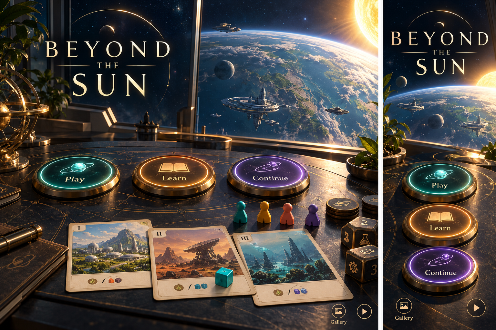](docs/ux/concepts/01-arrival.png)

**Visual review:** orbital vista, original illustrated components, and three tactile entry choices. The phone stacks the same choices in a distinct portrait composition.

The orbital setting holds three clear choices: **Play**, **Learn**, and **Continue** when a retained room exists. Play offers Create, Join by code, and Shared table. Learn explains the three phases, the cube cycle, and what discovery changes for everyone. A missing or incompatible retained room offers a useful recovery path.

There is no login form for anonymous play. Connection problems preserve the intended destination and offer Retry. The rules, sound/motion preferences, and gallery remain available without a game.

### 2. Gather and configure

[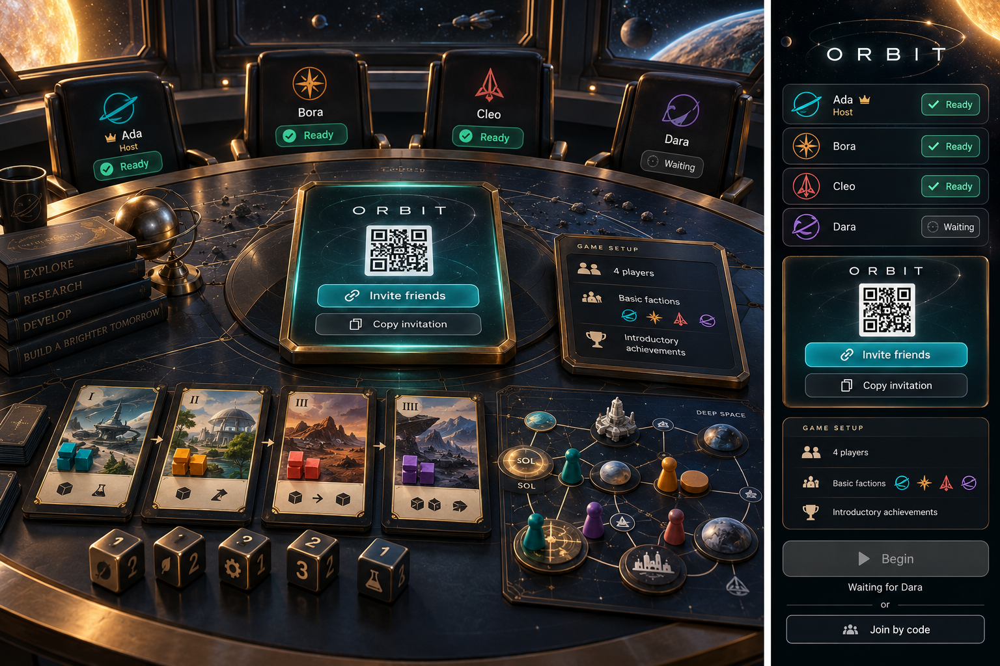](docs/ux/concepts/02-gather.png)

**Visual review:** named seats, a central invitation object, readable setup, readiness, and a disabled Begin control that explains who is missing. The pictured QR is illustrative; the implementation generates a real room link.

The host chooses a name, two to four seats, Basic or Advanced factions, and introductory or randomized achievements. The lobby exposes a five-letter code, copyable invitation, and QR link. Joining by code shows the found table before claiming a seat. Full, missing, and already-started rooms explain what can be done next.

Occupied seats show names and faction emblems. Only the owner can change setup; changing it clears readiness. Capacity cannot remove occupied seats. Each player sees the settings before becoming ready; Begin requires the configured seats and readiness. The first-player marker and turn order are public.

Basic faction selection enforces uniqueness and the two-player exclusion. Advanced factions are chosen in reverse turn order after the shared setup is visible. Do not reuse Pantheon's leader draft as an unexamined rules assumption. Once choices are complete, pieces settle into their exact starting places.

### 3. The active table

[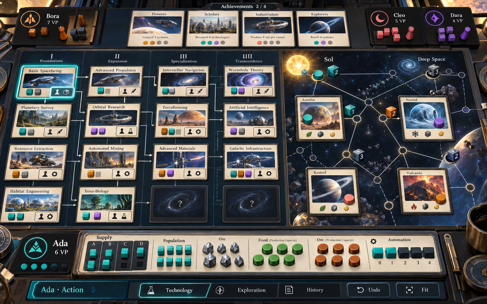](docs/ux/concepts/03-table-desktop.png)

**Desktop review:** the tree and exploration map share the main field. Research cubes and occupied action slots remain distinct; the near-edge mat explains the economy through physical supplies and tracks.

[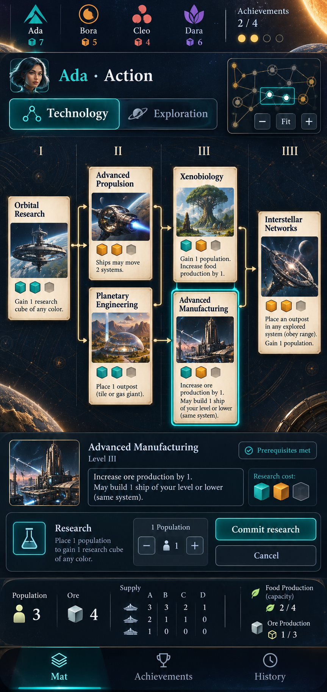](docs/ux/concepts/03-table-mobile.png)

**Mobile review:** one focused region, preserved board context, and a lower action rail. This full-resolution portrait study establishes hierarchy; final text scale and target spacing must be checked at the actual 393 × 852 viewport. Its generated card effects and adjustable Population selector are placeholders: ordinary research does not let the player vary its required cube count.

Always show the active faction, phase, available Population and Ore, and achievement count against the correct threshold. The active pawn and selected destination have distinct outlines. Inactive players can inspect public objects without gaining gameplay controls.

Tap an action slot to plan that action. Its rule text, total cost, and required targets appear next to the selected component or in the phone's decision rail. A disabled slot explains its specific blocker: **Occupied by Ada**, **Research this technology first**, **Need 1 more Population**, or **Move to another action space**. Blocked objects remain inspectable.

Selection and inspection never spend resources. A simple fully specified public action commits through its named action control. Multi-target and reveal actions stage their required choices before commitment. Avoid a generic confirmation dialog after every tap; reserve a clear final commitment for decisions involving several targets, irreversible information, or an explicit payment plan.

### 4. Research

[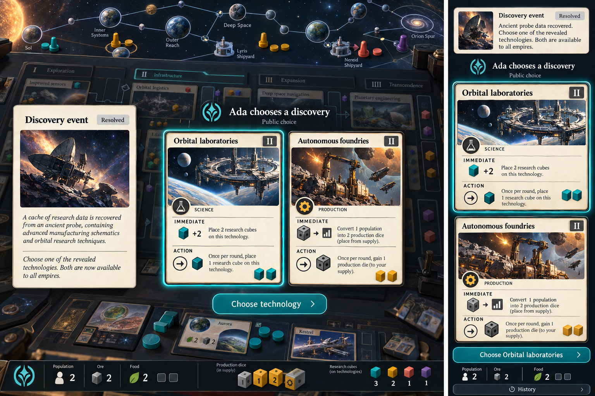](docs/ux/concepts/04-research.png)

**Visual review:** the event and candidate cards have complete faces, the active choice is unmistakable, and the board remains the spatial anchor. The phone shows the same public options rather than a private hand. The candidate effects in this study are invented layout text, illustrative layout content.

Selecting a research action illuminates eligible slots and their prerequisite paths. Distinguish a discovered-but-unresearched card from one this faction already researched. A locked slot names the missing prerequisites or level restriction. Research markers do not resemble occupied action slots.

The decision rail states the full payment and permanent cube placement. Commit research before revealing an event or candidates; cancel is available while planning, not after seeing new information. Revealed Level II/III events open as readable public cards, with named responders and any required choices.

When type selection is needed, show permissible category icons and labels before drawing. Display the two matching revealed candidates side by side on desktop and in a readable selectable sequence on phone. Opponents can inspect the same public candidates. Choosing a card places it in the shared tree; rejected cards return to the deck bottom. Immediate bonuses resolve visibly, then return to the interrupted effect or phase.

Inspecting a researched card separates its immediate bonus, available actions, persistent effect, and scoring. It must never imply that immediate bonuses repeat whenever its action is used.

### 5. Build, upgrade, and jump

[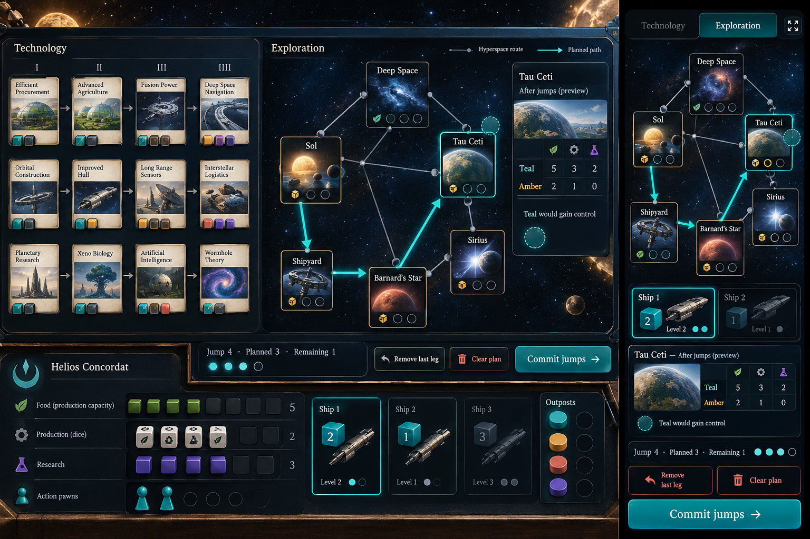](docs/ux/concepts/05-fleets.png)

**Visual review:** planned paths differ from fixed connections, the remaining allowance stays visible, and the player can clear or commit a plan. The final interface uses reviewed board geometry and actual ship-level cubes; the pictured map and fleet summary are composition studies.

Shipbuilding highlights Sol and controlled shipyards, the source cube, and the new level. Upgrading selects owned ships and shows the before/after power. Every cube remains individually selectable when stacked, with a list alternative to graphical selection.

Jump planning happens on the exploration map. Select a ship, then connected destinations; show its path, expenditure, total budget, and remaining jumps. Several ships can share the allowance. Provide Remove last leg, Clear plan, and a keyboard/list route editor. Dragging is optional.

The preview names the final control consequences across all affected locations, including lost production, potential disc-type decisions, and gain-control bonuses. Passing through a system does not preview a temporary outpost or bonus. **Commit jumps** applies the complete movement plan together. An upgrade-then-jump action resolves upgrade control changes before opening the jump plan.

### 6. Control and colonization

[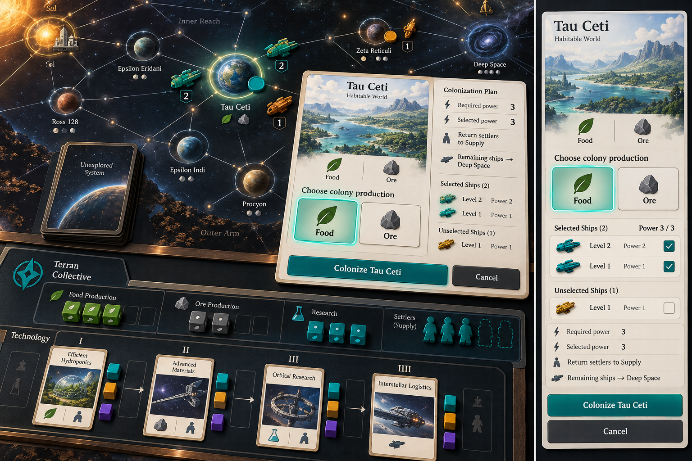](docs/ux/concepts/06-colonization.png)

**Visual review:** the world being colonized leads the composition, selected settlers and power are explicit, and consequences sit beside the committing action. Production selection shown in the plan is a preview; final resolution must still add the colony disc at the correct point after settlement and replacement reveal.

Each location shows ships by faction, summed power, and the outpost owner. An outpost without ships remains visible. A control explanation names the incumbent and why a tie preserves or changes ownership. Changes move the actual production disc between mat and system.

Colonize highlights eligible Systems. Select the settling ships, show required and selected power, and explain overpayment. Preview the remaining ships' Deep Space destination and the production benefit. **Colonize [system]** commits the settlement; the replacement card is revealed only after commitment.

Present colony acquisition, Supply returns, exile, replacement, additional production disc, and bonus in rules order. Multi-specialty disc choices use labelled Food/Ore controls with exact resulting production. Newly revealed card identity and resulting mandatory choices survive reload.

### 7. Production and trade

[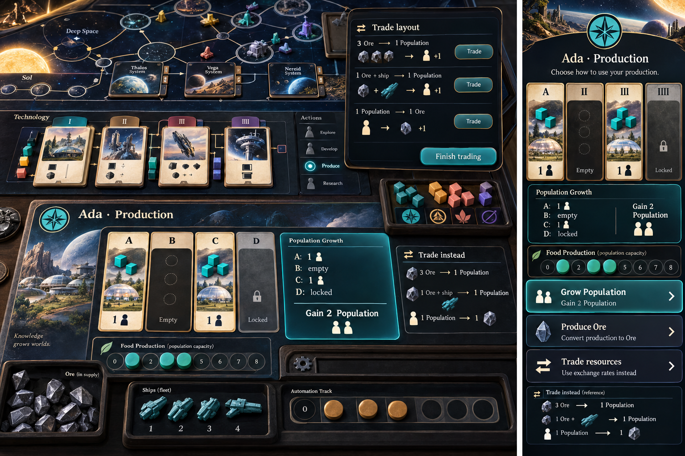](docs/ux/concepts/07-production.png)

**Visual review:** empty Supply columns explain lost yield, production has three distinct branches, and the mat remains the focal object. The desktop's lifted Trade layout is an alternate-state study, not permission to trade and produce in the same phase. Column labels and production-track geometry must come from the chosen faction mat.

Offer **Grow Population**, **Produce Ore**, and **Trade resources**, each with exact current yield or rates. Population shows column-by-column output and names empty columns; the Food track does not masquerade as a resource purse.

Growing or producing commits the full legal amount and proceeds when resolution finishes. Trade opens a compact exchange area beside the mat. Each exchange states its payment and result, identifies a decommissioned ship when relevant, and updates legal follow-up exchanges. **Finish trading** ends this branch; it does not add ordinary production. Selecting an exchange for inspection is distinct from committing it.

### 8. Achievements and handoff

[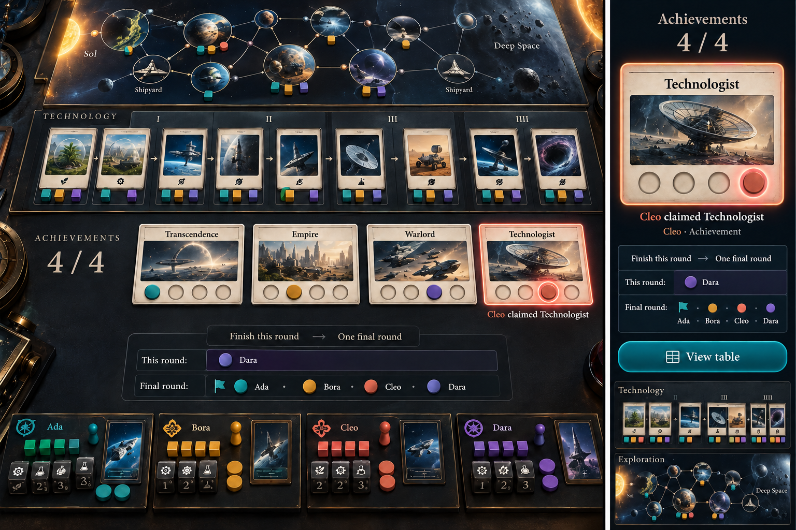](docs/ux/concepts/08-achievements-v2.png)

**Visual review:** a new claim is highlighted and the remaining turns are spelled out. This four-player study shows Cleo triggering the threshold, Dara finishing the current round, then all four taking one final turn. The enlarged phone card repeats the same claim, not an additional claim; exact slot counts and left-to-right placement still follow the actual achievement definitions.

Show eligible claims, exact qualifying facts, remaining slots, and reward values. If several qualify, let the player choose; if none qualify, resolve the empty phase automatically. If one qualifies, show its award clearly and apply the required claim without a misleading Skip option. Do not offer End turn while a mandatory claim is unresolved.

At handoff, name the next faction and show the completed turn's public changes without requiring a redundant summary acknowledgement. History remains available. When the threshold is reached, show **Finish this round, then one final round** with the actual remaining turn order, not an ambiguous “last turn” banner.

### 9. Inspect, history, and undo

[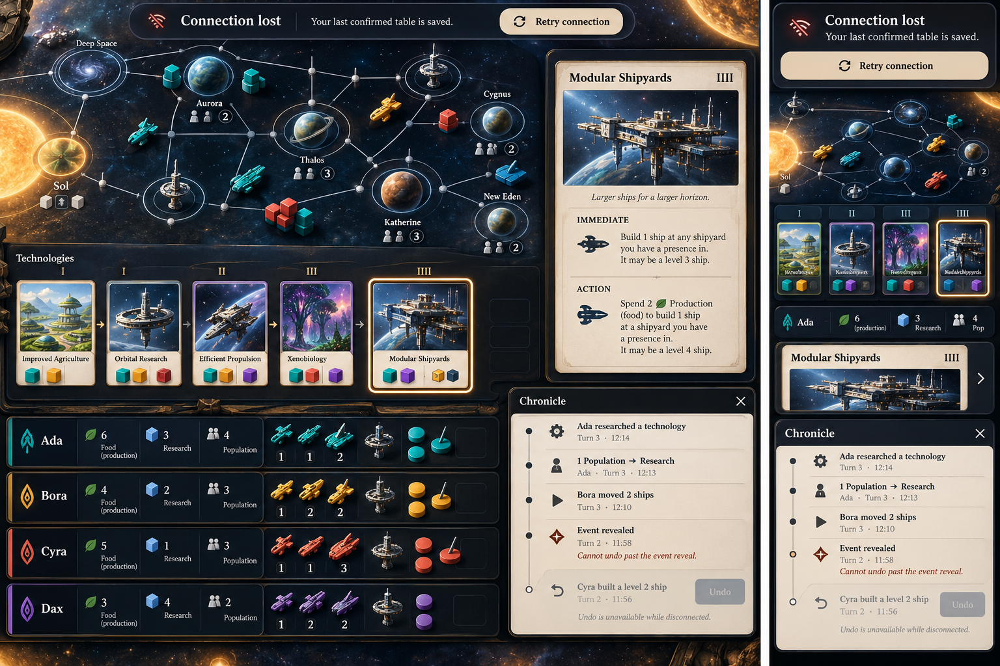](docs/ux/concepts/09-history-recovery.png)

**Visual review:** the table remains recognizable during an interruption, the Chronicle names movements and information boundaries, and Retry is reachable. Generated inspector text is not a rule source; any pictured effect that spends Food or treats research as a separate currency must be replaced, not implemented.

Any public card, faction mat, production track, system, or stack opens its complete readable representation. Back/Escape restores source focus, board location, and any uncommitted plan. Inspecting adds no game event. Future deck contents and unrevealed events never appear in an inspector, tooltip, DOM label, or accessibility description.

The history records actor, phase, component identity, payments, cube/disc movement, choices, and consequences in ordinary game language. Observers can keep an inspector or scrolled history open while another player acts; public events do not hijack their focus.

Undo policy: reverse the current actor's latest reversible suffix through a new history event. Do not cross a reveal, another player's response, or turn handoff. Show the boundary and its reason: **Cannot undo past the event reveal**. Local target/path drafts can always be cleared before commitment. Shared-table undo attributes both the controller and the faction. No global destructive history reset is part of ordinary play.

### 10. Finish and return

[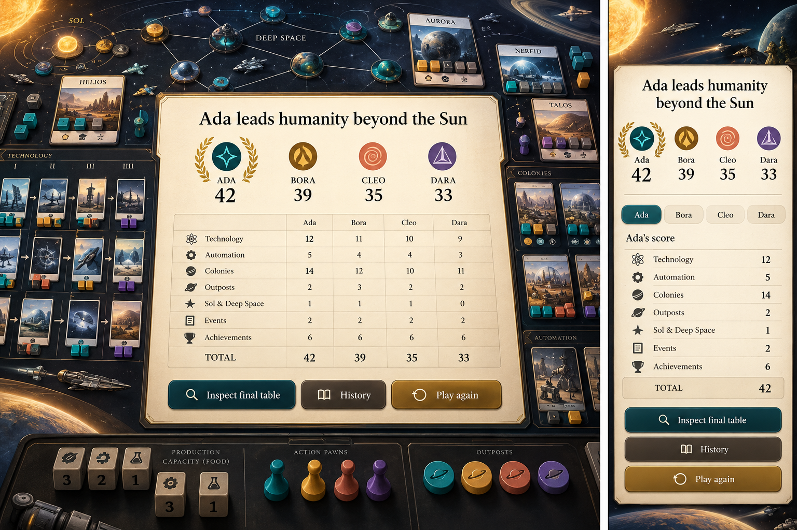](docs/ux/concepts/10-victory.png)

**Visual review:** all factions and totals remain visible, category arithmetic is readable, and the finished table remains inspectable. The example totals demonstrate ledger layout, not a replayed game. Shared-victory and tie-break variants reuse this scene with their own explicit comparisons.

Victory shows every faction, the winner or shared winners, all scoring categories, and tie-break comparisons. Technology scoring includes personal technologies; colonies and outposts remain separate. Players can inspect the final table and history. Play again opens a new lobby carrying names/settings while preserving the completed game's record; rematch does not erase it.

## Shared-table mode

[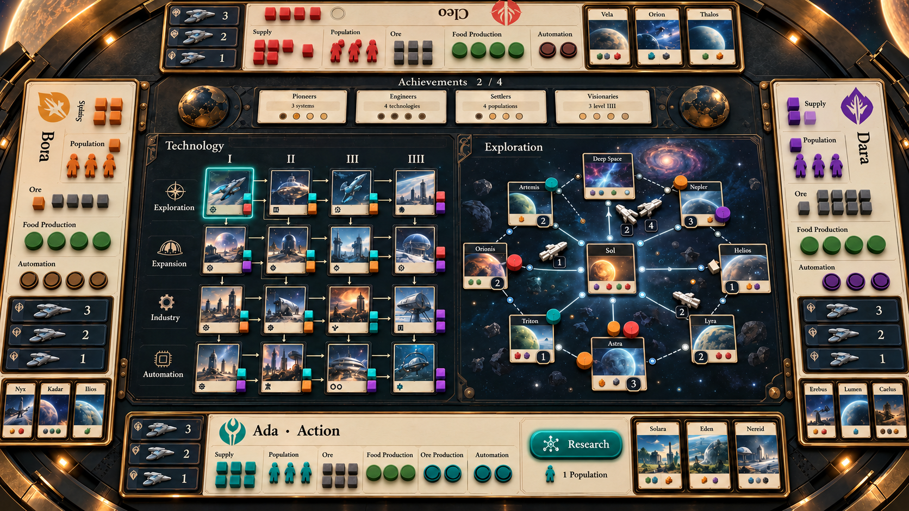](docs/ux/concepts/11-shared-table-v2.png)

**Visual review:** public boards stay central, faction mats belong to physical edges, and Ada's public Research action is on the display. This study establishes the four-seat composition. Seat names turn toward their players, but some generated mat labels remain upright to the viewer; the final renderer must rotate each complete mat and reader toward its seat, preserve safe margins, and use the real faction track layouts. Verify seat legibility against these requirements in the rendered interface.

Opening the `/tabletop/` entry creates or restores a table-owned room without claiming a player seat. Offer eight physical join positions, at corners and edge middles, with at most four occupied. QR links claim a position on the player's phone. Choose one occupied position as Player 1 and order the rest clockwise. Empty positions disappear from the playing surface after setup.

All public gameplay remains operable on the display: research, event choices, fleet planning, production, achievements, and undo. A visible acting-faction label and seat-oriented decision area prevent ambiguity. Base-game discovery candidates and personal technologies remain public. Phones support joining and inspection; public actions are not forced onto phones.

The table controller is an explicitly authorized room role. Its commands name the faction being operated; attribution does not pretend the player authored a command on their phone. Out-of-turn effects focus the responder's area and then return to the interrupted actor. Keep the global tree/map topology stable rather than rotating the whole board each turn. Seat readers and local decision controls can face their player.

The retained table URL restores the same room and pending choice. Controller reconnect and player reconnect must not claim a second seat or authorize another controller accidentally. Personal-screen and shared-table modes use the same rules and component renderers.

## Motion, accessibility, and recovery

Use short, finite motion to explain pawn movement, cube conversion, permanent research, outpost transfer, and colony acquisition. The accepted state is already determined before animation. Reconnect renders the latest state directly; reduced motion uses immediate placement and concise change highlights.

Every action works by keyboard, pointer, and touch. Use 44 px minimum targets; nonoverlapping hit areas; visible focus; icons plus text; and meaningful turn, payment, and pending-choice announcements. Never require long press, hover, drag, color recognition, or animation to understand play. Reading content can scroll inside bounded trays without hiding its close control.

While disconnected, retain the last confirmed table, identify the connection state, and prevent unacknowledged gameplay from looking accepted. Lost acknowledgement offers safe reconciliation by command identity. Stale plans revalidate against the current board and explain changed availability. Version mismatch offers readable diagnostics and a return path; it does not silently reset a game.

## Asset and visual review

Create original studies for the arrival scene, technology frame, event, System card, faction mat, cubes/ships, discs, achievements, and board connections. Render costs, titles, rules, and changing values as semantic UI rather than baking them into illustrations. Preserve a stable ID and provenance for every asset.

The `/gallery/` uses the exact production components with representative props, including occupied slots, multiple researchers, depleted columns, crowded fleets, long effects, Advanced innovations, and final scoring. It provides full-size inspection and stable review references. A composed card is reviewed as a composed card, not replaced with a raw artwork image.

The embedded plates cover arrival, lobby, desktop and portrait-phone tables, research/event choice, fleet planning, colonization, production/trade, achievements, history/recovery, victory, and the shared-table layout. Use them as the visual reference for implementation. Generated concept text is illustrative; verified rules and semantic lettering remain authoritative. Each implementation slice records fidelity evidence against the reviewed direction and resolves the annotated departures above. Do not use a flattened concept painting as a production interface or screenshot baseline.
