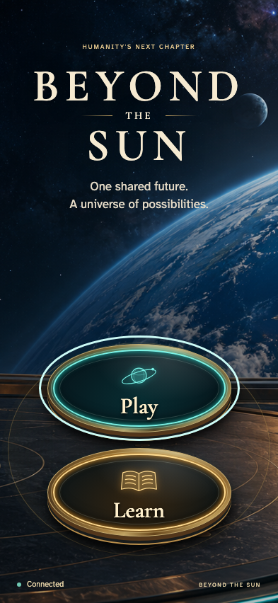
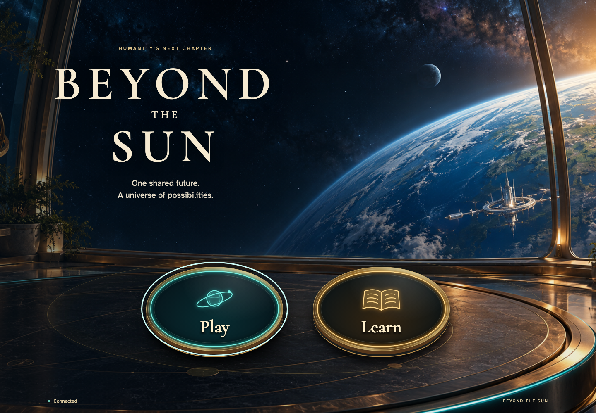
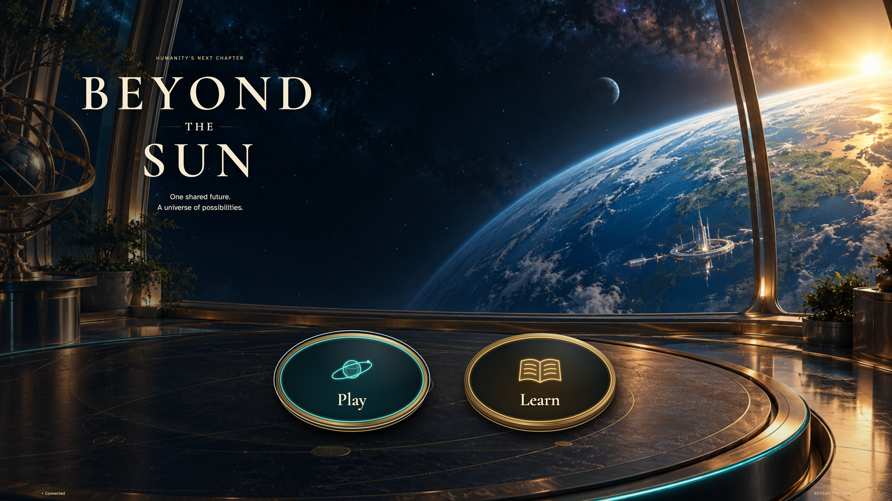
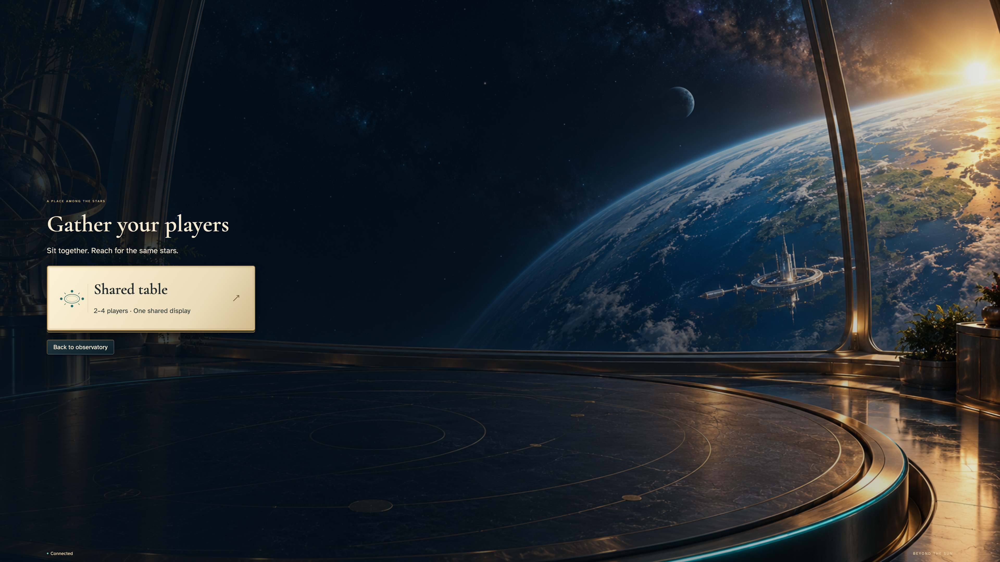

# Enter the observatory and learn the turn

Arrival on a personal or shared display; real anonymous Auth emulator, no injected state or gameplay randomness.

## 1. Enter the orbital observatory

Viewpoint: **Shared display**.

| phone · 393 × 852 | desktop · 1440 × 1000 |
| --- | --- |
|  |  |

tabletop-4k · 3840 × 2160

- [x] Play and Learn are ready; no game is retained for this new visitor.

## 2. Read the three phases of a turn

Viewpoint: **Shared display**.

| phone · 393 × 852 | desktop · 1440 × 1000 |
| --- | --- |
|  |  |

tabletop-4k · 3840 × 2160

- [x] Action, Production, and Achievement are explained on the screen.

## 3. Return to the observatory

Viewpoint: **Shared display**.

| phone · 393 × 852 | desktop · 1440 × 1000 |
| --- | --- |
|  |  |

tabletop-4k · 3840 × 2160

- [x] The guide closes and Play is ready.

## 4. Reach Play with the keyboard

Viewpoint: **Shared display**.

| phone · 393 × 852 | desktop · 1440 × 1000 |
| --- | --- |
|  |  |

tabletop-4k · 3840 × 2160

- [x] Play receives visible keyboard focus on its illuminated disc.

## 5. Choose how to gather your players

Viewpoint: **Shared display**.

| phone · 393 × 852 | desktop · 1440 × 1000 |
| --- | --- |
|  |  |

tabletop-4k · 3840 × 2160

- [x] The shared-table component is readable and available without leaving the observatory.

## 6. Return from Play to the entry objects

Viewpoint: **Shared display**.

| phone · 393 × 852 | desktop · 1440 × 1000 |
| --- | --- |
|  |  |

tabletop-4k · 3840 × 2160

- [x] Play and Learn return, with no Continue for this new visitor.
