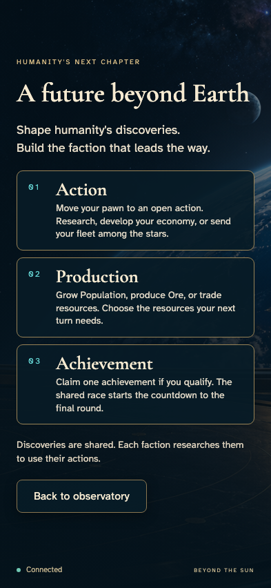
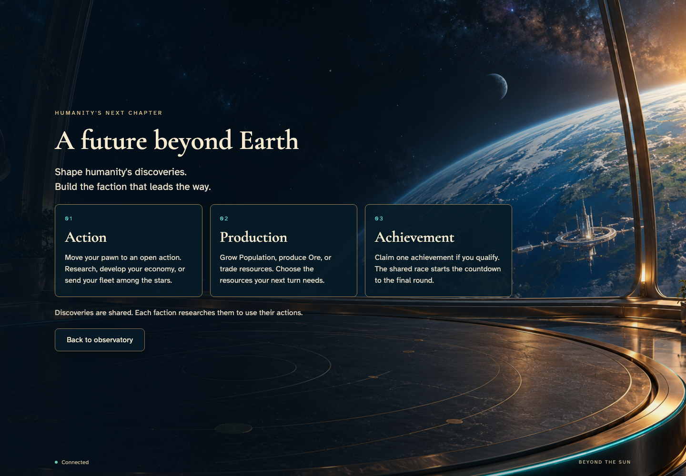
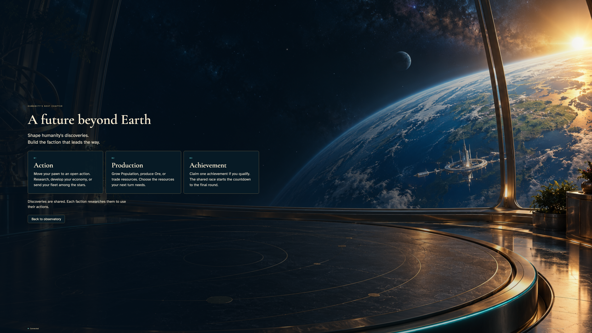

# Enter the observatory and learn the turn

Arrival on a personal or shared display; real anonymous Auth emulator, no injected state or gameplay randomness.

## 1. Enter the orbital observatory

Viewpoint: **Shared display**.

| phone | desktop |
| --- | --- |
|  |  |

Shared display at 4K

- [x] Play and Learn are ready; no game is retained for this new visitor.

## 2. Read the three phases of a turn

Viewpoint: **Shared display**.

| phone | desktop |
| --- | --- |
|  |  |

Shared display at 4K

- [x] Action, Production, and Achievement are explained on the screen.

## 3. Return to the observatory

Viewpoint: **Shared display**.

| phone | desktop |
| --- | --- |
|  |  |

Shared display at 4K

- [x] The guide closes and Play is ready.
