# Join physical seats and arrange the shared table

One shared-display controller, four local players. Real Auth and Firestore emulators, ordinary UI joins, no injected room or event history.

## 1. Arrive at the observatory

Viewpoint: **Shared display**.

| desktop |
| --- |
|  |

Shared display at 4K

- [x] Play is connected and ready.

## 2. Choose one shared display

Viewpoint: **Shared display**.

| desktop |
| --- |
| [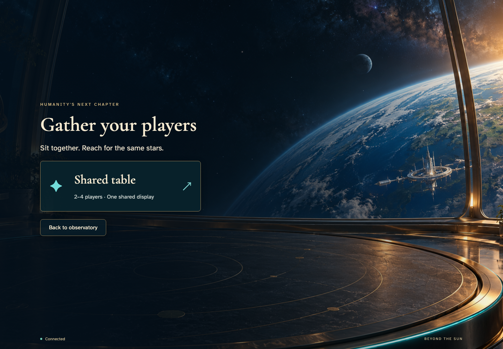](../../screenshots/join-physical-seats-and-arrange-the-shared-table/001-mode-desktop-darwin.png) |

Shared display at 4K

- [x] The shared table supports two to four local players.

## 3. Join directly where you sit

Viewpoint: **Shared display**.

| desktop |
| --- |
|  |

Shared display at 4K

[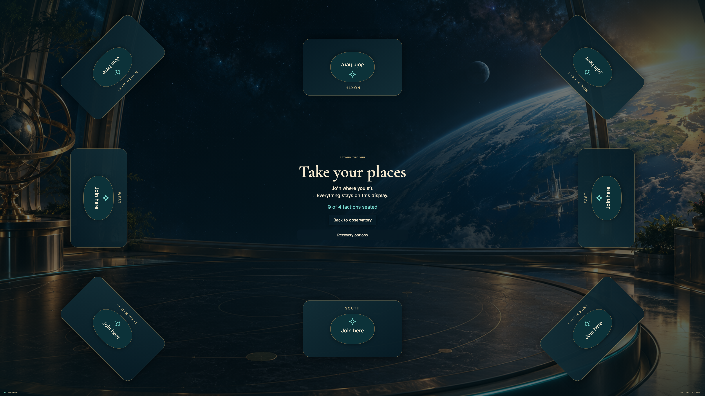](../../screenshots/join-physical-seats-and-arrange-the-shared-table/002-empty-table-tabletop-4k-darwin.png)

- [x] Eight physical Join here controls surround the table, without invitation or save wizard.

## 4. Ada opens the South seat

Viewpoint: **Shared display**.

| desktop |
| --- |
|  |

Shared display at 4K

[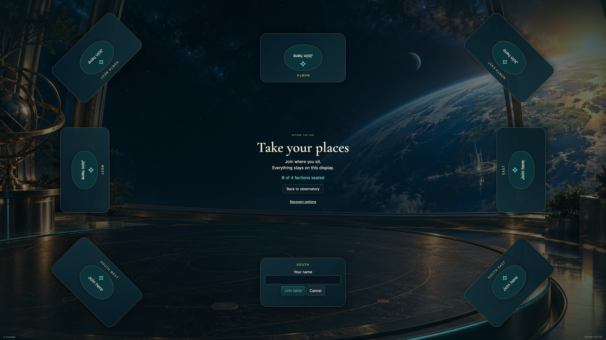](../../screenshots/join-physical-seats-and-arrange-the-shared-table/003-south-editor-tabletop-4k-darwin.png)

- [x] The name editor is at the chosen physical seat; joining needs a name.

## 5. Ada enters a local name

Viewpoint: **Shared display**.

| desktop |
| --- |
|  |

Shared display at 4K

- [x] The name appears inline and Join table becomes available.

## 6. Ada joins the physical seat

Viewpoint: **Shared display**.

| desktop |
| --- |
|  |

Shared display at 4K

- [x] The committed name replaces that position’s Join here control.

## 7. Bora opens the North seat

Viewpoint: **Shared display**.

| desktop |
| --- |
|  |

Shared display at 4K

- [x] The name editor is at the chosen physical seat; joining needs a name.

## 8. Bora enters a local name

Viewpoint: **Shared display**.

| desktop |
| --- |
| [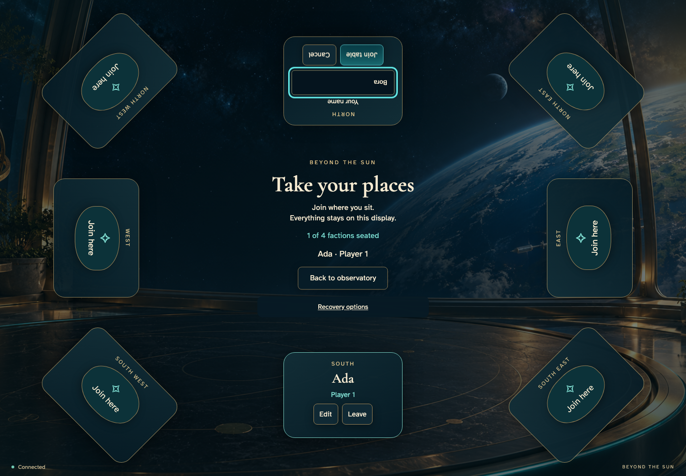](../../screenshots/join-physical-seats-and-arrange-the-shared-table/007-north-name-desktop-darwin.png) |

Shared display at 4K

[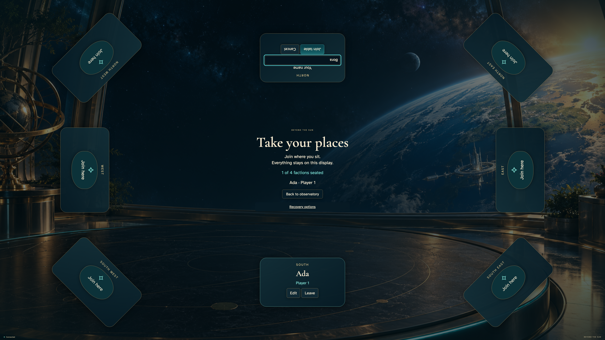](../../screenshots/join-physical-seats-and-arrange-the-shared-table/007-north-name-tabletop-4k-darwin.png)

- [x] The name appears inline and Join table becomes available.

## 9. Bora joins the physical seat

Viewpoint: **Shared display**.

| desktop |
| --- |
| [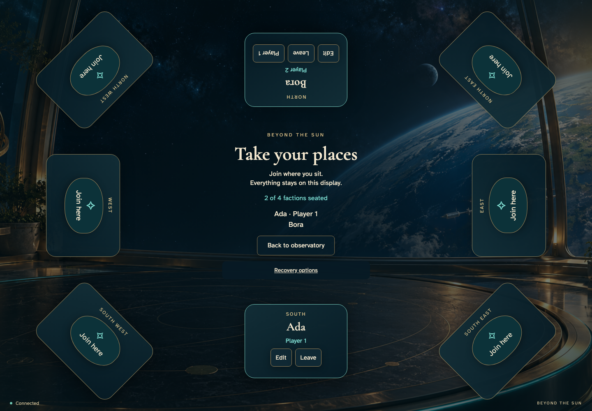](../../screenshots/join-physical-seats-and-arrange-the-shared-table/008-north-joined-desktop-darwin.png) |

Shared display at 4K

- [x] The committed name replaces that position’s Join here control.

## 10. Cleo opens the East seat

Viewpoint: **Shared display**.

| desktop |
| --- |
| [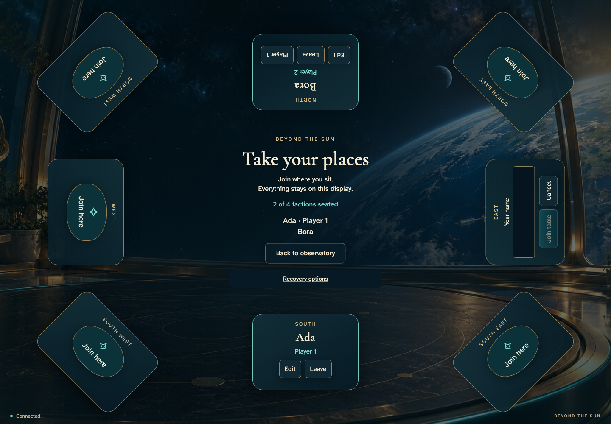](../../screenshots/join-physical-seats-and-arrange-the-shared-table/009-east-editor-desktop-darwin.png) |

Shared display at 4K

- [x] The name editor is at the chosen physical seat; joining needs a name.

## 11. Cleo enters a local name

Viewpoint: **Shared display**.

| desktop |
| --- |
| [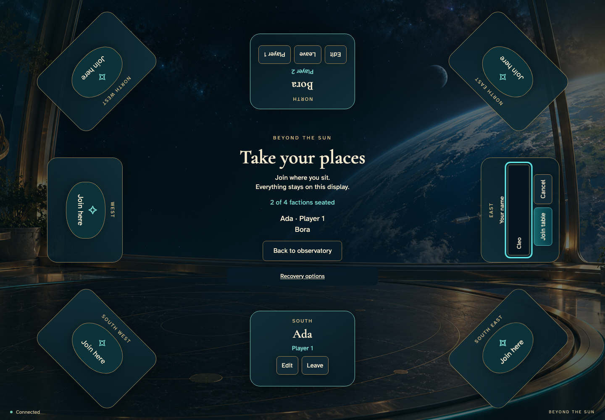](../../screenshots/join-physical-seats-and-arrange-the-shared-table/010-east-name-desktop-darwin.png) |

Shared display at 4K

[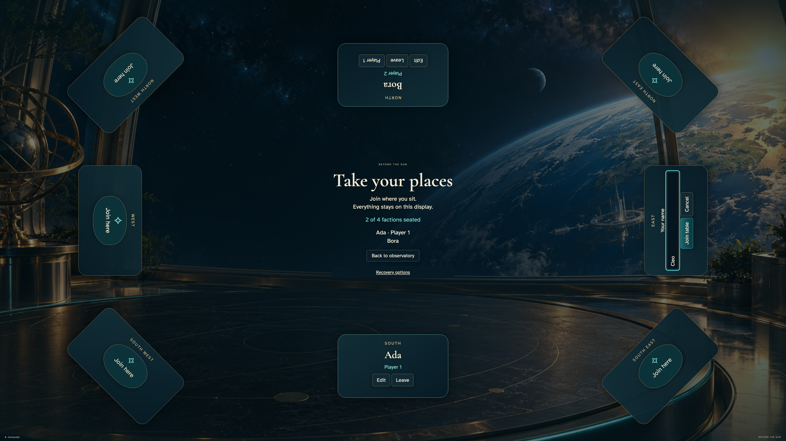](../../screenshots/join-physical-seats-and-arrange-the-shared-table/010-east-name-tabletop-4k-darwin.png)

- [x] The name appears inline and Join table becomes available.

## 12. Cleo joins the physical seat

Viewpoint: **Shared display**.

| desktop |
| --- |
| [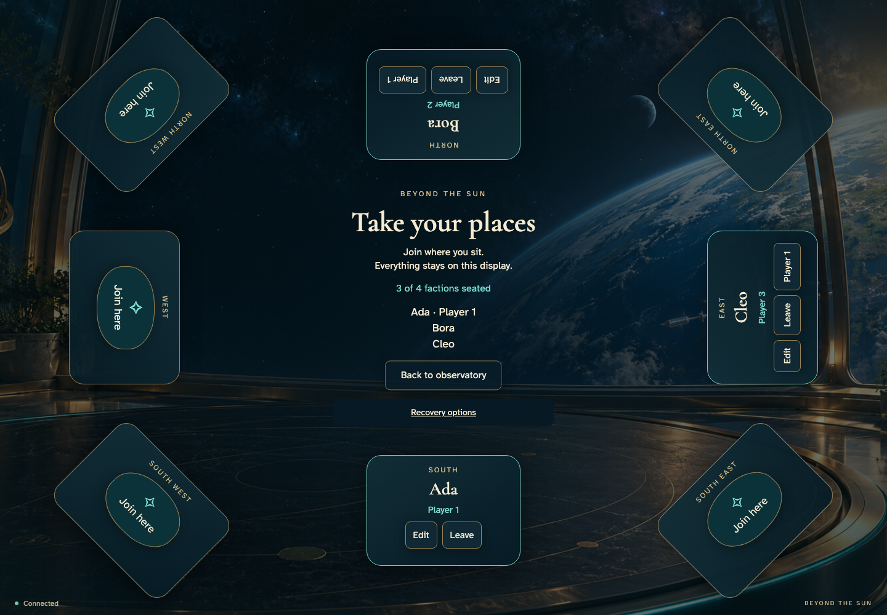](../../screenshots/join-physical-seats-and-arrange-the-shared-table/011-east-joined-desktop-darwin.png) |

Shared display at 4K

- [x] The committed name replaces that position’s Join here control.

## 13. Dara opens the West seat

Viewpoint: **Shared display**.

| desktop |
| --- |
| [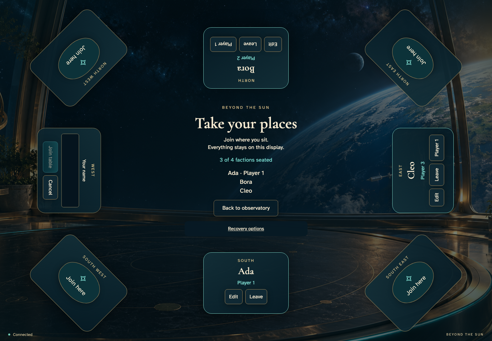](../../screenshots/join-physical-seats-and-arrange-the-shared-table/012-west-editor-desktop-darwin.png) |

Shared display at 4K

[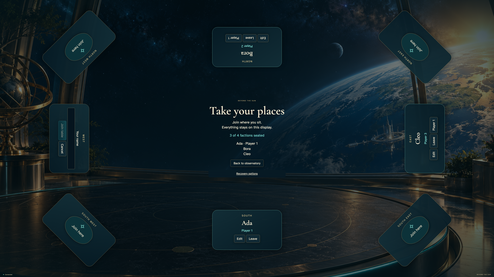](../../screenshots/join-physical-seats-and-arrange-the-shared-table/012-west-editor-tabletop-4k-darwin.png)

- [x] The name editor is at the chosen physical seat; joining needs a name.

## 14. Dara enters a local name

Viewpoint: **Shared display**.

| desktop |
| --- |
| [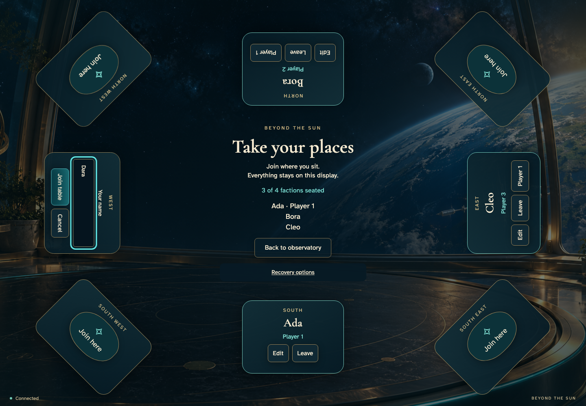](../../screenshots/join-physical-seats-and-arrange-the-shared-table/013-west-name-desktop-darwin.png) |

Shared display at 4K

- [x] The name appears inline and Join table becomes available.

## 15. Dara joins the physical seat

Viewpoint: **Shared display**.

| desktop |
| --- |
| [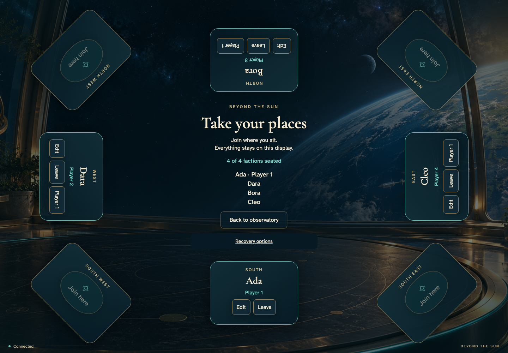](../../screenshots/join-physical-seats-and-arrange-the-shared-table/014-west-joined-desktop-darwin.png) |

Shared display at 4K

[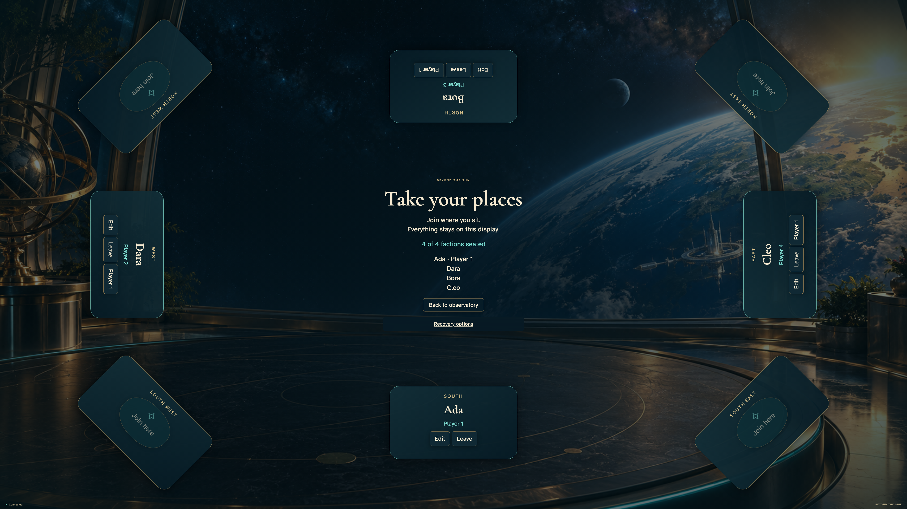](../../screenshots/join-physical-seats-and-arrange-the-shared-table/014-west-joined-tabletop-4k-darwin.png)

- [x] The committed name replaces that position’s Join here control.

## 16. Four players fill the table

Viewpoint: **Shared display**.

| desktop |
| --- |
| [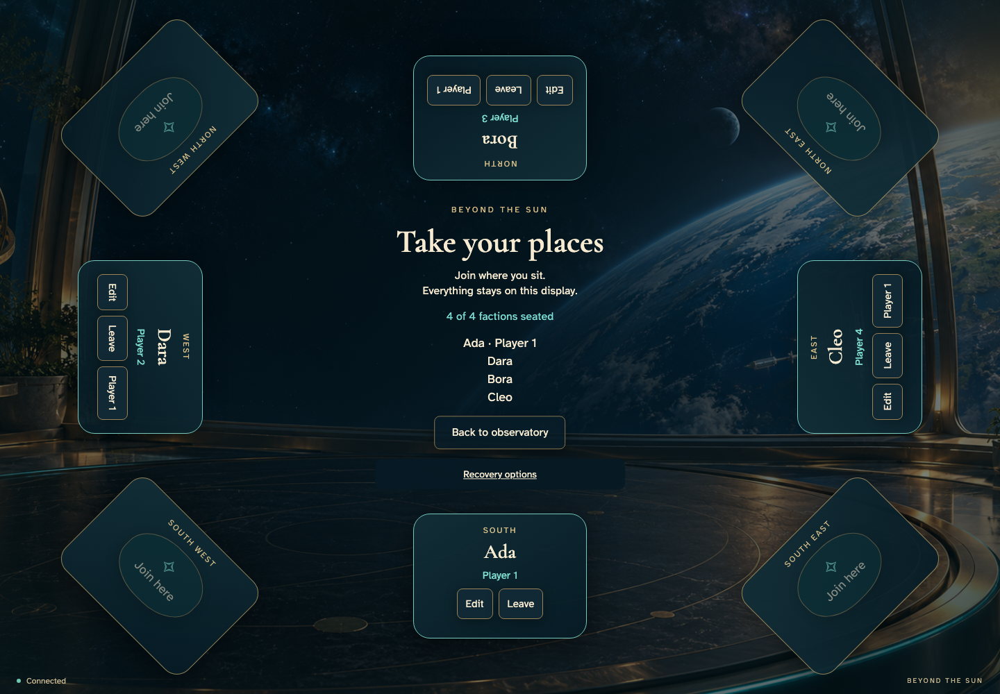](../../screenshots/join-physical-seats-and-arrange-the-shared-table/015-capacity-desktop-darwin.png) |

Shared display at 4K

[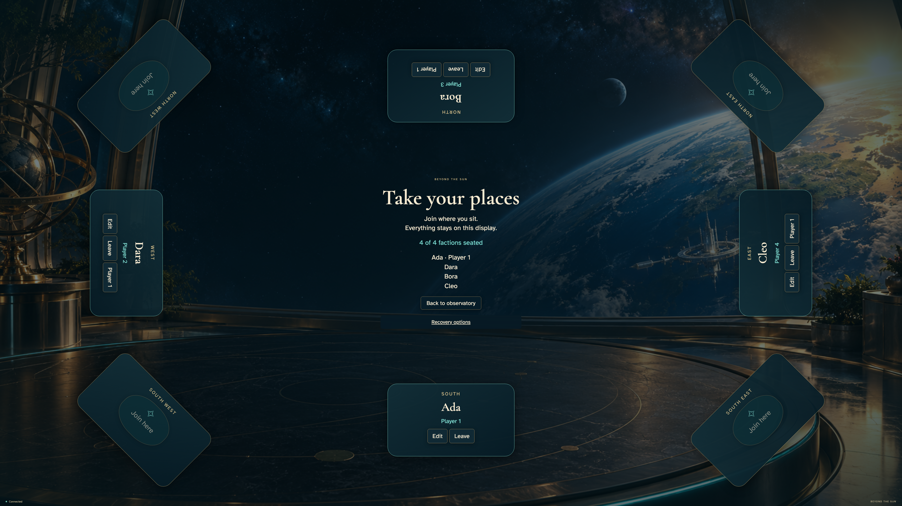](../../screenshots/join-physical-seats-and-arrange-the-shared-table/015-capacity-tabletop-4k-darwin.png)

- [x] Every remaining empty position rejects a fifth local player.

## 17. Choose Bora as Player 1

Viewpoint: **Shared display**.

| desktop |
| --- |
| [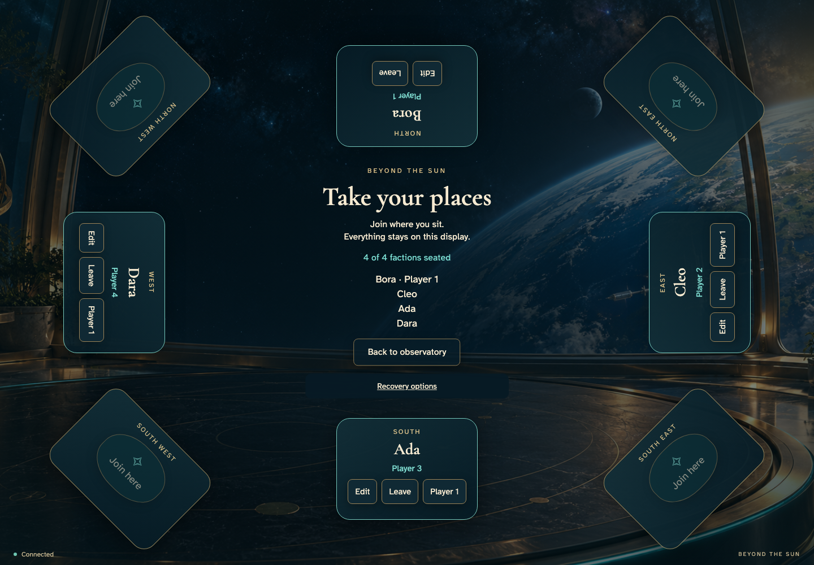](../../screenshots/join-physical-seats-and-arrange-the-shared-table/016-first-player-desktop-darwin.png) |

Shared display at 4K

- [x] The turn order begins at North then proceeds clockwise.

## 18. Ada edits the occupied South seat

Viewpoint: **Shared display**.

| desktop |
| --- |
| [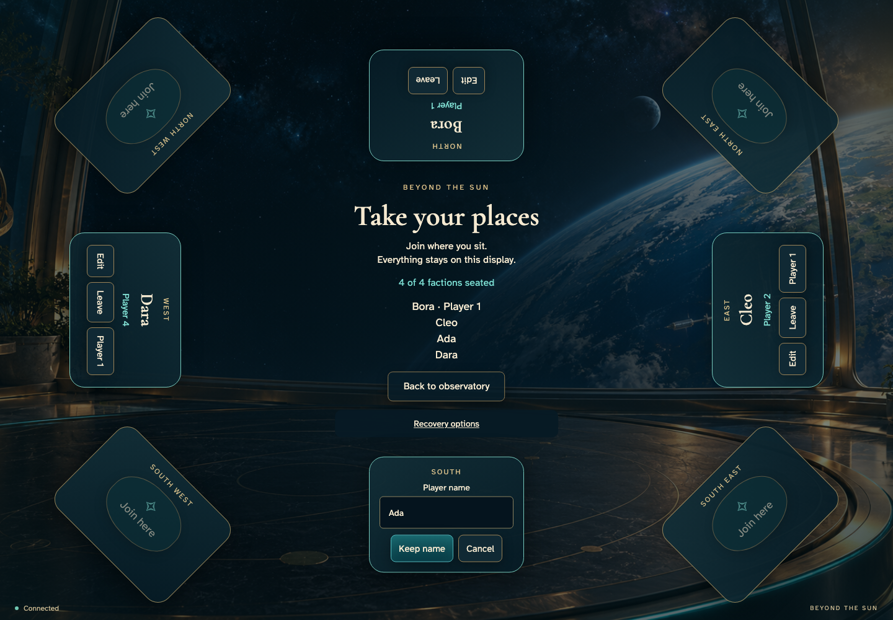](../../screenshots/join-physical-seats-and-arrange-the-shared-table/017-edit-desktop-darwin.png) |

Shared display at 4K

- [x] The editor retains the current name at that seat.

## 19. Enter the updated player name

Viewpoint: **Shared display**.

| desktop |
| --- |
| [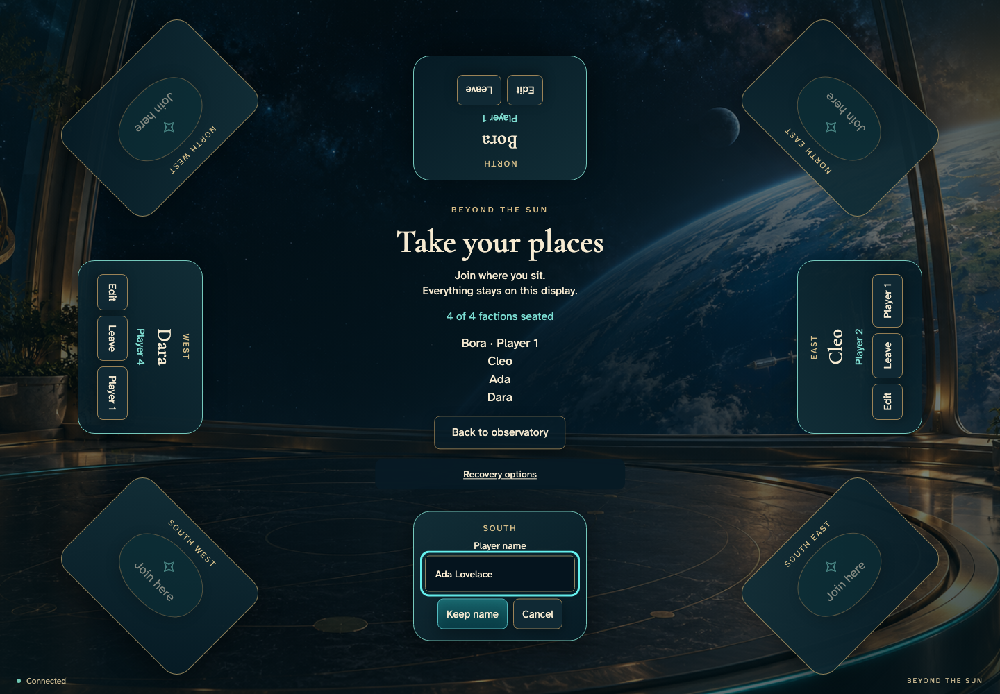](../../screenshots/join-physical-seats-and-arrange-the-shared-table/018-renamed-entry-desktop-darwin.png) |

Shared display at 4K

[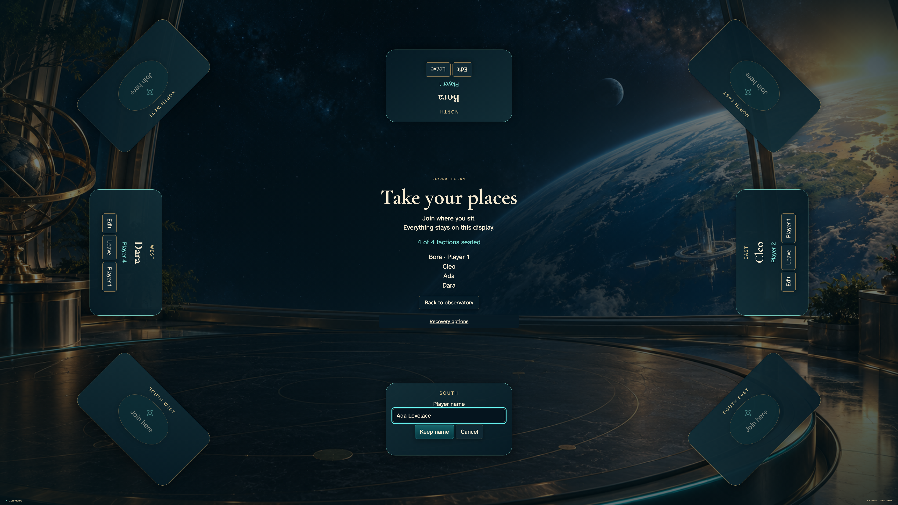](../../screenshots/join-physical-seats-and-arrange-the-shared-table/018-renamed-entry-tabletop-4k-darwin.png)

- [x] The edited name is visible before committing.

## 20. Keep Ada’s new name

Viewpoint: **Shared display**.

| desktop |
| --- |
|  |

Shared display at 4K

[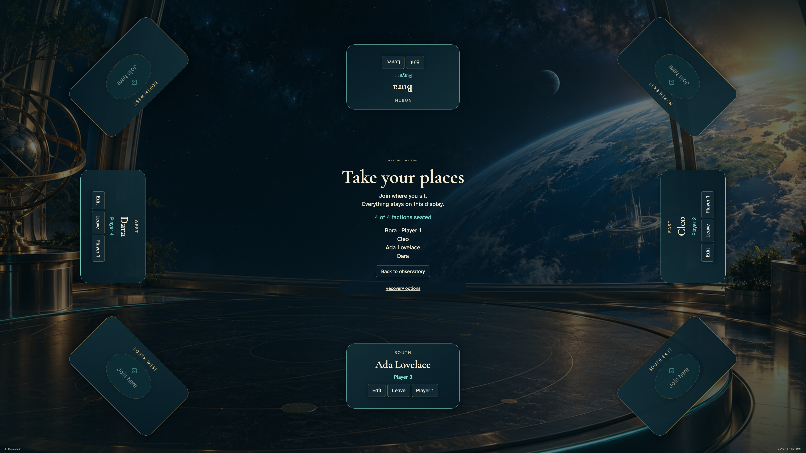](../../screenshots/join-physical-seats-and-arrange-the-shared-table/019-renamed-tabletop-4k-darwin.png)

- [x] The same occupied seat and order show the committed name.

## 21. Dara leaves before setup begins

Viewpoint: **Shared display**.

| desktop |
| --- |
|  |

Shared display at 4K

[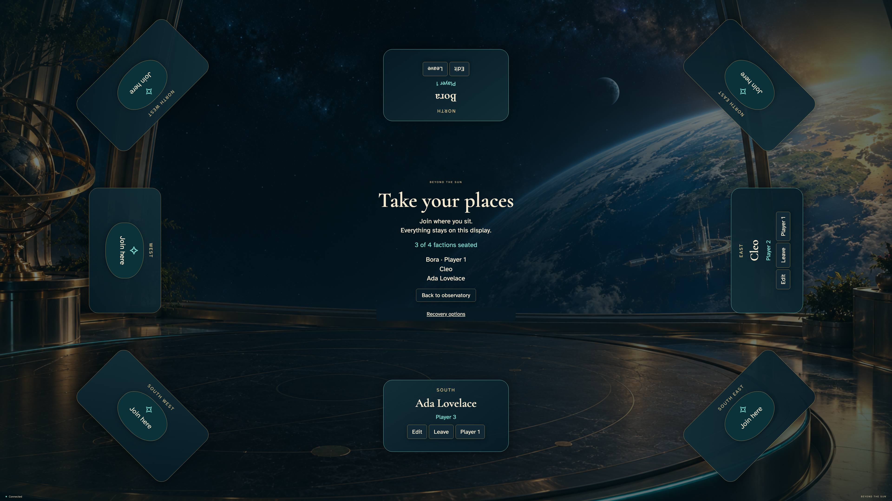](../../screenshots/join-physical-seats-and-arrange-the-shared-table/020-leave-tabletop-4k-darwin.png)

- [x] The West position becomes joinable and three seats remain.

## 22. Recover the same physical table

Viewpoint: **Shared display**.

| desktop |
| --- |
|  |

Shared display at 4K

- [x] Server replay preserves names, positions, first player, removal, and table URL.

## 23. Find the table from the observatory

Viewpoint: **Shared display**.

| desktop |
| --- |
| [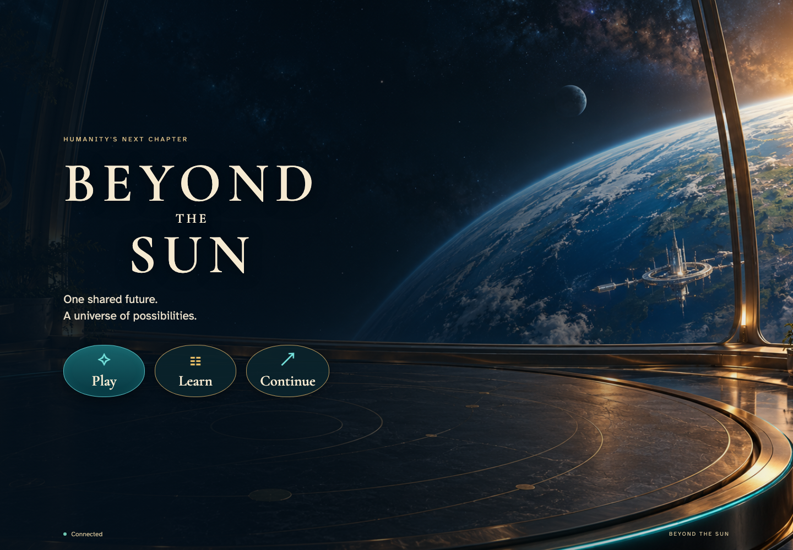](../../screenshots/join-physical-seats-and-arrange-the-shared-table/022-continue-desktop-darwin.png) |

Shared display at 4K

[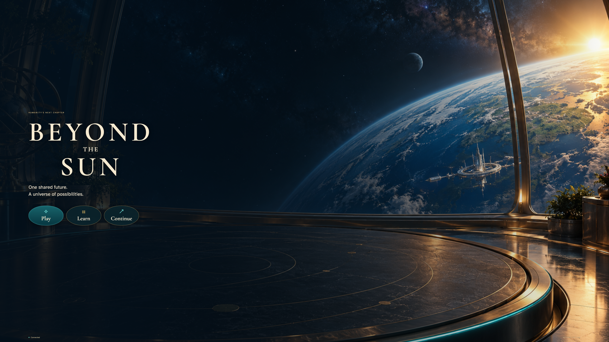](../../screenshots/join-physical-seats-and-arrange-the-shared-table/022-continue-tabletop-4k-darwin.png)

- [x] Continue is ready for the retained game.

## 24. Continue at the same seats

Viewpoint: **Shared display**.

| desktop |
| --- |
| [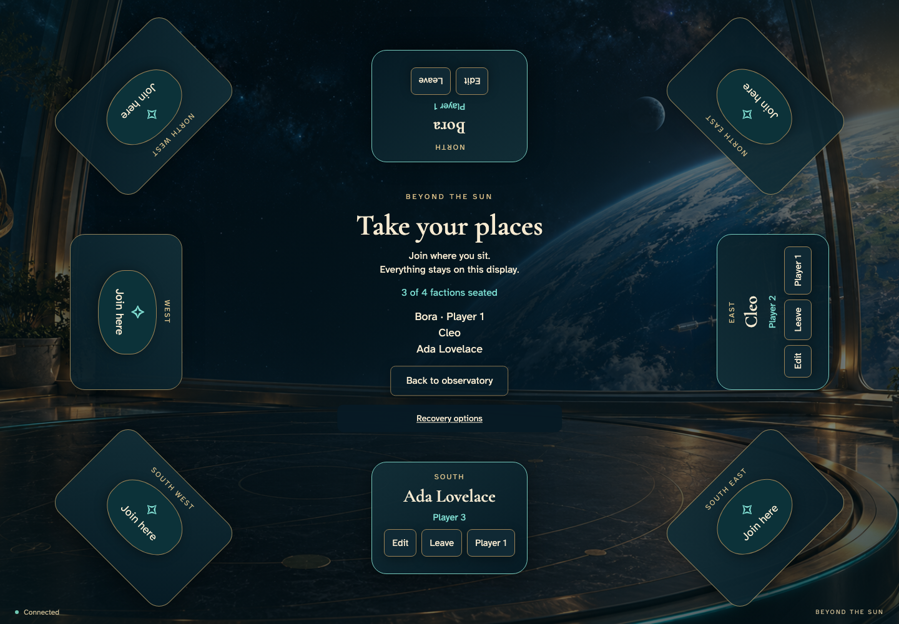](../../screenshots/join-physical-seats-and-arrange-the-shared-table/023-continued-desktop-darwin.png) |

Shared display at 4K

- [x] Continue reopens the same table URL and Player 1.
