# Recover one game between PR and production clients

Two real static client builds served at PR and production paths on one origin, one browser controller, one canonical emulator game. No copied or injected data.

## 1. Arrive through the PR client

Viewpoint: **Shared display**.

| desktop · 1440 × 1000 |
| --- |
|  |

tabletop-4k · 3840 × 2160

- [x] Play connects through real anonymous Auth.

## 2. Choose the shared table

Viewpoint: **Shared display**.

| desktop · 1440 × 1000 |
| --- |
|  |

tabletop-4k · 3840 × 2160

- [x] The actual shared-table entry is available.

## 3. Create the table through the PR client

Viewpoint: **Shared display**.

| desktop · 1440 × 1000 |
| --- |
| [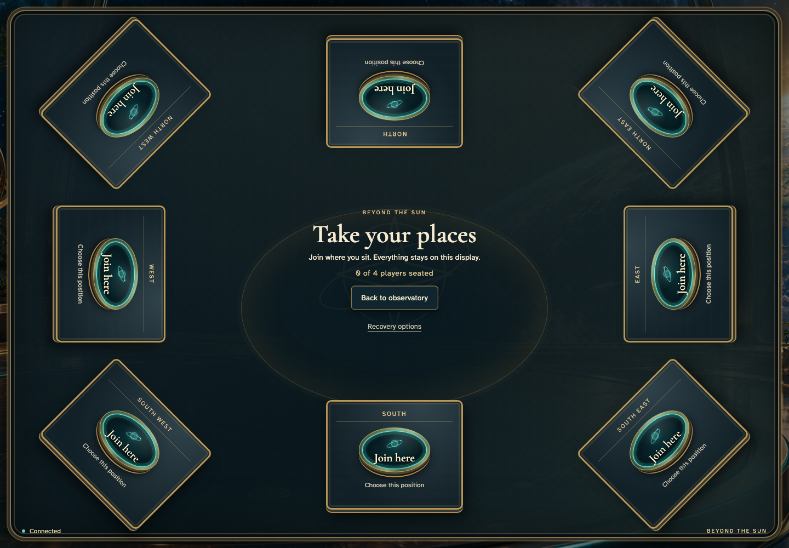](../../screenshots/recover-one-game-between-pr-and-production-clients/002-table-desktop-darwin.png) |

tabletop-4k · 3840 × 2160

- [x] All eight physical seats are empty.

## 4. Open the South position

Viewpoint: **Shared display**.

| desktop · 1440 × 1000 |
| --- |
|  |

tabletop-4k · 3840 × 2160

- [x] The name entry belongs to the South seat.

## 5. Ada enters a name at the table

Viewpoint: **Shared display**.

| desktop · 1440 × 1000 |
| --- |
|  |

tabletop-4k · 3840 × 2160

- [x] Ada can join directly at South.

## 6. Persist Ada’s seat in the shared game

Viewpoint: **Shared display**.

| desktop · 1440 × 1000 |
| --- |
|  |

tabletop-4k · 3840 × 2160

- [x] Ada occupies South after the server commits the join.

## 7. Choose another client for recovery

Viewpoint: **Shared display**.

| desktop · 1440 × 1000 |
| --- |
| [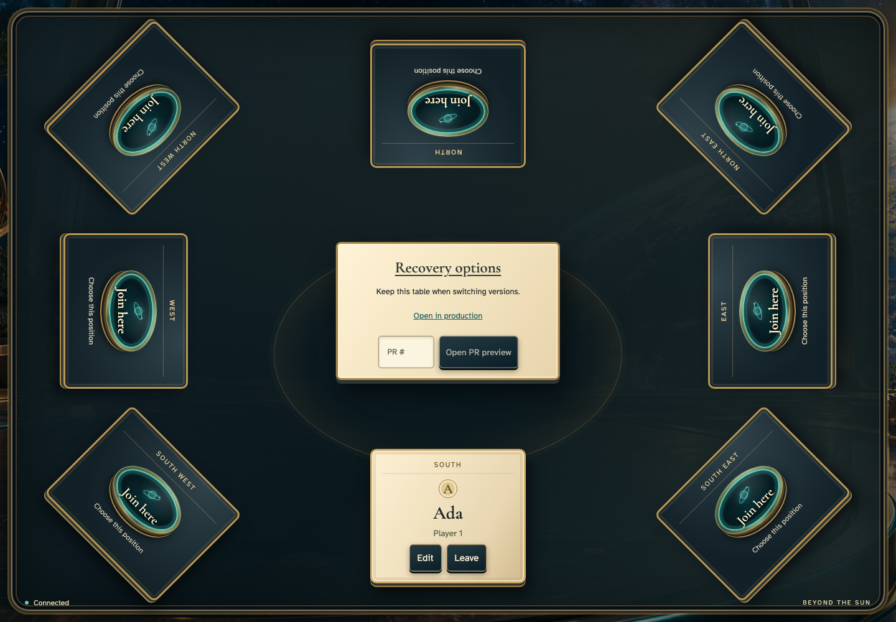](../../screenshots/recover-one-game-between-pr-and-production-clients/006-options-desktop-darwin.png) |

tabletop-4k · 3840 × 2160

[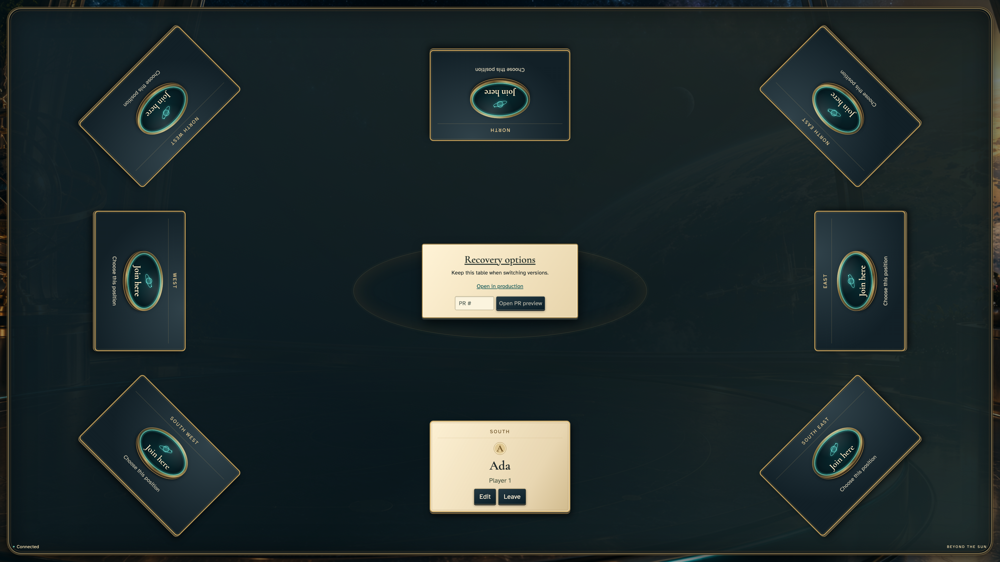](../../screenshots/recover-one-game-between-pr-and-production-clients/006-options-tabletop-4k-darwin.png)

- [x] The production link preserves this game ID.

## 8. Recover the same game through production

Viewpoint: **Shared display**.

| desktop · 1440 × 1000 |
| --- |
|  |

tabletop-4k · 3840 × 2160

- [x] The production build replays Ada’s PR-created seat at the same game ID.

## 9. Edit the same seat through production

Viewpoint: **Shared display**.

| desktop · 1440 × 1000 |
| --- |
| [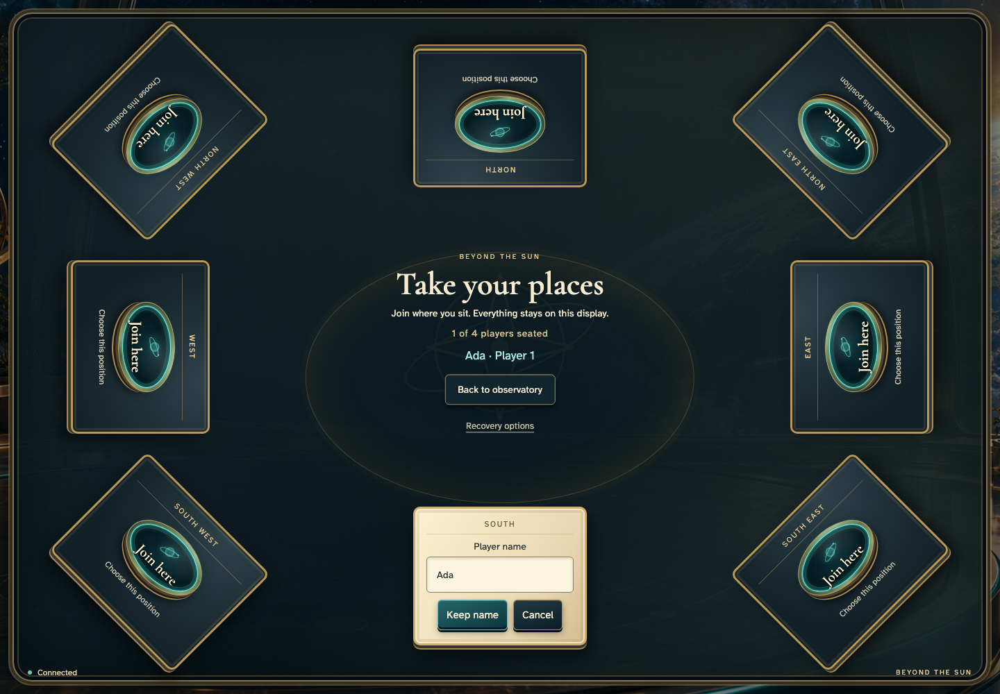](../../screenshots/recover-one-game-between-pr-and-production-clients/008-edit-desktop-darwin.png) |

tabletop-4k · 3840 × 2160

[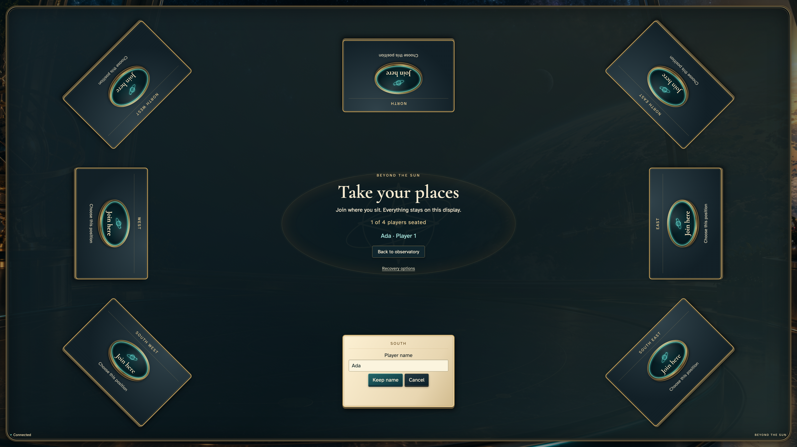](../../screenshots/recover-one-game-between-pr-and-production-clients/008-edit-tabletop-4k-darwin.png)

- [x] The occupied South editor retains Ada.

## 10. Enter a change through production

Viewpoint: **Shared display**.

| desktop · 1440 × 1000 |
| --- |
| [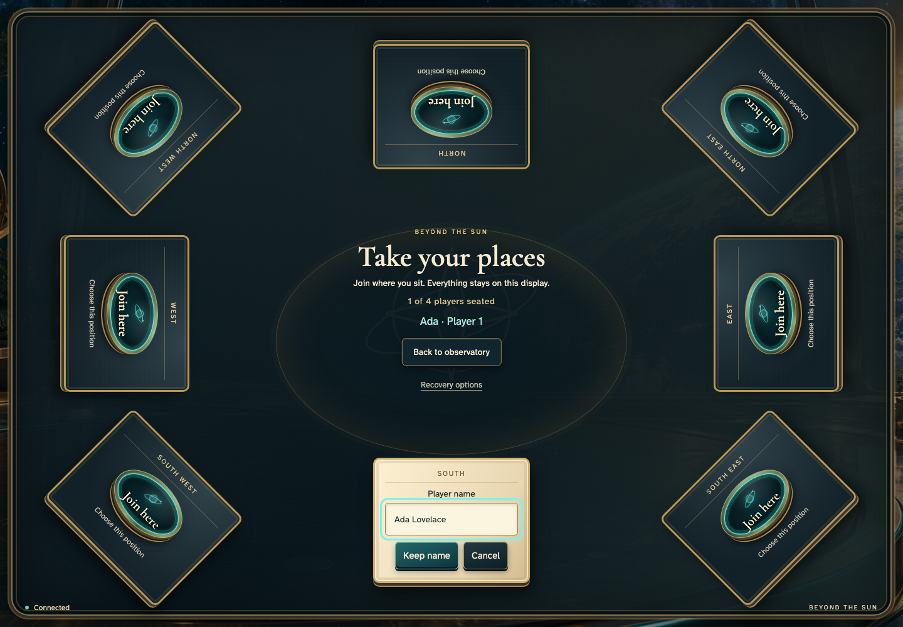](../../screenshots/recover-one-game-between-pr-and-production-clients/009-updated-name-desktop-darwin.png) |

tabletop-4k · 3840 × 2160

[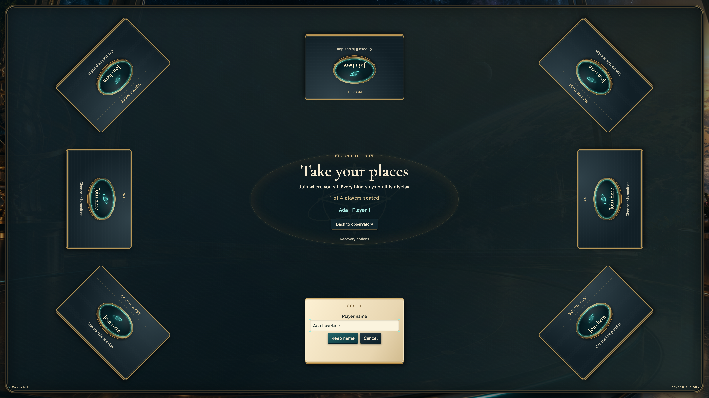](../../screenshots/recover-one-game-between-pr-and-production-clients/009-updated-name-tabletop-4k-darwin.png)

- [x] The new name is visible before committing.

## 11. Commit through the production client

Viewpoint: **Shared display**.

| desktop · 1440 × 1000 |
| --- |
|  |

tabletop-4k · 3840 × 2160

- [x] The same South position shows the accepted change.

## 12. Choose the PR client again

Viewpoint: **Shared display**.

| desktop · 1440 × 1000 |
| --- |
| [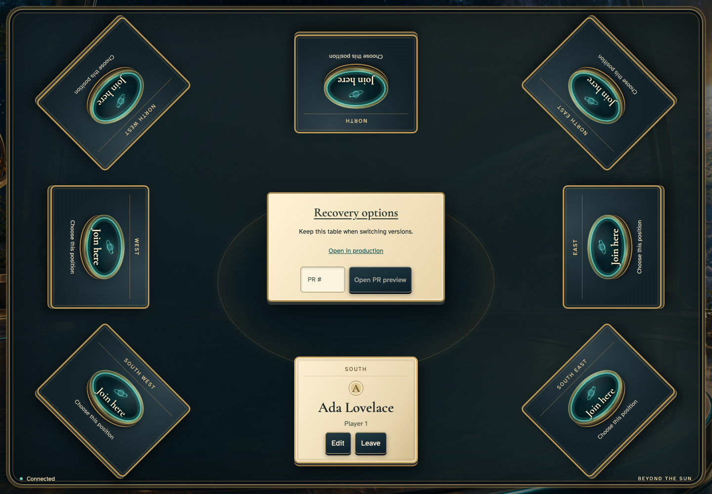](../../screenshots/recover-one-game-between-pr-and-production-clients/011-return-options-desktop-darwin.png) |

tabletop-4k · 3840 × 2160

[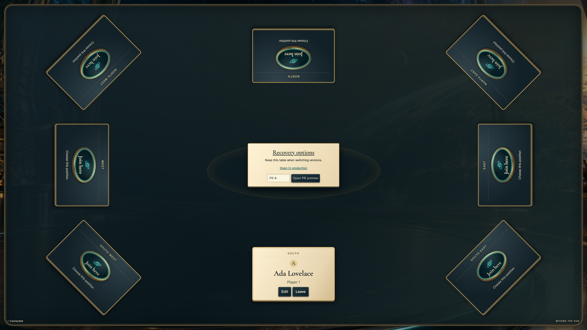](../../screenshots/recover-one-game-between-pr-and-production-clients/011-return-options-tabletop-4k-darwin.png)

- [x] Opening a PR requires a positive PR number.

## 13. Select PR 2 for recovery

Viewpoint: **Shared display**.

| desktop · 1440 × 1000 |
| --- |
| [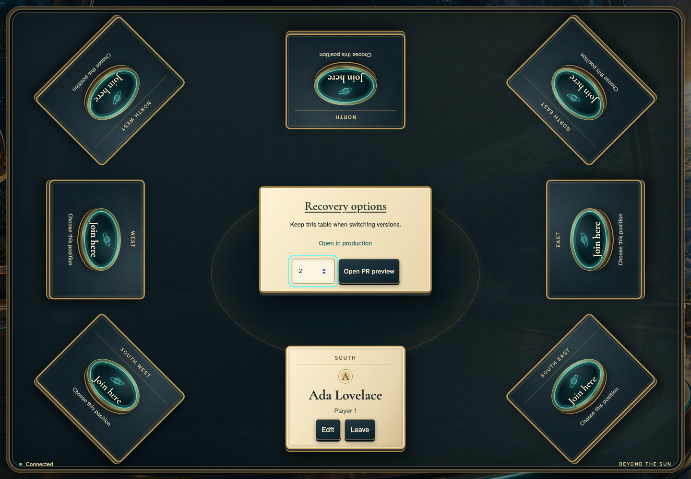](../../screenshots/recover-one-game-between-pr-and-production-clients/012-pr-number-desktop-darwin.png) |

tabletop-4k · 3840 × 2160

[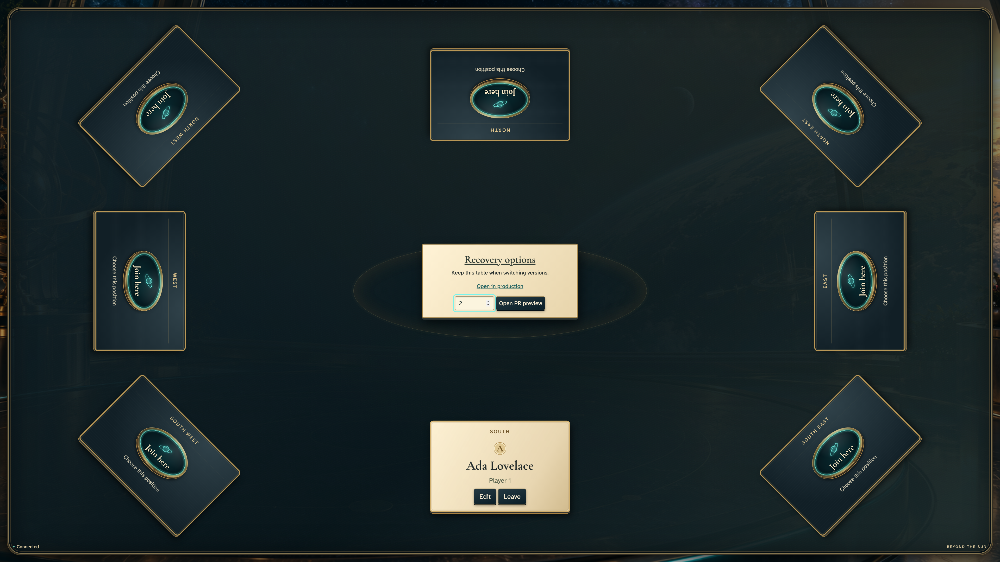](../../screenshots/recover-one-game-between-pr-and-production-clients/012-pr-number-tabletop-4k-darwin.png)

- [x] The ordinary recovery control opens PR 2 for this same game.

## 14. Recover production’s change in the PR client

Viewpoint: **Shared display**.

| desktop · 1440 × 1000 |
| --- |
| [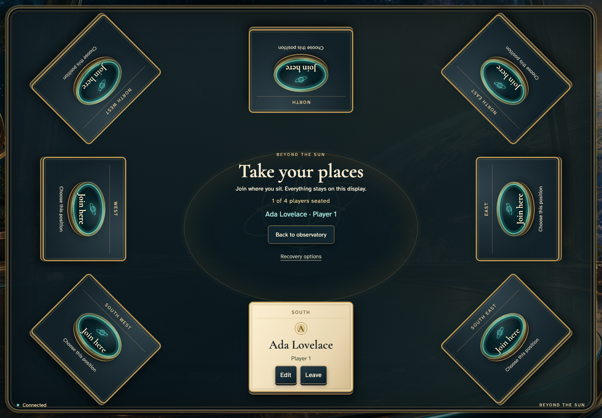](../../screenshots/recover-one-game-between-pr-and-production-clients/013-recovered-desktop-darwin.png) |

tabletop-4k · 3840 × 2160

[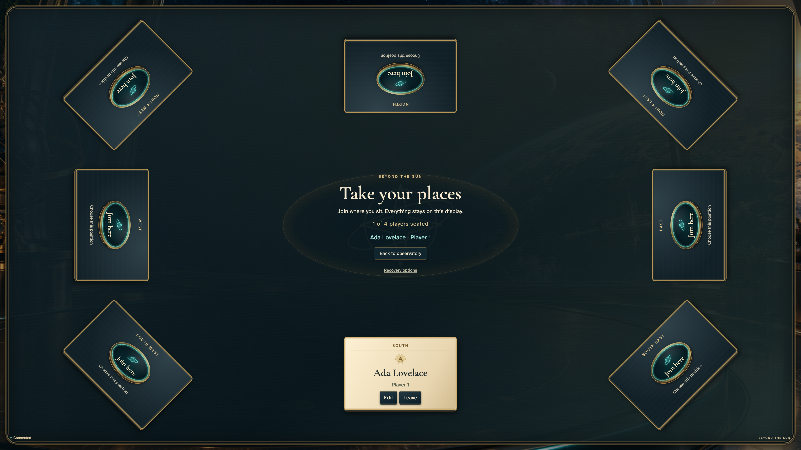](../../screenshots/recover-one-game-between-pr-and-production-clients/013-recovered-tabletop-4k-darwin.png)

- [x] The original PR build reads the updated seat from the same canonical game, without another identity or copy.
