# Explore source-reviewed card faces and representative public states

One visitor follows ordinary arrival navigation, with anonymous Auth and Firestore emulators. The gallery is a public reference document on each display, not remote PvP or a tabletop companion. Six reviewed definitions and explicitly labelled visual fixtures; no game creation, injected game state, random deck, or gameplay commands.

## 1. Find the card collection from the observatory

Viewpoint: **Gallery visitor**.

| phone · 393 × 852 | desktop · 1440 × 1000 | desktop-compact · 1280 × 720 |
| --- | --- | --- |
|  |  |  |

tabletop-4k · 3840 × 2160

- [x] The gallery is reachable without creating a game.

## 2. Browse a source-reviewed reference collection

Viewpoint: **Gallery visitor**.

| phone · 393 × 852 | desktop · 1440 × 1000 | desktop-compact · 1280 × 720 |
| --- | --- | --- |
| [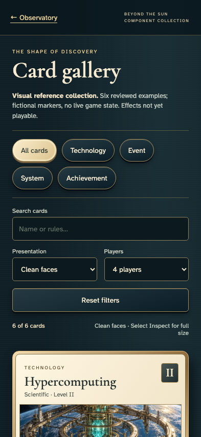](../../screenshots/explore-source-reviewed-card-faces-and-representative-public-states/001-collection-phone-darwin.png) | [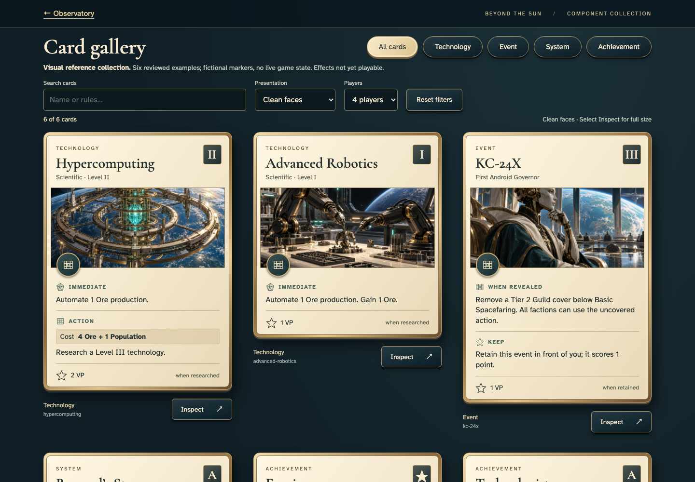](../../screenshots/explore-source-reviewed-card-faces-and-representative-public-states/001-collection-desktop-darwin.png) |  |

tabletop-4k · 3840 × 2160

[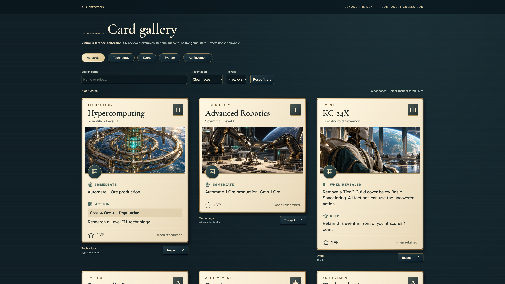](../../screenshots/explore-source-reviewed-card-faces-and-representative-public-states/001-collection-tabletop-4k-darwin.png)

- [x] Six semantic card faces are separate from live games and future draws.

## 3. Focus the collection on technologies

Viewpoint: **Gallery visitor**.

| phone · 393 × 852 | desktop · 1440 × 1000 | desktop-compact · 1280 × 720 |
| --- | --- | --- |
| [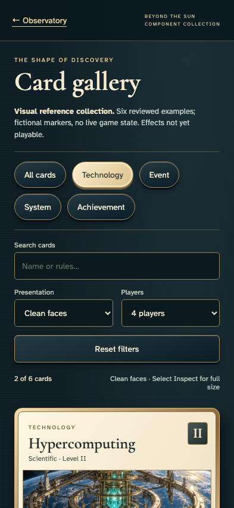](../../screenshots/explore-source-reviewed-card-faces-and-representative-public-states/002-technology-phone-darwin.png) | [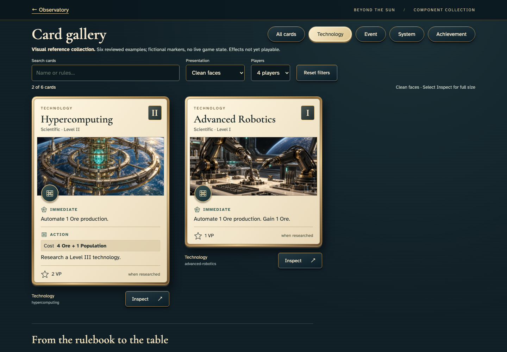](../../screenshots/explore-source-reviewed-card-faces-and-representative-public-states/002-technology-desktop-darwin.png) | [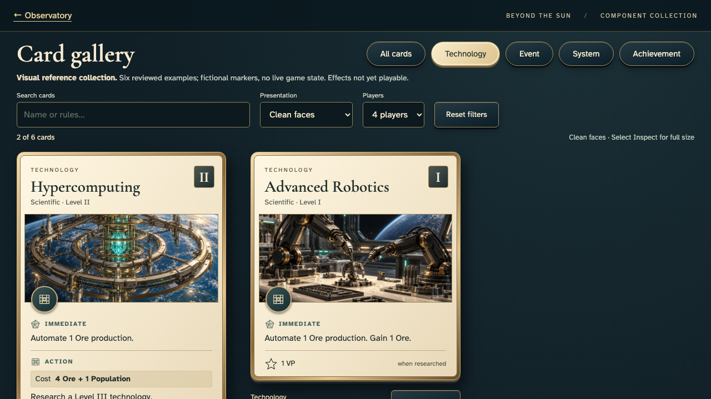](../../screenshots/explore-source-reviewed-card-faces-and-representative-public-states/002-technology-desktop-compact-darwin.png) |

tabletop-4k · 3840 × 2160

[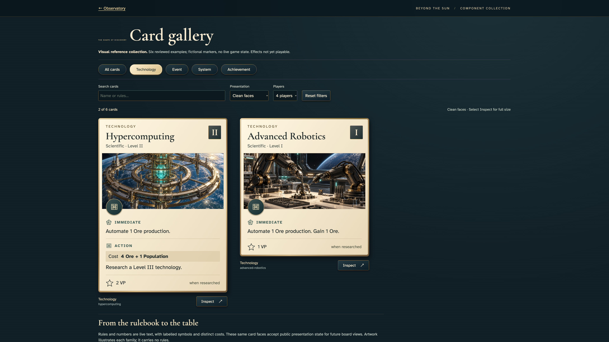](../../screenshots/explore-source-reviewed-card-faces-and-representative-public-states/002-technology-tabletop-4k-darwin.png)

- [x] The two scientific cards have separate immediate bonuses, costs and action text.

## 4. Read Hypercomputing at inspection scale

Viewpoint: **Gallery visitor**.

| phone · 393 × 852 | desktop · 1440 × 1000 | desktop-compact · 1280 × 720 |
| --- | --- | --- |
|  | [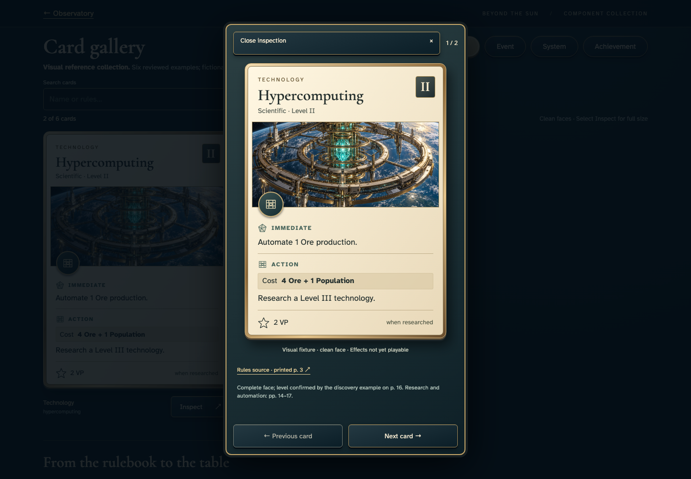](../../screenshots/explore-source-reviewed-card-faces-and-representative-public-states/003-inspect-technology-desktop-darwin.png) | [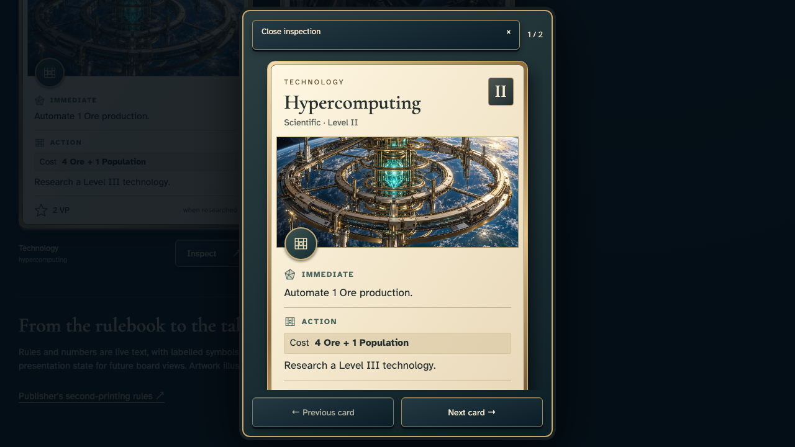](../../screenshots/explore-source-reviewed-card-faces-and-representative-public-states/003-inspect-technology-desktop-compact-darwin.png) |

tabletop-4k · 3840 × 2160

[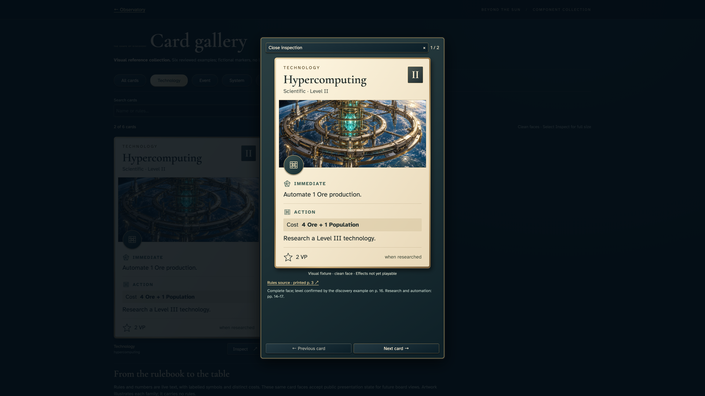](../../screenshots/explore-source-reviewed-card-faces-and-representative-public-states/003-inspect-technology-tabletop-4k-darwin.png)

- [x] The complete face shows the one-time bonus, research cost, action and scoring.

## 5. Keep reverse keyboard navigation inside the inspector

Viewpoint: **Gallery visitor**.

| phone · 393 × 852 | desktop · 1440 × 1000 | desktop-compact · 1280 × 720 |
| --- | --- | --- |
| [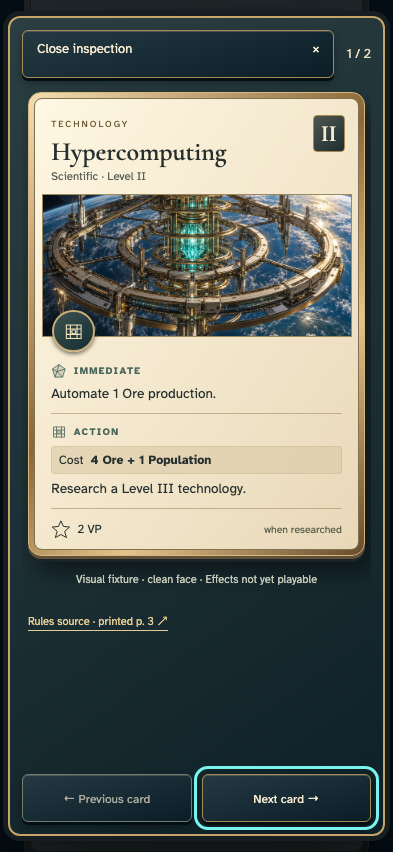](../../screenshots/explore-source-reviewed-card-faces-and-representative-public-states/004-focus-wrap-backward-phone-darwin.png) | [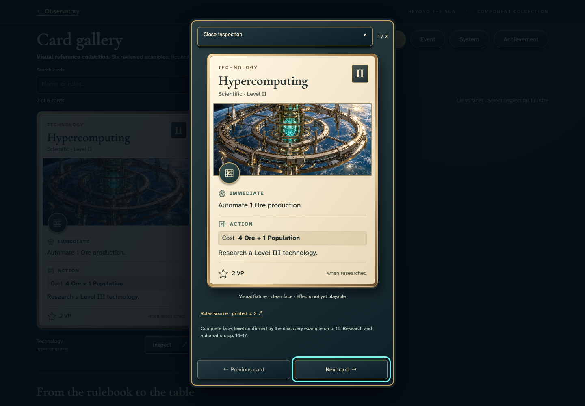](../../screenshots/explore-source-reviewed-card-faces-and-representative-public-states/004-focus-wrap-backward-desktop-darwin.png) | [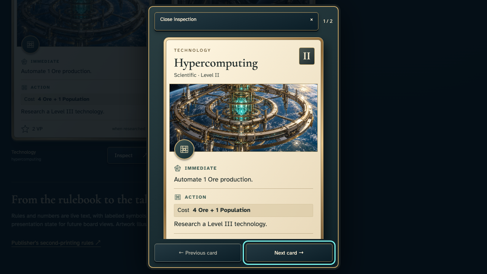](../../screenshots/explore-source-reviewed-card-faces-and-representative-public-states/004-focus-wrap-backward-desktop-compact-darwin.png) |

tabletop-4k · 3840 × 2160

- [x] Shift+Tab from Close wraps to the final enabled navigation control.

## 6. Keep forward keyboard navigation inside the inspector

Viewpoint: **Gallery visitor**.

| phone · 393 × 852 | desktop · 1440 × 1000 | desktop-compact · 1280 × 720 |
| --- | --- | --- |
| [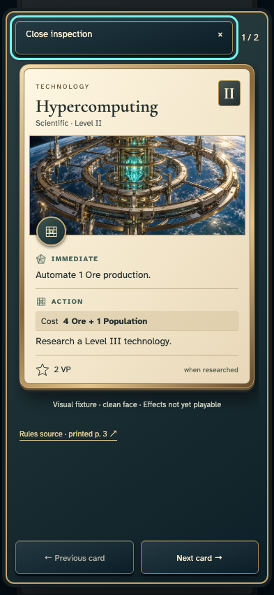](../../screenshots/explore-source-reviewed-card-faces-and-representative-public-states/005-focus-wrap-forward-phone-darwin.png) |  | [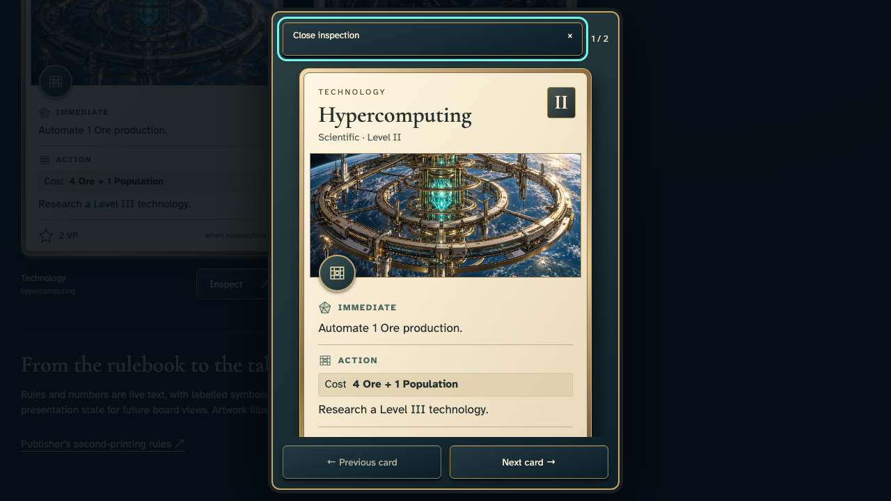](../../screenshots/explore-source-reviewed-card-faces-and-representative-public-states/005-focus-wrap-forward-desktop-compact-darwin.png) |

tabletop-4k · 3840 × 2160

- [x] Tab from the final navigation control wraps to Close instead of escaping the dialog.

## 7. Reach the labelled card-details scroll region

Viewpoint: **Gallery visitor**.

| phone · 393 × 852 | desktop · 1440 × 1000 | desktop-compact · 1280 × 720 |
| --- | --- | --- |
|  |  |  |

tabletop-4k · 3840 × 2160

- [x] The card/details area is keyboard reachable while navigation stays outside it.

## 8. Read the end of the card details with navigation still in reach

Viewpoint: **Gallery visitor**.

| phone · 393 × 852 | desktop · 1440 × 1000 | desktop-compact · 1280 × 720 |
| --- | --- | --- |
| [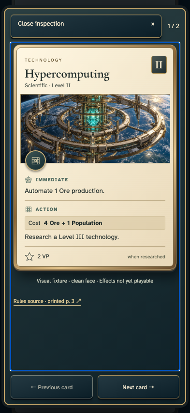](../../screenshots/explore-source-reviewed-card-faces-and-representative-public-states/007-scroll-details-phone-darwin.png) | [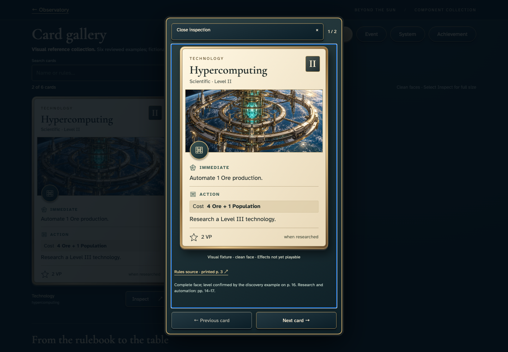](../../screenshots/explore-source-reviewed-card-faces-and-representative-public-states/007-scroll-details-desktop-darwin.png) | [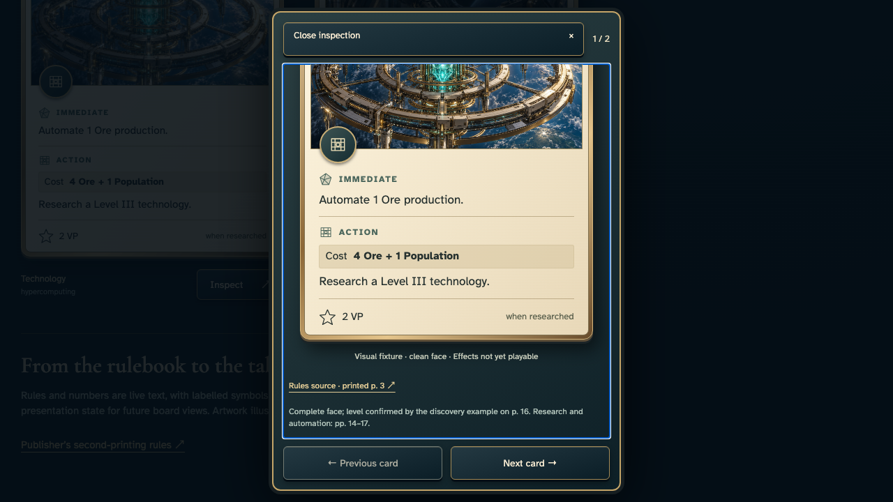](../../screenshots/explore-source-reviewed-card-faces-and-representative-public-states/007-scroll-details-desktop-compact-darwin.png) |

tabletop-4k · 3840 × 2160

- [x] End reaches the details limit; Close and Previous/Next stay within the viewport.

## 9. Inspect a technology with no action space

Viewpoint: **Gallery visitor**.

| phone · 393 × 852 | desktop · 1440 × 1000 | desktop-compact · 1280 × 720 |
| --- | --- | --- |
| [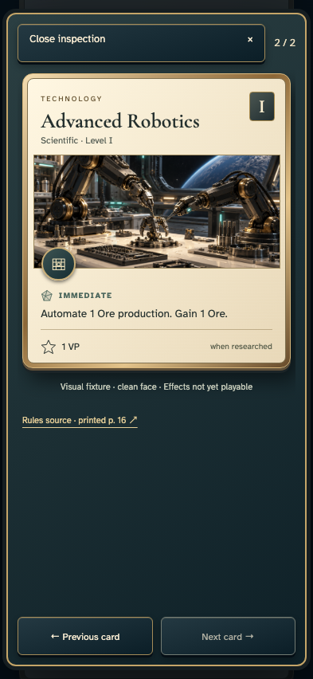](../../screenshots/explore-source-reviewed-card-faces-and-representative-public-states/008-next-technology-phone-darwin.png) | [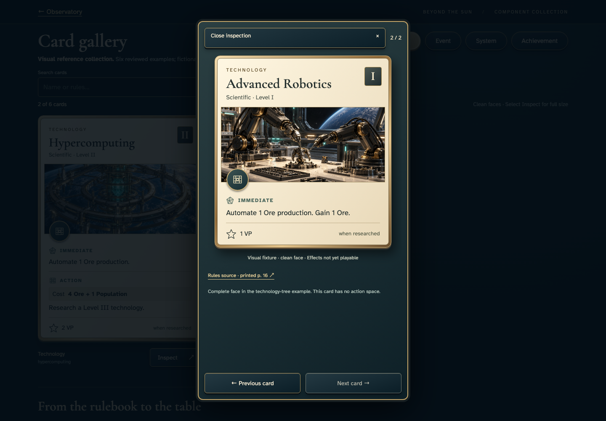](../../screenshots/explore-source-reviewed-card-faces-and-representative-public-states/008-next-technology-desktop-darwin.png) | [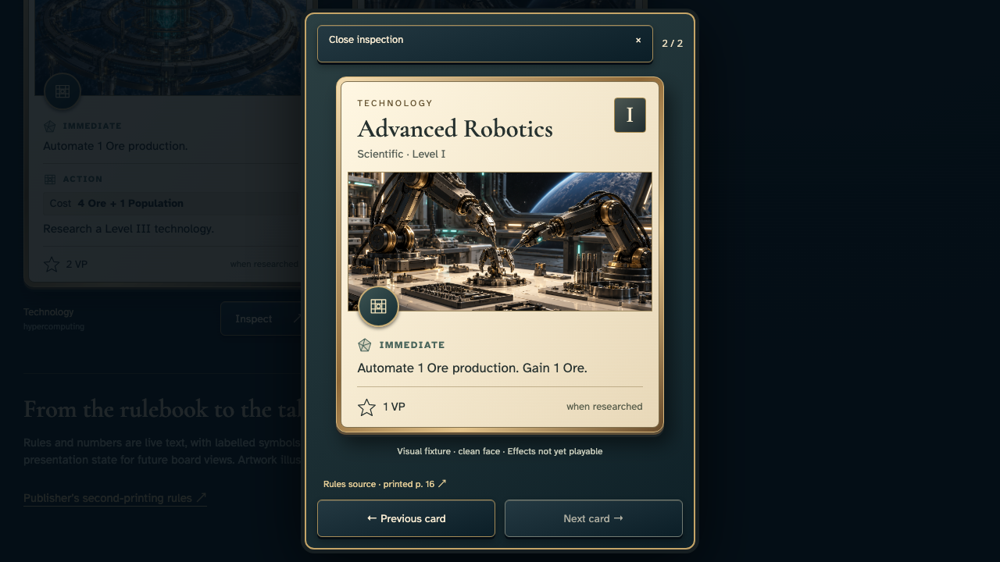](../../screenshots/explore-source-reviewed-card-faces-and-representative-public-states/008-next-technology-desktop-compact-darwin.png) |

tabletop-4k · 3840 × 2160

[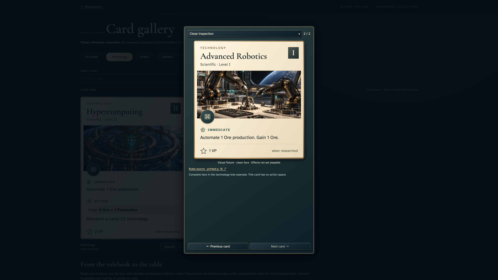](../../screenshots/explore-source-reviewed-card-faces-and-representative-public-states/008-next-technology-tabletop-4k-darwin.png)

- [x] Advanced Robotics has an immediate bonus and no invented action.

## 10. Return to the source card with Escape

Viewpoint: **Gallery visitor**.

| phone · 393 × 852 | desktop · 1440 × 1000 | desktop-compact · 1280 × 720 |
| --- | --- | --- |
| [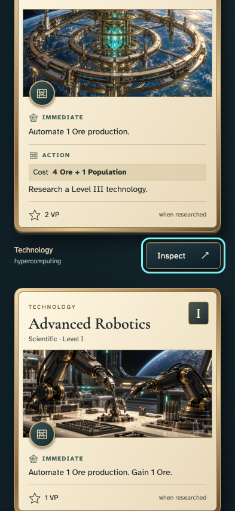](../../screenshots/explore-source-reviewed-card-faces-and-representative-public-states/009-restore-focus-phone-darwin.png) | [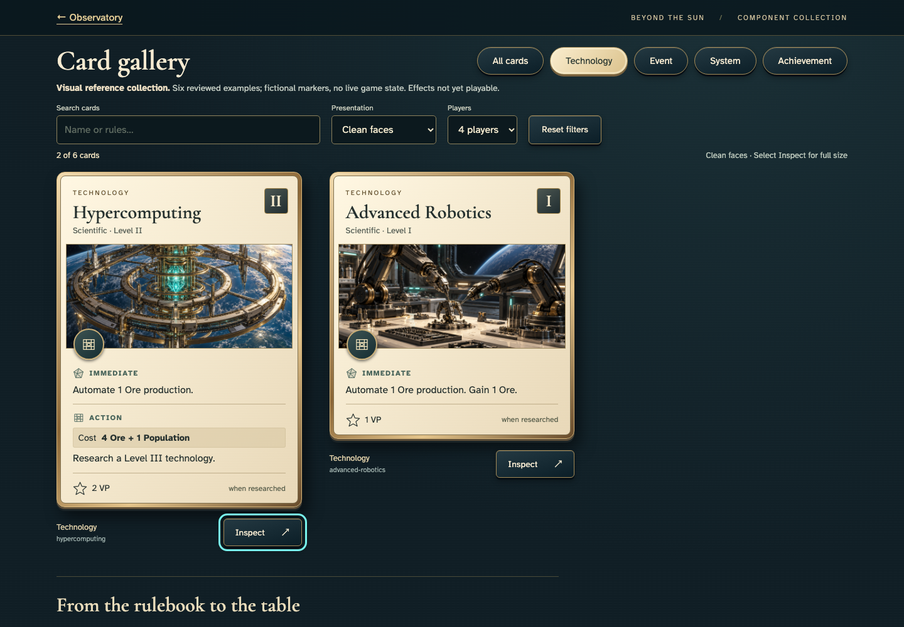](../../screenshots/explore-source-reviewed-card-faces-and-representative-public-states/009-restore-focus-desktop-darwin.png) | [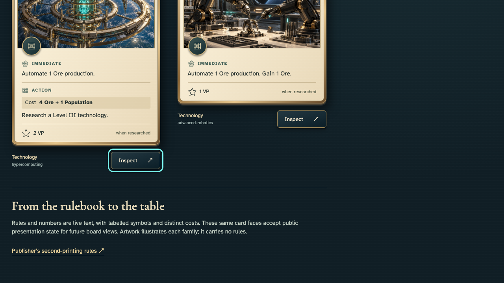](../../screenshots/explore-source-reviewed-card-faces-and-representative-public-states/009-restore-focus-desktop-compact-darwin.png) |

tabletop-4k · 3840 × 2160

- [x] Closing restores keyboard focus to the original inspection control.

## 11. Compare labelled visual state on the same renderers

Viewpoint: **Gallery visitor**.

| phone · 393 × 852 | desktop · 1440 × 1000 | desktop-compact · 1280 × 720 |
| --- | --- | --- |
| [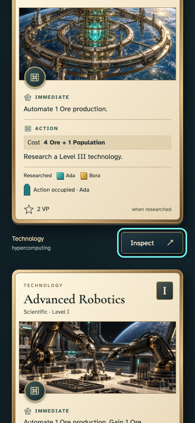](../../screenshots/explore-source-reviewed-card-faces-and-representative-public-states/010-markers-phone-darwin.png) | [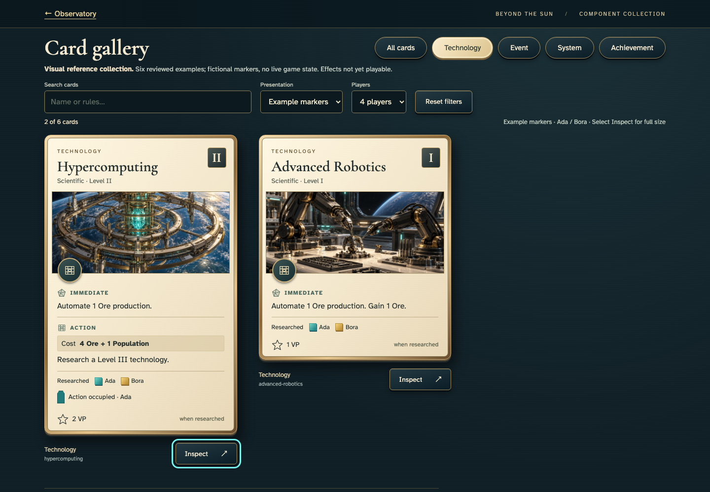](../../screenshots/explore-source-reviewed-card-faces-and-representative-public-states/010-markers-desktop-darwin.png) | [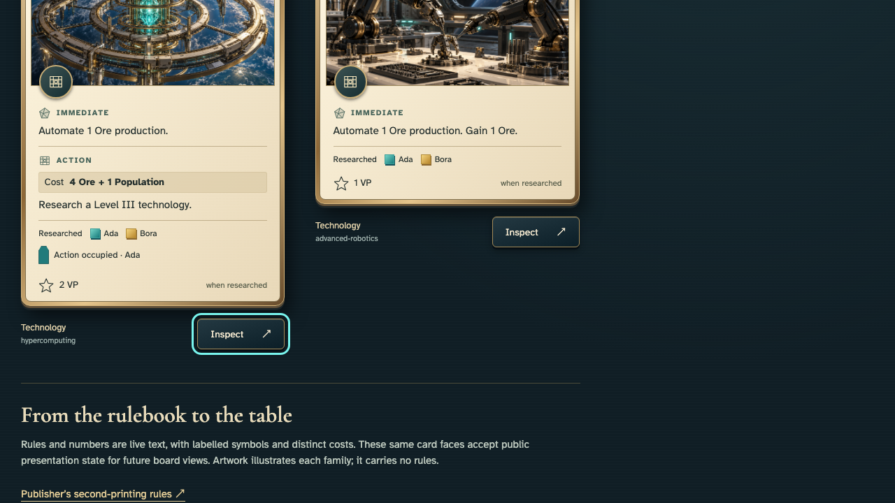](../../screenshots/explore-source-reviewed-card-faces-and-representative-public-states/010-markers-desktop-compact-darwin.png) |

tabletop-4k · 3840 × 2160

- [x] Researchers and action occupancy are distinct, fictional examples.

## 12. Inspect researchers and an occupied action

Viewpoint: **Gallery visitor**.

| phone · 393 × 852 | desktop · 1440 × 1000 | desktop-compact · 1280 × 720 |
| --- | --- | --- |
| [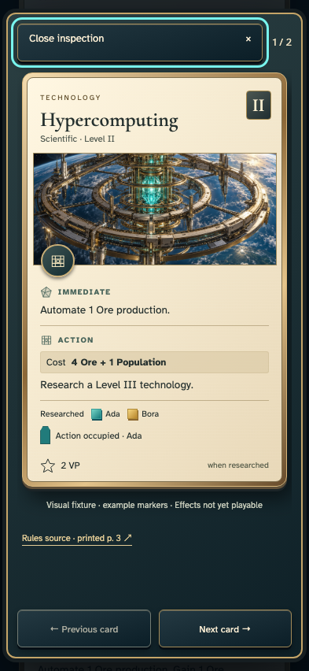](../../screenshots/explore-source-reviewed-card-faces-and-representative-public-states/011-inspect-markers-phone-darwin.png) | [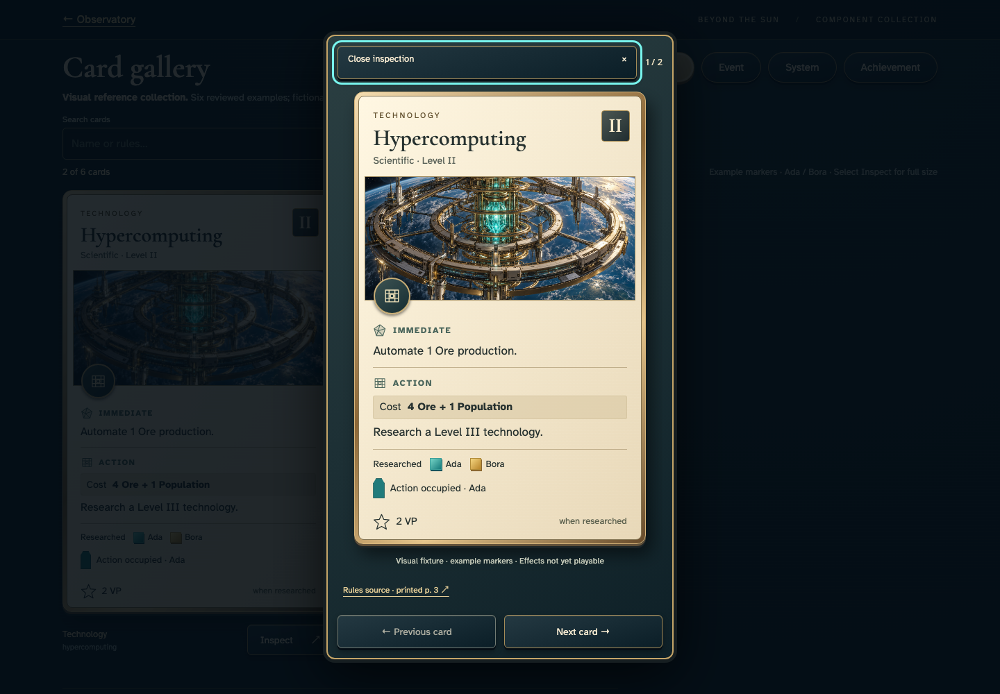](../../screenshots/explore-source-reviewed-card-faces-and-representative-public-states/011-inspect-markers-desktop-darwin.png) | [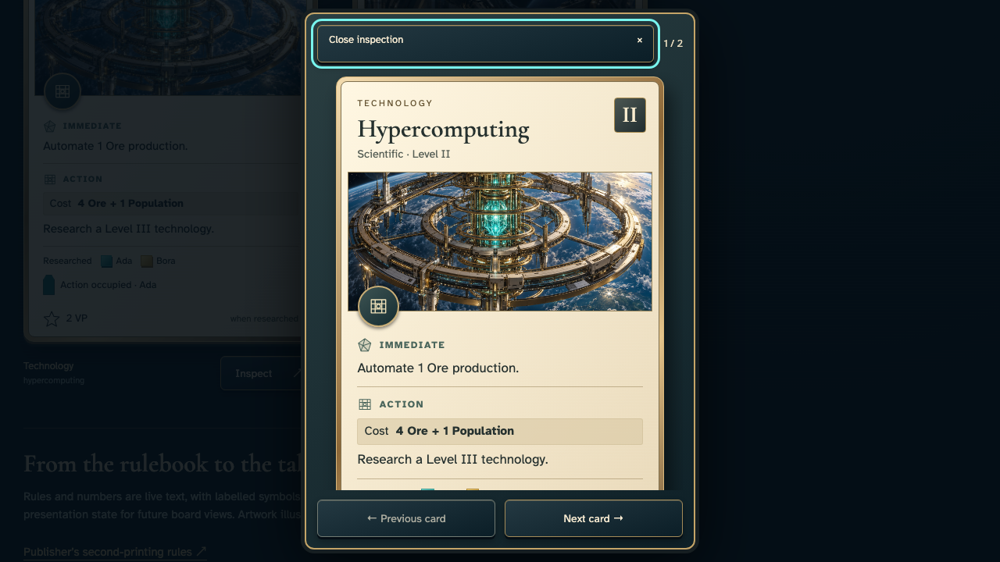](../../screenshots/explore-source-reviewed-card-faces-and-representative-public-states/011-inspect-markers-desktop-compact-darwin.png) |

tabletop-4k · 3840 × 2160

[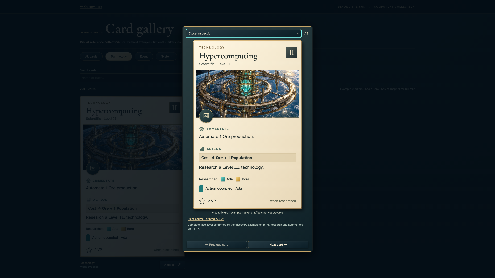](../../screenshots/explore-source-reviewed-card-faces-and-representative-public-states/011-inspect-markers-tabletop-4k-darwin.png)

- [x] Two named research cubes remain separate from Ada’s action pawn.

## 13. Close inspection without changing the fixture

Viewpoint: **Gallery visitor**.

| phone · 393 × 852 | desktop · 1440 × 1000 | desktop-compact · 1280 × 720 |
| --- | --- | --- |
|  |  |  |

tabletop-4k · 3840 × 2160

[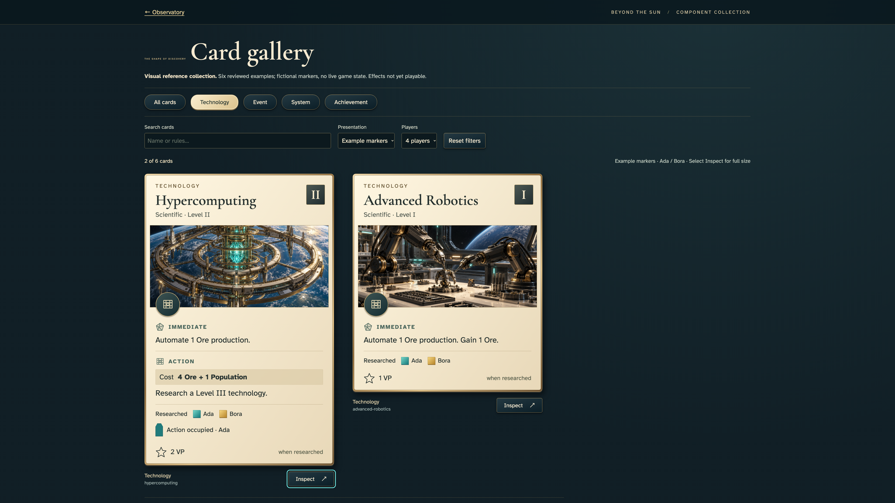](../../screenshots/explore-source-reviewed-card-faces-and-representative-public-states/012-close-markers-tabletop-4k-darwin.png)

- [x] The example presentation remains selected.

## 14. Filter to the fixed Level III event

Viewpoint: **Gallery visitor**.

| phone · 393 × 852 | desktop · 1440 × 1000 | desktop-compact · 1280 × 720 |
| --- | --- | --- |
| [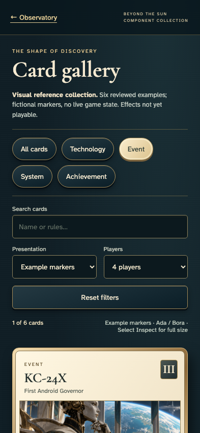](../../screenshots/explore-source-reviewed-card-faces-and-representative-public-states/013-event-phone-darwin.png) |  | [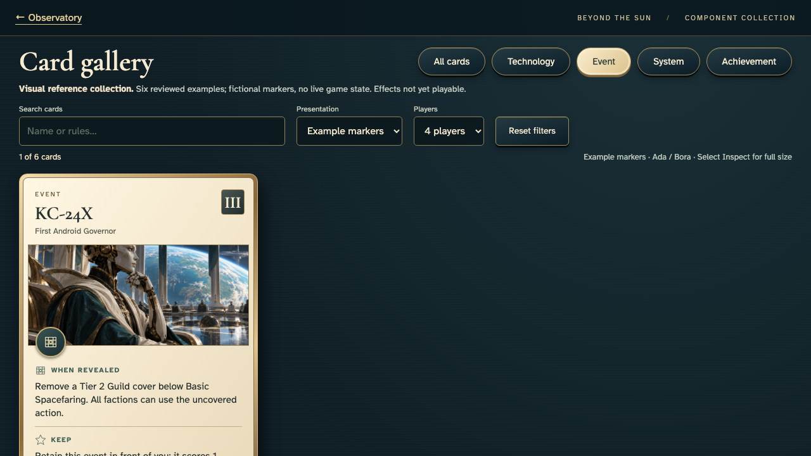](../../screenshots/explore-source-reviewed-card-faces-and-representative-public-states/013-event-desktop-compact-darwin.png) |

tabletop-4k · 3840 × 2160

[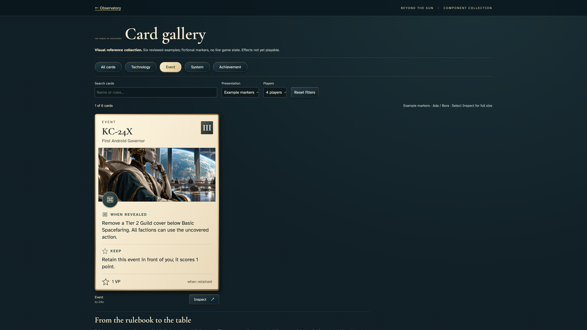](../../screenshots/explore-source-reviewed-card-faces-and-representative-public-states/013-event-tabletop-4k-darwin.png)

- [x] The event family contains KC-24X and no concealed live event.

## 15. Read the longer event text and retained reward

Viewpoint: **Gallery visitor**.

| phone · 393 × 852 | desktop · 1440 × 1000 | desktop-compact · 1280 × 720 |
| --- | --- | --- |
| [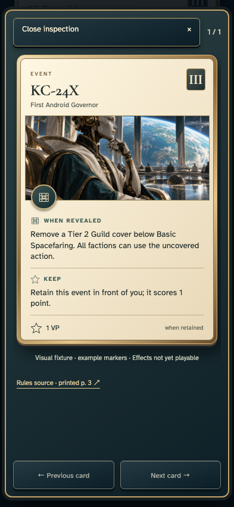](../../screenshots/explore-source-reviewed-card-faces-and-representative-public-states/014-inspect-event-phone-darwin.png) | [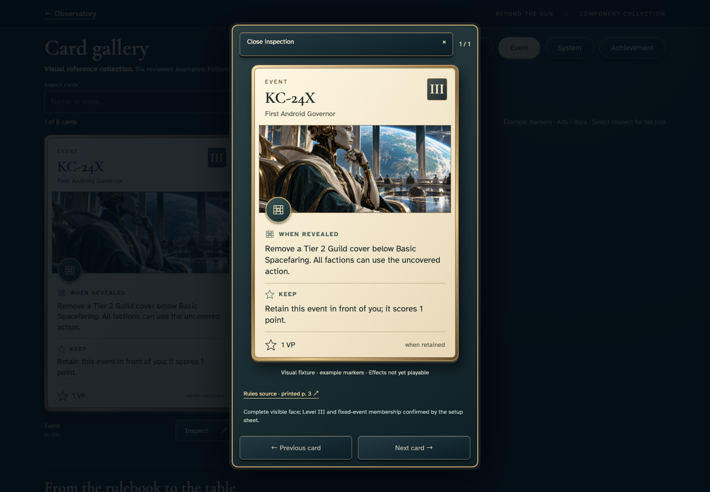](../../screenshots/explore-source-reviewed-card-faces-and-representative-public-states/014-inspect-event-desktop-darwin.png) | [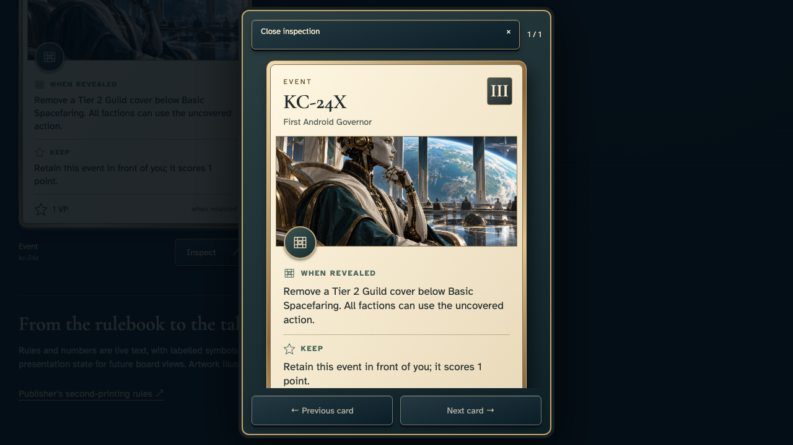](../../screenshots/explore-source-reviewed-card-faces-and-representative-public-states/014-inspect-event-desktop-compact-darwin.png) |

tabletop-4k · 3840 × 2160

[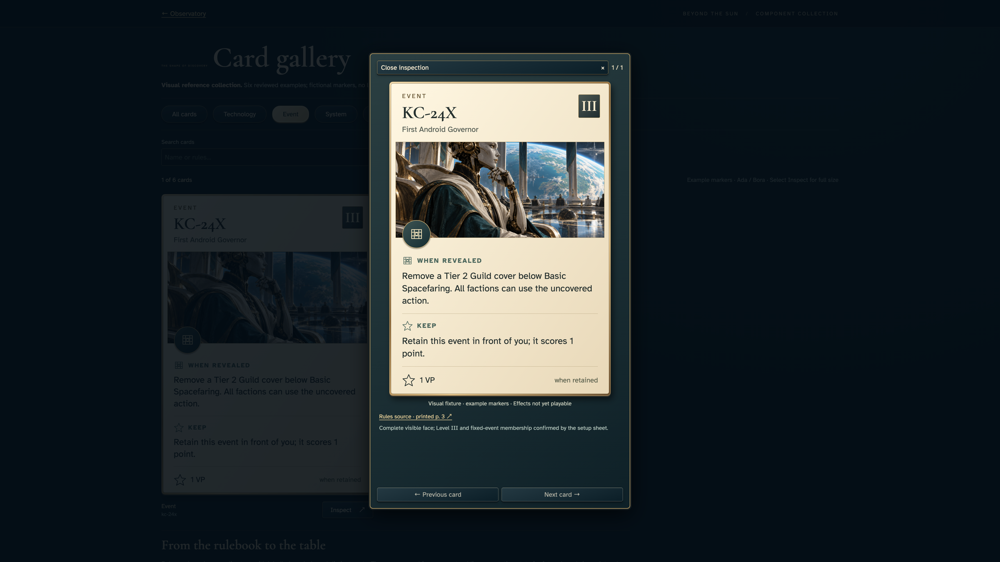](../../screenshots/explore-source-reviewed-card-faces-and-representative-public-states/014-inspect-event-tabletop-4k-darwin.png)

- [x] The reveal effect, shared guild access, retention and point value are readable.

## 16. Return to the event collection

Viewpoint: **Gallery visitor**.

| phone · 393 × 852 | desktop · 1440 × 1000 | desktop-compact · 1280 × 720 |
| --- | --- | --- |
| [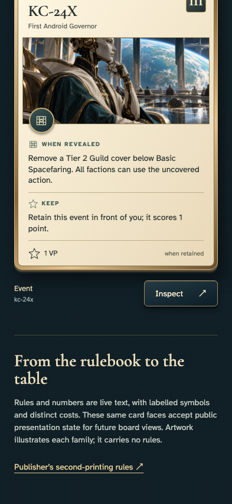](../../screenshots/explore-source-reviewed-card-faces-and-representative-public-states/015-close-event-phone-darwin.png) | [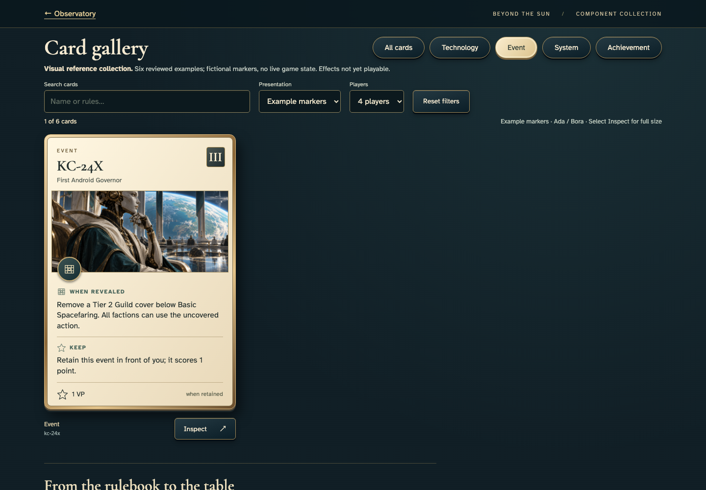](../../screenshots/explore-source-reviewed-card-faces-and-representative-public-states/015-close-event-desktop-darwin.png) | [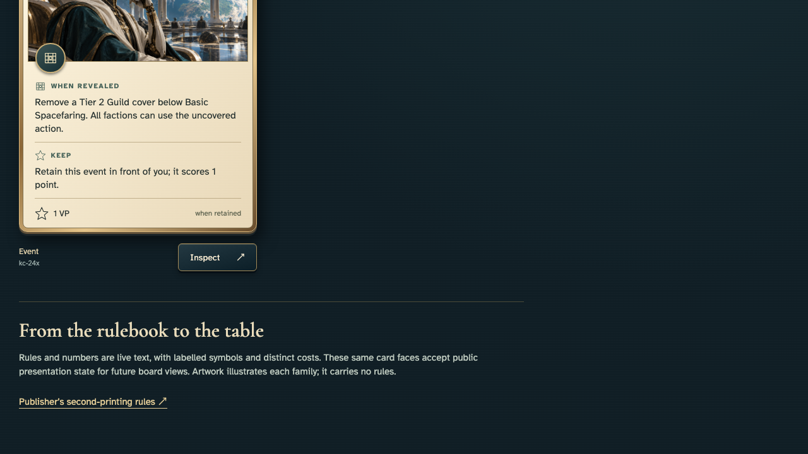](../../screenshots/explore-source-reviewed-card-faces-and-representative-public-states/015-close-event-desktop-compact-darwin.png) |

tabletop-4k · 3840 × 2160

- [x] The event filter and source inspection control are retained.

## 17. Review a starting System with a colony example

Viewpoint: **Gallery visitor**.

| phone · 393 × 852 | desktop · 1440 × 1000 | desktop-compact · 1280 × 720 |
| --- | --- | --- |
| [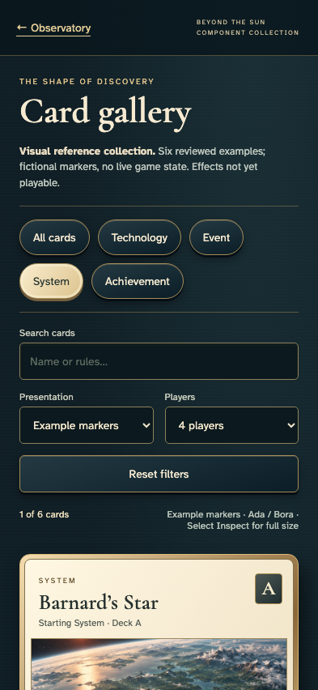](../../screenshots/explore-source-reviewed-card-faces-and-representative-public-states/016-system-phone-darwin.png) |  | [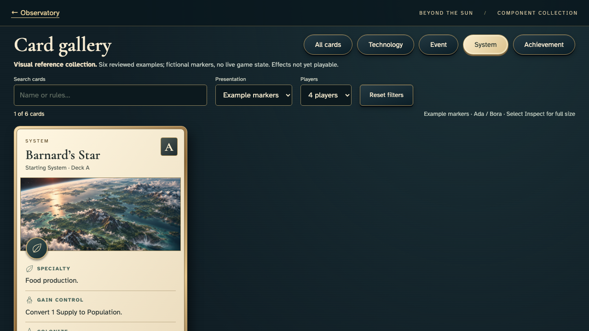](../../screenshots/explore-source-reviewed-card-faces-and-representative-public-states/016-system-desktop-compact-darwin.png) |

tabletop-4k · 3840 × 2160

[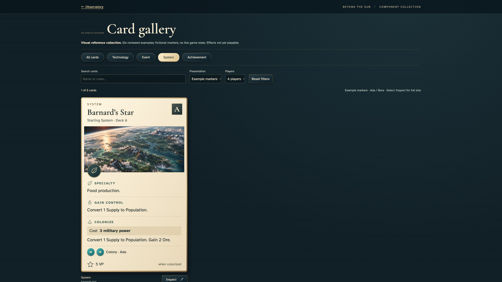](../../screenshots/explore-source-reviewed-card-faces-and-representative-public-states/016-system-tabletop-4k-darwin.png)

- [x] Barnard’s Star shows a named colony with two production discs.

## 18. Read control, settlement and scoring separately

Viewpoint: **Gallery visitor**.

| phone · 393 × 852 | desktop · 1440 × 1000 | desktop-compact · 1280 × 720 |
| --- | --- | --- |
| [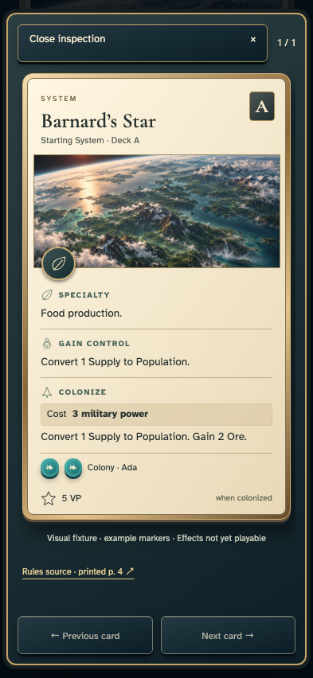](../../screenshots/explore-source-reviewed-card-faces-and-representative-public-states/017-inspect-system-phone-darwin.png) | [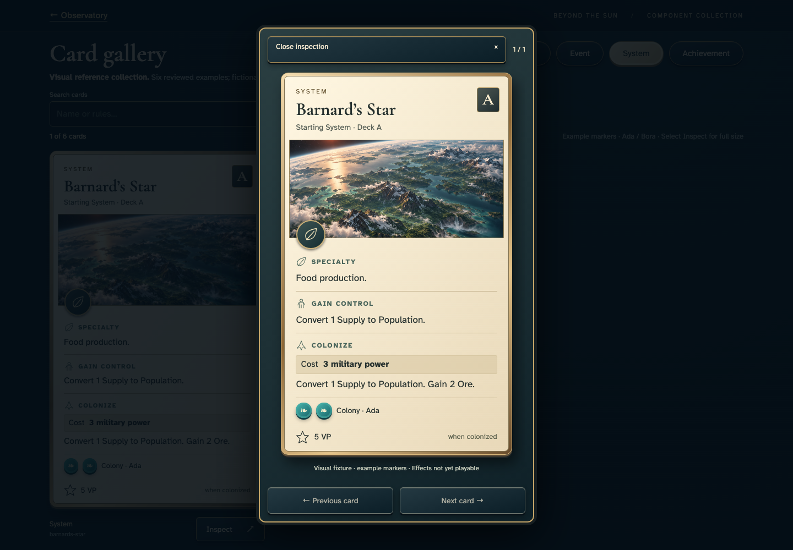](../../screenshots/explore-source-reviewed-card-faces-and-representative-public-states/017-inspect-system-desktop-darwin.png) | [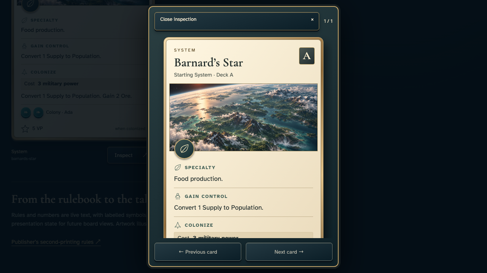](../../screenshots/explore-source-reviewed-card-faces-and-representative-public-states/017-inspect-system-desktop-compact-darwin.png) |

tabletop-4k · 3840 × 2160

[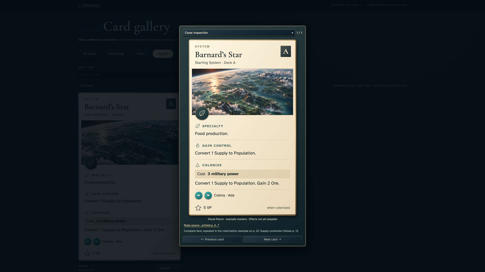](../../screenshots/explore-source-reviewed-card-faces-and-representative-public-states/017-inspect-system-tabletop-4k-darwin.png)

- [x] The food specialty, 3-power settlement cost and 5-point colony value are visible.

## 19. Return from the System face

Viewpoint: **Gallery visitor**.

| phone · 393 × 852 | desktop · 1440 × 1000 | desktop-compact · 1280 × 720 |
| --- | --- | --- |
|  |  |  |

tabletop-4k · 3840 × 2160

- [x] The original System inspection control has focus.

## 20. Compare achievement requirements and claim slots

Viewpoint: **Gallery visitor**.

| phone · 393 × 852 | desktop · 1440 × 1000 | desktop-compact · 1280 × 720 |
| --- | --- | --- |
|  |  |  |

tabletop-4k · 3840 × 2160

- [x] The two achievements show source-backed rewards and Ada’s example first claim.

## 21. Apply the three-player achievement restriction

Viewpoint: **Gallery visitor**.

| phone · 393 × 852 | desktop · 1440 × 1000 | desktop-compact · 1280 × 720 |
| --- | --- | --- |
|  |  |  |

tabletop-4k · 3840 × 2160

- [x] Technologist’s second slot is explicitly unavailable in a three-player reference.

## 22. Inspect the restricted achievement at full size

Viewpoint: **Gallery visitor**.

| phone · 393 × 852 | desktop · 1440 × 1000 | desktop-compact · 1280 × 720 |
| --- | --- | --- |
|  |  |  |

tabletop-4k · 3840 × 2160

- [x] The requirement excludes personal technologies and the blocked second slot stays visible.

## 23. Restore the achievement inspection source

Viewpoint: **Gallery visitor**.

| phone · 393 × 852 | desktop · 1440 × 1000 | desktop-compact · 1280 × 720 |
| --- | --- | --- |
|  |  |  |

tabletop-4k · 3840 × 2160

- [x] Keyboard focus returns to Technologist.

## 24. See an informative empty search result

Viewpoint: **Gallery visitor**.

| phone · 393 × 852 | desktop · 1440 × 1000 | desktop-compact · 1280 × 720 |
| --- | --- | --- |
|  |  |  |

tabletop-4k · 3840 × 2160

- [x] No match produces a clear explanation and no card faces.

## 25. Restore the full collection

Viewpoint: **Gallery visitor**.

| phone · 393 × 852 | desktop · 1440 × 1000 | desktop-compact · 1280 × 720 |
| --- | --- | --- |
|  |  |  |

tabletop-4k · 3840 × 2160

- [x] Reset clears the search and family while preserving the chosen presentation.

## 26. Return to the accepted observatory

Viewpoint: **Gallery visitor**.

| phone · 393 × 852 | desktop · 1440 × 1000 | desktop-compact · 1280 × 720 |
| --- | --- | --- |
|  |  |  |

tabletop-4k · 3840 × 2160

- [x] Play and Learn remain available and browsing has created no retained game.
