# Explore source-reviewed card faces and representative public states

One visitor follows ordinary arrival navigation, with anonymous Auth and Firestore emulators. The gallery is a public reference document on each display, not remote PvP or a tabletop companion. Complete100-design/100-copy source-verified base inventory, with complete original project art, and separately labelled presentation markers; Mechanical paraphrases retain the documented WISE physical second-print title/verbatim-wording limitation; no definitive edition-face equality is claimed. No game creation, injected game state, random deck, or gameplay commands.

## 1. Find the card collection from the observatory

Viewpoint: **Gallery visitor**.

| phone · 393 × 852 | desktop · 1440 × 1000 | desktop-compact · 1280 × 720 |
| --- | --- | --- |
|  |  |  |

tabletop-4k · 3840 × 2160

- [x] The gallery is reachable without creating a game.

## 2. Browse a source-reviewed reference collection

Viewpoint: **Gallery visitor**.

| phone · 393 × 852 | desktop · 1440 × 1000 | desktop-compact · 1280 × 720 |
| --- | --- | --- |
|  |  |  |

tabletop-4k · 3840 × 2160

- [x] All100 canonical designs are browsable in pages, separate from live games and future draws.

## 3. Review base inventory page 1 of17

Viewpoint: **Gallery visitor**.

| phone · 393 × 852 | desktop · 1440 × 1000 | desktop-compact · 1280 × 720 |
| --- | --- | --- |
|  |  | [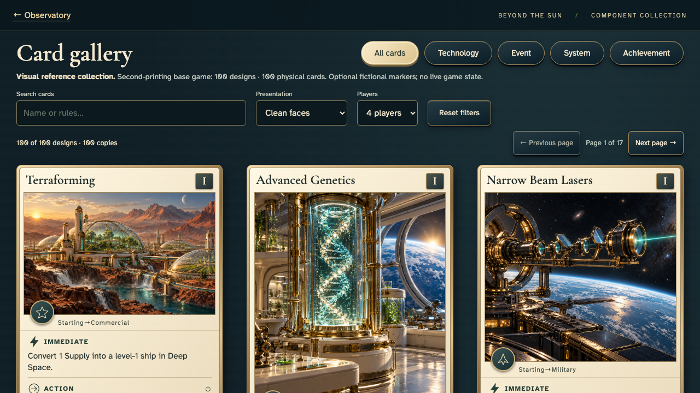](../../screenshots/explore-source-reviewed-card-faces-and-representative-public-states/002-inventory-page-1-desktop-compact-darwin.png) |

tabletop-4k · 3840 × 2160

[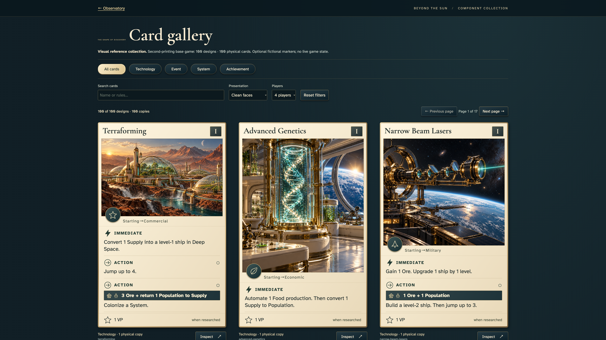](../../screenshots/explore-source-reviewed-card-faces-and-representative-public-states/002-inventory-page-1-tabletop-4k-darwin.png)

- [x] Each canonical design occurs once, with a source-backed physical-copy quantity.

## 4. Review base inventory page 2 of17

Viewpoint: **Gallery visitor**.

| phone · 393 × 852 | desktop · 1440 × 1000 | desktop-compact · 1280 × 720 |
| --- | --- | --- |
| [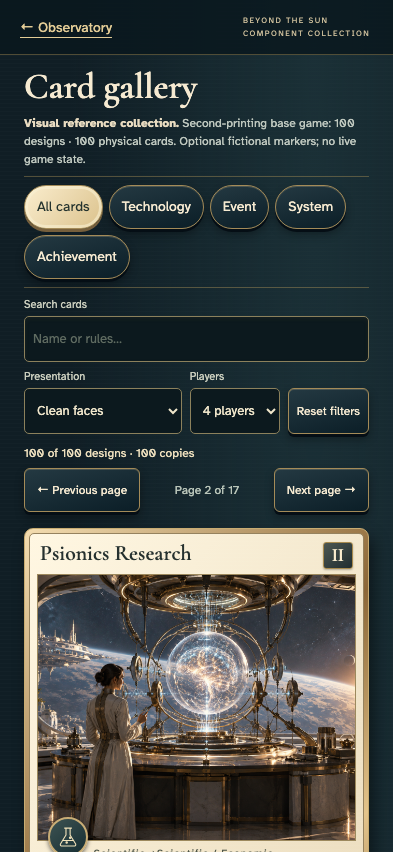](../../screenshots/explore-source-reviewed-card-faces-and-representative-public-states/003-inventory-page-2-phone-darwin.png) | [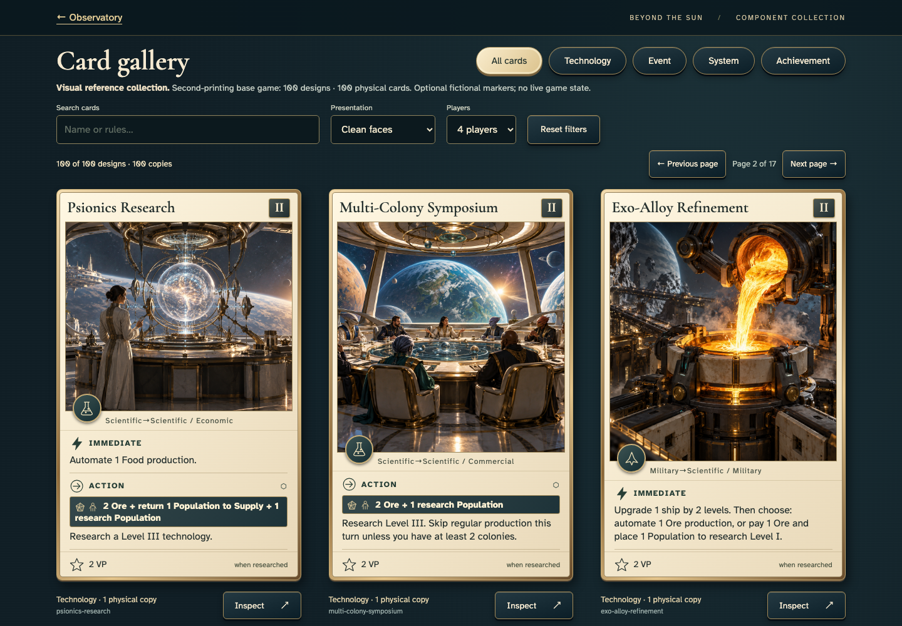](../../screenshots/explore-source-reviewed-card-faces-and-representative-public-states/003-inventory-page-2-desktop-darwin.png) | [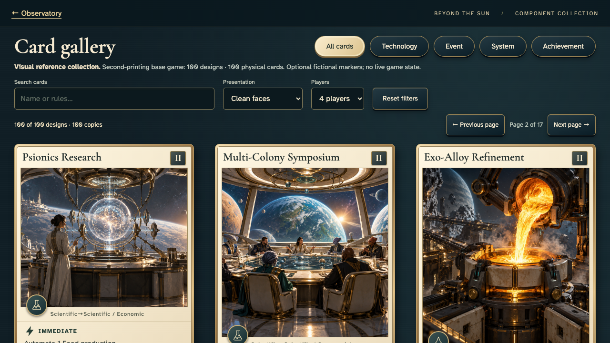](../../screenshots/explore-source-reviewed-card-faces-and-representative-public-states/003-inventory-page-2-desktop-compact-darwin.png) |

tabletop-4k · 3840 × 2160

[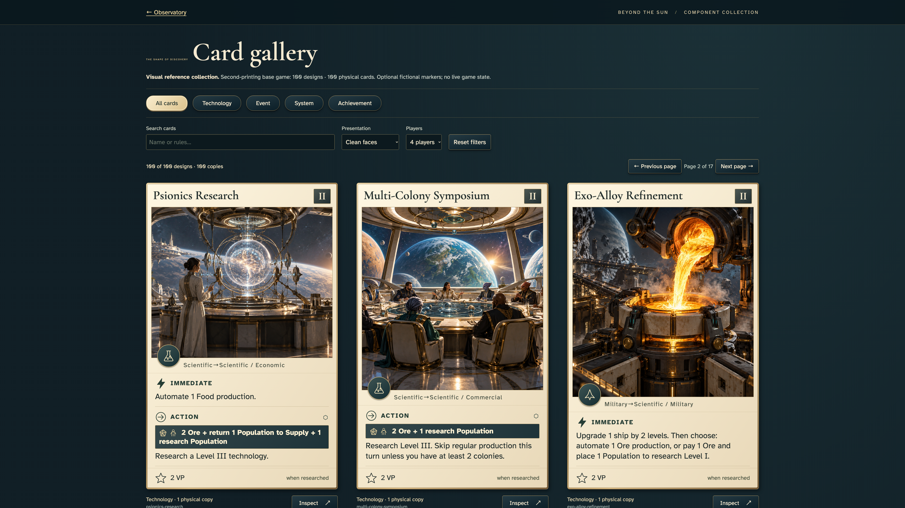](../../screenshots/explore-source-reviewed-card-faces-and-representative-public-states/003-inventory-page-2-tabletop-4k-darwin.png)

- [x] Each canonical design occurs once, with a source-backed physical-copy quantity.

## 5. Review base inventory page 3 of17

Viewpoint: **Gallery visitor**.

| phone · 393 × 852 | desktop · 1440 × 1000 | desktop-compact · 1280 × 720 |
| --- | --- | --- |
| [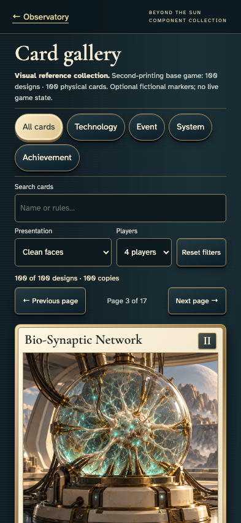](../../screenshots/explore-source-reviewed-card-faces-and-representative-public-states/004-inventory-page-3-phone-darwin.png) | [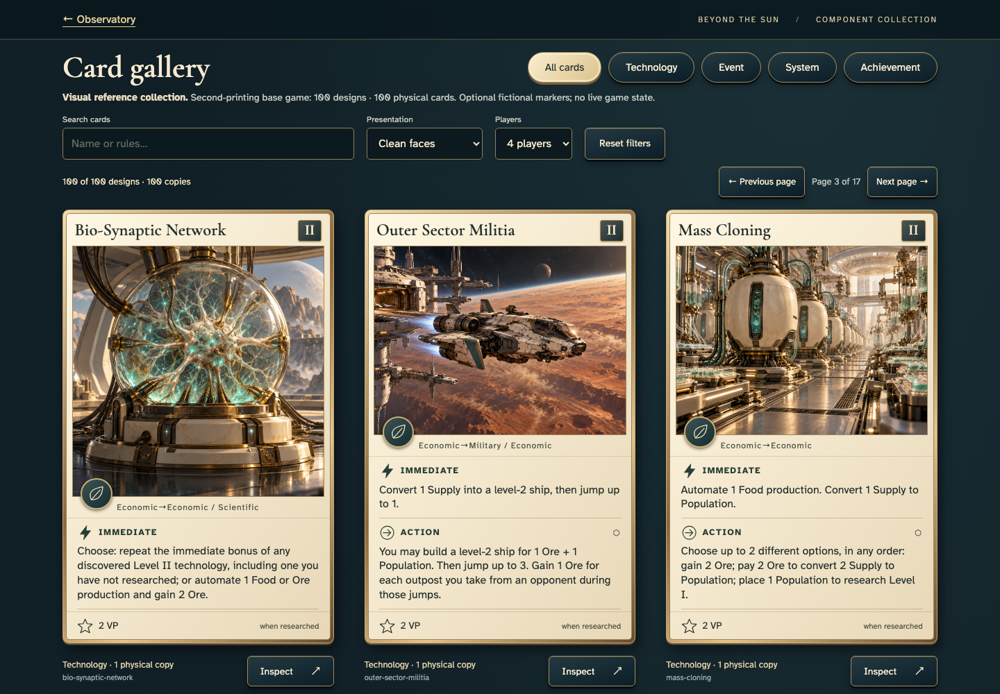](../../screenshots/explore-source-reviewed-card-faces-and-representative-public-states/004-inventory-page-3-desktop-darwin.png) | [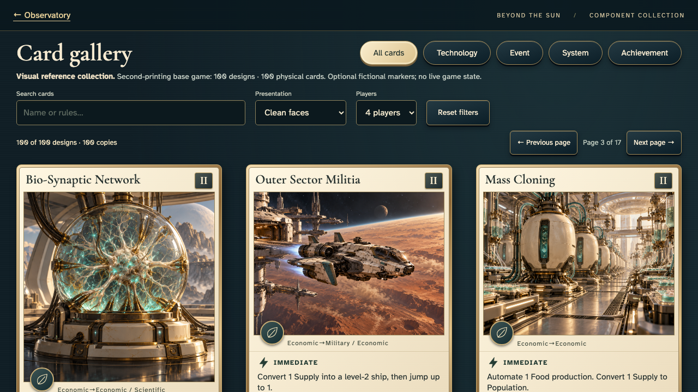](../../screenshots/explore-source-reviewed-card-faces-and-representative-public-states/004-inventory-page-3-desktop-compact-darwin.png) |

tabletop-4k · 3840 × 2160

[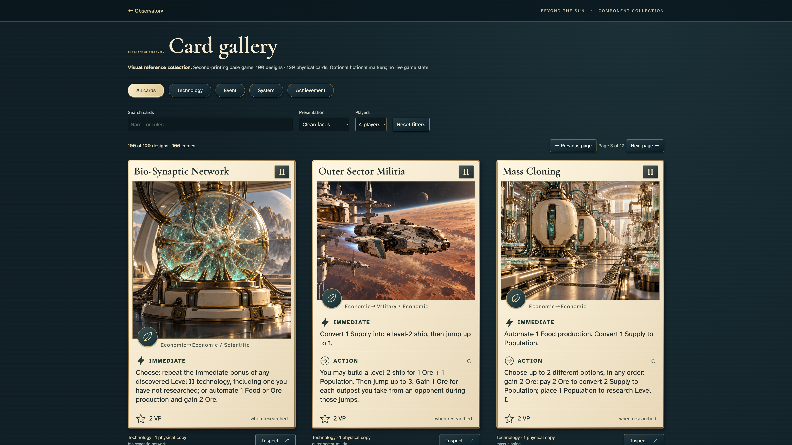](../../screenshots/explore-source-reviewed-card-faces-and-representative-public-states/004-inventory-page-3-tabletop-4k-darwin.png)

- [x] Each canonical design occurs once, with a source-backed physical-copy quantity.

## 6. Review base inventory page 4 of17

Viewpoint: **Gallery visitor**.

| phone · 393 × 852 | desktop · 1440 × 1000 | desktop-compact · 1280 × 720 |
| --- | --- | --- |
| [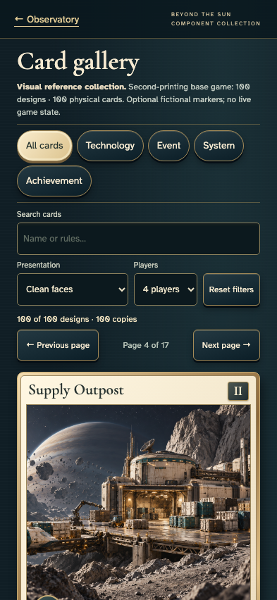](../../screenshots/explore-source-reviewed-card-faces-and-representative-public-states/005-inventory-page-4-phone-darwin.png) | [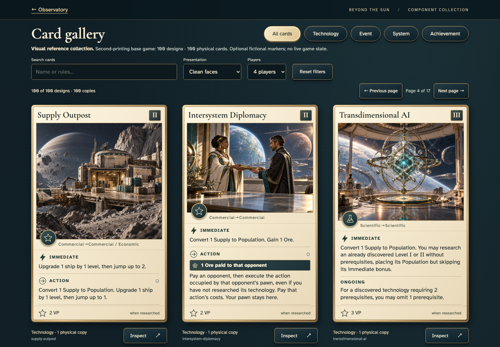](../../screenshots/explore-source-reviewed-card-faces-and-representative-public-states/005-inventory-page-4-desktop-darwin.png) | [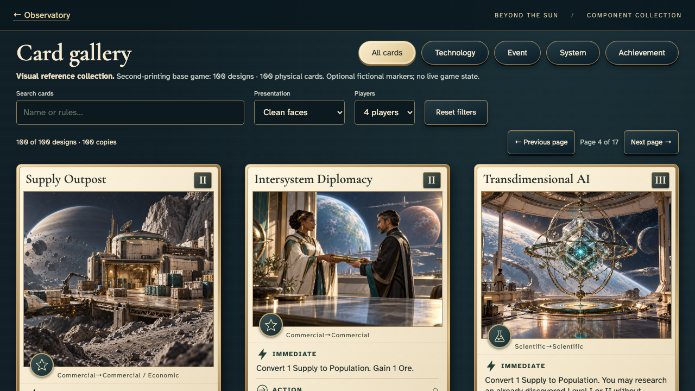](../../screenshots/explore-source-reviewed-card-faces-and-representative-public-states/005-inventory-page-4-desktop-compact-darwin.png) |

tabletop-4k · 3840 × 2160

[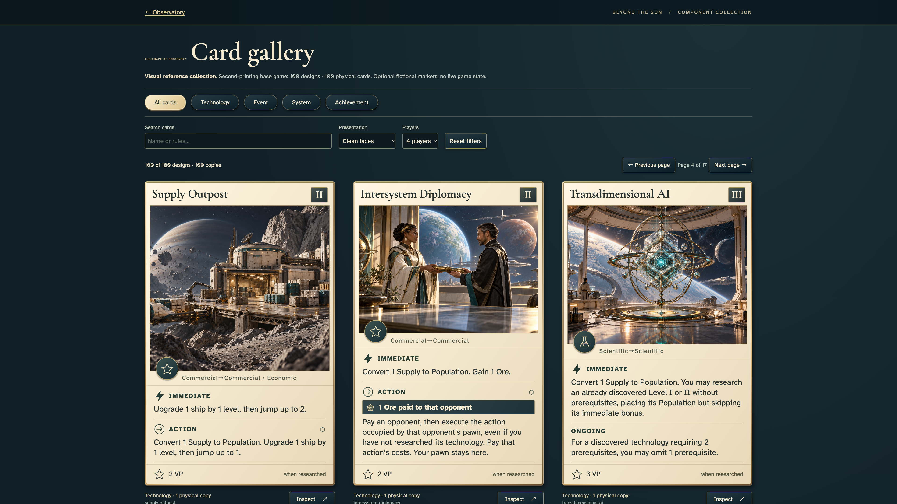](../../screenshots/explore-source-reviewed-card-faces-and-representative-public-states/005-inventory-page-4-tabletop-4k-darwin.png)

- [x] Each canonical design occurs once, with a source-backed physical-copy quantity.

## 7. Review base inventory page 5 of17

Viewpoint: **Gallery visitor**.

| phone · 393 × 852 | desktop · 1440 × 1000 | desktop-compact · 1280 × 720 |
| --- | --- | --- |
| [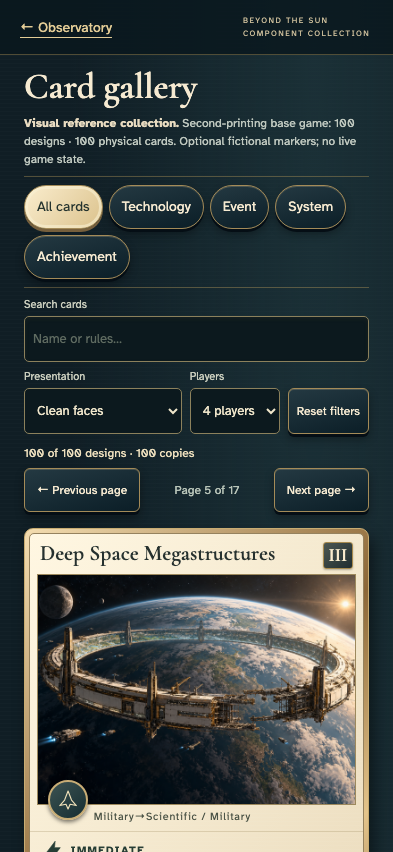](../../screenshots/explore-source-reviewed-card-faces-and-representative-public-states/006-inventory-page-5-phone-darwin.png) | [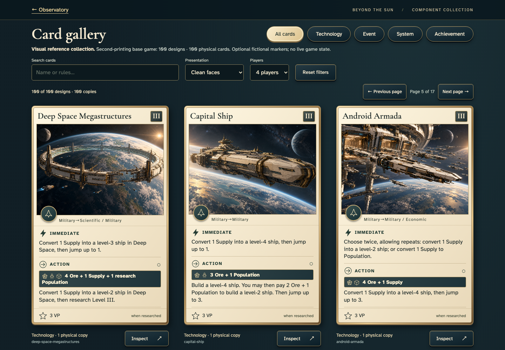](../../screenshots/explore-source-reviewed-card-faces-and-representative-public-states/006-inventory-page-5-desktop-darwin.png) | [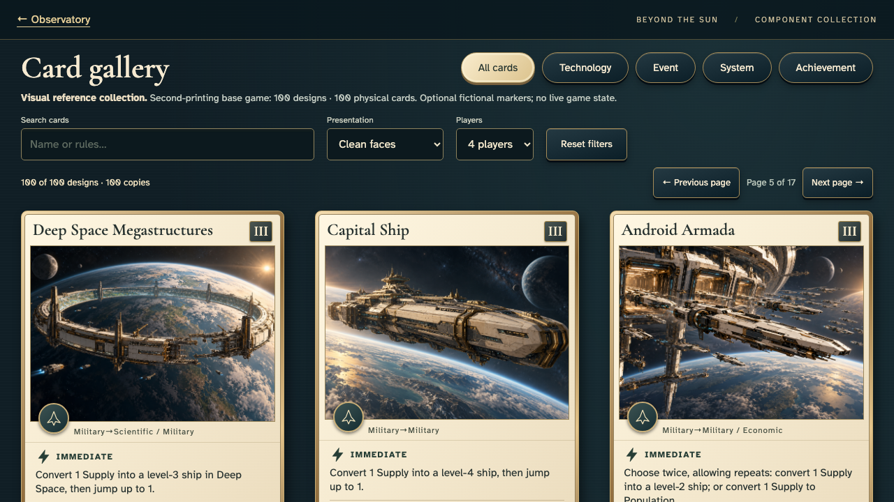](../../screenshots/explore-source-reviewed-card-faces-and-representative-public-states/006-inventory-page-5-desktop-compact-darwin.png) |

tabletop-4k · 3840 × 2160

[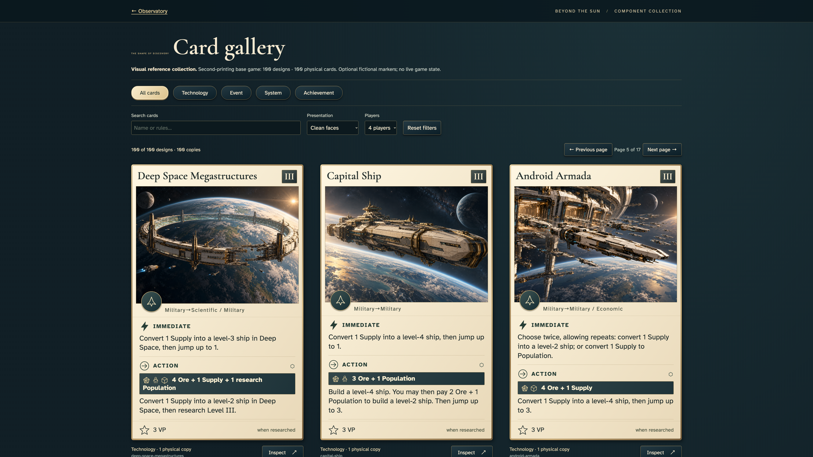](../../screenshots/explore-source-reviewed-card-faces-and-representative-public-states/006-inventory-page-5-tabletop-4k-darwin.png)

- [x] Each canonical design occurs once, with a source-backed physical-copy quantity.

## 8. Review base inventory page 6 of17

Viewpoint: **Gallery visitor**.

| phone · 393 × 852 | desktop · 1440 × 1000 | desktop-compact · 1280 × 720 |
| --- | --- | --- |
| [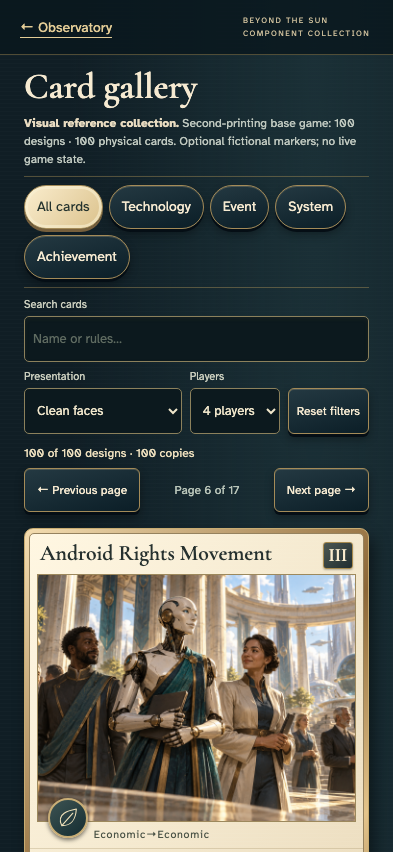](../../screenshots/explore-source-reviewed-card-faces-and-representative-public-states/007-inventory-page-6-phone-darwin.png) | [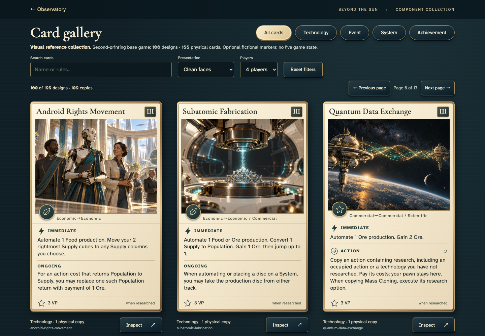](../../screenshots/explore-source-reviewed-card-faces-and-representative-public-states/007-inventory-page-6-desktop-darwin.png) | [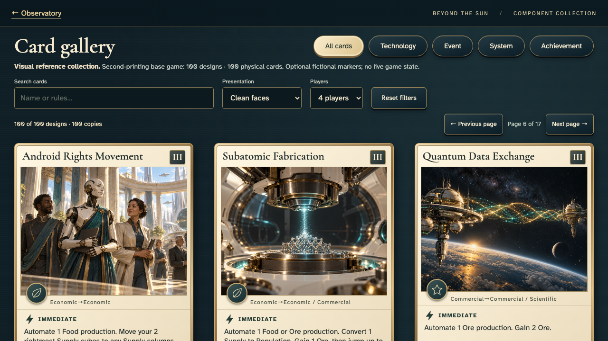](../../screenshots/explore-source-reviewed-card-faces-and-representative-public-states/007-inventory-page-6-desktop-compact-darwin.png) |

tabletop-4k · 3840 × 2160

[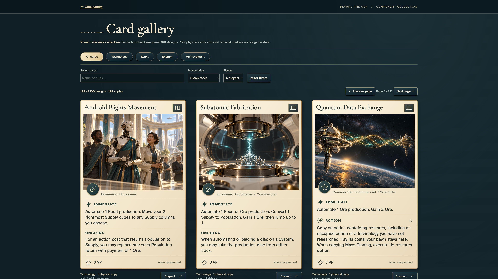](../../screenshots/explore-source-reviewed-card-faces-and-representative-public-states/007-inventory-page-6-tabletop-4k-darwin.png)

- [x] Each canonical design occurs once, with a source-backed physical-copy quantity.

## 9. Review base inventory page 7 of17

Viewpoint: **Gallery visitor**.

| phone · 393 × 852 | desktop · 1440 × 1000 | desktop-compact · 1280 × 720 |
| --- | --- | --- |
| [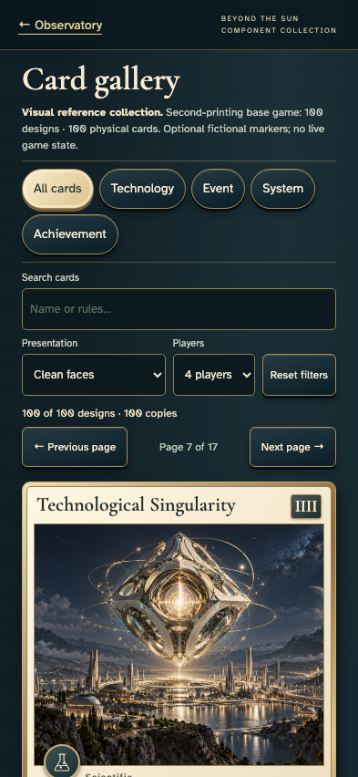](../../screenshots/explore-source-reviewed-card-faces-and-representative-public-states/008-inventory-page-7-phone-darwin.png) | [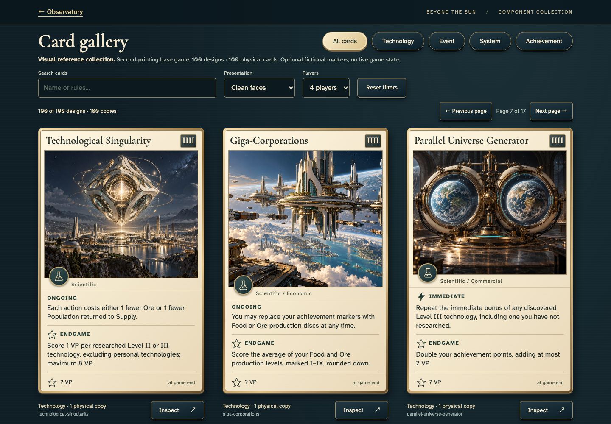](../../screenshots/explore-source-reviewed-card-faces-and-representative-public-states/008-inventory-page-7-desktop-darwin.png) | [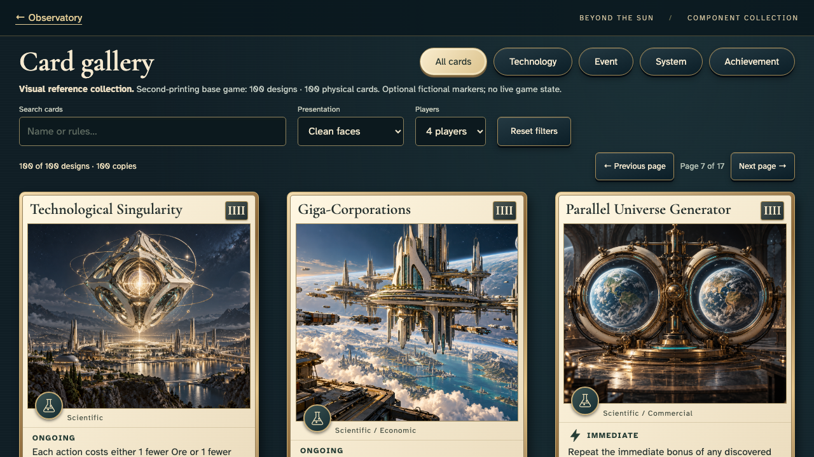](../../screenshots/explore-source-reviewed-card-faces-and-representative-public-states/008-inventory-page-7-desktop-compact-darwin.png) |

tabletop-4k · 3840 × 2160

[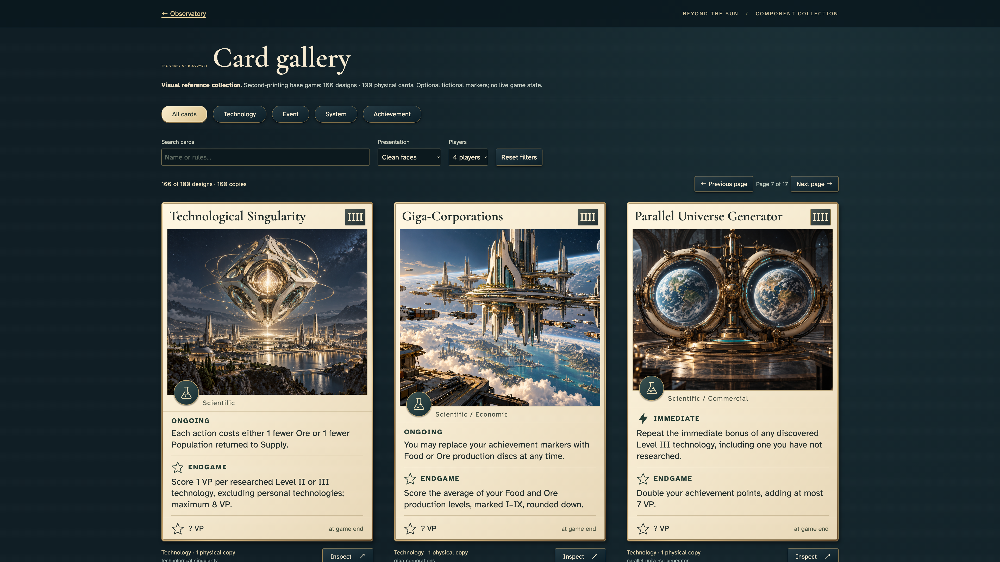](../../screenshots/explore-source-reviewed-card-faces-and-representative-public-states/008-inventory-page-7-tabletop-4k-darwin.png)

- [x] Each canonical design occurs once, with a source-backed physical-copy quantity.

## 10. Review base inventory page 8 of17

Viewpoint: **Gallery visitor**.

| phone · 393 × 852 | desktop · 1440 × 1000 | desktop-compact · 1280 × 720 |
| --- | --- | --- |
| [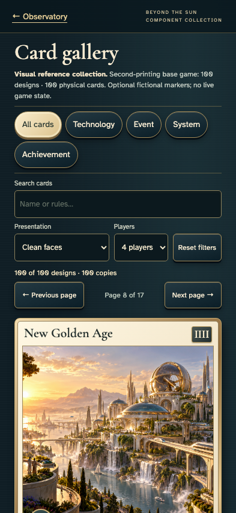](../../screenshots/explore-source-reviewed-card-faces-and-representative-public-states/009-inventory-page-8-phone-darwin.png) | [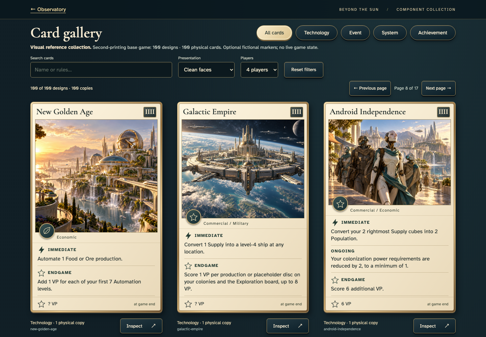](../../screenshots/explore-source-reviewed-card-faces-and-representative-public-states/009-inventory-page-8-desktop-darwin.png) | [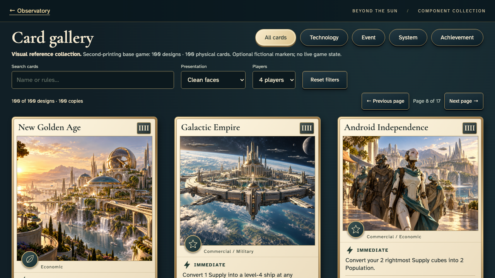](../../screenshots/explore-source-reviewed-card-faces-and-representative-public-states/009-inventory-page-8-desktop-compact-darwin.png) |

tabletop-4k · 3840 × 2160

[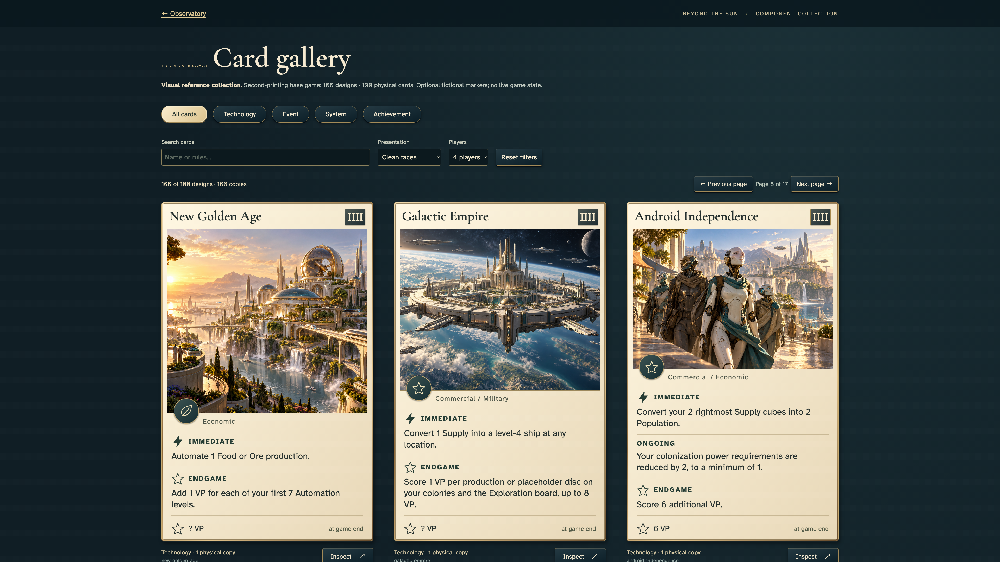](../../screenshots/explore-source-reviewed-card-faces-and-representative-public-states/009-inventory-page-8-tabletop-4k-darwin.png)

- [x] Each canonical design occurs once, with a source-backed physical-copy quantity.

## 11. Review base inventory page 9 of17

Viewpoint: **Gallery visitor**.

| phone · 393 × 852 | desktop · 1440 × 1000 | desktop-compact · 1280 × 720 |
| --- | --- | --- |
| [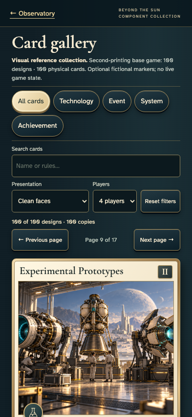](../../screenshots/explore-source-reviewed-card-faces-and-representative-public-states/010-inventory-page-9-phone-darwin.png) | [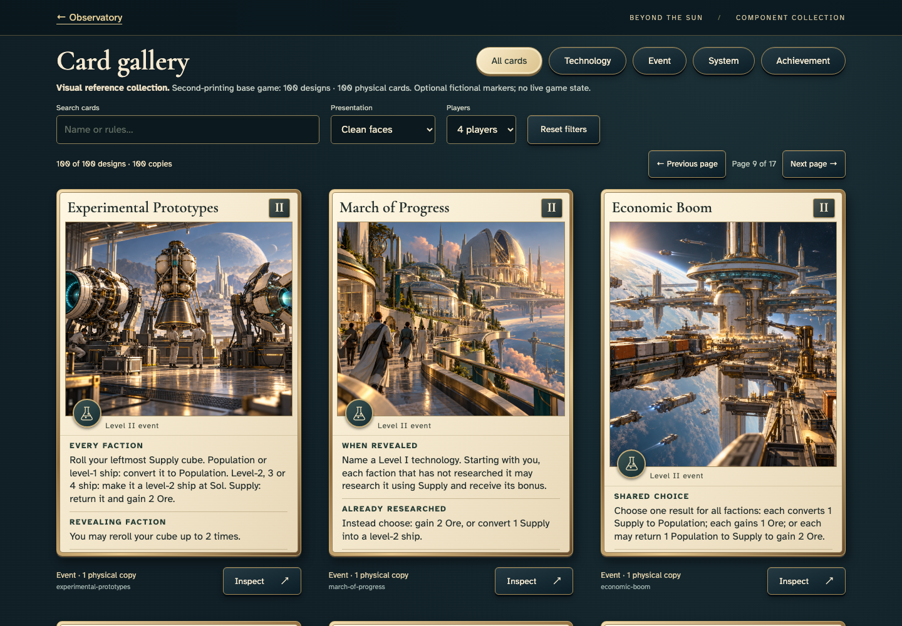](../../screenshots/explore-source-reviewed-card-faces-and-representative-public-states/010-inventory-page-9-desktop-darwin.png) | [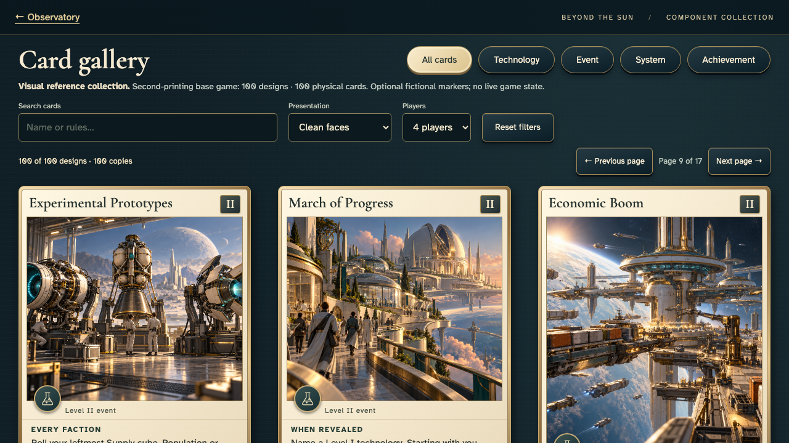](../../screenshots/explore-source-reviewed-card-faces-and-representative-public-states/010-inventory-page-9-desktop-compact-darwin.png) |

tabletop-4k · 3840 × 2160

[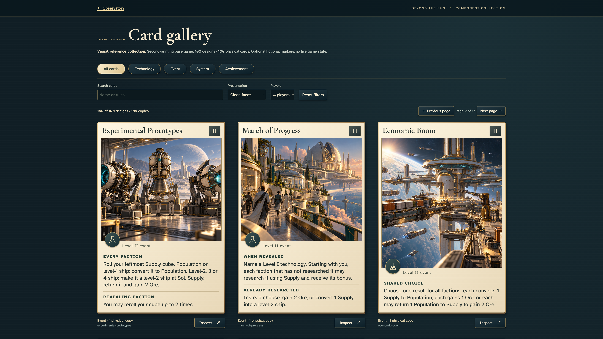](../../screenshots/explore-source-reviewed-card-faces-and-representative-public-states/010-inventory-page-9-tabletop-4k-darwin.png)

- [x] Each canonical design occurs once, with a source-backed physical-copy quantity.

## 12. Review base inventory page 10 of17

Viewpoint: **Gallery visitor**.

| phone · 393 × 852 | desktop · 1440 × 1000 | desktop-compact · 1280 × 720 |
| --- | --- | --- |
| [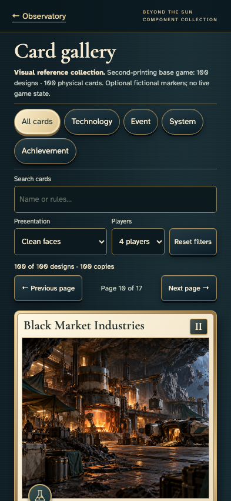](../../screenshots/explore-source-reviewed-card-faces-and-representative-public-states/011-inventory-page-10-phone-darwin.png) | [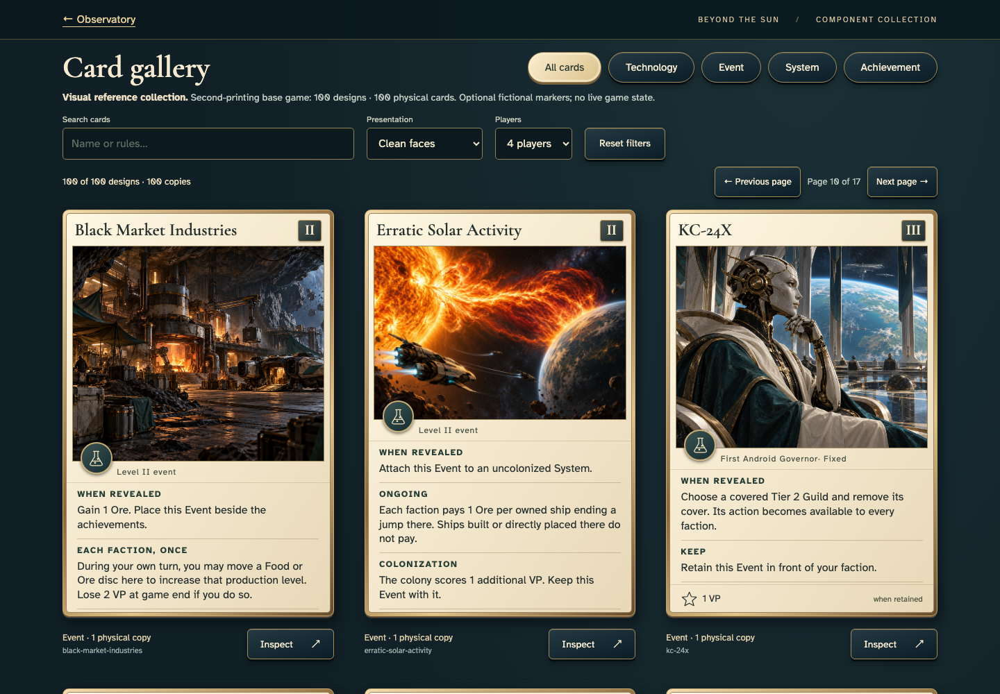](../../screenshots/explore-source-reviewed-card-faces-and-representative-public-states/011-inventory-page-10-desktop-darwin.png) | [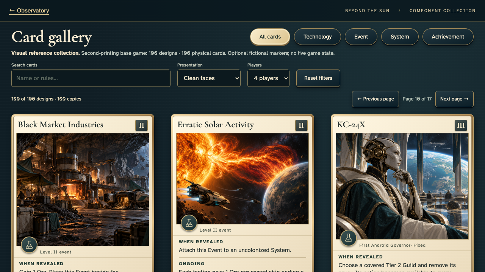](../../screenshots/explore-source-reviewed-card-faces-and-representative-public-states/011-inventory-page-10-desktop-compact-darwin.png) |

tabletop-4k · 3840 × 2160

[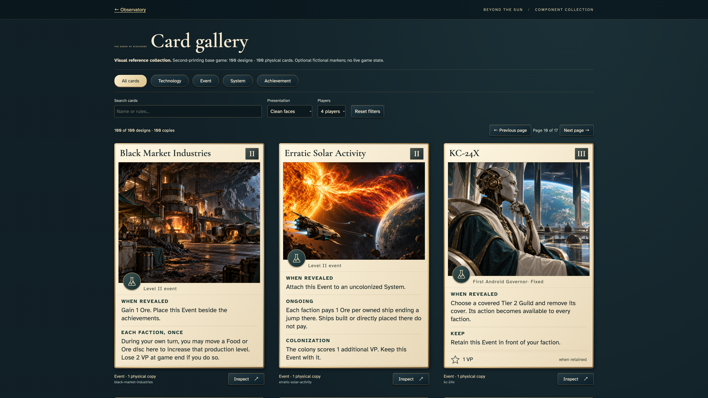](../../screenshots/explore-source-reviewed-card-faces-and-representative-public-states/011-inventory-page-10-tabletop-4k-darwin.png)

- [x] Each canonical design occurs once, with a source-backed physical-copy quantity.

## 13. Review base inventory page 11 of17

Viewpoint: **Gallery visitor**.

| phone · 393 × 852 | desktop · 1440 × 1000 | desktop-compact · 1280 × 720 |
| --- | --- | --- |
| [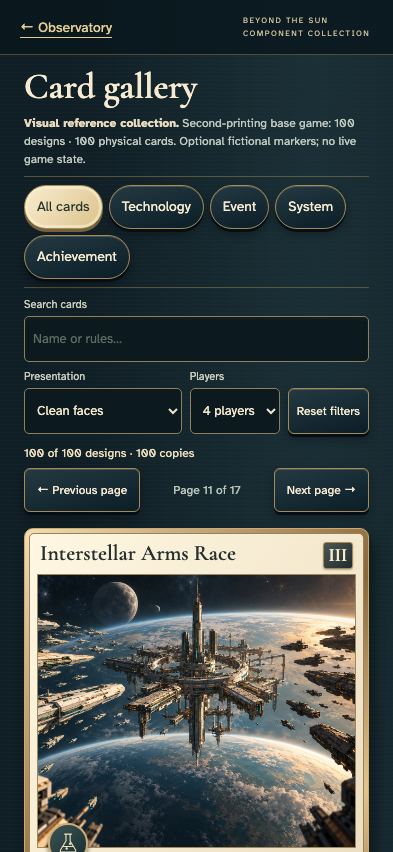](../../screenshots/explore-source-reviewed-card-faces-and-representative-public-states/012-inventory-page-11-phone-darwin.png) | [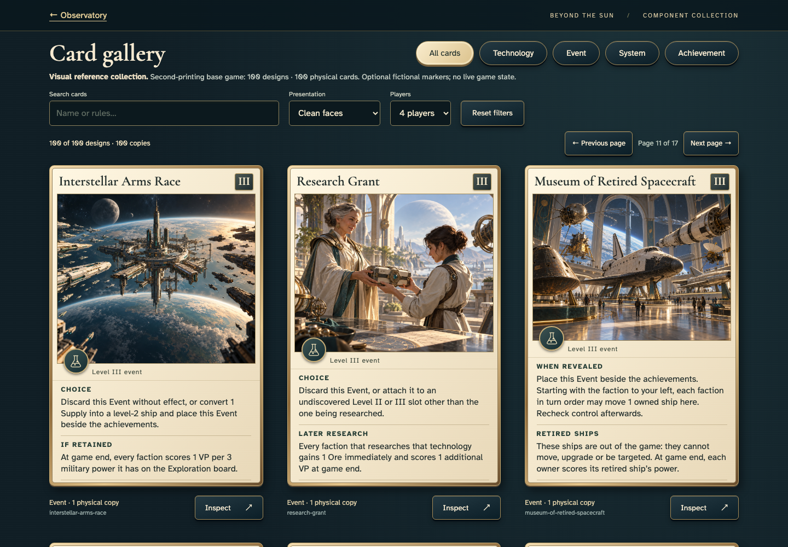](../../screenshots/explore-source-reviewed-card-faces-and-representative-public-states/012-inventory-page-11-desktop-darwin.png) | [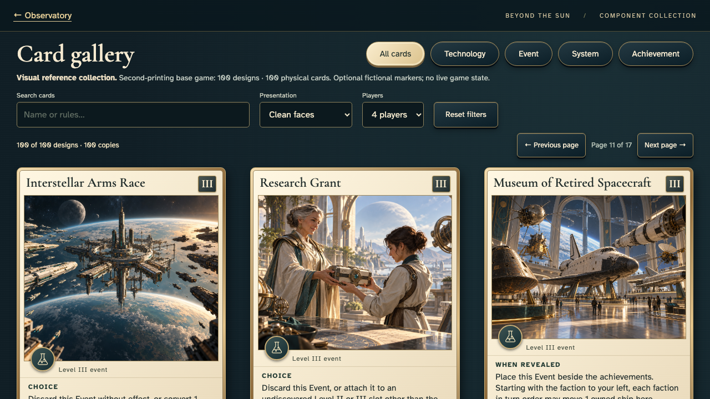](../../screenshots/explore-source-reviewed-card-faces-and-representative-public-states/012-inventory-page-11-desktop-compact-darwin.png) |

tabletop-4k · 3840 × 2160

[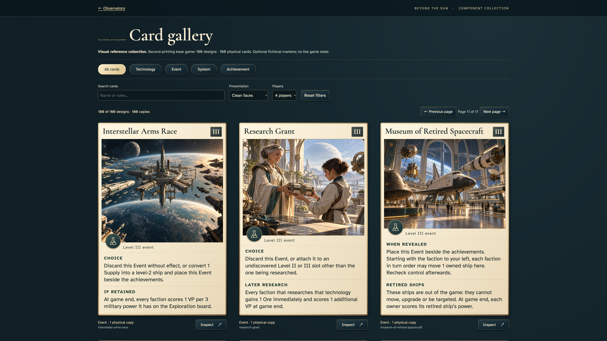](../../screenshots/explore-source-reviewed-card-faces-and-representative-public-states/012-inventory-page-11-tabletop-4k-darwin.png)

- [x] Each canonical design occurs once, with a source-backed physical-copy quantity.

## 14. Review base inventory page 12 of17

Viewpoint: **Gallery visitor**.

| phone · 393 × 852 | desktop · 1440 × 1000 | desktop-compact · 1280 × 720 |
| --- | --- | --- |
| [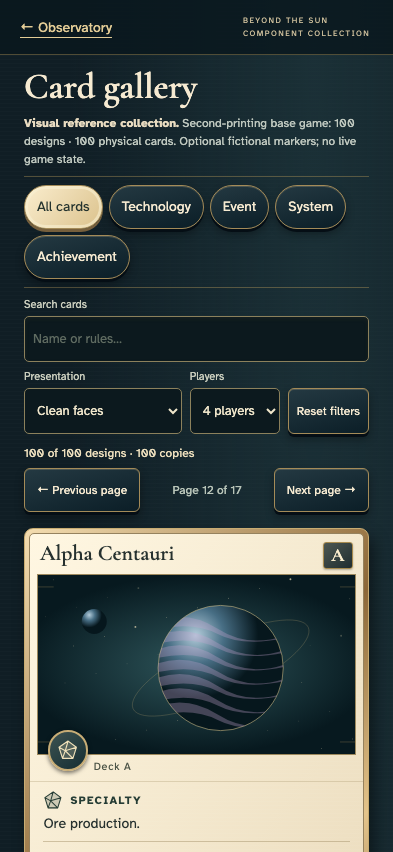](../../screenshots/explore-source-reviewed-card-faces-and-representative-public-states/013-inventory-page-12-phone-darwin.png) | [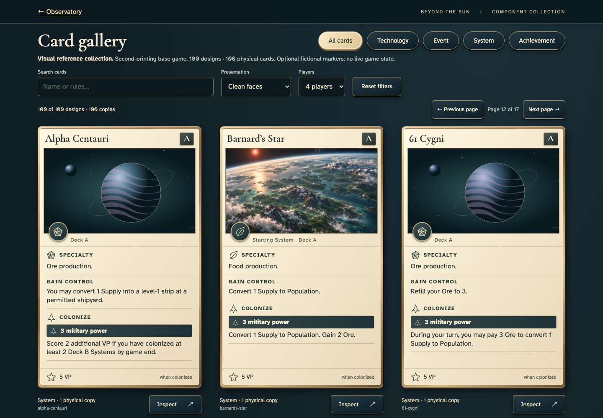](../../screenshots/explore-source-reviewed-card-faces-and-representative-public-states/013-inventory-page-12-desktop-darwin.png) | [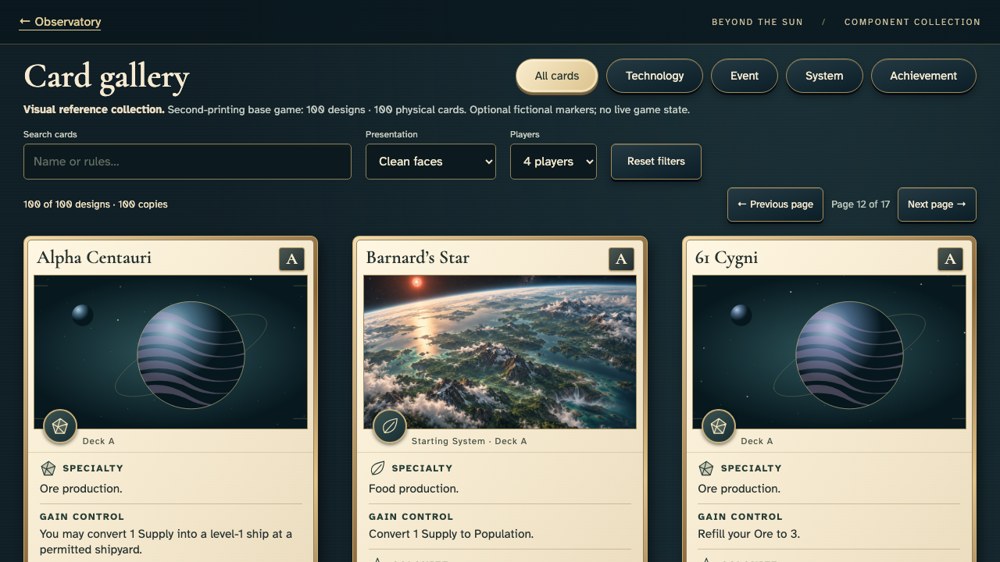](../../screenshots/explore-source-reviewed-card-faces-and-representative-public-states/013-inventory-page-12-desktop-compact-darwin.png) |

tabletop-4k · 3840 × 2160

[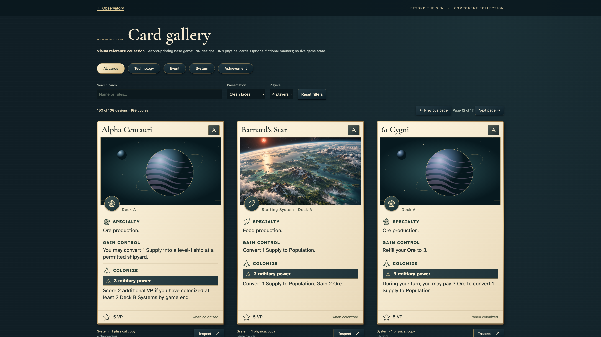](../../screenshots/explore-source-reviewed-card-faces-and-representative-public-states/013-inventory-page-12-tabletop-4k-darwin.png)

- [x] Each canonical design occurs once, with a source-backed physical-copy quantity.

## 15. Review base inventory page 13 of17

Viewpoint: **Gallery visitor**.

| phone · 393 × 852 | desktop · 1440 × 1000 | desktop-compact · 1280 × 720 |
| --- | --- | --- |
| [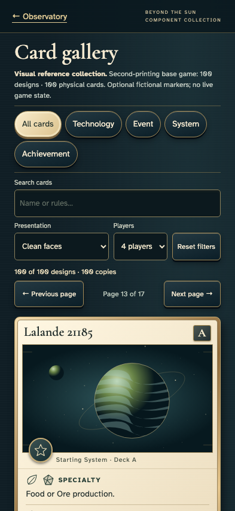](../../screenshots/explore-source-reviewed-card-faces-and-representative-public-states/014-inventory-page-13-phone-darwin.png) | [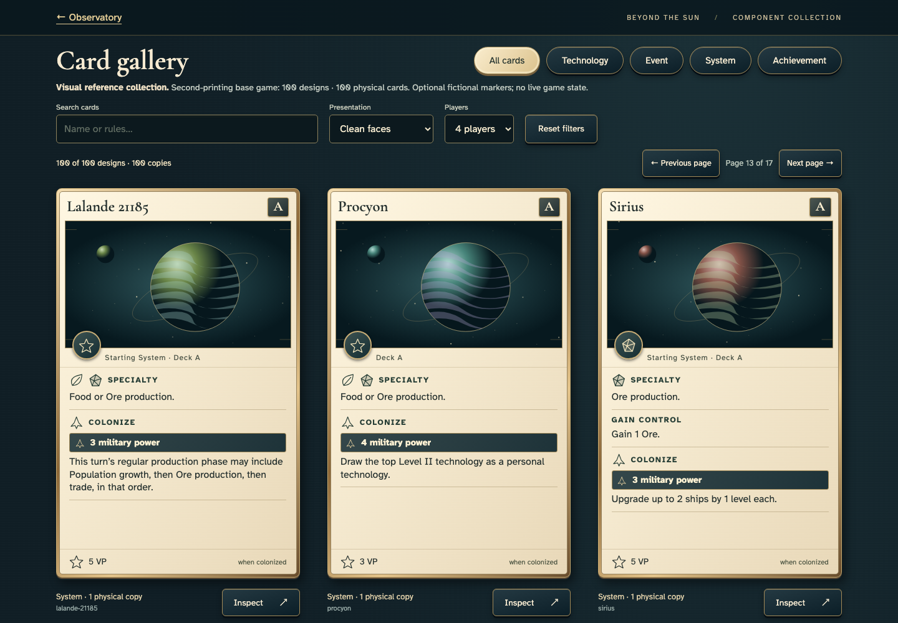](../../screenshots/explore-source-reviewed-card-faces-and-representative-public-states/014-inventory-page-13-desktop-darwin.png) | [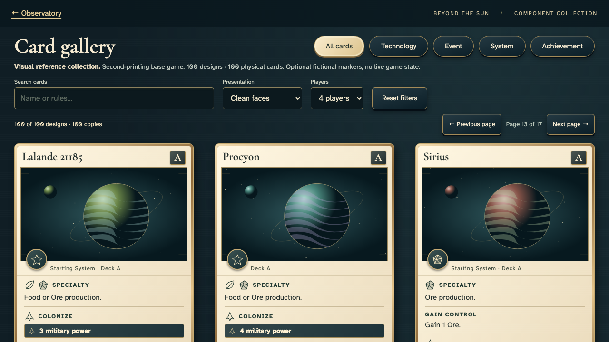](../../screenshots/explore-source-reviewed-card-faces-and-representative-public-states/014-inventory-page-13-desktop-compact-darwin.png) |

tabletop-4k · 3840 × 2160

[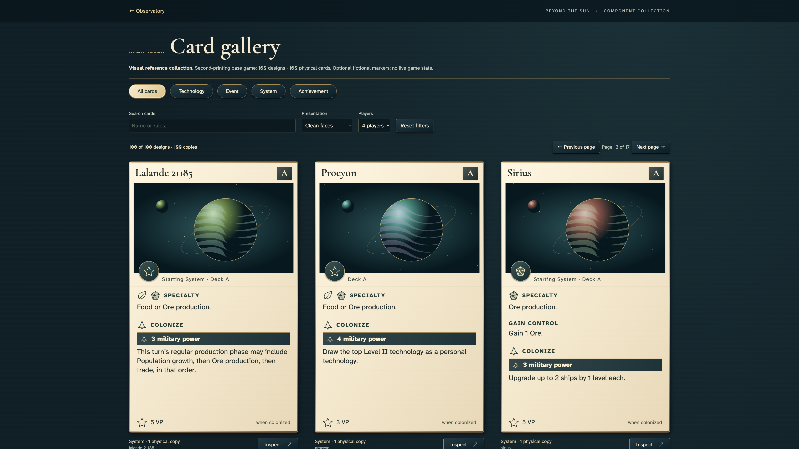](../../screenshots/explore-source-reviewed-card-faces-and-representative-public-states/014-inventory-page-13-tabletop-4k-darwin.png)

- [x] Each canonical design occurs once, with a source-backed physical-copy quantity.

## 16. Review base inventory page 14 of17

Viewpoint: **Gallery visitor**.

| phone · 393 × 852 | desktop · 1440 × 1000 | desktop-compact · 1280 × 720 |
| --- | --- | --- |
|  |  |  |

tabletop-4k · 3840 × 2160

- [x] Each canonical design occurs once, with a source-backed physical-copy quantity.

## 17. Review base inventory page 15 of17

Viewpoint: **Gallery visitor**.

| phone · 393 × 852 | desktop · 1440 × 1000 | desktop-compact · 1280 × 720 |
| --- | --- | --- |
|  |  |  |

tabletop-4k · 3840 × 2160

- [x] Each canonical design occurs once, with a source-backed physical-copy quantity.

## 18. Review base inventory page 16 of17

Viewpoint: **Gallery visitor**.

| phone · 393 × 852 | desktop · 1440 × 1000 | desktop-compact · 1280 × 720 |
| --- | --- | --- |
|  |  |  |

tabletop-4k · 3840 × 2160

- [x] Each canonical design occurs once, with a source-backed physical-copy quantity.

## 19. Review base inventory page 17 of17

Viewpoint: **Gallery visitor**.

| phone · 393 × 852 | desktop · 1440 × 1000 | desktop-compact · 1280 × 720 |
| --- | --- | --- |
|  |  |  |

tabletop-4k · 3840 × 2160

- [x] Each canonical design occurs once, with a source-backed physical-copy quantity.

## 20. Focus the collection on technologies

Viewpoint: **Gallery visitor**.

| phone · 393 × 852 | desktop · 1440 × 1000 | desktop-compact · 1280 × 720 |
| --- | --- | --- |
|  |  |  |

tabletop-4k · 3840 × 2160

- [x] All46 technologies are available through eight pages, with complete type directions, bonuses, costs and actions.

## 21. Read Hypercomputing at inspection scale

Viewpoint: **Gallery visitor**.

| phone · 393 × 852 | desktop · 1440 × 1000 | desktop-compact · 1280 × 720 |
| --- | --- | --- |
|  |  |  |

tabletop-4k · 3840 × 2160

- [x] The complete face shows the one-time bonus, research cost, action and scoring.

## 22. Keep reverse keyboard navigation inside the inspector

Viewpoint: **Gallery visitor**.

| phone · 393 × 852 | desktop · 1440 × 1000 | desktop-compact · 1280 × 720 |
| --- | --- | --- |
|  |  |  |

tabletop-4k · 3840 × 2160

- [x] Shift+Tab from Close wraps to the final enabled navigation control.

## 23. Keep forward keyboard navigation inside the inspector

Viewpoint: **Gallery visitor**.

| phone · 393 × 852 | desktop · 1440 × 1000 | desktop-compact · 1280 × 720 |
| --- | --- | --- |
|  |  |  |

tabletop-4k · 3840 × 2160

- [x] Tab from the final navigation control wraps to Close instead of escaping the dialog.

## 24. Reach the labelled card-details scroll region

Viewpoint: **Gallery visitor**.

| phone · 393 × 852 | desktop · 1440 × 1000 | desktop-compact · 1280 × 720 |
| --- | --- | --- |
|  |  |  |

tabletop-4k · 3840 × 2160

- [x] The card/details area is keyboard reachable while navigation stays outside it.

## 25. Read the end of the card details with navigation still in reach

Viewpoint: **Gallery visitor**.

| phone · 393 × 852 | desktop · 1440 × 1000 | desktop-compact · 1280 × 720 |
| --- | --- | --- |
|  |  |  |

tabletop-4k · 3840 × 2160

- [x] End reaches the details limit; Close and Previous/Next stay within the viewport.

## 26. Inspect a technology with two actions

Viewpoint: **Gallery visitor**.

| phone · 393 × 852 | desktop · 1440 × 1000 | desktop-compact · 1280 × 720 |
| --- | --- | --- |
|  |  |  |

tabletop-4k · 3840 × 2160

- [x] Human Experiments preserves its immediate upgrade and two separate action/cost groups.

## 27. Return to the source card with Escape

Viewpoint: **Gallery visitor**.

| phone · 393 × 852 | desktop · 1440 × 1000 | desktop-compact · 1280 × 720 |
| --- | --- | --- |
|  |  |  |

tabletop-4k · 3840 × 2160

- [x] Closing restores keyboard focus to the original inspection control.

## 28. Compare labelled visual state on the same renderers

Viewpoint: **Gallery visitor**.

| phone · 393 × 852 | desktop · 1440 × 1000 | desktop-compact · 1280 × 720 |
| --- | --- | --- |
|  |  |  |

tabletop-4k · 3840 × 2160

- [x] Researchers and action occupancy are distinct, fictional examples.

## 29. Inspect researchers and an occupied action

Viewpoint: **Gallery visitor**.

| phone · 393 × 852 | desktop · 1440 × 1000 | desktop-compact · 1280 × 720 |
| --- | --- | --- |
|  |  |  |

tabletop-4k · 3840 × 2160

- [x] Two named research cubes remain separate from Ada’s action pawn.

## 30. Close inspection without changing the fixture

Viewpoint: **Gallery visitor**.

| phone · 393 × 852 | desktop · 1440 × 1000 | desktop-compact · 1280 × 720 |
| --- | --- | --- |
|  |  |  |

tabletop-4k · 3840 × 2160

- [x] The example presentation remains selected.

## 31. Browse all20 base Events

Viewpoint: **Gallery visitor**.

| phone · 393 × 852 | desktop · 1440 × 1000 | desktop-compact · 1280 × 720 |
| --- | --- | --- |
|  |  |  |

tabletop-4k · 3840 × 2160

- [x] The public reference catalog includes both levels and fixed events, without exposing a live game’s event order.

## 32. Find a fixed Event by canonical identity

Viewpoint: **Gallery visitor**.

| phone · 393 × 852 | desktop · 1440 × 1000 | desktop-compact · 1280 × 720 |
| --- | --- | --- |
|  |  |  |

tabletop-4k · 3840 × 2160

- [x] Search covers every card beyond the current collection page.

## 33. Read the longer event text and retained reward

Viewpoint: **Gallery visitor**.

| phone · 393 × 852 | desktop · 1440 × 1000 | desktop-compact · 1280 × 720 |
| --- | --- | --- |
|  |  |  |

tabletop-4k · 3840 × 2160

- [x] The reveal effect, shared guild access, retention and point value are readable.

## 34. Return to the event collection

Viewpoint: **Gallery visitor**.

| phone · 393 × 852 | desktop · 1440 × 1000 | desktop-compact · 1280 × 720 |
| --- | --- | --- |
|  |  |  |

tabletop-4k · 3840 × 2160

- [x] The event filter and source inspection control are retained.

## 35. Restore the Event family

Viewpoint: **Gallery visitor**.

| phone · 393 × 852 | desktop · 1440 × 1000 | desktop-compact · 1280 × 720 |
| --- | --- | --- |
|  |  |  |

tabletop-4k · 3840 × 2160

- [x] Clearing search restores all20 Event designs.

## 36. Review a starting System with a colony example

Viewpoint: **Gallery visitor**.

| phone · 393 × 852 | desktop · 1440 × 1000 | desktop-compact · 1280 × 720 |
| --- | --- | --- |
|  |  |  |

tabletop-4k · 3840 × 2160

- [x] Barnard’s Star shows a named colony with two production discs.

## 37. Read control, settlement and scoring separately

Viewpoint: **Gallery visitor**.

| phone · 393 × 852 | desktop · 1440 × 1000 | desktop-compact · 1280 × 720 |
| --- | --- | --- |
|  |  |  |

tabletop-4k · 3840 × 2160

- [x] The food specialty, 3-power settlement cost and 5-point colony value are visible.

## 38. Return from the System face

Viewpoint: **Gallery visitor**.

| phone · 393 × 852 | desktop · 1440 × 1000 | desktop-compact · 1280 × 720 |
| --- | --- | --- |
|  |  |  |

tabletop-4k · 3840 × 2160

- [x] The original System inspection control has focus.

## 39. Compare achievement requirements and claim slots

Viewpoint: **Gallery visitor**.

| phone · 393 × 852 | desktop · 1440 × 1000 | desktop-compact · 1280 × 720 |
| --- | --- | --- |
|  |  |  |

tabletop-4k · 3840 × 2160

- [x] All10 achievements are present with source-backed rewards and separate example claims.

## 40. Apply the three-player achievement restriction

Viewpoint: **Gallery visitor**.

| phone · 393 × 852 | desktop · 1440 × 1000 | desktop-compact · 1280 × 720 |
| --- | --- | --- |
|  |  |  |

tabletop-4k · 3840 × 2160

- [x] Technologist’s second slot is explicitly unavailable in a three-player reference.

## 41. Inspect the restricted achievement at full size

Viewpoint: **Gallery visitor**.

| phone · 393 × 852 | desktop · 1440 × 1000 | desktop-compact · 1280 × 720 |
| --- | --- | --- |
|  |  |  |

tabletop-4k · 3840 × 2160

- [x] The requirement excludes personal technologies and the blocked second slot stays visible.

## 42. Restore the achievement inspection source

Viewpoint: **Gallery visitor**.

| phone · 393 × 852 | desktop · 1440 × 1000 | desktop-compact · 1280 × 720 |
| --- | --- | --- |
|  |  |  |

tabletop-4k · 3840 × 2160

- [x] Keyboard focus returns to Technologist.

## 43. See an informative empty search result

Viewpoint: **Gallery visitor**.

| phone · 393 × 852 | desktop · 1440 × 1000 | desktop-compact · 1280 × 720 |
| --- | --- | --- |
|  |  |  |

tabletop-4k · 3840 × 2160

- [x] No match produces a clear explanation and no card faces.

## 44. Restore the full collection

Viewpoint: **Gallery visitor**.

| phone · 393 × 852 | desktop · 1440 × 1000 | desktop-compact · 1280 × 720 |
| --- | --- | --- |
|  |  |  |

tabletop-4k · 3840 × 2160

- [x] Reset clears the search and family while preserving the chosen presentation.

## 45. Restore four-player reference capacity

Viewpoint: **Gallery visitor**.

| phone · 393 × 852 | desktop · 1440 × 1000 | desktop-compact · 1280 × 720 |
| --- | --- | --- |
|  |  |  |

tabletop-4k · 3840 × 2160

- [x] Four-player rewards are available without creating a live game.

## 46. Show a crowded but explicitly fictional public tableau

Viewpoint: **Gallery visitor**.

| phone · 393 × 852 | desktop · 1440 × 1000 | desktop-compact · 1280 × 720 |
| --- | --- | --- |
|  |  |  |

tabletop-4k · 3840 × 2160

- [x] Technology cards show four named researchers; only printed action-bearing cards have an occupied-action example.

## 47. Review complete four-player claim rows

Viewpoint: **Gallery visitor**.

| phone · 393 × 852 | desktop · 1440 × 1000 | desktop-compact · 1280 × 720 |
| --- | --- | --- |
|  |  |  |

tabletop-4k · 3840 × 2160

- [x] Basic achievements show four distinct named claimants and A achievements show both valid claimants.

## 48. Retain the three-player restriction in crowded fixtures

Viewpoint: **Gallery visitor**.

| phone · 393 × 852 | desktop · 1440 × 1000 | desktop-compact · 1280 × 720 |
| --- | --- | --- |
|  |  |  |

tabletop-4k · 3840 × 2160

- [x] The unavailable second A slot is never occupied; Basic rewards contain only three example claimants.

## 49. Restore all four-player reference slots

Viewpoint: **Gallery visitor**.

| phone · 393 × 852 | desktop · 1440 × 1000 | desktop-compact · 1280 × 720 |
| --- | --- | --- |
|  |  |  |

tabletop-4k · 3840 × 2160

- [x] Both A slots are again available and visibly occupied in this optional fixture.

## 50. Return to the complete full-marker collection

Viewpoint: **Gallery visitor**.

| phone · 393 × 852 | desktop · 1440 × 1000 | desktop-compact · 1280 × 720 |
| --- | --- | --- |
|  |  |  |

tabletop-4k · 3840 × 2160

- [x] All100 canonical designs and100 copies remain available for long-face inspection.

## 51. Find Human Experiments in the complete inventory

Viewpoint: **Gallery visitor**.

| phone · 393 × 852 | desktop · 1440 × 1000 | desktop-compact · 1280 × 720 |
| --- | --- | --- |
|  |  |  |

tabletop-4k · 3840 × 2160

- [x] Canonical identity search returns exactly one original illustrated face.

## 52. Inspect Human Experiments with full public markers

Viewpoint: **Gallery visitor**.

| phone · 393 × 852 | desktop · 1440 × 1000 | desktop-compact · 1280 × 720 |
| --- | --- | --- |
|  |  |  |

tabletop-4k · 3840 × 2160

- [x] Four researchers and an occupied action coexist with both complete research/ship costs.

## 53. Read the end of Human Experiments without losing navigation

Viewpoint: **Gallery visitor**.

| phone · 393 × 852 | desktop · 1440 × 1000 | desktop-compact · 1280 × 720 |
| --- | --- | --- |
|  |  |  |

tabletop-4k · 3840 × 2160

- [x] The complete card/source is reachable; Close and Previous/Next stay within the viewport.

## 54. Return from Human Experiments

Viewpoint: **Gallery visitor**.

| phone · 393 × 852 | desktop · 1440 × 1000 | desktop-compact · 1280 × 720 |
| --- | --- | --- |
|  |  |  |

tabletop-4k · 3840 × 2160

- [x] Escape restores the actual source control without changing filters or fictional presentation.

## 55. Find Ministry of Colonies in the complete inventory

Viewpoint: **Gallery visitor**.

| phone · 393 × 852 | desktop · 1440 × 1000 | desktop-compact · 1280 × 720 |
| --- | --- | --- |
|  |  |  |

tabletop-4k · 3840 × 2160

- [x] Canonical identity search returns exactly one original illustrated face.

## 56. Inspect Ministry of Colonies with full public markers

Viewpoint: **Gallery visitor**.

| phone · 393 × 852 | desktop · 1440 × 1000 | desktop-compact · 1280 × 720 |
| --- | --- | --- |
|  |  |  |

tabletop-4k · 3840 × 2160

- [x] The complete Level IIII colony-draw effect and scoring fit alongside four researchers.

## 57. Read the end of Ministry of Colonies without losing navigation

Viewpoint: **Gallery visitor**.

| phone · 393 × 852 | desktop · 1440 × 1000 | desktop-compact · 1280 × 720 |
| --- | --- | --- |
|  |  |  |

tabletop-4k · 3840 × 2160

- [x] The complete card/source is reachable; Close and Previous/Next stay within the viewport.

## 58. Return from Ministry of Colonies

Viewpoint: **Gallery visitor**.

| phone · 393 × 852 | desktop · 1440 × 1000 | desktop-compact · 1280 × 720 |
| --- | --- | --- |
|  |  |  |

tabletop-4k · 3840 × 2160

- [x] Escape restores the actual source control without changing filters or fictional presentation.

## 59. Find Mass Enlightenment in the complete inventory

Viewpoint: **Gallery visitor**.

| phone · 393 × 852 | desktop · 1440 × 1000 | desktop-compact · 1280 × 720 |
| --- | --- | --- |
|  |  |  |

tabletop-4k · 3840 × 2160

- [x] Canonical identity search returns exactly one original illustrated face.

## 60. Inspect Mass Enlightenment with full public markers

Viewpoint: **Gallery visitor**.

| phone · 393 × 852 | desktop · 1440 × 1000 | desktop-compact · 1280 × 720 |
| --- | --- | --- |
|  |  |  |

tabletop-4k · 3840 × 2160

- [x] Final-round restriction, extra public technology and achievement exclusion remain complete.

## 61. Read the end of Mass Enlightenment without losing navigation

Viewpoint: **Gallery visitor**.

| phone · 393 × 852 | desktop · 1440 × 1000 | desktop-compact · 1280 × 720 |
| --- | --- | --- |
|  |  |  |

tabletop-4k · 3840 × 2160

- [x] The complete card/source is reachable; Close and Previous/Next stay within the viewport.

## 62. Return from Mass Enlightenment

Viewpoint: **Gallery visitor**.

| phone · 393 × 852 | desktop · 1440 × 1000 | desktop-compact · 1280 × 720 |
| --- | --- | --- |
|  |  |  |

tabletop-4k · 3840 × 2160

- [x] Escape restores the actual source control without changing filters or fictional presentation.

## 63. Find Dyson Sphere, Mk. I in the complete inventory

Viewpoint: **Gallery visitor**.

| phone · 393 × 852 | desktop · 1440 × 1000 | desktop-compact · 1280 × 720 |
| --- | --- | --- |
|  |  |  |

tabletop-4k · 3840 × 2160

- [x] Canonical identity search returns exactly one original illustrated face.

## 64. Inspect Dyson Sphere, Mk. I with full public markers

Viewpoint: **Gallery visitor**.

| phone · 393 × 852 | desktop · 1440 × 1000 | desktop-compact · 1280 × 720 |
| --- | --- | --- |
|  |  |  |

tabletop-4k · 3840 × 2160

- [x] The shared action retains5 Ore and3 returned Population, its delayed availability and all settlement exceptions.

## 65. Read the end of Dyson Sphere, Mk. I without losing navigation

Viewpoint: **Gallery visitor**.

| phone · 393 × 852 | desktop · 1440 × 1000 | desktop-compact · 1280 × 720 |
| --- | --- | --- |
|  |  |  |

tabletop-4k · 3840 × 2160

- [x] The complete card/source is reachable; Close and Previous/Next stay within the viewport.

## 66. Return from Dyson Sphere, Mk. I

Viewpoint: **Gallery visitor**.

| phone · 393 × 852 | desktop · 1440 × 1000 | desktop-compact · 1280 × 720 |
| --- | --- | --- |
|  |  |  |

tabletop-4k · 3840 × 2160

- [x] Escape restores the actual source control without changing filters or fictional presentation.

## 67. Find Luyten’s Star in the complete inventory

Viewpoint: **Gallery visitor**.

| phone · 393 × 852 | desktop · 1440 × 1000 | desktop-compact · 1280 × 720 |
| --- | --- | --- |
|  |  |  |

tabletop-4k · 3840 × 2160

- [x] Canonical identity search returns exactly one original illustrated face.

## 68. Inspect Luyten’s Star with full public markers

Viewpoint: **Gallery visitor**.

| phone · 393 × 852 | desktop · 1440 × 1000 | desktop-compact · 1280 × 720 |
| --- | --- | --- |
|  |  |  |

tabletop-4k · 3840 × 2160

- [x] The entry restriction remains separate from colonization, with two colony production markers.

## 69. Read the end of Luyten’s Star without losing navigation

Viewpoint: **Gallery visitor**.

| phone · 393 × 852 | desktop · 1440 × 1000 | desktop-compact · 1280 × 720 |
| --- | --- | --- |
|  |  |  |

tabletop-4k · 3840 × 2160

- [x] The complete card/source is reachable; Close and Previous/Next stay within the viewport.

## 70. Return from Luyten’s Star

Viewpoint: **Gallery visitor**.

| phone · 393 × 852 | desktop · 1440 × 1000 | desktop-compact · 1280 × 720 |
| --- | --- | --- |
|  |  |  |

tabletop-4k · 3840 × 2160

- [x] Escape restores the actual source control without changing filters or fictional presentation.

## 71. Find Specialization in the complete inventory

Viewpoint: **Gallery visitor**.

| phone · 393 × 852 | desktop · 1440 × 1000 | desktop-compact · 1280 × 720 |
| --- | --- | --- |
|  |  |  |

tabletop-4k · 3840 × 2160

- [x] Canonical identity search returns exactly one original illustrated face.

## 72. Inspect Specialization with full public markers

Viewpoint: **Gallery visitor**.

| phone · 393 × 852 | desktop · 1440 × 1000 | desktop-compact · 1280 × 720 |
| --- | --- | --- |
|  |  |  |

tabletop-4k · 3840 × 2160

- [x] The full requirement includes printed specialties, hybrid Systems and shipyards beside the claim reward.

## 73. Read the end of Specialization without losing navigation

Viewpoint: **Gallery visitor**.

| phone · 393 × 852 | desktop · 1440 × 1000 | desktop-compact · 1280 × 720 |
| --- | --- | --- |
|  |  |  |

tabletop-4k · 3840 × 2160

- [x] The complete card/source is reachable; Close and Previous/Next stay within the viewport.

## 74. Return from Specialization

Viewpoint: **Gallery visitor**.

| phone · 393 × 852 | desktop · 1440 × 1000 | desktop-compact · 1280 × 720 |
| --- | --- | --- |
|  |  |  |

tabletop-4k · 3840 × 2160

- [x] Escape restores the actual source control without changing filters or fictional presentation.

## 75. Return to the accepted observatory

Viewpoint: **Gallery visitor**.

| phone · 393 × 852 | desktop · 1440 × 1000 | desktop-compact · 1280 × 720 |
| --- | --- | --- |
|  |  |  |

tabletop-4k · 3840 × 2160

- [x] Play and Learn remain available and browsing has created no retained game.
