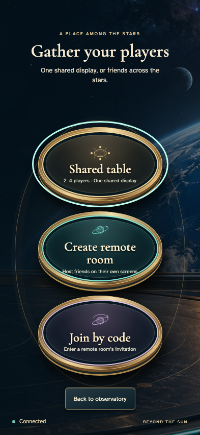
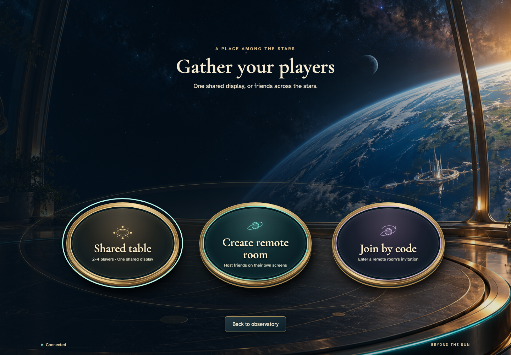
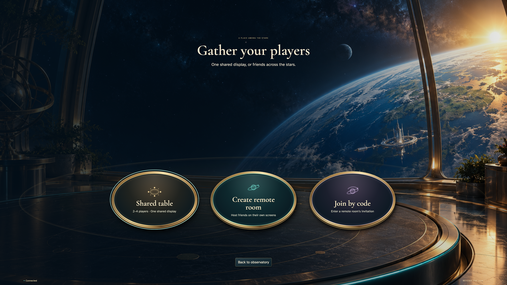
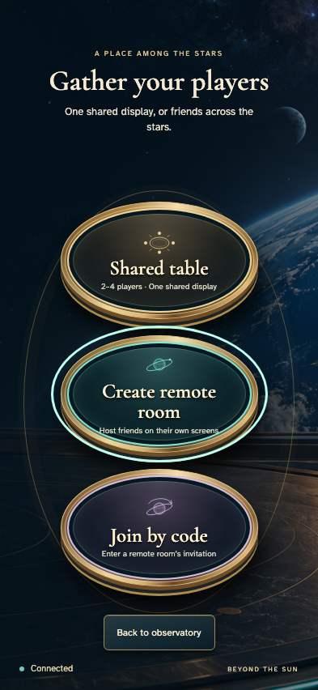
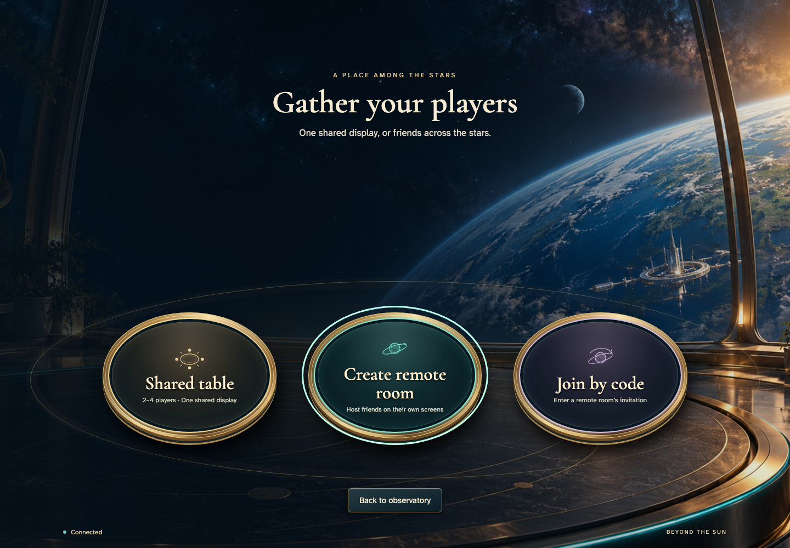
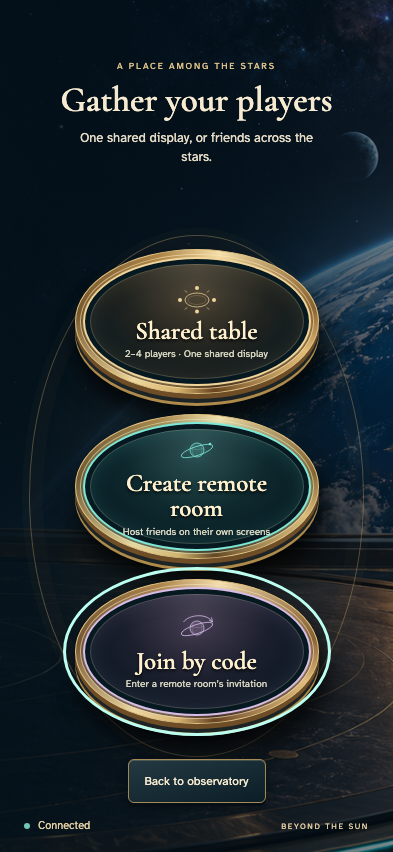
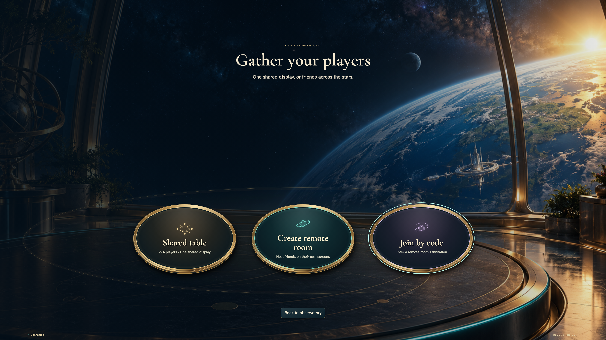
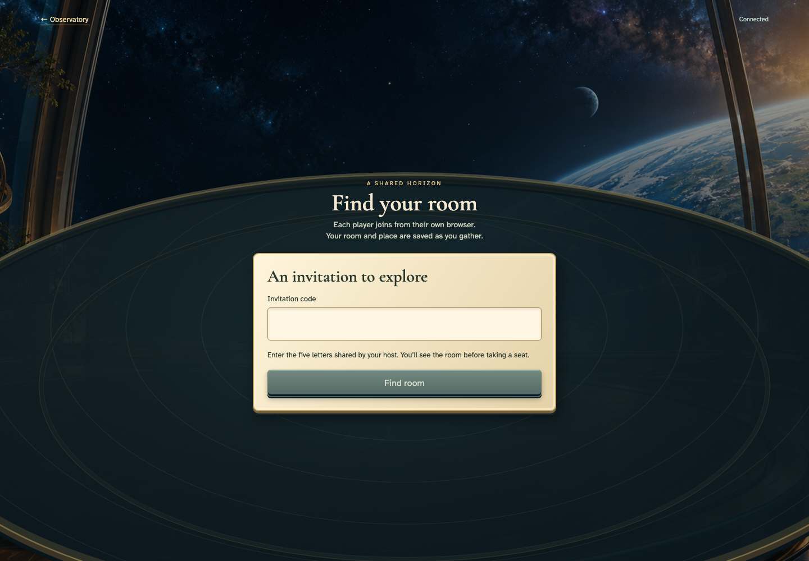
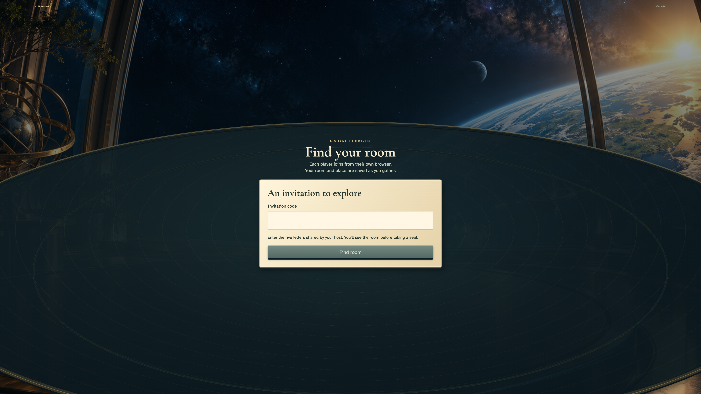
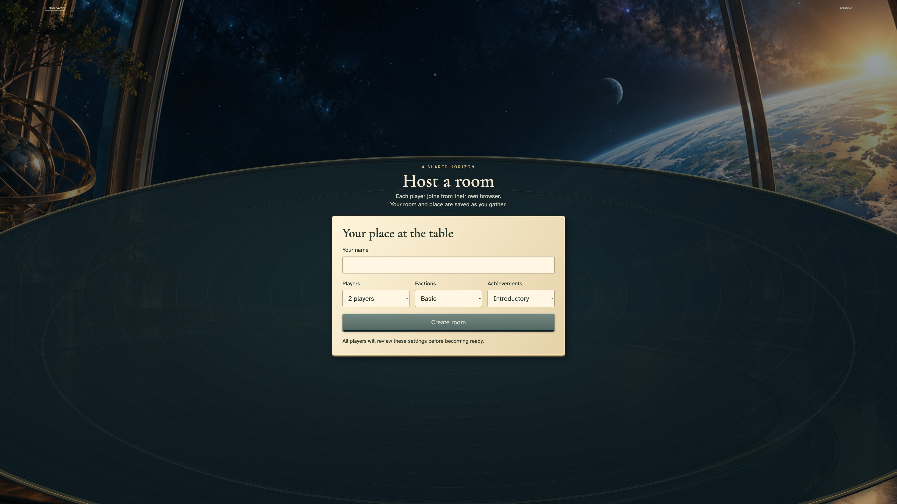

# Choose a gathering mode through tactile keyboard-accessible instruments

One visitor uses the ordinary production arrival and mode instruments on phone, desktop and a full 3840×2160 shared display. Auth and Firestore emulators; no room, faction, deck or game state is injected. Tabletop seating itself remains covered by the existing single-controller physical-seat story.

## 1. The visitor starts at the observatory

Viewpoint: **Visitor choosing a display mode**.

| phone · 393 × 852 | desktop · 1440 × 1000 |
| --- | --- |
|  |  |

tabletop-4k · 3840 × 2160

- [x] The visitor starts at the observatory

## 2. Three balanced table instruments distinguish local and remote play

Viewpoint: **Visitor choosing a display mode**.

| phone · 393 × 852 | desktop · 1440 × 1000 |
| --- | --- |
|  |  |

tabletop-4k · 3840 × 2160

- [x] Three balanced table instruments distinguish local and remote play

## 3. The shared-display instrument receives visible keyboard focus

Viewpoint: **Visitor choosing a display mode**.

| phone · 393 × 852 | desktop · 1440 × 1000 |
| --- | --- |
|  |  |

tabletop-4k · 3840 × 2160

- [x] The shared-display instrument receives visible keyboard focus

## 4. The remote-host instrument follows in keyboard order

Viewpoint: **Visitor choosing a display mode**.

| phone · 393 × 852 | desktop · 1440 × 1000 |
| --- | --- |
|  |  |

tabletop-4k · 3840 × 2160

- [x] The remote-host instrument follows in keyboard order

## 5. The invitation instrument is separately reachable

Viewpoint: **Visitor choosing a display mode**.

| phone · 393 × 852 | desktop · 1440 × 1000 |
| --- | --- |
|  |  |

tabletop-4k · 3840 × 2160

- [x] The invitation instrument is separately reachable

## 6. Keyboard activation opens the real code-entry instrument

Viewpoint: **Visitor choosing a display mode**.

| phone · 393 × 852 | desktop · 1440 × 1000 |
| --- | --- |
|  |  |

tabletop-4k · 3840 × 2160

- [x] Keyboard activation opens the real code-entry instrument

## 7. Return from code entry without creating a room

Viewpoint: **Visitor choosing a display mode**.

| phone · 393 × 852 | desktop · 1440 × 1000 |
| --- | --- |
|  |  |

tabletop-4k · 3840 × 2160

- [x] Return from code entry without creating a room

## 8. The same three production choices remain available

Viewpoint: **Visitor choosing a display mode**.

| phone · 393 × 852 | desktop · 1440 × 1000 |
| --- | --- |
|  |  |

tabletop-4k · 3840 × 2160

- [x] The same three production choices remain available

## 9. Remote creation opens the actual name and configuration controls

Viewpoint: **Visitor choosing a display mode**.

| phone · 393 × 852 | desktop · 1440 × 1000 |
| --- | --- |
|  |  |

tabletop-4k · 3840 × 2160

- [x] Remote creation opens the actual name and configuration controls

## 10. Leaving an unsubmitted host form creates no retained game

Viewpoint: **Visitor choosing a display mode**.

| phone · 393 × 852 | desktop · 1440 × 1000 |
| --- | --- |
|  |  |

tabletop-4k · 3840 × 2160

- [x] Leaving an unsubmitted host form creates no retained game
