# Invite a remote friend, confirm setup and restore the same seats across clients

Remote PvP: Ada (host), Bora (guest) and Cleo (unseated visitor) use three isolated anonymous Auth contexts against the Firestore emulator. Host and guest use complementary desktop/phone viewports, explicitly labelled per capture. Fixed UUID entropy is installed before UI setup; every room, name, setting and readiness command uses production controls. No injected game data. Recovery navigates two real built clients on the same origin/store.

## 1. Ada arrives at the observatory

Viewpoint: **Ada · host**.

| phone · 393 × 852 | desktop · 1440 × 1000 |
| --- | --- |
|  |  |

- [x] Ada arrives at the observatory
- [x] The remote shell fits the viewport without page overflow.

## 2. Choose remote hosting beside shared-table play

Viewpoint: **Ada · host**.

| phone · 393 × 852 | desktop · 1440 × 1000 |
| --- | --- |
|  |  |

- [x] Choose remote hosting beside shared-table play
- [x] The remote shell fits the viewport without page overflow.

## 3. Review the real host name and setup controls

Viewpoint: **Ada · host**.

| phone · 393 × 852 | desktop · 1440 × 1000 |
| --- | --- |
|  |  |

- [x] Review the real host name and setup controls
- [x] The remote shell fits the viewport without page overflow.

## 4. Ada enters her public player name

Viewpoint: **Ada · host**.

| phone · 393 × 852 | desktop · 1440 × 1000 |
| --- | --- |
|  |  |

- [x] Ada enters her public player name
- [x] The remote shell fits the viewport without page overflow.

## 5. The host occupies Player 1 and receives a five-letter invitation

Viewpoint: **Ada · host**.

| phone · 393 × 852 | desktop · 1440 × 1000 |
| --- | --- |
|  | [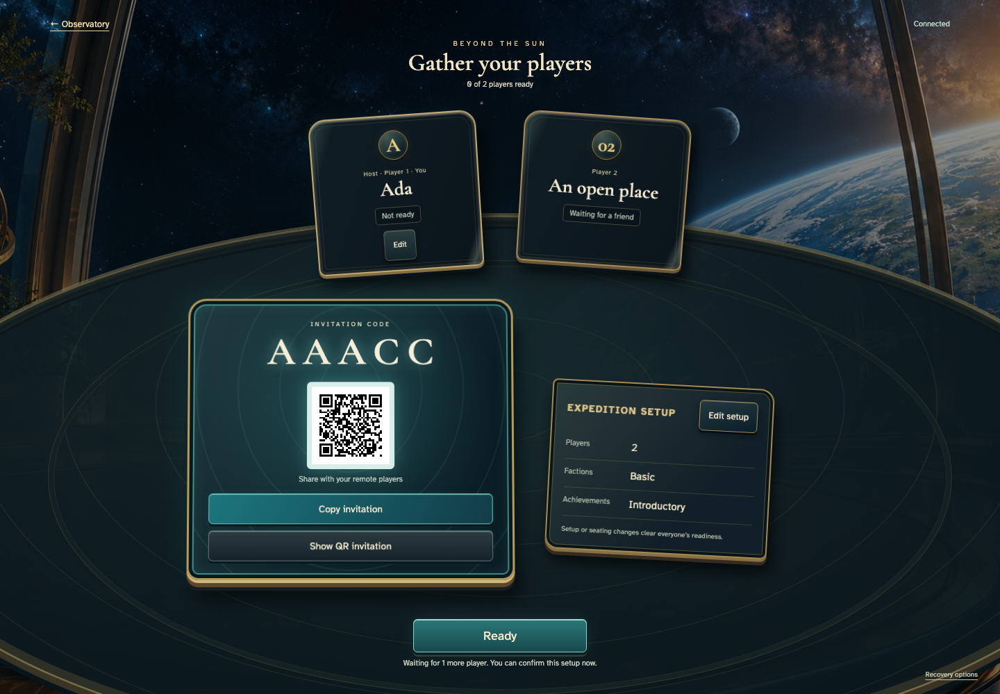](../../screenshots/invite-a-remote-friend-confirm-setup-and-restore-the-same-seats-across-clients/004-created-desktop-darwin.png) |

- [x] The host occupies Player 1 and receives a five-letter invitation
- [x] The remote shell fits the viewport without page overflow.

## 6. The remote-only invitation opens a readable QR dialog

Viewpoint: **Ada · host**.

| phone · 393 × 852 | desktop · 1440 × 1000 |
| --- | --- |
| [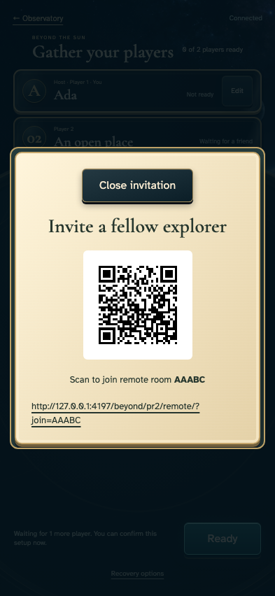](../../screenshots/invite-a-remote-friend-confirm-setup-and-restore-the-same-seats-across-clients/005-qr-phone-darwin.png) | [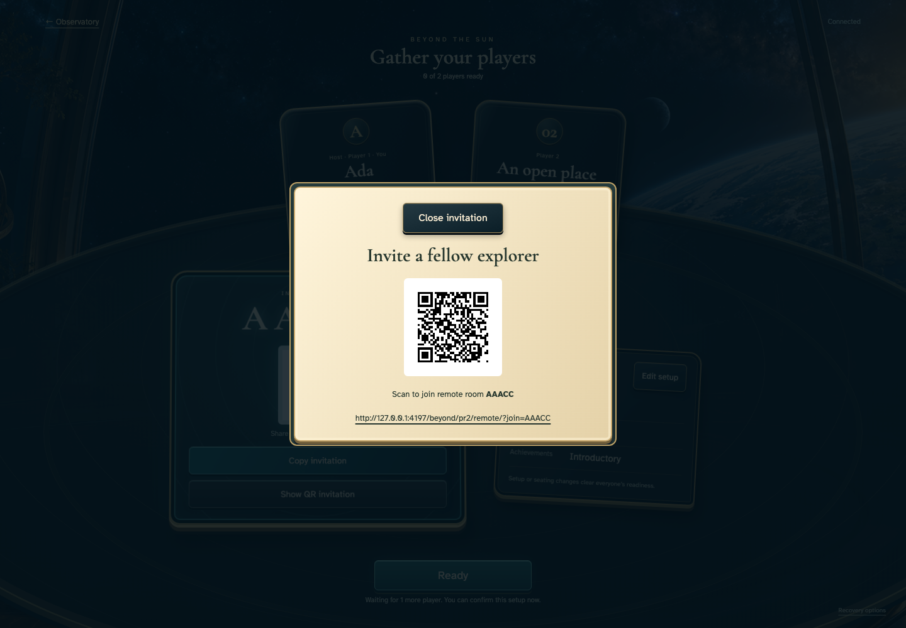](../../screenshots/invite-a-remote-friend-confirm-setup-and-restore-the-same-seats-across-clients/005-qr-desktop-darwin.png) |

- [x] The remote-only invitation opens a readable QR dialog
- [x] The remote shell fits the viewport without page overflow.

## 7. Reverse keyboard navigation reaches the underlined URL

Viewpoint: **Ada · host**.

| phone · 393 × 852 | desktop · 1440 × 1000 |
| --- | --- |
| [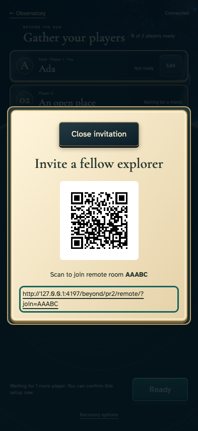](../../screenshots/invite-a-remote-friend-confirm-setup-and-restore-the-same-seats-across-clients/006-qr-keyboard-back-phone-darwin.png) | [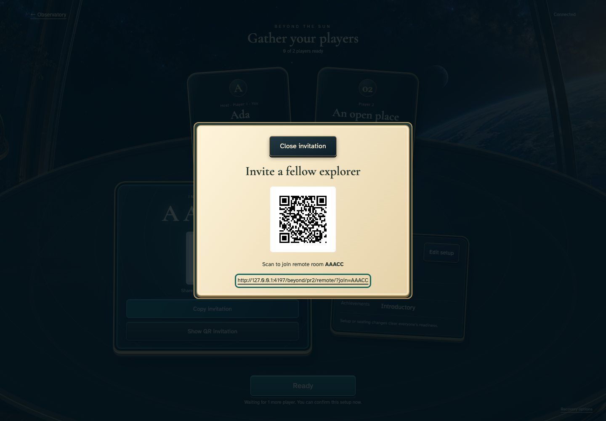](../../screenshots/invite-a-remote-friend-confirm-setup-and-restore-the-same-seats-across-clients/006-qr-keyboard-back-desktop-darwin.png) |

- [x] Reverse keyboard navigation reaches the underlined URL
- [x] The remote shell fits the viewport without page overflow.

## 8. Keyboard navigation remains inside the invitation dialog

Viewpoint: **Ada · host**.

| phone · 393 × 852 | desktop · 1440 × 1000 |
| --- | --- |
| [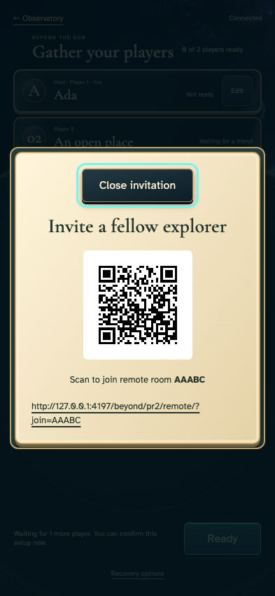](../../screenshots/invite-a-remote-friend-confirm-setup-and-restore-the-same-seats-across-clients/007-qr-keyboard-forward-phone-darwin.png) | [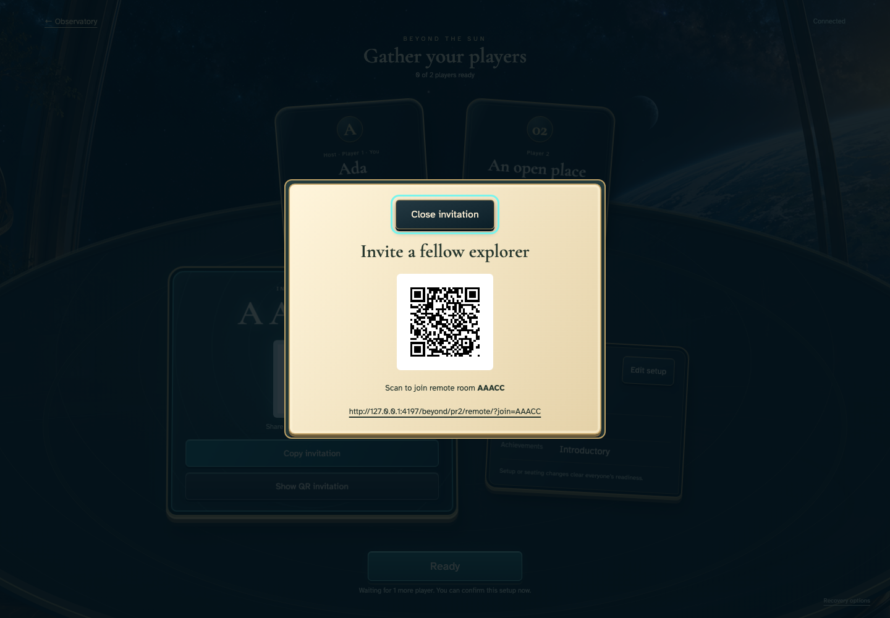](../../screenshots/invite-a-remote-friend-confirm-setup-and-restore-the-same-seats-across-clients/007-qr-keyboard-forward-desktop-darwin.png) |

- [x] Keyboard navigation remains inside the invitation dialog
- [x] The remote shell fits the viewport without page overflow.

## 9. Escape returns focus to the invitation control

Viewpoint: **Ada · host**.

| phone · 393 × 852 | desktop · 1440 × 1000 |
| --- | --- |
| [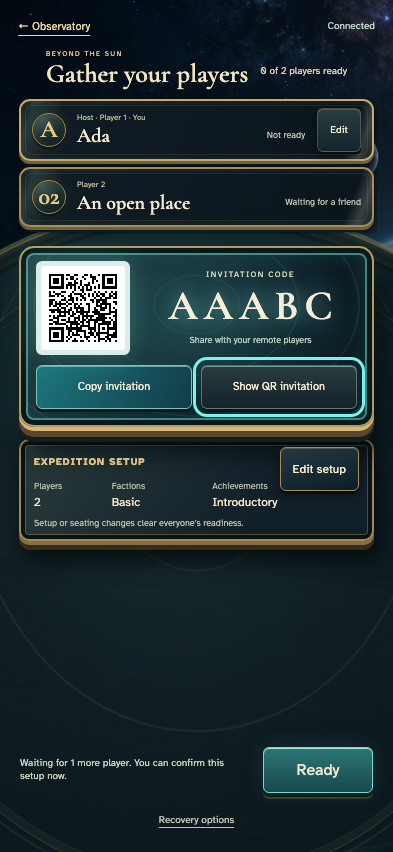](../../screenshots/invite-a-remote-friend-confirm-setup-and-restore-the-same-seats-across-clients/008-qr-closed-phone-darwin.png) |  |

- [x] Escape returns focus to the invitation control
- [x] The remote shell fits the viewport without page overflow.

## 10. Cleo opens code entry from an independent browser

Viewpoint: **Cleo · unseated visitor**.

| phone · 393 × 852 | desktop · 1440 × 1000 |
| --- | --- |
| [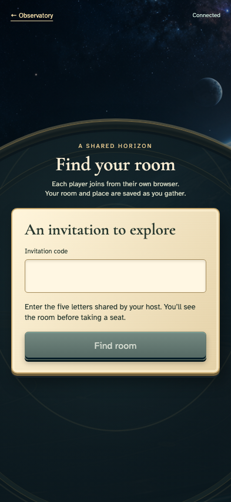](../../screenshots/invite-a-remote-friend-confirm-setup-and-restore-the-same-seats-across-clients/009-missing-entry-phone-darwin.png) |  |

- [x] Cleo opens code entry from an independent browser
- [x] The remote shell fits the viewport without page overflow.

## 11. Cleo enters a missing room code

Viewpoint: **Cleo · unseated visitor**.

| phone · 393 × 852 | desktop · 1440 × 1000 |
| --- | --- |
|  | [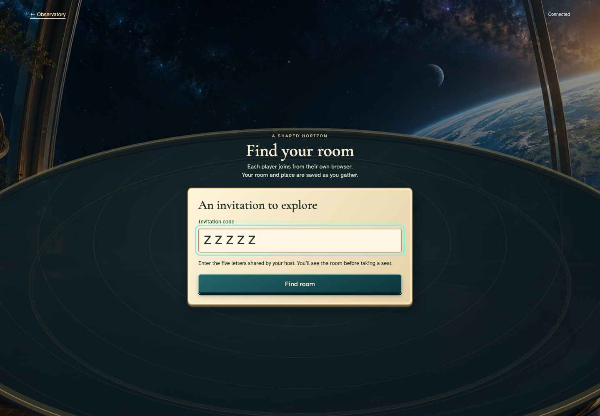](../../screenshots/invite-a-remote-friend-confirm-setup-and-restore-the-same-seats-across-clients/010-missing-code-desktop-darwin.png) |

- [x] Cleo enters a missing room code
- [x] The remote shell fits the viewport without page overflow.

## 12. A missing invitation explains how to recover

Viewpoint: **Cleo · unseated visitor**.

| phone · 393 × 852 | desktop · 1440 × 1000 |
| --- | --- |
| [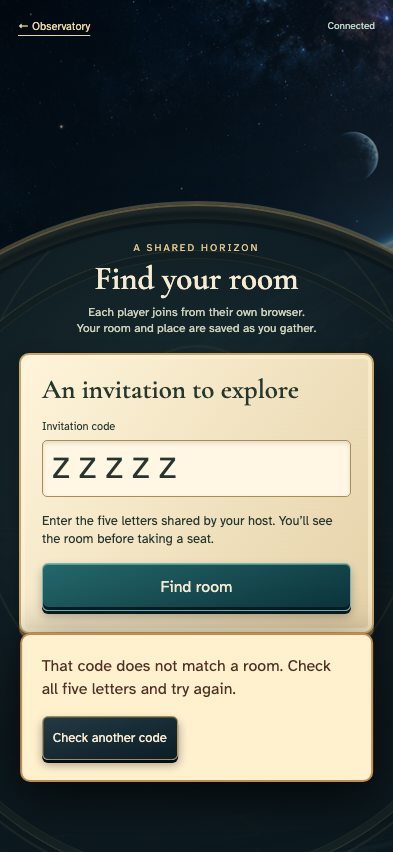](../../screenshots/invite-a-remote-friend-confirm-setup-and-restore-the-same-seats-across-clients/011-missing-room-phone-darwin.png) | [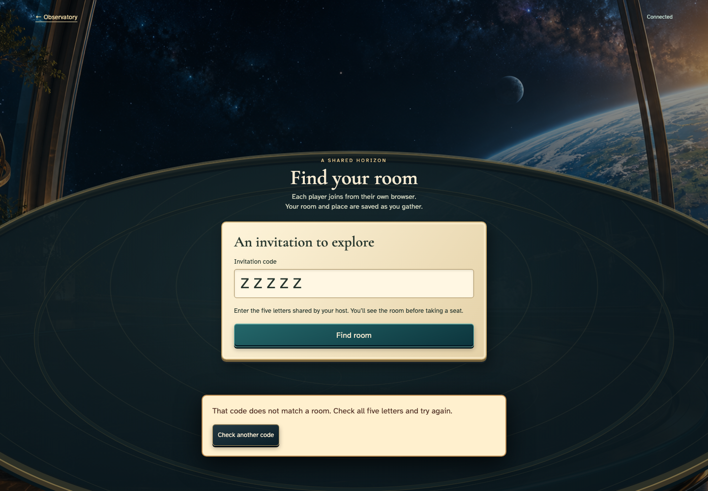](../../screenshots/invite-a-remote-friend-confirm-setup-and-restore-the-same-seats-across-clients/011-missing-room-desktop-darwin.png) |

- [x] A missing invitation explains how to recover
- [x] The remote shell fits the viewport without page overflow.

## 13. Bora arrives without a retained seat in her separate browser

Viewpoint: **Bora · separate identity**.

| phone · 1440 × 1000 | desktop · 393 × 852 |
| --- | --- |
|  |  |

- [x] Bora arrives without a retained seat in her separate browser
- [x] The remote shell fits the viewport without page overflow.

## 14. Bora can choose code joining from Play

Viewpoint: **Bora · separate identity**.

| phone · 1440 × 1000 | desktop · 393 × 852 |
| --- | --- |
| [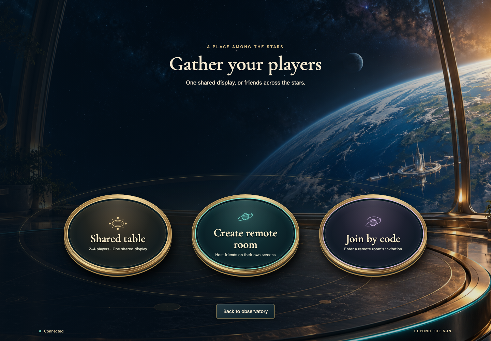](../../screenshots/invite-a-remote-friend-confirm-setup-and-restore-the-same-seats-across-clients/013-guest-play-phone-darwin.png) | [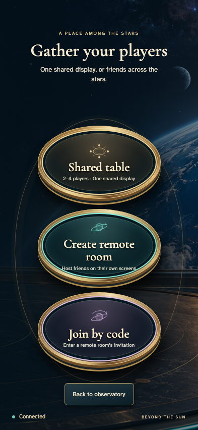](../../screenshots/invite-a-remote-friend-confirm-setup-and-restore-the-same-seats-across-clients/013-guest-play-desktop-darwin.png) |

- [x] Bora can choose code joining from Play
- [x] The remote shell fits the viewport without page overflow.

## 15. Bora opens the production invitation form

Viewpoint: **Bora · separate identity**.

| phone · 1440 × 1000 | desktop · 393 × 852 |
| --- | --- |
|  |  |

- [x] Bora opens the production invitation form
- [x] The remote shell fits the viewport without page overflow.

## 16. Bora enters the host’s invitation

Viewpoint: **Bora · separate identity**.

| phone · 1440 × 1000 | desktop · 393 × 852 |
| --- | --- |
|  | [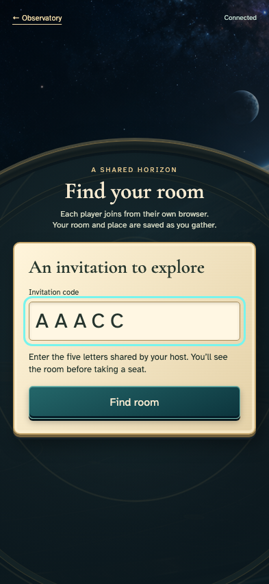](../../screenshots/invite-a-remote-friend-confirm-setup-and-restore-the-same-seats-across-clients/015-guest-code-desktop-darwin.png) |

- [x] Bora enters the host’s invitation
- [x] The remote shell fits the viewport without page overflow.

## 17. Bora reviews host, capacity and setup before claiming a seat

Viewpoint: **Bora · separate identity**.

| phone · 1440 × 1000 | desktop · 393 × 852 |
| --- | --- |
|  | [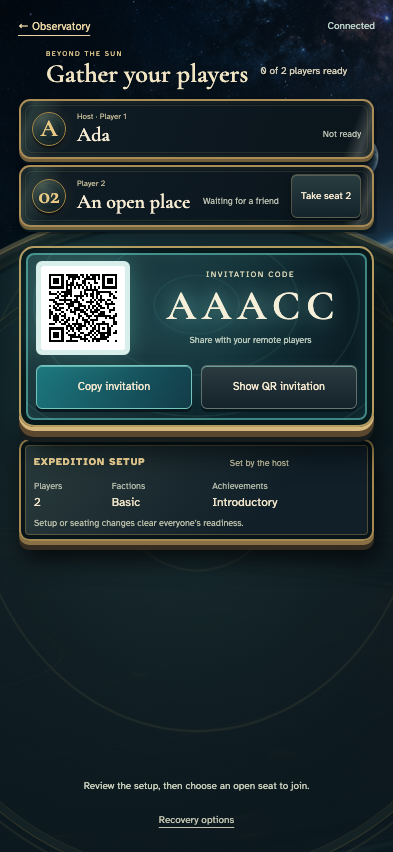](../../screenshots/invite-a-remote-friend-confirm-setup-and-restore-the-same-seats-across-clients/016-preview-desktop-darwin.png) |

- [x] Bora reviews host, capacity and setup before claiming a seat
- [x] The remote shell fits the viewport without page overflow.

## 18. Bora chooses the open seat

Viewpoint: **Bora · separate identity**.

| phone · 1440 × 1000 | desktop · 393 × 852 |
| --- | --- |
|  |  |

- [x] Bora chooses the open seat
- [x] The remote shell fits the viewport without page overflow.

## 19. Reverse keyboard navigation remains inside the lifted name plaque

Viewpoint: **Bora · separate identity**.

| phone · 1440 × 1000 | desktop · 393 × 852 |
| --- | --- |
| [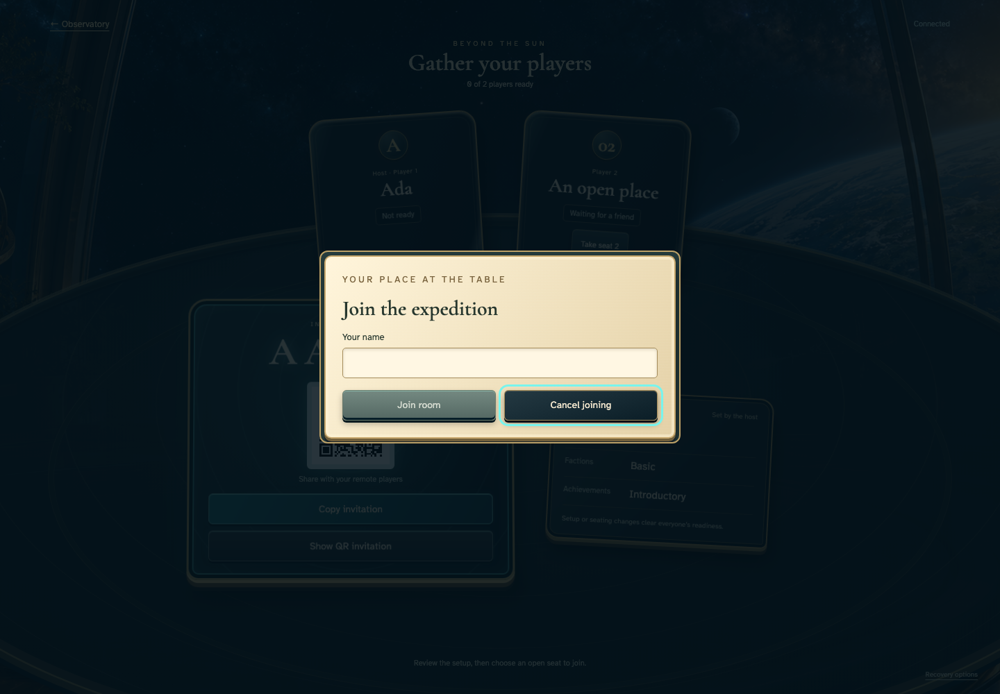](../../screenshots/invite-a-remote-friend-confirm-setup-and-restore-the-same-seats-across-clients/018-join-keyboard-back-phone-darwin.png) | [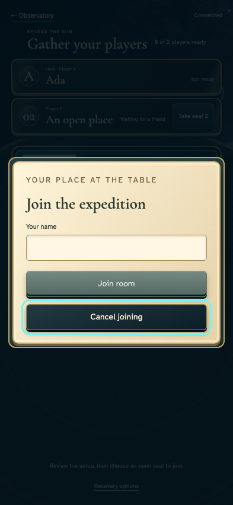](../../screenshots/invite-a-remote-friend-confirm-setup-and-restore-the-same-seats-across-clients/018-join-keyboard-back-desktop-darwin.png) |

- [x] Reverse keyboard navigation remains inside the lifted name plaque
- [x] The remote shell fits the viewport without page overflow.

## 20. Forward keyboard navigation returns to the guest name field

Viewpoint: **Bora · separate identity**.

| phone · 1440 × 1000 | desktop · 393 × 852 |
| --- | --- |
| [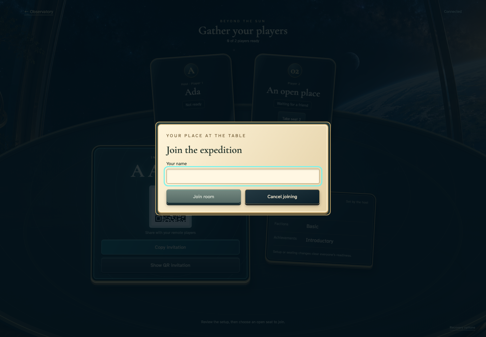](../../screenshots/invite-a-remote-friend-confirm-setup-and-restore-the-same-seats-across-clients/019-join-keyboard-forward-phone-darwin.png) |  |

- [x] Forward keyboard navigation returns to the guest name field
- [x] The remote shell fits the viewport without page overflow.

## 21. Bora supplies her own public name

Viewpoint: **Bora · separate identity**.

| phone · 1440 × 1000 | desktop · 393 × 852 |
| --- | --- |
| [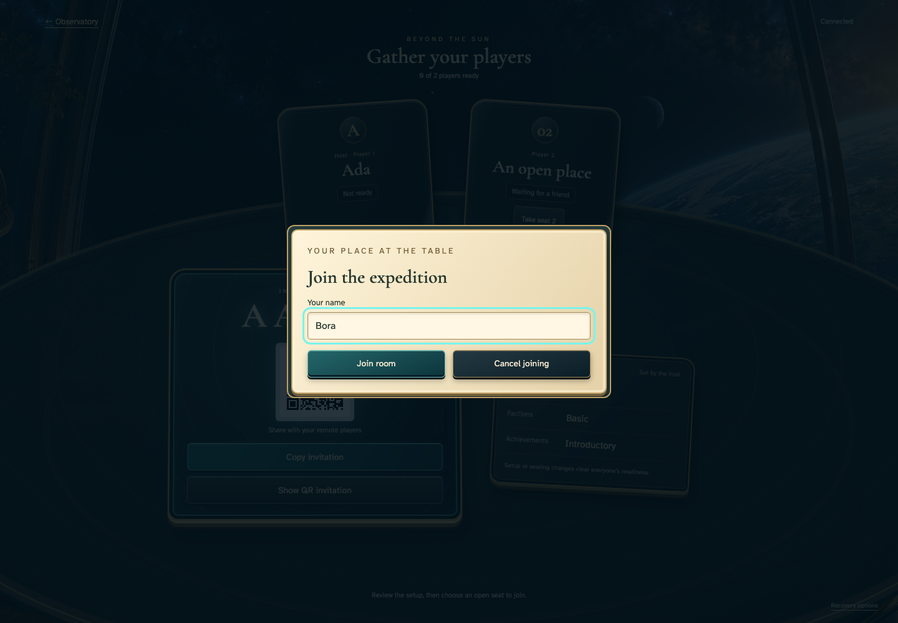](../../screenshots/invite-a-remote-friend-confirm-setup-and-restore-the-same-seats-across-clients/020-guest-name-phone-darwin.png) | [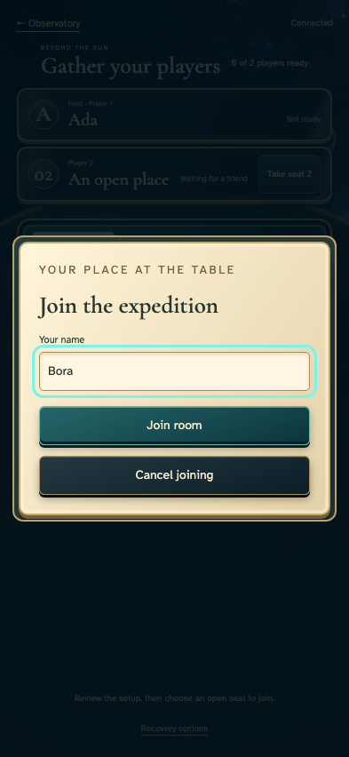](../../screenshots/invite-a-remote-friend-confirm-setup-and-restore-the-same-seats-across-clients/020-guest-name-desktop-darwin.png) |

- [x] Bora supplies her own public name
- [x] The remote shell fits the viewport without page overflow.

## 22. Bora’s separate identity owns Player 2

Viewpoint: **Bora · separate identity**.

| phone · 1440 × 1000 | desktop · 393 × 852 |
| --- | --- |
|  | [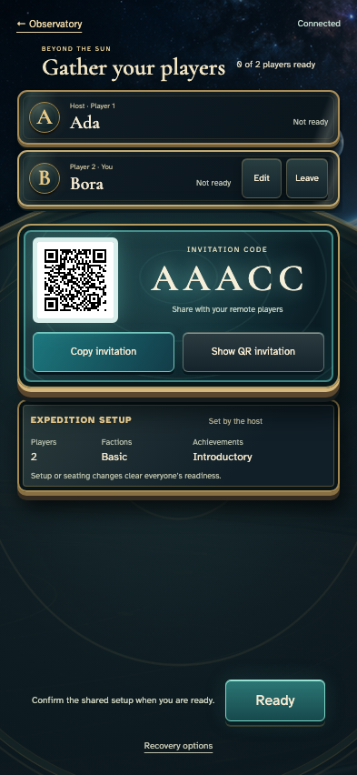](../../screenshots/invite-a-remote-friend-confirm-setup-and-restore-the-same-seats-across-clients/021-joined-desktop-darwin.png) |

- [x] Bora’s separate identity owns Player 2
- [x] The remote shell fits the viewport without page overflow.

## 23. Ada sees the committed guest seat live

Viewpoint: **Ada · host**.

| phone · 393 × 852 | desktop · 1440 × 1000 |
| --- | --- |
| [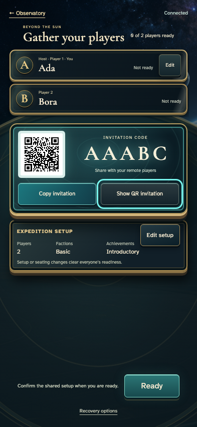](../../screenshots/invite-a-remote-friend-confirm-setup-and-restore-the-same-seats-across-clients/022-host-observes-join-phone-darwin.png) | [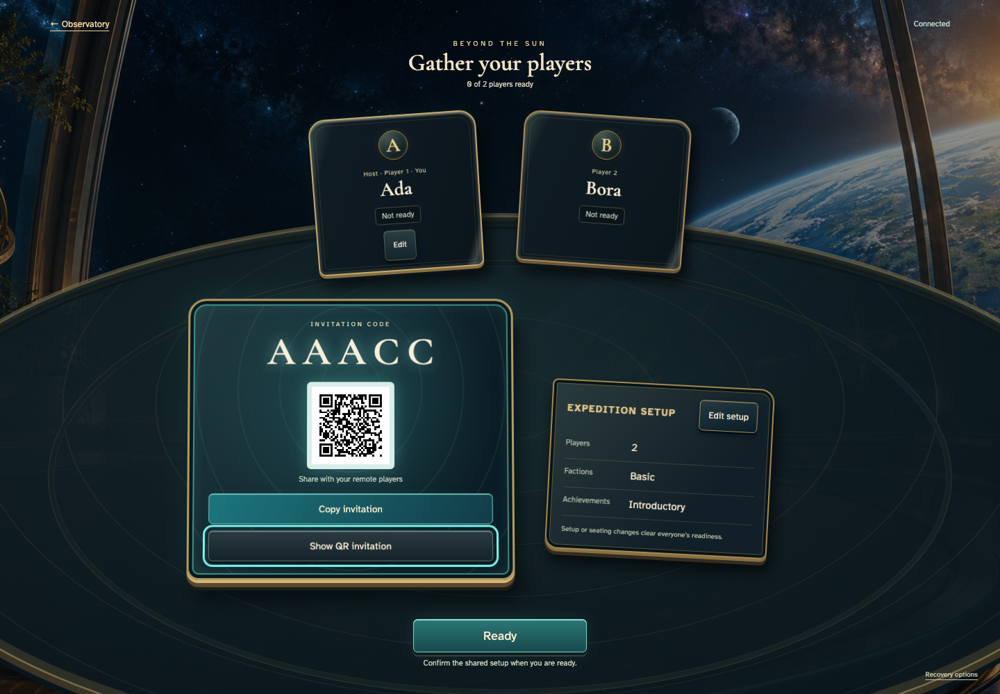](../../screenshots/invite-a-remote-friend-confirm-setup-and-restore-the-same-seats-across-clients/022-host-observes-join-desktop-darwin.png) |

- [x] Ada sees the committed guest seat live
- [x] The remote shell fits the viewport without page overflow.

## 24. Cleo can correct a missing invitation

Viewpoint: **Cleo · unseated visitor**.

| phone · 393 × 852 | desktop · 1440 × 1000 |
| --- | --- |
|  | [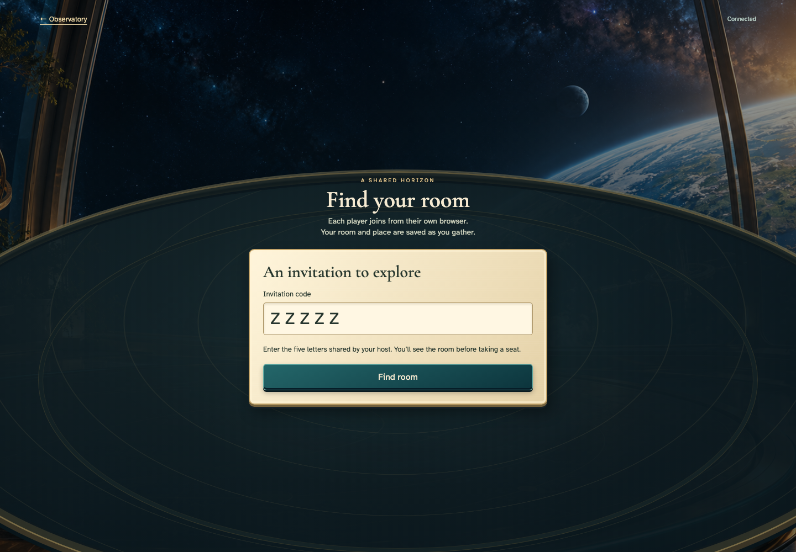](../../screenshots/invite-a-remote-friend-confirm-setup-and-restore-the-same-seats-across-clients/023-retry-code-desktop-darwin.png) |

- [x] Cleo can correct a missing invitation
- [x] The remote shell fits the viewport without page overflow.

## 25. Cleo enters the now full room’s invitation

Viewpoint: **Cleo · unseated visitor**.

| phone · 393 × 852 | desktop · 1440 × 1000 |
| --- | --- |
|  |  |

- [x] Cleo enters the now full room’s invitation
- [x] The remote shell fits the viewport without page overflow.

## 26. A full room keeps occupied seats intact and explains the result

Viewpoint: **Cleo · unseated visitor**.

| phone · 393 × 852 | desktop · 1440 × 1000 |
| --- | --- |
| [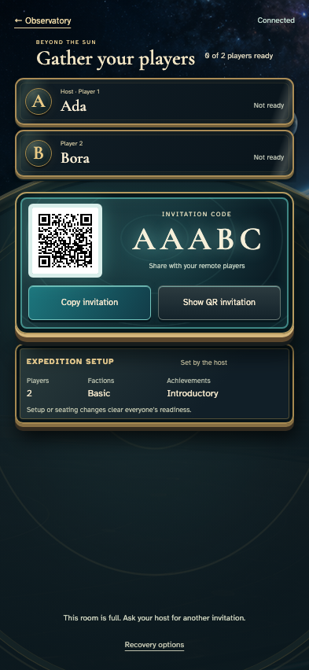](../../screenshots/invite-a-remote-friend-confirm-setup-and-restore-the-same-seats-across-clients/025-full-room-phone-darwin.png) | [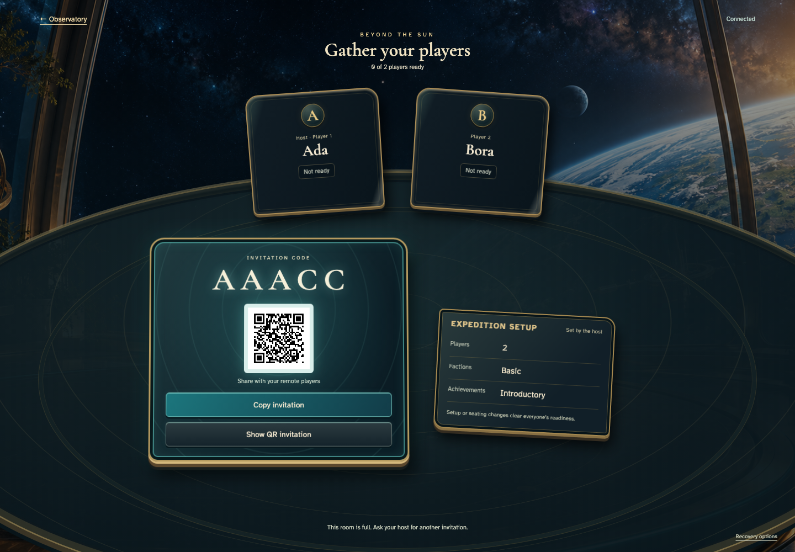](../../screenshots/invite-a-remote-friend-confirm-setup-and-restore-the-same-seats-across-clients/025-full-room-desktop-darwin.png) |

- [x] A full room keeps occupied seats intact and explains the result
- [x] The remote shell fits the viewport without page overflow.

## 27. Bora receives an acknowledged readiness state

Viewpoint: **Bora · separate identity**.

| phone · 1440 × 1000 | desktop · 393 × 852 |
| --- | --- |
|  | [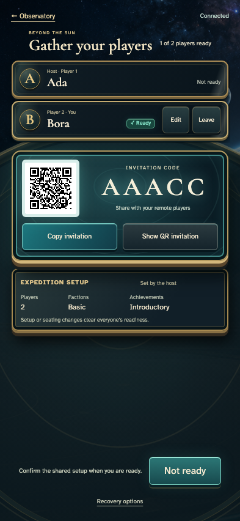](../../screenshots/invite-a-remote-friend-confirm-setup-and-restore-the-same-seats-across-clients/026-guest-ready-desktop-darwin.png) |

- [x] Bora receives an acknowledged readiness state
- [x] The remote shell fits the viewport without page overflow.

## 28. Ada sees Bora’s readiness

Viewpoint: **Ada · host**.

| phone · 393 × 852 | desktop · 1440 × 1000 |
| --- | --- |
|  | [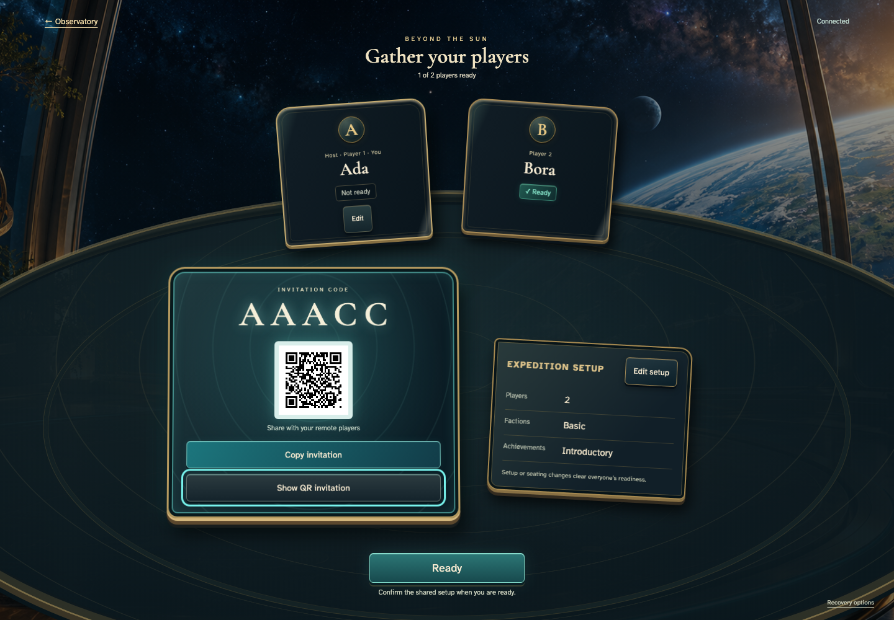](../../screenshots/invite-a-remote-friend-confirm-setup-and-restore-the-same-seats-across-clients/027-host-observes-ready-desktop-darwin.png) |

- [x] Ada sees Bora’s readiness
- [x] The remote shell fits the viewport without page overflow.

## 29. Both configured players have confirmed this setup

Viewpoint: **Ada · host**.

| phone · 393 × 852 | desktop · 1440 × 1000 |
| --- | --- |
| [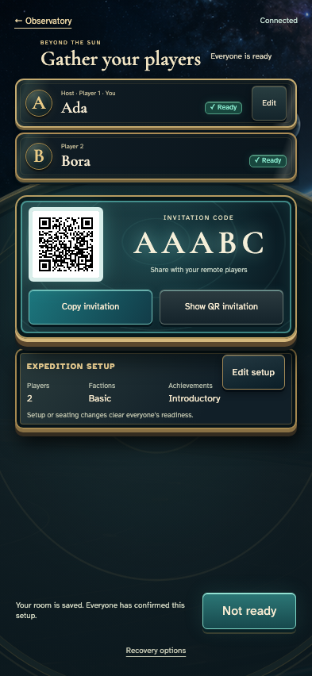](../../screenshots/invite-a-remote-friend-confirm-setup-and-restore-the-same-seats-across-clients/028-everyone-ready-phone-darwin.png) |  |

- [x] Both configured players have confirmed this setup
- [x] The remote shell fits the viewport without page overflow.

## 30. Bora’s identity, seat and readiness survive reload

Viewpoint: **Bora · separate identity**.

| phone · 1440 × 1000 | desktop · 393 × 852 |
| --- | --- |
|  | [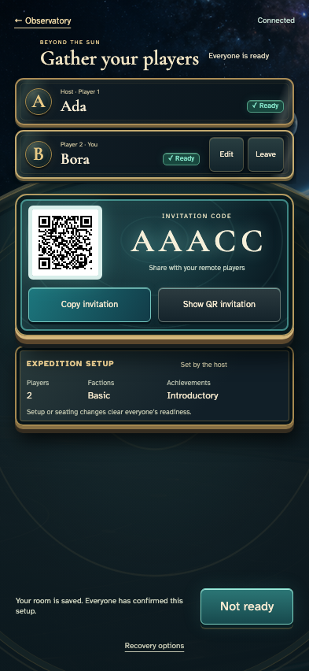](../../screenshots/invite-a-remote-friend-confirm-setup-and-restore-the-same-seats-across-clients/029-ready-reload-desktop-darwin.png) |

- [x] Bora’s identity, seat and readiness survive reload
- [x] The remote shell fits the viewport without page overflow.

## 31. Only the host opens the shared setup editor

Viewpoint: **Ada · host**.

| phone · 393 × 852 | desktop · 1440 × 1000 |
| --- | --- |
| [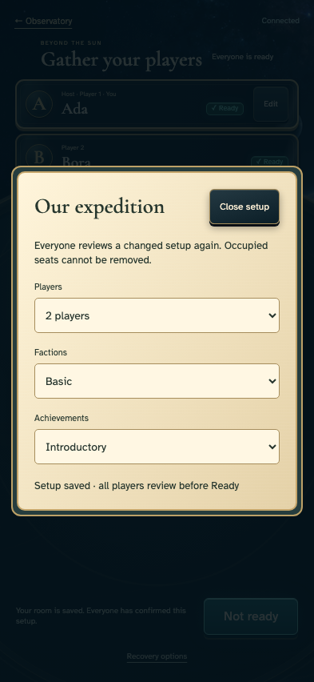](../../screenshots/invite-a-remote-friend-confirm-setup-and-restore-the-same-seats-across-clients/030-setup-dialog-phone-darwin.png) | [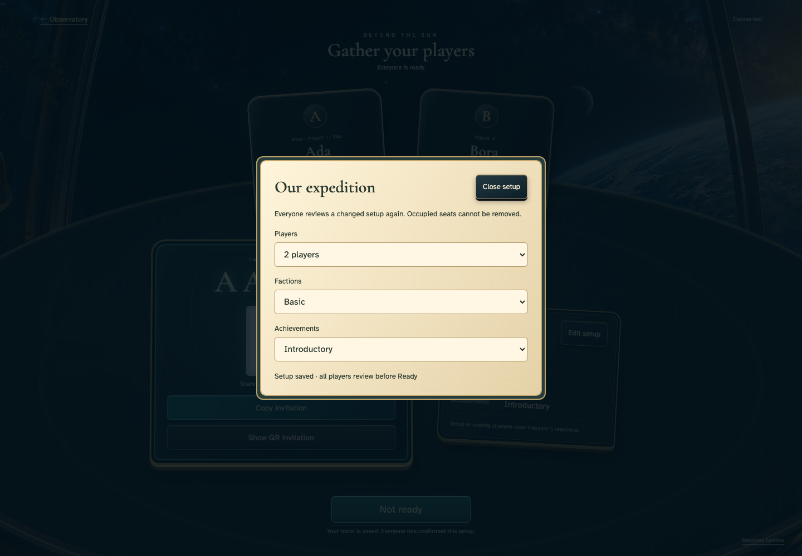](../../screenshots/invite-a-remote-friend-confirm-setup-and-restore-the-same-seats-across-clients/030-setup-dialog-desktop-darwin.png) |

- [x] Only the host opens the shared setup editor
- [x] The remote shell fits the viewport without page overflow.

## 32. Reverse keyboard navigation wraps to the final setup control

Viewpoint: **Ada · host**.

| phone · 393 × 852 | desktop · 1440 × 1000 |
| --- | --- |
| [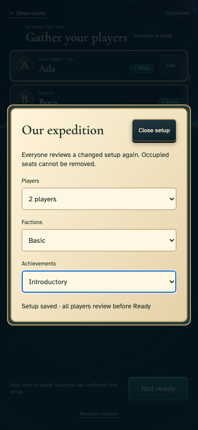](../../screenshots/invite-a-remote-friend-confirm-setup-and-restore-the-same-seats-across-clients/031-setup-keyboard-back-phone-darwin.png) | [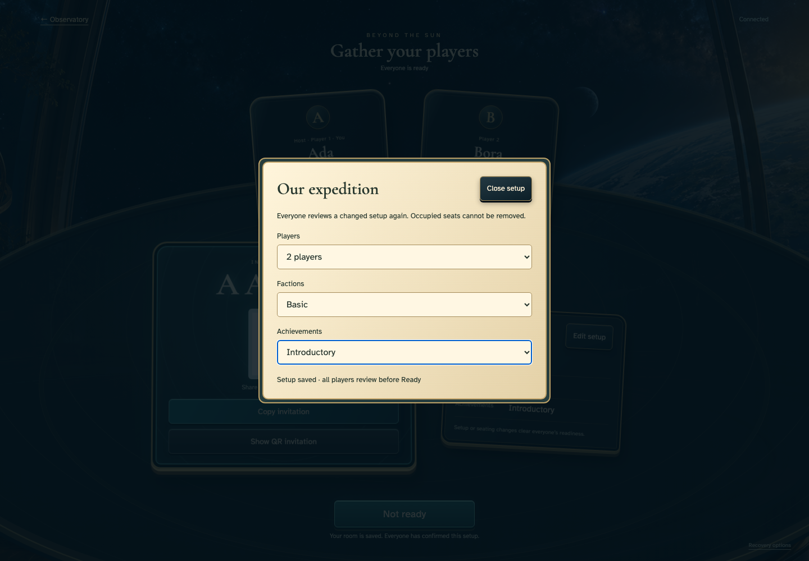](../../screenshots/invite-a-remote-friend-confirm-setup-and-restore-the-same-seats-across-clients/031-setup-keyboard-back-desktop-darwin.png) |

- [x] Reverse keyboard navigation wraps to the final setup control
- [x] The remote shell fits the viewport without page overflow.

## 33. Forward keyboard navigation wraps to Close setup

Viewpoint: **Ada · host**.

| phone · 393 × 852 | desktop · 1440 × 1000 |
| --- | --- |
| [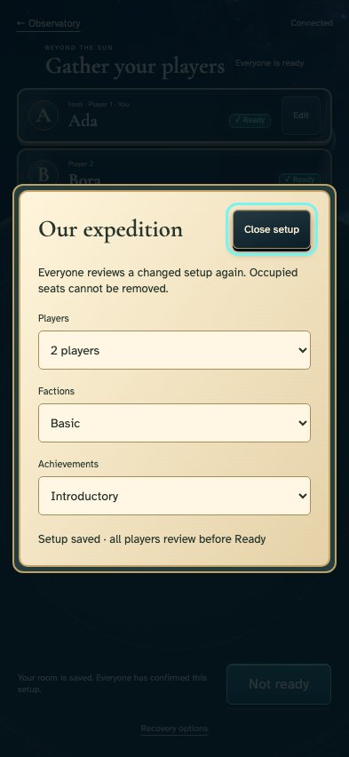](../../screenshots/invite-a-remote-friend-confirm-setup-and-restore-the-same-seats-across-clients/032-setup-keyboard-forward-phone-darwin.png) | [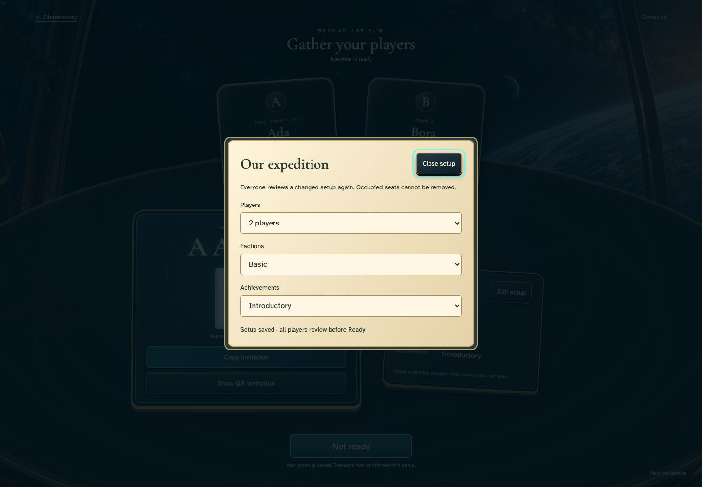](../../screenshots/invite-a-remote-friend-confirm-setup-and-restore-the-same-seats-across-clients/032-setup-keyboard-forward-desktop-darwin.png) |

- [x] Forward keyboard navigation wraps to Close setup
- [x] The remote shell fits the viewport without page overflow.

## 34. A committed achievement configuration invalidates previous confirmations

Viewpoint: **Ada · host**.

| phone · 393 × 852 | desktop · 1440 × 1000 |
| --- | --- |
| [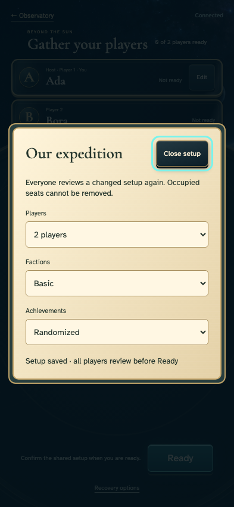](../../screenshots/invite-a-remote-friend-confirm-setup-and-restore-the-same-seats-across-clients/033-changed-setup-phone-darwin.png) |  |

- [x] A committed achievement configuration invalidates previous confirmations
- [x] The remote shell fits the viewport without page overflow.

## 35. Bora sees the new setup and must confirm again

Viewpoint: **Bora · separate identity**.

| phone · 1440 × 1000 | desktop · 393 × 852 |
| --- | --- |
| [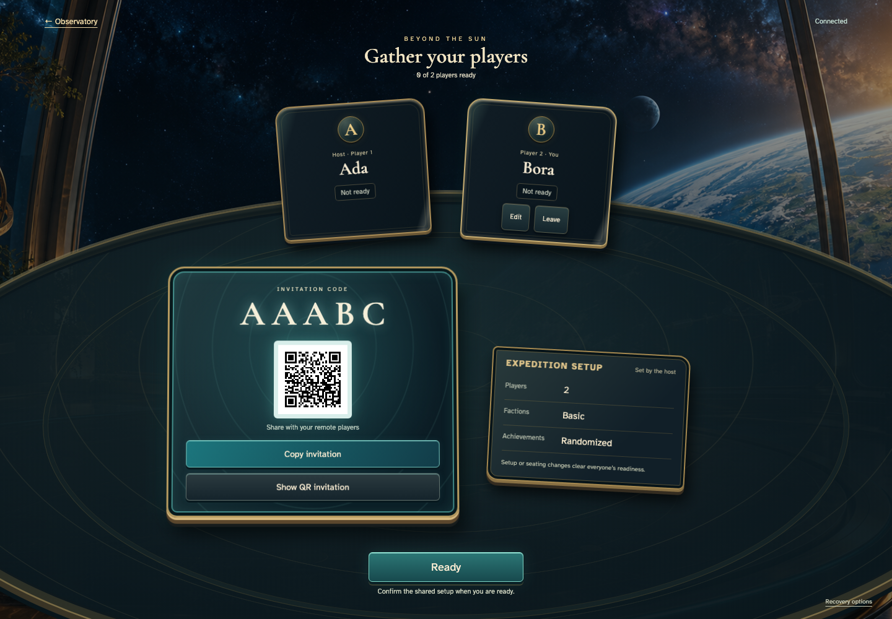](../../screenshots/invite-a-remote-friend-confirm-setup-and-restore-the-same-seats-across-clients/034-guest-observes-change-phone-darwin.png) |  |

- [x] Bora sees the new setup and must confirm again
- [x] The remote shell fits the viewport without page overflow.

## 36. Escape restores focus to Edit setup

Viewpoint: **Ada · host**.

| phone · 393 × 852 | desktop · 1440 × 1000 |
| --- | --- |
| [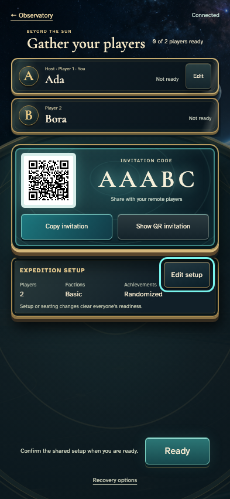](../../screenshots/invite-a-remote-friend-confirm-setup-and-restore-the-same-seats-across-clients/035-setup-closed-phone-darwin.png) |  |

- [x] Escape restores focus to Edit setup
- [x] The remote shell fits the viewport without page overflow.

## 37. The guest’s Continue action retains her remote room

Viewpoint: **Bora · separate identity**.

| phone · 1440 × 1000 | desktop · 393 × 852 |
| --- | --- |
| [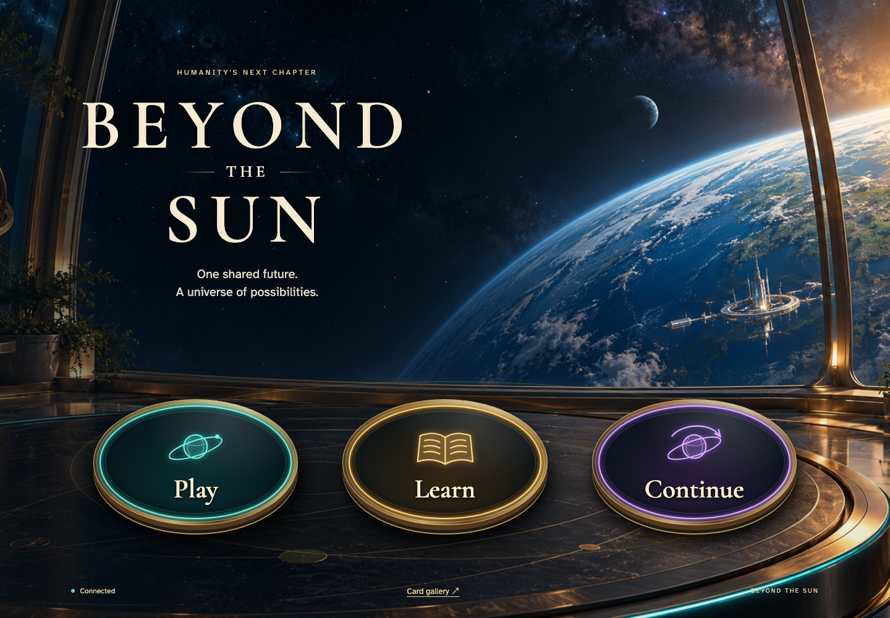](../../screenshots/invite-a-remote-friend-confirm-setup-and-restore-the-same-seats-across-clients/036-retained-arrival-phone-darwin.png) | [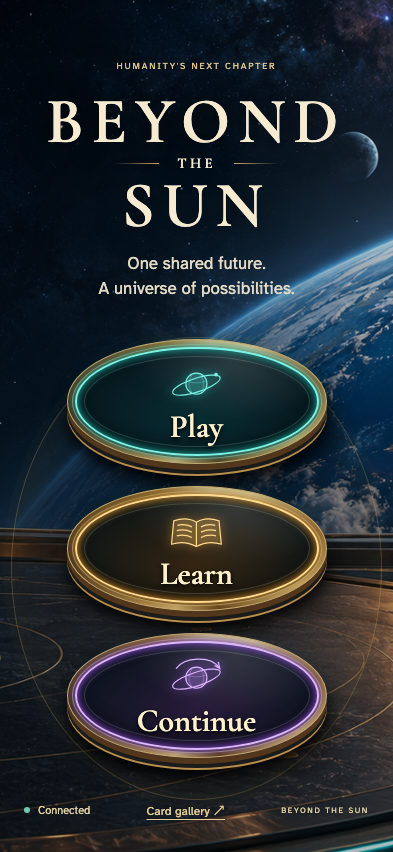](../../screenshots/invite-a-remote-friend-confirm-setup-and-restore-the-same-seats-across-clients/036-retained-arrival-desktop-darwin.png) |

- [x] The guest’s Continue action retains her remote room
- [x] The remote shell fits the viewport without page overflow.

## 38. Continue restores Bora’s own seat and current configuration

Viewpoint: **Bora · separate identity**.

| phone · 1440 × 1000 | desktop · 393 × 852 |
| --- | --- |
|  | [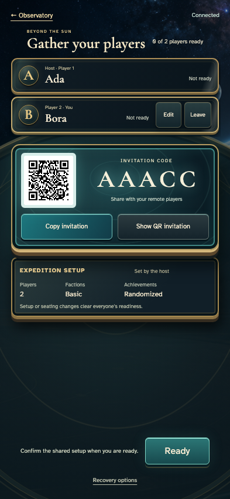](../../screenshots/invite-a-remote-friend-confirm-setup-and-restore-the-same-seats-across-clients/037-retained-seat-desktop-darwin.png) |

- [x] Continue restores Bora’s own seat and current configuration
- [x] The remote shell fits the viewport without page overflow.

## 39. Recovery switches client URLs while keeping the same room

Viewpoint: **Ada · host**.

| phone · 393 × 852 | desktop · 1440 × 1000 |
| --- | --- |
|  | [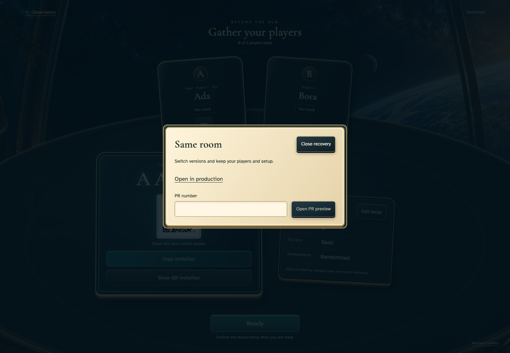](../../screenshots/invite-a-remote-friend-confirm-setup-and-restore-the-same-seats-across-clients/038-recovery-options-desktop-darwin.png) |

- [x] Recovery switches client URLs while keeping the same room
- [x] The remote shell fits the viewport without page overflow.

## 40. Reverse navigation reaches the PR field inside recovery

Viewpoint: **Ada · host**.

| phone · 393 × 852 | desktop · 1440 × 1000 |
| --- | --- |
| [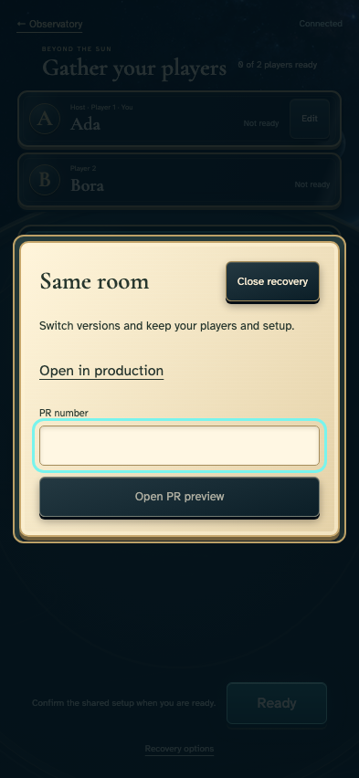](../../screenshots/invite-a-remote-friend-confirm-setup-and-restore-the-same-seats-across-clients/039-recovery-keyboard-back-phone-darwin.png) | [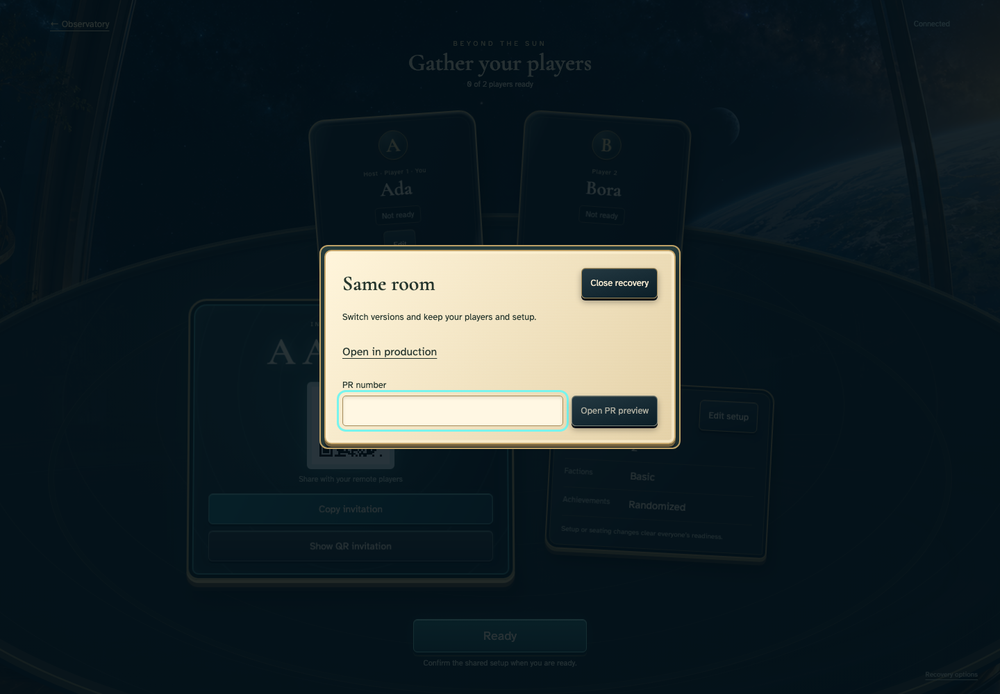](../../screenshots/invite-a-remote-friend-confirm-setup-and-restore-the-same-seats-across-clients/039-recovery-keyboard-back-desktop-darwin.png) |

- [x] Reverse navigation reaches the PR field inside recovery
- [x] The remote shell fits the viewport without page overflow.

## 41. Forward navigation wraps to Close recovery

Viewpoint: **Ada · host**.

| phone · 393 × 852 | desktop · 1440 × 1000 |
| --- | --- |
|  | [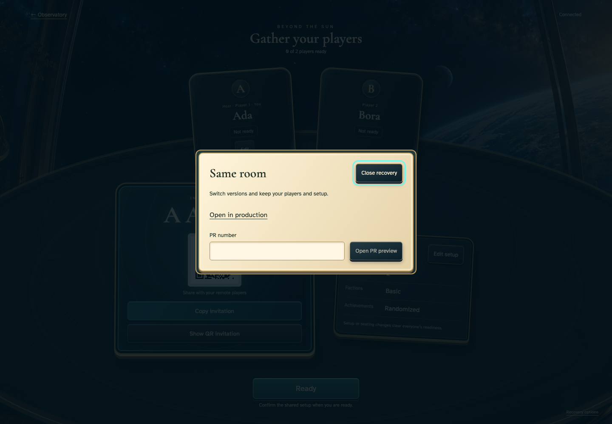](../../screenshots/invite-a-remote-friend-confirm-setup-and-restore-the-same-seats-across-clients/040-recovery-keyboard-forward-desktop-darwin.png) |

- [x] Forward navigation wraps to Close recovery
- [x] The remote shell fits the viewport without page overflow.

## 42. Escape returns to Recovery options without changing the room

Viewpoint: **Ada · host**.

| phone · 393 × 852 | desktop · 1440 × 1000 |
| --- | --- |
| [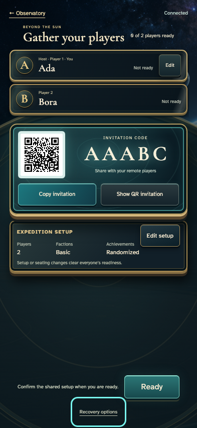](../../screenshots/invite-a-remote-friend-confirm-setup-and-restore-the-same-seats-across-clients/041-recovery-closed-phone-darwin.png) |  |

- [x] Escape returns to Recovery options without changing the room
- [x] The remote shell fits the viewport without page overflow.

## 43. Reopen the bounded recovery instrument before switching clients

Viewpoint: **Ada · host**.

| phone · 393 × 852 | desktop · 1440 × 1000 |
| --- | --- |
| [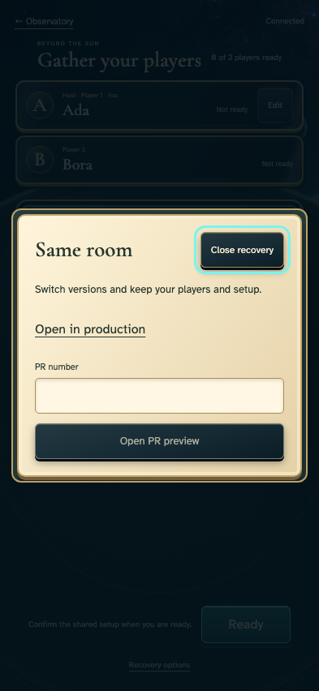](../../screenshots/invite-a-remote-friend-confirm-setup-and-restore-the-same-seats-across-clients/042-recovery-reopened-phone-darwin.png) |  |

- [x] Reopen the bounded recovery instrument before switching clients
- [x] The remote shell fits the viewport without page overflow.

## 44. The real production build restores the same owner and guest

Viewpoint: **Ada · host**.

| phone · 393 × 852 | desktop · 1440 × 1000 |
| --- | --- |
| [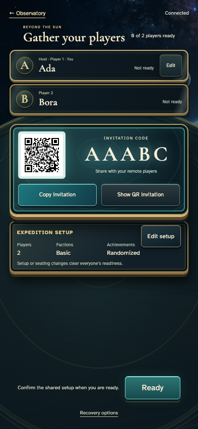](../../screenshots/invite-a-remote-friend-confirm-setup-and-restore-the-same-seats-across-clients/043-production-room-phone-darwin.png) |  |

- [x] The real production build restores the same owner and guest
- [x] The remote shell fits the viewport without page overflow.

## 45. The production client writes to the existing canonical room

Viewpoint: **Ada · host**.

| phone · 393 × 852 | desktop · 1440 × 1000 |
| --- | --- |
|  |  |

- [x] The production client writes to the existing canonical room
- [x] The remote shell fits the viewport without page overflow.

## 46. The preview guest observes the production client’s command live

Viewpoint: **Bora · separate identity**.

| phone · 1440 × 1000 | desktop · 393 × 852 |
| --- | --- |
|  |  |

- [x] The preview guest observes the production client’s command live
- [x] The remote shell fits the viewport without page overflow.

## 47. Production exposes the PR recovery selector

Viewpoint: **Ada · host**.

| phone · 393 × 852 | desktop · 1440 × 1000 |
| --- | --- |
|  |  |

- [x] Production exposes the PR recovery selector
- [x] The remote shell fits the viewport without page overflow.

## 48. Choose the separately built preview client

Viewpoint: **Ada · host**.

| phone · 393 × 852 | desktop · 1440 × 1000 |
| --- | --- |
|  |  |

- [x] Choose the separately built preview client
- [x] The remote shell fits the viewport without page overflow.

## 49. Preview restores the same room, readiness and identity

Viewpoint: **Ada · host**.

| phone · 393 × 852 | desktop · 1440 × 1000 |
| --- | --- |
|  |  |

- [x] Preview restores the same room, readiness and identity
- [x] The remote shell fits the viewport without page overflow.

## 50. A guest can release only her own seat

Viewpoint: **Bora · separate identity**.

| phone · 1440 × 1000 | desktop · 393 × 852 |
| --- | --- |
|  |  |

- [x] A guest can release only her own seat
- [x] The remote shell fits the viewport without page overflow.

## 51. Seat release clears the host’s previous confirmation

Viewpoint: **Ada · host**.

| phone · 393 × 852 | desktop · 1440 × 1000 |
| --- | --- |
|  |  |

- [x] Seat release clears the host’s previous confirmation
- [x] The remote shell fits the viewport without page overflow.

## 52. The host lifts the bounded ivory name plaque

Viewpoint: **Ada · host**.

| phone · 393 × 852 | desktop · 1440 × 1000 |
| --- | --- |
|  |  |

- [x] The host lifts the bounded ivory name plaque
- [x] The remote shell fits the viewport without page overflow.

## 53. Reverse keyboard navigation reaches Cancel name edit

Viewpoint: **Ada · host**.

| phone · 393 × 852 | desktop · 1440 × 1000 |
| --- | --- |
|  |  |

- [x] Reverse keyboard navigation reaches Cancel name edit
- [x] The remote shell fits the viewport without page overflow.

## 54. Forward keyboard navigation stays in the name plaque

Viewpoint: **Ada · host**.

| phone · 393 × 852 | desktop · 1440 × 1000 |
| --- | --- |
|  |  |

- [x] Forward keyboard navigation stays in the name plaque
- [x] The remote shell fits the viewport without page overflow.

## 55. A long name remains readable in its focused name plaque

Viewpoint: **Ada · host**.

| phone · 393 × 852 | desktop · 1440 × 1000 |
| --- | --- |
|  |  |

- [x] A long name remains readable in its focused name plaque
- [x] The remote shell fits the viewport without page overflow.

## 56. Escape leaves the saved name unchanged and restores the seat control

Viewpoint: **Ada · host**.

| phone · 393 × 852 | desktop · 1440 × 1000 |
| --- | --- |
|  |  |

- [x] Escape leaves the saved name unchanged and restores the seat control
- [x] The remote shell fits the viewport without page overflow.

## 57. Reopen name editing from the same seat object

Viewpoint: **Ada · host**.

| phone · 393 × 852 | desktop · 1440 × 1000 |
| --- | --- |
|  |  |

- [x] Reopen name editing from the same seat object
- [x] The remote shell fits the viewport without page overflow.

## 58. Enter the intended public long name after cancelling the first draft

Viewpoint: **Ada · host**.

| phone · 393 × 852 | desktop · 1440 × 1000 |
| --- | --- |
|  |  |

- [x] Enter the intended public long name after cancelling the first draft
- [x] The remote shell fits the viewport without page overflow.

## 59. The committed long name returns to the player’s seat object

Viewpoint: **Ada · host**.

| phone · 393 × 852 | desktop · 1440 × 1000 |
| --- | --- |
|  |  |

- [x] The committed long name returns to the player’s seat object
- [x] The remote shell fits the viewport without page overflow.
