# Begin and recover an exact 2-player compact shared Basic table

Configure at 1440 × 1000, then review the same started table at 1280 × 720 and return to the original viewport for mat inspection. One shared display and one controller configure 2 named physical seats directly on the table. Factions, settings, starting-player order and Begin use ordinary production controls. No remote identities or companion devices. Command entropy is fixed before play, without injecting any game state. The story stops at the real immutable starting position.

## 1. The shared controller arrives at the observatory

Viewpoint: **Shared table · one controller**.

| desktop · 1440 × 1000 |
| --- |
|  |

- [x] The shared controller arrives at the observatory
- [x] The shared display fits without page scrolling.

## 2. Choose the shared physical table

Viewpoint: **Shared table · one controller**.

| desktop · 1440 × 1000 |
| --- |
|  |

- [x] Choose the shared physical table
- [x] The shared display fits without page scrolling.

## 3. An empty shared surface offers eight physical positions

Viewpoint: **Shared table · one controller**.

| desktop · 1440 × 1000 |
| --- |
|  |

- [x] An empty shared surface offers eight physical positions
- [x] The shared display fits without page scrolling.

## 4. Open North East’s seat-facing editor

Viewpoint: **Shared table · one controller**.

| desktop · 1440 × 1000 |
| --- |
| [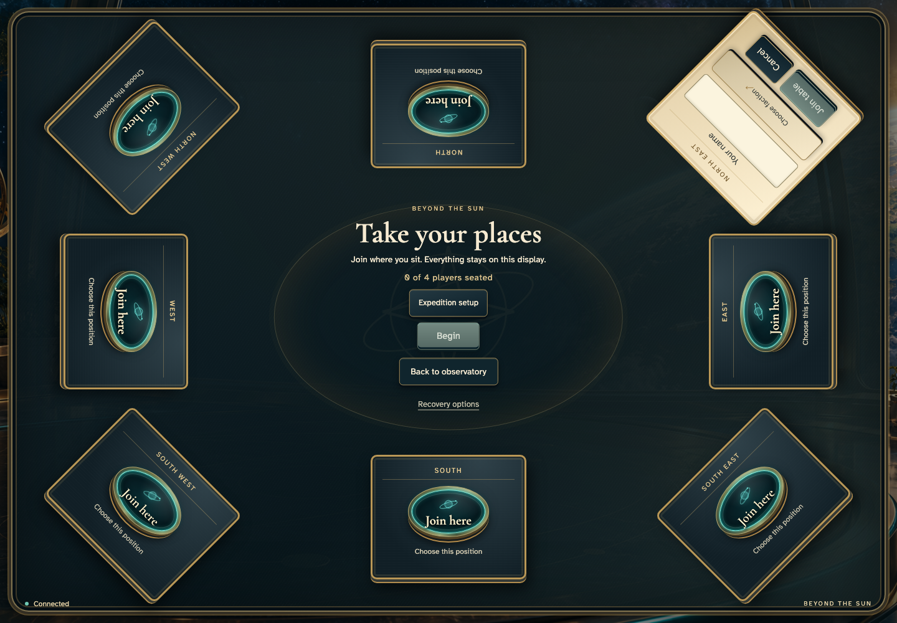](../../screenshots/begin-and-recover-an-exact-2-player-compact-shared-basic-table/003-join-editor-0-desktop-darwin.png) |

- [x] Open North East’s seat-facing editor
- [x] The shared display fits without page scrolling.

## 5. Enter Ada at North East

Viewpoint: **Shared table · one controller**.

| desktop · 1440 × 1000 |
| --- |
|  |

- [x] Enter Ada at North East
- [x] The shared display fits without page scrolling.

## 6. Ada joins the real physical seat

Viewpoint: **Shared table · one controller**.

| desktop · 1440 × 1000 |
| --- |
|  |

- [x] Ada joins the real physical seat
- [x] The shared display fits without page scrolling.

## 7. Open South West’s seat-facing editor

Viewpoint: **Shared table · one controller**.

| desktop · 1440 × 1000 |
| --- |
|  |

- [x] Open South West’s seat-facing editor
- [x] The shared display fits without page scrolling.

## 8. Enter Bora at South West

Viewpoint: **Shared table · one controller**.

| desktop · 1440 × 1000 |
| --- |
|  |

- [x] Enter Bora at South West
- [x] The shared display fits without page scrolling.

## 9. Bora joins the real physical seat

Viewpoint: **Shared table · one controller**.

| desktop · 1440 × 1000 |
| --- |
|  |

- [x] Bora joins the real physical seat
- [x] The shared display fits without page scrolling.

## 10. Inspect the actual Basic and achievement configuration

Viewpoint: **Shared table · one controller**.

| desktop · 1440 × 1000 |
| --- |
| [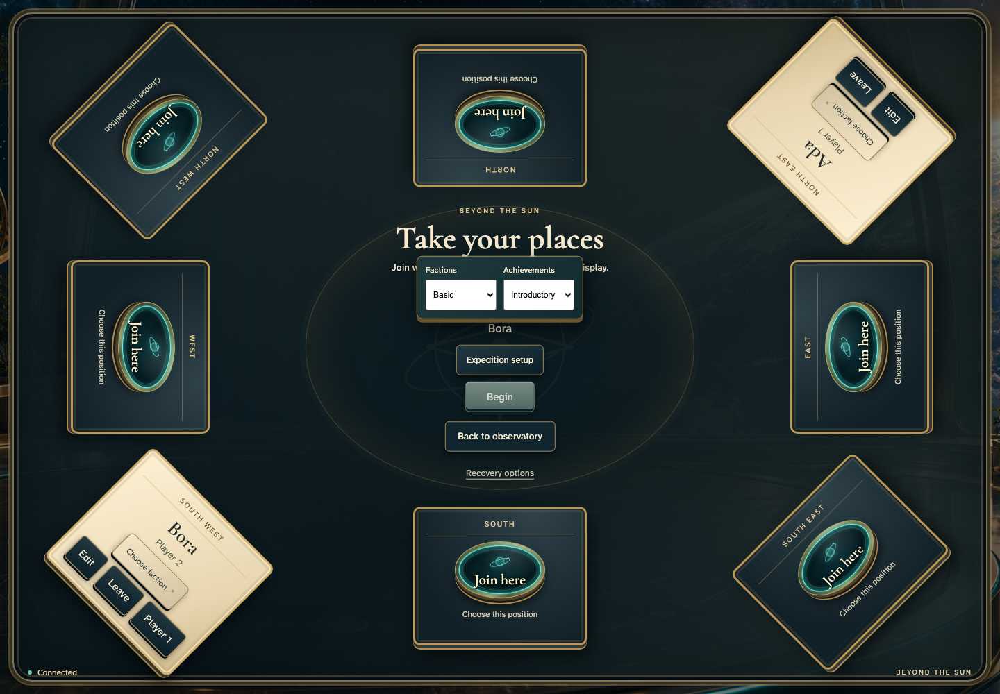](../../screenshots/begin-and-recover-an-exact-2-player-compact-shared-basic-table/009-configuration-desktop-darwin.png) |

- [x] Inspect the actual Basic and achievement configuration
- [x] The shared display fits without page scrolling.

## 11. Return to the composed gathering surface

Viewpoint: **Shared table · one controller**.

| desktop · 1440 × 1000 |
| --- |
|  |

- [x] Return to the composed gathering surface
- [x] The shared display fits without page scrolling.

## 12. Ada reads legal Basic faction setup

Viewpoint: **Shared table · one controller**.

| desktop · 1440 × 1000 |
| --- |
|  |

- [x] Ada reads legal Basic faction setup
- [x] The shared display fits without page scrolling.

## 13. Commit Ada’s unique Basic faction

Viewpoint: **Shared table · one controller**.

| desktop · 1440 × 1000 |
| --- |
|  |

- [x] Commit Ada’s unique Basic faction
- [x] The shared display fits without page scrolling.

## 14. Bora reads legal Basic faction setup

Viewpoint: **Shared table · one controller**.

| desktop · 1440 × 1000 |
| --- |
| [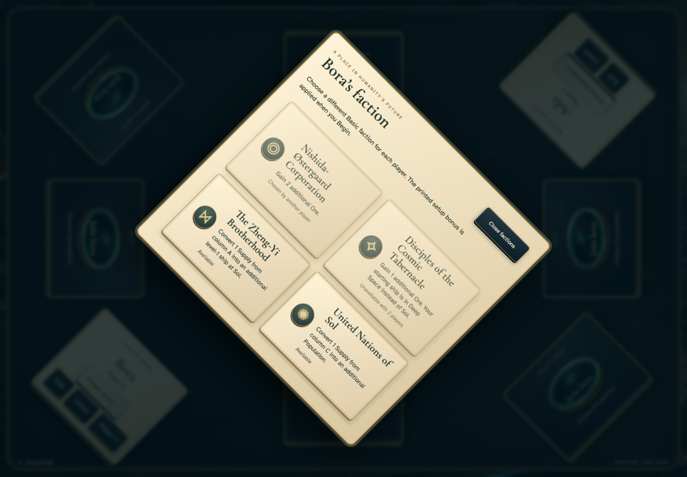](../../screenshots/begin-and-recover-an-exact-2-player-compact-shared-basic-table/013-faction-open-1-desktop-darwin.png) |

- [x] Bora reads legal Basic faction setup
- [x] The shared display fits without page scrolling.

## 15. Commit Bora’s unique Basic faction

Viewpoint: **Shared table · one controller**.

| desktop · 1440 × 1000 |
| --- |
|  |

- [x] Commit Bora’s unique Basic faction
- [x] The shared display fits without page scrolling.

## 16. Begin applies the reviewed starting position on this shared display

Viewpoint: **Shared table · one controller**.

| desktop · 1440 × 1000 |
| --- |
|  |

- [x] Begin applies the reviewed starting position on this shared display
- [x] The shared display fits without page scrolling.

## 17. The same saved table at 1280 × 720 exposes the complete public overview

Viewpoint: **Shared table · one controller**.

| desktop · 1280 × 720 |
| --- |
| [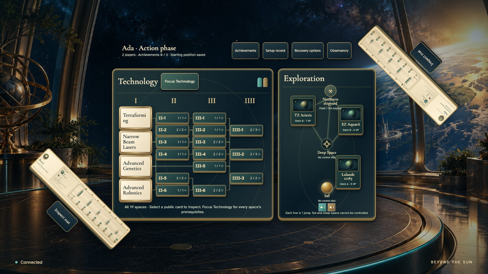](../../screenshots/begin-and-recover-an-exact-2-player-compact-shared-basic-table/016-compact-overview-desktop-darwin.png) |

- [x] The same saved table at 1280 × 720 exposes the complete public overview
- [x] The shared display fits without page scrolling.

## 18. Keyboard opens readable Technology with persistent overview and branch instruments

Viewpoint: **Shared table · one controller**.

| desktop · 1280 × 720 |
| --- |
| [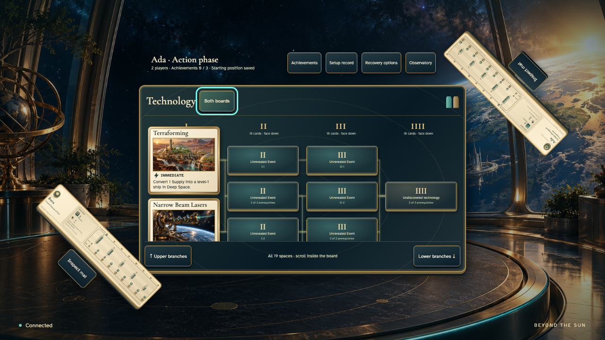](../../screenshots/begin-and-recover-an-exact-2-player-compact-shared-basic-table/017-technology-focus-desktop-darwin.png) |

- [x] Keyboard opens readable Technology with persistent overview and branch instruments
- [x] The shared display fits without page scrolling.

## 19. Reach lower public cards and all final prerequisite positions

Viewpoint: **Shared table · one controller**.

| desktop · 1280 × 720 |
| --- |
| [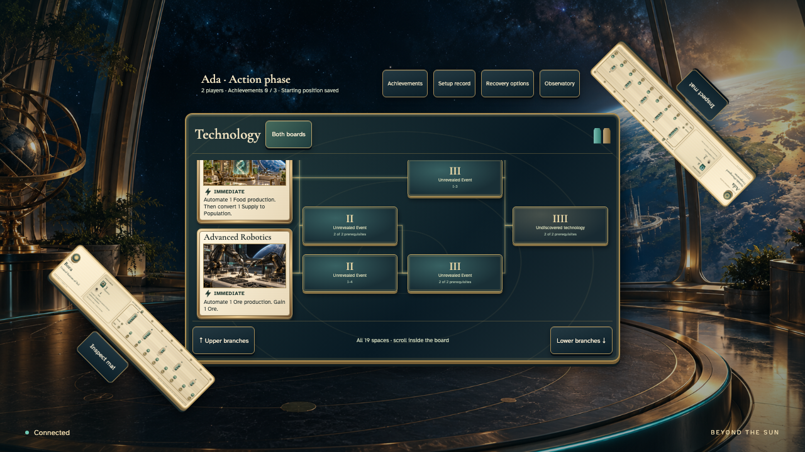](../../screenshots/begin-and-recover-an-exact-2-player-compact-shared-basic-table/018-lower-branches-desktop-darwin.png) |

- [x] Reach lower public cards and all final prerequisite positions
- [x] The shared display fits without page scrolling.

## 20. Read the lowest public Technology card in the full-size inspector

Viewpoint: **Shared table · one controller**.

| desktop · 1280 × 720 |
| --- |
| [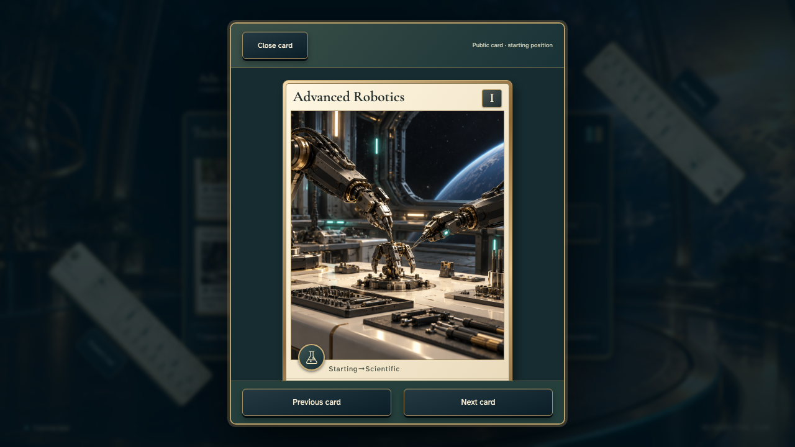](../../screenshots/begin-and-recover-an-exact-2-player-compact-shared-basic-table/019-lower-card-desktop-darwin.png) |

- [x] Read the lowest public Technology card in the full-size inspector
- [x] The shared display fits without page scrolling.

## 21. Escape restores the actual lower-card keyboard focus

Viewpoint: **Shared table · one controller**.

| desktop · 1280 × 720 |
| --- |
| [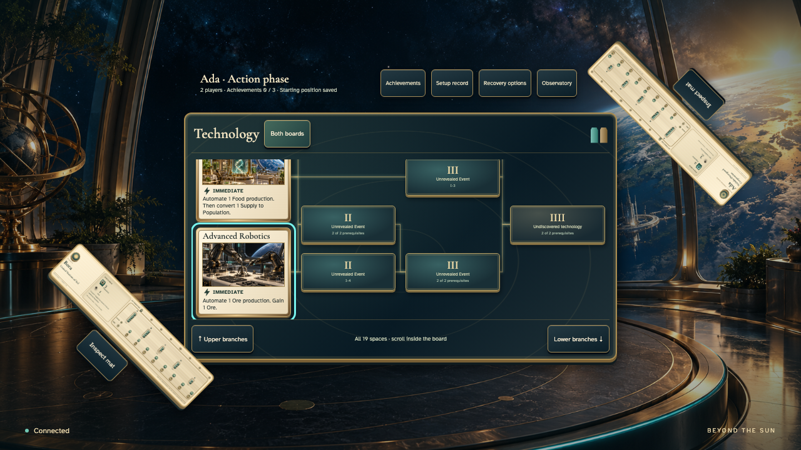](../../screenshots/begin-and-recover-an-exact-2-player-compact-shared-basic-table/020-lower-card-return-desktop-darwin.png) |

- [x] Escape restores the actual lower-card keyboard focus
- [x] The shared display fits without page scrolling.

## 22. Return to all 19 public positions and both boards without changing the game

Viewpoint: **Shared table · one controller**.

| desktop · 1280 × 720 |
| --- |
| [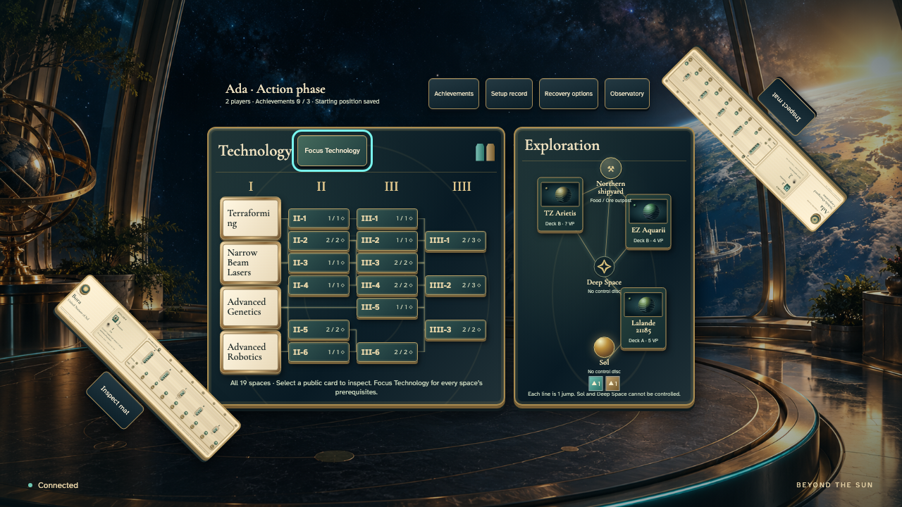](../../screenshots/begin-and-recover-an-exact-2-player-compact-shared-basic-table/021-overview-return-desktop-darwin.png) |

- [x] Return to all 19 public positions and both boards without changing the game
- [x] The shared display fits without page scrolling.

## 23. The complete seat-facing faction mat fits its compact landscape reader

Viewpoint: **Shared table · one controller**.

| desktop · 1280 × 720 |
| --- |
| [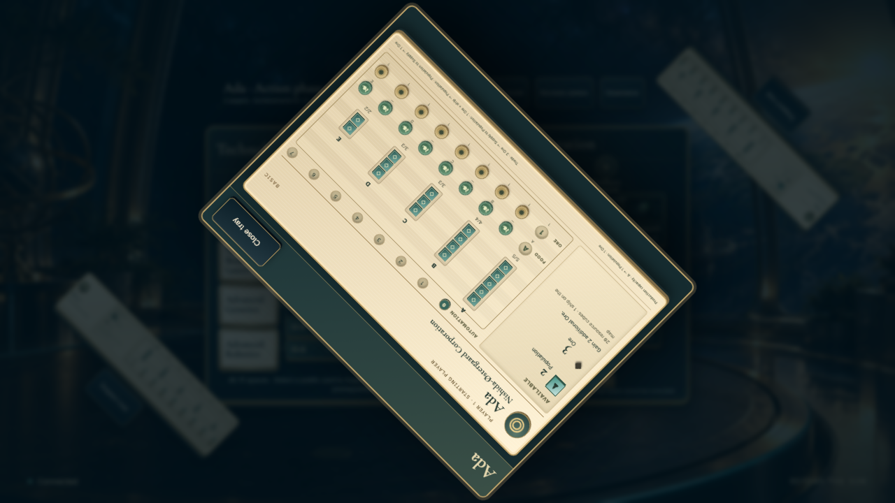](../../screenshots/begin-and-recover-an-exact-2-player-compact-shared-basic-table/022-compact-mat-desktop-darwin.png) |

- [x] The complete seat-facing faction mat fits its compact landscape reader
- [x] The shared display fits without page scrolling.

## 24. Close the compact reader and restore the seat-facing control focus

Viewpoint: **Shared table · one controller**.

| desktop · 1280 × 720 |
| --- |
| [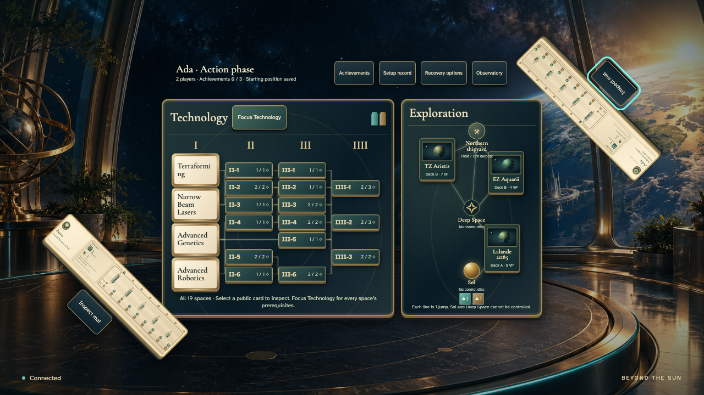](../../screenshots/begin-and-recover-an-exact-2-player-compact-shared-basic-table/023-compact-mat-return-desktop-darwin.png) |

- [x] Close the compact reader and restore the seat-facing control focus
- [x] The shared display fits without page scrolling.

## 25. Restore the original shared display before inspecting seat-facing mats

Viewpoint: **Shared table · one controller**.

| desktop · 1440 × 1000 |
| --- |
|  |

- [x] Restore the original shared display before inspecting seat-facing mats
- [x] The shared display fits without page scrolling.

## 26. Ada’s complete mat shows Ore by actual turn order and the Basic bonus

Viewpoint: **Shared table · one controller**.

| desktop · 1440 × 1000 |
| --- |
| [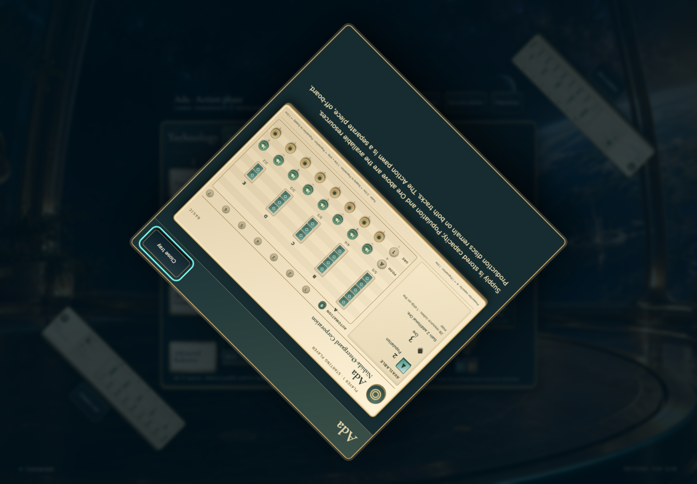](../../screenshots/begin-and-recover-an-exact-2-player-compact-shared-basic-table/025-ada-mat-desktop-darwin.png) |

- [x] Ada’s complete mat shows Ore by actual turn order and the Basic bonus
- [x] The shared display fits without page scrolling.

## 27. Close the inspection and restore the physical mat’s control focus

Viewpoint: **Shared table · one controller**.

| desktop · 1440 × 1000 |
| --- |
|  |

- [x] Close the inspection and restore the physical mat’s control focus
- [x] The shared display fits without page scrolling.

## 28. Confirm the exact board face and covered guilds

Viewpoint: **Shared table · one controller**.

| desktop · 1440 × 1000 |
| --- |
|  |

- [x] Confirm the exact board face and covered guilds
- [x] The shared display fits without page scrolling.

## 29. The board controls remain reachable after inspection

Viewpoint: **Shared table · one controller**.

| desktop · 1440 × 1000 |
| --- |
| [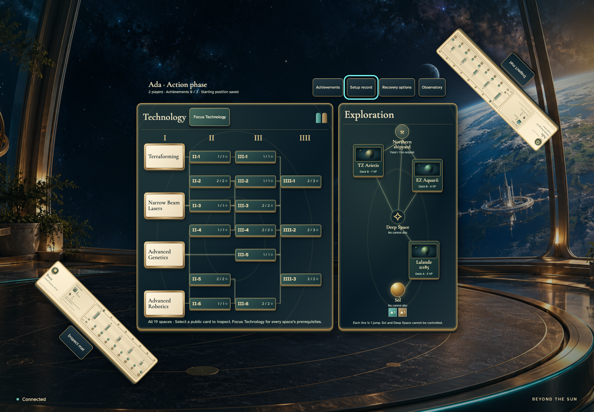](../../screenshots/begin-and-recover-an-exact-2-player-compact-shared-basic-table/028-record-closed-desktop-darwin.png) |

- [x] The board controls remain reachable after inspection
- [x] The shared display fits without page scrolling.

## 30. Reload recovers the same saved shared starting position

Viewpoint: **Shared table · one controller**.

| desktop · 1440 × 1000 |
| --- |
| [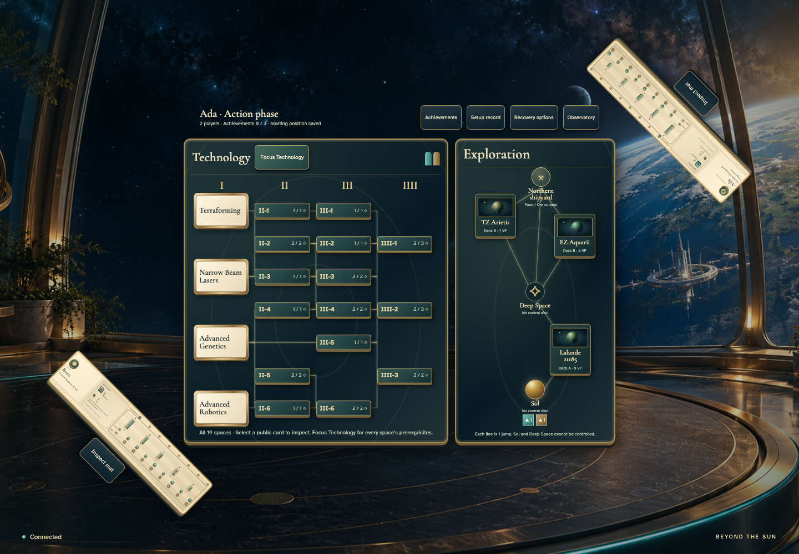](../../screenshots/begin-and-recover-an-exact-2-player-compact-shared-basic-table/029-restored-desktop-darwin.png) |

- [x] Reload recovers the same saved shared starting position
- [x] The shared display fits without page scrolling.
