# Begin and recover an exact 2-player remote Basic game

Ordinary remote setup for 2 separate identities. Host navigates arrival/Play/Create, guests use the displayed invitation code. Each player selects their own legal unique Basic faction and confirms the final configuration. UUID entropy is fixed before setup; no state injection or gameplay simulation. This story ends at the real immutable starting position, with inspection and reload.

## 1. Ada arrives through normal navigation

Viewpoint: **Ada · host**.

| phone · 393 × 852 | desktop · 1440 × 1000 |
| --- | --- |
|  |  |

- [x] Ada arrives through normal navigation
- [x] The actual game shell has no page overflow.

## 2. Ada chooses remote hosting

Viewpoint: **Ada · host**.

| phone · 393 × 852 | desktop · 1440 × 1000 |
| --- | --- |
|  |  |

- [x] Ada chooses remote hosting
- [x] The actual game shell has no page overflow.

## 3. Review the production room setup

Viewpoint: **Ada · host**.

| phone · 393 × 852 | desktop · 1440 × 1000 |
| --- | --- |
|  |  |

- [x] Review the production room setup
- [x] The actual game shell has no page overflow.

## 4. Ada supplies her public name

Viewpoint: **Ada · host**.

| phone · 393 × 852 | desktop · 1440 × 1000 |
| --- | --- |
| [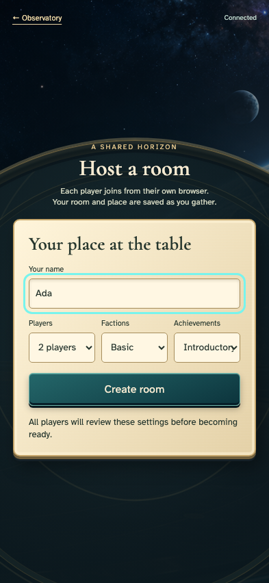](../../screenshots/begin-and-recover-an-exact-2-player-remote-basic-game/003-host-name-phone-darwin.png) |  |

- [x] Ada supplies her public name
- [x] The actual game shell has no page overflow.

## 5. The real room awaits factions and confirmations

Viewpoint: **Ada · host**.

| phone · 393 × 852 | desktop · 1440 × 1000 |
| --- | --- |
| [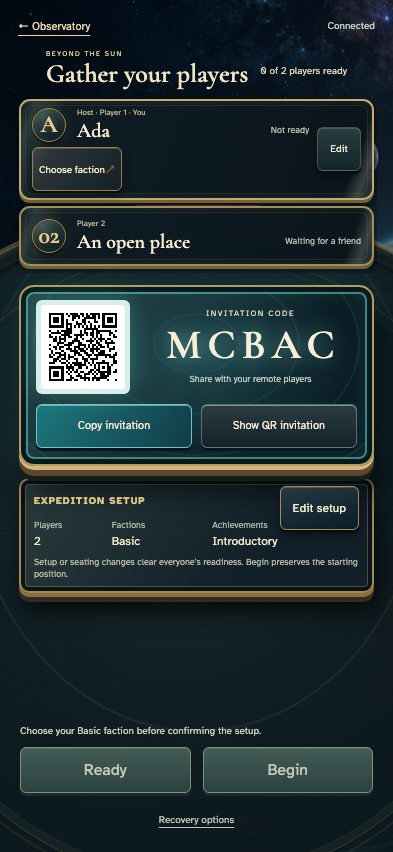](../../screenshots/begin-and-recover-an-exact-2-player-remote-basic-game/004-created-phone-darwin.png) |  |

- [x] The real room awaits factions and confirmations
- [x] The actual game shell has no page overflow.

## 6. Bora reviews the host invitation before joining

Viewpoint: **Bora · separate remote identity**.

| phone · 1440 × 1000 | desktop · 393 × 852 |
| --- | --- |
| [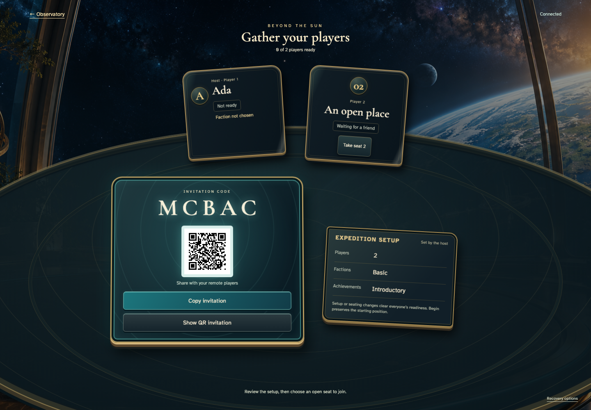](../../screenshots/begin-and-recover-an-exact-2-player-remote-basic-game/005-invite-1-phone-darwin.png) | [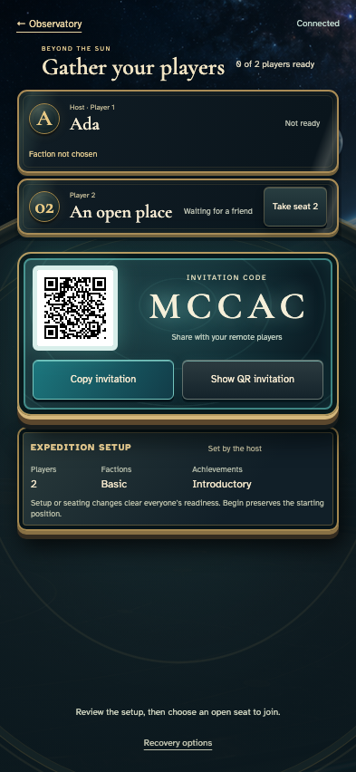](../../screenshots/begin-and-recover-an-exact-2-player-remote-basic-game/005-invite-1-desktop-darwin.png) |

- [x] Bora reviews the host invitation before joining
- [x] The actual game shell has no page overflow.

## 7. Bora opens their own seat editor

Viewpoint: **Bora · separate remote identity**.

| phone · 1440 × 1000 | desktop · 393 × 852 |
| --- | --- |
| [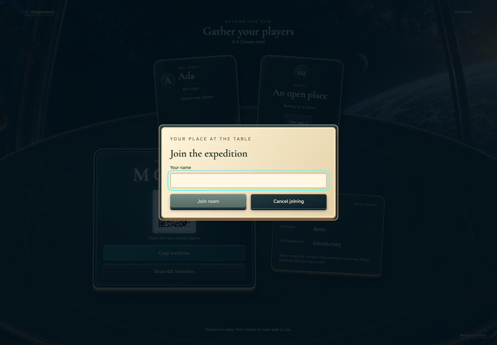](../../screenshots/begin-and-recover-an-exact-2-player-remote-basic-game/006-join-editor-1-phone-darwin.png) |  |

- [x] Bora opens their own seat editor
- [x] The actual game shell has no page overflow.

## 8. Bora enters their public name

Viewpoint: **Bora · separate remote identity**.

| phone · 1440 × 1000 | desktop · 393 × 852 |
| --- | --- |
| [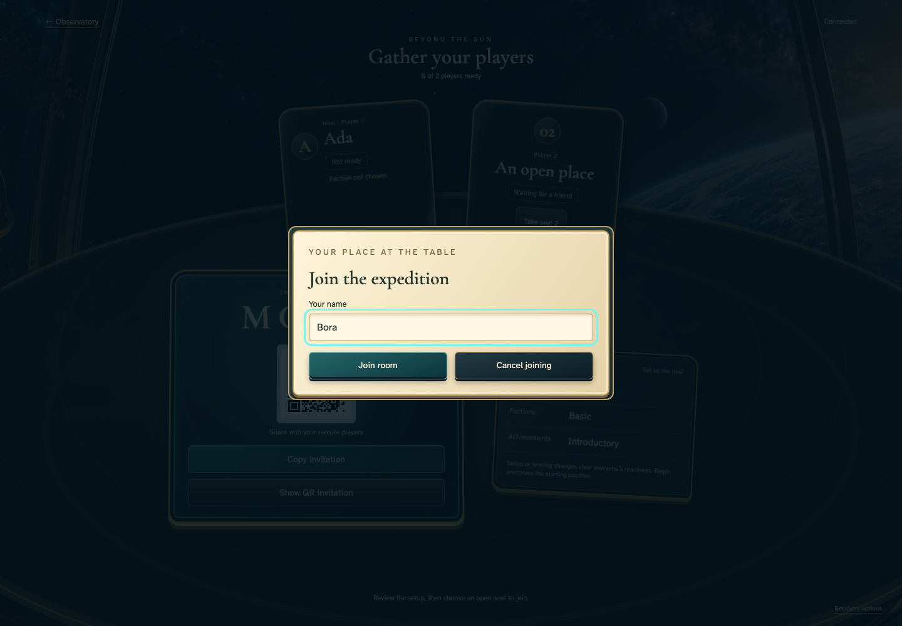](../../screenshots/begin-and-recover-an-exact-2-player-remote-basic-game/007-join-name-1-phone-darwin.png) |  |

- [x] Bora enters their public name
- [x] The actual game shell has no page overflow.

## 9. Bora owns their separate seat

Viewpoint: **Bora · separate remote identity**.

| phone · 1440 × 1000 | desktop · 393 × 852 |
| --- | --- |
| [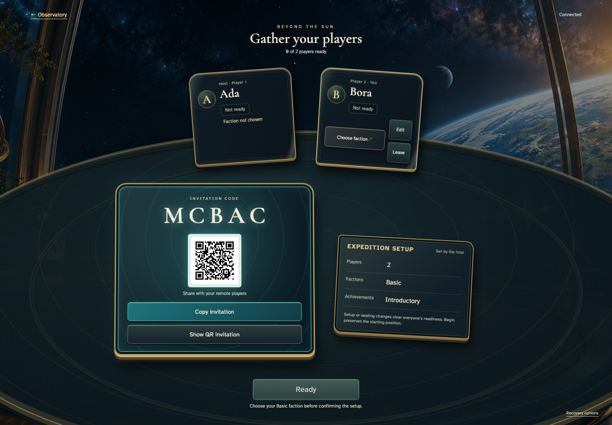](../../screenshots/begin-and-recover-an-exact-2-player-remote-basic-game/008-joined-1-phone-darwin.png) | [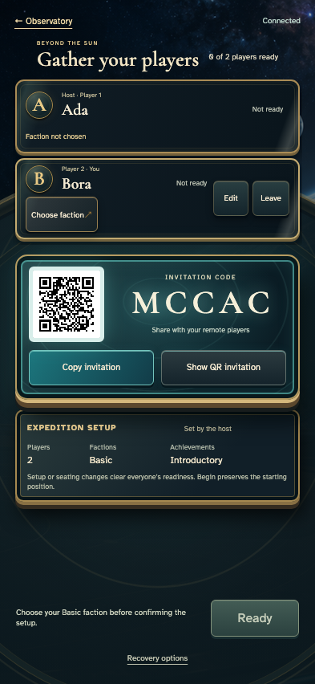](../../screenshots/begin-and-recover-an-exact-2-player-remote-basic-game/008-joined-1-desktop-darwin.png) |

- [x] Bora owns their separate seat
- [x] The actual game shell has no page overflow.

## 10. Ada sees Bora arrive through the live canonical room

Viewpoint: **Ada · host**.

| phone · 393 × 852 | desktop · 1440 × 1000 |
| --- | --- |
| [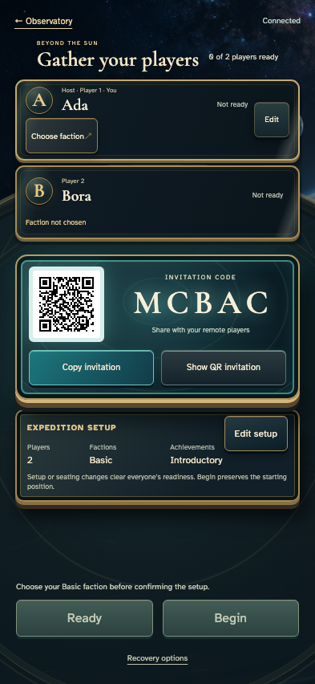](../../screenshots/begin-and-recover-an-exact-2-player-remote-basic-game/009-host-observes-1-phone-darwin.png) | [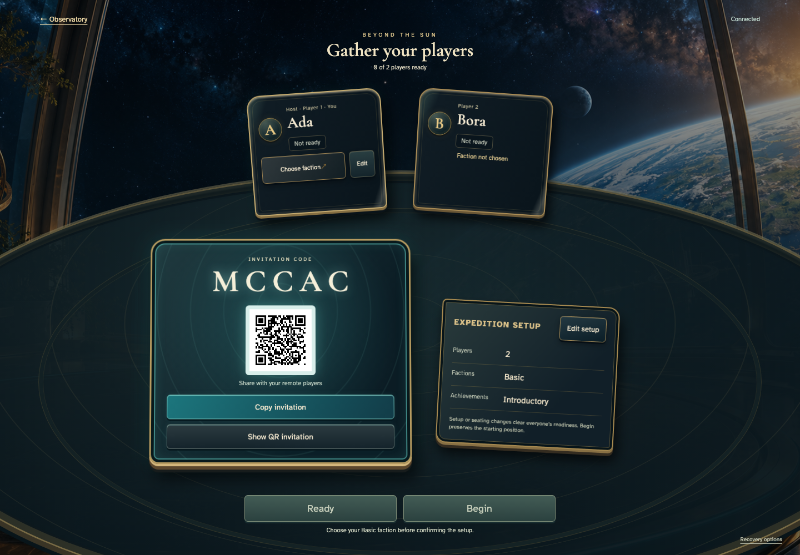](../../screenshots/begin-and-recover-an-exact-2-player-remote-basic-game/009-host-observes-1-desktop-darwin.png) |

- [x] Ada sees Bora arrive through the live canonical room
- [x] The actual game shell has no page overflow.

## 11. Ada reads source-reviewed Basic setup bonuses

Viewpoint: **Ada · host**.

| phone · 393 × 852 | desktop · 1440 × 1000 |
| --- | --- |
|  |  |

- [x] Ada reads source-reviewed Basic setup bonuses
- [x] The actual game shell has no page overflow.

## 12. Ada commits a unique legal faction

Viewpoint: **Ada · host**.

| phone · 393 × 852 | desktop · 1440 × 1000 |
| --- | --- |
| [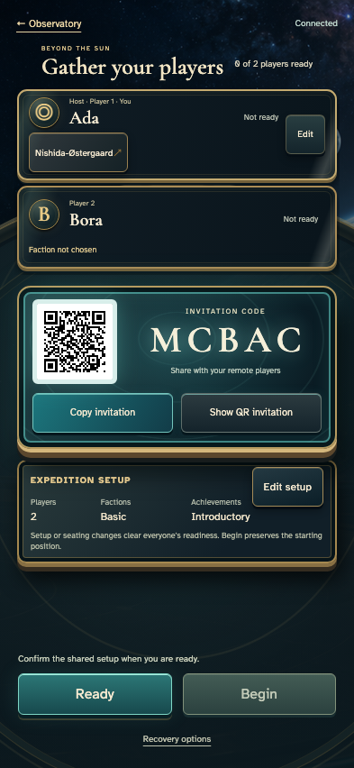](../../screenshots/begin-and-recover-an-exact-2-player-remote-basic-game/011-faction-chosen-0-phone-darwin.png) | [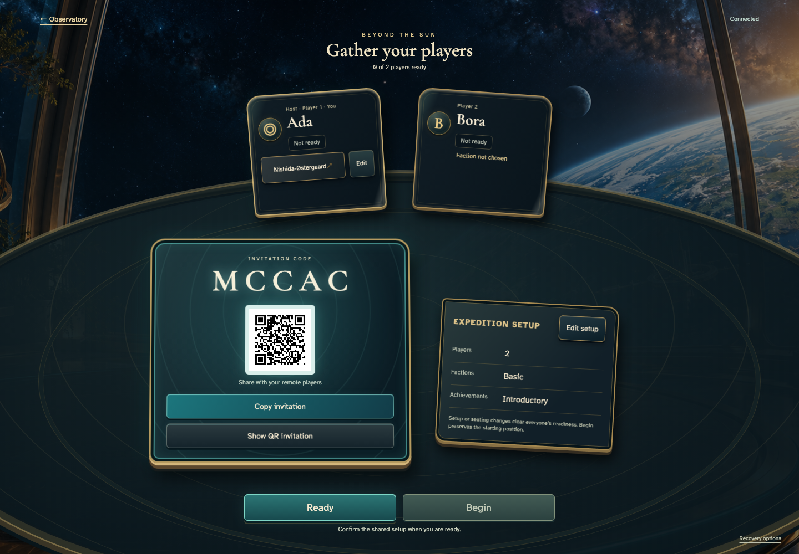](../../screenshots/begin-and-recover-an-exact-2-player-remote-basic-game/011-faction-chosen-0-desktop-darwin.png) |

- [x] Ada commits a unique legal faction
- [x] The actual game shell has no page overflow.

## 13. Bora reads source-reviewed Basic setup bonuses

Viewpoint: **Bora · separate remote identity**.

| phone · 1440 × 1000 | desktop · 393 × 852 |
| --- | --- |
|  |  |

- [x] Bora reads source-reviewed Basic setup bonuses
- [x] The actual game shell has no page overflow.

## 14. Bora commits a unique legal faction

Viewpoint: **Bora · separate remote identity**.

| phone · 1440 × 1000 | desktop · 393 × 852 |
| --- | --- |
| [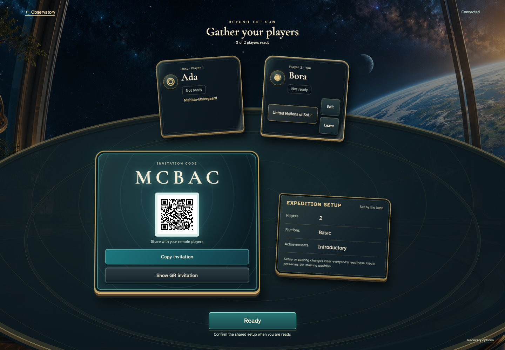](../../screenshots/begin-and-recover-an-exact-2-player-remote-basic-game/013-faction-chosen-1-phone-darwin.png) | [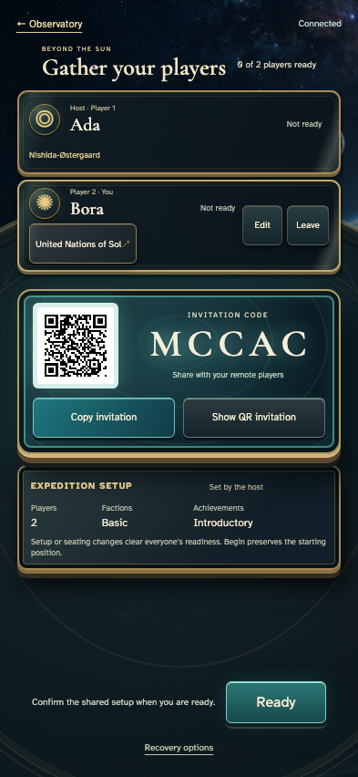](../../screenshots/begin-and-recover-an-exact-2-player-remote-basic-game/013-faction-chosen-1-desktop-darwin.png) |

- [x] Bora commits a unique legal faction
- [x] The actual game shell has no page overflow.

## 15. Ada confirms this faction and configuration

Viewpoint: **Ada · host**.

| phone · 393 × 852 | desktop · 1440 × 1000 |
| --- | --- |
| [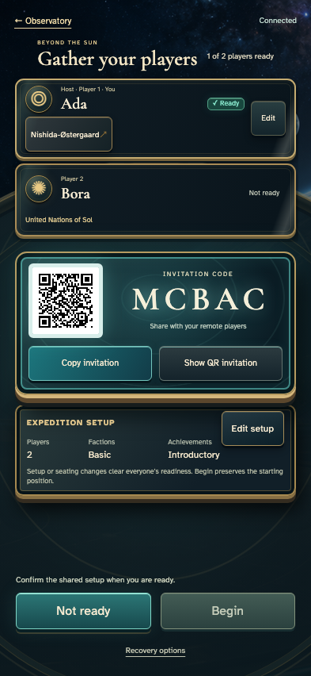](../../screenshots/begin-and-recover-an-exact-2-player-remote-basic-game/014-ready-0-phone-darwin.png) |  |

- [x] Ada confirms this faction and configuration
- [x] The actual game shell has no page overflow.

## 16. Bora confirms this faction and configuration

Viewpoint: **Bora · separate remote identity**.

| phone · 1440 × 1000 | desktop · 393 × 852 |
| --- | --- |
|  | [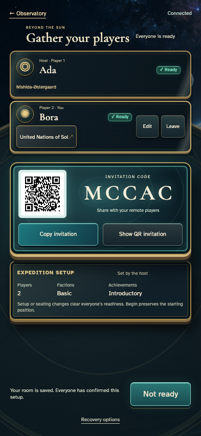](../../screenshots/begin-and-recover-an-exact-2-player-remote-basic-game/015-ready-1-desktop-darwin.png) |

- [x] Bora confirms this faction and configuration
- [x] The actual game shell has no page overflow.

## 17. Ada can Begin only after every configured player confirms

Viewpoint: **Ada · host**.

| phone · 393 × 852 | desktop · 1440 × 1000 |
| --- | --- |
| [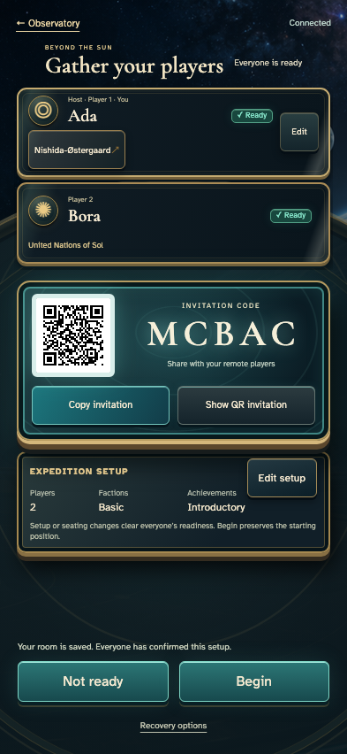](../../screenshots/begin-and-recover-an-exact-2-player-remote-basic-game/016-all-ready-phone-darwin.png) |  |

- [x] Ada can Begin only after every configured player confirms
- [x] The actual game shell has no page overflow.

## 18. Begin commits one immutable starting position

Viewpoint: **Ada · host**.

| phone · 393 × 852 | desktop · 1440 × 1000 |
| --- | --- |
|  | [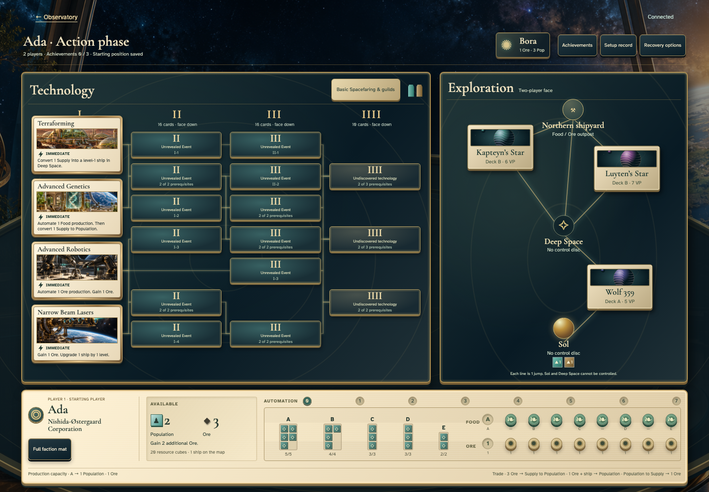](../../screenshots/begin-and-recover-an-exact-2-player-remote-basic-game/017-begun-desktop-darwin.png) |

- [x] Begin commits one immutable starting position
- [x] The actual game shell has no page overflow.

## 19. The separate guest observes the same started game

Viewpoint: **Bora · separate remote identity**.

| phone · 1440 × 1000 | desktop · 393 × 852 |
| --- | --- |
| [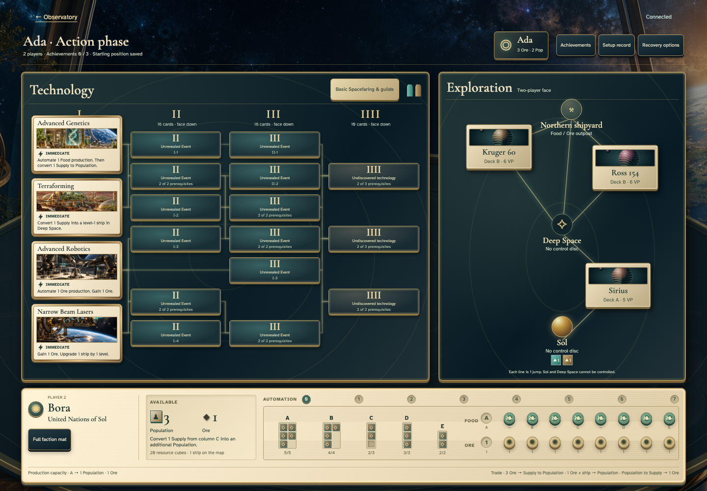](../../screenshots/begin-and-recover-an-exact-2-player-remote-basic-game/018-guest-start-phone-darwin.png) |  |

- [x] The separate guest observes the same started game
- [x] The actual game shell has no page overflow.

## 20. The phone focuses the correct public Exploration board

Viewpoint: **Bora · separate remote identity**.

| phone · 393 × 852 | desktop · 393 × 852 |
| --- | --- |
| [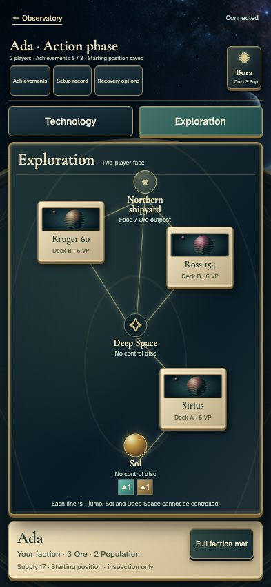](../../screenshots/begin-and-recover-an-exact-2-player-remote-basic-game/019-phone-exploration-phone-darwin.png) |  |

- [x] The phone focuses the correct public Exploration board
- [x] The actual game shell has no page overflow.

## 21. Return to the phone’s Technology board without changing game state

Viewpoint: **Bora · separate remote identity**.

| phone · 393 × 852 | desktop · 393 × 852 |
| --- | --- |
|  |  |

- [x] Return to the phone’s Technology board without changing game state
- [x] The actual game shell has no page overflow.

## 22. Inspect the real public Technology face and its printed action cost

Viewpoint: **Ada · host**.

| phone · 393 × 852 | desktop · 1440 × 1000 |
| --- | --- |
| [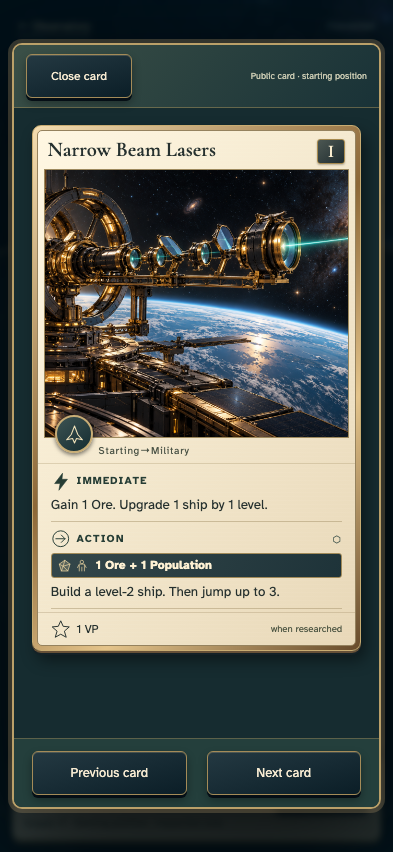](../../screenshots/begin-and-recover-an-exact-2-player-remote-basic-game/021-technology-inspection-phone-darwin.png) | [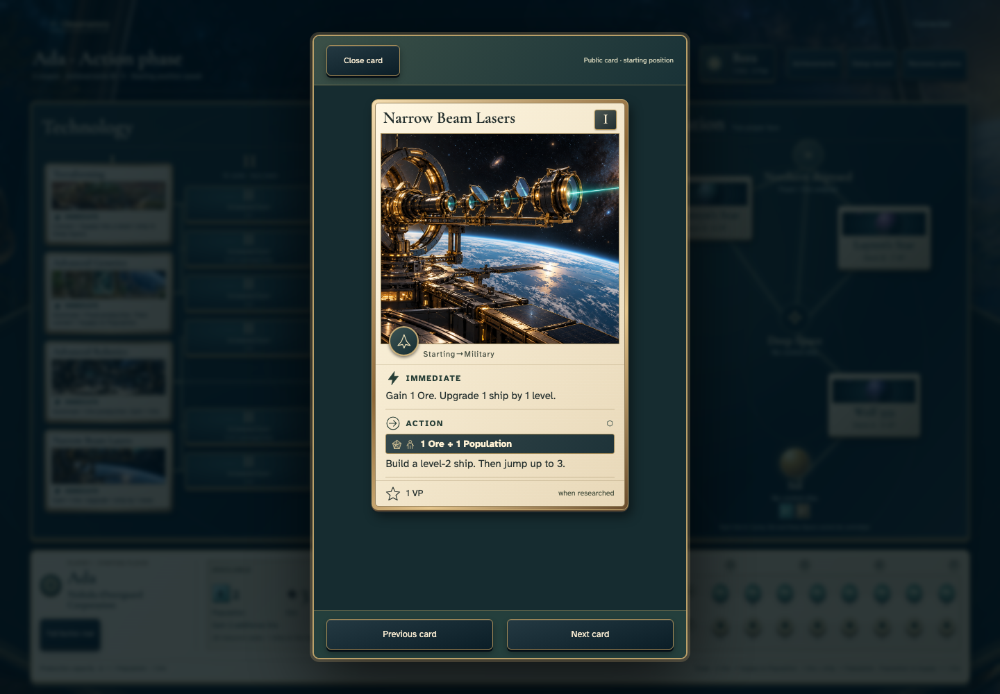](../../screenshots/begin-and-recover-an-exact-2-player-remote-basic-game/021-technology-inspection-desktop-darwin.png) |

- [x] Inspect the real public Technology face and its printed action cost
- [x] The actual game shell has no page overflow.

## 23. Reverse keyboard navigation stays in persistent card chrome

Viewpoint: **Ada · host**.

| phone · 393 × 852 | desktop · 1440 × 1000 |
| --- | --- |
| [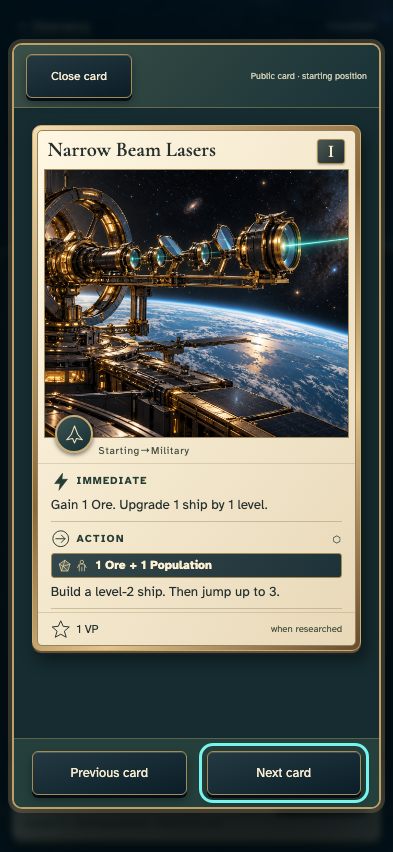](../../screenshots/begin-and-recover-an-exact-2-player-remote-basic-game/022-card-keyboard-wrap-phone-darwin.png) | [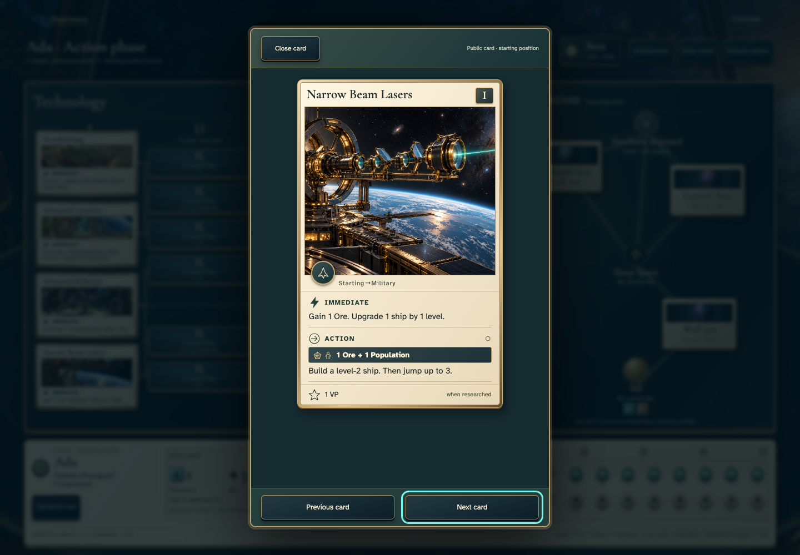](../../screenshots/begin-and-recover-an-exact-2-player-remote-basic-game/022-card-keyboard-wrap-desktop-darwin.png) |

- [x] Reverse keyboard navigation stays in persistent card chrome
- [x] The actual game shell has no page overflow.

## 24. Closing the card restores the actual board control focus

Viewpoint: **Ada · host**.

| phone · 393 × 852 | desktop · 1440 × 1000 |
| --- | --- |
| [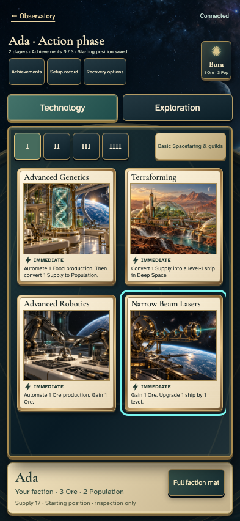](../../screenshots/begin-and-recover-an-exact-2-player-remote-basic-game/023-card-closed-phone-darwin.png) |  |

- [x] Closing the card restores the actual board control focus
- [x] The actual game shell has no page overflow.

## 25. The phone focuses the actual Level III slots

Viewpoint: **Bora · separate remote identity**.

| phone · 393 × 852 | desktop · 393 × 852 |
| --- | --- |
| [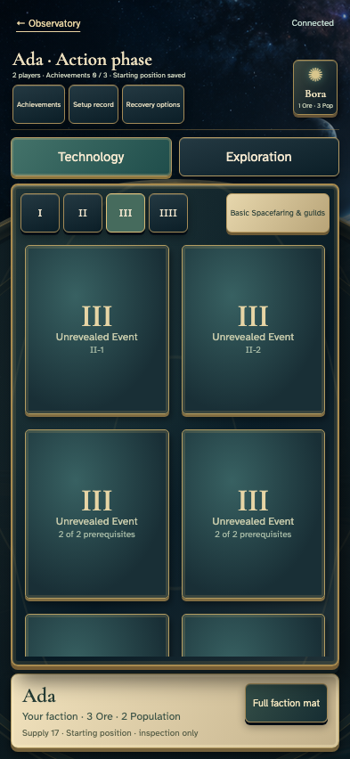](../../screenshots/begin-and-recover-an-exact-2-player-remote-basic-game/024-phone-level-three-phone-darwin.png) |  |

- [x] The phone focuses the actual Level III slots
- [x] The actual game shell has no page overflow.

## 26. Inspect the printed direct I-to-III prerequisite without revealing the Event

Viewpoint: **Ada · host**.

| phone · 393 × 852 | desktop · 1440 × 1000 |
| --- | --- |
| [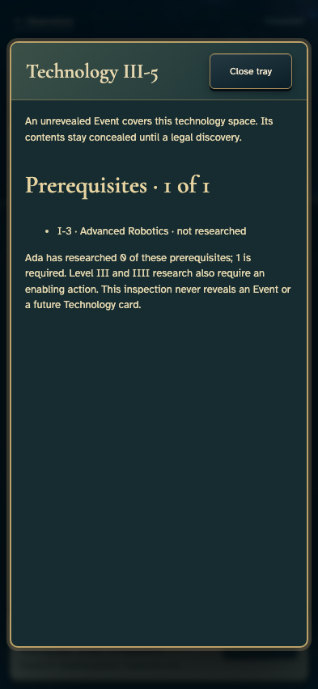](../../screenshots/begin-and-recover-an-exact-2-player-remote-basic-game/025-prerequisites-phone-darwin.png) | [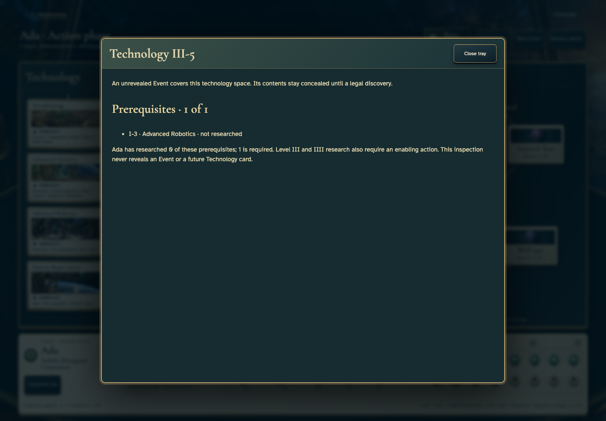](../../screenshots/begin-and-recover-an-exact-2-player-remote-basic-game/025-prerequisites-desktop-darwin.png) |

- [x] Inspect the printed direct I-to-III prerequisite without revealing the Event
- [x] The actual game shell has no page overflow.

## 27. Return focus to the concealed slot without revealing or spending anything

Viewpoint: **Ada · host**.

| phone · 393 × 852 | desktop · 1440 × 1000 |
| --- | --- |
| [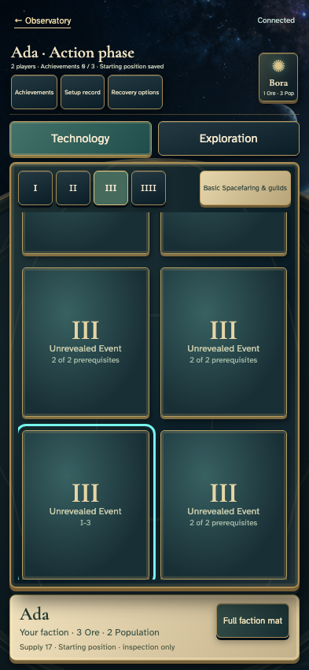](../../screenshots/begin-and-recover-an-exact-2-player-remote-basic-game/026-prerequisites-closed-phone-darwin.png) |  |

- [x] Return focus to the concealed slot without revealing or spending anything
- [x] The actual game shell has no page overflow.

## 28. Return to the four public Level I faces

Viewpoint: **Bora · separate remote identity**.

| phone · 393 × 852 | desktop · 393 × 852 |
| --- | --- |
| [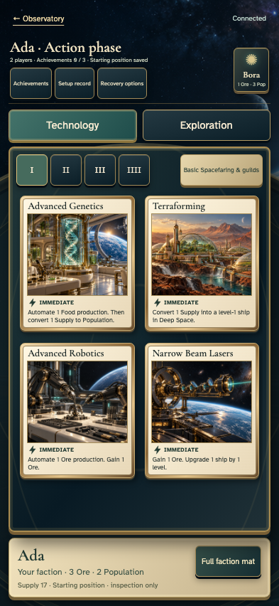](../../screenshots/begin-and-recover-an-exact-2-player-remote-basic-game/027-phone-level-one-phone-darwin.png) | [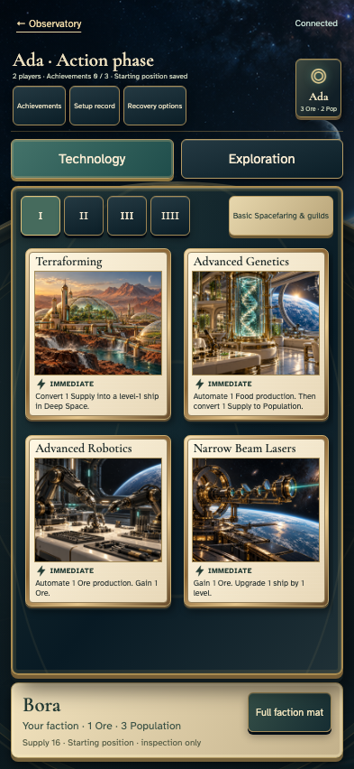](../../screenshots/begin-and-recover-an-exact-2-player-remote-basic-game/027-phone-level-one-desktop-darwin.png) |

- [x] Return to the four public Level I faces
- [x] The actual game shell has no page overflow.

## 29. Inspect exact player-count decks, overlay and achievement restrictions

Viewpoint: **Ada · host**.

| phone · 393 × 852 | desktop · 1440 × 1000 |
| --- | --- |
| [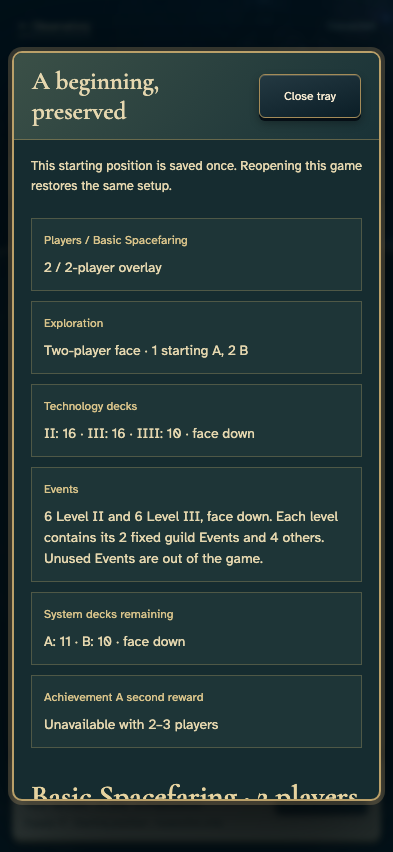](../../screenshots/begin-and-recover-an-exact-2-player-remote-basic-game/028-setup-record-phone-darwin.png) | [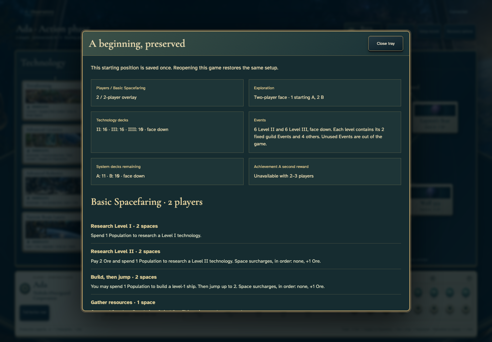](../../screenshots/begin-and-recover-an-exact-2-player-remote-basic-game/028-setup-record-desktop-darwin.png) |

- [x] Inspect exact player-count decks, overlay and achievement restrictions
- [x] The actual game shell has no page overflow.

## 30. Escape returns to the Setup record instrument

Viewpoint: **Ada · host**.

| phone · 393 × 852 | desktop · 1440 × 1000 |
| --- | --- |
| [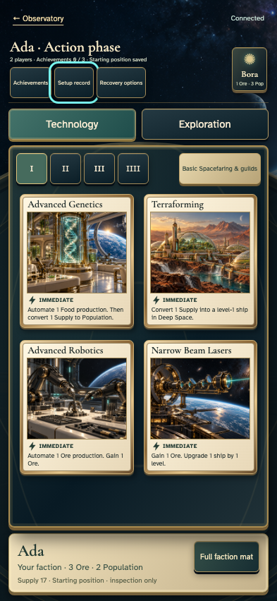](../../screenshots/begin-and-recover-an-exact-2-player-remote-basic-game/029-record-closed-phone-darwin.png) | [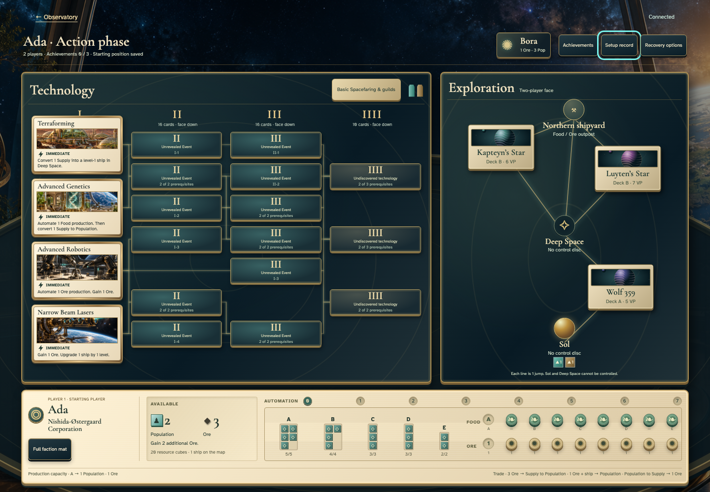](../../screenshots/begin-and-recover-an-exact-2-player-remote-basic-game/029-record-closed-desktop-darwin.png) |

- [x] Escape returns to the Setup record instrument
- [x] The actual game shell has no page overflow.

## 31. Inspect available resources, filled Supply and eight discs on each production track

Viewpoint: **Ada · host**.

| phone · 393 × 852 | desktop · 1440 × 1000 |
| --- | --- |
| [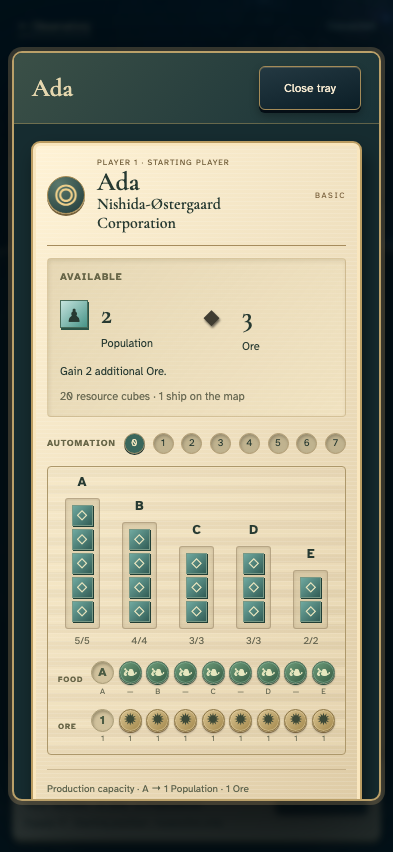](../../screenshots/begin-and-recover-an-exact-2-player-remote-basic-game/030-faction-mat-phone-darwin.png) | [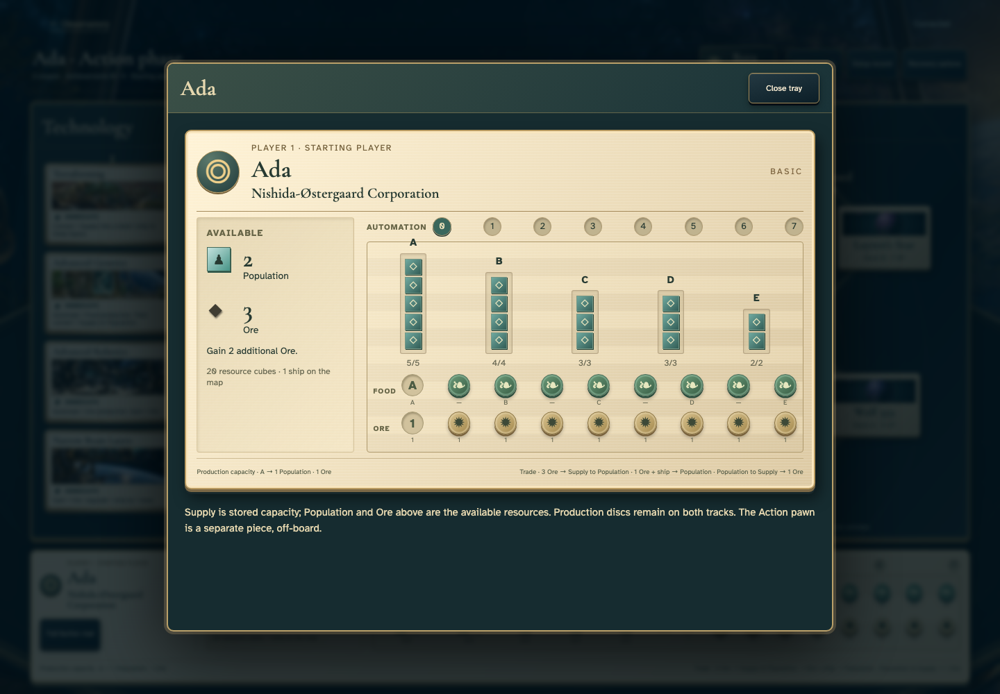](../../screenshots/begin-and-recover-an-exact-2-player-remote-basic-game/030-faction-mat-desktop-darwin.png) |

- [x] Inspect available resources, filled Supply and eight discs on each production track
- [x] The actual game shell has no page overflow.

## 32. Return from the full mat with focus restored

Viewpoint: **Ada · host**.

| phone · 393 × 852 | desktop · 1440 × 1000 |
| --- | --- |
| [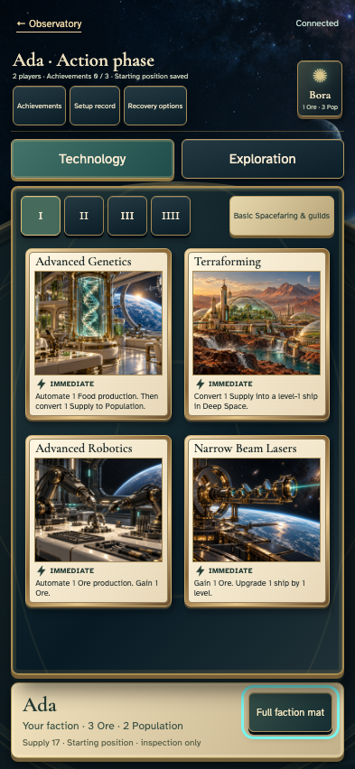](../../screenshots/begin-and-recover-an-exact-2-player-remote-basic-game/031-mat-closed-phone-darwin.png) |  |

- [x] Return from the full mat with focus restored
- [x] The actual game shell has no page overflow.

## 33. Recovery remains available after the immutable Begin

Viewpoint: **Ada · host**.

| phone · 393 × 852 | desktop · 1440 × 1000 |
| --- | --- |
| [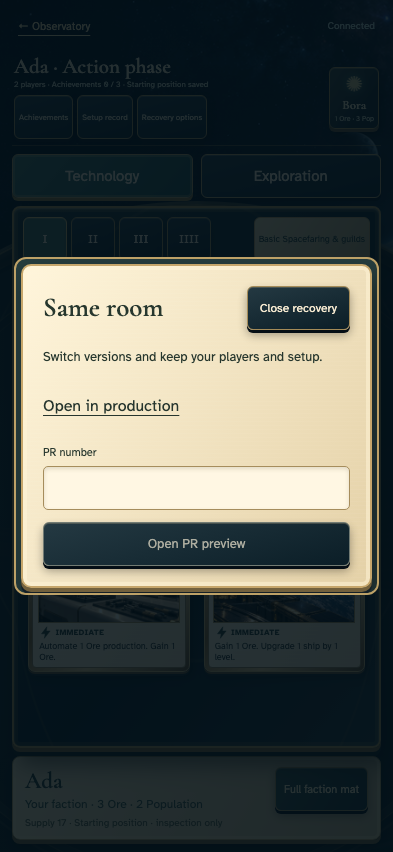](../../screenshots/begin-and-recover-an-exact-2-player-remote-basic-game/032-started-recovery-phone-darwin.png) | [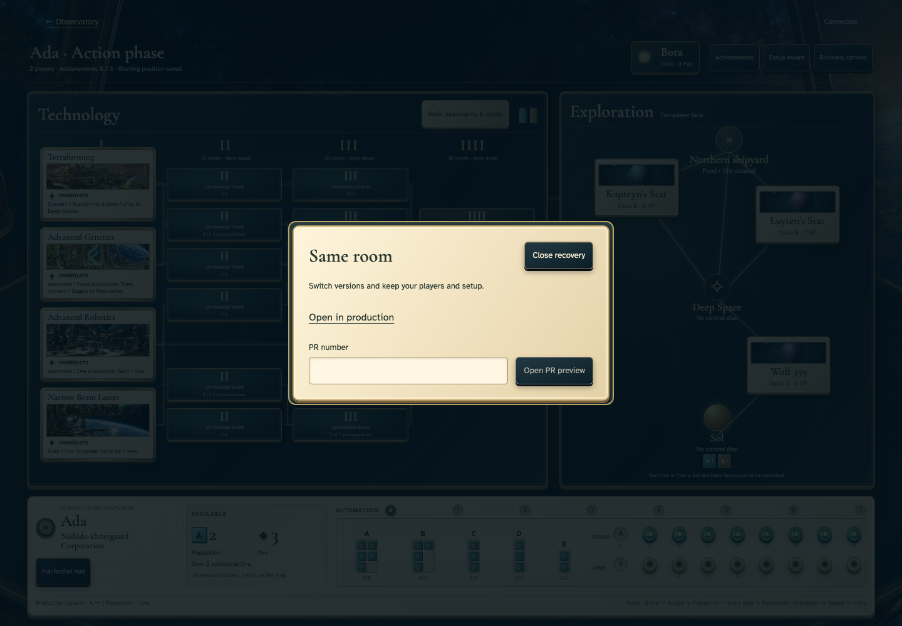](../../screenshots/begin-and-recover-an-exact-2-player-remote-basic-game/032-started-recovery-desktop-darwin.png) |

- [x] Recovery remains available after the immutable Begin
- [x] The actual game shell has no page overflow.

## 34. Close recovery with focus back on its game instrument

Viewpoint: **Ada · host**.

| phone · 393 × 852 | desktop · 1440 × 1000 |
| --- | --- |
| [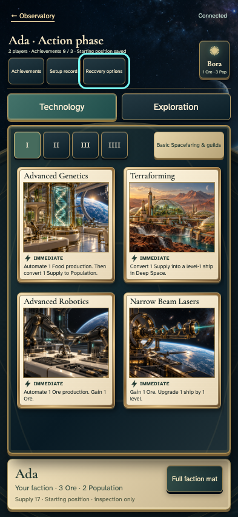](../../screenshots/begin-and-recover-an-exact-2-player-remote-basic-game/033-recovery-closed-phone-darwin.png) | [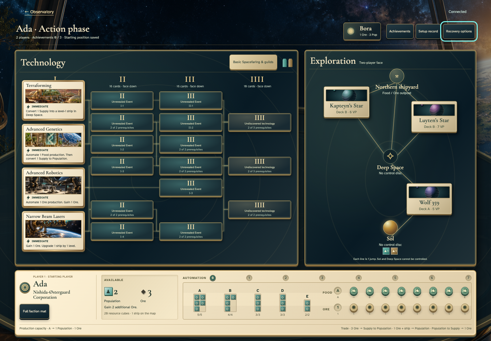](../../screenshots/begin-and-recover-an-exact-2-player-remote-basic-game/033-recovery-closed-desktop-darwin.png) |

- [x] Close recovery with focus back on its game instrument
- [x] The actual game shell has no page overflow.

## 35. Reload preserves the permanent starting position and seat

Viewpoint: **Ada · host**.

| phone · 393 × 852 | desktop · 1440 × 1000 |
| --- | --- |
|  |  |

- [x] Reload preserves the permanent starting position and seat
- [x] The actual game shell has no page overflow.
