# Begin and recover an exact 4-player remote Basic game

Ordinary remote setup for 4 separate identities. Host navigates arrival/Play/Create, guests use the displayed invitation code. Each player selects their own legal unique Basic faction and confirms the final configuration. UUID entropy is fixed before setup; no state injection or gameplay simulation. This story ends at the real immutable starting position, with inspection and reload.

## 1. Ada arrives through normal navigation

Viewpoint: **Ada · host**.

| phone · 393 × 852 | desktop · 1440 × 1000 |
| --- | --- |
|  |  |

- [x] Ada arrives through normal navigation
- [x] The actual game shell has no page overflow.

## 2. Ada chooses remote hosting

Viewpoint: **Ada · host**.

| phone · 393 × 852 | desktop · 1440 × 1000 |
| --- | --- |
|  |  |

- [x] Ada chooses remote hosting
- [x] The actual game shell has no page overflow.

## 3. Review the production room setup

Viewpoint: **Ada · host**.

| phone · 393 × 852 | desktop · 1440 × 1000 |
| --- | --- |
|  |  |

- [x] Review the production room setup
- [x] The actual game shell has no page overflow.

## 4. Configure 4 remote players

Viewpoint: **Ada · host**.

| phone · 393 × 852 | desktop · 1440 × 1000 |
| --- | --- |
| [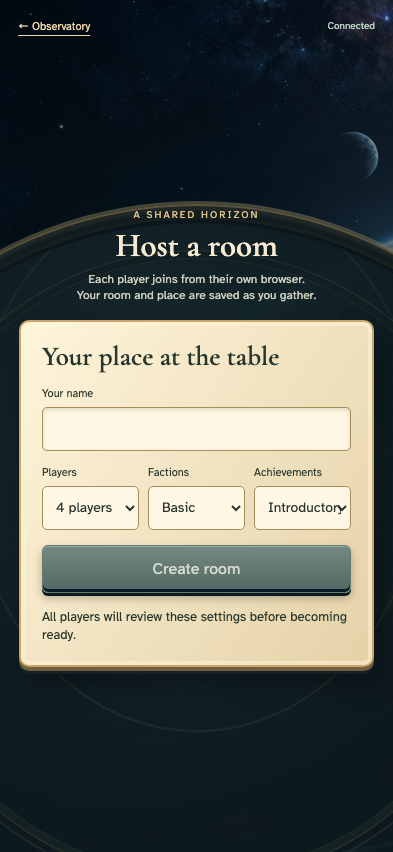](../../screenshots/begin-and-recover-an-exact-4-player-remote-basic-game/003-player-count-phone-darwin.png) |  |

- [x] Configure 4 remote players
- [x] The actual game shell has no page overflow.

## 5. Ada supplies her public name

Viewpoint: **Ada · host**.

| phone · 393 × 852 | desktop · 1440 × 1000 |
| --- | --- |
|  | [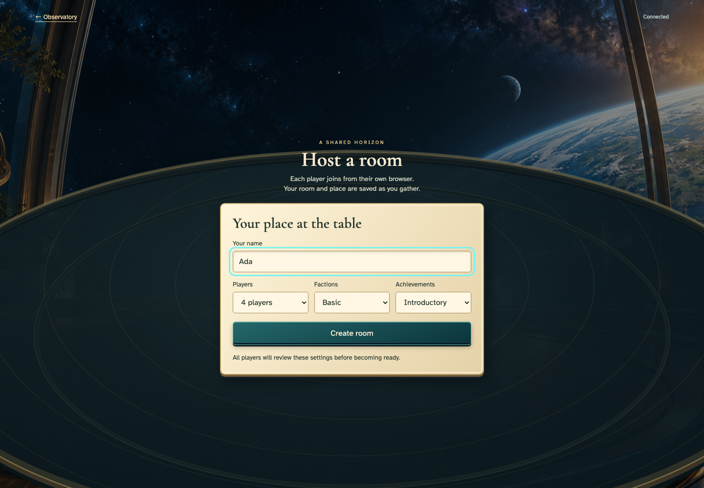](../../screenshots/begin-and-recover-an-exact-4-player-remote-basic-game/004-host-name-desktop-darwin.png) |

- [x] Ada supplies her public name
- [x] The actual game shell has no page overflow.

## 6. The real room awaits factions and confirmations

Viewpoint: **Ada · host**.

| phone · 393 × 852 | desktop · 1440 × 1000 |
| --- | --- |
| [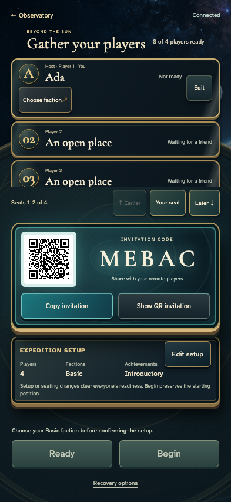](../../screenshots/begin-and-recover-an-exact-4-player-remote-basic-game/005-created-phone-darwin.png) | [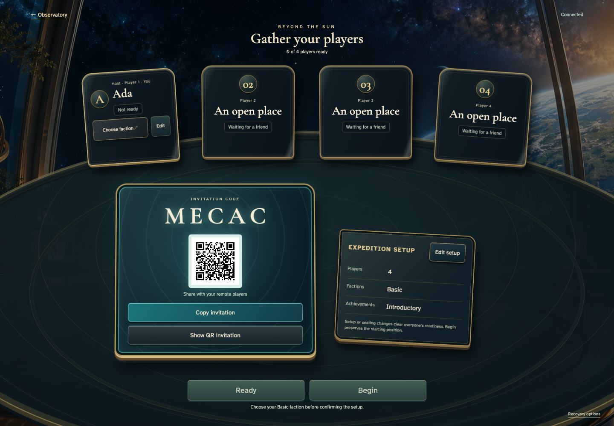](../../screenshots/begin-and-recover-an-exact-4-player-remote-basic-game/005-created-desktop-darwin.png) |

- [x] The real room awaits factions and confirmations
- [x] The actual game shell has no page overflow.

## 7. Bora reviews the host invitation before joining

Viewpoint: **Bora · separate remote identity**.

| phone · 1440 × 1000 | desktop · 393 × 852 |
| --- | --- |
| [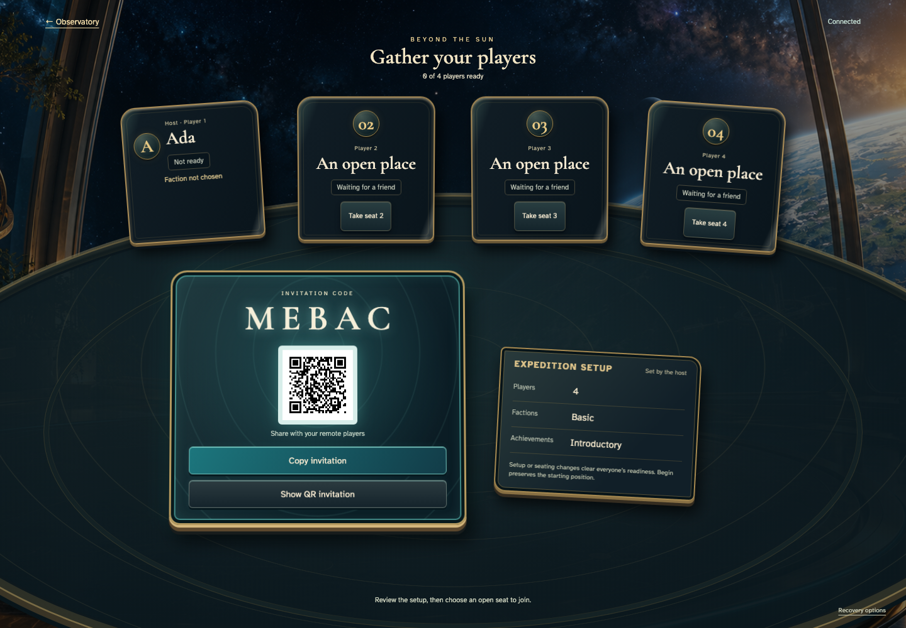](../../screenshots/begin-and-recover-an-exact-4-player-remote-basic-game/006-invite-1-phone-darwin.png) | [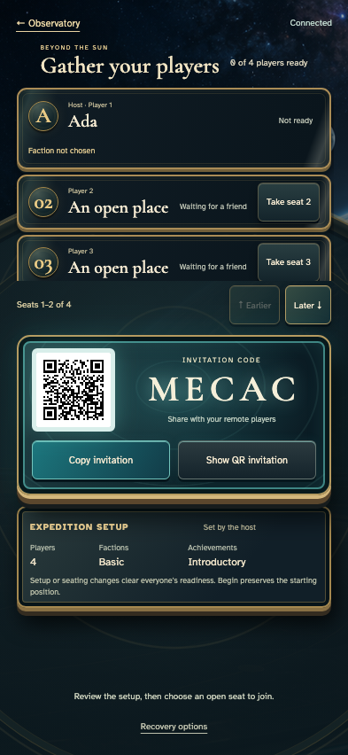](../../screenshots/begin-and-recover-an-exact-4-player-remote-basic-game/006-invite-1-desktop-darwin.png) |

- [x] Bora reviews the host invitation before joining
- [x] The actual game shell has no page overflow.

## 8. Bora opens their own seat editor

Viewpoint: **Bora · separate remote identity**.

| phone · 1440 × 1000 | desktop · 393 × 852 |
| --- | --- |
| [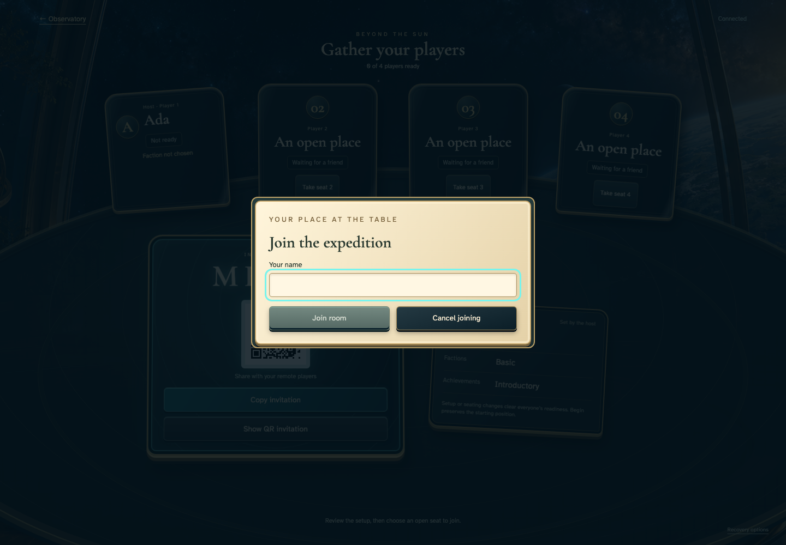](../../screenshots/begin-and-recover-an-exact-4-player-remote-basic-game/007-join-editor-1-phone-darwin.png) | [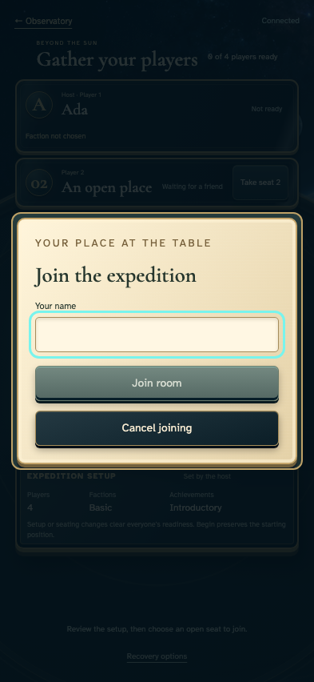](../../screenshots/begin-and-recover-an-exact-4-player-remote-basic-game/007-join-editor-1-desktop-darwin.png) |

- [x] Bora opens their own seat editor
- [x] The actual game shell has no page overflow.

## 9. Bora enters their public name

Viewpoint: **Bora · separate remote identity**.

| phone · 1440 × 1000 | desktop · 393 × 852 |
| --- | --- |
| [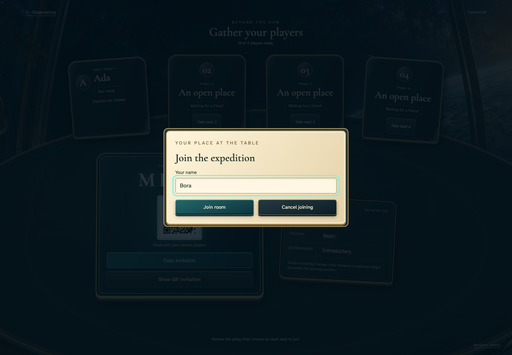](../../screenshots/begin-and-recover-an-exact-4-player-remote-basic-game/008-join-name-1-phone-darwin.png) |  |

- [x] Bora enters their public name
- [x] The actual game shell has no page overflow.

## 10. Bora owns their separate seat

Viewpoint: **Bora · separate remote identity**.

| phone · 1440 × 1000 | desktop · 393 × 852 |
| --- | --- |
| [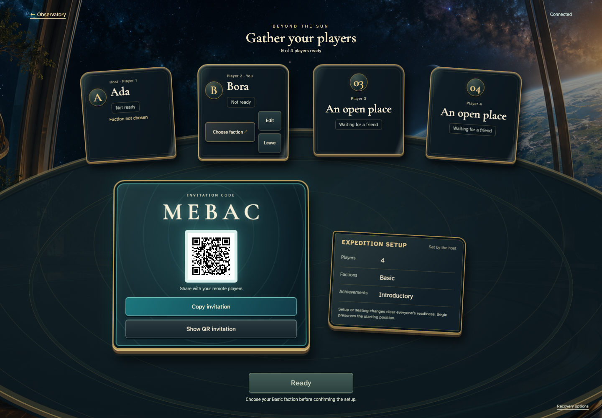](../../screenshots/begin-and-recover-an-exact-4-player-remote-basic-game/009-joined-1-phone-darwin.png) | [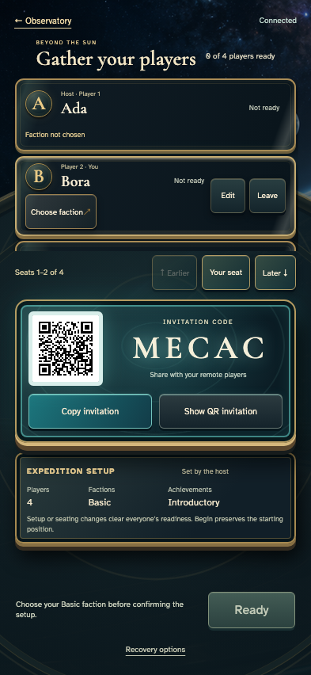](../../screenshots/begin-and-recover-an-exact-4-player-remote-basic-game/009-joined-1-desktop-darwin.png) |

- [x] Bora owns their separate seat
- [x] The actual game shell has no page overflow.

## 11. Ada sees Bora arrive through the live canonical room

Viewpoint: **Ada · host**.

| phone · 393 × 852 | desktop · 1440 × 1000 |
| --- | --- |
| [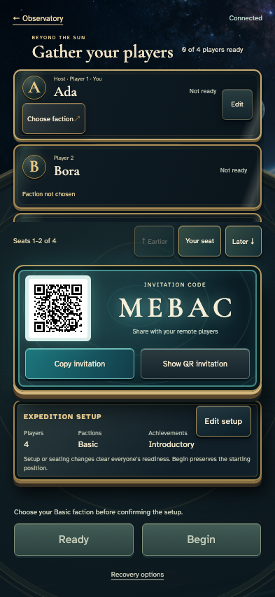](../../screenshots/begin-and-recover-an-exact-4-player-remote-basic-game/010-host-observes-1-phone-darwin.png) | [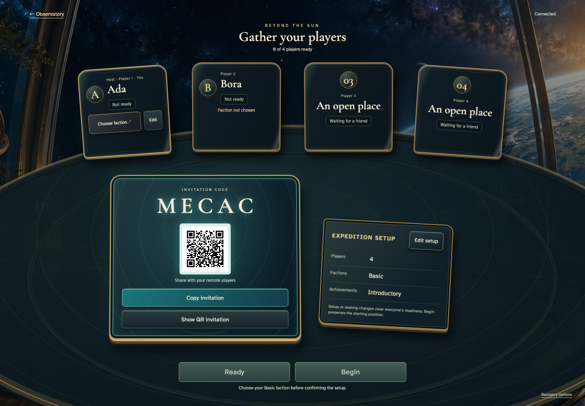](../../screenshots/begin-and-recover-an-exact-4-player-remote-basic-game/010-host-observes-1-desktop-darwin.png) |

- [x] Ada sees Bora arrive through the live canonical room
- [x] The actual game shell has no page overflow.

## 12. Cleo reviews the host invitation before joining

Viewpoint: **Cleo · separate remote identity**.

| phone · 1440 × 1000 | desktop · 393 × 852 |
| --- | --- |
| [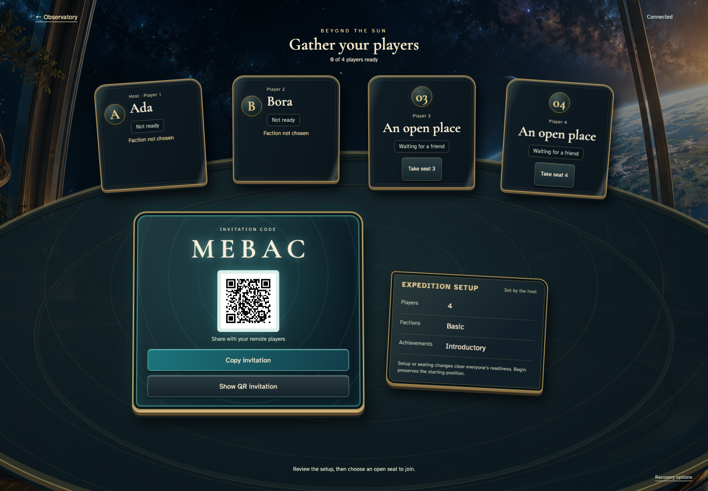](../../screenshots/begin-and-recover-an-exact-4-player-remote-basic-game/011-invite-2-phone-darwin.png) |  |

- [x] Cleo reviews the host invitation before joining
- [x] The actual game shell has no page overflow.

## 13. Cleo opens their own seat editor

Viewpoint: **Cleo · separate remote identity**.

| phone · 1440 × 1000 | desktop · 393 × 852 |
| --- | --- |
| [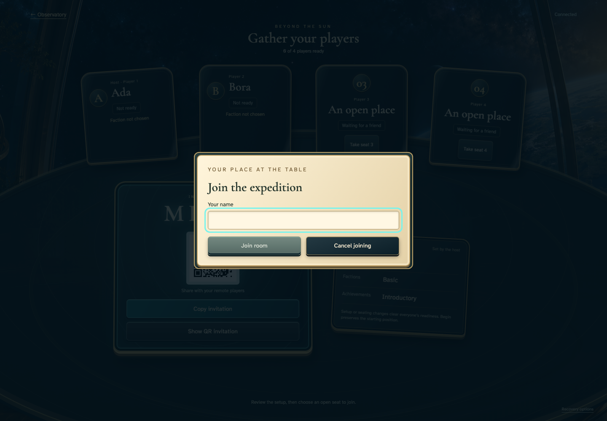](../../screenshots/begin-and-recover-an-exact-4-player-remote-basic-game/012-join-editor-2-phone-darwin.png) |  |

- [x] Cleo opens their own seat editor
- [x] The actual game shell has no page overflow.

## 14. Cleo enters their public name

Viewpoint: **Cleo · separate remote identity**.

| phone · 1440 × 1000 | desktop · 393 × 852 |
| --- | --- |
|  |  |

- [x] Cleo enters their public name
- [x] The actual game shell has no page overflow.

## 15. Cleo owns their separate seat

Viewpoint: **Cleo · separate remote identity**.

| phone · 1440 × 1000 | desktop · 393 × 852 |
| --- | --- |
| [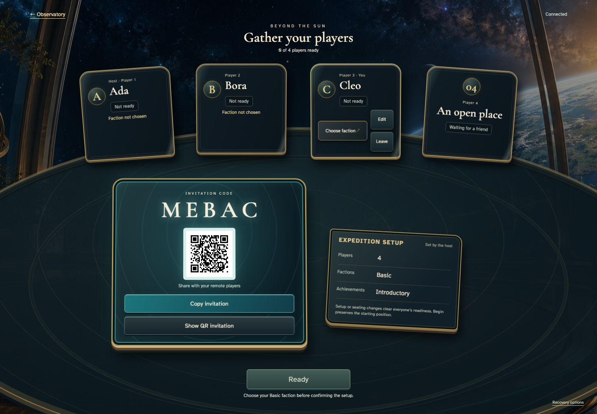](../../screenshots/begin-and-recover-an-exact-4-player-remote-basic-game/014-joined-2-phone-darwin.png) |  |

- [x] Cleo owns their separate seat
- [x] The actual game shell has no page overflow.

## 16. Ada sees Cleo arrive through the live canonical room

Viewpoint: **Ada · host**.

| phone · 393 × 852 | desktop · 1440 × 1000 |
| --- | --- |
| [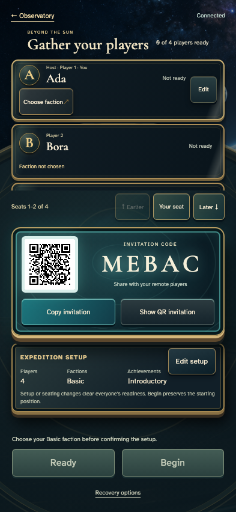](../../screenshots/begin-and-recover-an-exact-4-player-remote-basic-game/015-host-observes-2-phone-darwin.png) |  |

- [x] Ada sees Cleo arrive through the live canonical room
- [x] The actual game shell has no page overflow.

## 17. Dara reviews the host invitation before joining

Viewpoint: **Dara · separate remote identity**.

| phone · 1440 × 1000 | desktop · 393 × 852 |
| --- | --- |
| [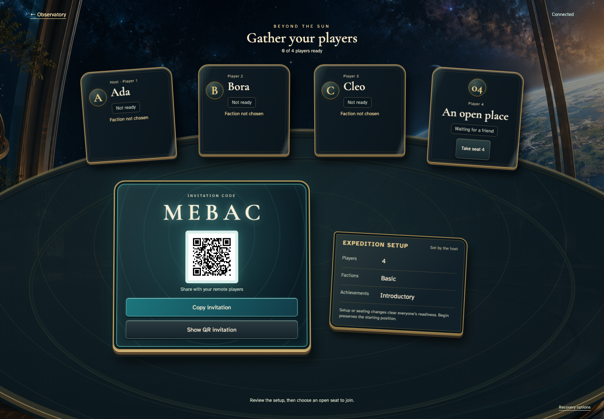](../../screenshots/begin-and-recover-an-exact-4-player-remote-basic-game/016-invite-3-phone-darwin.png) | [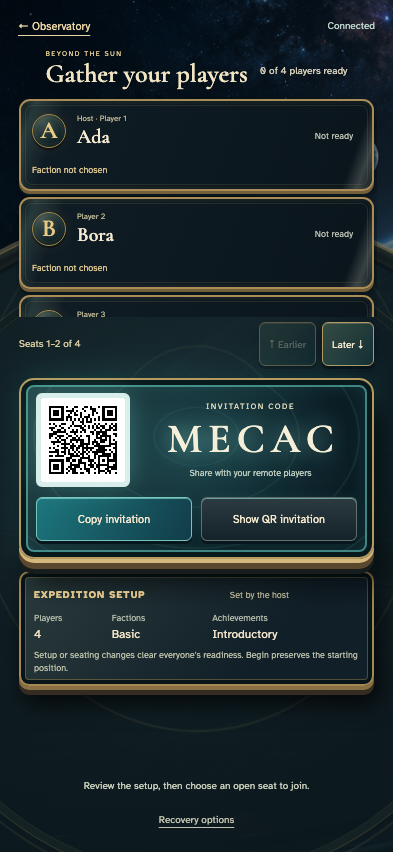](../../screenshots/begin-and-recover-an-exact-4-player-remote-basic-game/016-invite-3-desktop-darwin.png) |

- [x] Dara reviews the host invitation before joining
- [x] The actual game shell has no page overflow.

## 18. Dara opens their own seat editor

Viewpoint: **Dara · separate remote identity**.

| phone · 1440 × 1000 | desktop · 393 × 852 |
| --- | --- |
|  | [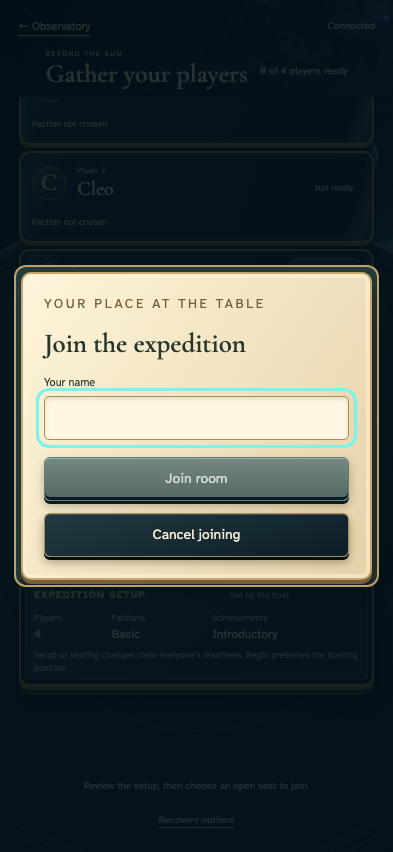](../../screenshots/begin-and-recover-an-exact-4-player-remote-basic-game/017-join-editor-3-desktop-darwin.png) |

- [x] Dara opens their own seat editor
- [x] The actual game shell has no page overflow.

## 19. Dara enters their public name

Viewpoint: **Dara · separate remote identity**.

| phone · 1440 × 1000 | desktop · 393 × 852 |
| --- | --- |
| [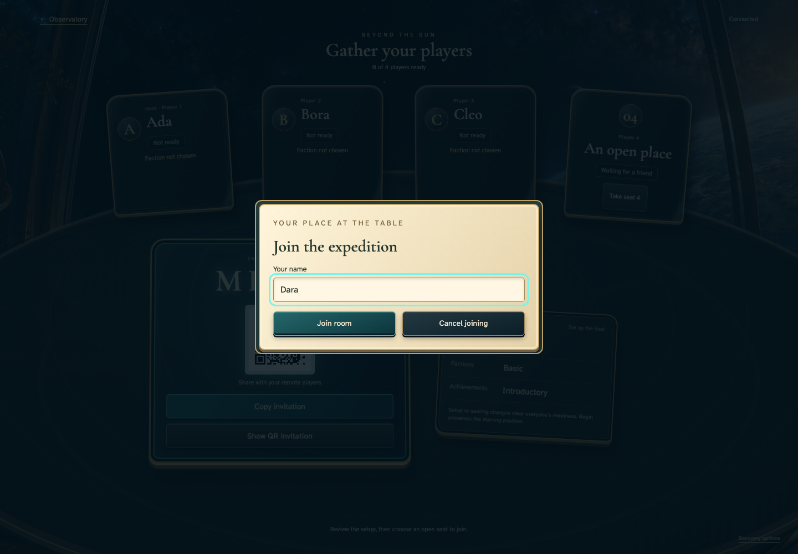](../../screenshots/begin-and-recover-an-exact-4-player-remote-basic-game/018-join-name-3-phone-darwin.png) |  |

- [x] Dara enters their public name
- [x] The actual game shell has no page overflow.

## 20. Dara owns their separate seat

Viewpoint: **Dara · separate remote identity**.

| phone · 1440 × 1000 | desktop · 393 × 852 |
| --- | --- |
| [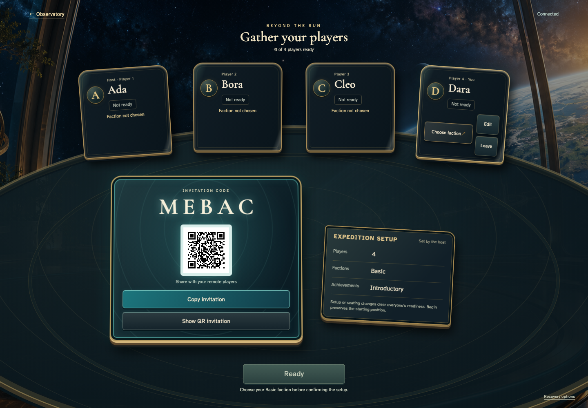](../../screenshots/begin-and-recover-an-exact-4-player-remote-basic-game/019-joined-3-phone-darwin.png) | [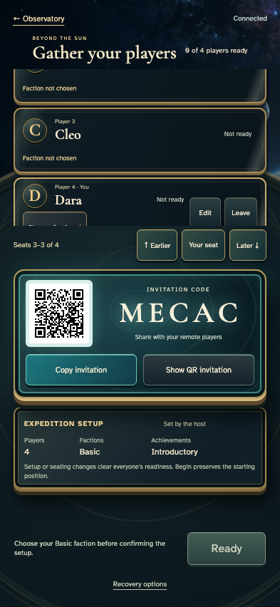](../../screenshots/begin-and-recover-an-exact-4-player-remote-basic-game/019-joined-3-desktop-darwin.png) |

- [x] Dara owns their separate seat
- [x] The actual game shell has no page overflow.

## 21. Ada sees Dara arrive through the live canonical room

Viewpoint: **Ada · host**.

| phone · 393 × 852 | desktop · 1440 × 1000 |
| --- | --- |
|  |  |

- [x] Ada sees Dara arrive through the live canonical room
- [x] The actual game shell has no page overflow.

## 22. Ada reads source-reviewed Basic setup bonuses

Viewpoint: **Ada · host**.

| phone · 393 × 852 | desktop · 1440 × 1000 |
| --- | --- |
|  | [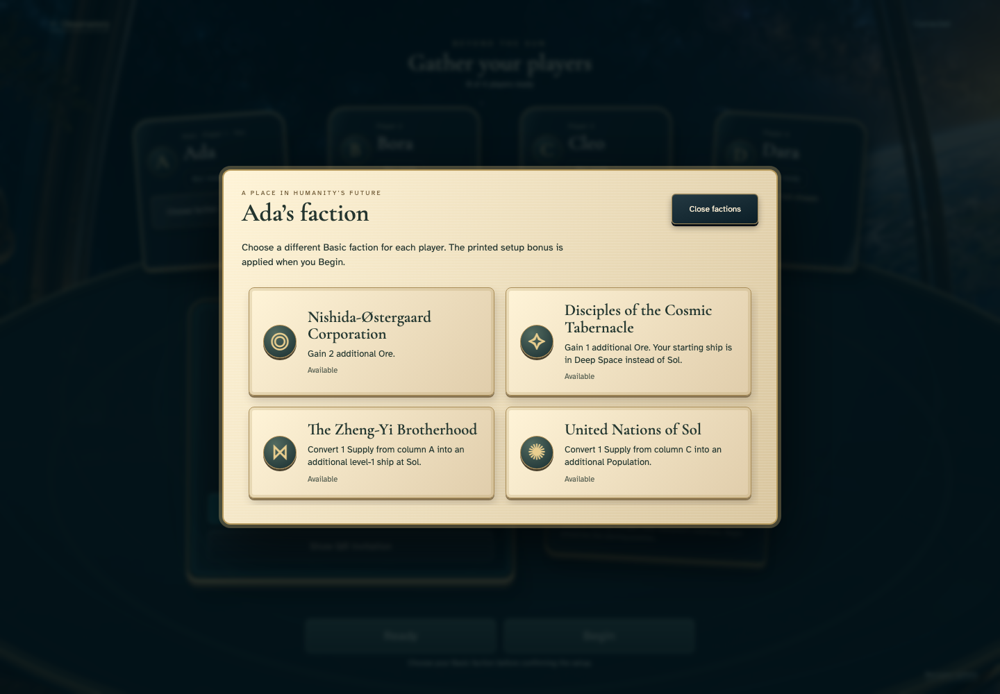](../../screenshots/begin-and-recover-an-exact-4-player-remote-basic-game/021-faction-open-0-desktop-darwin.png) |

- [x] Ada reads source-reviewed Basic setup bonuses
- [x] The actual game shell has no page overflow.

## 23. Ada commits a unique legal faction

Viewpoint: **Ada · host**.

| phone · 393 × 852 | desktop · 1440 × 1000 |
| --- | --- |
| [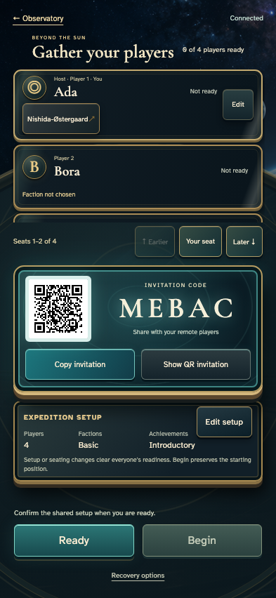](../../screenshots/begin-and-recover-an-exact-4-player-remote-basic-game/022-faction-chosen-0-phone-darwin.png) | [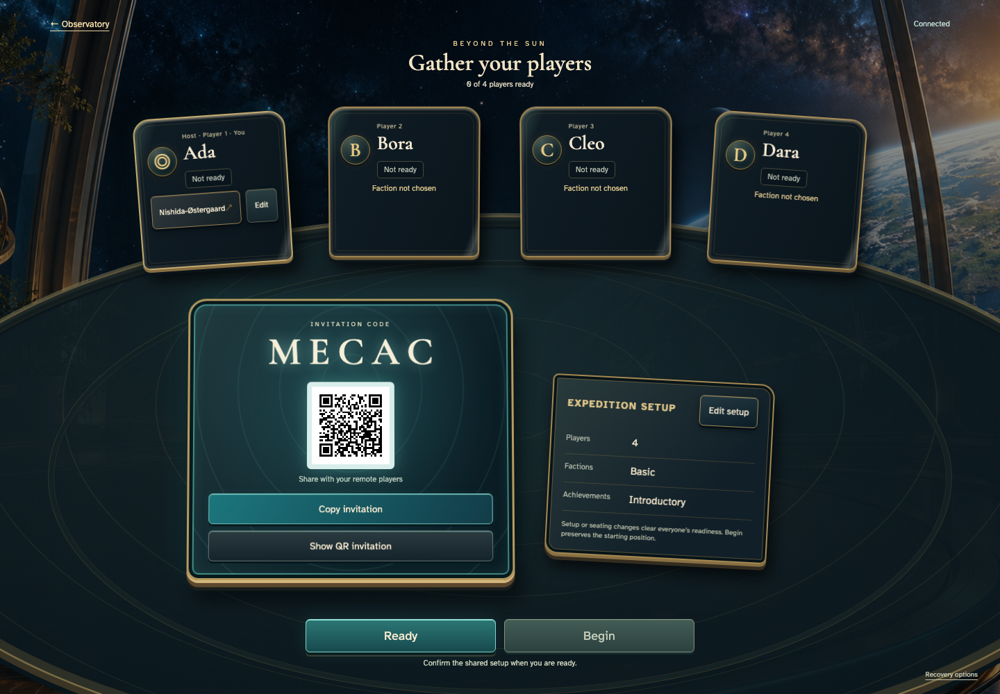](../../screenshots/begin-and-recover-an-exact-4-player-remote-basic-game/022-faction-chosen-0-desktop-darwin.png) |

- [x] Ada commits a unique legal faction
- [x] The actual game shell has no page overflow.

## 24. Bora reads source-reviewed Basic setup bonuses

Viewpoint: **Bora · separate remote identity**.

| phone · 1440 × 1000 | desktop · 393 × 852 |
| --- | --- |
|  | [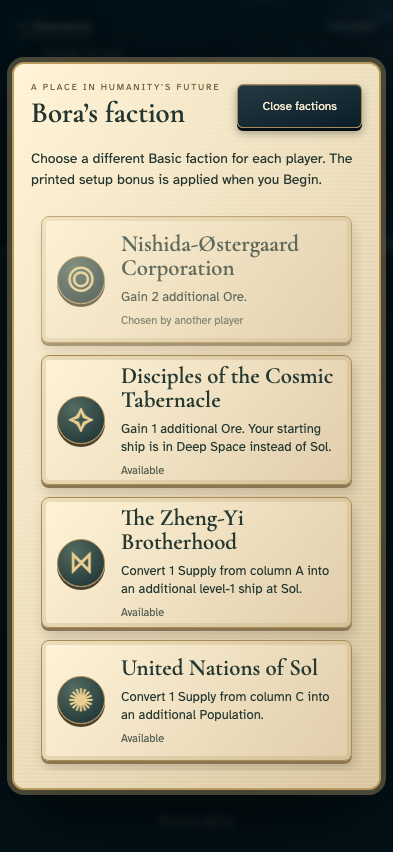](../../screenshots/begin-and-recover-an-exact-4-player-remote-basic-game/023-faction-open-1-desktop-darwin.png) |

- [x] Bora reads source-reviewed Basic setup bonuses
- [x] The actual game shell has no page overflow.

## 25. Bora commits a unique legal faction

Viewpoint: **Bora · separate remote identity**.

| phone · 1440 × 1000 | desktop · 393 × 852 |
| --- | --- |
| [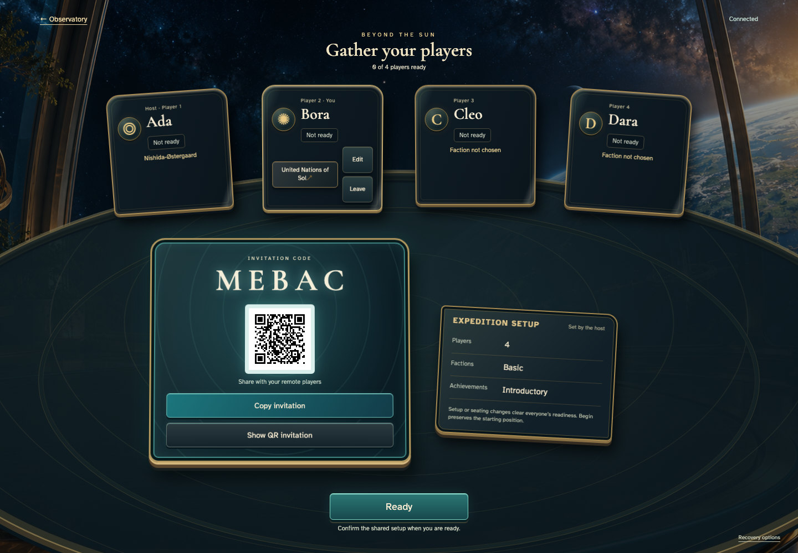](../../screenshots/begin-and-recover-an-exact-4-player-remote-basic-game/024-faction-chosen-1-phone-darwin.png) | [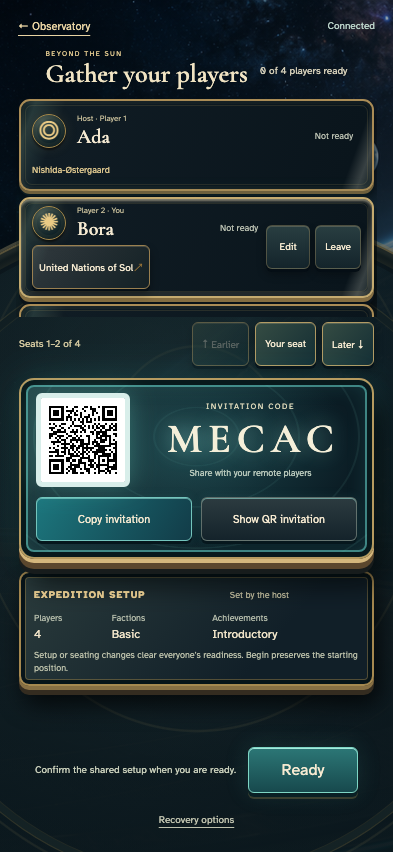](../../screenshots/begin-and-recover-an-exact-4-player-remote-basic-game/024-faction-chosen-1-desktop-darwin.png) |

- [x] Bora commits a unique legal faction
- [x] The actual game shell has no page overflow.

## 26. Cleo reads source-reviewed Basic setup bonuses

Viewpoint: **Cleo · separate remote identity**.

| phone · 1440 × 1000 | desktop · 393 × 852 |
| --- | --- |
|  | [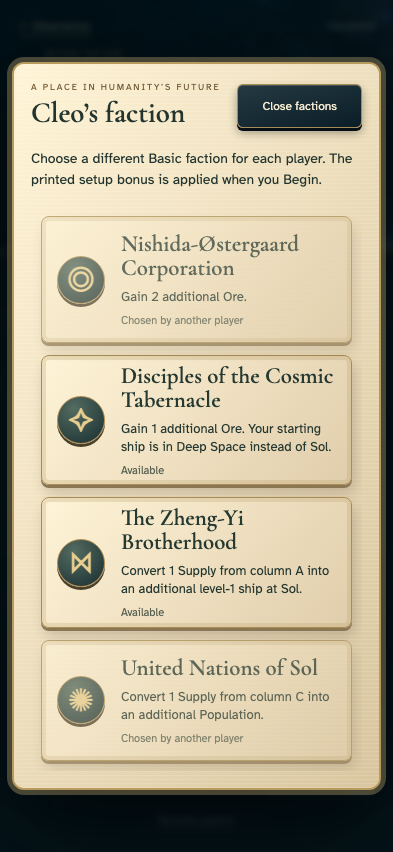](../../screenshots/begin-and-recover-an-exact-4-player-remote-basic-game/025-faction-open-2-desktop-darwin.png) |

- [x] Cleo reads source-reviewed Basic setup bonuses
- [x] The actual game shell has no page overflow.

## 27. Cleo commits a unique legal faction

Viewpoint: **Cleo · separate remote identity**.

| phone · 1440 × 1000 | desktop · 393 × 852 |
| --- | --- |
| [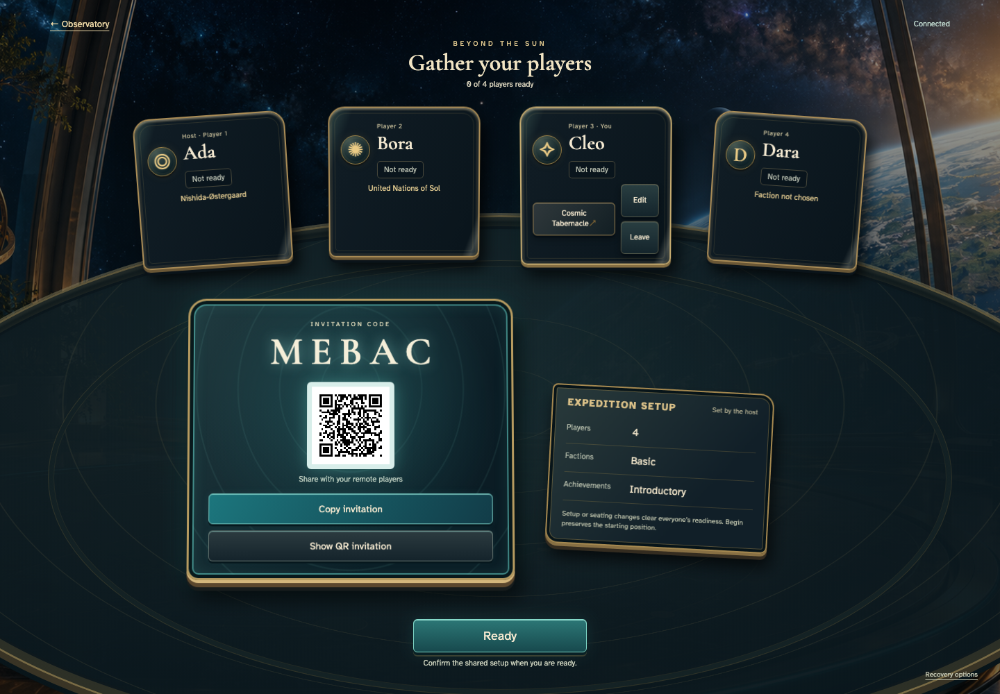](../../screenshots/begin-and-recover-an-exact-4-player-remote-basic-game/026-faction-chosen-2-phone-darwin.png) | [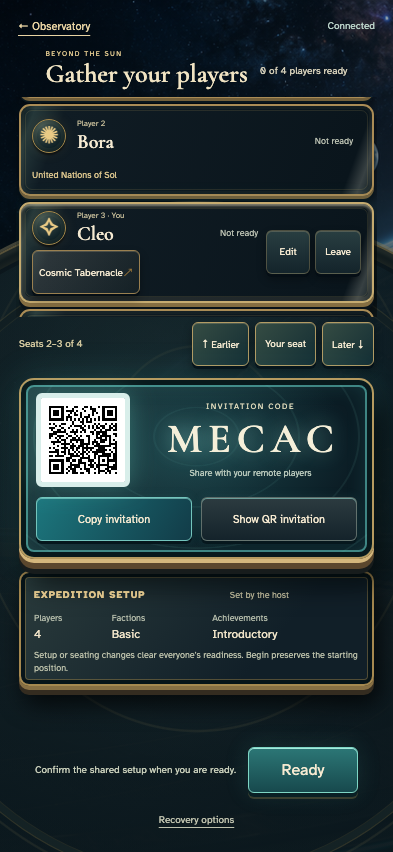](../../screenshots/begin-and-recover-an-exact-4-player-remote-basic-game/026-faction-chosen-2-desktop-darwin.png) |

- [x] Cleo commits a unique legal faction
- [x] The actual game shell has no page overflow.

## 28. Dara reads source-reviewed Basic setup bonuses

Viewpoint: **Dara · separate remote identity**.

| phone · 1440 × 1000 | desktop · 393 × 852 |
| --- | --- |
| [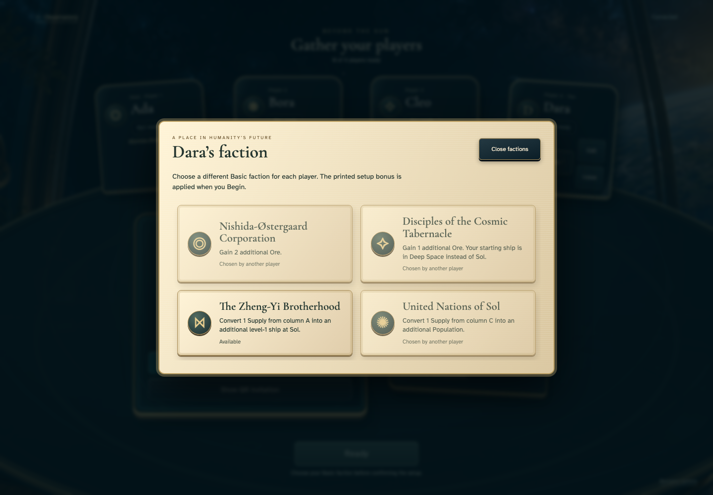](../../screenshots/begin-and-recover-an-exact-4-player-remote-basic-game/027-faction-open-3-phone-darwin.png) | [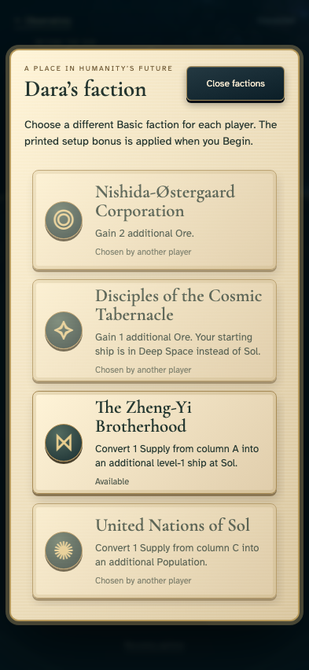](../../screenshots/begin-and-recover-an-exact-4-player-remote-basic-game/027-faction-open-3-desktop-darwin.png) |

- [x] Dara reads source-reviewed Basic setup bonuses
- [x] The actual game shell has no page overflow.

## 29. Dara commits a unique legal faction

Viewpoint: **Dara · separate remote identity**.

| phone · 1440 × 1000 | desktop · 393 × 852 |
| --- | --- |
| [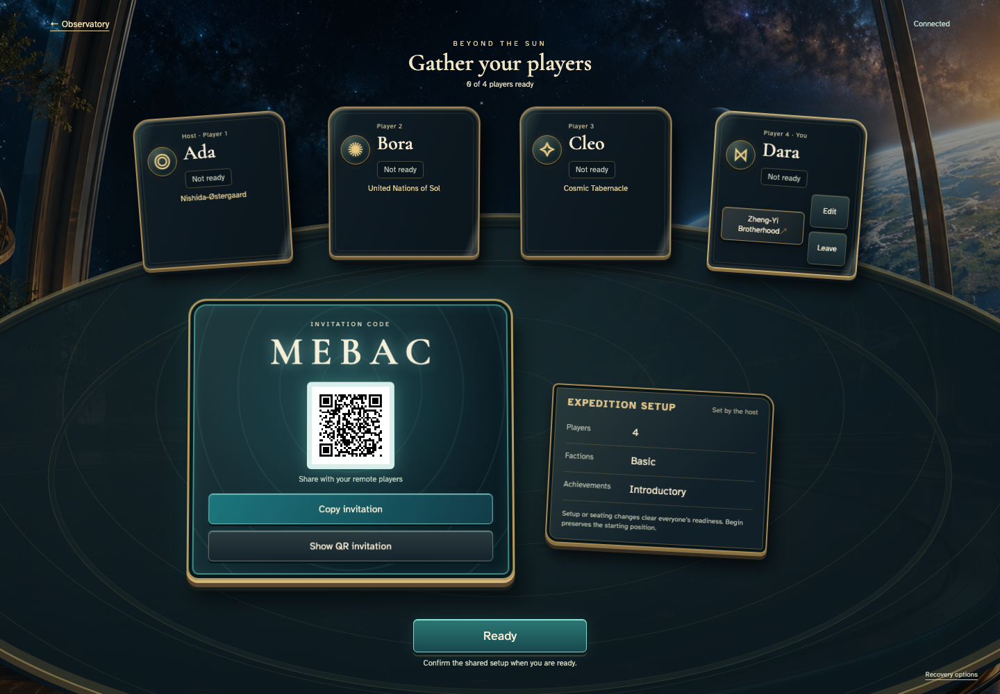](../../screenshots/begin-and-recover-an-exact-4-player-remote-basic-game/028-faction-chosen-3-phone-darwin.png) |  |

- [x] Dara commits a unique legal faction
- [x] The actual game shell has no page overflow.

## 30. The portrait roster instrument brings the current player into its bounded seat rail

Viewpoint: **Dara · separate remote identity**.

| phone · 393 × 852 | desktop · 393 × 852 |
| --- | --- |
|  | [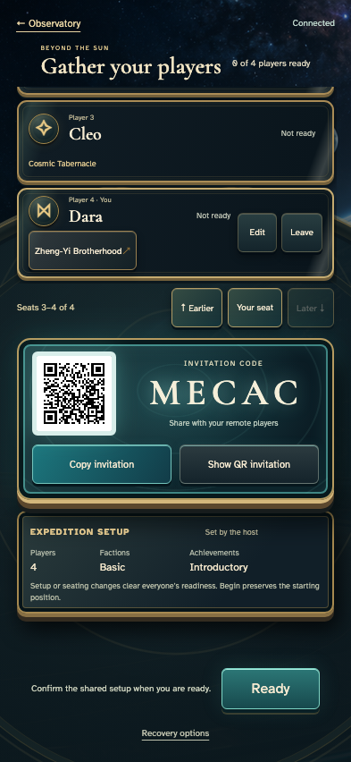](../../screenshots/begin-and-recover-an-exact-4-player-remote-basic-game/029-roster-own-seat-desktop-darwin.png) |

- [x] The portrait roster instrument brings the current player into its bounded seat rail
- [x] The actual game shell has no page overflow.

## 31. An explicit roster instrument reveals neighboring seats without shrinking controls

Viewpoint: **Dara · separate remote identity**.

| phone · 393 × 852 | desktop · 393 × 852 |
| --- | --- |
| [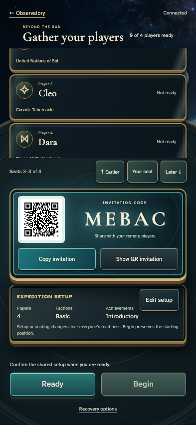](../../screenshots/begin-and-recover-an-exact-4-player-remote-basic-game/030-roster-adjacent-seats-phone-darwin.png) | [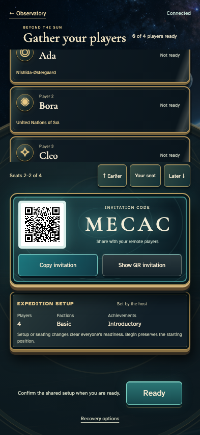](../../screenshots/begin-and-recover-an-exact-4-player-remote-basic-game/030-roster-adjacent-seats-desktop-darwin.png) |

- [x] An explicit roster instrument reveals neighboring seats without shrinking controls
- [x] The actual game shell has no page overflow.

## 32. Your seat restores the player’s reachable faction control

Viewpoint: **Dara · separate remote identity**.

| phone · 393 × 852 | desktop · 393 × 852 |
| --- | --- |
|  |  |

- [x] Your seat restores the player’s reachable faction control
- [x] The actual game shell has no page overflow.

## 33. Ada confirms this faction and configuration

Viewpoint: **Ada · host**.

| phone · 393 × 852 | desktop · 1440 × 1000 |
| --- | --- |
| [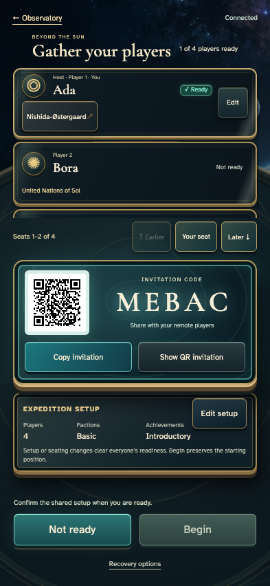](../../screenshots/begin-and-recover-an-exact-4-player-remote-basic-game/032-ready-0-phone-darwin.png) | [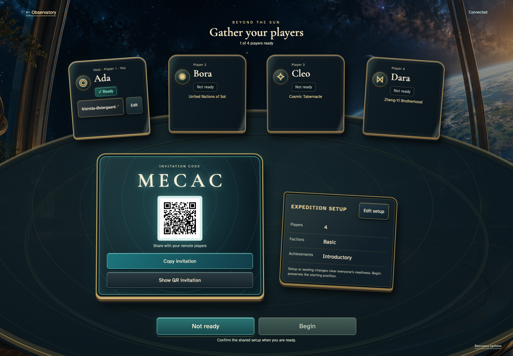](../../screenshots/begin-and-recover-an-exact-4-player-remote-basic-game/032-ready-0-desktop-darwin.png) |

- [x] Ada confirms this faction and configuration
- [x] The actual game shell has no page overflow.

## 34. Bora confirms this faction and configuration

Viewpoint: **Bora · separate remote identity**.

| phone · 1440 × 1000 | desktop · 393 × 852 |
| --- | --- |
| [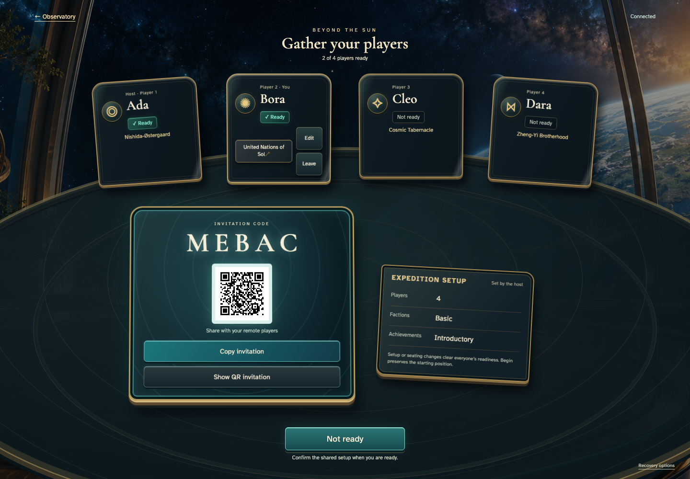](../../screenshots/begin-and-recover-an-exact-4-player-remote-basic-game/033-ready-1-phone-darwin.png) | [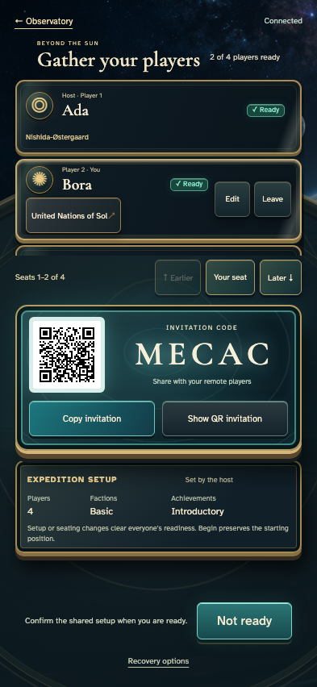](../../screenshots/begin-and-recover-an-exact-4-player-remote-basic-game/033-ready-1-desktop-darwin.png) |

- [x] Bora confirms this faction and configuration
- [x] The actual game shell has no page overflow.

## 35. Cleo confirms this faction and configuration

Viewpoint: **Cleo · separate remote identity**.

| phone · 1440 × 1000 | desktop · 393 × 852 |
| --- | --- |
| [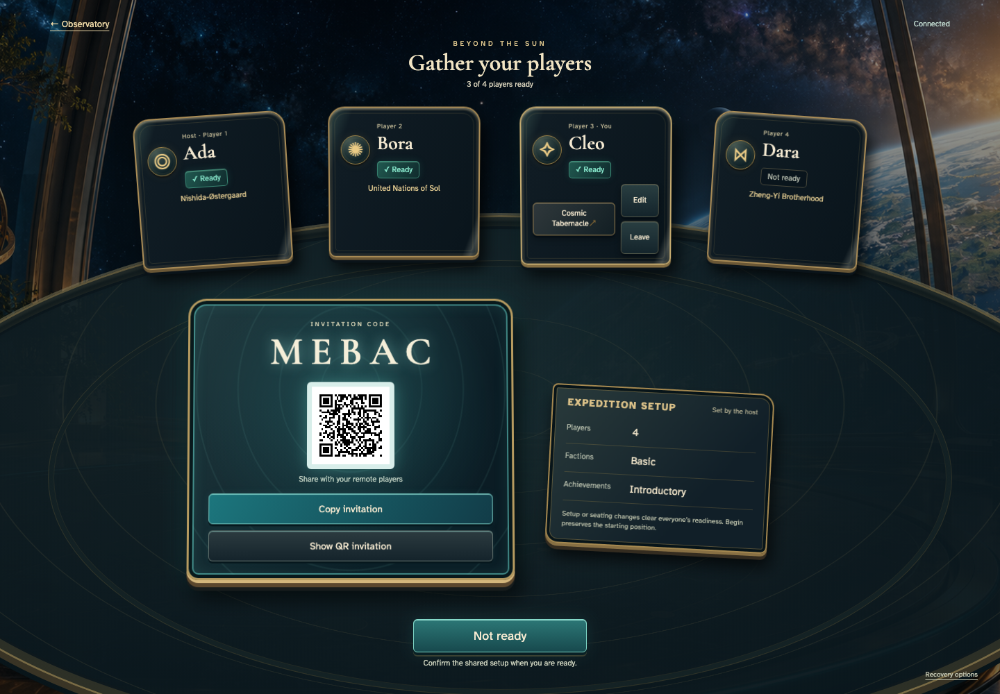](../../screenshots/begin-and-recover-an-exact-4-player-remote-basic-game/034-ready-2-phone-darwin.png) | [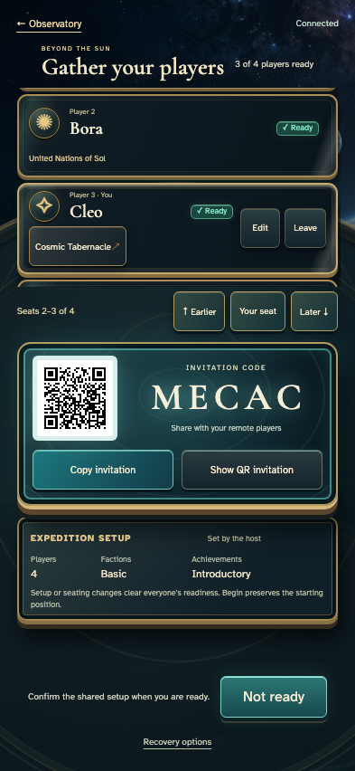](../../screenshots/begin-and-recover-an-exact-4-player-remote-basic-game/034-ready-2-desktop-darwin.png) |

- [x] Cleo confirms this faction and configuration
- [x] The actual game shell has no page overflow.

## 36. Dara confirms this faction and configuration

Viewpoint: **Dara · separate remote identity**.

| phone · 1440 × 1000 | desktop · 393 × 852 |
| --- | --- |
| [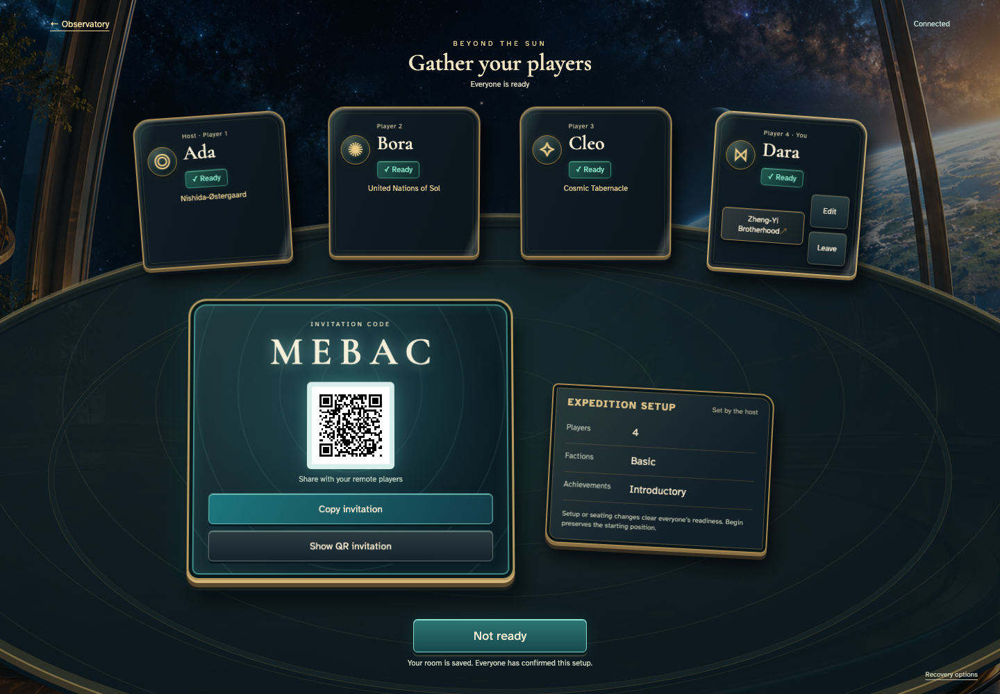](../../screenshots/begin-and-recover-an-exact-4-player-remote-basic-game/035-ready-3-phone-darwin.png) | [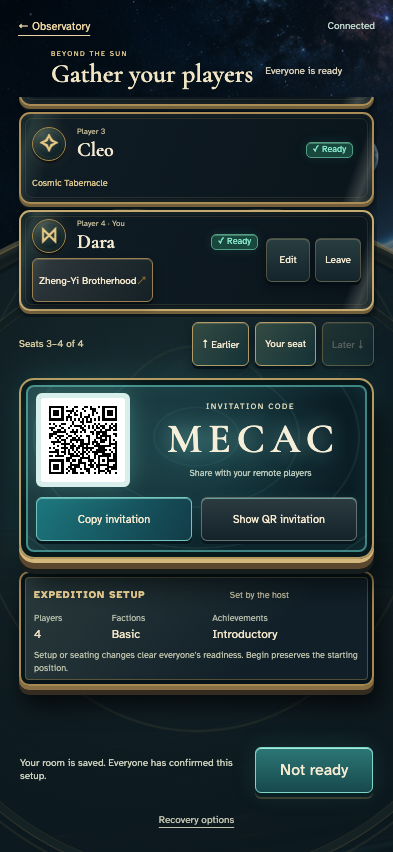](../../screenshots/begin-and-recover-an-exact-4-player-remote-basic-game/035-ready-3-desktop-darwin.png) |

- [x] Dara confirms this faction and configuration
- [x] The actual game shell has no page overflow.

## 37. Ada can Begin only after every configured player confirms

Viewpoint: **Ada · host**.

| phone · 393 × 852 | desktop · 1440 × 1000 |
| --- | --- |
| [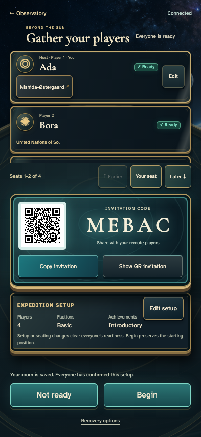](../../screenshots/begin-and-recover-an-exact-4-player-remote-basic-game/036-all-ready-phone-darwin.png) | [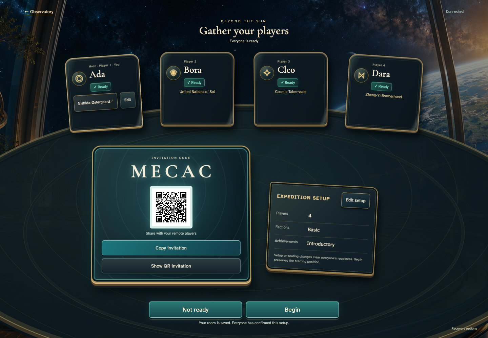](../../screenshots/begin-and-recover-an-exact-4-player-remote-basic-game/036-all-ready-desktop-darwin.png) |

- [x] Ada can Begin only after every configured player confirms
- [x] The actual game shell has no page overflow.

## 38. Begin commits one immutable starting position

Viewpoint: **Ada · host**.

| phone · 393 × 852 | desktop · 1440 × 1000 |
| --- | --- |
|  |  |

- [x] Begin commits one immutable starting position
- [x] The actual game shell has no page overflow.

## 39. The separate guest observes the same started game

Viewpoint: **Dara · separate remote identity**.

| phone · 1440 × 1000 | desktop · 393 × 852 |
| --- | --- |
| [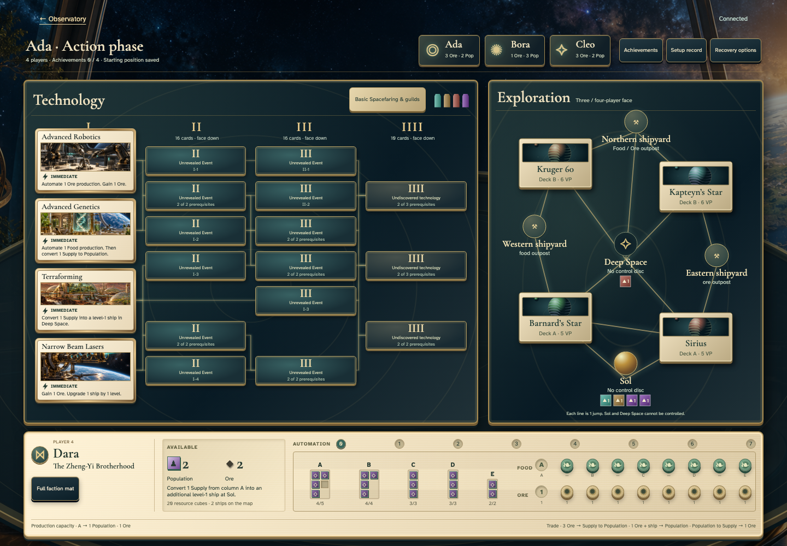](../../screenshots/begin-and-recover-an-exact-4-player-remote-basic-game/038-guest-start-phone-darwin.png) |  |

- [x] The separate guest observes the same started game
- [x] The actual game shell has no page overflow.

## 40. Compact desktop preserves all 19 public technology positions and four inspectable starting cards

Viewpoint: **Ada · host**.

| phone · 1280 × 720 | desktop · 1280 × 720 |
| --- | --- |
| [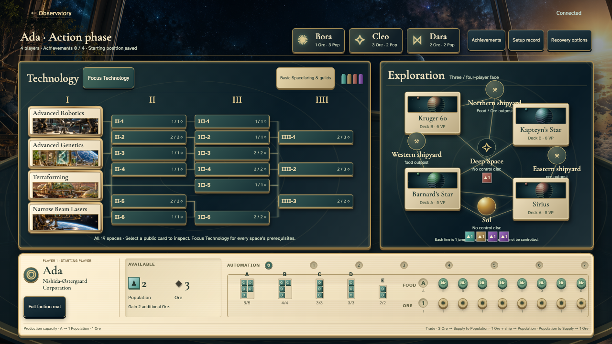](../../screenshots/begin-and-recover-an-exact-4-player-remote-basic-game/039-compact-overview-phone-darwin.png) |  |

- [x] Compact desktop preserves all 19 public technology positions and four inspectable starting cards
- [x] The actual game shell has no page overflow.

## 41. Keyboard focus opens the substantial Technology field and persistent board navigation

Viewpoint: **Ada · host**.

| phone · 1280 × 720 | desktop · 1280 × 720 |
| --- | --- |
|  |  |

- [x] Keyboard focus opens the substantial Technology field and persistent board navigation
- [x] The actual game shell has no page overflow.

## 42. The lower-branch instrument reaches the final public card and prerequisite nodes

Viewpoint: **Ada · host**.

| phone · 1280 × 720 | desktop · 1280 × 720 |
| --- | --- |
|  |  |

- [x] The lower-branch instrument reaches the final public card and prerequisite nodes
- [x] The actual game shell has no page overflow.

## 43. Inspect the lowest public card at full rules scale

Viewpoint: **Ada · host**.

| phone · 1280 × 720 | desktop · 1280 × 720 |
| --- | --- |
|  |  |

- [x] Inspect the lowest public card at full rules scale
- [x] The actual game shell has no page overflow.

## 44. Closing inspection returns keyboard focus to the actual lower card

Viewpoint: **Ada · host**.

| phone · 1280 × 720 | desktop · 1280 × 720 |
| --- | --- |
|  |  |

- [x] Closing inspection returns keyboard focus to the actual lower card
- [x] The actual game shell has no page overflow.

## 45. Keyboard return restores the complete two-board composition

Viewpoint: **Ada · host**.

| phone · 1280 × 720 | desktop · 1280 × 720 |
| --- | --- |
|  |  |

- [x] Keyboard return restores the complete two-board composition
- [x] The actual game shell has no page overflow.

## 46. Return to the original personal-screen viewport without changing the game

Viewpoint: **Ada · host**.

| phone · 393 × 852 | desktop · 1440 × 1000 |
| --- | --- |
|  |  |

- [x] Return to the original personal-screen viewport without changing the game
- [x] The actual game shell has no page overflow.

## 47. The phone focuses the correct public Exploration board

Viewpoint: **Dara · separate remote identity**.

| phone · 393 × 852 | desktop · 393 × 852 |
| --- | --- |
|  |  |

- [x] The phone focuses the correct public Exploration board
- [x] The actual game shell has no page overflow.

## 48. Return to the phone’s Technology board without changing game state

Viewpoint: **Dara · separate remote identity**.

| phone · 393 × 852 | desktop · 393 × 852 |
| --- | --- |
|  |  |

- [x] Return to the phone’s Technology board without changing game state
- [x] The actual game shell has no page overflow.

## 49. Inspect the real public Technology face and its printed action cost

Viewpoint: **Ada · host**.

| phone · 393 × 852 | desktop · 1440 × 1000 |
| --- | --- |
|  |  |

- [x] Inspect the real public Technology face and its printed action cost
- [x] The actual game shell has no page overflow.

## 50. Reverse keyboard navigation stays in persistent card chrome

Viewpoint: **Ada · host**.

| phone · 393 × 852 | desktop · 1440 × 1000 |
| --- | --- |
|  |  |

- [x] Reverse keyboard navigation stays in persistent card chrome
- [x] The actual game shell has no page overflow.

## 51. Closing the card restores the actual board control focus

Viewpoint: **Ada · host**.

| phone · 393 × 852 | desktop · 1440 × 1000 |
| --- | --- |
|  |  |

- [x] Closing the card restores the actual board control focus
- [x] The actual game shell has no page overflow.

## 52. The phone focuses the actual Level III slots

Viewpoint: **Dara · separate remote identity**.

| phone · 393 × 852 | desktop · 393 × 852 |
| --- | --- |
|  |  |

- [x] The phone focuses the actual Level III slots
- [x] The actual game shell has no page overflow.

## 53. Inspect the printed direct I-to-III prerequisite without revealing the Event

Viewpoint: **Ada · host**.

| phone · 393 × 852 | desktop · 1440 × 1000 |
| --- | --- |
|  |  |

- [x] Inspect the printed direct I-to-III prerequisite without revealing the Event
- [x] The actual game shell has no page overflow.

## 54. Return focus to the concealed slot without revealing or spending anything

Viewpoint: **Ada · host**.

| phone · 393 × 852 | desktop · 1440 × 1000 |
| --- | --- |
|  |  |

- [x] Return focus to the concealed slot without revealing or spending anything
- [x] The actual game shell has no page overflow.

## 55. Return to the four public Level I faces

Viewpoint: **Dara · separate remote identity**.

| phone · 393 × 852 | desktop · 393 × 852 |
| --- | --- |
|  |  |

- [x] Return to the four public Level I faces
- [x] The actual game shell has no page overflow.

## 56. Inspect exact player-count decks, overlay and achievement restrictions

Viewpoint: **Ada · host**.

| phone · 393 × 852 | desktop · 1440 × 1000 |
| --- | --- |
|  |  |

- [x] Inspect exact player-count decks, overlay and achievement restrictions
- [x] The actual game shell has no page overflow.

## 57. Escape returns to the Setup record instrument

Viewpoint: **Ada · host**.

| phone · 393 × 852 | desktop · 1440 × 1000 |
| --- | --- |
|  |  |

- [x] Escape returns to the Setup record instrument
- [x] The actual game shell has no page overflow.

## 58. Inspect available resources, filled Supply and eight discs on each production track

Viewpoint: **Ada · host**.

| phone · 393 × 852 | desktop · 1440 × 1000 |
| --- | --- |
|  |  |

- [x] Inspect available resources, filled Supply and eight discs on each production track
- [x] The actual game shell has no page overflow.

## 59. Return from the full mat with focus restored

Viewpoint: **Ada · host**.

| phone · 393 × 852 | desktop · 1440 × 1000 |
| --- | --- |
|  |  |

- [x] Return from the full mat with focus restored
- [x] The actual game shell has no page overflow.

## 60. Recovery remains available after the immutable Begin

Viewpoint: **Ada · host**.

| phone · 393 × 852 | desktop · 1440 × 1000 |
| --- | --- |
|  |  |

- [x] Recovery remains available after the immutable Begin
- [x] The actual game shell has no page overflow.

## 61. Close recovery with focus back on its game instrument

Viewpoint: **Ada · host**.

| phone · 393 × 852 | desktop · 1440 × 1000 |
| --- | --- |
|  |  |

- [x] Close recovery with focus back on its game instrument
- [x] The actual game shell has no page overflow.

## 62. Reload preserves the permanent starting position and seat

Viewpoint: **Ada · host**.

| phone · 393 × 852 | desktop · 1440 × 1000 |
| --- | --- |
|  |  |

- [x] Reload preserves the permanent starting position and seat
- [x] The actual game shell has no page overflow.
