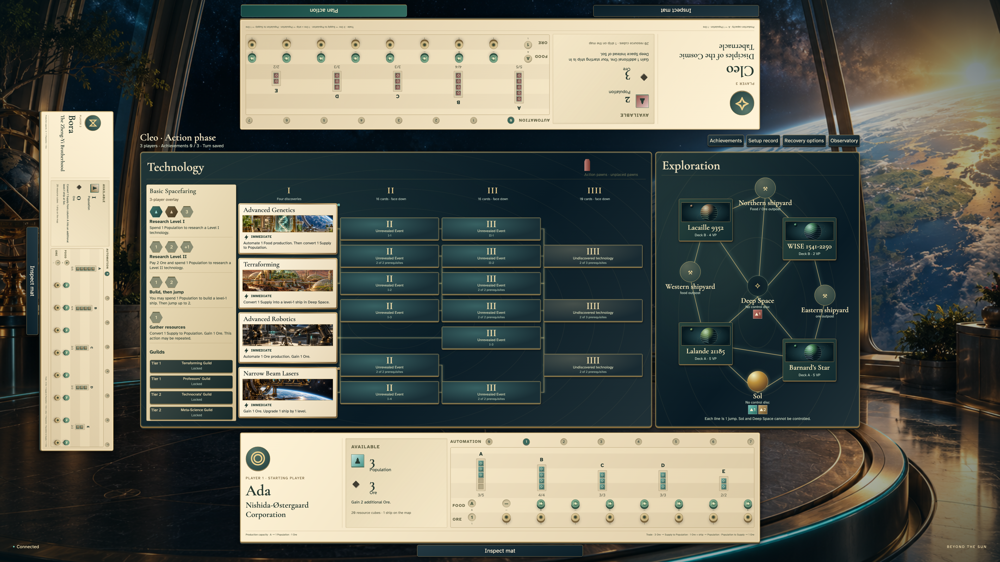

# Milestone004 — first research fidelity

Reviewer18:40 independently accepts local visual/functional review for final illustrated validation. This increment is reconciled on accepted PR5 `af76265`, with the new PR based on `feat/basic-setup`. Seventeen new viewport variants preserve the existing31 journeys. Final macOS exact and subsequent pinned Linux/hosted gates are reported separately below. Milestone005 remains held; no PR is merged.

The production decision instrument uses the existing original, semantic card renderer, the approved ivory/graphite/brass materials and teal selection light. Remote players act only for their own identity. Shared decisions face the active physical seat; diagonal readers retain native 44px controls without scrolling the rotated reader. Public research cubes sit beside researched cards and identify their faction by accessible name and color. They remain distinct from occupied Action pawn spaces.

Compare actual local captures with concepts03 (public boards and near-edge economy),04 (substantial public card objects, illuminated selection, persistent cost/commit controls) and07 (production). Concept04 depicts later discovery; this increment shows the four already public Level I cards and does not invent an Event, candidate draw or unsupported card effect. Concealed decks remain concealed. Rules authority and reviewed content are recorded in `src/lib/game/SOURCES.md`.

Local emulator audits cover complete first rounds with two, three and four separate remote identities; permanent research/payment/bonus; Growth, Ore and Trade; all three exchange rates; Supply overflow; reload during production/trading; clockwise handoff; keyboard containment and return; desktop, phone, landscape, tablet and4K readers; one-controller shared play including southwest/northeast seats at1280×600,1280×720 and3840×2160. These raw review PNGs and scripts are diagnostic evidence, not substitutes for required TestStepHelper stories and exact comparisons.

Review at http://127.0.0.1:5197/ through Play, remote Create/Join or Shared table. Choose legal unique Basic factions and Begin normally. The active mat offers Plan research. Select an open Level I space and public technology, inspect the complete card, then commit the displayed payment. Narrow Beam Lasers requires a legal ship target when one exists. Choose one production branch, resolve the empty achievement phase and hand off automatically. No discovery, movement, colonization or later turn action is implied to exist in004.

Representative local files: `tmp/local-research-review/research-planned-1280.png`, `production-reader-393x852.png`, `production-reader-3840x2160.png`, `corner-600-plan.png`, `corner-3840-production.png`. They were visually inspected against the concept hierarchy. Current local checks pass25 backend/model/security tests (193 assertions),10 tooling tests, source policy and zero Svelte errors/warnings. Independent local reviewer acceptance and final illustrated stories/full exact regression checks remain outstanding.

## Reviewer checkpoint36 — rotated planning correction

The reviewer rejected the earlier compact card strip despite its geometry pass. The selected card now occupies a substantial vertical field, using the real compact production CardFace with title, artwork and printed immediate rule. A separate ivory bonus plaque sits beside it, below native Action-space and Previous/Next instruments. Required ship selection remains visible at the foot of that column, with explicit required labeling and a disabled commit until a legal ship is chosen. Payment, balance and the complete Research action stay in the persistent footer. The compact source envelope changes proportions while preserving its rotated viewport footprint. No rules or art changed.

Fresh captures were visually inspected at1280×720 and1280×600, plus full4K, including Narrow Beam Lasers before/after ship selection. `tmp/research-rotated-spread-keyboard.log` passes all three viewports through research, bonus, production, exchange selection, decommission/return and handoff, plus full-card inspection/return, reverse Tab containment and planner Escape/focus return. Rotated readers use the polygon game audit; the upright full-card inspector retains its existing document/scroll-region audit. All44px target, clipping and overlap checks remain enabled. These are local review captures, not baseline generation or independent reviewer acceptance.

Stable reviewer checkpoint36 evidence is in `tmp/local-research-review/round36/`: `1280-card-and-bonus.png`, `1280-required-ship.png`, `1280-ready-to-commit.png`, `600-card-and-bonus.png`, native `3840-ready-to-commit.png`, and keyboard/card-return captures. Source/type check after the composition correction reports zero errors/warnings. PR5 hosted workflow passes at75d228c; final Linux remains30/31 because first phone arrival waits longer than2s for the cold backend connection. No baseline mismatch was reported; that failure is tracked separately and is not accepted.

## Reviewer checkpoint37 — scoped acceptance and complete functional review

The reviewer independently accepted round36's1280 card/bonus and ship/commit views. No final004 acceptance or005 release was granted. PR5 readiness and exact gates continue separately.

Review against UX_DESIGN found a redundant Finish turn acknowledgement in the empty achievement phase. It now resolves automatically, retaining the existing append-only phase/end-turn events and replay compatibility. Reload of a pending empty phase resumes resolution; a failed save gets an explicit retry instead of an automatic retry loop. Shared modal closure now tracks actor changes explicitly and returns focus to the next-player heading after DOM settlement. The scoped accepted planning spread is unchanged.

The refreshed remote desktop/phone flow and cardinal/diagonal shared flows at1280×720 and3840×2160 execute all three exchange rates, including an actually affordable recruitment after two Population returns. They inspect the six-cube Supply overflow, reload during production and trading, preserve the selected ship upgrade, add no ordinary production to Trade, and hand off automatically with focus on the next actor. Earlier branch-selection-only captures are not claimed as execution of an unaffordable recruitment. Six personal-screen production/reload/focus audits pass, including393px phone, landscape, tablet, compact desktop, desktop and4K. Backend/security verification passes25 tests/193 assertions. Final raw review captures are in `tmp/local-research-review/round37-final/`; they remain distinct from required final TestStepHelper stories and exact baselines.

Final checkpoint37 refinements also use the bounded illustrated reader at east/west seats, avoiding sideways scrolling after selecting a ship. Occupied compact slots keep their full accessible/hover reason and show the selected blocker beside payment. Physical paper/frame insets preserve real clearance under90-degree scaling without relaxing clipping checks. Non-action unrotated production/trade instruments use content-sized heights; native screenshot inspection caught and corrected fixed-inset auto-height stretching. These changes leave the scoped accepted planning layout intact. Four legal shared factions now complete a first round in all cardinal/corner positions at1280 and4K.

PR5 final automated gates now pass at34d7cc9: Linux31 exact journeys/914 frames,41 guards, static/rules/docs and matching hosted revision/functional smoke. Its fixes are propagated into this branch. Separate local observer contexts at1280,393 and4K see all public permanent research cubes and no turn authority. Final004 local checks pass25 backend/security tests (193 assertions),41 capture guards,13 tooling tests, policy and zero Svelte diagnostics. Full independent004 review and final illustrated baseline/exact work remain outstanding; no005 release.

## Reviewer47 — corrected catalog integration local review

The corrected gallery is independently accepted at PR3 `1bcc370`, retaining the WISE provenance limitation. PR4 `28d63df` and PR5 `af76265` pass final independent Linux exact and matching hosted functional gates. Their earlier pending-gate notes above are historical. The existing004 work is reconciled on corrected PR5, with40 passing backend/model/security tests and2422 assertions; no future gameplay enters the earlier PRs.

Fresh local audits cover all2/3/4-player ordinary research first rounds, all three trades actually executed, retained production/trade, public observers, cardinal/corner4K shared views and keyboard inspection/return. Selection now scrolls only the named internal reader to the selected face's title and resets the reader when reopened; unchanged clipping and touch guards pass. Desktop/phone/4K full-card/Escape/source return and reverse Tab checks pass. No family face dimensions, rules text, comparison budgets or guards changed. Source/type check reports zero errors/warnings.

Native captures, live room URLs and exact log names are indexed in `tmp/local-research-review/round47/README.md`. These remain local diagnostic review evidence, not final TestStepHelper stories or screenshot baselines. Independent004 local acceptance and final illustrated/exact validation remain pending.005 remains held; all PRs remain unmerged.

## Reviewer50 — compose the ordinary desktop decision

The reviewer rejects the initial1280 planner overview because rules/Select lie below the first view, while retaining the rotated compact shared direction. Compact desktop research now composes two equal production card objects with source-derived immediate-bonus plaques and native selection/full-inspection controls. Complete first-pair visibility is verified at1280×720/640/600 and1440;4K retains complete full faces. Selected identity/payment/consequence are persistent. The phone ship picker names the actual selected ship/location and exact level change beside commit. Full card rendering and printed rules are unchanged.

Fresh native first-turn desktop/phone captures,4K cardinal/corner views and independent local bounds/focus/ordinary-flow logs are indexed in `tmp/local-research-review/round50/README.md`. The implementation agent inspected these against concept04-research before handing them over. Independent visual acceptance remains pending. No004 baselines, pushes, merge or005 release occurred.

## Reviewer51 — scoped visual acceptance and local check completion

The reviewer independently accepts round50 first-pair/selected desktop composition and the phone exact ship/level consequence. Full004 live acceptance is still pending. Remaining local non-baseline checks pass40 backend/security tests/2422 assertions,17 tooling tests,41 capture guards, source policy/types and both compiled client paths. Fresh compact shared cardinal/diagonal flows execute all three exchanges, Supply overflow, retained production/trading and automatic focused handoff. Native captures were visually inspected; source/rules match the reconciled worktree. Review entrypoints and a concise ordinary live flow are in `tmp/local-research-review/round51/README.md`. No final illustrated/exact004 result, merge or005 release is claimed.

## Reviewer52 — final illustrated validation

Native candidate inspection covers all17 new viewport variants via indexed contact sheets and original full-resolution captures, including dense phone faces, selected ship consequence, rotated card/bonus/commit, production, all three executed exchanges, Supply overflow, pending-choice recovery, public observers and keyboard return. The comparison references concepts03/04/07; source-reviewed semantic rules and full inspection remain authoritative.

Strict capture guards exposed compact seat-editor overlap, an undersized remote name Edit button and shared4K column-title ink clipping. Real production layouts now contain these controls and labels. Native visual inspection additionally caught the Level I heading behind its card; physical grid/header clearance preserves196px cards, all19 public slots and aligned prerequisite paths. A new DOM assertion checks heading/card separation. No screenshot normalization, masks, tolerance, capture deadline, touch-size or clipping guard changes are used.

Review evidence and final results: `tmp/local-research-review/round52/README.md`. Candidate generation alone is not an exact pass. Earlier review notes below remain historical.

## Final macOS comparison52

Independent non-updating run passes48/48 journeys and2219 exact frames; all48 story records explicitly report generation=false. The17 new004 viewport variants contribute1091 frames and preserve all31 prior variants. Native End-key scrolling is verified at the actual reader bottom with complete rule visibility before capture; the three corrected compact references were visually inspected.40 backend/security tests/2422 assertions,17 tooling tests,41 capture guards, policy, zero Svelte diagnostics and both client builds pass. The retained reviewer emulators and root work are preserved; isolated8297/9397 emulators serve the independent browser run. Linux exact and matching hosted004 production smoke remain pending final gates.005 remains held; no PR is merged.

## Reviewer53 — verify native handoff heading

A fresh independent ordinary3-player desktop/4K run passes2/2 journeys/126 exact frames with generation=false. Native4K visual review confirms complete Level I and Four discoveries text above Advanced Genetics after Bora hands off to Cleo. The heading block ends at775.984375px, subtitle at772.984375px and card starts at781.078125px; heading/card clearance is5.09375px and subtitle/card clearance8.09375px. Paint-stack inspection selects the actual heading/subtitle, not a covering card.

The fresh native4K PNG is byte-identical to the current committed reference (SHA-256 d9b502e653746a556c76c0c74ed00e82aa8085e4e4b4dbb53fbc176876b3ecd6), which already contains the physical header-clearance fix made before PR6 publication. No further production/style or baseline change is warranted by this reproduction. Earlier candidates and all48 final journeys/2219 references are preserved. Fresh local PNGs, geometry and exact log are indexed in `tmp/local-research-review/round53/README.md`.005 remains held.

## Reviewer54 — scoped acceptance and fresh full exact

Reviewer19:33 independently accepts the refreshed native3-player4K Level I/Four discoveries separation and retained topology/cards, resolving the queued19:17 finding. After this acceptance, a fresh full macOS non-updating run passes48/48 journeys/2219 exact frames; all48 records report generation=false. Every one of the2219 reference SHA-256 values matches the preserved round52 manifest. The affected fresh desktop/4K run remains2/2 journeys/126 exact frames. No UI, reference, capture deadline or comparison/geometry guard changed for this revalidation. Evidence: `tmp/local-research-review/round54/README.md`. Linux/hosted gates remain separate;005 still requires explicit reviewer release.
