# Finish a compact 4-player shared corner research round

Ordinary UI setup, legal unique Basic factions and real emulator persistence. Only UUID entropy is fixed before setup; no game-state injection. Every visible input/choice/result uses TestStepHelper. Complete first rounds exercise all Level I bonuses, real permanent cube payment, occupied Action blocking, explicit ship choice, exclusive production, all three printed trades, Supply overflow, pending-choice reload and automatic handoff. Full-card and planner Escape restore source focus.

## 1. Arrive through the actual observatory

Viewpoint: **Ada · South West · shared controller**.

| desktop · 1280 × 720 |
| --- |
| [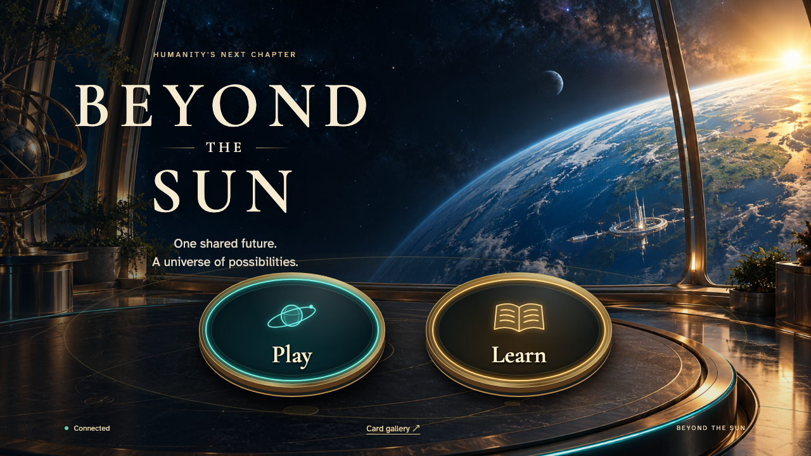](../../screenshots/finish-a-compact-4-player-shared-corner-research-round/000-arrival-desktop-darwin.png) |

- [x] Arrive through the actual observatory
- [x] Public Technology headings have physical clearance above their cards.
- [x] The game stays within its actual viewport without page scrolling.

## 2. Choose the intended production play interface

Viewpoint: **Ada · South West · shared controller**.

| desktop · 1280 × 720 |
| --- |
|  |

- [x] Choose the intended production play interface
- [x] Public Technology headings have physical clearance above their cards.
- [x] The game stays within its actual viewport without page scrolling.

## 3. Join directly on the single shared display

Viewpoint: **Ada · South West · shared controller**.

| desktop · 1280 × 720 |
| --- |
| [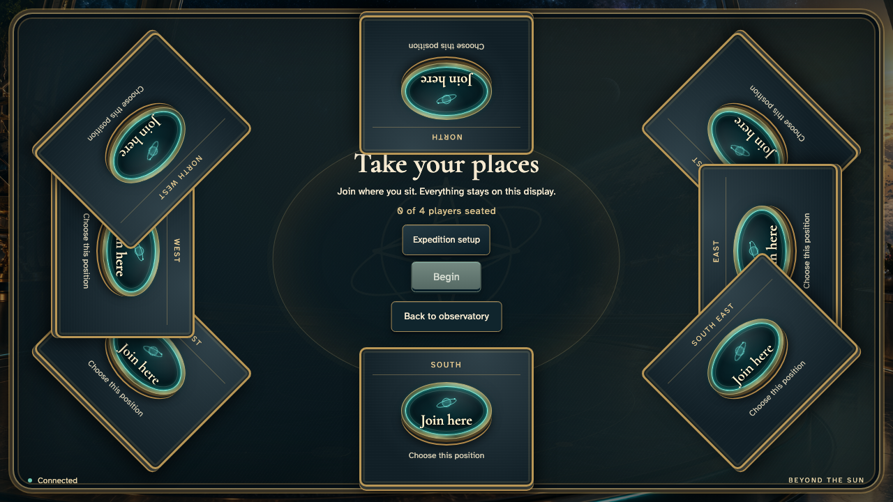](../../screenshots/finish-a-compact-4-player-shared-corner-research-round/002-physical-table-desktop-darwin.png) |

- [x] Join directly on the single shared display
- [x] Public Technology headings have physical clearance above their cards.
- [x] The game stays within its actual viewport without page scrolling.

## 4. Open the South West physical seat editor

Viewpoint: **Ada · South West · shared controller**.

| desktop · 1280 × 720 |
| --- |
| [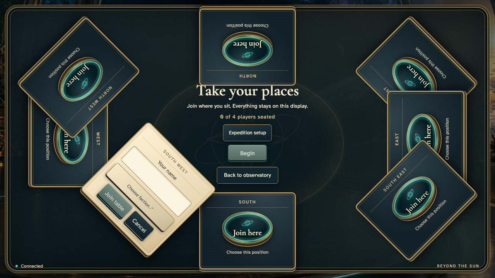](../../screenshots/finish-a-compact-4-player-shared-corner-research-round/003-seat-editor-0-desktop-darwin.png) |

- [x] Open the South West physical seat editor
- [x] Public Technology headings have physical clearance above their cards.
- [x] The game stays within its actual viewport without page scrolling.

## 5. Name Ada on the shared surface

Viewpoint: **Ada · South West · shared controller**.

| desktop · 1280 × 720 |
| --- |
| [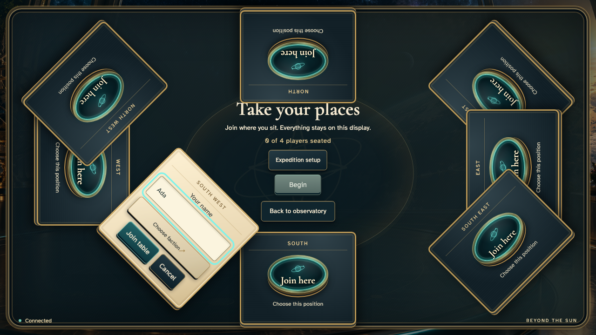](../../screenshots/finish-a-compact-4-player-shared-corner-research-round/004-seat-name-0-desktop-darwin.png) |

- [x] Name Ada on the shared surface
- [x] Public Technology headings have physical clearance above their cards.
- [x] The game stays within its actual viewport without page scrolling.

## 6. Ada occupies the physical seat

Viewpoint: **Ada · South West · shared controller**.

| desktop · 1280 × 720 |
| --- |
| [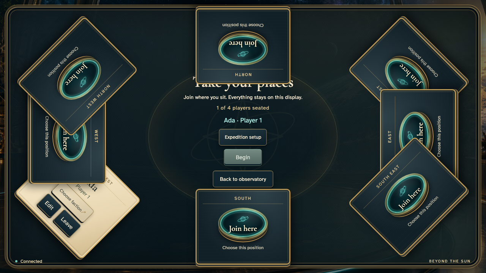](../../screenshots/finish-a-compact-4-player-shared-corner-research-round/005-seated-0-desktop-darwin.png) |

- [x] Ada occupies the physical seat
- [x] Public Technology headings have physical clearance above their cards.
- [x] The game stays within its actual viewport without page scrolling.

## 7. Open the North West physical seat editor

Viewpoint: **Bora · North West · shared controller**.

| desktop · 1280 × 720 |
| --- |
| [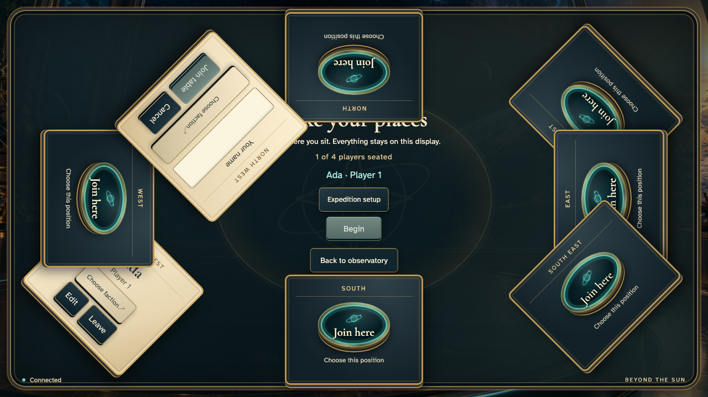](../../screenshots/finish-a-compact-4-player-shared-corner-research-round/006-seat-editor-1-desktop-darwin.png) |

- [x] Open the North West physical seat editor
- [x] Public Technology headings have physical clearance above their cards.
- [x] The game stays within its actual viewport without page scrolling.

## 8. Name Bora on the shared surface

Viewpoint: **Bora · North West · shared controller**.

| desktop · 1280 × 720 |
| --- |
| [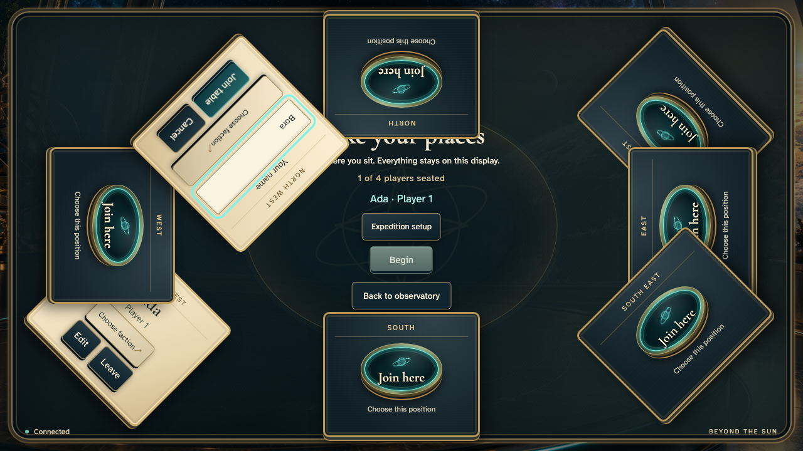](../../screenshots/finish-a-compact-4-player-shared-corner-research-round/007-seat-name-1-desktop-darwin.png) |

- [x] Name Bora on the shared surface
- [x] Public Technology headings have physical clearance above their cards.
- [x] The game stays within its actual viewport without page scrolling.

## 9. Bora occupies the physical seat

Viewpoint: **Bora · North West · shared controller**.

| desktop · 1280 × 720 |
| --- |
| [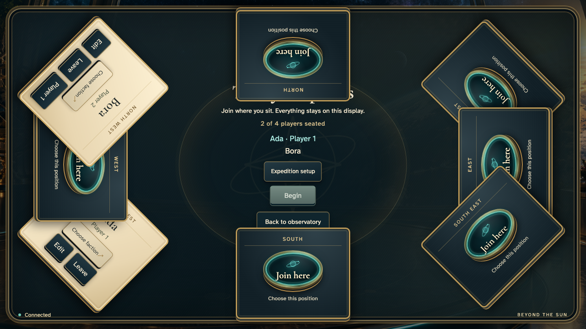](../../screenshots/finish-a-compact-4-player-shared-corner-research-round/008-seated-1-desktop-darwin.png) |

- [x] Bora occupies the physical seat
- [x] Public Technology headings have physical clearance above their cards.
- [x] The game stays within its actual viewport without page scrolling.

## 10. Open the North East physical seat editor

Viewpoint: **Cleo · North East · shared controller**.

| desktop · 1280 × 720 |
| --- |
|  |

- [x] Open the North East physical seat editor
- [x] Public Technology headings have physical clearance above their cards.
- [x] The game stays within its actual viewport without page scrolling.

## 11. Name Cleo on the shared surface

Viewpoint: **Cleo · North East · shared controller**.

| desktop · 1280 × 720 |
| --- |
| [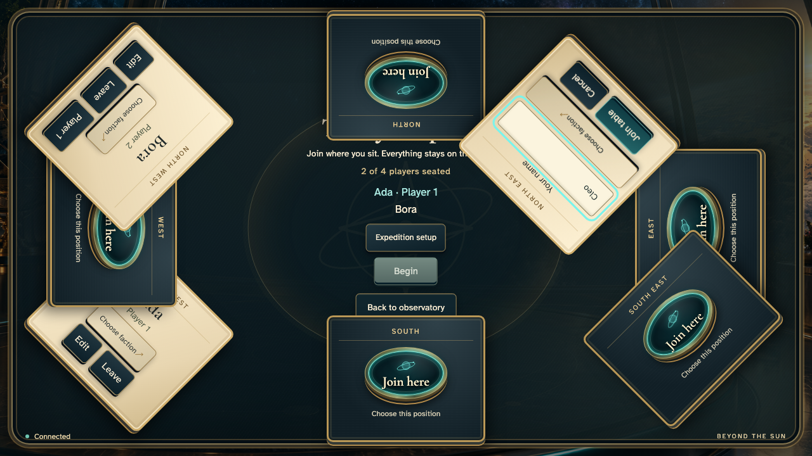](../../screenshots/finish-a-compact-4-player-shared-corner-research-round/010-seat-name-2-desktop-darwin.png) |

- [x] Name Cleo on the shared surface
- [x] Public Technology headings have physical clearance above their cards.
- [x] The game stays within its actual viewport without page scrolling.

## 12. Cleo occupies the physical seat

Viewpoint: **Cleo · North East · shared controller**.

| desktop · 1280 × 720 |
| --- |
| [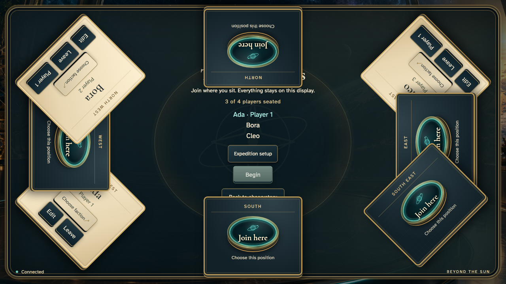](../../screenshots/finish-a-compact-4-player-shared-corner-research-round/011-seated-2-desktop-darwin.png) |

- [x] Cleo occupies the physical seat
- [x] Public Technology headings have physical clearance above their cards.
- [x] The game stays within its actual viewport without page scrolling.

## 13. Open the South East physical seat editor

Viewpoint: **Dara · South East · shared controller**.

| desktop · 1280 × 720 |
| --- |
|  |

- [x] Open the South East physical seat editor
- [x] Public Technology headings have physical clearance above their cards.
- [x] The game stays within its actual viewport without page scrolling.

## 14. Name Dara on the shared surface

Viewpoint: **Dara · South East · shared controller**.

| desktop · 1280 × 720 |
| --- |
| [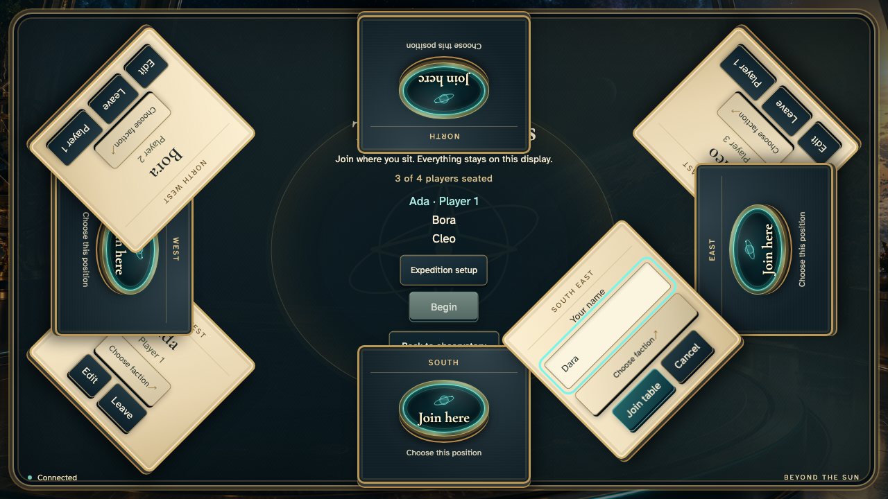](../../screenshots/finish-a-compact-4-player-shared-corner-research-round/013-seat-name-3-desktop-darwin.png) |

- [x] Name Dara on the shared surface
- [x] Public Technology headings have physical clearance above their cards.
- [x] The game stays within its actual viewport without page scrolling.

## 15. Dara occupies the physical seat

Viewpoint: **Dara · South East · shared controller**.

| desktop · 1280 × 720 |
| --- |
|  |

- [x] Dara occupies the physical seat
- [x] Public Technology headings have physical clearance above their cards.
- [x] The game stays within its actual viewport without page scrolling.

## 16. Ada reads the legal unique Basic choices

Viewpoint: **Ada · South West · shared controller**.

| desktop · 1280 × 720 |
| --- |
| [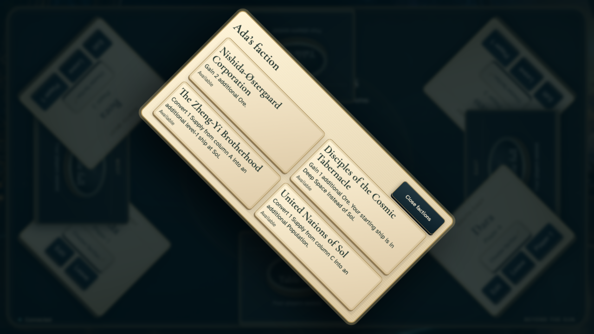](../../screenshots/finish-a-compact-4-player-shared-corner-research-round/015-factions-0-desktop-darwin.png) |

- [x] Ada reads the legal unique Basic choices
- [x] Public Technology headings have physical clearance above their cards.
- [x] The game stays within its actual viewport without page scrolling.

## 17. Ada commits the real starting faction

Viewpoint: **Ada · South West · shared controller**.

| desktop · 1280 × 720 |
| --- |
| [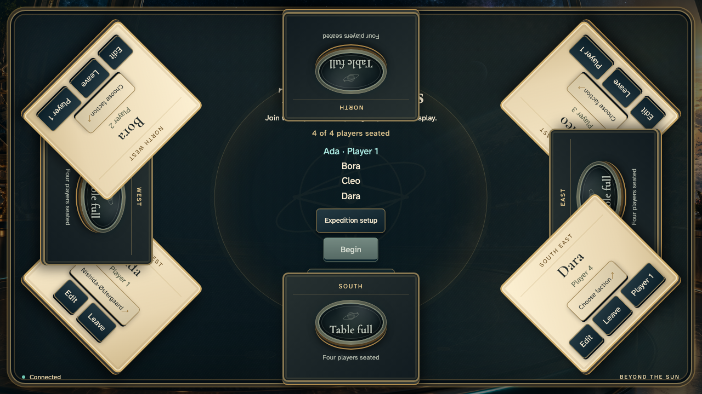](../../screenshots/finish-a-compact-4-player-shared-corner-research-round/016-faction-chosen-0-desktop-darwin.png) |

- [x] Ada commits the real starting faction
- [x] Public Technology headings have physical clearance above their cards.
- [x] The game stays within its actual viewport without page scrolling.

## 18. Bora reads the legal unique Basic choices

Viewpoint: **Bora · North West · shared controller**.

| desktop · 1280 × 720 |
| --- |
| [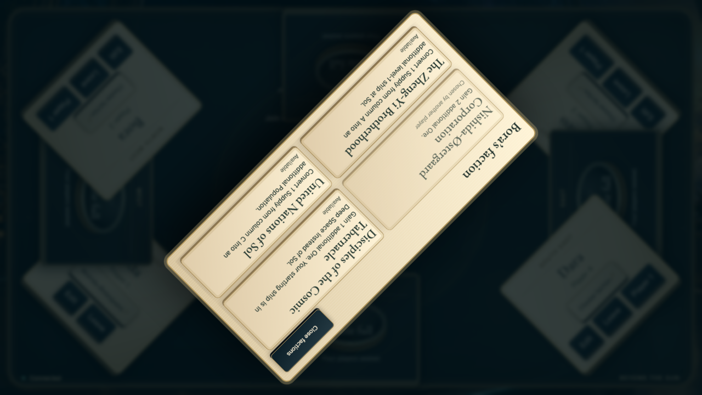](../../screenshots/finish-a-compact-4-player-shared-corner-research-round/017-factions-1-desktop-darwin.png) |

- [x] Bora reads the legal unique Basic choices
- [x] Public Technology headings have physical clearance above their cards.
- [x] The game stays within its actual viewport without page scrolling.

## 19. Bora commits the real starting faction

Viewpoint: **Bora · North West · shared controller**.

| desktop · 1280 × 720 |
| --- |
|  |

- [x] Bora commits the real starting faction
- [x] Public Technology headings have physical clearance above their cards.
- [x] The game stays within its actual viewport without page scrolling.

## 20. Cleo reads the legal unique Basic choices

Viewpoint: **Cleo · North East · shared controller**.

| desktop · 1280 × 720 |
| --- |
| [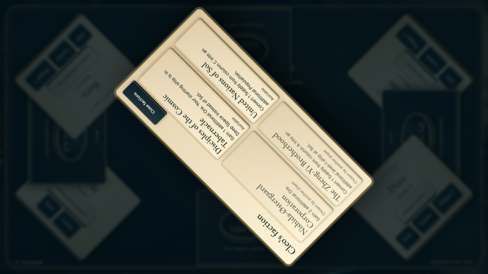](../../screenshots/finish-a-compact-4-player-shared-corner-research-round/019-factions-2-desktop-darwin.png) |

- [x] Cleo reads the legal unique Basic choices
- [x] Public Technology headings have physical clearance above their cards.
- [x] The game stays within its actual viewport without page scrolling.

## 21. Cleo commits the real starting faction

Viewpoint: **Cleo · North East · shared controller**.

| desktop · 1280 × 720 |
| --- |
| [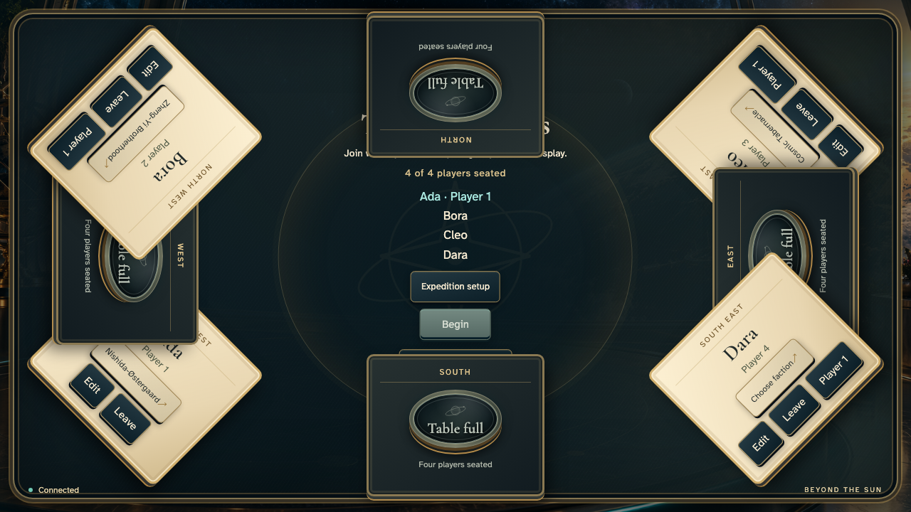](../../screenshots/finish-a-compact-4-player-shared-corner-research-round/020-faction-chosen-2-desktop-darwin.png) |

- [x] Cleo commits the real starting faction
- [x] Public Technology headings have physical clearance above their cards.
- [x] The game stays within its actual viewport without page scrolling.

## 22. Dara reads the legal unique Basic choices

Viewpoint: **Dara · South East · shared controller**.

| desktop · 1280 × 720 |
| --- |
| [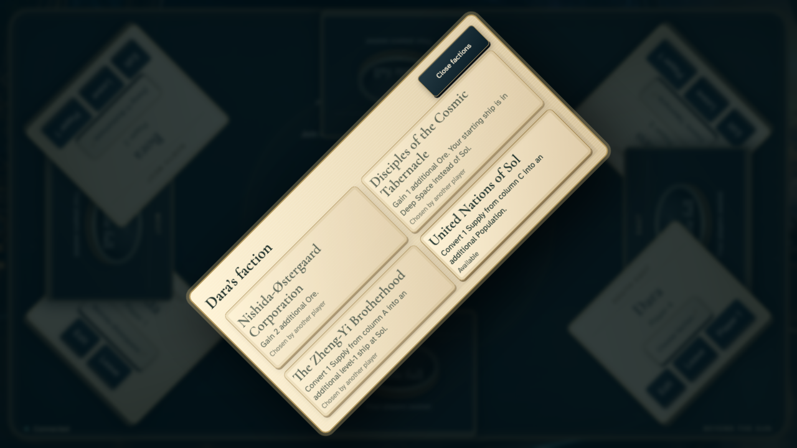](../../screenshots/finish-a-compact-4-player-shared-corner-research-round/021-factions-3-desktop-darwin.png) |

- [x] Dara reads the legal unique Basic choices
- [x] Public Technology headings have physical clearance above their cards.
- [x] The game stays within its actual viewport without page scrolling.

## 23. Dara commits the real starting faction

Viewpoint: **Dara · South East · shared controller**.

| desktop · 1280 × 720 |
| --- |
| [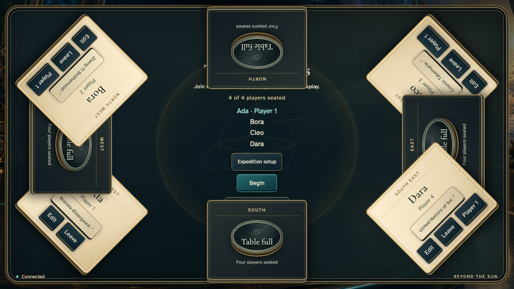](../../screenshots/finish-a-compact-4-player-shared-corner-research-round/022-faction-chosen-3-desktop-darwin.png) |

- [x] Dara commits the real starting faction
- [x] Public Technology headings have physical clearance above their cards.
- [x] The game stays within its actual viewport without page scrolling.

## 24. Begin creates the reviewed immutable board and resources

Viewpoint: **Ada · South West · shared controller**.

| desktop · 1280 × 720 |
| --- |
|  |

- [x] Begin creates the reviewed immutable board and resources
- [x] Public Technology headings have physical clearance above their cards.
- [x] The game stays within its actual viewport without page scrolling.

## 25. Ada plans the real Action pawn and permanent research payment

Viewpoint: **Ada · South West · shared controller**.

| desktop · 1280 × 720 |
| --- |
| [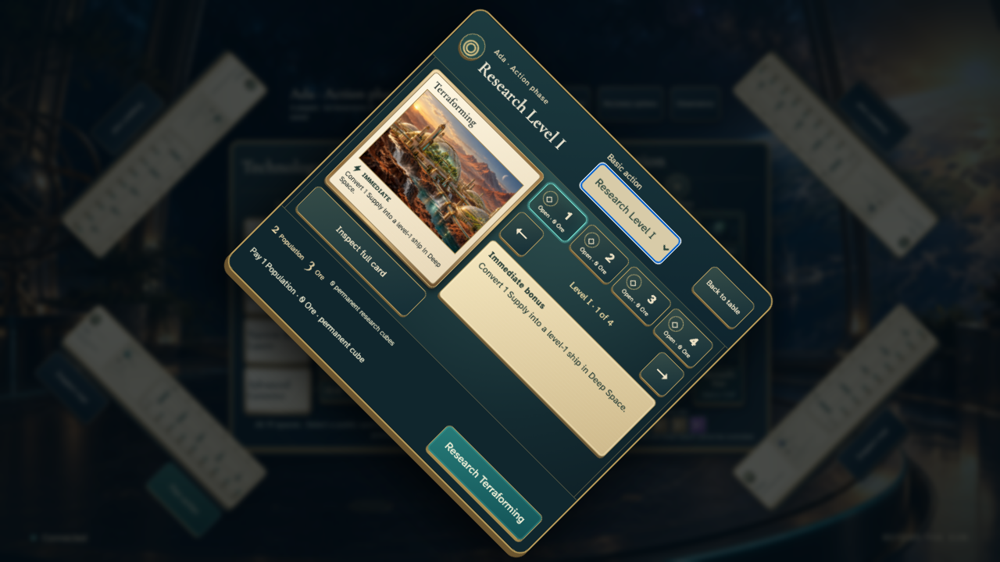](../../screenshots/finish-a-compact-4-player-shared-corner-research-round/024-turn-0-plan-desktop-darwin.png) |

- [x] Ada plans the real Action pawn and permanent research payment
- [x] Public Technology headings have physical clearance above their cards.
- [x] The game stays within its actual viewport without page scrolling.

## 26. Ada browses the next public Level I face

Viewpoint: **Ada · South West · shared controller**.

| desktop · 1280 × 720 |
| --- |
|  |

- [x] Ada browses the next public Level I face
- [x] Public Technology headings have physical clearance above their cards.
- [x] The game stays within its actual viewport without page scrolling.

## 27. Ada browses the next public Level I face

Viewpoint: **Ada · South West · shared controller**.

| desktop · 1280 × 720 |
| --- |
| [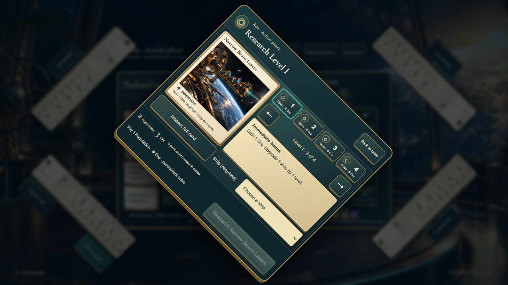](../../screenshots/finish-a-compact-4-player-shared-corner-research-round/026-turn-0-browse-1-desktop-darwin.png) |

- [x] Ada browses the next public Level I face
- [x] Public Technology headings have physical clearance above their cards.
- [x] The game stays within its actual viewport without page scrolling.

## 28. Ada browses the next public Level I face

Viewpoint: **Ada · South West · shared controller**.

| desktop · 1280 × 720 |
| --- |
|  |

- [x] Ada browses the next public Level I face
- [x] Public Technology headings have physical clearance above their cards.
- [x] The game stays within its actual viewport without page scrolling.

## 29. Inspect the complete canonical face before payment

Viewpoint: **Ada · South West · shared controller**.

| desktop · 1280 × 720 |
| --- |
| [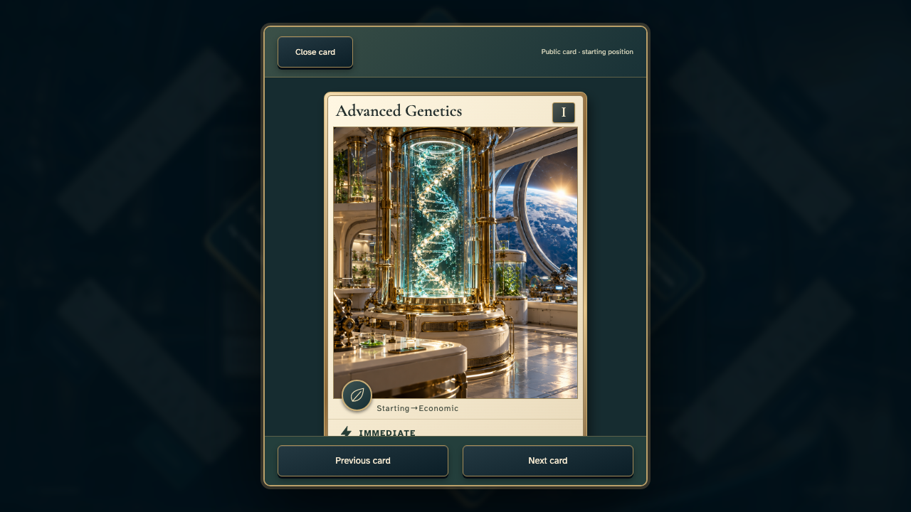](../../screenshots/finish-a-compact-4-player-shared-corner-research-round/028-full-card-desktop-darwin.png) |

- [x] Inspect the complete canonical face before payment
- [x] Public Technology headings have physical clearance above their cards.
- [x] The game stays within its actual viewport without page scrolling.

## 30. Read the entire public face through its bounded reader

Viewpoint: **Ada · South West · shared controller**.

| desktop · 1280 × 720 |
| --- |
| [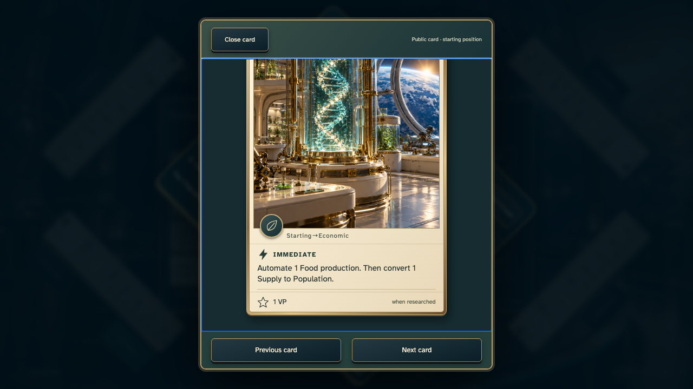](../../screenshots/finish-a-compact-4-player-shared-corner-research-round/029-full-rules-desktop-darwin.png) |

- [x] Read the entire public face through its bounded reader
- [x] Public Technology headings have physical clearance above their cards.
- [x] The game stays within its actual viewport without page scrolling.

## 31. Escape restores the actual inspection source without committing

Viewpoint: **Ada · South West · shared controller**.

| desktop · 1280 × 720 |
| --- |
| [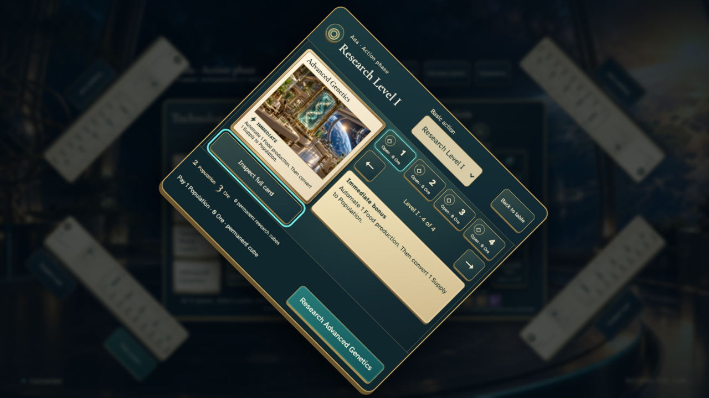](../../screenshots/finish-a-compact-4-player-shared-corner-research-round/030-inspection-return-desktop-darwin.png) |

- [x] Escape restores the actual inspection source without committing
- [x] Public Technology headings have physical clearance above their cards.
- [x] The game stays within its actual viewport without page scrolling.

## 32. Cancel the unpaid plan and restore the acting mat control

Viewpoint: **Ada · South West · shared controller**.

| desktop · 1280 × 720 |
| --- |
| [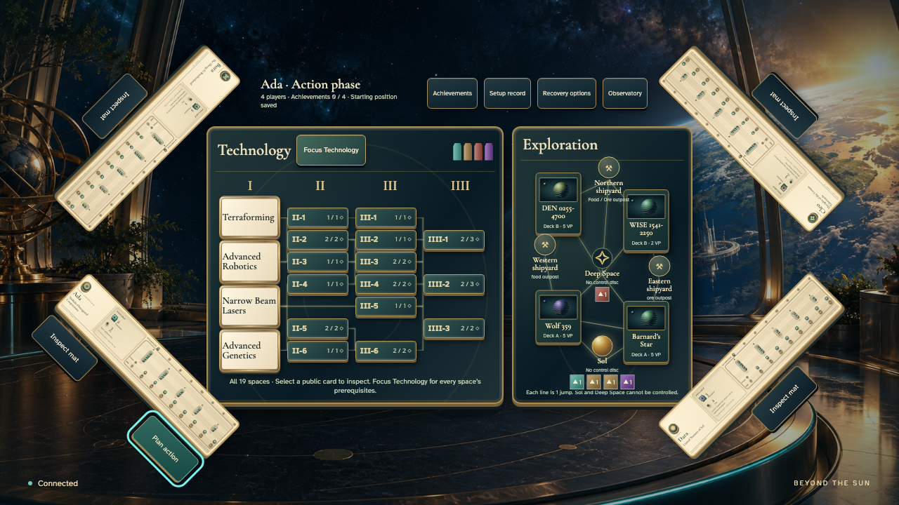](../../screenshots/finish-a-compact-4-player-shared-corner-research-round/031-plan-return-desktop-darwin.png) |

- [x] Cancel the unpaid plan and restore the acting mat control
- [x] Public Technology headings have physical clearance above their cards.
- [x] The game stays within its actual viewport without page scrolling.

## 33. Reopen the bounded planning instrument

Viewpoint: **Ada · South West · shared controller**.

| desktop · 1280 × 720 |
| --- |
| [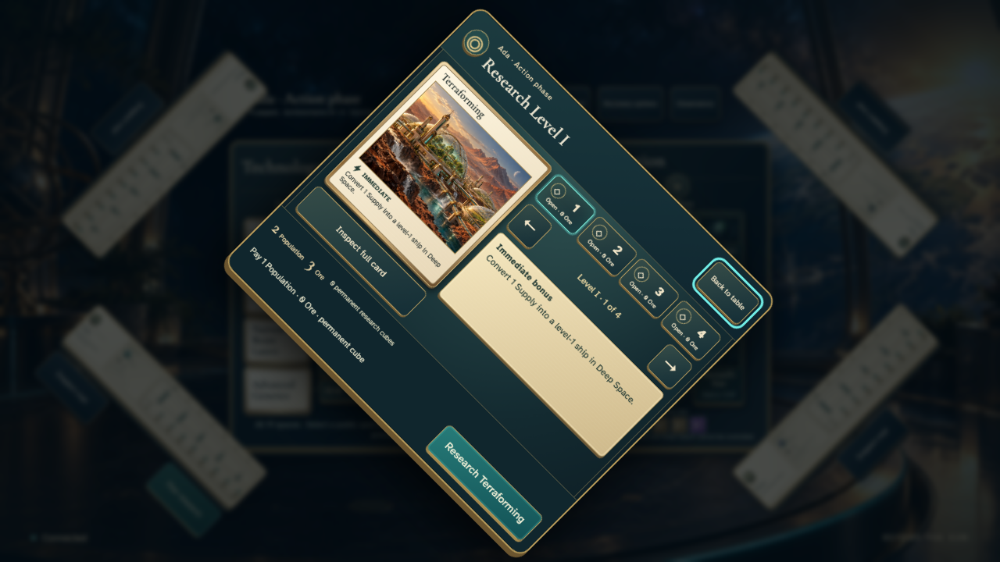](../../screenshots/finish-a-compact-4-player-shared-corner-research-round/032-reopened-plan-desktop-darwin.png) |

- [x] Reopen the bounded planning instrument
- [x] Public Technology headings have physical clearance above their cards.
- [x] The game stays within its actual viewport without page scrolling.

## 34. Ada browses the next public Level I face

Viewpoint: **Ada · South West · shared controller**.

| desktop · 1280 × 720 |
| --- |
| [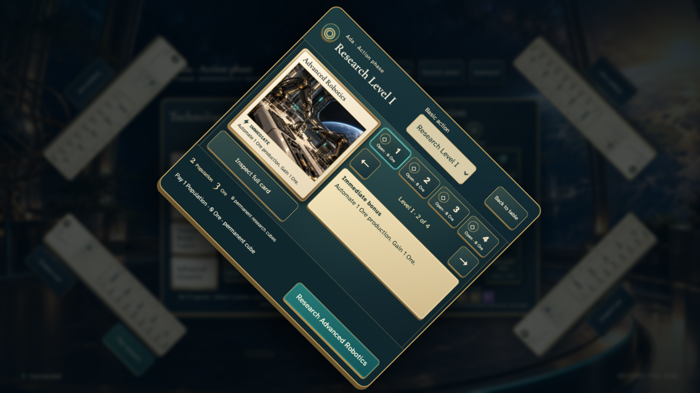](../../screenshots/finish-a-compact-4-player-shared-corner-research-round/033-turn-0-browse-0-reopened-desktop-darwin.png) |

- [x] Ada browses the next public Level I face
- [x] Public Technology headings have physical clearance above their cards.
- [x] The game stays within its actual viewport without page scrolling.

## 35. Ada browses the next public Level I face

Viewpoint: **Ada · South West · shared controller**.

| desktop · 1280 × 720 |
| --- |
|  |

- [x] Ada browses the next public Level I face
- [x] Public Technology headings have physical clearance above their cards.
- [x] The game stays within its actual viewport without page scrolling.

## 36. Ada browses the next public Level I face

Viewpoint: **Ada · South West · shared controller**.

| desktop · 1280 × 720 |
| --- |
| [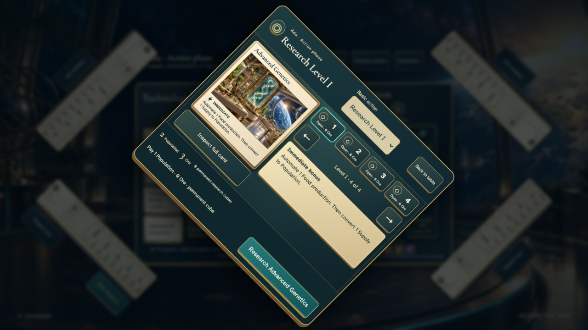](../../screenshots/finish-a-compact-4-player-shared-corner-research-round/035-turn-0-browse-2-reopened-desktop-darwin.png) |

- [x] Ada browses the next public Level I face
- [x] Public Technology headings have physical clearance above their cards.
- [x] The game stays within its actual viewport without page scrolling.

## 37. Ada pays once, places the permanent cube and resolves Advanced Genetics

Viewpoint: **Ada · South West · shared controller**.

| desktop · 1280 × 720 |
| --- |
|  |

- [x] Ada pays once, places the permanent cube and resolves Advanced Genetics
- [x] Public Technology headings have physical clearance above their cards.
- [x] The game stays within its actual viewport without page scrolling.

## 38. Ada reloads the retained pending production without a repeated bonus

Viewpoint: **Ada · South West · shared controller**.

| desktop · 1280 × 720 |
| --- |
| [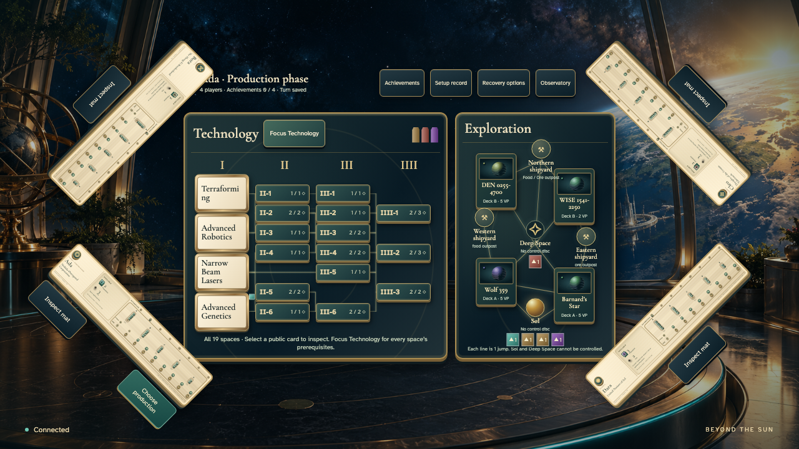](../../screenshots/finish-a-compact-4-player-shared-corner-research-round/037-turn-0-pending-restored-desktop-darwin.png) |

- [x] Ada reloads the retained pending production without a repeated bonus
- [x] Public Technology headings have physical clearance above their cards.
- [x] The game stays within its actual viewport without page scrolling.

## 39. Ada resumes the same saved production choice

Viewpoint: **Ada · South West · shared controller**.

| desktop · 1280 × 720 |
| --- |
| [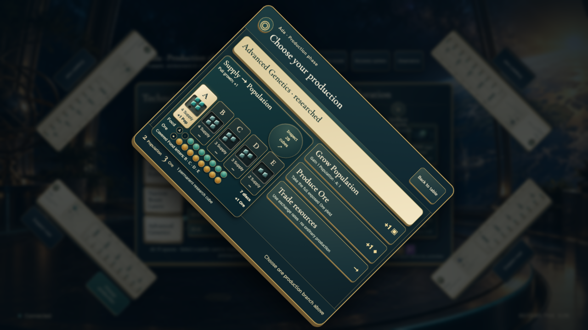](../../screenshots/finish-a-compact-4-player-shared-corner-research-round/038-turn-0-production-restored-desktop-darwin.png) |

- [x] Ada resumes the same saved production choice
- [x] Public Technology headings have physical clearance above their cards.
- [x] The game stays within its actual viewport without page scrolling.

## 40. Ada hands off automatically after the resolved production branch

Viewpoint: **Ada · South West · shared controller**.

| desktop · 1280 × 720 |
| --- |
|  |

- [x] Ada hands off automatically after the resolved production branch
- [x] Public Technology headings have physical clearance above their cards.
- [x] The game stays within its actual viewport without page scrolling.

## 41. Bora plans the real Action pawn and permanent research payment

Viewpoint: **Bora · North West · shared controller**.

| desktop · 1280 × 720 |
| --- |
|  |

- [x] Bora plans the real Action pawn and permanent research payment
- [x] Public Technology headings have physical clearance above their cards.
- [x] The game stays within its actual viewport without page scrolling.

## 42. An occupied Action space rejects commitment without spending

Viewpoint: **Bora · North West · shared controller**.

| desktop · 1280 × 720 |
| --- |
| [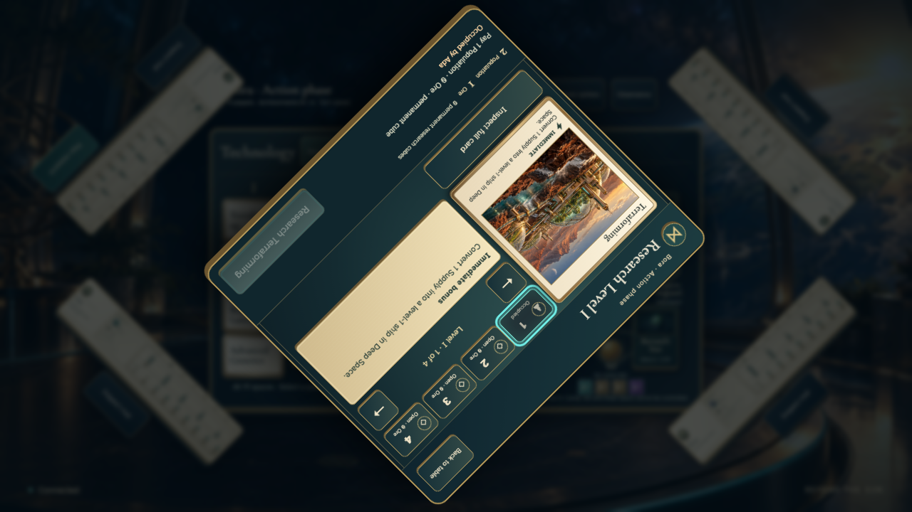](../../screenshots/finish-a-compact-4-player-shared-corner-research-round/041-blocked-occupied-desktop-darwin.png) |

- [x] An occupied Action space rejects commitment without spending
- [x] Public Technology headings have physical clearance above their cards.
- [x] The game stays within its actual viewport without page scrolling.

## 43. Choose the genuinely unoccupied second space

Viewpoint: **Bora · North West · shared controller**.

| desktop · 1280 × 720 |
| --- |
| [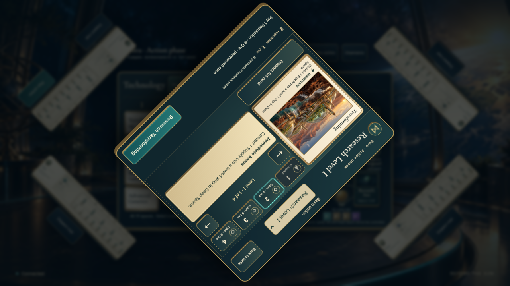](../../screenshots/finish-a-compact-4-player-shared-corner-research-round/042-open-second-space-desktop-darwin.png) |

- [x] Choose the genuinely unoccupied second space
- [x] Public Technology headings have physical clearance above their cards.
- [x] The game stays within its actual viewport without page scrolling.

## 44. Bora browses the next public Level I face

Viewpoint: **Bora · North West · shared controller**.

| desktop · 1280 × 720 |
| --- |
| [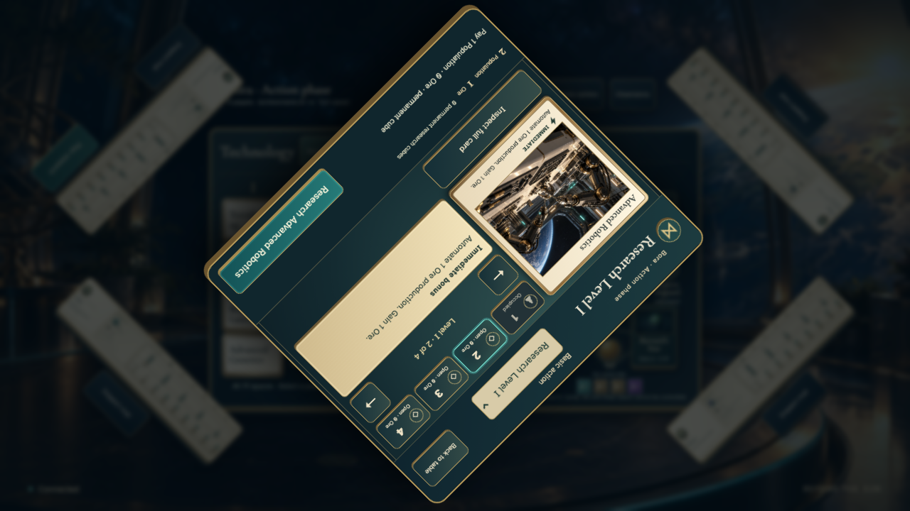](../../screenshots/finish-a-compact-4-player-shared-corner-research-round/043-turn-1-browse-0-desktop-darwin.png) |

- [x] Bora browses the next public Level I face
- [x] Public Technology headings have physical clearance above their cards.
- [x] The game stays within its actual viewport without page scrolling.

## 45. Bora browses the next public Level I face

Viewpoint: **Bora · North West · shared controller**.

| desktop · 1280 × 720 |
| --- |
| [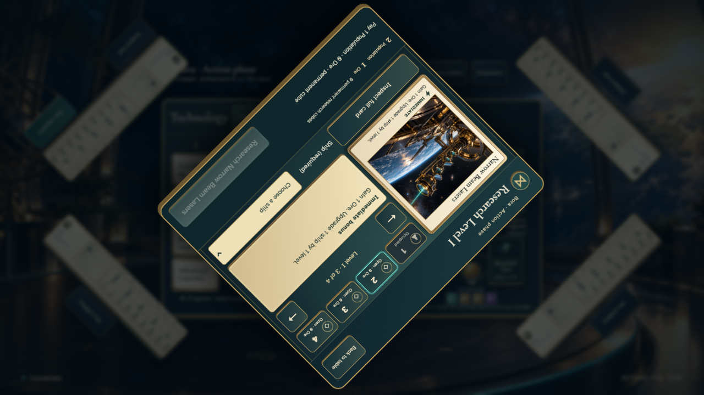](../../screenshots/finish-a-compact-4-player-shared-corner-research-round/044-turn-1-browse-1-desktop-darwin.png) |

- [x] Bora browses the next public Level I face
- [x] Public Technology headings have physical clearance above their cards.
- [x] The game stays within its actual viewport without page scrolling.

## 46. The mandatory Lasers target disables commit until explicitly chosen

Viewpoint: **Bora · North West · shared controller**.

| desktop · 1280 × 720 |
| --- |
|  |

- [x] The mandatory Lasers target disables commit until explicitly chosen
- [x] Public Technology headings have physical clearance above their cards.
- [x] The game stays within its actual viewport without page scrolling.

## 47. Select the second Sol ship; the commit names its level1 to2 consequence

Viewpoint: **Bora · North West · shared controller**.

| desktop · 1280 × 720 |
| --- |
| [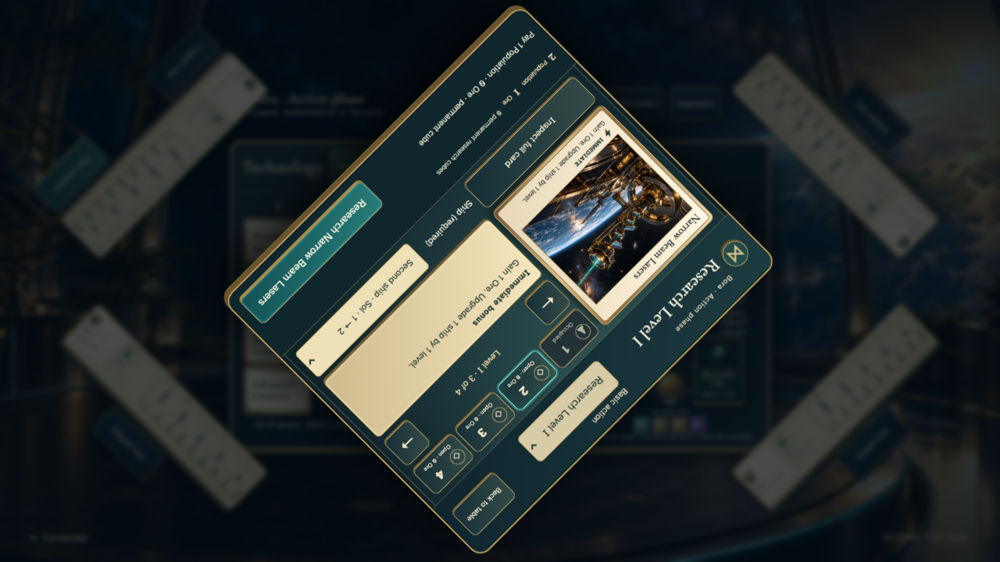](../../screenshots/finish-a-compact-4-player-shared-corner-research-round/046-ship-selected-desktop-darwin.png) |

- [x] Select the second Sol ship; the commit names its level1 to2 consequence
- [x] Public Technology headings have physical clearance above their cards.
- [x] The game stays within its actual viewport without page scrolling.

## 48. Bora pays once, places the permanent cube and resolves Narrow Beam Lasers

Viewpoint: **Bora · North West · shared controller**.

| desktop · 1280 × 720 |
| --- |
|  |

- [x] Bora pays once, places the permanent cube and resolves Narrow Beam Lasers
- [x] Public Technology headings have physical clearance above their cards.
- [x] The game stays within its actual viewport without page scrolling.

## 49. Bora reloads the retained pending production without a repeated bonus

Viewpoint: **Bora · North West · shared controller**.

| desktop · 1280 × 720 |
| --- |
|  |

- [x] Bora reloads the retained pending production without a repeated bonus
- [x] Public Technology headings have physical clearance above their cards.
- [x] The game stays within its actual viewport without page scrolling.

## 50. Bora resumes the same saved production choice

Viewpoint: **Bora · North West · shared controller**.

| desktop · 1280 × 720 |
| --- |
| [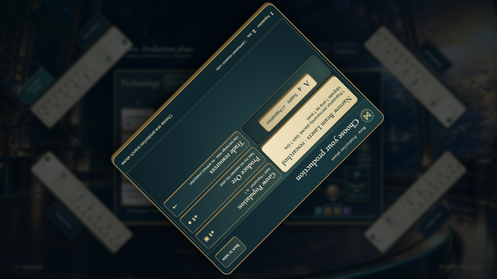](../../screenshots/finish-a-compact-4-player-shared-corner-research-round/049-turn-1-production-restored-desktop-darwin.png) |

- [x] Bora resumes the same saved production choice
- [x] Public Technology headings have physical clearance above their cards.
- [x] The game stays within its actual viewport without page scrolling.

## 51. Trade is a persisted exclusive production branch

Viewpoint: **Bora · North West · shared controller**.

| desktop · 1280 × 720 |
| --- |
|  |

- [x] Trade is a persisted exclusive production branch
- [x] Public Technology headings have physical clearance above their cards.
- [x] The game stays within its actual viewport without page scrolling.

## 52. Inspect the printed ship decommission exchange

Viewpoint: **Bora · North West · shared controller**.

| desktop · 1280 × 720 |
| --- |
| [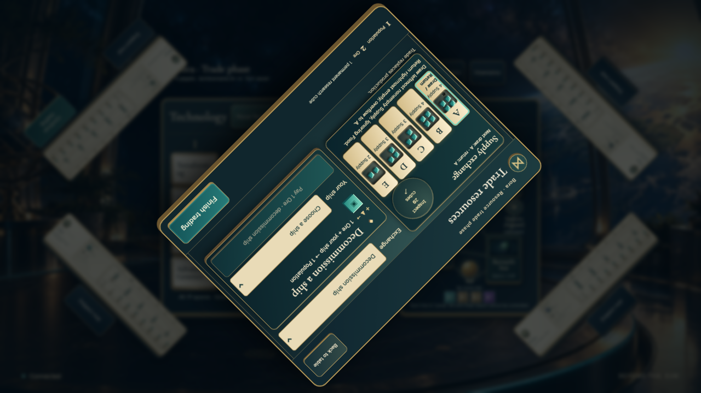](../../screenshots/finish-a-compact-4-player-shared-corner-research-round/051-decommission-exchange-desktop-darwin.png) |

- [x] Inspect the printed ship decommission exchange
- [x] Public Technology headings have physical clearance above their cards.
- [x] The game stays within its actual viewport without page scrolling.

## 53. Identify the unupgraded first Sol ship, preserving the level2 second ship

Viewpoint: **Bora · North West · shared controller**.

| desktop · 1280 × 720 |
| --- |
| [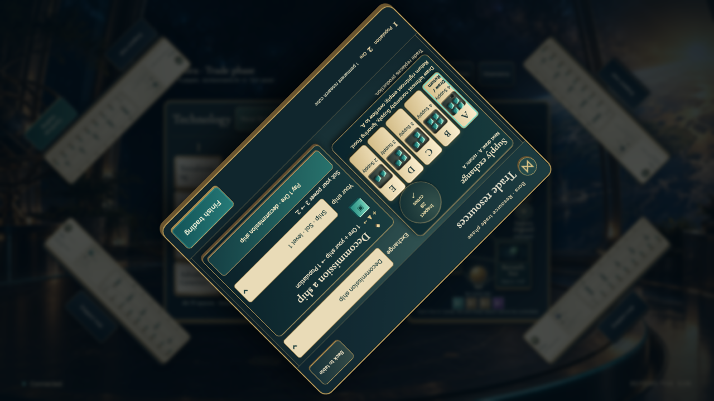](../../screenshots/finish-a-compact-4-player-shared-corner-research-round/052-decommission-target-desktop-darwin.png) |

- [x] Identify the unupgraded first Sol ship, preserving the level2 second ship
- [x] Public Technology headings have physical clearance above their cards.
- [x] The game stays within its actual viewport without page scrolling.

## 54. Pay1 Ore and turn the first ship into available Population

Viewpoint: **Bora · North West · shared controller**.

| desktop · 1280 × 720 |
| --- |
| [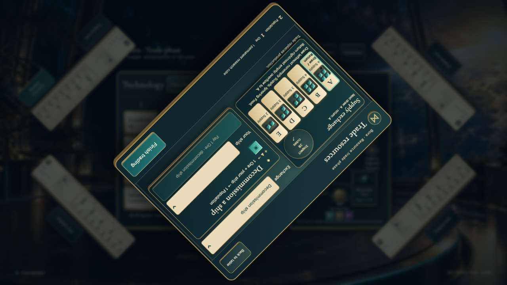](../../screenshots/finish-a-compact-4-player-shared-corner-research-round/053-decommissioned-desktop-darwin.png) |

- [x] Pay1 Ore and turn the first ship into available Population
- [x] Public Technology headings have physical clearance above their cards.
- [x] The game stays within its actual viewport without page scrolling.

## 55. Inspect the Population return exchange

Viewpoint: **Bora · North West · shared controller**.

| desktop · 1280 × 720 |
| --- |
| [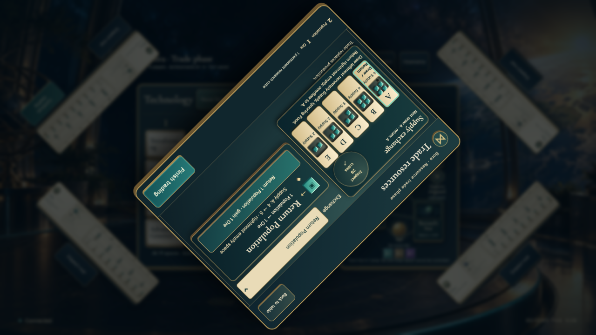](../../screenshots/finish-a-compact-4-player-shared-corner-research-round/054-return-exchange-desktop-darwin.png) |

- [x] Inspect the Population return exchange
- [x] Public Technology headings have physical clearance above their cards.
- [x] The game stays within its actual viewport without page scrolling.

## 56. Return Population1 to the rightmost Supply space

Viewpoint: **Bora · North West · shared controller**.

| desktop · 1280 × 720 |
| --- |
| [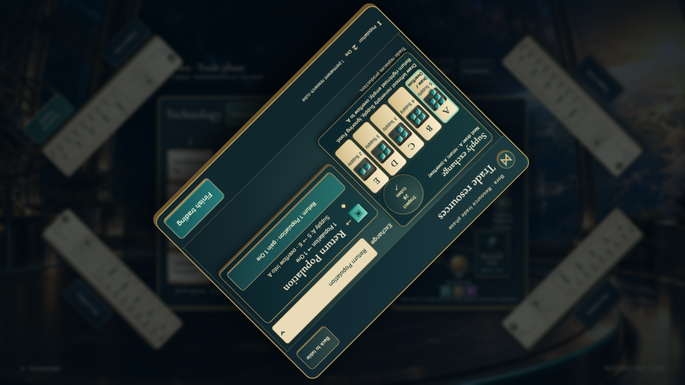](../../screenshots/finish-a-compact-4-player-shared-corner-research-round/055-returned-0-desktop-darwin.png) |

- [x] Return Population1 to the rightmost Supply space
- [x] Public Technology headings have physical clearance above their cards.
- [x] The game stays within its actual viewport without page scrolling.

## 57. Return Population2 to the rightmost Supply space

Viewpoint: **Bora · North West · shared controller**.

| desktop · 1280 × 720 |
| --- |
| [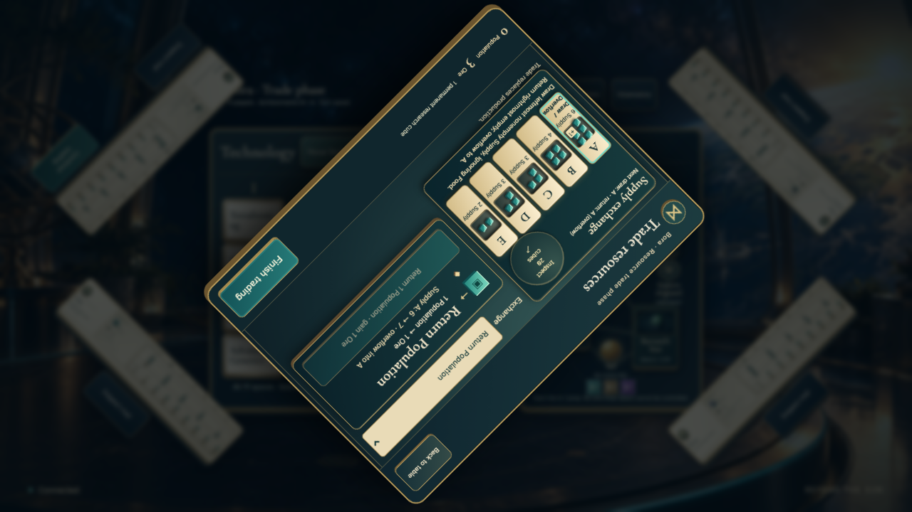](../../screenshots/finish-a-compact-4-player-shared-corner-research-round/056-returned-1-desktop-darwin.png) |

- [x] Return Population2 to the rightmost Supply space
- [x] Public Technology headings have physical clearance above their cards.
- [x] The game stays within its actual viewport without page scrolling.

## 58. Close the trade reader without ending its saved phase

Viewpoint: **Bora · North West · shared controller**.

| desktop · 1280 × 720 |
| --- |
| [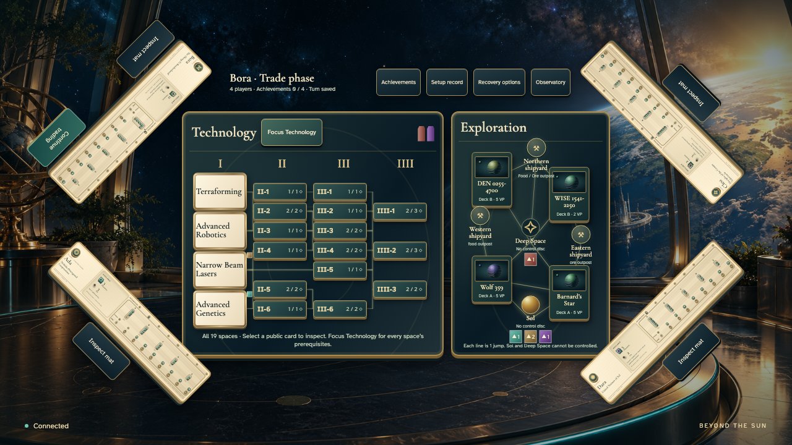](../../screenshots/finish-a-compact-4-player-shared-corner-research-round/057-trade-table-desktop-darwin.png) |

- [x] Close the trade reader without ending its saved phase
- [x] Public Technology headings have physical clearance above their cards.
- [x] The game stays within its actual viewport without page scrolling.

## 59. The complete mat shows the actual sixth Supply cube

Viewpoint: **Bora · North West · shared controller**.

| desktop · 1280 × 720 |
| --- |
| [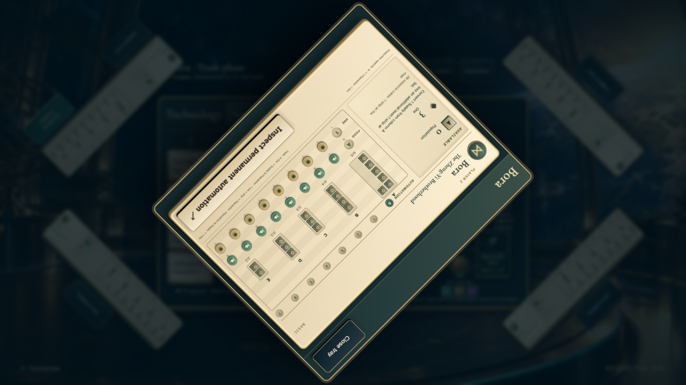](../../screenshots/finish-a-compact-4-player-shared-corner-research-round/058-supply-overflow-desktop-darwin.png) |

- [x] The complete mat shows the actual sixth Supply cube
- [x] Public Technology headings have physical clearance above their cards.
- [x] The game stays within its actual viewport without page scrolling.

## 60. Return from the public mat inspection with the trade phase retained

Viewpoint: **Bora · North West · shared controller**.

| desktop · 1280 × 720 |
| --- |
|  |

- [x] Return from the public mat inspection with the trade phase retained
- [x] Public Technology headings have physical clearance above their cards.
- [x] The game stays within its actual viewport without page scrolling.

## 61. Resume the same accepted trade stream

Viewpoint: **Bora · North West · shared controller**.

| desktop · 1280 × 720 |
| --- |
|  |

- [x] Resume the same accepted trade stream
- [x] Public Technology headings have physical clearance above their cards.
- [x] The game stays within its actual viewport without page scrolling.

## 62. Inspect the printed recruitment exchange

Viewpoint: **Bora · North West · shared controller**.

| desktop · 1280 × 720 |
| --- |
|  |

- [x] Inspect the printed recruitment exchange
- [x] Public Technology headings have physical clearance above their cards.
- [x] The game stays within its actual viewport without page scrolling.

## 63. Pay3 Ore and convert the leftmost Supply into Population

Viewpoint: **Bora · North West · shared controller**.

| desktop · 1280 × 720 |
| --- |
| [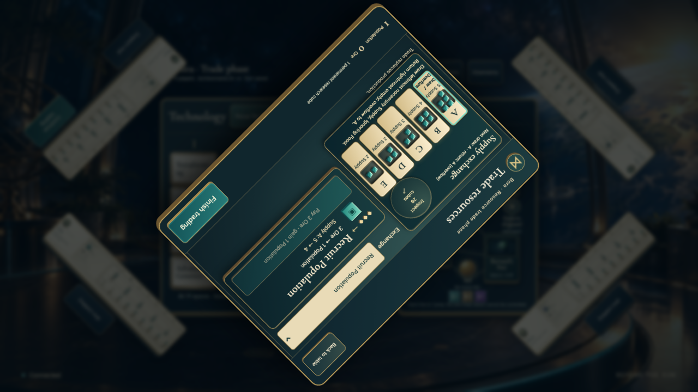](../../screenshots/finish-a-compact-4-player-shared-corner-research-round/062-recruited-desktop-darwin.png) |

- [x] Pay3 Ore and convert the leftmost Supply into Population
- [x] Public Technology headings have physical clearance above their cards.
- [x] The game stays within its actual viewport without page scrolling.

## 64. Reload preserves the accepted exchanges and trading phase

Viewpoint: **Bora · North West · shared controller**.

| desktop · 1280 × 720 |
| --- |
|  |

- [x] Reload preserves the accepted exchanges and trading phase
- [x] Public Technology headings have physical clearance above their cards.
- [x] The game stays within its actual viewport without page scrolling.

## 65. Reopen the saved balance without duplicating an exchange

Viewpoint: **Bora · North West · shared controller**.

| desktop · 1280 × 720 |
| --- |
|  |

- [x] Reopen the saved balance without duplicating an exchange
- [x] Public Technology headings have physical clearance above their cards.
- [x] The game stays within its actual viewport without page scrolling.

## 66. Bora hands off automatically after the resolved production branch

Viewpoint: **Bora · North West · shared controller**.

| desktop · 1280 × 720 |
| --- |
| [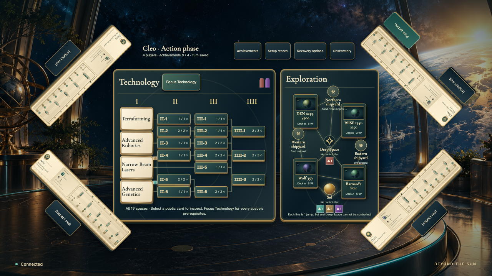](../../screenshots/finish-a-compact-4-player-shared-corner-research-round/065-turn-1-handoff-desktop-darwin.png) |

- [x] Bora hands off automatically after the resolved production branch
- [x] Public Technology headings have physical clearance above their cards.
- [x] The game stays within its actual viewport without page scrolling.

## 67. Cleo plans the real Action pawn and permanent research payment

Viewpoint: **Cleo · North East · shared controller**.

| desktop · 1280 × 720 |
| --- |
| [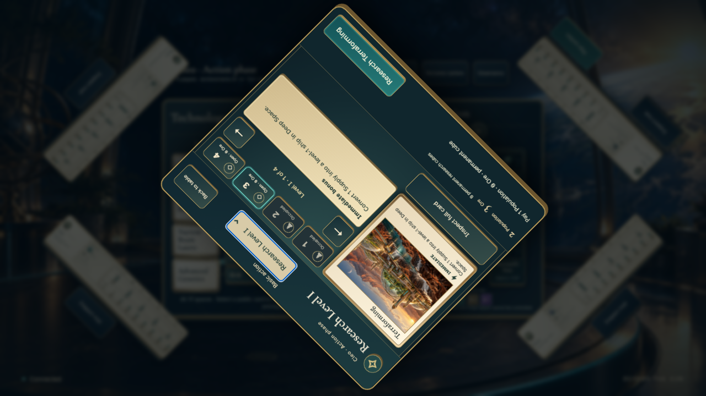](../../screenshots/finish-a-compact-4-player-shared-corner-research-round/066-turn-2-plan-desktop-darwin.png) |

- [x] Cleo plans the real Action pawn and permanent research payment
- [x] Public Technology headings have physical clearance above their cards.
- [x] The game stays within its actual viewport without page scrolling.

## 68. Cleo browses the next public Level I face

Viewpoint: **Cleo · North East · shared controller**.

| desktop · 1280 × 720 |
| --- |
| [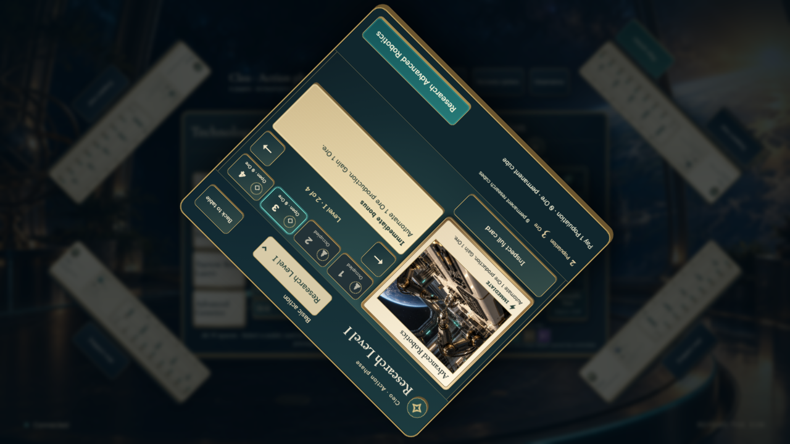](../../screenshots/finish-a-compact-4-player-shared-corner-research-round/067-turn-2-browse-0-desktop-darwin.png) |

- [x] Cleo browses the next public Level I face
- [x] Public Technology headings have physical clearance above their cards.
- [x] The game stays within its actual viewport without page scrolling.

## 69. Cleo pays once, places the permanent cube and resolves Advanced Robotics

Viewpoint: **Cleo · North East · shared controller**.

| desktop · 1280 × 720 |
| --- |
| [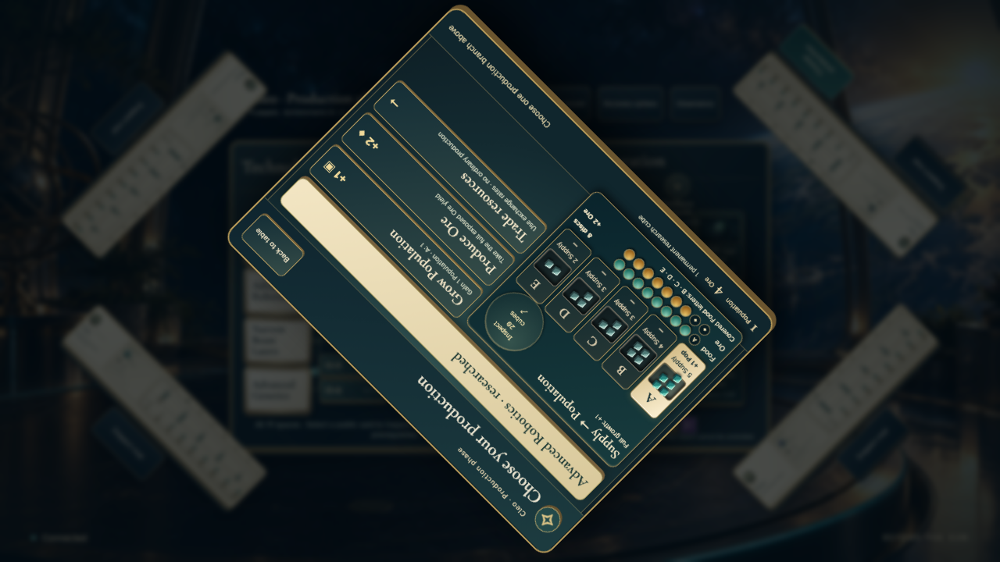](../../screenshots/finish-a-compact-4-player-shared-corner-research-round/068-turn-2-researched-desktop-darwin.png) |

- [x] Cleo pays once, places the permanent cube and resolves Advanced Robotics
- [x] Public Technology headings have physical clearance above their cards.
- [x] The game stays within its actual viewport without page scrolling.

## 70. Cleo hands off automatically after the resolved production branch

Viewpoint: **Cleo · North East · shared controller**.

| desktop · 1280 × 720 |
| --- |
| [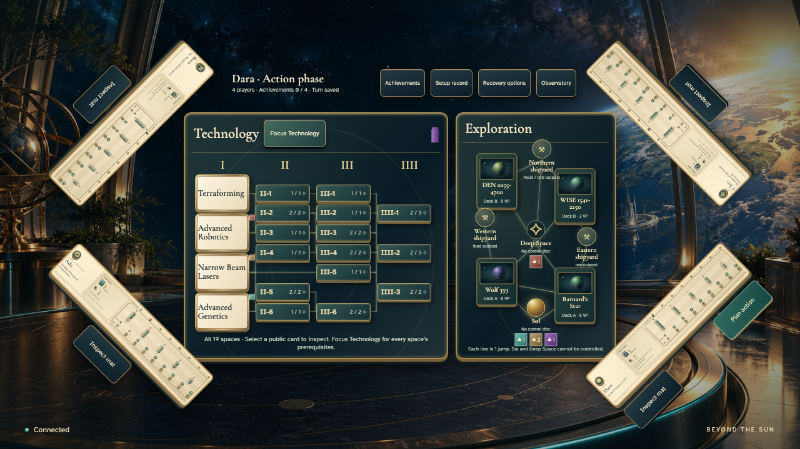](../../screenshots/finish-a-compact-4-player-shared-corner-research-round/069-turn-2-handoff-desktop-darwin.png) |

- [x] Cleo hands off automatically after the resolved production branch
- [x] Public Technology headings have physical clearance above their cards.
- [x] The game stays within its actual viewport without page scrolling.

## 71. Dara plans the real Action pawn and permanent research payment

Viewpoint: **Dara · South East · shared controller**.

| desktop · 1280 × 720 |
| --- |
| [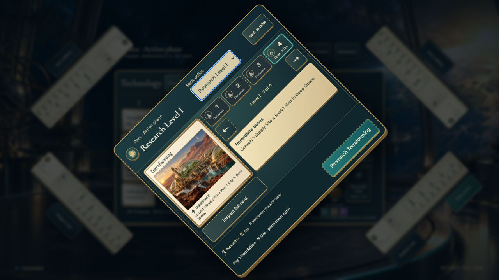](../../screenshots/finish-a-compact-4-player-shared-corner-research-round/070-turn-3-plan-desktop-darwin.png) |

- [x] Dara plans the real Action pawn and permanent research payment
- [x] Public Technology headings have physical clearance above their cards.
- [x] The game stays within its actual viewport without page scrolling.

## 72. Dara pays once, places the permanent cube and resolves Terraforming

Viewpoint: **Dara · South East · shared controller**.

| desktop · 1280 × 720 |
| --- |
|  |

- [x] Dara pays once, places the permanent cube and resolves Terraforming
- [x] Public Technology headings have physical clearance above their cards.
- [x] The game stays within its actual viewport without page scrolling.

## 73. Dara hands off automatically after the resolved production branch

Viewpoint: **Dara · South East · shared controller**.

| desktop · 1280 × 720 |
| --- |
|  |

- [x] Dara hands off automatically after the resolved production branch
- [x] Public Technology headings have physical clearance above their cards.
- [x] The game stays within its actual viewport without page scrolling.

## 74. Reload recovers permanent cubes, occupied spaces and all economies

Viewpoint: **Ada · South West · shared controller**.

| desktop · 1280 × 720 |
| --- |
|  |

- [x] Reload recovers permanent cubes, occupied spaces and all economies
- [x] Public Technology headings have physical clearance above their cards.
- [x] The game stays within its actual viewport without page scrolling.
