# Finish research from the compact desktop decision overview

Ordinary UI setup, legal unique Basic factions and real emulator persistence. Only UUID entropy is fixed before setup; no game-state injection. Every visible input/choice/result uses TestStepHelper. Complete first rounds exercise all Level I bonuses, real permanent cube payment, occupied Action blocking, explicit ship choice, exclusive production, all three printed trades, Supply overflow, pending-choice reload and automatic handoff. Full-card and planner Escape restore source focus.

## 1. Arrive through the actual observatory

Viewpoint: **Ada · host**.

| desktop · 1280 × 720 |
| --- |
|  |

- [x] Arrive through the actual observatory
- [x] Public Technology headings have physical clearance above their cards.
- [x] The game stays within its actual viewport without page scrolling.

## 2. Choose the intended production play interface

Viewpoint: **Ada · host**.

| desktop · 1280 × 720 |
| --- |
| [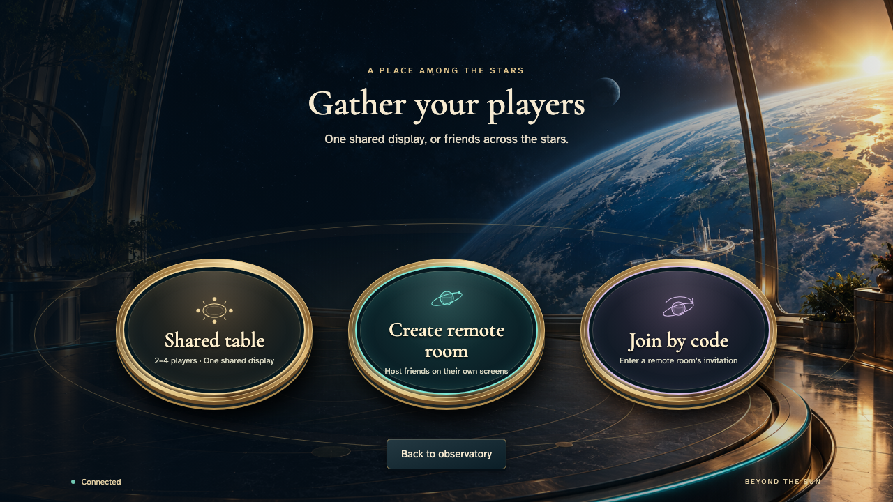](../../screenshots/finish-research-from-the-compact-desktop-decision-overview/001-play-desktop-darwin.png) |

- [x] Choose the intended production play interface
- [x] Public Technology headings have physical clearance above their cards.
- [x] The game stays within its actual viewport without page scrolling.

## 3. Open the production remote hosting instrument

Viewpoint: **Ada · host**.

| desktop · 1280 × 720 |
| --- |
| [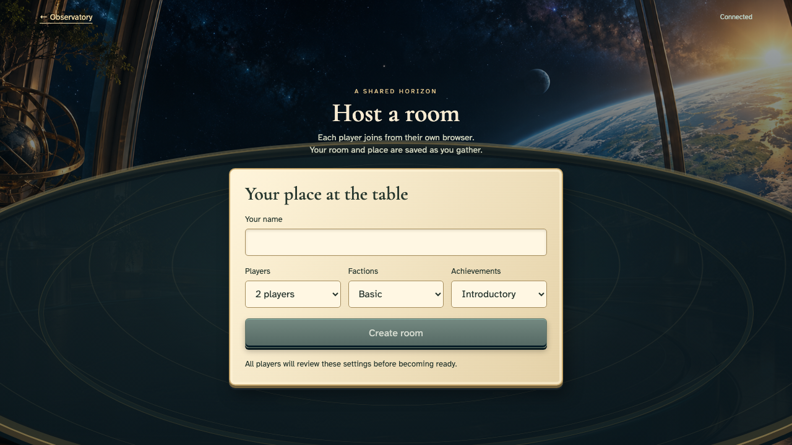](../../screenshots/finish-research-from-the-compact-desktop-decision-overview/002-host-form-desktop-darwin.png) |

- [x] Open the production remote hosting instrument
- [x] Public Technology headings have physical clearance above their cards.
- [x] The game stays within its actual viewport without page scrolling.

## 4. Name the actual host

Viewpoint: **Ada · host**.

| desktop · 1280 × 720 |
| --- |
| [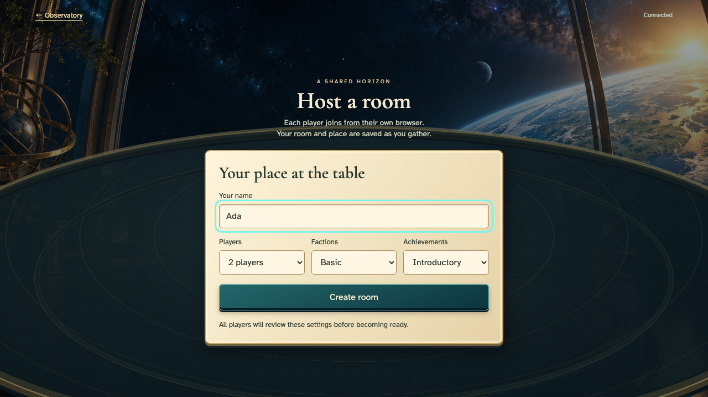](../../screenshots/finish-research-from-the-compact-desktop-decision-overview/003-host-name-desktop-darwin.png) |

- [x] Name the actual host
- [x] Public Technology headings have physical clearance above their cards.
- [x] The game stays within its actual viewport without page scrolling.

## 5. Persist the canonical remote gathering

Viewpoint: **Ada · host**.

| desktop · 1280 × 720 |
| --- |
| [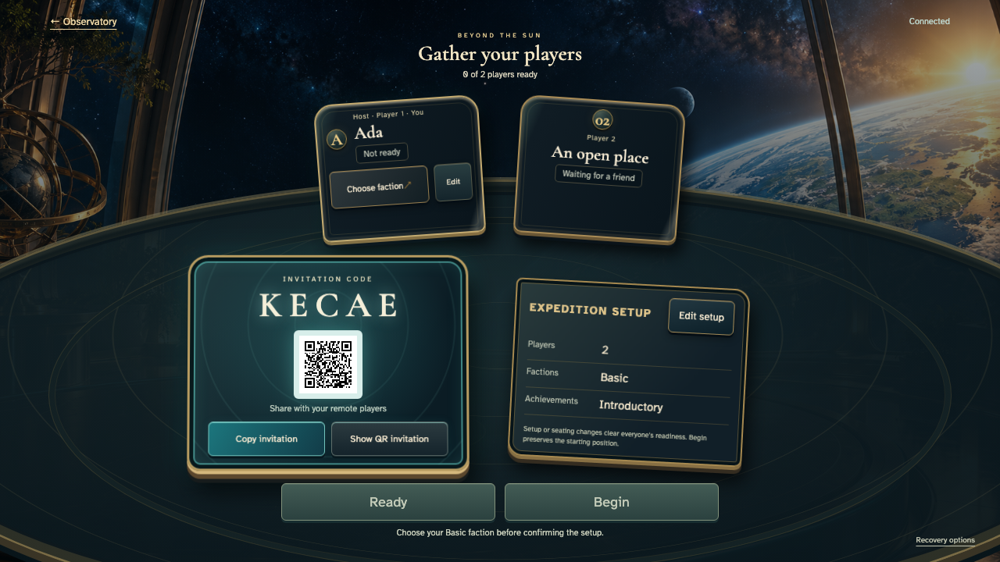](../../screenshots/finish-research-from-the-compact-desktop-decision-overview/004-room-created-desktop-darwin.png) |

- [x] Persist the canonical remote gathering
- [x] Public Technology headings have physical clearance above their cards.
- [x] The game stays within its actual viewport without page scrolling.

## 6. Bora previews the public invitation

Viewpoint: **Bora · separate remote identity**.

| desktop · 393 × 852 |
| --- |
| [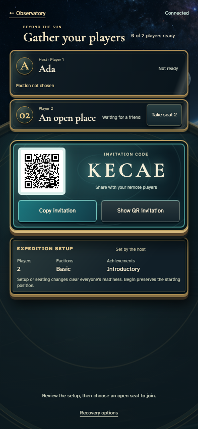](../../screenshots/finish-research-from-the-compact-desktop-decision-overview/005-invite-1-desktop-darwin.png) |

- [x] Bora previews the public invitation
- [x] Public Technology headings have physical clearance above their cards.
- [x] The game stays within its actual viewport without page scrolling.

## 7. Bora opens their separate seat editor

Viewpoint: **Bora · separate remote identity**.

| desktop · 393 × 852 |
| --- |
|  |

- [x] Bora opens their separate seat editor
- [x] Public Technology headings have physical clearance above their cards.
- [x] The game stays within its actual viewport without page scrolling.

## 8. Bora supplies their public name

Viewpoint: **Bora · separate remote identity**.

| desktop · 393 × 852 |
| --- |
|  |

- [x] Bora supplies their public name
- [x] Public Technology headings have physical clearance above their cards.
- [x] The game stays within its actual viewport without page scrolling.

## 9. Bora joins with a separate identity

Viewpoint: **Bora · separate remote identity**.

| desktop · 393 × 852 |
| --- |
| [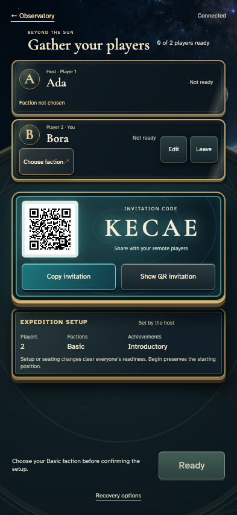](../../screenshots/finish-research-from-the-compact-desktop-decision-overview/008-joined-1-desktop-darwin.png) |

- [x] Bora joins with a separate identity
- [x] Public Technology headings have physical clearance above their cards.
- [x] The game stays within its actual viewport without page scrolling.

## 10. Ada reads the legal unique Basic choices

Viewpoint: **Ada · host**.

| desktop · 1280 × 720 |
| --- |
| [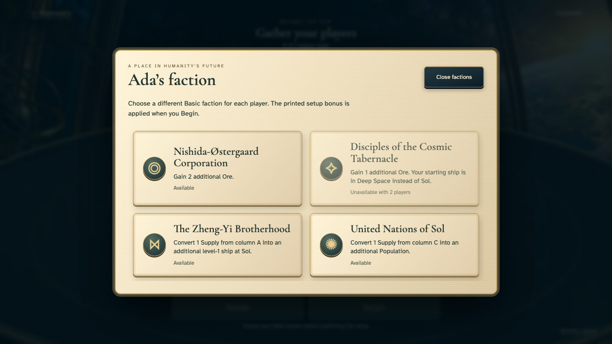](../../screenshots/finish-research-from-the-compact-desktop-decision-overview/009-factions-0-desktop-darwin.png) |

- [x] Ada reads the legal unique Basic choices
- [x] Public Technology headings have physical clearance above their cards.
- [x] The game stays within its actual viewport without page scrolling.

## 11. Ada commits the real starting faction

Viewpoint: **Ada · host**.

| desktop · 1280 × 720 |
| --- |
| [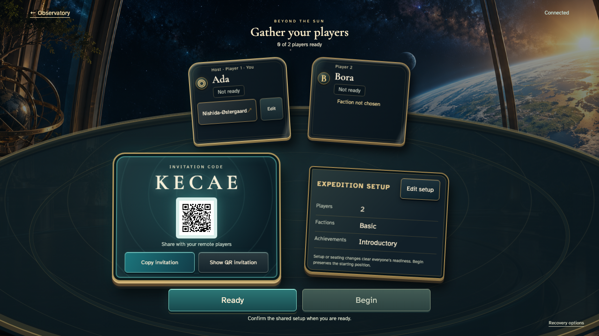](../../screenshots/finish-research-from-the-compact-desktop-decision-overview/010-faction-chosen-0-desktop-darwin.png) |

- [x] Ada commits the real starting faction
- [x] Public Technology headings have physical clearance above their cards.
- [x] The game stays within its actual viewport without page scrolling.

## 12. Bora reads the legal unique Basic choices

Viewpoint: **Bora · separate remote identity**.

| desktop · 393 × 852 |
| --- |
|  |

- [x] Bora reads the legal unique Basic choices
- [x] Public Technology headings have physical clearance above their cards.
- [x] The game stays within its actual viewport without page scrolling.

## 13. Bora commits the real starting faction

Viewpoint: **Bora · separate remote identity**.

| desktop · 393 × 852 |
| --- |
| [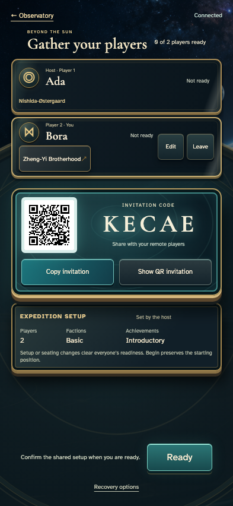](../../screenshots/finish-research-from-the-compact-desktop-decision-overview/012-faction-chosen-1-desktop-darwin.png) |

- [x] Bora commits the real starting faction
- [x] Public Technology headings have physical clearance above their cards.
- [x] The game stays within its actual viewport without page scrolling.

## 14. Ada confirms this exact configuration

Viewpoint: **Ada · host**.

| desktop · 1280 × 720 |
| --- |
|  |

- [x] Ada confirms this exact configuration
- [x] Public Technology headings have physical clearance above their cards.
- [x] The game stays within its actual viewport without page scrolling.

## 15. Bora confirms this exact configuration

Viewpoint: **Bora · separate remote identity**.

| desktop · 393 × 852 |
| --- |
| [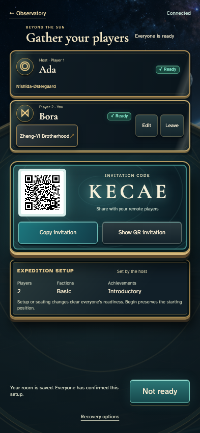](../../screenshots/finish-research-from-the-compact-desktop-decision-overview/014-ready-1-desktop-darwin.png) |

- [x] Bora confirms this exact configuration
- [x] Public Technology headings have physical clearance above their cards.
- [x] The game stays within its actual viewport without page scrolling.

## 16. Begin creates the reviewed immutable board and resources

Viewpoint: **Ada · host**.

| desktop · 1280 × 720 |
| --- |
|  |

- [x] Begin creates the reviewed immutable board and resources
- [x] Public Technology headings have physical clearance above their cards.
- [x] The game stays within its actual viewport without page scrolling.

## 17. Ada plans the real Action pawn and permanent research payment

Viewpoint: **Ada · host**.

| desktop · 1280 × 720 |
| --- |
| [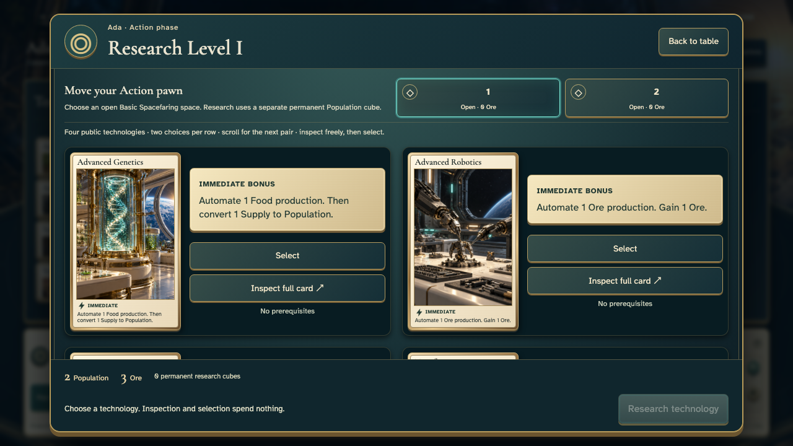](../../screenshots/finish-research-from-the-compact-desktop-decision-overview/016-turn-0-plan-desktop-darwin.png) |

- [x] Ada plans the real Action pawn and permanent research payment
- [x] Public Technology headings have physical clearance above their cards.
- [x] The game stays within its actual viewport without page scrolling.

## 18. Ada selects Advanced Genetics without paying yet

Viewpoint: **Ada · host**.

| desktop · 1280 × 720 |
| --- |
| [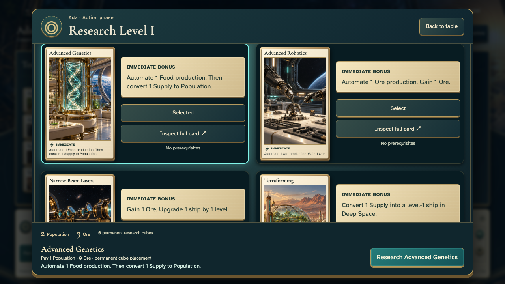](../../screenshots/finish-research-from-the-compact-desktop-decision-overview/017-turn-0-selected-desktop-darwin.png) |

- [x] Ada selects Advanced Genetics without paying yet
- [x] Public Technology headings have physical clearance above their cards.
- [x] The game stays within its actual viewport without page scrolling.

## 19. Inspect the complete canonical face before payment

Viewpoint: **Ada · host**.

| desktop · 1280 × 720 |
| --- |
| [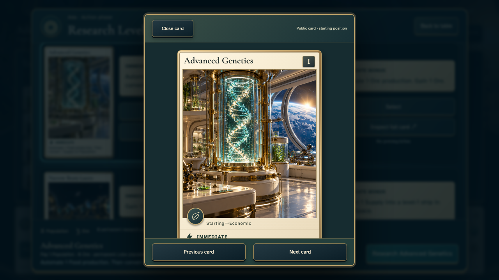](../../screenshots/finish-research-from-the-compact-desktop-decision-overview/018-full-card-desktop-darwin.png) |

- [x] Inspect the complete canonical face before payment
- [x] Public Technology headings have physical clearance above their cards.
- [x] The game stays within its actual viewport without page scrolling.

## 20. Read the entire public face through its bounded reader

Viewpoint: **Ada · host**.

| desktop · 1280 × 720 |
| --- |
| [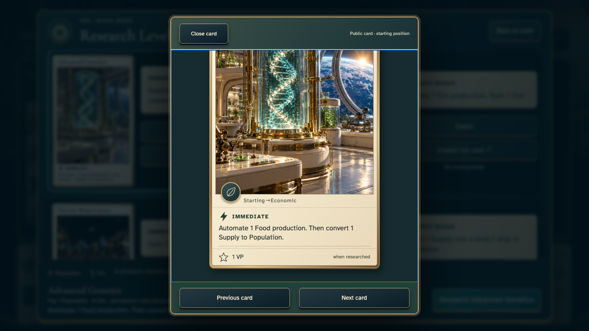](../../screenshots/finish-research-from-the-compact-desktop-decision-overview/019-full-rules-desktop-darwin.png) |

- [x] Read the entire public face through its bounded reader
- [x] Public Technology headings have physical clearance above their cards.
- [x] The game stays within its actual viewport without page scrolling.

## 21. Escape restores the actual inspection source without committing

Viewpoint: **Ada · host**.

| desktop · 1280 × 720 |
| --- |
| [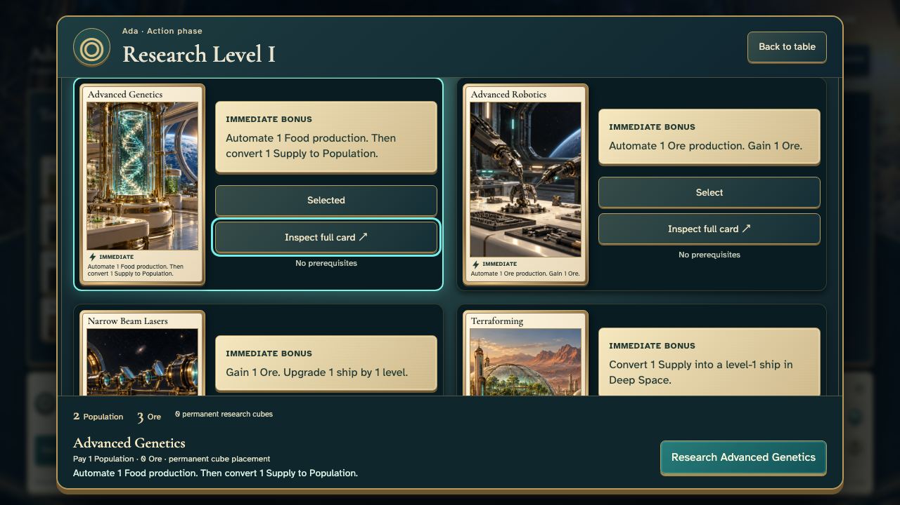](../../screenshots/finish-research-from-the-compact-desktop-decision-overview/020-inspection-return-desktop-darwin.png) |

- [x] Escape restores the actual inspection source without committing
- [x] Public Technology headings have physical clearance above their cards.
- [x] The game stays within its actual viewport without page scrolling.

## 22. Cancel the unpaid plan and restore the acting mat control

Viewpoint: **Ada · host**.

| desktop · 1280 × 720 |
| --- |
|  |

- [x] Cancel the unpaid plan and restore the acting mat control
- [x] Public Technology headings have physical clearance above their cards.
- [x] The game stays within its actual viewport without page scrolling.

## 23. Reopen the bounded planning instrument

Viewpoint: **Ada · host**.

| desktop · 1280 × 720 |
| --- |
|  |

- [x] Reopen the bounded planning instrument
- [x] Public Technology headings have physical clearance above their cards.
- [x] The game stays within its actual viewport without page scrolling.

## 24. Ada selects Advanced Genetics without paying yet

Viewpoint: **Ada · host**.

| desktop · 1280 × 720 |
| --- |
|  |

- [x] Ada selects Advanced Genetics without paying yet
- [x] Public Technology headings have physical clearance above their cards.
- [x] The game stays within its actual viewport without page scrolling.

## 25. Ada pays once, places the permanent cube and resolves Advanced Genetics

Viewpoint: **Ada · host**.

| desktop · 1280 × 720 |
| --- |
|  |

- [x] Ada pays once, places the permanent cube and resolves Advanced Genetics
- [x] Public Technology headings have physical clearance above their cards.
- [x] The game stays within its actual viewport without page scrolling.

## 26. Ada reloads the retained pending production without a repeated bonus

Viewpoint: **Ada · host**.

| desktop · 1280 × 720 |
| --- |
| [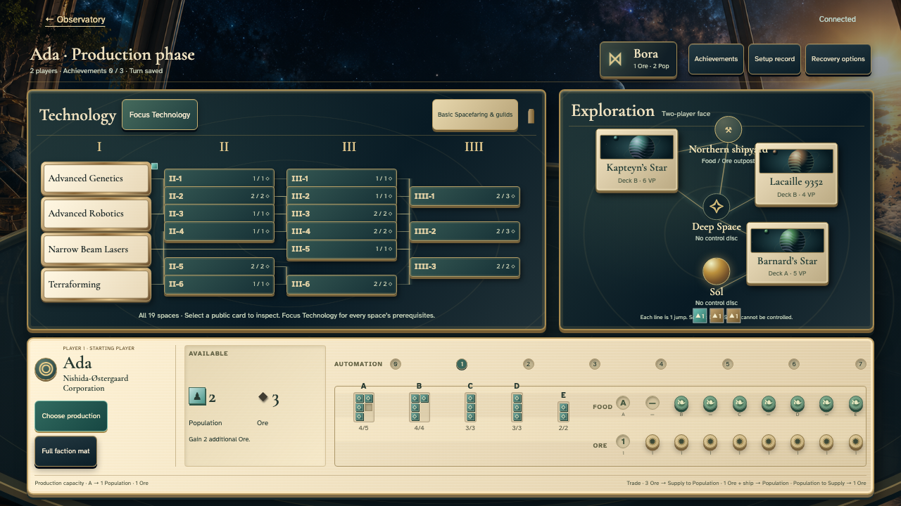](../../screenshots/finish-research-from-the-compact-desktop-decision-overview/025-turn-0-pending-restored-desktop-darwin.png) |

- [x] Ada reloads the retained pending production without a repeated bonus
- [x] Public Technology headings have physical clearance above their cards.
- [x] The game stays within its actual viewport without page scrolling.

## 27. Ada resumes the same saved production choice

Viewpoint: **Ada · host**.

| desktop · 1280 × 720 |
| --- |
| [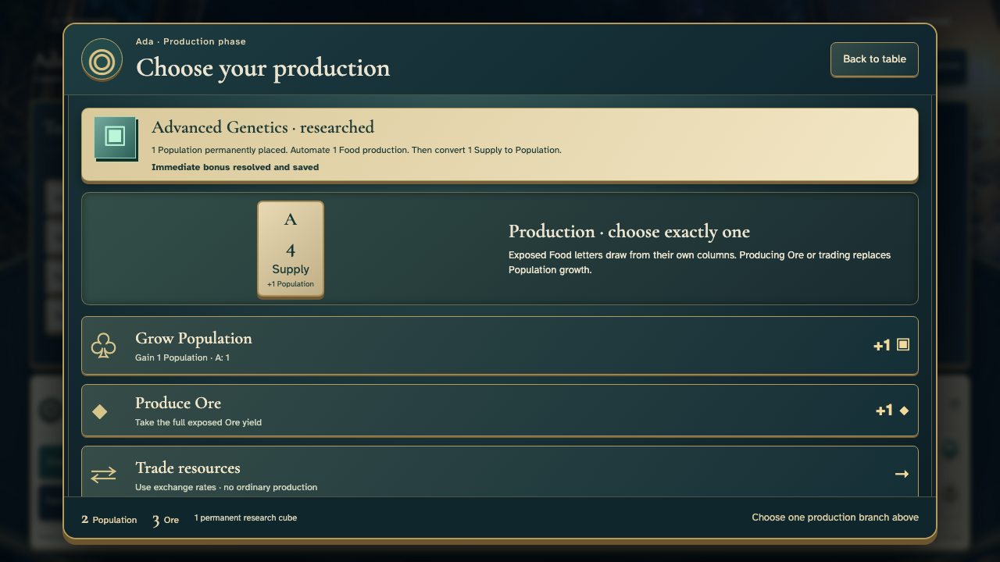](../../screenshots/finish-research-from-the-compact-desktop-decision-overview/026-turn-0-production-restored-desktop-darwin.png) |

- [x] Ada resumes the same saved production choice
- [x] Public Technology headings have physical clearance above their cards.
- [x] The game stays within its actual viewport without page scrolling.

## 28. Ada hands off automatically after the resolved production branch

Viewpoint: **Ada · host**.

| desktop · 1280 × 720 |
| --- |
| [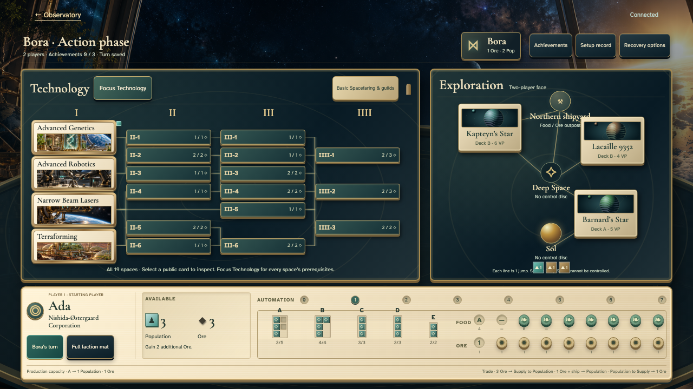](../../screenshots/finish-research-from-the-compact-desktop-decision-overview/027-turn-0-handoff-desktop-darwin.png) |

- [x] Ada hands off automatically after the resolved production branch
- [x] Public Technology headings have physical clearance above their cards.
- [x] The game stays within its actual viewport without page scrolling.

## 29. Bora sees the canonical handoff on their own interface

Viewpoint: **Bora · separate remote identity**.

| desktop · 393 × 852 |
| --- |
|  |

- [x] Bora sees the canonical handoff on their own interface
- [x] Public Technology headings have physical clearance above their cards.
- [x] The game stays within its actual viewport without page scrolling.

## 30. Bora plans the real Action pawn and permanent research payment

Viewpoint: **Bora · separate remote identity**.

| desktop · 393 × 852 |
| --- |
|  |

- [x] Bora plans the real Action pawn and permanent research payment
- [x] Public Technology headings have physical clearance above their cards.
- [x] The game stays within its actual viewport without page scrolling.

## 31. An occupied Action space rejects commitment without spending

Viewpoint: **Bora · separate remote identity**.

| desktop · 393 × 852 |
| --- |
| [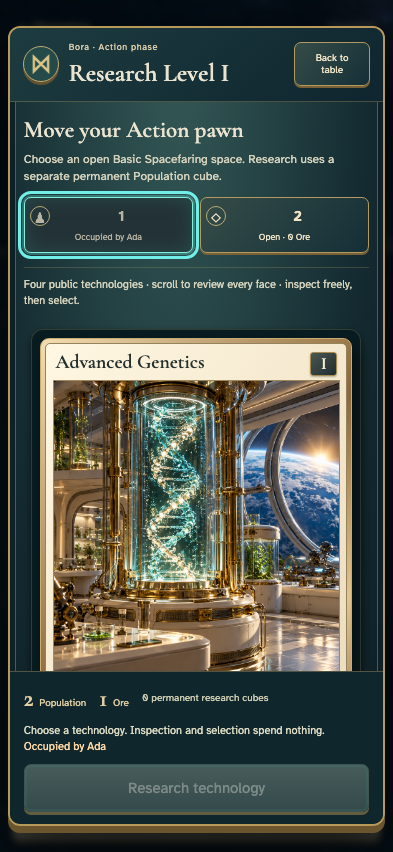](../../screenshots/finish-research-from-the-compact-desktop-decision-overview/030-blocked-occupied-desktop-darwin.png) |

- [x] An occupied Action space rejects commitment without spending
- [x] Public Technology headings have physical clearance above their cards.
- [x] The game stays within its actual viewport without page scrolling.

## 32. Choose the genuinely unoccupied second space

Viewpoint: **Bora · separate remote identity**.

| desktop · 393 × 852 |
| --- |
| [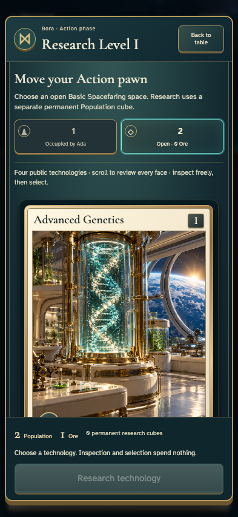](../../screenshots/finish-research-from-the-compact-desktop-decision-overview/031-open-second-space-desktop-darwin.png) |

- [x] Choose the genuinely unoccupied second space
- [x] Public Technology headings have physical clearance above their cards.
- [x] The game stays within its actual viewport without page scrolling.

## 33. Bora selects Narrow Beam Lasers without paying yet

Viewpoint: **Bora · separate remote identity**.

| desktop · 393 × 852 |
| --- |
|  |

- [x] Bora selects Narrow Beam Lasers without paying yet
- [x] Public Technology headings have physical clearance above their cards.
- [x] The game stays within its actual viewport without page scrolling.

## 34. The mandatory Lasers target disables commit until explicitly chosen

Viewpoint: **Bora · separate remote identity**.

| desktop · 393 × 852 |
| --- |
| [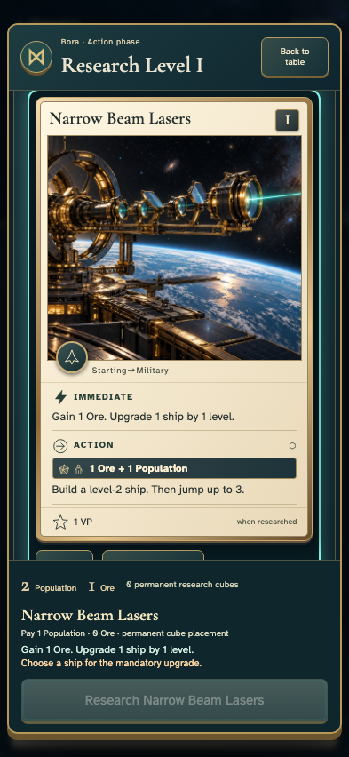](../../screenshots/finish-research-from-the-compact-desktop-decision-overview/033-ship-required-desktop-darwin.png) |

- [x] The mandatory Lasers target disables commit until explicitly chosen
- [x] Public Technology headings have physical clearance above their cards.
- [x] The game stays within its actual viewport without page scrolling.

## 35. Select the second Sol ship; the commit names its level1 to2 consequence

Viewpoint: **Bora · separate remote identity**.

| desktop · 393 × 852 |
| --- |
| [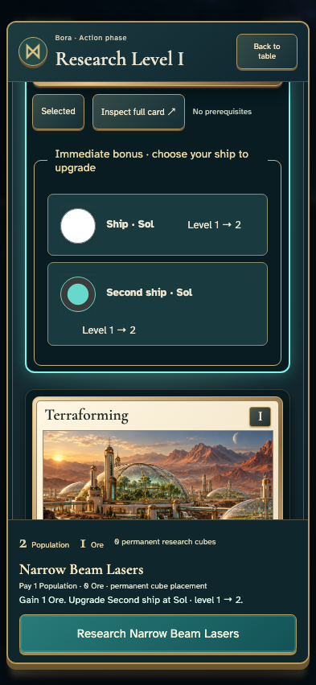](../../screenshots/finish-research-from-the-compact-desktop-decision-overview/034-ship-selected-desktop-darwin.png) |

- [x] Select the second Sol ship; the commit names its level1 to2 consequence
- [x] Public Technology headings have physical clearance above their cards.
- [x] The game stays within its actual viewport without page scrolling.

## 36. Bora pays once, places the permanent cube and resolves Narrow Beam Lasers

Viewpoint: **Bora · separate remote identity**.

| desktop · 393 × 852 |
| --- |
| [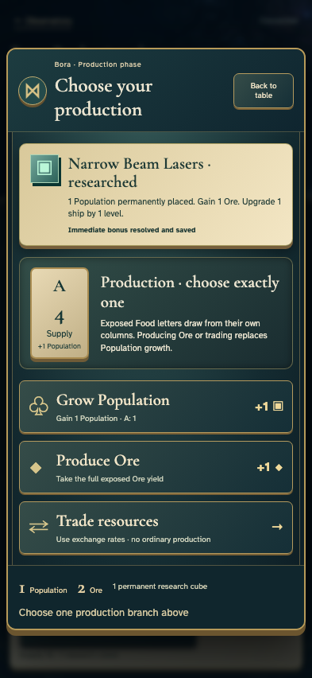](../../screenshots/finish-research-from-the-compact-desktop-decision-overview/035-turn-1-researched-desktop-darwin.png) |

- [x] Bora pays once, places the permanent cube and resolves Narrow Beam Lasers
- [x] Public Technology headings have physical clearance above their cards.
- [x] The game stays within its actual viewport without page scrolling.

## 37. Bora reloads the retained pending production without a repeated bonus

Viewpoint: **Bora · separate remote identity**.

| desktop · 393 × 852 |
| --- |
| [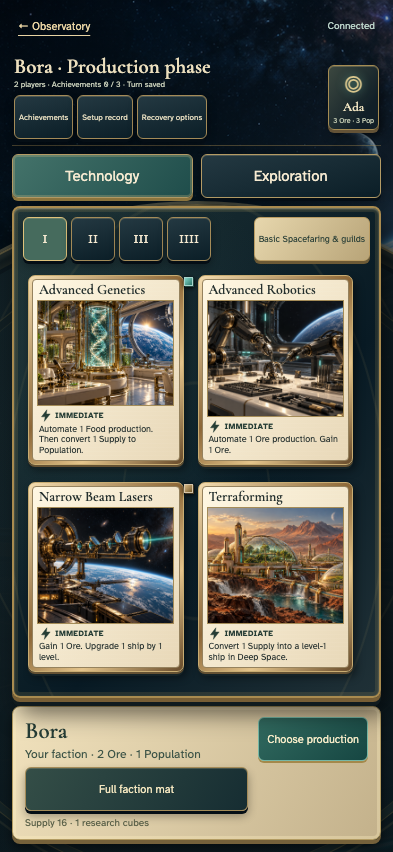](../../screenshots/finish-research-from-the-compact-desktop-decision-overview/036-turn-1-pending-restored-desktop-darwin.png) |

- [x] Bora reloads the retained pending production without a repeated bonus
- [x] Public Technology headings have physical clearance above their cards.
- [x] The game stays within its actual viewport without page scrolling.

## 38. Bora resumes the same saved production choice

Viewpoint: **Bora · separate remote identity**.

| desktop · 393 × 852 |
| --- |
|  |

- [x] Bora resumes the same saved production choice
- [x] Public Technology headings have physical clearance above their cards.
- [x] The game stays within its actual viewport without page scrolling.

## 39. Trade is a persisted exclusive production branch

Viewpoint: **Bora · separate remote identity**.

| desktop · 393 × 852 |
| --- |
| [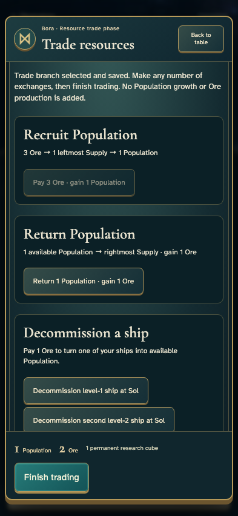](../../screenshots/finish-research-from-the-compact-desktop-decision-overview/038-trade-selected-desktop-darwin.png) |

- [x] Trade is a persisted exclusive production branch
- [x] Public Technology headings have physical clearance above their cards.
- [x] The game stays within its actual viewport without page scrolling.

## 40. Pay1 Ore and turn the first ship into available Population

Viewpoint: **Bora · separate remote identity**.

| desktop · 393 × 852 |
| --- |
|  |

- [x] Pay1 Ore and turn the first ship into available Population
- [x] Public Technology headings have physical clearance above their cards.
- [x] The game stays within its actual viewport without page scrolling.

## 41. Return Population1 to the rightmost Supply space

Viewpoint: **Bora · separate remote identity**.

| desktop · 393 × 852 |
| --- |
| [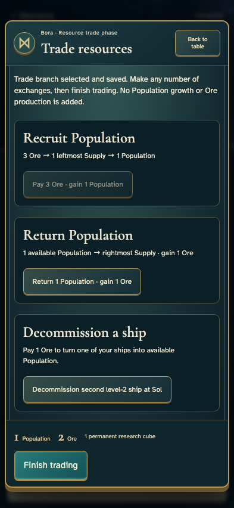](../../screenshots/finish-research-from-the-compact-desktop-decision-overview/040-returned-0-desktop-darwin.png) |

- [x] Return Population1 to the rightmost Supply space
- [x] Public Technology headings have physical clearance above their cards.
- [x] The game stays within its actual viewport without page scrolling.

## 42. Return Population2 to the rightmost Supply space

Viewpoint: **Bora · separate remote identity**.

| desktop · 393 × 852 |
| --- |
| [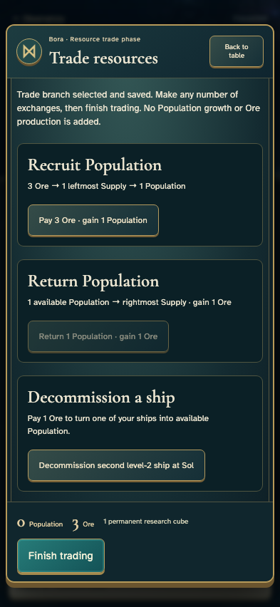](../../screenshots/finish-research-from-the-compact-desktop-decision-overview/041-returned-1-desktop-darwin.png) |

- [x] Return Population2 to the rightmost Supply space
- [x] Public Technology headings have physical clearance above their cards.
- [x] The game stays within its actual viewport without page scrolling.

## 43. Close the trade reader without ending its saved phase

Viewpoint: **Bora · separate remote identity**.

| desktop · 393 × 852 |
| --- |
| [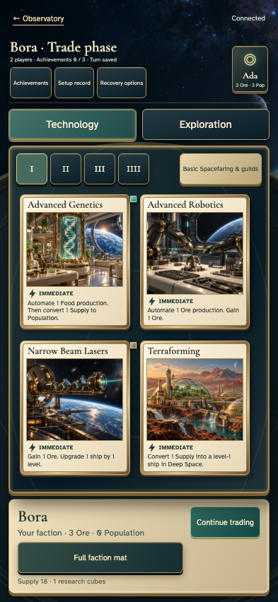](../../screenshots/finish-research-from-the-compact-desktop-decision-overview/042-trade-table-desktop-darwin.png) |

- [x] Close the trade reader without ending its saved phase
- [x] Public Technology headings have physical clearance above their cards.
- [x] The game stays within its actual viewport without page scrolling.

## 44. The complete mat shows the actual sixth Supply cube

Viewpoint: **Bora · separate remote identity**.

| desktop · 393 × 852 |
| --- |
| [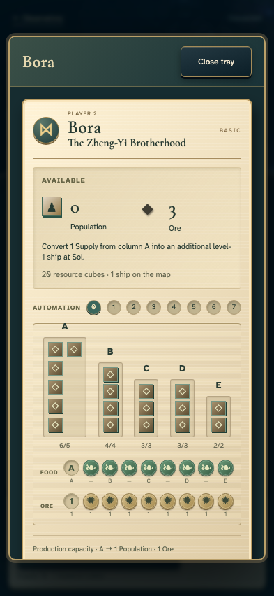](../../screenshots/finish-research-from-the-compact-desktop-decision-overview/043-supply-overflow-desktop-darwin.png) |

- [x] The complete mat shows the actual sixth Supply cube
- [x] Public Technology headings have physical clearance above their cards.
- [x] The game stays within its actual viewport without page scrolling.

## 45. Return from the public mat inspection with the trade phase retained

Viewpoint: **Bora · separate remote identity**.

| desktop · 393 × 852 |
| --- |
| [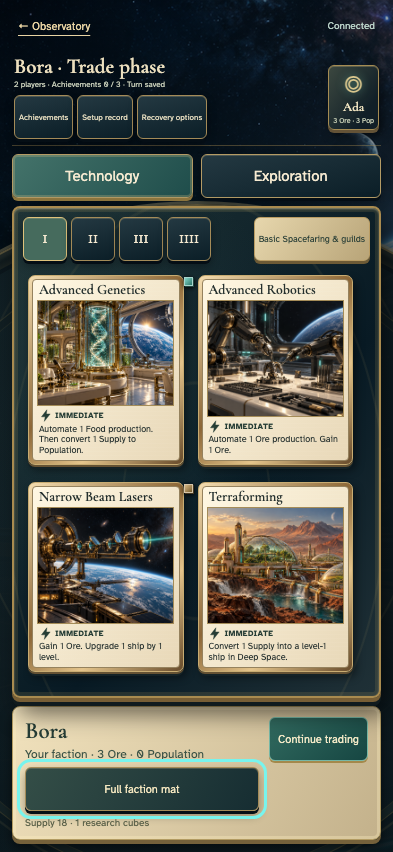](../../screenshots/finish-research-from-the-compact-desktop-decision-overview/044-mat-return-desktop-darwin.png) |

- [x] Return from the public mat inspection with the trade phase retained
- [x] Public Technology headings have physical clearance above their cards.
- [x] The game stays within its actual viewport without page scrolling.

## 46. Resume the same accepted trade stream

Viewpoint: **Bora · separate remote identity**.

| desktop · 393 × 852 |
| --- |
|  |

- [x] Resume the same accepted trade stream
- [x] Public Technology headings have physical clearance above their cards.
- [x] The game stays within its actual viewport without page scrolling.

## 47. Pay3 Ore and convert the leftmost Supply into Population

Viewpoint: **Bora · separate remote identity**.

| desktop · 393 × 852 |
| --- |
| [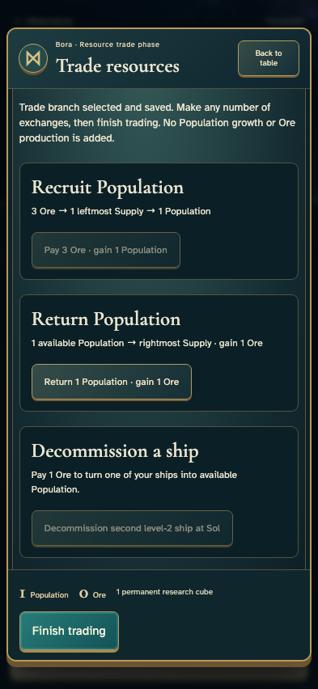](../../screenshots/finish-research-from-the-compact-desktop-decision-overview/046-recruited-desktop-darwin.png) |

- [x] Pay3 Ore and convert the leftmost Supply into Population
- [x] Public Technology headings have physical clearance above their cards.
- [x] The game stays within its actual viewport without page scrolling.

## 48. Reload preserves the accepted exchanges and trading phase

Viewpoint: **Bora · separate remote identity**.

| desktop · 393 × 852 |
| --- |
|  |

- [x] Reload preserves the accepted exchanges and trading phase
- [x] Public Technology headings have physical clearance above their cards.
- [x] The game stays within its actual viewport without page scrolling.

## 49. Reopen the saved balance without duplicating an exchange

Viewpoint: **Bora · separate remote identity**.

| desktop · 393 × 852 |
| --- |
|  |

- [x] Reopen the saved balance without duplicating an exchange
- [x] Public Technology headings have physical clearance above their cards.
- [x] The game stays within its actual viewport without page scrolling.

## 50. Bora hands off automatically after the resolved production branch

Viewpoint: **Bora · separate remote identity**.

| desktop · 393 × 852 |
| --- |
| [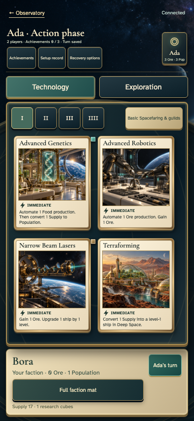](../../screenshots/finish-research-from-the-compact-desktop-decision-overview/049-turn-1-handoff-desktop-darwin.png) |

- [x] Bora hands off automatically after the resolved production branch
- [x] Public Technology headings have physical clearance above their cards.
- [x] The game stays within its actual viewport without page scrolling.

## 51. Ada sees the canonical handoff on their own interface

Viewpoint: **Ada · host**.

| desktop · 1280 × 720 |
| --- |
|  |

- [x] Ada sees the canonical handoff on their own interface
- [x] Public Technology headings have physical clearance above their cards.
- [x] The game stays within its actual viewport without page scrolling.

## 52. Reload recovers permanent cubes, occupied spaces and all economies

Viewpoint: **Ada · host**.

| desktop · 1280 × 720 |
| --- |
|  |

- [x] Reload recovers permanent cubes, occupied spaces and all economies
- [x] Public Technology headings have physical clearance above their cards.
- [x] The game stays within its actual viewport without page scrolling.

## 53. A separate unseated identity sees permanent public research without turn authority

Viewpoint: **Public observer · separate identity**.

| desktop · 1440 × 1000 |
| --- |
| [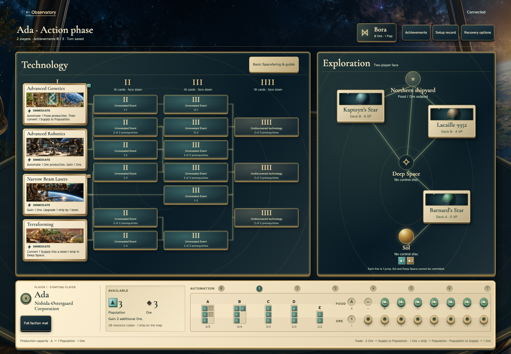](../../screenshots/finish-research-from-the-compact-desktop-decision-overview/052-public-observer-desktop-darwin.png) |

- [x] A separate unseated identity sees permanent public research without turn authority
- [x] Public Technology headings have physical clearance above their cards.
- [x] The game stays within its actual viewport without page scrolling.

## 54. The observer can inspect the same researched public face

Viewpoint: **Public observer · separate identity**.

| desktop · 1440 × 1000 |
| --- |
| [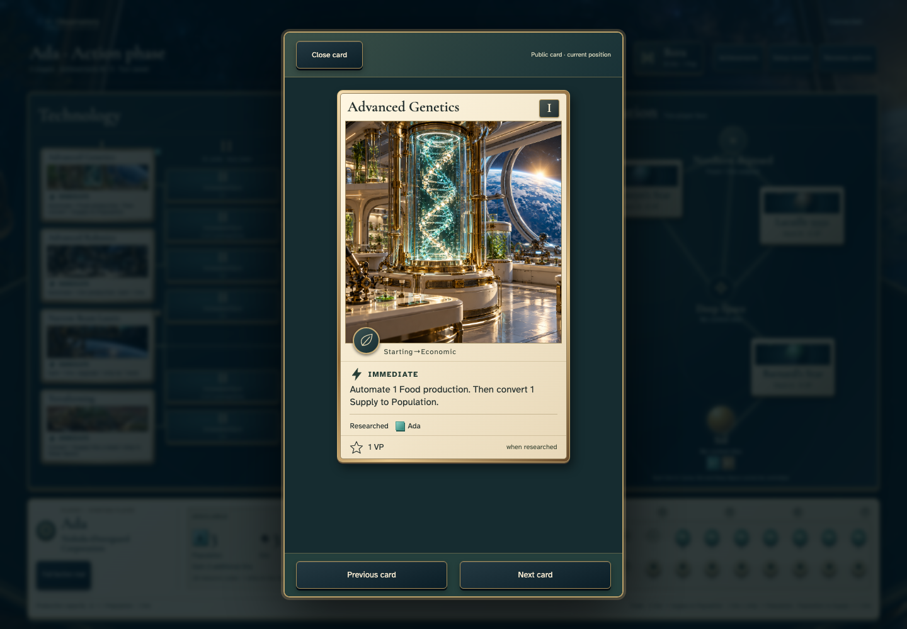](../../screenshots/finish-research-from-the-compact-desktop-decision-overview/053-observer-inspects-desktop-darwin.png) |

- [x] The observer can inspect the same researched public face
- [x] Public Technology headings have physical clearance above their cards.
- [x] The game stays within its actual viewport without page scrolling.

## 55. Escape restores public inspection focus without acquiring a seat

Viewpoint: **Public observer · separate identity**.

| desktop · 1440 × 1000 |
| --- |
| [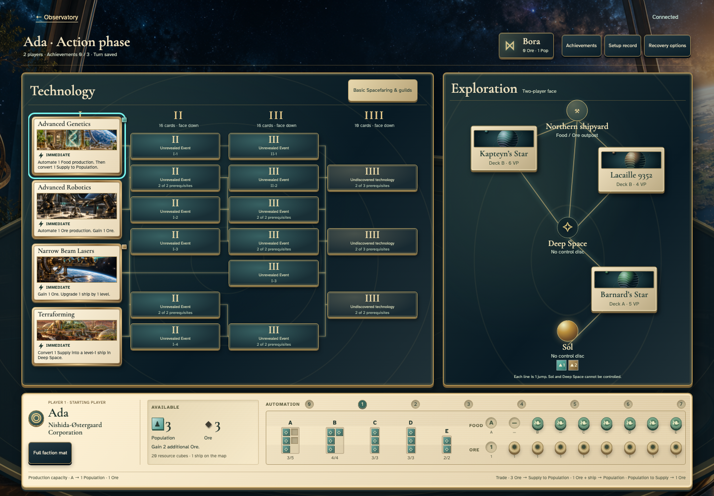](../../screenshots/finish-research-from-the-compact-desktop-decision-overview/054-observer-return-desktop-darwin.png) |

- [x] Escape restores public inspection focus without acquiring a seat
- [x] Public Technology headings have physical clearance above their cards.
- [x] The game stays within its actual viewport without page scrolling.
