# Research and recover a 3-player shared cardinal first round

Ordinary UI setup, legal unique Basic factions and real emulator persistence. Only UUID entropy is fixed before setup; no game-state injection. Every visible input/choice/result uses TestStepHelper. Complete first rounds exercise all Level I bonuses, real permanent cube payment, occupied Action blocking, explicit ship choice, exclusive production, all three printed trades, Supply overflow, pending-choice reload and automatic handoff. Full-card and planner Escape restore source focus.

## 1. Arrive through the actual observatory

Viewpoint: **Ada · South · shared controller**.

| desktop · 1440 × 1000 |
| --- |
|  |

tabletop-4k · 3840 × 2160

- [x] Arrive through the actual observatory
- [x] Public Technology headings have physical clearance above their cards.
- [x] The game stays within its actual viewport without page scrolling.

## 2. Choose the intended production play interface

Viewpoint: **Ada · South · shared controller**.

| desktop · 1440 × 1000 |
| --- |
|  |

tabletop-4k · 3840 × 2160

- [x] Choose the intended production play interface
- [x] Public Technology headings have physical clearance above their cards.
- [x] The game stays within its actual viewport without page scrolling.

## 3. Join directly on the single shared display

Viewpoint: **Ada · South · shared controller**.

| desktop · 1440 × 1000 |
| --- |
|  |

tabletop-4k · 3840 × 2160

- [x] Join directly on the single shared display
- [x] Public Technology headings have physical clearance above their cards.
- [x] The game stays within its actual viewport without page scrolling.

## 4. Open the South physical seat editor

Viewpoint: **Ada · South · shared controller**.

| desktop · 1440 × 1000 |
| --- |
|  |

tabletop-4k · 3840 × 2160

- [x] Open the South physical seat editor
- [x] Public Technology headings have physical clearance above their cards.
- [x] The game stays within its actual viewport without page scrolling.

## 5. Name Ada on the shared surface

Viewpoint: **Ada · South · shared controller**.

| desktop · 1440 × 1000 |
| --- |
|  |

tabletop-4k · 3840 × 2160

- [x] Name Ada on the shared surface
- [x] Public Technology headings have physical clearance above their cards.
- [x] The game stays within its actual viewport without page scrolling.

## 6. Ada occupies the physical seat

Viewpoint: **Ada · South · shared controller**.

| desktop · 1440 × 1000 |
| --- |
|  |

tabletop-4k · 3840 × 2160

- [x] Ada occupies the physical seat
- [x] Public Technology headings have physical clearance above their cards.
- [x] The game stays within its actual viewport without page scrolling.

## 7. Open the West physical seat editor

Viewpoint: **Bora · West · shared controller**.

| desktop · 1440 × 1000 |
| --- |
|  |

tabletop-4k · 3840 × 2160

- [x] Open the West physical seat editor
- [x] Public Technology headings have physical clearance above their cards.
- [x] The game stays within its actual viewport without page scrolling.

## 8. Name Bora on the shared surface

Viewpoint: **Bora · West · shared controller**.

| desktop · 1440 × 1000 |
| --- |
| [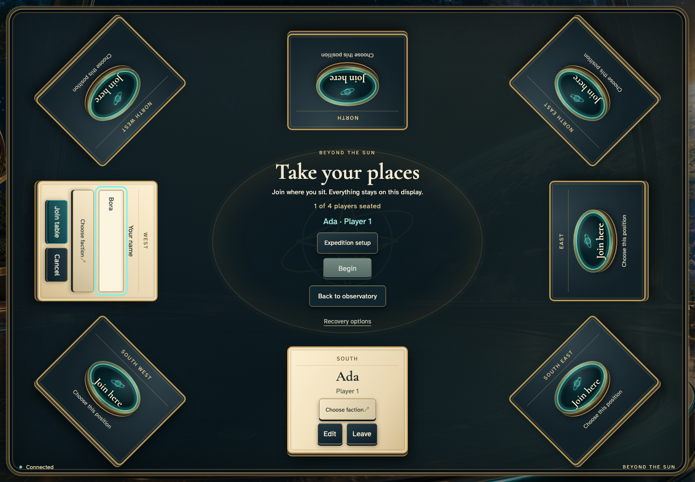](../../screenshots/research-and-recover-a-3-player-shared-cardinal-first-round/007-seat-name-1-desktop-darwin.png) |

tabletop-4k · 3840 × 2160

- [x] Name Bora on the shared surface
- [x] Public Technology headings have physical clearance above their cards.
- [x] The game stays within its actual viewport without page scrolling.

## 9. Bora occupies the physical seat

Viewpoint: **Bora · West · shared controller**.

| desktop · 1440 × 1000 |
| --- |
|  |

tabletop-4k · 3840 × 2160

- [x] Bora occupies the physical seat
- [x] Public Technology headings have physical clearance above their cards.
- [x] The game stays within its actual viewport without page scrolling.

## 10. Open the North physical seat editor

Viewpoint: **Cleo · North · shared controller**.

| desktop · 1440 × 1000 |
| --- |
|  |

tabletop-4k · 3840 × 2160

- [x] Open the North physical seat editor
- [x] Public Technology headings have physical clearance above their cards.
- [x] The game stays within its actual viewport without page scrolling.

## 11. Name Cleo on the shared surface

Viewpoint: **Cleo · North · shared controller**.

| desktop · 1440 × 1000 |
| --- |
|  |

tabletop-4k · 3840 × 2160

- [x] Name Cleo on the shared surface
- [x] Public Technology headings have physical clearance above their cards.
- [x] The game stays within its actual viewport without page scrolling.

## 12. Cleo occupies the physical seat

Viewpoint: **Cleo · North · shared controller**.

| desktop · 1440 × 1000 |
| --- |
|  |

tabletop-4k · 3840 × 2160

- [x] Cleo occupies the physical seat
- [x] Public Technology headings have physical clearance above their cards.
- [x] The game stays within its actual viewport without page scrolling.

## 13. Ada reads the legal unique Basic choices

Viewpoint: **Ada · South · shared controller**.

| desktop · 1440 × 1000 |
| --- |
| [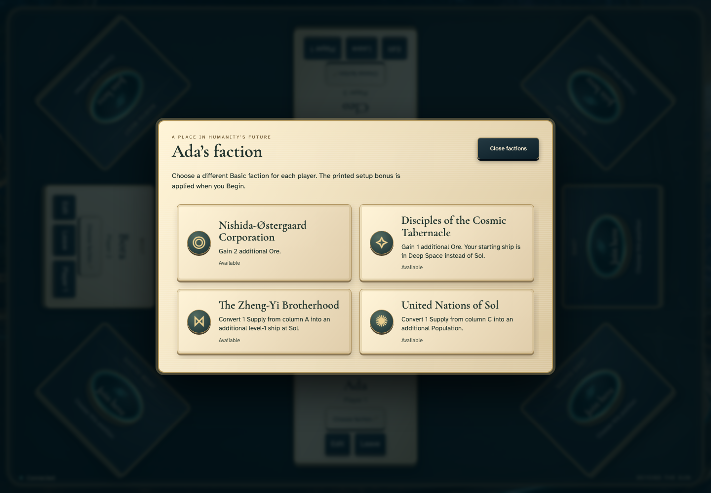](../../screenshots/research-and-recover-a-3-player-shared-cardinal-first-round/012-factions-0-desktop-darwin.png) |

tabletop-4k · 3840 × 2160

[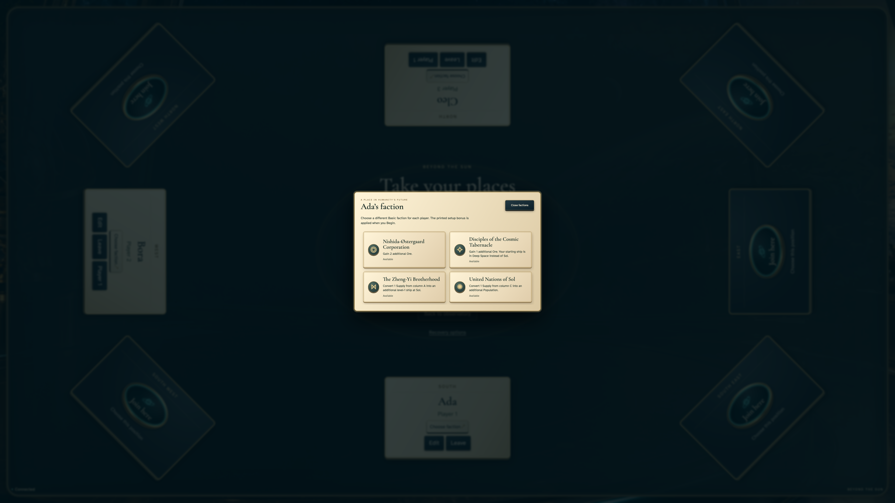](../../screenshots/research-and-recover-a-3-player-shared-cardinal-first-round/012-factions-0-tabletop-4k-darwin.png)

- [x] Ada reads the legal unique Basic choices
- [x] Public Technology headings have physical clearance above their cards.
- [x] The game stays within its actual viewport without page scrolling.

## 14. Ada commits the real starting faction

Viewpoint: **Ada · South · shared controller**.

| desktop · 1440 × 1000 |
| --- |
|  |

tabletop-4k · 3840 × 2160

[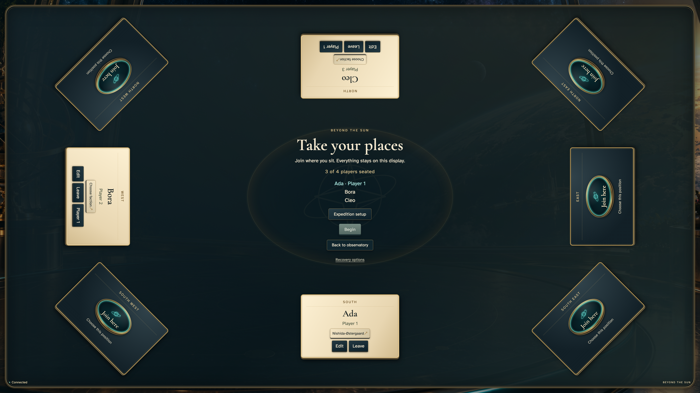](../../screenshots/research-and-recover-a-3-player-shared-cardinal-first-round/013-faction-chosen-0-tabletop-4k-darwin.png)

- [x] Ada commits the real starting faction
- [x] Public Technology headings have physical clearance above their cards.
- [x] The game stays within its actual viewport without page scrolling.

## 15. Bora reads the legal unique Basic choices

Viewpoint: **Bora · West · shared controller**.

| desktop · 1440 × 1000 |
| --- |
| [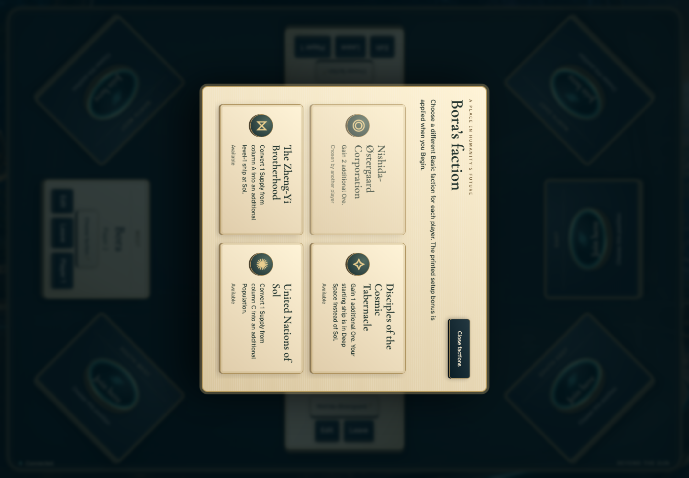](../../screenshots/research-and-recover-a-3-player-shared-cardinal-first-round/014-factions-1-desktop-darwin.png) |

tabletop-4k · 3840 × 2160

[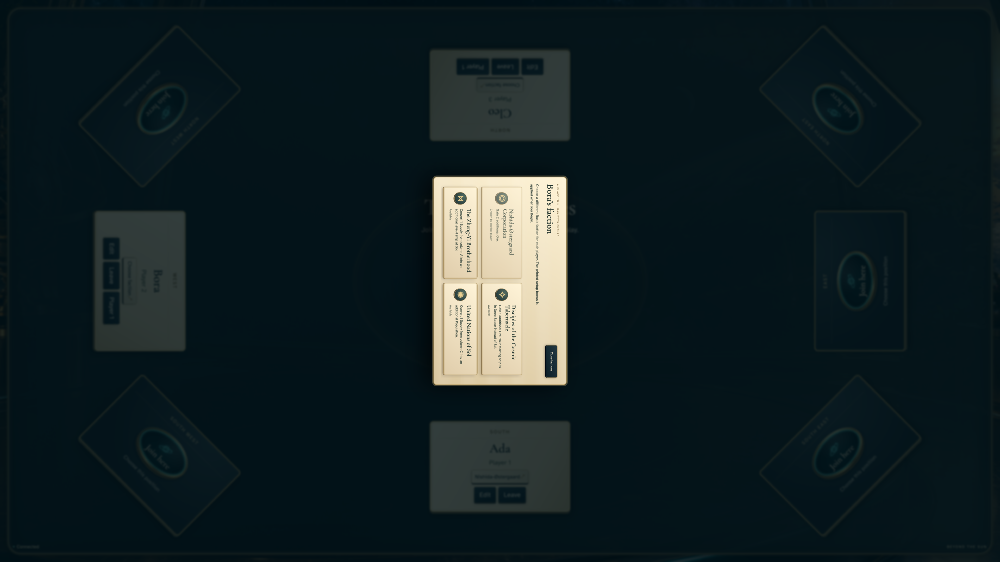](../../screenshots/research-and-recover-a-3-player-shared-cardinal-first-round/014-factions-1-tabletop-4k-darwin.png)

- [x] Bora reads the legal unique Basic choices
- [x] Public Technology headings have physical clearance above their cards.
- [x] The game stays within its actual viewport without page scrolling.

## 16. Bora commits the real starting faction

Viewpoint: **Bora · West · shared controller**.

| desktop · 1440 × 1000 |
| --- |
|  |

tabletop-4k · 3840 × 2160

- [x] Bora commits the real starting faction
- [x] Public Technology headings have physical clearance above their cards.
- [x] The game stays within its actual viewport without page scrolling.

## 17. Cleo reads the legal unique Basic choices

Viewpoint: **Cleo · North · shared controller**.

| desktop · 1440 × 1000 |
| --- |
| [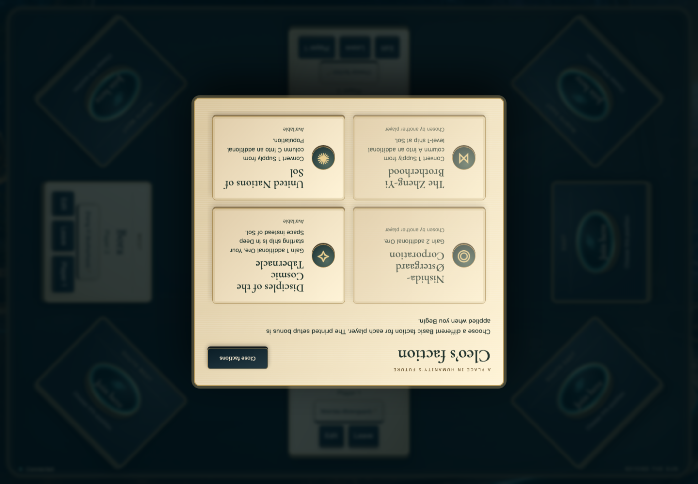](../../screenshots/research-and-recover-a-3-player-shared-cardinal-first-round/016-factions-2-desktop-darwin.png) |

tabletop-4k · 3840 × 2160

[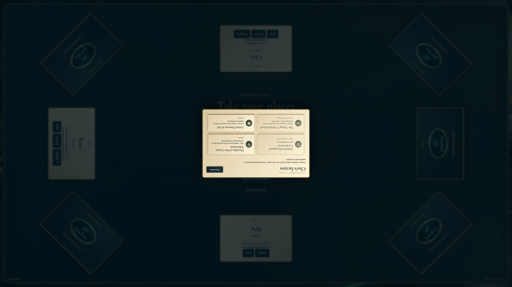](../../screenshots/research-and-recover-a-3-player-shared-cardinal-first-round/016-factions-2-tabletop-4k-darwin.png)

- [x] Cleo reads the legal unique Basic choices
- [x] Public Technology headings have physical clearance above their cards.
- [x] The game stays within its actual viewport without page scrolling.

## 18. Cleo commits the real starting faction

Viewpoint: **Cleo · North · shared controller**.

| desktop · 1440 × 1000 |
| --- |
| [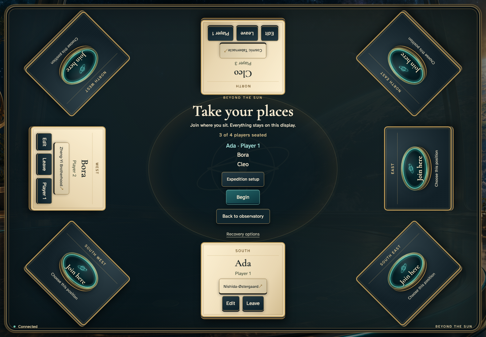](../../screenshots/research-and-recover-a-3-player-shared-cardinal-first-round/017-faction-chosen-2-desktop-darwin.png) |

tabletop-4k · 3840 × 2160

[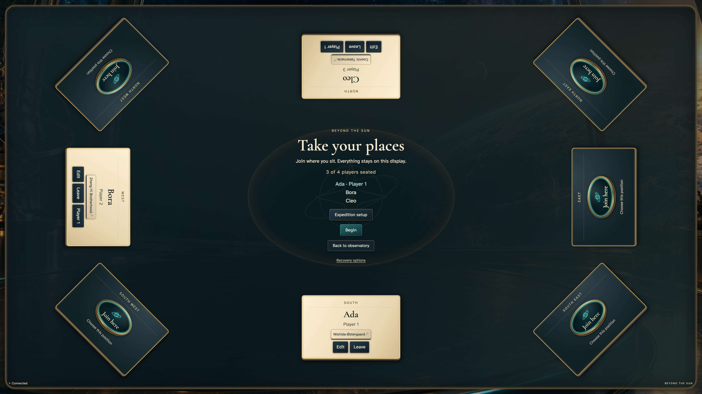](../../screenshots/research-and-recover-a-3-player-shared-cardinal-first-round/017-faction-chosen-2-tabletop-4k-darwin.png)

- [x] Cleo commits the real starting faction
- [x] Public Technology headings have physical clearance above their cards.
- [x] The game stays within its actual viewport without page scrolling.

## 19. Begin creates the reviewed immutable board and resources

Viewpoint: **Ada · South · shared controller**.

| desktop · 1440 × 1000 |
| --- |
|  |

tabletop-4k · 3840 × 2160

- [x] Begin creates the reviewed immutable board and resources
- [x] Public Technology headings have physical clearance above their cards.
- [x] The game stays within its actual viewport without page scrolling.

## 20. Ada plans the real Action pawn and permanent research payment

Viewpoint: **Ada · South · shared controller**.

| desktop · 1440 × 1000 |
| --- |
| [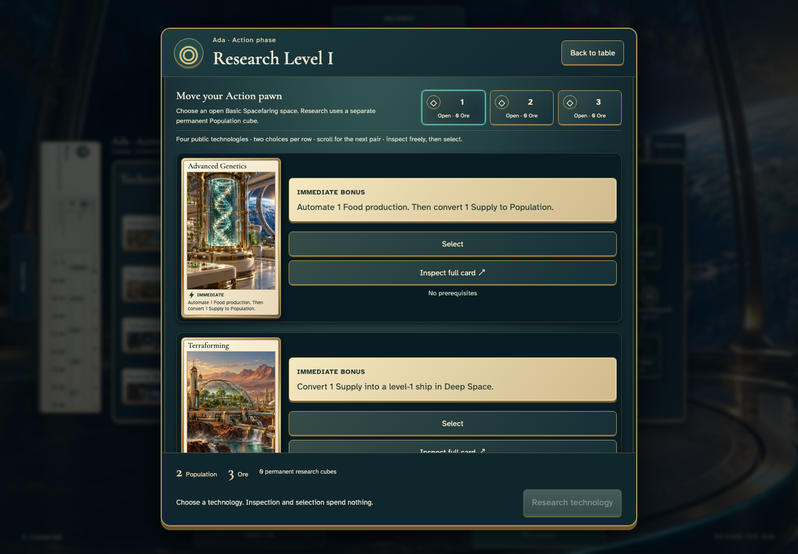](../../screenshots/research-and-recover-a-3-player-shared-cardinal-first-round/019-turn-0-plan-desktop-darwin.png) |

tabletop-4k · 3840 × 2160

- [x] Ada plans the real Action pawn and permanent research payment
- [x] Public Technology headings have physical clearance above their cards.
- [x] The game stays within its actual viewport without page scrolling.

## 21. Ada selects Advanced Genetics without paying yet

Viewpoint: **Ada · South · shared controller**.

| desktop · 1440 × 1000 |
| --- |
|  |

tabletop-4k · 3840 × 2160

- [x] Ada selects Advanced Genetics without paying yet
- [x] Public Technology headings have physical clearance above their cards.
- [x] The game stays within its actual viewport without page scrolling.

## 22. Inspect the complete canonical face before payment

Viewpoint: **Ada · South · shared controller**.

| desktop · 1440 × 1000 |
| --- |
| [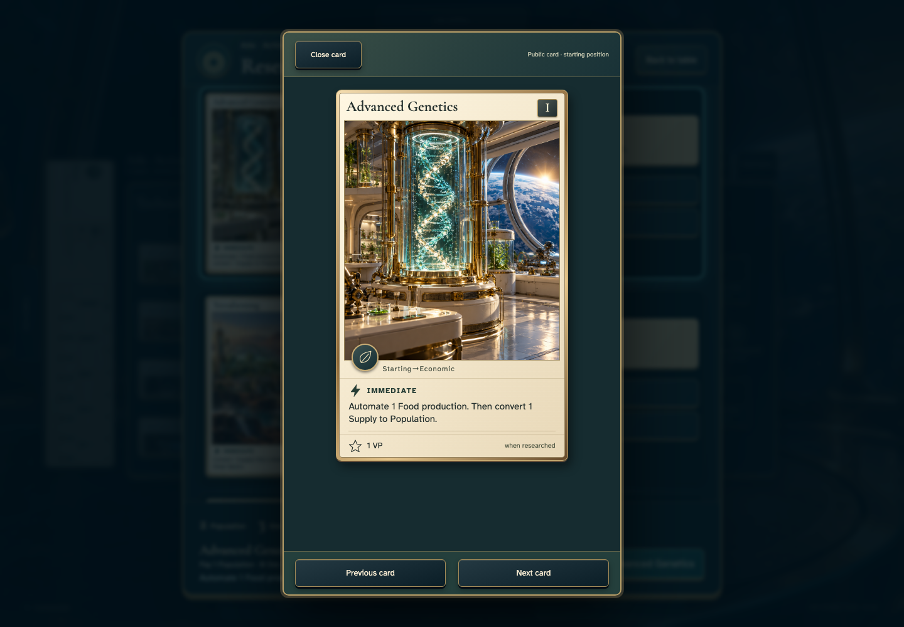](../../screenshots/research-and-recover-a-3-player-shared-cardinal-first-round/021-full-card-desktop-darwin.png) |

tabletop-4k · 3840 × 2160

[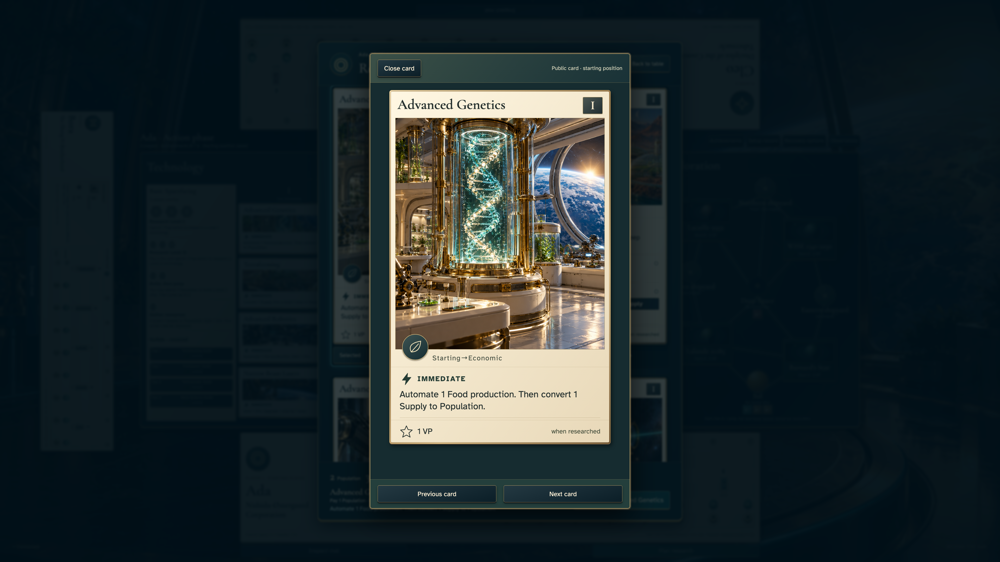](../../screenshots/research-and-recover-a-3-player-shared-cardinal-first-round/021-full-card-tabletop-4k-darwin.png)

- [x] Inspect the complete canonical face before payment
- [x] Public Technology headings have physical clearance above their cards.
- [x] The game stays within its actual viewport without page scrolling.

## 23. Read the entire public face through its bounded reader

Viewpoint: **Ada · South · shared controller**.

| desktop · 1440 × 1000 |
| --- |
| [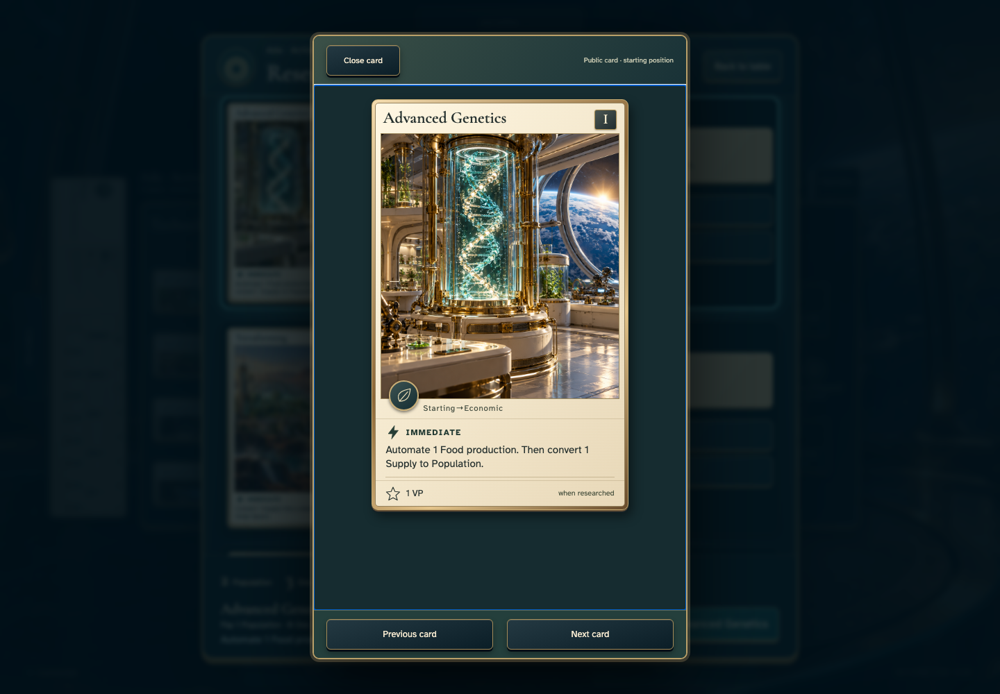](../../screenshots/research-and-recover-a-3-player-shared-cardinal-first-round/022-full-rules-desktop-darwin.png) |

tabletop-4k · 3840 × 2160

- [x] Read the entire public face through its bounded reader
- [x] Public Technology headings have physical clearance above their cards.
- [x] The game stays within its actual viewport without page scrolling.

## 24. Escape restores the actual inspection source without committing

Viewpoint: **Ada · South · shared controller**.

| desktop · 1440 × 1000 |
| --- |
|  |

tabletop-4k · 3840 × 2160

- [x] Escape restores the actual inspection source without committing
- [x] Public Technology headings have physical clearance above their cards.
- [x] The game stays within its actual viewport without page scrolling.

## 25. Cancel the unpaid plan and restore the acting mat control

Viewpoint: **Ada · South · shared controller**.

| desktop · 1440 × 1000 |
| --- |
| [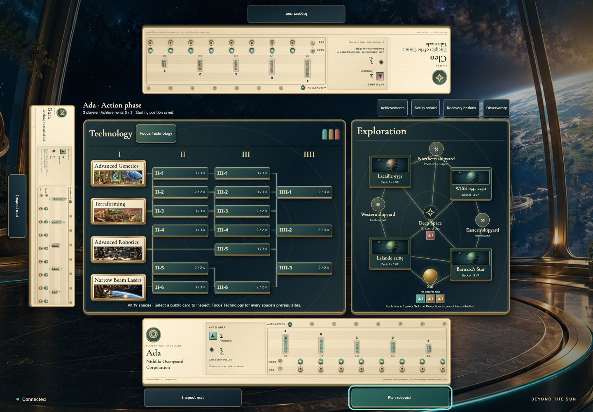](../../screenshots/research-and-recover-a-3-player-shared-cardinal-first-round/024-plan-return-desktop-darwin.png) |

tabletop-4k · 3840 × 2160

[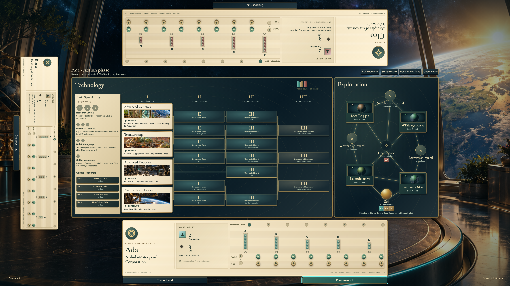](../../screenshots/research-and-recover-a-3-player-shared-cardinal-first-round/024-plan-return-tabletop-4k-darwin.png)

- [x] Cancel the unpaid plan and restore the acting mat control
- [x] Public Technology headings have physical clearance above their cards.
- [x] The game stays within its actual viewport without page scrolling.

## 26. Reopen the bounded planning instrument

Viewpoint: **Ada · South · shared controller**.

| desktop · 1440 × 1000 |
| --- |
| [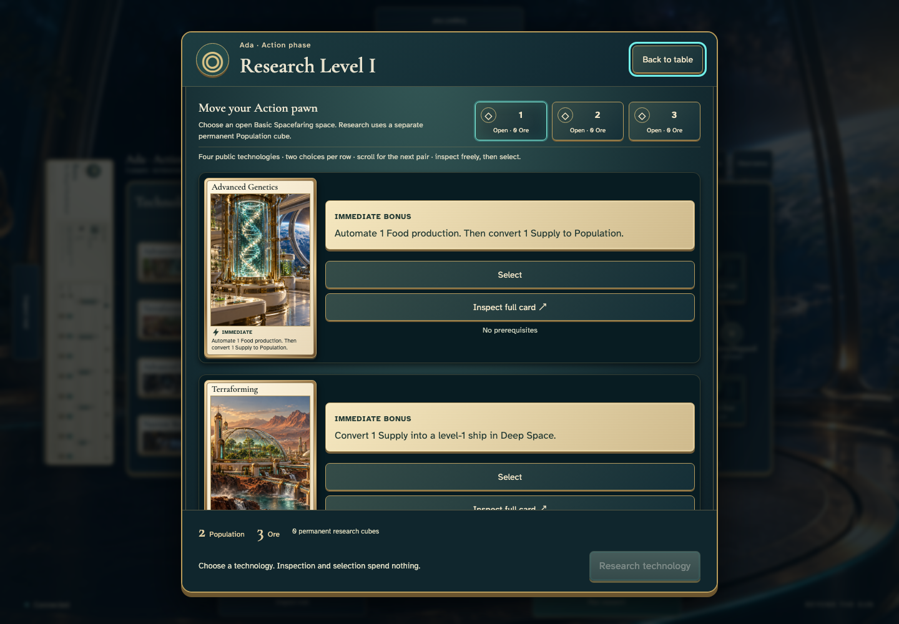](../../screenshots/research-and-recover-a-3-player-shared-cardinal-first-round/025-reopened-plan-desktop-darwin.png) |

tabletop-4k · 3840 × 2160

[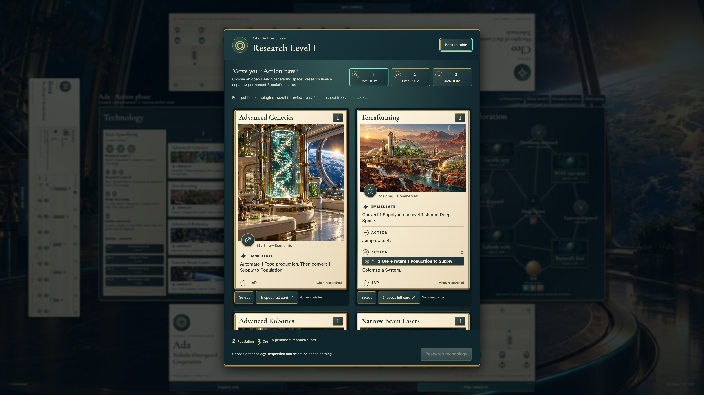](../../screenshots/research-and-recover-a-3-player-shared-cardinal-first-round/025-reopened-plan-tabletop-4k-darwin.png)

- [x] Reopen the bounded planning instrument
- [x] Public Technology headings have physical clearance above their cards.
- [x] The game stays within its actual viewport without page scrolling.

## 27. Ada selects Advanced Genetics without paying yet

Viewpoint: **Ada · South · shared controller**.

| desktop · 1440 × 1000 |
| --- |
| [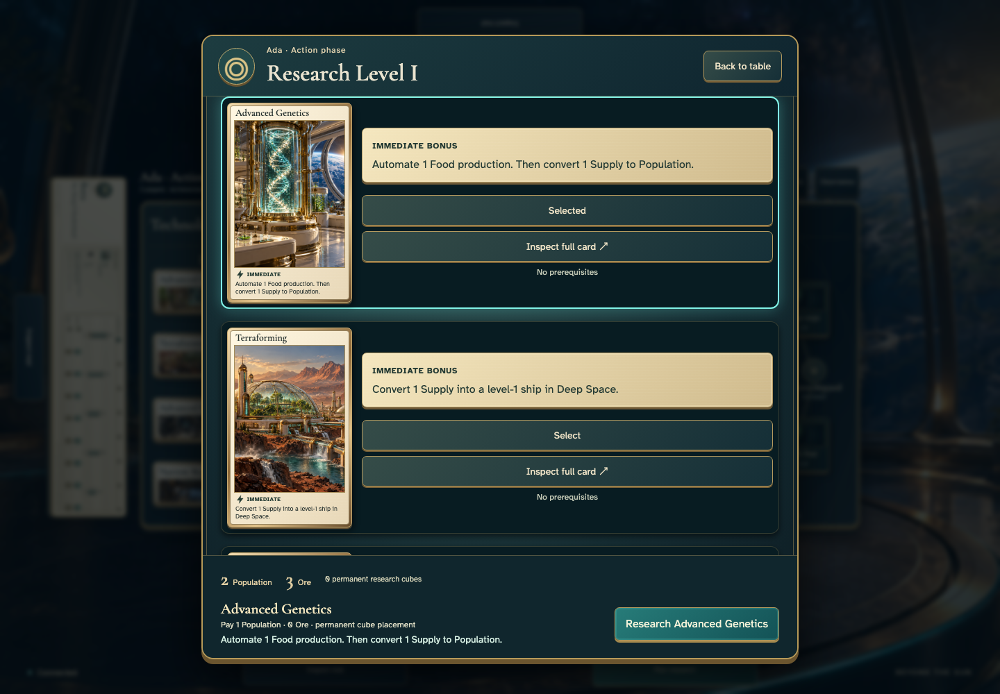](../../screenshots/research-and-recover-a-3-player-shared-cardinal-first-round/026-turn-0-selected-reopened-desktop-darwin.png) |

tabletop-4k · 3840 × 2160

[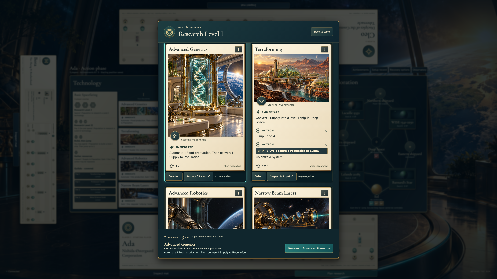](../../screenshots/research-and-recover-a-3-player-shared-cardinal-first-round/026-turn-0-selected-reopened-tabletop-4k-darwin.png)

- [x] Ada selects Advanced Genetics without paying yet
- [x] Public Technology headings have physical clearance above their cards.
- [x] The game stays within its actual viewport without page scrolling.

## 28. Ada pays once, places the permanent cube and resolves Advanced Genetics

Viewpoint: **Ada · South · shared controller**.

| desktop · 1440 × 1000 |
| --- |
|  |

tabletop-4k · 3840 × 2160

- [x] Ada pays once, places the permanent cube and resolves Advanced Genetics
- [x] Public Technology headings have physical clearance above their cards.
- [x] The game stays within its actual viewport without page scrolling.

## 29. Ada reloads the retained pending production without a repeated bonus

Viewpoint: **Ada · South · shared controller**.

| desktop · 1440 × 1000 |
| --- |
|  |

tabletop-4k · 3840 × 2160

[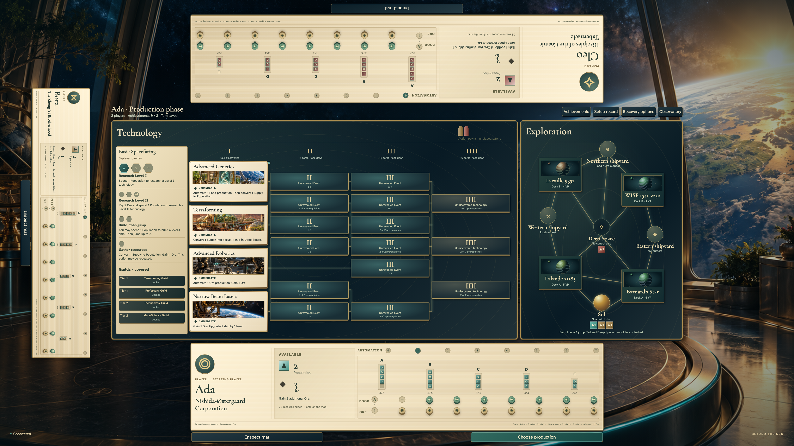](../../screenshots/research-and-recover-a-3-player-shared-cardinal-first-round/028-turn-0-pending-restored-tabletop-4k-darwin.png)

- [x] Ada reloads the retained pending production without a repeated bonus
- [x] Public Technology headings have physical clearance above their cards.
- [x] The game stays within its actual viewport without page scrolling.

## 30. Ada resumes the same saved production choice

Viewpoint: **Ada · South · shared controller**.

| desktop · 1440 × 1000 |
| --- |
| [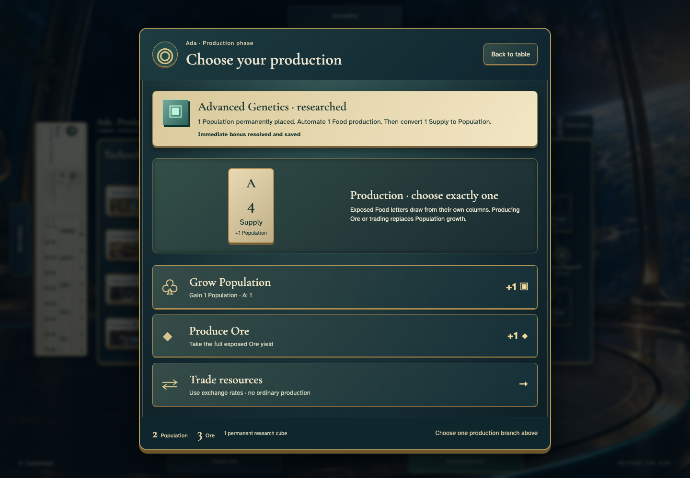](../../screenshots/research-and-recover-a-3-player-shared-cardinal-first-round/029-turn-0-production-restored-desktop-darwin.png) |

tabletop-4k · 3840 × 2160

[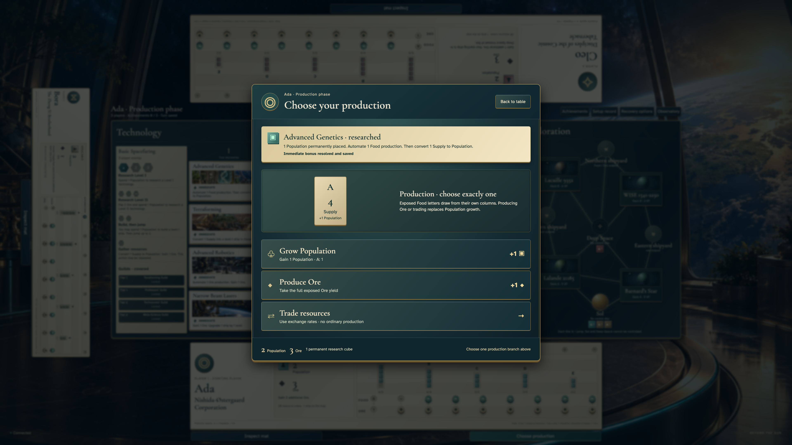](../../screenshots/research-and-recover-a-3-player-shared-cardinal-first-round/029-turn-0-production-restored-tabletop-4k-darwin.png)

- [x] Ada resumes the same saved production choice
- [x] Public Technology headings have physical clearance above their cards.
- [x] The game stays within its actual viewport without page scrolling.

## 31. Ada hands off automatically after the resolved production branch

Viewpoint: **Ada · South · shared controller**.

| desktop · 1440 × 1000 |
| --- |
|  |

tabletop-4k · 3840 × 2160

- [x] Ada hands off automatically after the resolved production branch
- [x] Public Technology headings have physical clearance above their cards.
- [x] The game stays within its actual viewport without page scrolling.

## 32. Bora plans the real Action pawn and permanent research payment

Viewpoint: **Bora · West · shared controller**.

| desktop · 1440 × 1000 |
| --- |
| [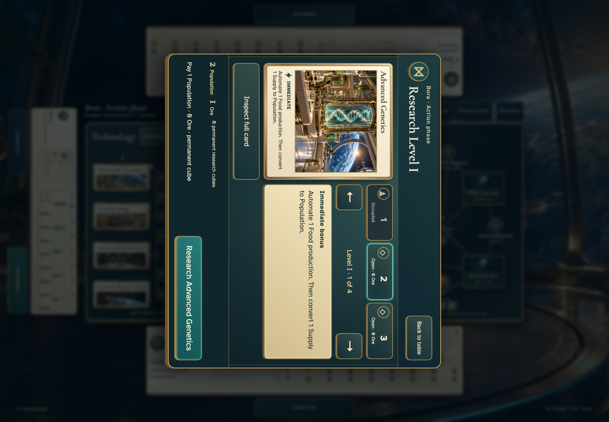](../../screenshots/research-and-recover-a-3-player-shared-cardinal-first-round/031-turn-1-plan-desktop-darwin.png) |

tabletop-4k · 3840 × 2160

[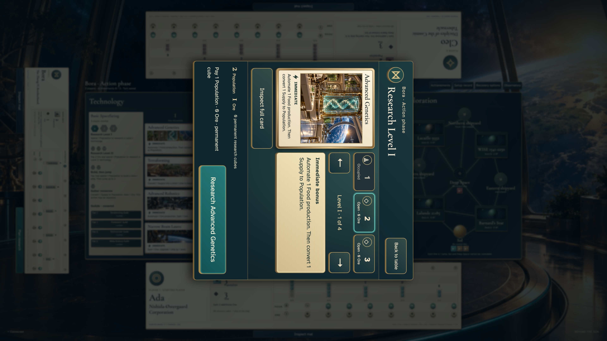](../../screenshots/research-and-recover-a-3-player-shared-cardinal-first-round/031-turn-1-plan-tabletop-4k-darwin.png)

- [x] Bora plans the real Action pawn and permanent research payment
- [x] Public Technology headings have physical clearance above their cards.
- [x] The game stays within its actual viewport without page scrolling.

## 33. An occupied Action space rejects commitment without spending

Viewpoint: **Bora · West · shared controller**.

| desktop · 1440 × 1000 |
| --- |
| [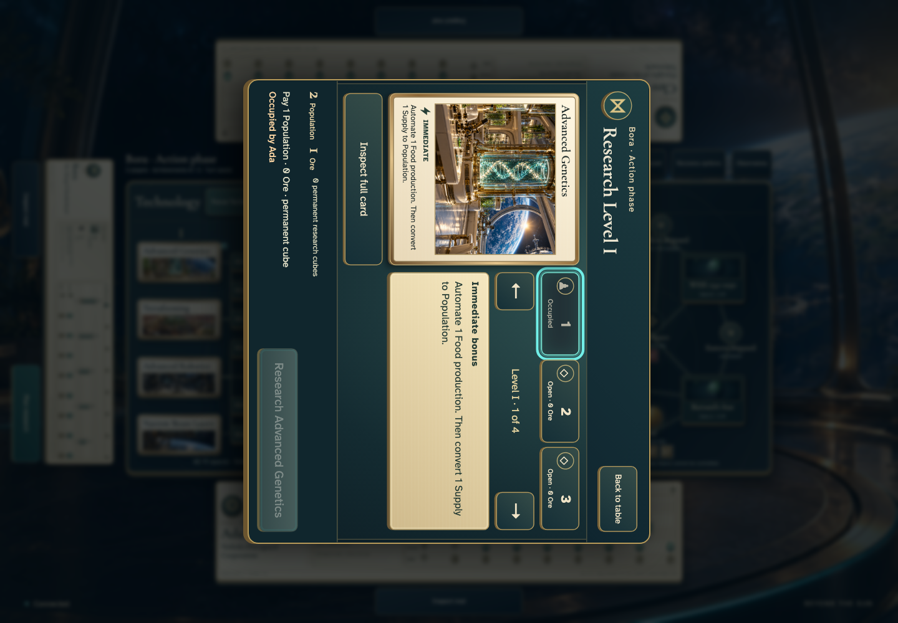](../../screenshots/research-and-recover-a-3-player-shared-cardinal-first-round/032-blocked-occupied-desktop-darwin.png) |

tabletop-4k · 3840 × 2160

[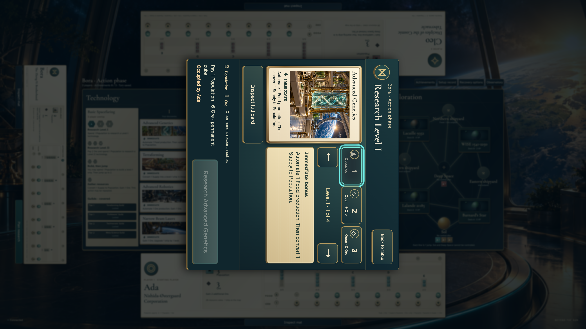](../../screenshots/research-and-recover-a-3-player-shared-cardinal-first-round/032-blocked-occupied-tabletop-4k-darwin.png)

- [x] An occupied Action space rejects commitment without spending
- [x] Public Technology headings have physical clearance above their cards.
- [x] The game stays within its actual viewport without page scrolling.

## 34. Choose the genuinely unoccupied second space

Viewpoint: **Bora · West · shared controller**.

| desktop · 1440 × 1000 |
| --- |
| [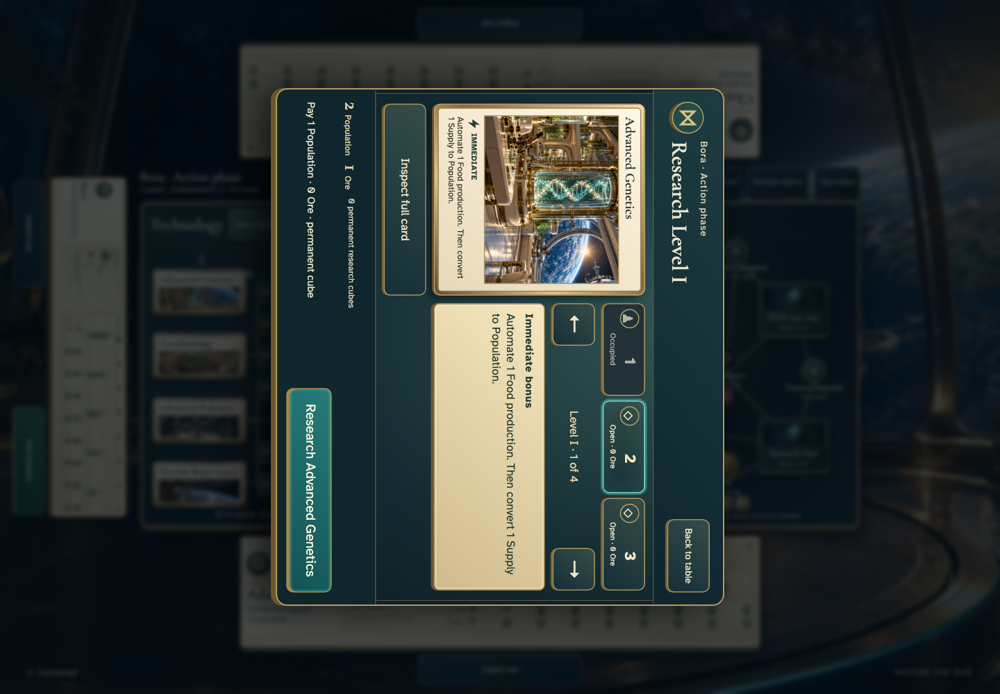](../../screenshots/research-and-recover-a-3-player-shared-cardinal-first-round/033-open-second-space-desktop-darwin.png) |

tabletop-4k · 3840 × 2160

[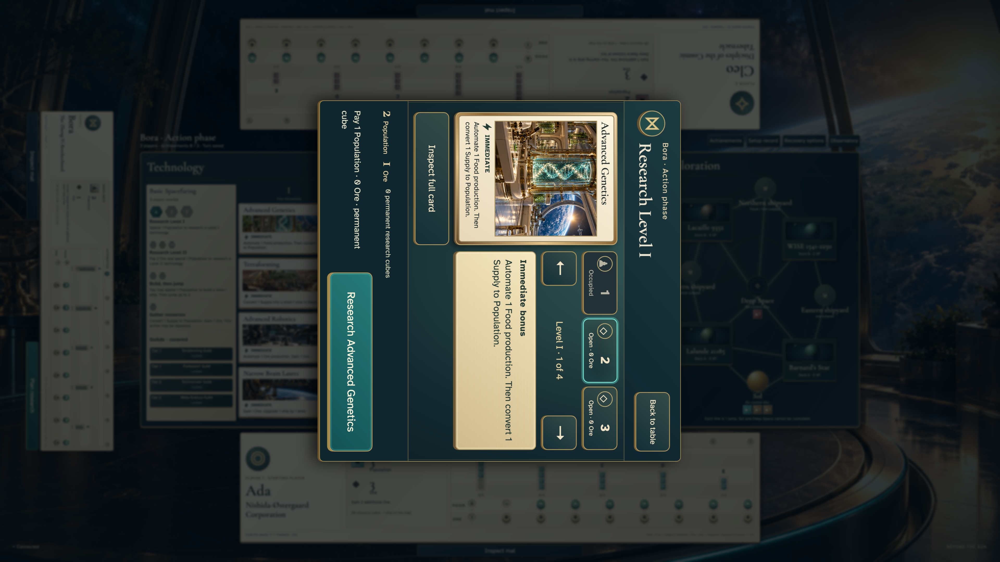](../../screenshots/research-and-recover-a-3-player-shared-cardinal-first-round/033-open-second-space-tabletop-4k-darwin.png)

- [x] Choose the genuinely unoccupied second space
- [x] Public Technology headings have physical clearance above their cards.
- [x] The game stays within its actual viewport without page scrolling.

## 35. Bora browses the next public Level I face

Viewpoint: **Bora · West · shared controller**.

| desktop · 1440 × 1000 |
| --- |
| [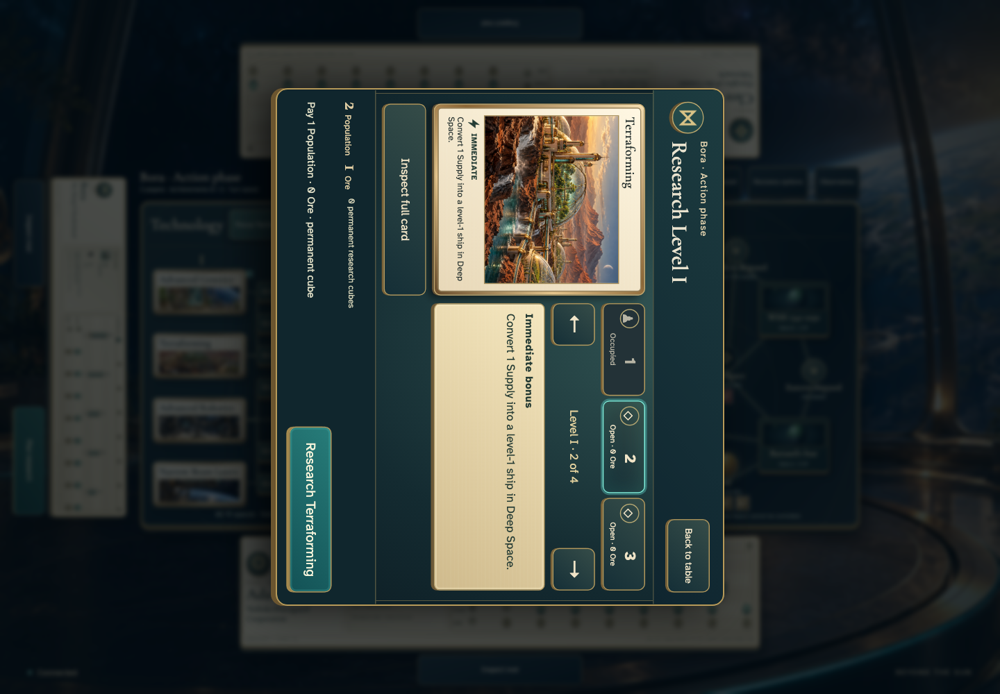](../../screenshots/research-and-recover-a-3-player-shared-cardinal-first-round/034-turn-1-browse-0-desktop-darwin.png) |

tabletop-4k · 3840 × 2160

[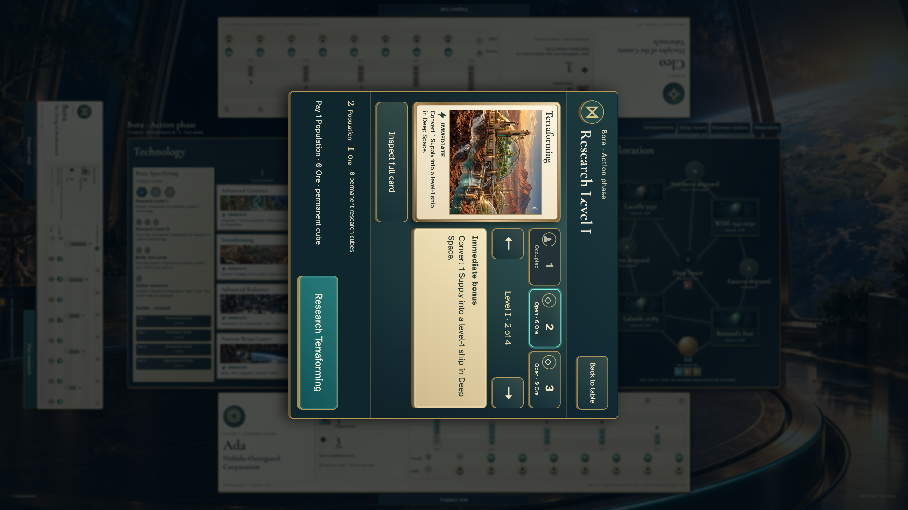](../../screenshots/research-and-recover-a-3-player-shared-cardinal-first-round/034-turn-1-browse-0-tabletop-4k-darwin.png)

- [x] Bora browses the next public Level I face
- [x] Public Technology headings have physical clearance above their cards.
- [x] The game stays within its actual viewport without page scrolling.

## 36. Bora browses the next public Level I face

Viewpoint: **Bora · West · shared controller**.

| desktop · 1440 × 1000 |
| --- |
| [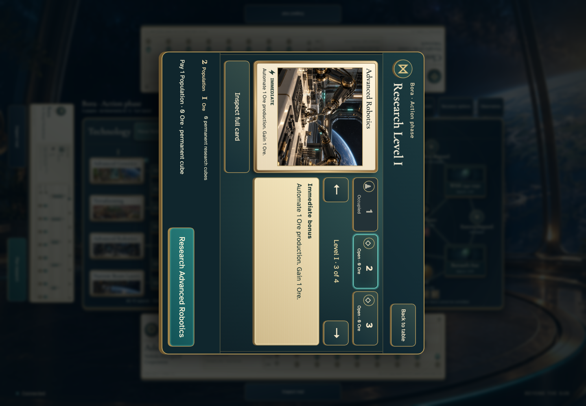](../../screenshots/research-and-recover-a-3-player-shared-cardinal-first-round/035-turn-1-browse-1-desktop-darwin.png) |

tabletop-4k · 3840 × 2160

[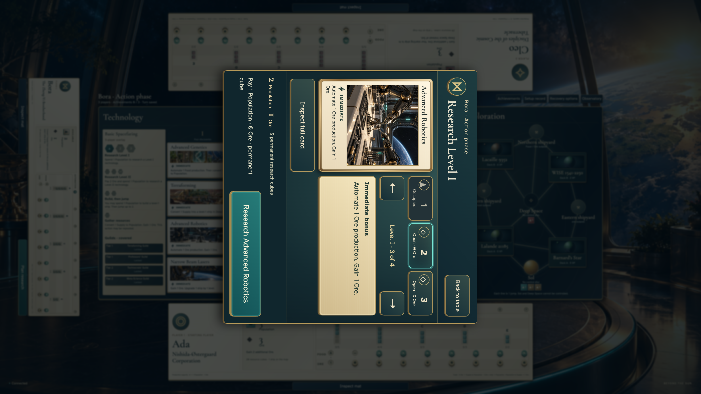](../../screenshots/research-and-recover-a-3-player-shared-cardinal-first-round/035-turn-1-browse-1-tabletop-4k-darwin.png)

- [x] Bora browses the next public Level I face
- [x] Public Technology headings have physical clearance above their cards.
- [x] The game stays within its actual viewport without page scrolling.

## 37. Bora browses the next public Level I face

Viewpoint: **Bora · West · shared controller**.

| desktop · 1440 × 1000 |
| --- |
|  |

tabletop-4k · 3840 × 2160

- [x] Bora browses the next public Level I face
- [x] Public Technology headings have physical clearance above their cards.
- [x] The game stays within its actual viewport without page scrolling.

## 38. The mandatory Lasers target disables commit until explicitly chosen

Viewpoint: **Bora · West · shared controller**.

| desktop · 1440 × 1000 |
| --- |
| [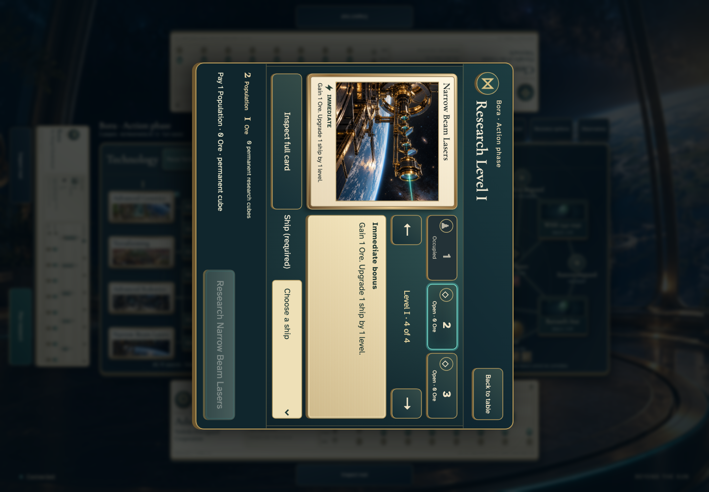](../../screenshots/research-and-recover-a-3-player-shared-cardinal-first-round/037-ship-required-desktop-darwin.png) |

tabletop-4k · 3840 × 2160

[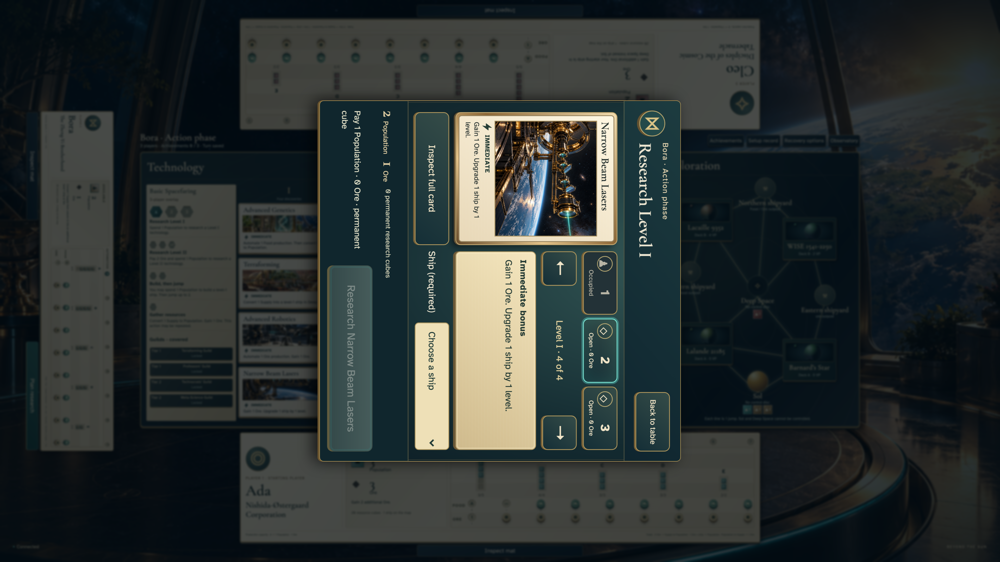](../../screenshots/research-and-recover-a-3-player-shared-cardinal-first-round/037-ship-required-tabletop-4k-darwin.png)

- [x] The mandatory Lasers target disables commit until explicitly chosen
- [x] Public Technology headings have physical clearance above their cards.
- [x] The game stays within its actual viewport without page scrolling.

## 39. Select the second Sol ship; the commit names its level1 to2 consequence

Viewpoint: **Bora · West · shared controller**.

| desktop · 1440 × 1000 |
| --- |
| [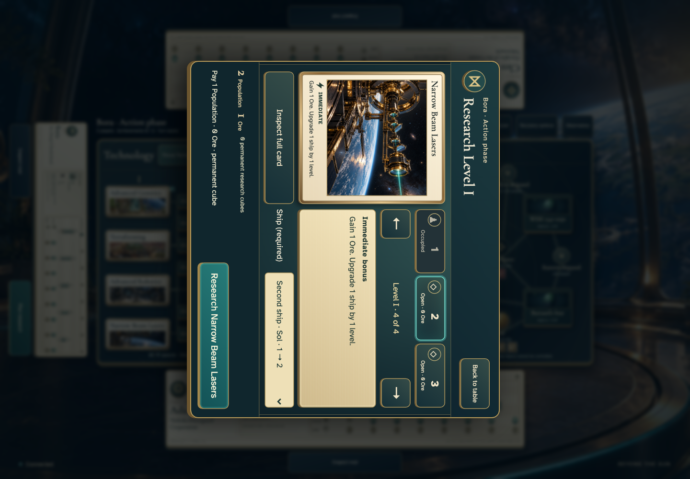](../../screenshots/research-and-recover-a-3-player-shared-cardinal-first-round/038-ship-selected-desktop-darwin.png) |

tabletop-4k · 3840 × 2160

[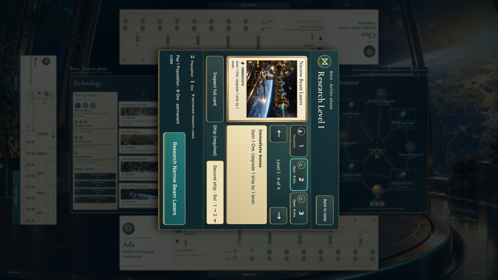](../../screenshots/research-and-recover-a-3-player-shared-cardinal-first-round/038-ship-selected-tabletop-4k-darwin.png)

- [x] Select the second Sol ship; the commit names its level1 to2 consequence
- [x] Public Technology headings have physical clearance above their cards.
- [x] The game stays within its actual viewport without page scrolling.

## 40. Bora pays once, places the permanent cube and resolves Narrow Beam Lasers

Viewpoint: **Bora · West · shared controller**.

| desktop · 1440 × 1000 |
| --- |
| [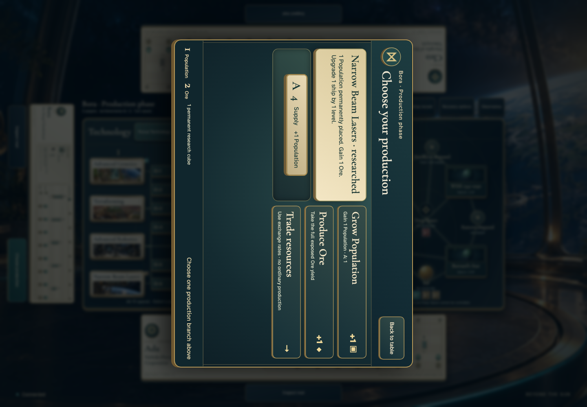](../../screenshots/research-and-recover-a-3-player-shared-cardinal-first-round/039-turn-1-researched-desktop-darwin.png) |

tabletop-4k · 3840 × 2160

- [x] Bora pays once, places the permanent cube and resolves Narrow Beam Lasers
- [x] Public Technology headings have physical clearance above their cards.
- [x] The game stays within its actual viewport without page scrolling.

## 41. Bora reloads the retained pending production without a repeated bonus

Viewpoint: **Bora · West · shared controller**.

| desktop · 1440 × 1000 |
| --- |
|  |

tabletop-4k · 3840 × 2160

[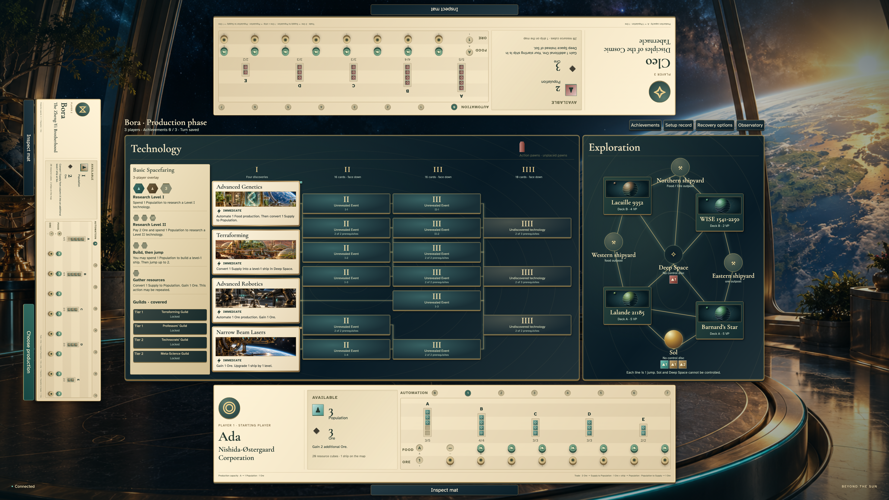](../../screenshots/research-and-recover-a-3-player-shared-cardinal-first-round/040-turn-1-pending-restored-tabletop-4k-darwin.png)

- [x] Bora reloads the retained pending production without a repeated bonus
- [x] Public Technology headings have physical clearance above their cards.
- [x] The game stays within its actual viewport without page scrolling.

## 42. Bora resumes the same saved production choice

Viewpoint: **Bora · West · shared controller**.

| desktop · 1440 × 1000 |
| --- |
|  |

tabletop-4k · 3840 × 2160

[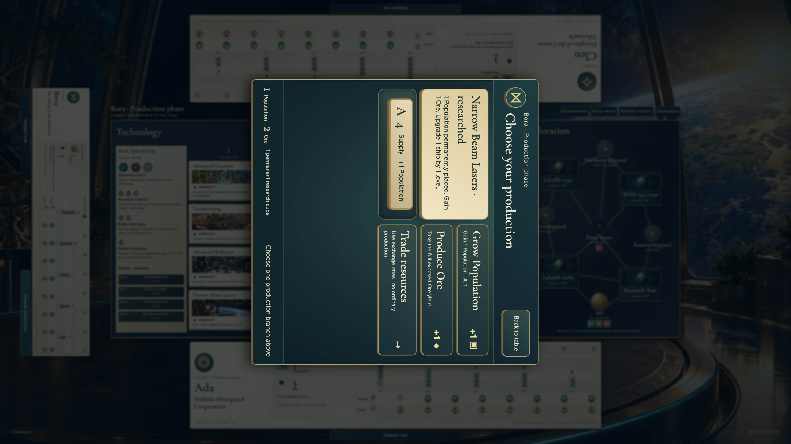](../../screenshots/research-and-recover-a-3-player-shared-cardinal-first-round/041-turn-1-production-restored-tabletop-4k-darwin.png)

- [x] Bora resumes the same saved production choice
- [x] Public Technology headings have physical clearance above their cards.
- [x] The game stays within its actual viewport without page scrolling.

## 43. Trade is a persisted exclusive production branch

Viewpoint: **Bora · West · shared controller**.

| desktop · 1440 × 1000 |
| --- |
|  |

tabletop-4k · 3840 × 2160

- [x] Trade is a persisted exclusive production branch
- [x] Public Technology headings have physical clearance above their cards.
- [x] The game stays within its actual viewport without page scrolling.

## 44. Choose the printed ship decommission exchange

Viewpoint: **Bora · West · shared controller**.

| desktop · 1440 × 1000 |
| --- |
| [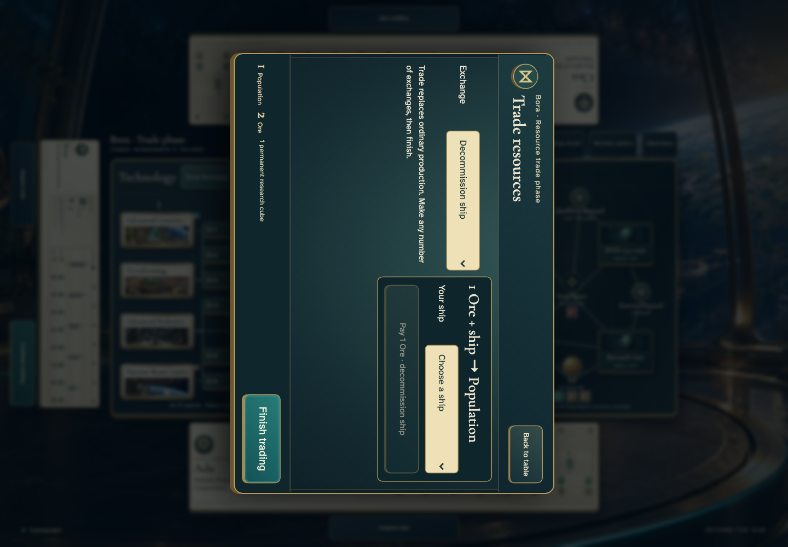](../../screenshots/research-and-recover-a-3-player-shared-cardinal-first-round/043-decommission-exchange-desktop-darwin.png) |

tabletop-4k · 3840 × 2160

[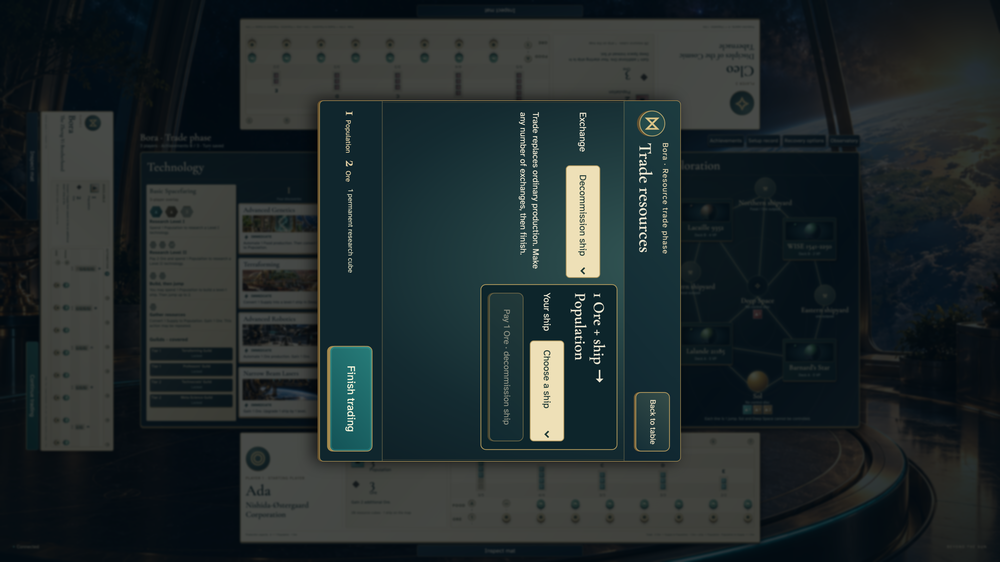](../../screenshots/research-and-recover-a-3-player-shared-cardinal-first-round/043-decommission-exchange-tabletop-4k-darwin.png)

- [x] Choose the printed ship decommission exchange
- [x] Public Technology headings have physical clearance above their cards.
- [x] The game stays within its actual viewport without page scrolling.

## 45. Choose the unupgraded first ship, preserving the level2 second ship

Viewpoint: **Bora · West · shared controller**.

| desktop · 1440 × 1000 |
| --- |
| [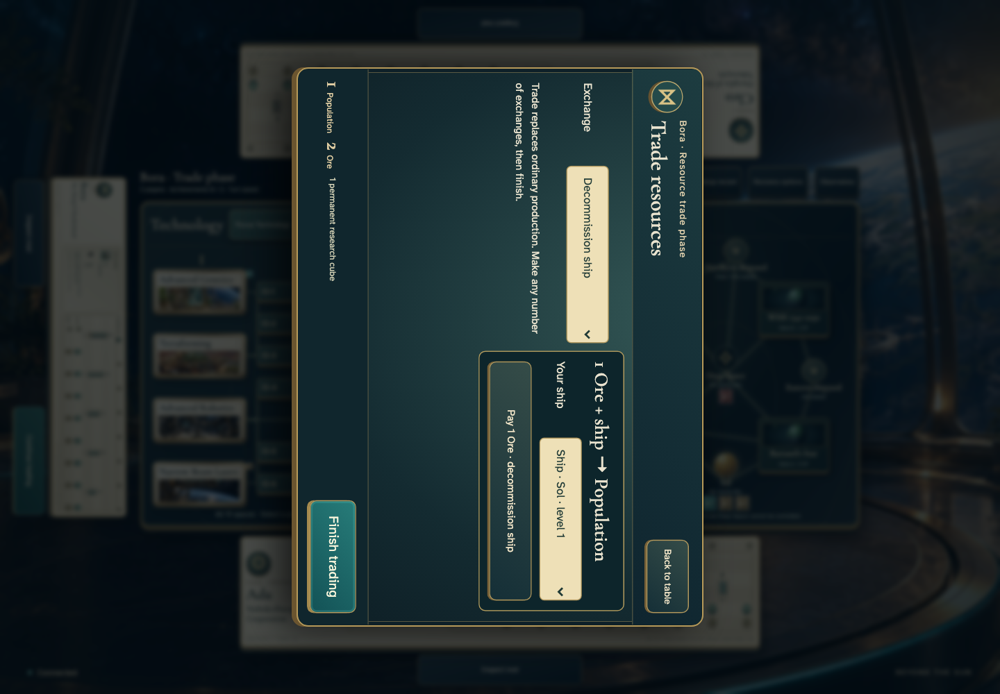](../../screenshots/research-and-recover-a-3-player-shared-cardinal-first-round/044-decommission-target-desktop-darwin.png) |

tabletop-4k · 3840 × 2160

- [x] Choose the unupgraded first ship, preserving the level2 second ship
- [x] Public Technology headings have physical clearance above their cards.
- [x] The game stays within its actual viewport without page scrolling.

## 46. Pay1 Ore and turn the first ship into available Population

Viewpoint: **Bora · West · shared controller**.

| desktop · 1440 × 1000 |
| --- |
| [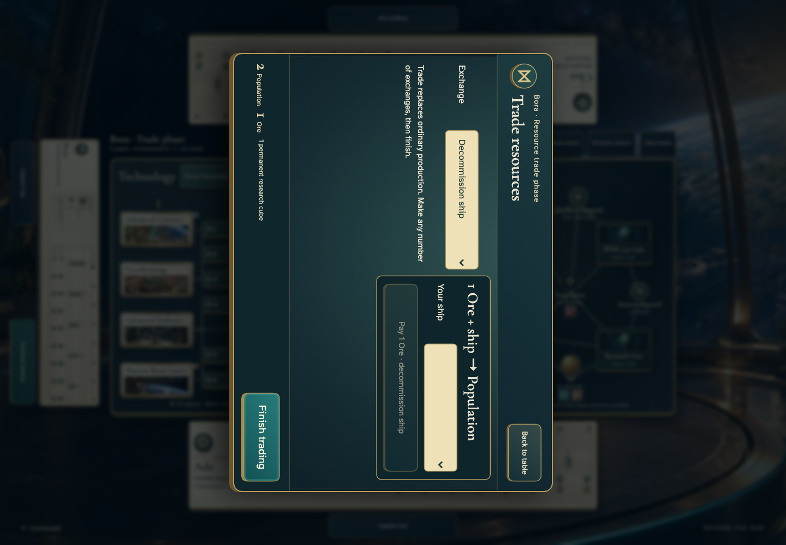](../../screenshots/research-and-recover-a-3-player-shared-cardinal-first-round/045-decommissioned-desktop-darwin.png) |

tabletop-4k · 3840 × 2160

[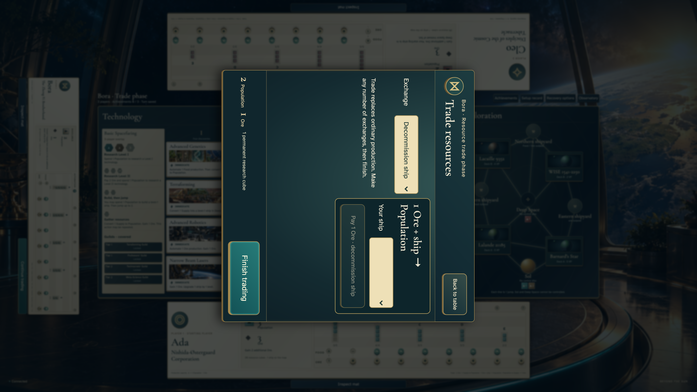](../../screenshots/research-and-recover-a-3-player-shared-cardinal-first-round/045-decommissioned-tabletop-4k-darwin.png)

- [x] Pay1 Ore and turn the first ship into available Population
- [x] Public Technology headings have physical clearance above their cards.
- [x] The game stays within its actual viewport without page scrolling.

## 47. Choose the Population return exchange

Viewpoint: **Bora · West · shared controller**.

| desktop · 1440 × 1000 |
| --- |
| [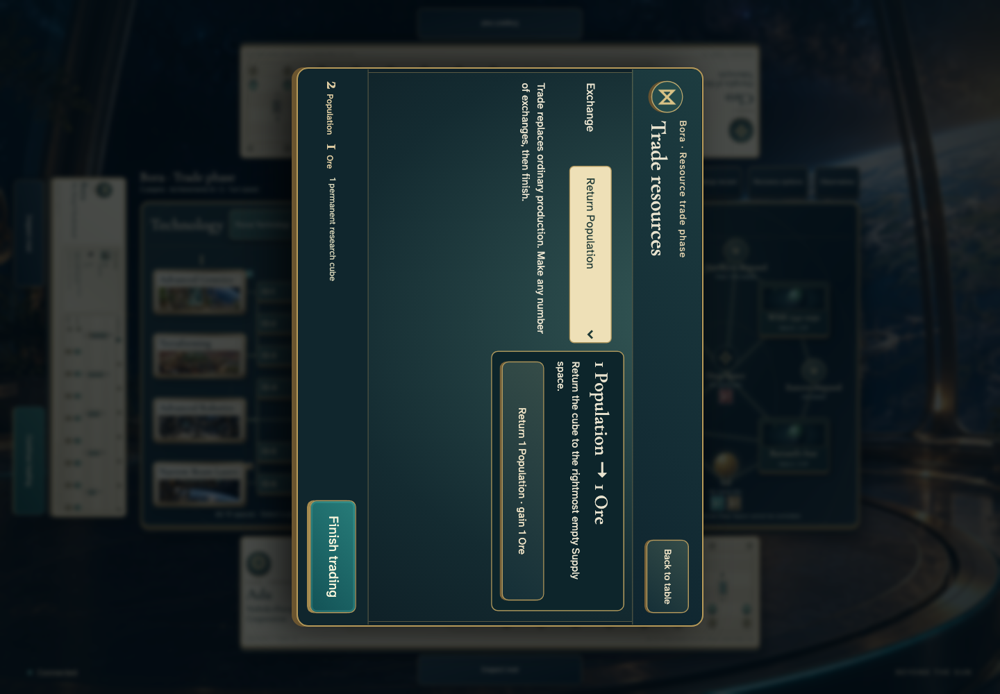](../../screenshots/research-and-recover-a-3-player-shared-cardinal-first-round/046-return-exchange-desktop-darwin.png) |

tabletop-4k · 3840 × 2160

[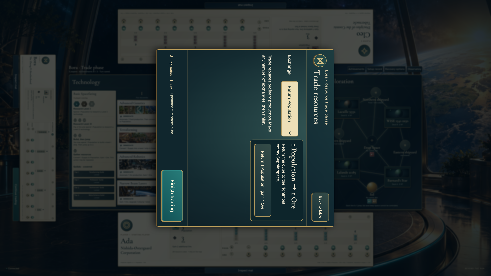](../../screenshots/research-and-recover-a-3-player-shared-cardinal-first-round/046-return-exchange-tabletop-4k-darwin.png)

- [x] Choose the Population return exchange
- [x] Public Technology headings have physical clearance above their cards.
- [x] The game stays within its actual viewport without page scrolling.

## 48. Return Population1 to the rightmost Supply space

Viewpoint: **Bora · West · shared controller**.

| desktop · 1440 × 1000 |
| --- |
|  |

tabletop-4k · 3840 × 2160

[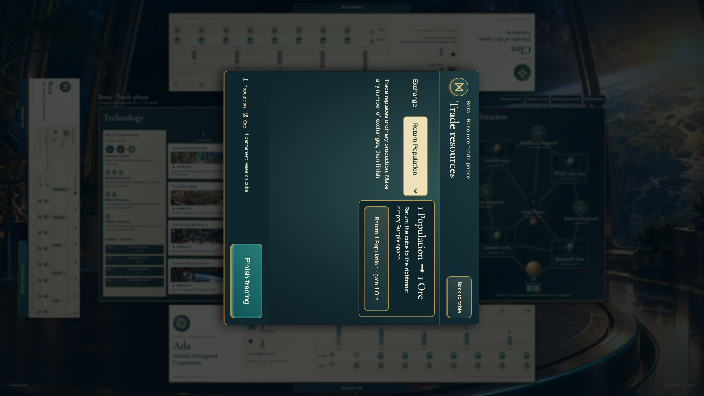](../../screenshots/research-and-recover-a-3-player-shared-cardinal-first-round/047-returned-0-tabletop-4k-darwin.png)

- [x] Return Population1 to the rightmost Supply space
- [x] Public Technology headings have physical clearance above their cards.
- [x] The game stays within its actual viewport without page scrolling.

## 49. Return Population2 to the rightmost Supply space

Viewpoint: **Bora · West · shared controller**.

| desktop · 1440 × 1000 |
| --- |
|  |

tabletop-4k · 3840 × 2160

- [x] Return Population2 to the rightmost Supply space
- [x] Public Technology headings have physical clearance above their cards.
- [x] The game stays within its actual viewport without page scrolling.

## 50. Close the trade reader without ending its saved phase

Viewpoint: **Bora · West · shared controller**.

| desktop · 1440 × 1000 |
| --- |
| [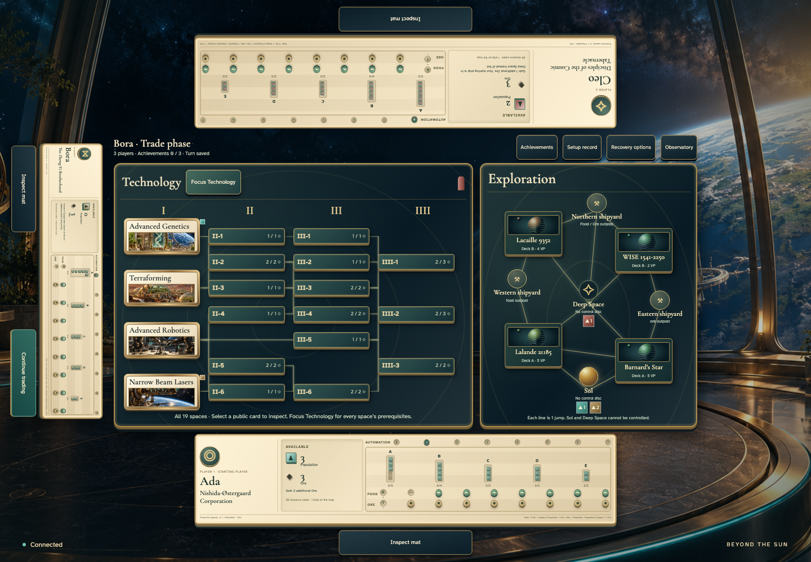](../../screenshots/research-and-recover-a-3-player-shared-cardinal-first-round/049-trade-table-desktop-darwin.png) |

tabletop-4k · 3840 × 2160

[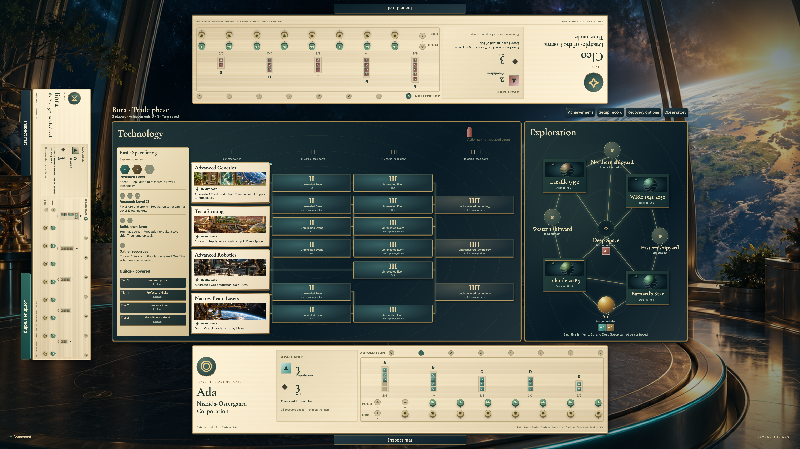](../../screenshots/research-and-recover-a-3-player-shared-cardinal-first-round/049-trade-table-tabletop-4k-darwin.png)

- [x] Close the trade reader without ending its saved phase
- [x] Public Technology headings have physical clearance above their cards.
- [x] The game stays within its actual viewport without page scrolling.

## 51. The complete mat shows the actual sixth Supply cube

Viewpoint: **Bora · West · shared controller**.

| desktop · 1440 × 1000 |
| --- |
|  |

tabletop-4k · 3840 × 2160

- [x] The complete mat shows the actual sixth Supply cube
- [x] Public Technology headings have physical clearance above their cards.
- [x] The game stays within its actual viewport without page scrolling.

## 52. Return from the public mat inspection with the trade phase retained

Viewpoint: **Bora · West · shared controller**.

| desktop · 1440 × 1000 |
| --- |
|  |

tabletop-4k · 3840 × 2160

- [x] Return from the public mat inspection with the trade phase retained
- [x] Public Technology headings have physical clearance above their cards.
- [x] The game stays within its actual viewport without page scrolling.

## 53. Resume the same accepted trade stream

Viewpoint: **Bora · West · shared controller**.

| desktop · 1440 × 1000 |
| --- |
|  |

tabletop-4k · 3840 × 2160

- [x] Resume the same accepted trade stream
- [x] Public Technology headings have physical clearance above their cards.
- [x] The game stays within its actual viewport without page scrolling.

## 54. Choose the printed recruitment exchange

Viewpoint: **Bora · West · shared controller**.

| desktop · 1440 × 1000 |
| --- |
|  |

tabletop-4k · 3840 × 2160

- [x] Choose the printed recruitment exchange
- [x] Public Technology headings have physical clearance above their cards.
- [x] The game stays within its actual viewport without page scrolling.

## 55. Pay3 Ore and convert the leftmost Supply into Population

Viewpoint: **Bora · West · shared controller**.

| desktop · 1440 × 1000 |
| --- |
|  |

tabletop-4k · 3840 × 2160

- [x] Pay3 Ore and convert the leftmost Supply into Population
- [x] Public Technology headings have physical clearance above their cards.
- [x] The game stays within its actual viewport without page scrolling.

## 56. Reload preserves the accepted exchanges and trading phase

Viewpoint: **Bora · West · shared controller**.

| desktop · 1440 × 1000 |
| --- |
|  |

tabletop-4k · 3840 × 2160

- [x] Reload preserves the accepted exchanges and trading phase
- [x] Public Technology headings have physical clearance above their cards.
- [x] The game stays within its actual viewport without page scrolling.

## 57. Reopen the saved balance without duplicating an exchange

Viewpoint: **Bora · West · shared controller**.

| desktop · 1440 × 1000 |
| --- |
|  |

tabletop-4k · 3840 × 2160

- [x] Reopen the saved balance without duplicating an exchange
- [x] Public Technology headings have physical clearance above their cards.
- [x] The game stays within its actual viewport without page scrolling.

## 58. Bora hands off automatically after the resolved production branch

Viewpoint: **Bora · West · shared controller**.

| desktop · 1440 × 1000 |
| --- |
|  |

tabletop-4k · 3840 × 2160

- [x] Bora hands off automatically after the resolved production branch
- [x] Public Technology headings have physical clearance above their cards.
- [x] The game stays within its actual viewport without page scrolling.

## 59. Cleo plans the real Action pawn and permanent research payment

Viewpoint: **Cleo · North · shared controller**.

| desktop · 1440 × 1000 |
| --- |
|  |

tabletop-4k · 3840 × 2160

- [x] Cleo plans the real Action pawn and permanent research payment
- [x] Public Technology headings have physical clearance above their cards.
- [x] The game stays within its actual viewport without page scrolling.

## 60. Cleo selects Advanced Robotics without paying yet

Viewpoint: **Cleo · North · shared controller**.

| desktop · 1440 × 1000 |
| --- |
|  |

tabletop-4k · 3840 × 2160

- [x] Cleo selects Advanced Robotics without paying yet
- [x] Public Technology headings have physical clearance above their cards.
- [x] The game stays within its actual viewport without page scrolling.

## 61. Cleo pays once, places the permanent cube and resolves Advanced Robotics

Viewpoint: **Cleo · North · shared controller**.

| desktop · 1440 × 1000 |
| --- |
|  |

tabletop-4k · 3840 × 2160

- [x] Cleo pays once, places the permanent cube and resolves Advanced Robotics
- [x] Public Technology headings have physical clearance above their cards.
- [x] The game stays within its actual viewport without page scrolling.

## 62. Cleo hands off automatically after the resolved production branch

Viewpoint: **Cleo · North · shared controller**.

| desktop · 1440 × 1000 |
| --- |
|  |

tabletop-4k · 3840 × 2160

- [x] Cleo hands off automatically after the resolved production branch
- [x] Public Technology headings have physical clearance above their cards.
- [x] The game stays within its actual viewport without page scrolling.

## 63. Reload recovers permanent cubes, occupied spaces and all economies

Viewpoint: **Ada · South · shared controller**.

| desktop · 1440 × 1000 |
| --- |
|  |

tabletop-4k · 3840 × 2160

- [x] Reload recovers permanent cubes, occupied spaces and all economies
- [x] Public Technology headings have physical clearance above their cards.
- [x] The game stays within its actual viewport without page scrolling.
