# Research and recover a complete 3-player remote first round

Ordinary UI setup, legal unique Basic factions and real emulator persistence. Only UUID entropy is fixed before setup; no game-state injection. Every visible input/choice/result uses TestStepHelper. Complete first rounds exercise all Level I bonuses, real permanent cube payment, occupied Action blocking, explicit ship choice, exclusive production, all three printed trades, Supply overflow, pending-choice reload and automatic handoff. Full-card and planner Escape restore source focus.

## 1. Arrive through the actual observatory

Viewpoint: **Ada · host**.

| phone · 393 × 852 | desktop · 1440 × 1000 |
| --- | --- |
|  |  |

- [x] Arrive through the actual observatory
- [x] Public Technology headings have physical clearance above their cards.
- [x] The game stays within its actual viewport without page scrolling.

## 2. Choose the intended production play interface

Viewpoint: **Ada · host**.

| phone · 393 × 852 | desktop · 1440 × 1000 |
| --- | --- |
|  |  |

- [x] Choose the intended production play interface
- [x] Public Technology headings have physical clearance above their cards.
- [x] The game stays within its actual viewport without page scrolling.

## 3. Open the production remote hosting instrument

Viewpoint: **Ada · host**.

| phone · 393 × 852 | desktop · 1440 × 1000 |
| --- | --- |
|  |  |

- [x] Open the production remote hosting instrument
- [x] Public Technology headings have physical clearance above their cards.
- [x] The game stays within its actual viewport without page scrolling.

## 4. Configure 3 separate players

Viewpoint: **Ada · host**.

| phone · 393 × 852 | desktop · 1440 × 1000 |
| --- | --- |
| [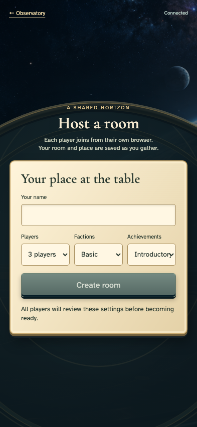](../../screenshots/research-and-recover-a-complete-3-player-remote-first-round/003-capacity-phone-darwin.png) |  |

- [x] Configure 3 separate players
- [x] Public Technology headings have physical clearance above their cards.
- [x] The game stays within its actual viewport without page scrolling.

## 5. Name the actual host

Viewpoint: **Ada · host**.

| phone · 393 × 852 | desktop · 1440 × 1000 |
| --- | --- |
| [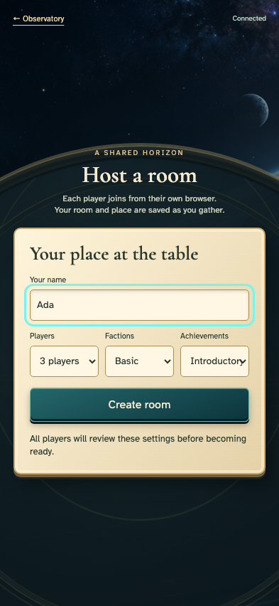](../../screenshots/research-and-recover-a-complete-3-player-remote-first-round/004-host-name-phone-darwin.png) | [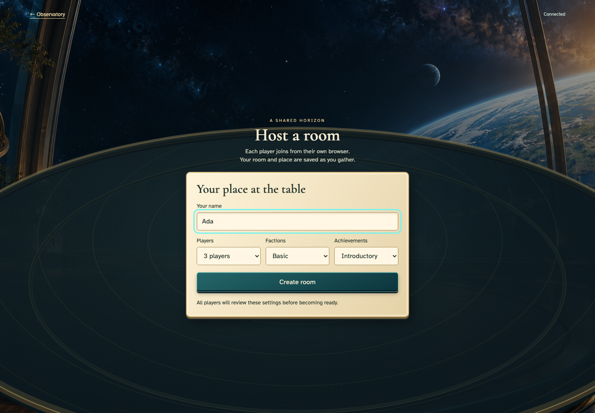](../../screenshots/research-and-recover-a-complete-3-player-remote-first-round/004-host-name-desktop-darwin.png) |

- [x] Name the actual host
- [x] Public Technology headings have physical clearance above their cards.
- [x] The game stays within its actual viewport without page scrolling.

## 6. Persist the canonical remote gathering

Viewpoint: **Ada · host**.

| phone · 393 × 852 | desktop · 1440 × 1000 |
| --- | --- |
| [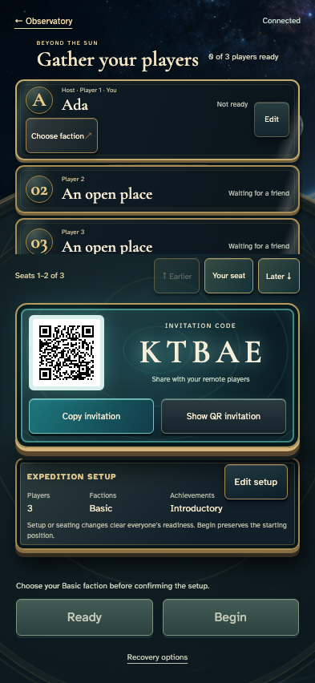](../../screenshots/research-and-recover-a-complete-3-player-remote-first-round/005-room-created-phone-darwin.png) | [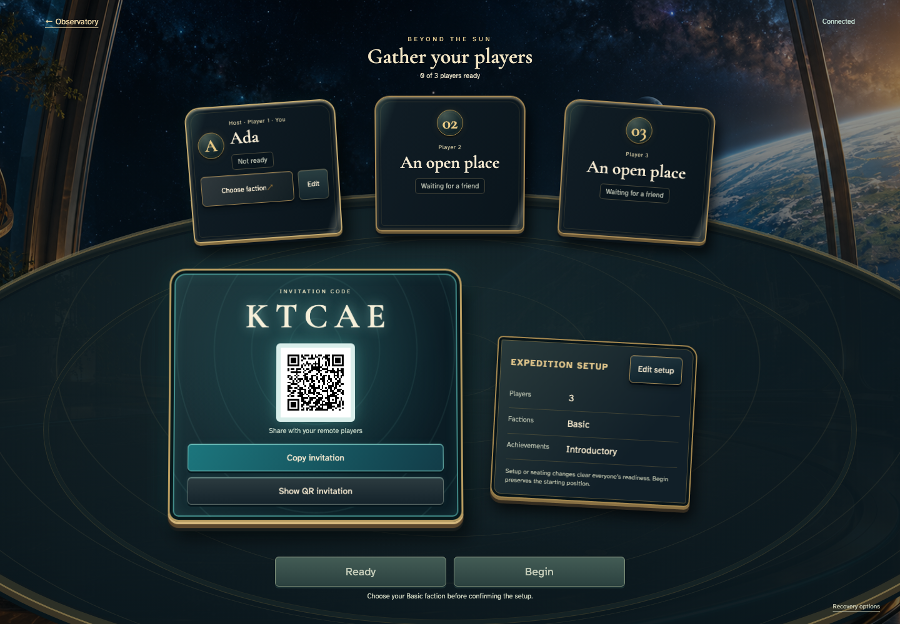](../../screenshots/research-and-recover-a-complete-3-player-remote-first-round/005-room-created-desktop-darwin.png) |

- [x] Persist the canonical remote gathering
- [x] Public Technology headings have physical clearance above their cards.
- [x] The game stays within its actual viewport without page scrolling.

## 7. Bora previews the public invitation

Viewpoint: **Bora · separate remote identity**.

| phone · 1440 × 1000 | desktop · 393 × 852 |
| --- | --- |
|  | [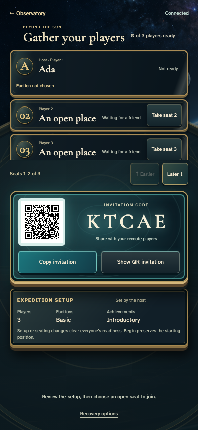](../../screenshots/research-and-recover-a-complete-3-player-remote-first-round/006-invite-1-desktop-darwin.png) |

- [x] Bora previews the public invitation
- [x] Public Technology headings have physical clearance above their cards.
- [x] The game stays within its actual viewport without page scrolling.

## 8. Bora opens their separate seat editor

Viewpoint: **Bora · separate remote identity**.

| phone · 1440 × 1000 | desktop · 393 × 852 |
| --- | --- |
| [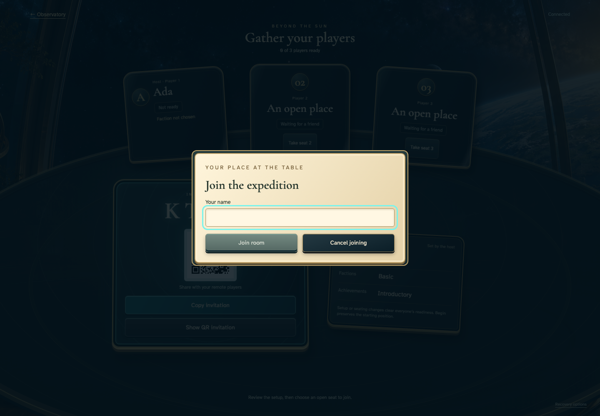](../../screenshots/research-and-recover-a-complete-3-player-remote-first-round/007-join-editor-1-phone-darwin.png) | [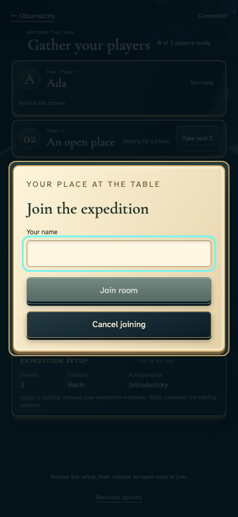](../../screenshots/research-and-recover-a-complete-3-player-remote-first-round/007-join-editor-1-desktop-darwin.png) |

- [x] Bora opens their separate seat editor
- [x] Public Technology headings have physical clearance above their cards.
- [x] The game stays within its actual viewport without page scrolling.

## 9. Bora supplies their public name

Viewpoint: **Bora · separate remote identity**.

| phone · 1440 × 1000 | desktop · 393 × 852 |
| --- | --- |
| [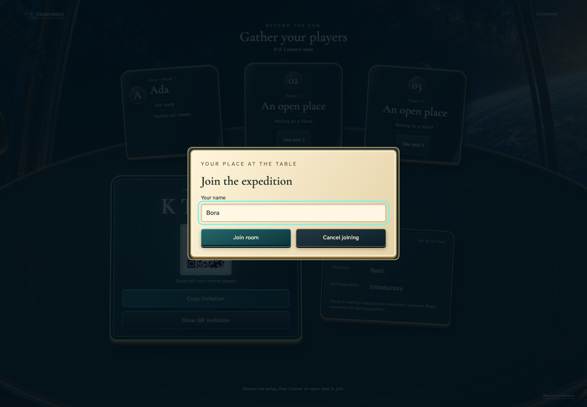](../../screenshots/research-and-recover-a-complete-3-player-remote-first-round/008-join-name-1-phone-darwin.png) | [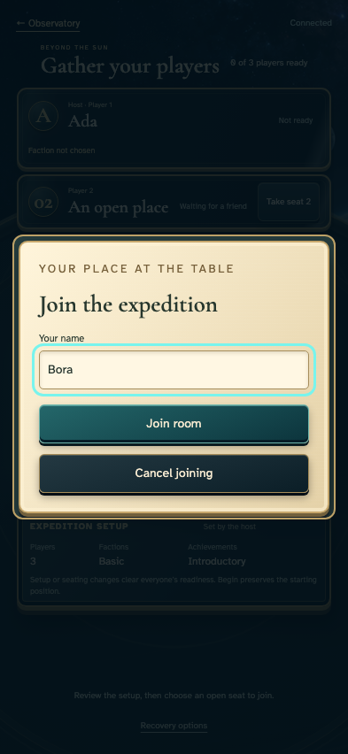](../../screenshots/research-and-recover-a-complete-3-player-remote-first-round/008-join-name-1-desktop-darwin.png) |

- [x] Bora supplies their public name
- [x] Public Technology headings have physical clearance above their cards.
- [x] The game stays within its actual viewport without page scrolling.

## 10. Bora joins with a separate identity

Viewpoint: **Bora · separate remote identity**.

| phone · 1440 × 1000 | desktop · 393 × 852 |
| --- | --- |
|  | [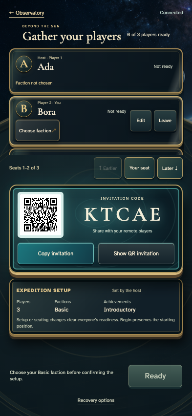](../../screenshots/research-and-recover-a-complete-3-player-remote-first-round/009-joined-1-desktop-darwin.png) |

- [x] Bora joins with a separate identity
- [x] Public Technology headings have physical clearance above their cards.
- [x] The game stays within its actual viewport without page scrolling.

## 11. Cleo previews the public invitation

Viewpoint: **Cleo · separate remote identity**.

| phone · 1440 × 1000 | desktop · 393 × 852 |
| --- | --- |
| [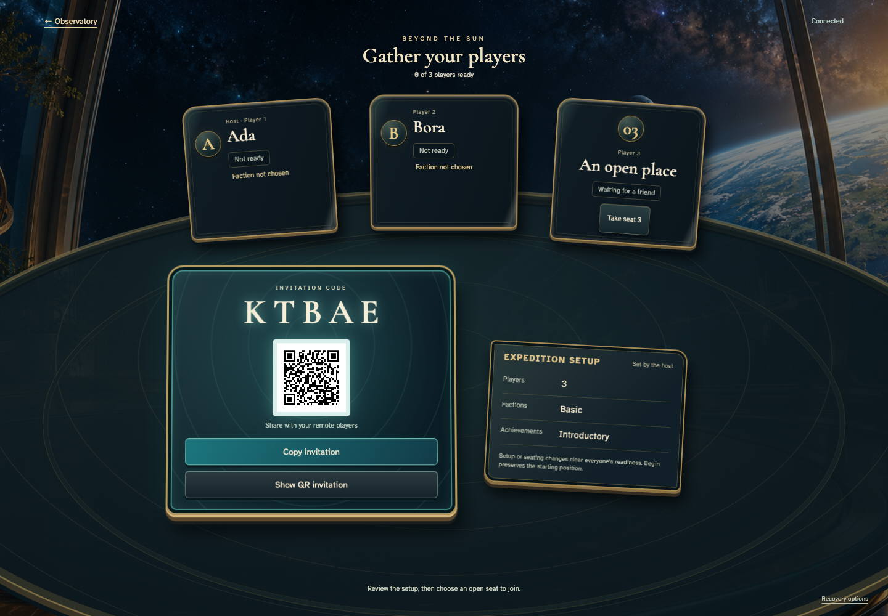](../../screenshots/research-and-recover-a-complete-3-player-remote-first-round/010-invite-2-phone-darwin.png) | [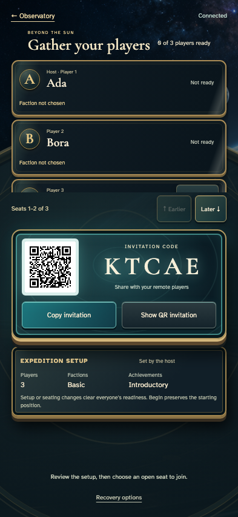](../../screenshots/research-and-recover-a-complete-3-player-remote-first-round/010-invite-2-desktop-darwin.png) |

- [x] Cleo previews the public invitation
- [x] Public Technology headings have physical clearance above their cards.
- [x] The game stays within its actual viewport without page scrolling.

## 12. Cleo opens their separate seat editor

Viewpoint: **Cleo · separate remote identity**.

| phone · 1440 × 1000 | desktop · 393 × 852 |
| --- | --- |
| [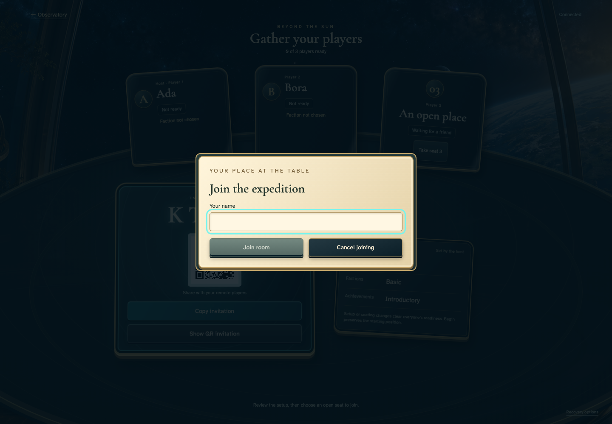](../../screenshots/research-and-recover-a-complete-3-player-remote-first-round/011-join-editor-2-phone-darwin.png) | [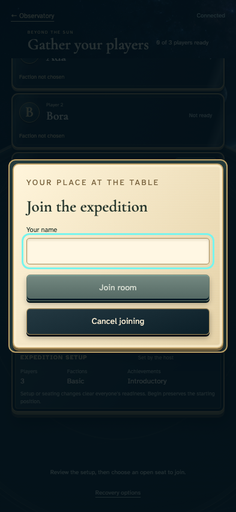](../../screenshots/research-and-recover-a-complete-3-player-remote-first-round/011-join-editor-2-desktop-darwin.png) |

- [x] Cleo opens their separate seat editor
- [x] Public Technology headings have physical clearance above their cards.
- [x] The game stays within its actual viewport without page scrolling.

## 13. Cleo supplies their public name

Viewpoint: **Cleo · separate remote identity**.

| phone · 1440 × 1000 | desktop · 393 × 852 |
| --- | --- |
|  | [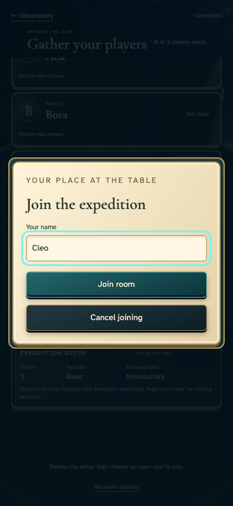](../../screenshots/research-and-recover-a-complete-3-player-remote-first-round/012-join-name-2-desktop-darwin.png) |

- [x] Cleo supplies their public name
- [x] Public Technology headings have physical clearance above their cards.
- [x] The game stays within its actual viewport without page scrolling.

## 14. Cleo joins with a separate identity

Viewpoint: **Cleo · separate remote identity**.

| phone · 1440 × 1000 | desktop · 393 × 852 |
| --- | --- |
| [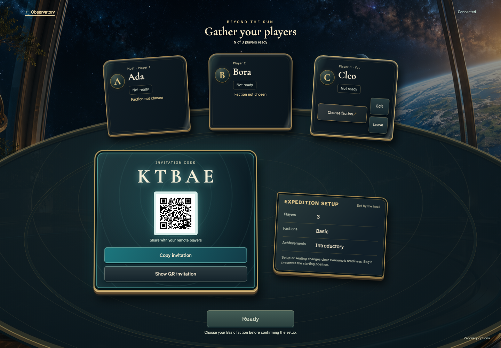](../../screenshots/research-and-recover-a-complete-3-player-remote-first-round/013-joined-2-phone-darwin.png) |  |

- [x] Cleo joins with a separate identity
- [x] Public Technology headings have physical clearance above their cards.
- [x] The game stays within its actual viewport without page scrolling.

## 15. Ada reads the legal unique Basic choices

Viewpoint: **Ada · host**.

| phone · 393 × 852 | desktop · 1440 × 1000 |
| --- | --- |
| [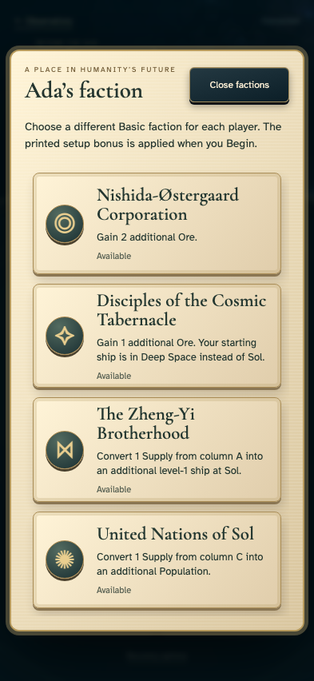](../../screenshots/research-and-recover-a-complete-3-player-remote-first-round/014-factions-0-phone-darwin.png) |  |

- [x] Ada reads the legal unique Basic choices
- [x] Public Technology headings have physical clearance above their cards.
- [x] The game stays within its actual viewport without page scrolling.

## 16. Ada commits the real starting faction

Viewpoint: **Ada · host**.

| phone · 393 × 852 | desktop · 1440 × 1000 |
| --- | --- |
|  | [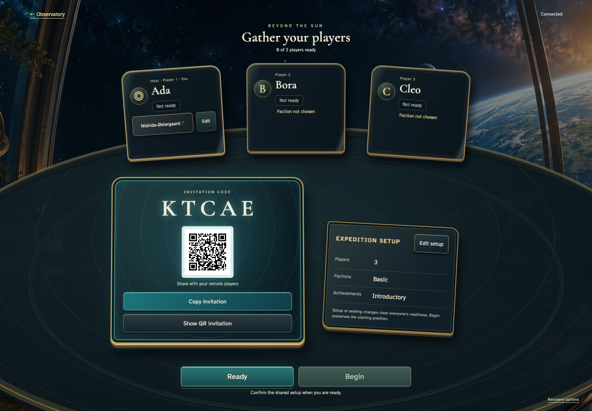](../../screenshots/research-and-recover-a-complete-3-player-remote-first-round/015-faction-chosen-0-desktop-darwin.png) |

- [x] Ada commits the real starting faction
- [x] Public Technology headings have physical clearance above their cards.
- [x] The game stays within its actual viewport without page scrolling.

## 17. Bora reads the legal unique Basic choices

Viewpoint: **Bora · separate remote identity**.

| phone · 1440 × 1000 | desktop · 393 × 852 |
| --- | --- |
| [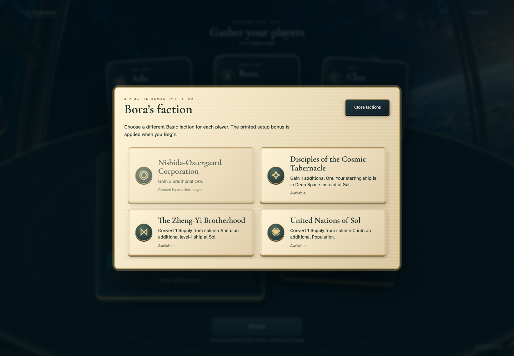](../../screenshots/research-and-recover-a-complete-3-player-remote-first-round/016-factions-1-phone-darwin.png) | [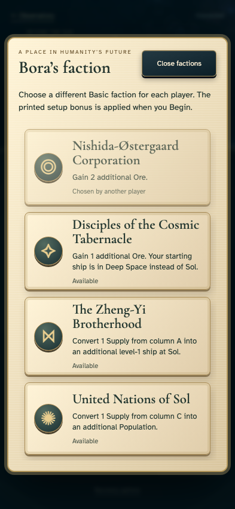](../../screenshots/research-and-recover-a-complete-3-player-remote-first-round/016-factions-1-desktop-darwin.png) |

- [x] Bora reads the legal unique Basic choices
- [x] Public Technology headings have physical clearance above their cards.
- [x] The game stays within its actual viewport without page scrolling.

## 18. Bora commits the real starting faction

Viewpoint: **Bora · separate remote identity**.

| phone · 1440 × 1000 | desktop · 393 × 852 |
| --- | --- |
| [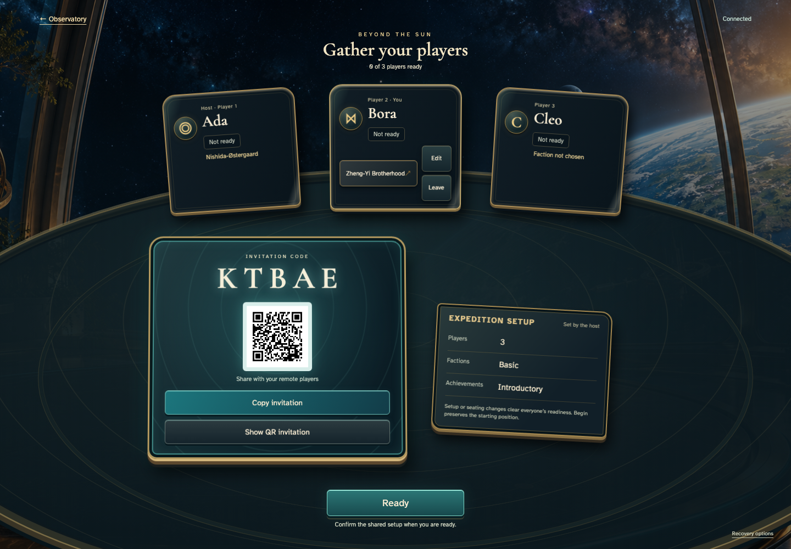](../../screenshots/research-and-recover-a-complete-3-player-remote-first-round/017-faction-chosen-1-phone-darwin.png) | [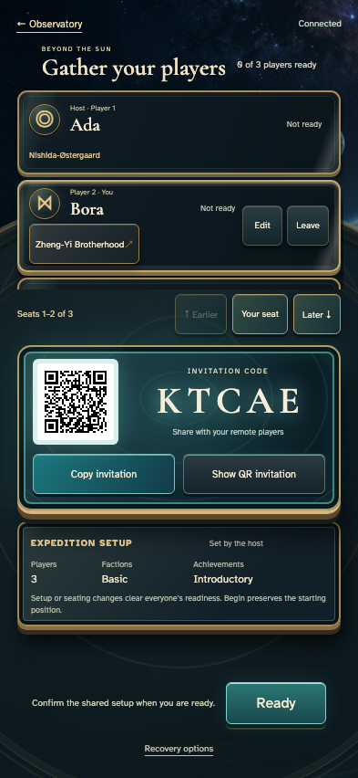](../../screenshots/research-and-recover-a-complete-3-player-remote-first-round/017-faction-chosen-1-desktop-darwin.png) |

- [x] Bora commits the real starting faction
- [x] Public Technology headings have physical clearance above their cards.
- [x] The game stays within its actual viewport without page scrolling.

## 19. Cleo reads the legal unique Basic choices

Viewpoint: **Cleo · separate remote identity**.

| phone · 1440 × 1000 | desktop · 393 × 852 |
| --- | --- |
| [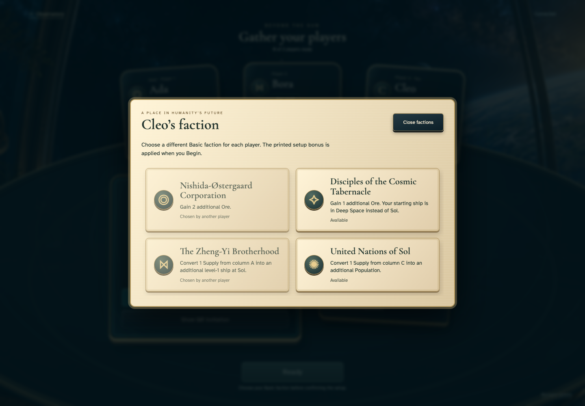](../../screenshots/research-and-recover-a-complete-3-player-remote-first-round/018-factions-2-phone-darwin.png) | [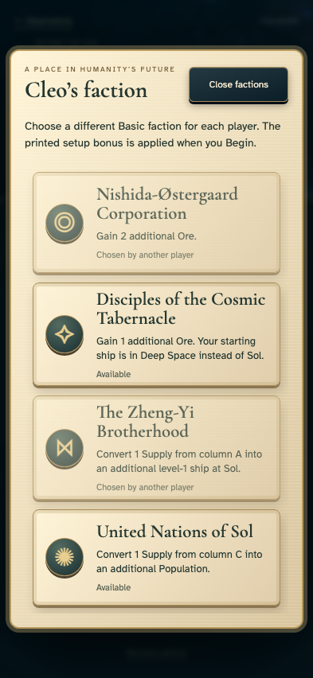](../../screenshots/research-and-recover-a-complete-3-player-remote-first-round/018-factions-2-desktop-darwin.png) |

- [x] Cleo reads the legal unique Basic choices
- [x] Public Technology headings have physical clearance above their cards.
- [x] The game stays within its actual viewport without page scrolling.

## 20. Cleo commits the real starting faction

Viewpoint: **Cleo · separate remote identity**.

| phone · 1440 × 1000 | desktop · 393 × 852 |
| --- | --- |
| [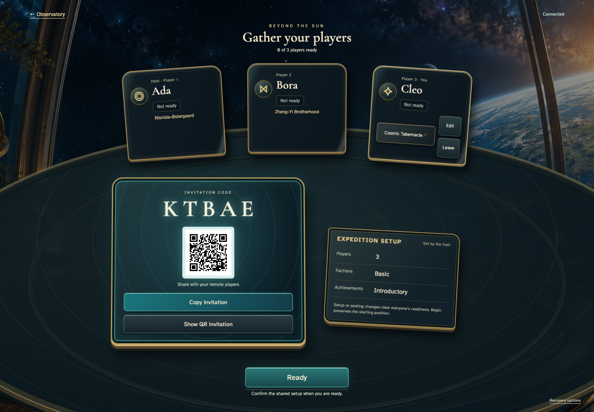](../../screenshots/research-and-recover-a-complete-3-player-remote-first-round/019-faction-chosen-2-phone-darwin.png) | [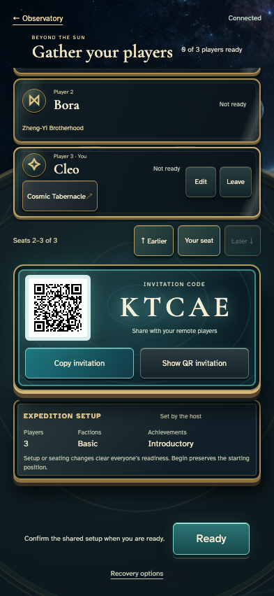](../../screenshots/research-and-recover-a-complete-3-player-remote-first-round/019-faction-chosen-2-desktop-darwin.png) |

- [x] Cleo commits the real starting faction
- [x] Public Technology headings have physical clearance above their cards.
- [x] The game stays within its actual viewport without page scrolling.

## 21. Ada confirms this exact configuration

Viewpoint: **Ada · host**.

| phone · 393 × 852 | desktop · 1440 × 1000 |
| --- | --- |
| [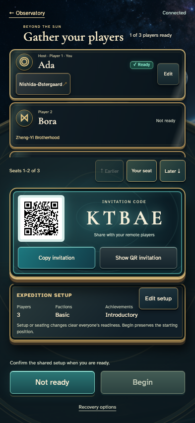](../../screenshots/research-and-recover-a-complete-3-player-remote-first-round/020-ready-0-phone-darwin.png) | [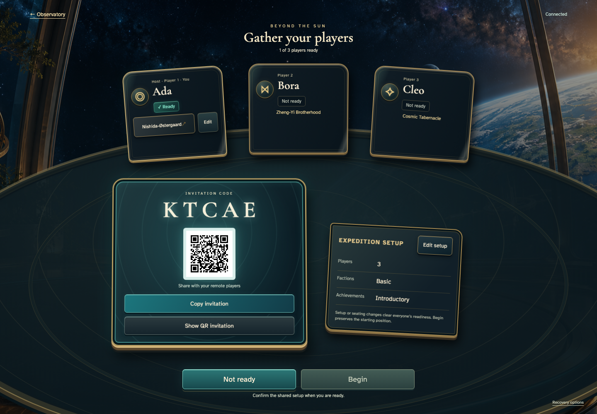](../../screenshots/research-and-recover-a-complete-3-player-remote-first-round/020-ready-0-desktop-darwin.png) |

- [x] Ada confirms this exact configuration
- [x] Public Technology headings have physical clearance above their cards.
- [x] The game stays within its actual viewport without page scrolling.

## 22. Bora confirms this exact configuration

Viewpoint: **Bora · separate remote identity**.

| phone · 1440 × 1000 | desktop · 393 × 852 |
| --- | --- |
|  | [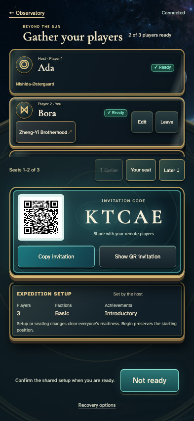](../../screenshots/research-and-recover-a-complete-3-player-remote-first-round/021-ready-1-desktop-darwin.png) |

- [x] Bora confirms this exact configuration
- [x] Public Technology headings have physical clearance above their cards.
- [x] The game stays within its actual viewport without page scrolling.

## 23. Cleo confirms this exact configuration

Viewpoint: **Cleo · separate remote identity**.

| phone · 1440 × 1000 | desktop · 393 × 852 |
| --- | --- |
|  | [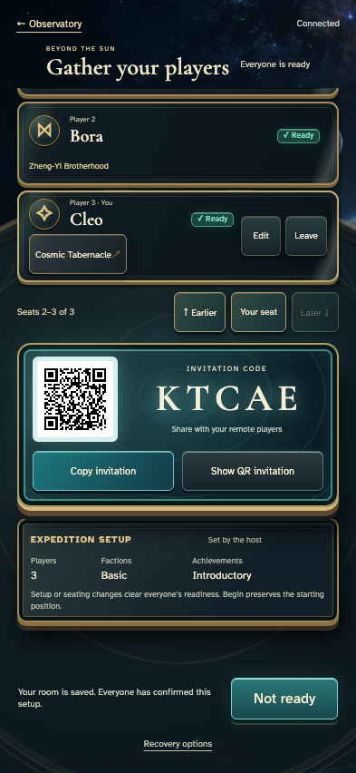](../../screenshots/research-and-recover-a-complete-3-player-remote-first-round/022-ready-2-desktop-darwin.png) |

- [x] Cleo confirms this exact configuration
- [x] Public Technology headings have physical clearance above their cards.
- [x] The game stays within its actual viewport without page scrolling.

## 24. Begin creates the reviewed immutable board and resources

Viewpoint: **Ada · host**.

| phone · 393 × 852 | desktop · 1440 × 1000 |
| --- | --- |
| [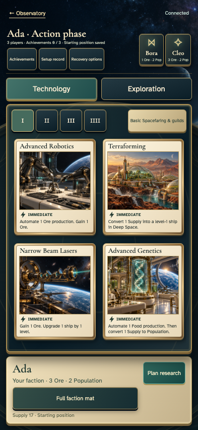](../../screenshots/research-and-recover-a-complete-3-player-remote-first-round/023-begun-phone-darwin.png) | [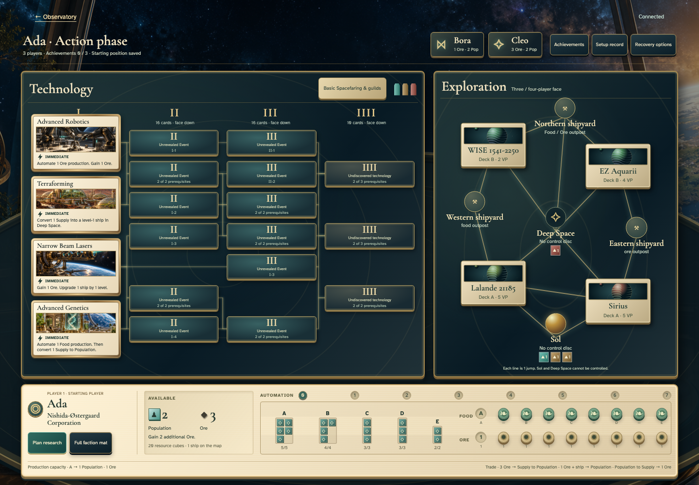](../../screenshots/research-and-recover-a-complete-3-player-remote-first-round/023-begun-desktop-darwin.png) |

- [x] Begin creates the reviewed immutable board and resources
- [x] Public Technology headings have physical clearance above their cards.
- [x] The game stays within its actual viewport without page scrolling.

## 25. Ada plans the real Action pawn and permanent research payment

Viewpoint: **Ada · host**.

| phone · 393 × 852 | desktop · 1440 × 1000 |
| --- | --- |
|  | [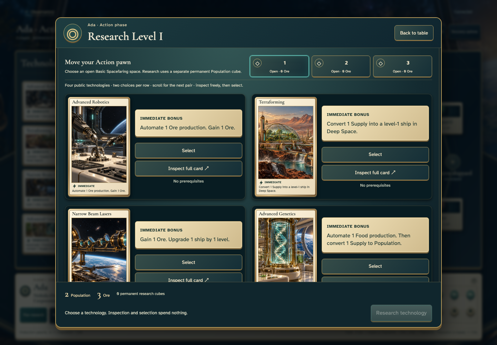](../../screenshots/research-and-recover-a-complete-3-player-remote-first-round/024-turn-0-plan-desktop-darwin.png) |

- [x] Ada plans the real Action pawn and permanent research payment
- [x] Public Technology headings have physical clearance above their cards.
- [x] The game stays within its actual viewport without page scrolling.

## 26. Ada selects Advanced Genetics without paying yet

Viewpoint: **Ada · host**.

| phone · 393 × 852 | desktop · 1440 × 1000 |
| --- | --- |
|  |  |

- [x] Ada selects Advanced Genetics without paying yet
- [x] Public Technology headings have physical clearance above their cards.
- [x] The game stays within its actual viewport without page scrolling.

## 27. Inspect the complete canonical face before payment

Viewpoint: **Ada · host**.

| phone · 393 × 852 | desktop · 1440 × 1000 |
| --- | --- |
| [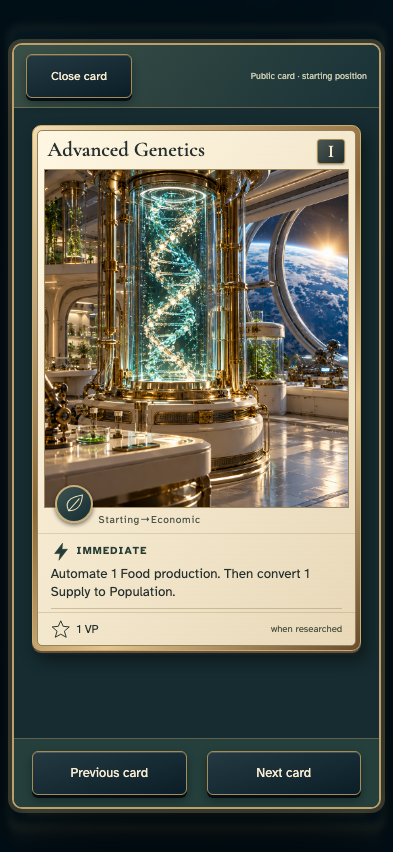](../../screenshots/research-and-recover-a-complete-3-player-remote-first-round/026-full-card-phone-darwin.png) | [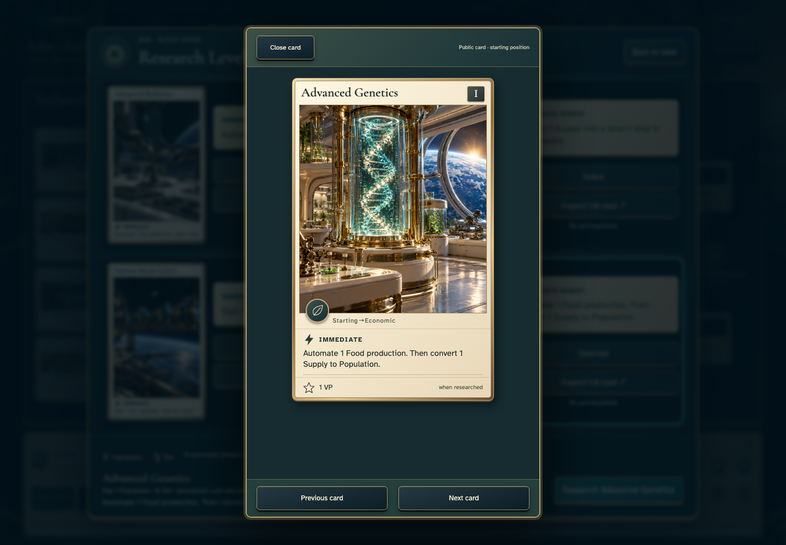](../../screenshots/research-and-recover-a-complete-3-player-remote-first-round/026-full-card-desktop-darwin.png) |

- [x] Inspect the complete canonical face before payment
- [x] Public Technology headings have physical clearance above their cards.
- [x] The game stays within its actual viewport without page scrolling.

## 28. Read the entire public face through its bounded reader

Viewpoint: **Ada · host**.

| phone · 393 × 852 | desktop · 1440 × 1000 |
| --- | --- |
| [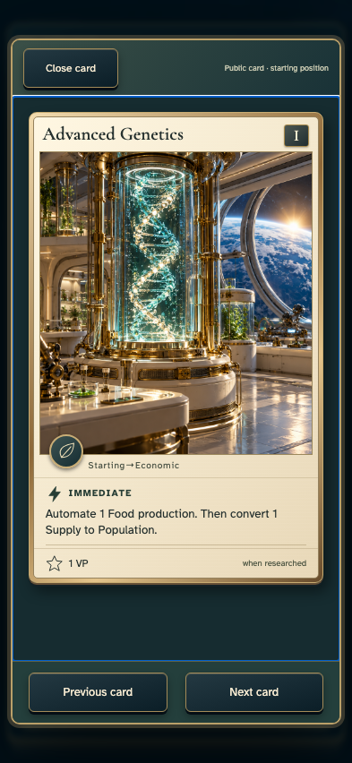](../../screenshots/research-and-recover-a-complete-3-player-remote-first-round/027-full-rules-phone-darwin.png) |  |

- [x] Read the entire public face through its bounded reader
- [x] Public Technology headings have physical clearance above their cards.
- [x] The game stays within its actual viewport without page scrolling.

## 29. Escape restores the actual inspection source without committing

Viewpoint: **Ada · host**.

| phone · 393 × 852 | desktop · 1440 × 1000 |
| --- | --- |
| [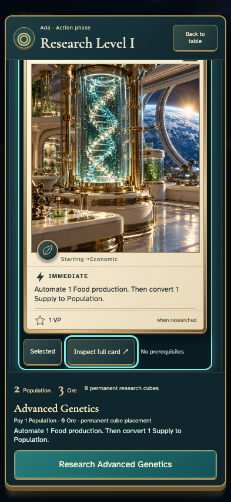](../../screenshots/research-and-recover-a-complete-3-player-remote-first-round/028-inspection-return-phone-darwin.png) | [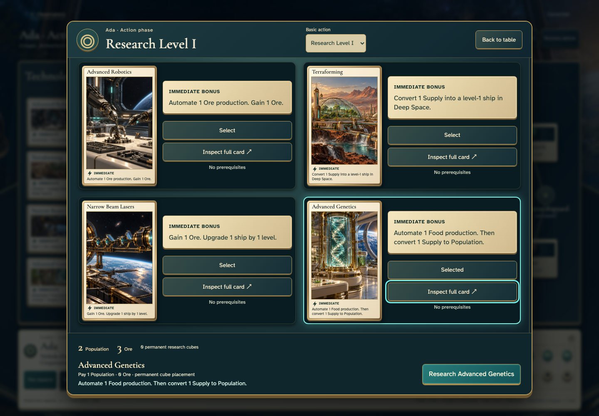](../../screenshots/research-and-recover-a-complete-3-player-remote-first-round/028-inspection-return-desktop-darwin.png) |

- [x] Escape restores the actual inspection source without committing
- [x] Public Technology headings have physical clearance above their cards.
- [x] The game stays within its actual viewport without page scrolling.

## 30. Cancel the unpaid plan and restore the acting mat control

Viewpoint: **Ada · host**.

| phone · 393 × 852 | desktop · 1440 × 1000 |
| --- | --- |
| [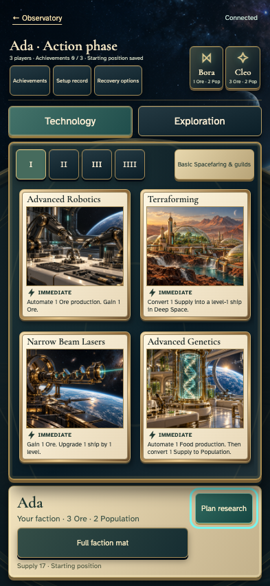](../../screenshots/research-and-recover-a-complete-3-player-remote-first-round/029-plan-return-phone-darwin.png) |  |

- [x] Cancel the unpaid plan and restore the acting mat control
- [x] Public Technology headings have physical clearance above their cards.
- [x] The game stays within its actual viewport without page scrolling.

## 31. Reopen the bounded planning instrument

Viewpoint: **Ada · host**.

| phone · 393 × 852 | desktop · 1440 × 1000 |
| --- | --- |
| [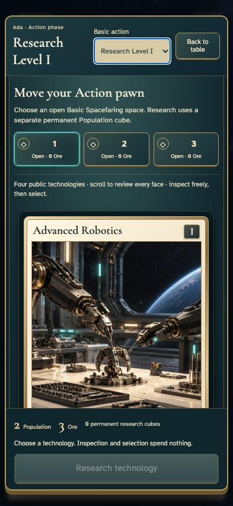](../../screenshots/research-and-recover-a-complete-3-player-remote-first-round/030-reopened-plan-phone-darwin.png) |  |

- [x] Reopen the bounded planning instrument
- [x] Public Technology headings have physical clearance above their cards.
- [x] The game stays within its actual viewport without page scrolling.

## 32. Ada selects Advanced Genetics without paying yet

Viewpoint: **Ada · host**.

| phone · 393 × 852 | desktop · 1440 × 1000 |
| --- | --- |
| [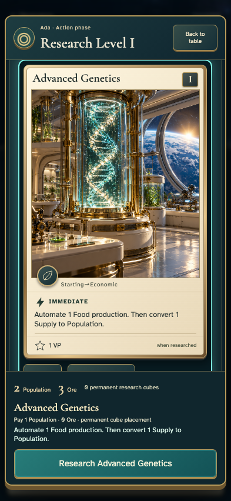](../../screenshots/research-and-recover-a-complete-3-player-remote-first-round/031-turn-0-selected-reopened-phone-darwin.png) | [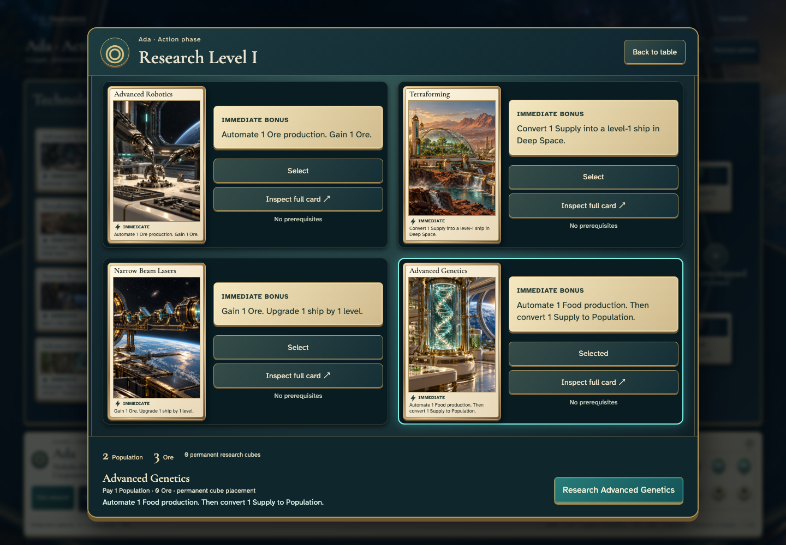](../../screenshots/research-and-recover-a-complete-3-player-remote-first-round/031-turn-0-selected-reopened-desktop-darwin.png) |

- [x] Ada selects Advanced Genetics without paying yet
- [x] Public Technology headings have physical clearance above their cards.
- [x] The game stays within its actual viewport without page scrolling.

## 33. Ada pays once, places the permanent cube and resolves Advanced Genetics

Viewpoint: **Ada · host**.

| phone · 393 × 852 | desktop · 1440 × 1000 |
| --- | --- |
|  | [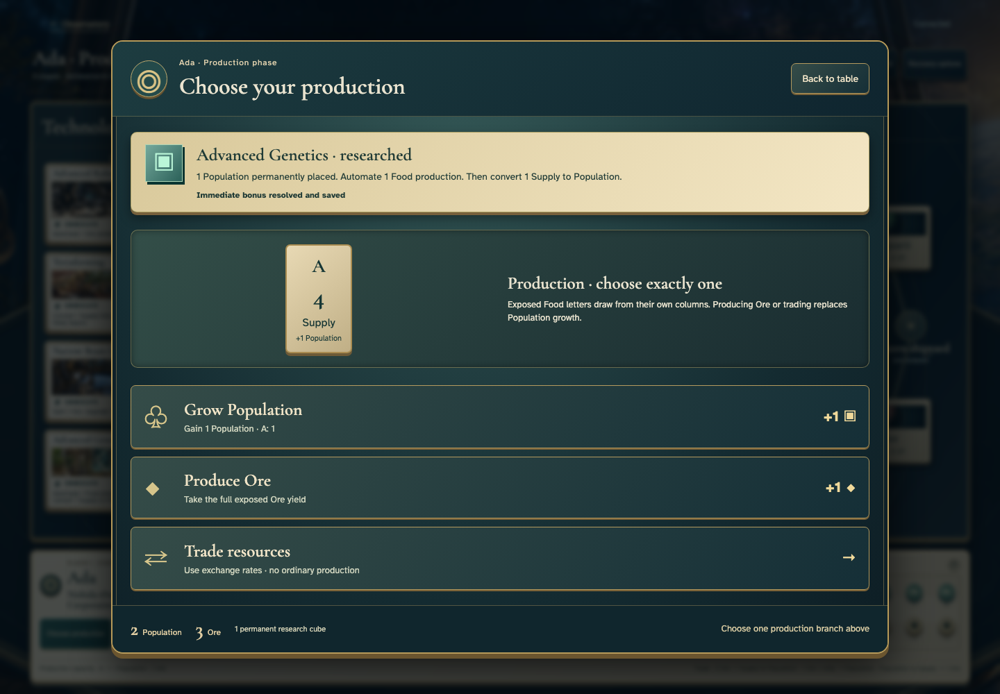](../../screenshots/research-and-recover-a-complete-3-player-remote-first-round/032-turn-0-researched-desktop-darwin.png) |

- [x] Ada pays once, places the permanent cube and resolves Advanced Genetics
- [x] Public Technology headings have physical clearance above their cards.
- [x] The game stays within its actual viewport without page scrolling.

## 34. Ada reloads the retained pending production without a repeated bonus

Viewpoint: **Ada · host**.

| phone · 393 × 852 | desktop · 1440 × 1000 |
| --- | --- |
| [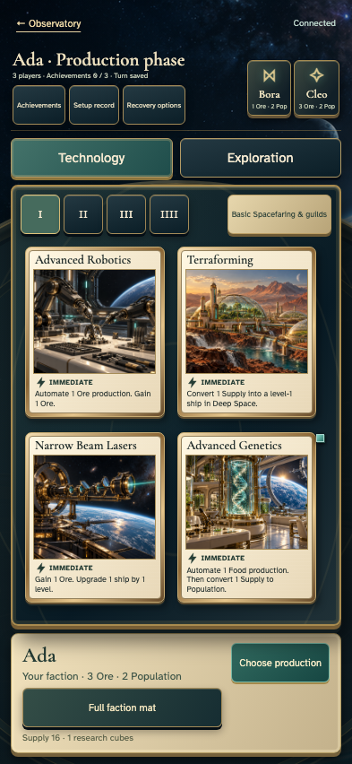](../../screenshots/research-and-recover-a-complete-3-player-remote-first-round/033-turn-0-pending-restored-phone-darwin.png) | [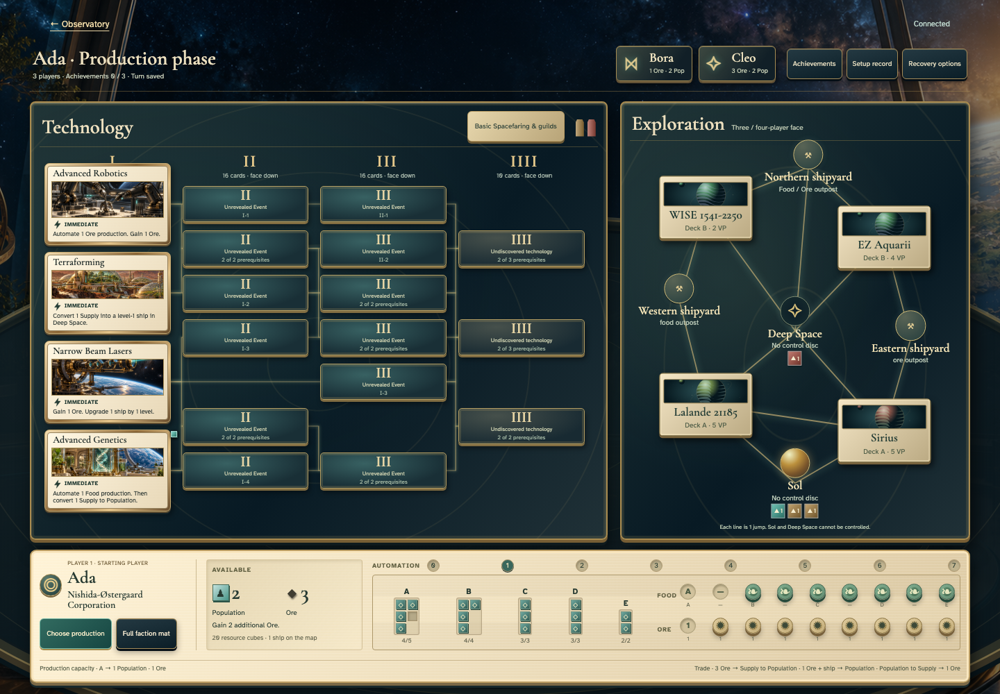](../../screenshots/research-and-recover-a-complete-3-player-remote-first-round/033-turn-0-pending-restored-desktop-darwin.png) |

- [x] Ada reloads the retained pending production without a repeated bonus
- [x] Public Technology headings have physical clearance above their cards.
- [x] The game stays within its actual viewport without page scrolling.

## 35. Ada resumes the same saved production choice

Viewpoint: **Ada · host**.

| phone · 393 × 852 | desktop · 1440 × 1000 |
| --- | --- |
|  |  |

- [x] Ada resumes the same saved production choice
- [x] Public Technology headings have physical clearance above their cards.
- [x] The game stays within its actual viewport without page scrolling.

## 36. Ada hands off automatically after the resolved production branch

Viewpoint: **Ada · host**.

| phone · 393 × 852 | desktop · 1440 × 1000 |
| --- | --- |
| [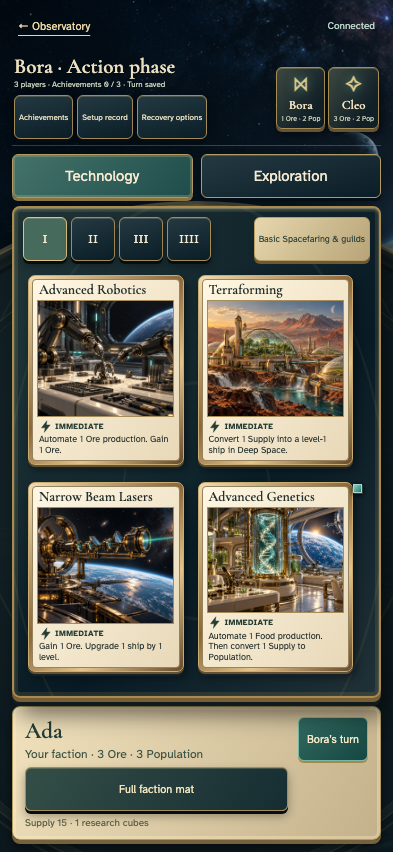](../../screenshots/research-and-recover-a-complete-3-player-remote-first-round/035-turn-0-handoff-phone-darwin.png) | [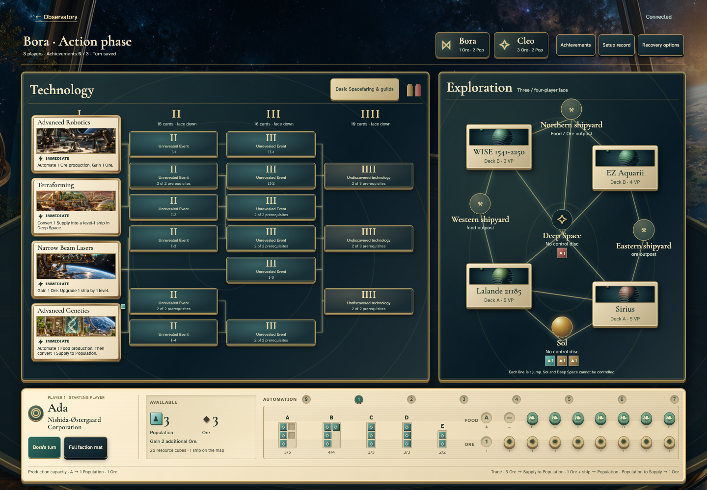](../../screenshots/research-and-recover-a-complete-3-player-remote-first-round/035-turn-0-handoff-desktop-darwin.png) |

- [x] Ada hands off automatically after the resolved production branch
- [x] Public Technology headings have physical clearance above their cards.
- [x] The game stays within its actual viewport without page scrolling.

## 37. Bora sees the canonical handoff on their own interface

Viewpoint: **Bora · separate remote identity**.

| phone · 1440 × 1000 | desktop · 393 × 852 |
| --- | --- |
| [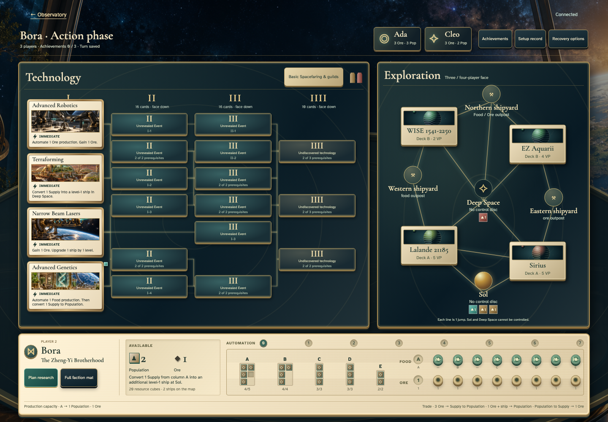](../../screenshots/research-and-recover-a-complete-3-player-remote-first-round/036-turn-0-next-player-phone-darwin.png) |  |

- [x] Bora sees the canonical handoff on their own interface
- [x] Public Technology headings have physical clearance above their cards.
- [x] The game stays within its actual viewport without page scrolling.

## 38. Bora plans the real Action pawn and permanent research payment

Viewpoint: **Bora · separate remote identity**.

| phone · 1440 × 1000 | desktop · 393 × 852 |
| --- | --- |
|  | [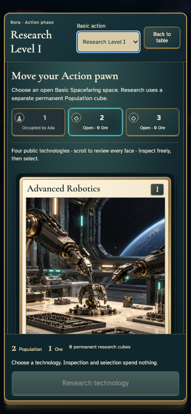](../../screenshots/research-and-recover-a-complete-3-player-remote-first-round/037-turn-1-plan-desktop-darwin.png) |

- [x] Bora plans the real Action pawn and permanent research payment
- [x] Public Technology headings have physical clearance above their cards.
- [x] The game stays within its actual viewport without page scrolling.

## 39. An occupied Action space rejects commitment without spending

Viewpoint: **Bora · separate remote identity**.

| phone · 1440 × 1000 | desktop · 393 × 852 |
| --- | --- |
|  |  |

- [x] An occupied Action space rejects commitment without spending
- [x] Public Technology headings have physical clearance above their cards.
- [x] The game stays within its actual viewport without page scrolling.

## 40. Choose the genuinely unoccupied second space

Viewpoint: **Bora · separate remote identity**.

| phone · 1440 × 1000 | desktop · 393 × 852 |
| --- | --- |
|  |  |

- [x] Choose the genuinely unoccupied second space
- [x] Public Technology headings have physical clearance above their cards.
- [x] The game stays within its actual viewport without page scrolling.

## 41. Bora selects Narrow Beam Lasers without paying yet

Viewpoint: **Bora · separate remote identity**.

| phone · 1440 × 1000 | desktop · 393 × 852 |
| --- | --- |
|  |  |

- [x] Bora selects Narrow Beam Lasers without paying yet
- [x] Public Technology headings have physical clearance above their cards.
- [x] The game stays within its actual viewport without page scrolling.

## 42. The mandatory Lasers target disables commit until explicitly chosen

Viewpoint: **Bora · separate remote identity**.

| phone · 1440 × 1000 | desktop · 393 × 852 |
| --- | --- |
|  |  |

- [x] The mandatory Lasers target disables commit until explicitly chosen
- [x] Public Technology headings have physical clearance above their cards.
- [x] The game stays within its actual viewport without page scrolling.

## 43. Select the second Sol ship; the commit names its level1 to2 consequence

Viewpoint: **Bora · separate remote identity**.

| phone · 1440 × 1000 | desktop · 393 × 852 |
| --- | --- |
|  |  |

- [x] Select the second Sol ship; the commit names its level1 to2 consequence
- [x] Public Technology headings have physical clearance above their cards.
- [x] The game stays within its actual viewport without page scrolling.

## 44. Bora pays once, places the permanent cube and resolves Narrow Beam Lasers

Viewpoint: **Bora · separate remote identity**.

| phone · 1440 × 1000 | desktop · 393 × 852 |
| --- | --- |
|  |  |

- [x] Bora pays once, places the permanent cube and resolves Narrow Beam Lasers
- [x] Public Technology headings have physical clearance above their cards.
- [x] The game stays within its actual viewport without page scrolling.

## 45. Bora reloads the retained pending production without a repeated bonus

Viewpoint: **Bora · separate remote identity**.

| phone · 1440 × 1000 | desktop · 393 × 852 |
| --- | --- |
|  |  |

- [x] Bora reloads the retained pending production without a repeated bonus
- [x] Public Technology headings have physical clearance above their cards.
- [x] The game stays within its actual viewport without page scrolling.

## 46. Bora resumes the same saved production choice

Viewpoint: **Bora · separate remote identity**.

| phone · 1440 × 1000 | desktop · 393 × 852 |
| --- | --- |
|  |  |

- [x] Bora resumes the same saved production choice
- [x] Public Technology headings have physical clearance above their cards.
- [x] The game stays within its actual viewport without page scrolling.

## 47. Trade is a persisted exclusive production branch

Viewpoint: **Bora · separate remote identity**.

| phone · 1440 × 1000 | desktop · 393 × 852 |
| --- | --- |
|  |  |

- [x] Trade is a persisted exclusive production branch
- [x] Public Technology headings have physical clearance above their cards.
- [x] The game stays within its actual viewport without page scrolling.

## 48. Inspect the printed ship decommission exchange

Viewpoint: **Bora · separate remote identity**.

| phone · 1440 × 1000 | desktop · 393 × 852 |
| --- | --- |
|  |  |

- [x] Inspect the printed ship decommission exchange
- [x] Public Technology headings have physical clearance above their cards.
- [x] The game stays within its actual viewport without page scrolling.

## 49. Identify the unupgraded first Sol ship, preserving the level2 second ship

Viewpoint: **Bora · separate remote identity**.

| phone · 1440 × 1000 | desktop · 393 × 852 |
| --- | --- |
|  |  |

- [x] Identify the unupgraded first Sol ship, preserving the level2 second ship
- [x] Public Technology headings have physical clearance above their cards.
- [x] The game stays within its actual viewport without page scrolling.

## 50. Pay1 Ore and turn the first ship into available Population

Viewpoint: **Bora · separate remote identity**.

| phone · 1440 × 1000 | desktop · 393 × 852 |
| --- | --- |
|  |  |

- [x] Pay1 Ore and turn the first ship into available Population
- [x] Public Technology headings have physical clearance above their cards.
- [x] The game stays within its actual viewport without page scrolling.

## 51. Inspect the Population return exchange

Viewpoint: **Bora · separate remote identity**.

| phone · 1440 × 1000 | desktop · 393 × 852 |
| --- | --- |
|  |  |

- [x] Inspect the Population return exchange
- [x] Public Technology headings have physical clearance above their cards.
- [x] The game stays within its actual viewport without page scrolling.

## 52. Return Population1 to the rightmost Supply space

Viewpoint: **Bora · separate remote identity**.

| phone · 1440 × 1000 | desktop · 393 × 852 |
| --- | --- |
|  |  |

- [x] Return Population1 to the rightmost Supply space
- [x] Public Technology headings have physical clearance above their cards.
- [x] The game stays within its actual viewport without page scrolling.

## 53. Return Population2 to the rightmost Supply space

Viewpoint: **Bora · separate remote identity**.

| phone · 1440 × 1000 | desktop · 393 × 852 |
| --- | --- |
|  |  |

- [x] Return Population2 to the rightmost Supply space
- [x] Public Technology headings have physical clearance above their cards.
- [x] The game stays within its actual viewport without page scrolling.

## 54. Close the trade reader without ending its saved phase

Viewpoint: **Bora · separate remote identity**.

| phone · 1440 × 1000 | desktop · 393 × 852 |
| --- | --- |
|  |  |

- [x] Close the trade reader without ending its saved phase
- [x] Public Technology headings have physical clearance above their cards.
- [x] The game stays within its actual viewport without page scrolling.

## 55. The complete mat shows the actual sixth Supply cube

Viewpoint: **Bora · separate remote identity**.

| phone · 1440 × 1000 | desktop · 393 × 852 |
| --- | --- |
|  |  |

- [x] The complete mat shows the actual sixth Supply cube
- [x] Public Technology headings have physical clearance above their cards.
- [x] The game stays within its actual viewport without page scrolling.

## 56. Return from the public mat inspection with the trade phase retained

Viewpoint: **Bora · separate remote identity**.

| phone · 1440 × 1000 | desktop · 393 × 852 |
| --- | --- |
|  |  |

- [x] Return from the public mat inspection with the trade phase retained
- [x] Public Technology headings have physical clearance above their cards.
- [x] The game stays within its actual viewport without page scrolling.

## 57. Resume the same accepted trade stream

Viewpoint: **Bora · separate remote identity**.

| phone · 1440 × 1000 | desktop · 393 × 852 |
| --- | --- |
|  |  |

- [x] Resume the same accepted trade stream
- [x] Public Technology headings have physical clearance above their cards.
- [x] The game stays within its actual viewport without page scrolling.

## 58. Inspect the printed recruitment exchange

Viewpoint: **Bora · separate remote identity**.

| phone · 1440 × 1000 | desktop · 393 × 852 |
| --- | --- |
|  |  |

- [x] Inspect the printed recruitment exchange
- [x] Public Technology headings have physical clearance above their cards.
- [x] The game stays within its actual viewport without page scrolling.

## 59. Pay3 Ore and convert the leftmost Supply into Population

Viewpoint: **Bora · separate remote identity**.

| phone · 1440 × 1000 | desktop · 393 × 852 |
| --- | --- |
|  |  |

- [x] Pay3 Ore and convert the leftmost Supply into Population
- [x] Public Technology headings have physical clearance above their cards.
- [x] The game stays within its actual viewport without page scrolling.

## 60. Reload preserves the accepted exchanges and trading phase

Viewpoint: **Bora · separate remote identity**.

| phone · 1440 × 1000 | desktop · 393 × 852 |
| --- | --- |
|  |  |

- [x] Reload preserves the accepted exchanges and trading phase
- [x] Public Technology headings have physical clearance above their cards.
- [x] The game stays within its actual viewport without page scrolling.

## 61. Reopen the saved balance without duplicating an exchange

Viewpoint: **Bora · separate remote identity**.

| phone · 1440 × 1000 | desktop · 393 × 852 |
| --- | --- |
|  |  |

- [x] Reopen the saved balance without duplicating an exchange
- [x] Public Technology headings have physical clearance above their cards.
- [x] The game stays within its actual viewport without page scrolling.

## 62. Bora hands off automatically after the resolved production branch

Viewpoint: **Bora · separate remote identity**.

| phone · 1440 × 1000 | desktop · 393 × 852 |
| --- | --- |
|  |  |

- [x] Bora hands off automatically after the resolved production branch
- [x] Public Technology headings have physical clearance above their cards.
- [x] The game stays within its actual viewport without page scrolling.

## 63. Cleo sees the canonical handoff on their own interface

Viewpoint: **Cleo · separate remote identity**.

| phone · 1440 × 1000 | desktop · 393 × 852 |
| --- | --- |
|  |  |

- [x] Cleo sees the canonical handoff on their own interface
- [x] Public Technology headings have physical clearance above their cards.
- [x] The game stays within its actual viewport without page scrolling.

## 64. Cleo plans the real Action pawn and permanent research payment

Viewpoint: **Cleo · separate remote identity**.

| phone · 1440 × 1000 | desktop · 393 × 852 |
| --- | --- |
|  |  |

- [x] Cleo plans the real Action pawn and permanent research payment
- [x] Public Technology headings have physical clearance above their cards.
- [x] The game stays within its actual viewport without page scrolling.

## 65. Cleo selects Advanced Robotics without paying yet

Viewpoint: **Cleo · separate remote identity**.

| phone · 1440 × 1000 | desktop · 393 × 852 |
| --- | --- |
|  |  |

- [x] Cleo selects Advanced Robotics without paying yet
- [x] Public Technology headings have physical clearance above their cards.
- [x] The game stays within its actual viewport without page scrolling.

## 66. Cleo pays once, places the permanent cube and resolves Advanced Robotics

Viewpoint: **Cleo · separate remote identity**.

| phone · 1440 × 1000 | desktop · 393 × 852 |
| --- | --- |
|  |  |

- [x] Cleo pays once, places the permanent cube and resolves Advanced Robotics
- [x] Public Technology headings have physical clearance above their cards.
- [x] The game stays within its actual viewport without page scrolling.

## 67. Cleo hands off automatically after the resolved production branch

Viewpoint: **Cleo · separate remote identity**.

| phone · 1440 × 1000 | desktop · 393 × 852 |
| --- | --- |
|  |  |

- [x] Cleo hands off automatically after the resolved production branch
- [x] Public Technology headings have physical clearance above their cards.
- [x] The game stays within its actual viewport without page scrolling.

## 68. Ada sees the canonical handoff on their own interface

Viewpoint: **Ada · host**.

| phone · 393 × 852 | desktop · 1440 × 1000 |
| --- | --- |
|  |  |

- [x] Ada sees the canonical handoff on their own interface
- [x] Public Technology headings have physical clearance above their cards.
- [x] The game stays within its actual viewport without page scrolling.

## 69. Reload recovers permanent cubes, occupied spaces and all economies

Viewpoint: **Ada · host**.

| phone · 393 × 852 | desktop · 1440 × 1000 |
| --- | --- |
|  |  |

- [x] Reload recovers permanent cubes, occupied spaces and all economies
- [x] Public Technology headings have physical clearance above their cards.
- [x] The game stays within its actual viewport without page scrolling.

## 70. A separate unseated identity sees permanent public research without turn authority

Viewpoint: **Public observer · separate identity**.

| phone · 393 × 852 | desktop · 1440 × 1000 |
| --- | --- |
|  |  |

- [x] A separate unseated identity sees permanent public research without turn authority
- [x] Public Technology headings have physical clearance above their cards.
- [x] The game stays within its actual viewport without page scrolling.

## 71. The observer can inspect the same researched public face

Viewpoint: **Public observer · separate identity**.

| phone · 393 × 852 | desktop · 1440 × 1000 |
| --- | --- |
|  |  |

- [x] The observer can inspect the same researched public face
- [x] Public Technology headings have physical clearance above their cards.
- [x] The game stays within its actual viewport without page scrolling.

## 72. Escape restores public inspection focus without acquiring a seat

Viewpoint: **Public observer · separate identity**.

| phone · 393 × 852 | desktop · 1440 × 1000 |
| --- | --- |
|  |  |

- [x] Escape restores public inspection focus without acquiring a seat
- [x] Public Technology headings have physical clearance above their cards.
- [x] The game stays within its actual viewport without page scrolling.
