# Choose a two-prerequisite discovery type and retain the exact public candidates

Ordinary UI setup and legal preparatory turns; two independent remote identities, no state injection. Fixed initial entropy selects documented base-game seed 55555555-5555-4555-8555-000000000039. Every visible decision/input/result uses TestStepHelper. Revealed Events, candidates and mandatory bonuses remain on the canonical persisted queue. Printed technology Actions are inspectable; later-phase turn actions are not implemented by this increment.

## 1. Arrive through the actual observatory

Viewpoint: **Ada · independent host controller**.

| phone · 393 × 852 | desktop · 1440 × 1000 |
| --- | --- |
|  |  |

- [x] Arrive through the actual observatory
- [x] The saved automatic consequences settle before the public decision is photographed.
- [x] Public compact Technology objects retain physical separation.
- [x] The gameplay shell stays inside the actual viewport.

## 2. Choose the intended production interface

Viewpoint: **Ada · independent host controller**.

| phone · 393 × 852 | desktop · 1440 × 1000 |
| --- | --- |
|  |  |

- [x] Choose the intended production interface
- [x] The saved automatic consequences settle before the public decision is photographed.
- [x] Public compact Technology objects retain physical separation.
- [x] The gameplay shell stays inside the actual viewport.

## 3. Configure a real remote room

Viewpoint: **Ada · independent host controller**.

| phone · 393 × 852 | desktop · 1440 × 1000 |
| --- | --- |
|  |  |

- [x] Configure a real remote room
- [x] The saved automatic consequences settle before the public decision is photographed.
- [x] Public compact Technology objects retain physical separation.
- [x] The gameplay shell stays inside the actual viewport.

## 4. Name the host before creating the room

Viewpoint: **Ada · independent host controller**.

| phone · 393 × 852 | desktop · 1440 × 1000 |
| --- | --- |
|  |  |

- [x] Name the host before creating the room
- [x] The saved automatic consequences settle before the public decision is photographed.
- [x] Public compact Technology objects retain physical separation.
- [x] The gameplay shell stays inside the actual viewport.

## 5. Create the canonical remote room and invitation

Viewpoint: **Ada · independent host controller**.

| phone · 393 × 852 | desktop · 1440 × 1000 |
| --- | --- |
| [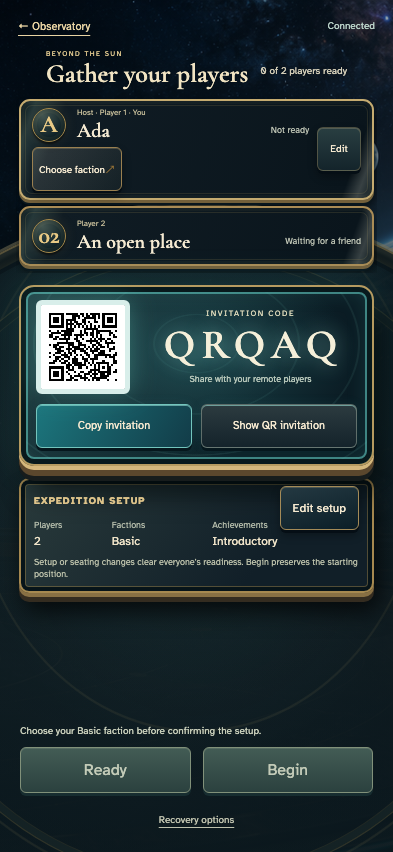](../../screenshots/choose-a-two-prerequisite-discovery-type-and-retain-the-exact-public-candidates/004-host-created-phone-darwin.png) | [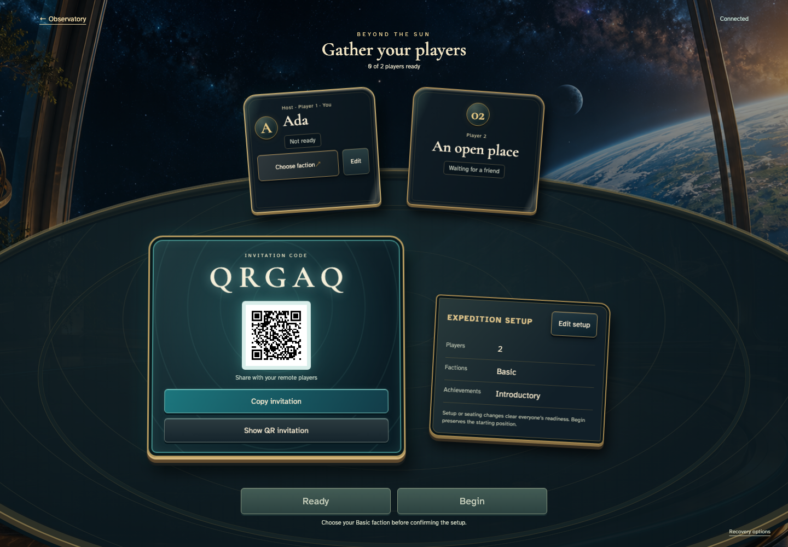](../../screenshots/choose-a-two-prerequisite-discovery-type-and-retain-the-exact-public-candidates/004-host-created-desktop-darwin.png) |

- [x] Create the canonical remote room and invitation
- [x] The saved automatic consequences settle before the public decision is photographed.
- [x] Public compact Technology objects retain physical separation.
- [x] The gameplay shell stays inside the actual viewport.

## 6. A separate identity previews the real invitation

Viewpoint: **Bora · independent guest controller**.

| phone · 1440 × 1000 | desktop · 393 × 852 |
| --- | --- |
| [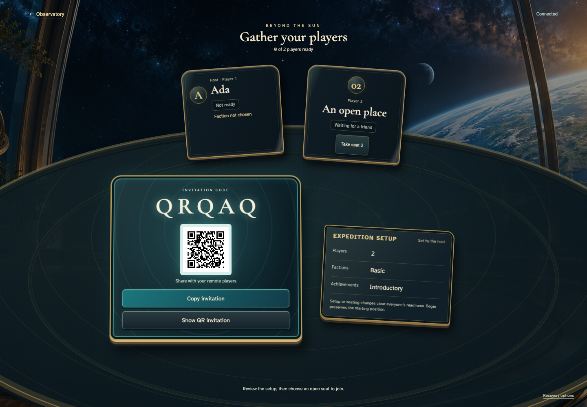](../../screenshots/choose-a-two-prerequisite-discovery-type-and-retain-the-exact-public-candidates/005-guest-preview-phone-darwin.png) | [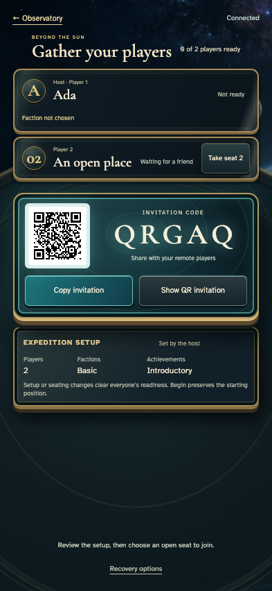](../../screenshots/choose-a-two-prerequisite-discovery-type-and-retain-the-exact-public-candidates/005-guest-preview-desktop-darwin.png) |

- [x] A separate identity previews the real invitation
- [x] The saved automatic consequences settle before the public decision is photographed.
- [x] Public compact Technology objects retain physical separation.
- [x] The gameplay shell stays inside the actual viewport.

## 7. The guest opens the ordinary seat editor

Viewpoint: **Bora · independent guest controller**.

| phone · 1440 × 1000 | desktop · 393 × 852 |
| --- | --- |
| [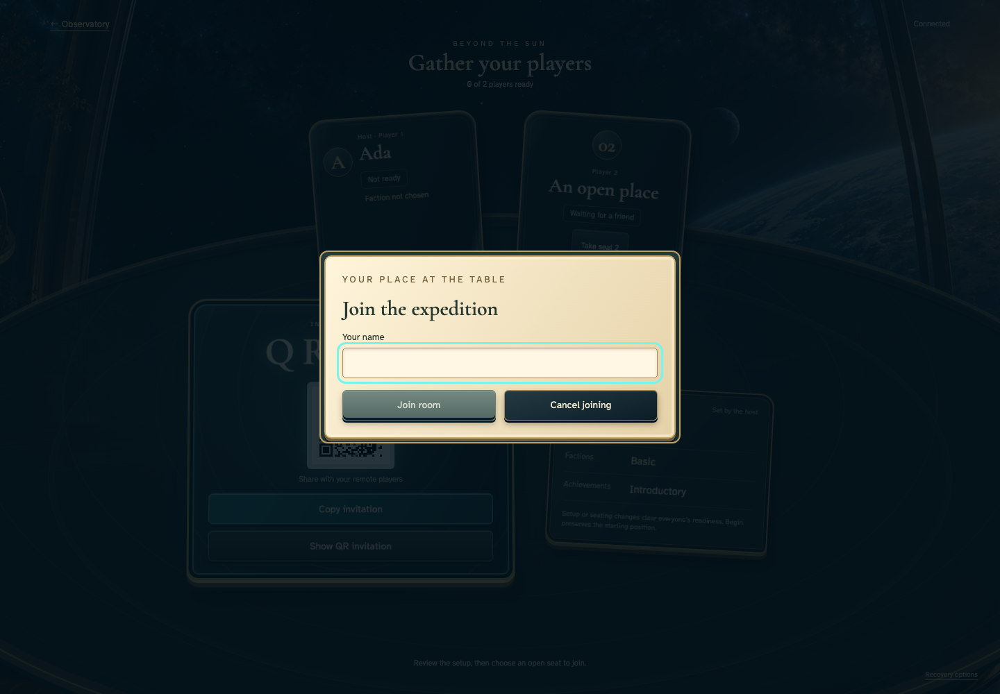](../../screenshots/choose-a-two-prerequisite-discovery-type-and-retain-the-exact-public-candidates/006-guest-editor-phone-darwin.png) |  |

- [x] The guest opens the ordinary seat editor
- [x] The saved automatic consequences settle before the public decision is photographed.
- [x] Public compact Technology objects retain physical separation.
- [x] The gameplay shell stays inside the actual viewport.

## 8. Name the independent guest

Viewpoint: **Bora · independent guest controller**.

| phone · 1440 × 1000 | desktop · 393 × 852 |
| --- | --- |
| [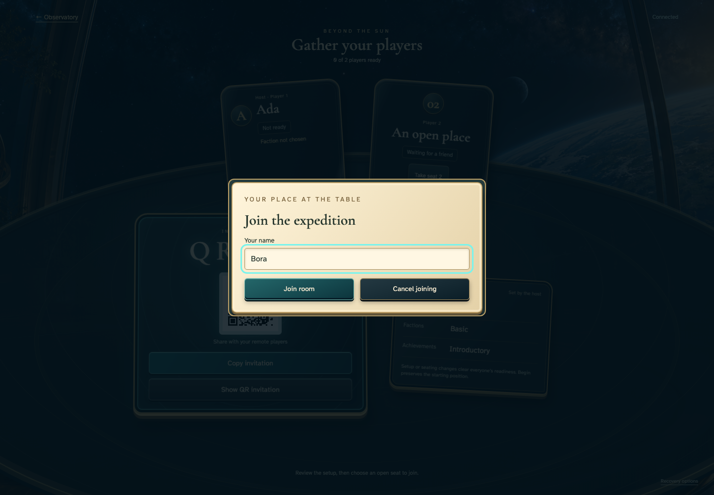](../../screenshots/choose-a-two-prerequisite-discovery-type-and-retain-the-exact-public-candidates/007-guest-name-phone-darwin.png) |  |

- [x] Name the independent guest
- [x] The saved automatic consequences settle before the public decision is photographed.
- [x] Public compact Technology objects retain physical separation.
- [x] The gameplay shell stays inside the actual viewport.

## 9. Bora claims their own remote seat

Viewpoint: **Bora · independent guest controller**.

| phone · 1440 × 1000 | desktop · 393 × 852 |
| --- | --- |
| [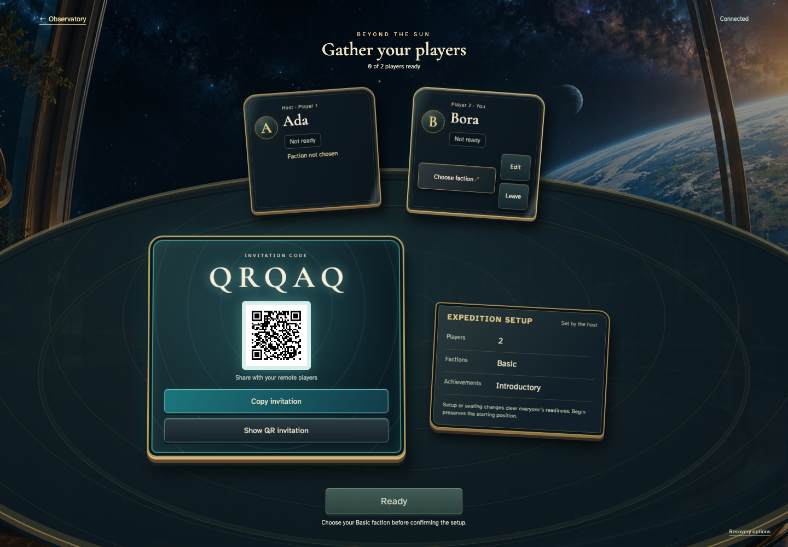](../../screenshots/choose-a-two-prerequisite-discovery-type-and-retain-the-exact-public-candidates/008-guest-joined-phone-darwin.png) | [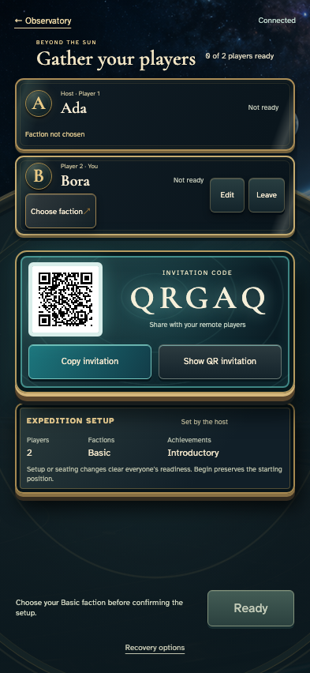](../../screenshots/choose-a-two-prerequisite-discovery-type-and-retain-the-exact-public-candidates/008-guest-joined-desktop-darwin.png) |

- [x] Bora claims their own remote seat
- [x] The saved automatic consequences settle before the public decision is photographed.
- [x] Public compact Technology objects retain physical separation.
- [x] The gameplay shell stays inside the actual viewport.

## 10. Ada reads the legal unique Basic factions

Viewpoint: **Ada · independent host controller**.

| phone · 393 × 852 | desktop · 1440 × 1000 |
| --- | --- |
|  | [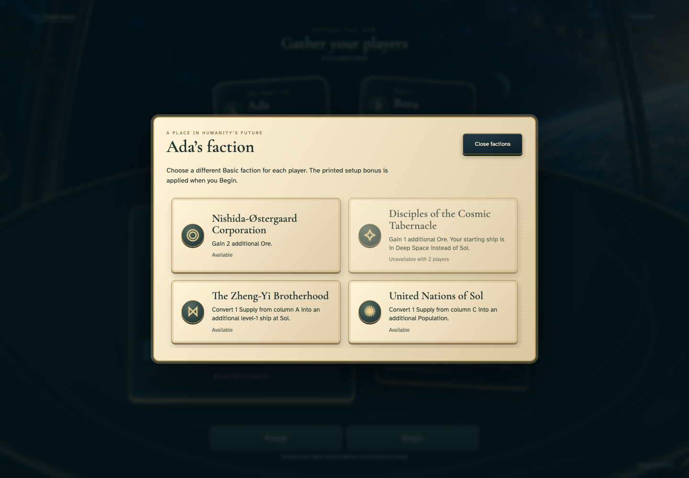](../../screenshots/choose-a-two-prerequisite-discovery-type-and-retain-the-exact-public-candidates/009-faction-0-choices-desktop-darwin.png) |

- [x] Ada reads the legal unique Basic factions
- [x] The saved automatic consequences settle before the public decision is photographed.
- [x] Public compact Technology objects retain physical separation.
- [x] The gameplay shell stays inside the actual viewport.

## 11. Ada chooses their actual production faction

Viewpoint: **Ada · independent host controller**.

| phone · 393 × 852 | desktop · 1440 × 1000 |
| --- | --- |
| [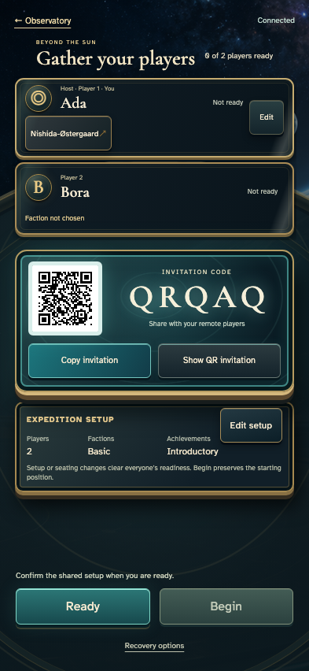](../../screenshots/choose-a-two-prerequisite-discovery-type-and-retain-the-exact-public-candidates/010-faction-0-chosen-phone-darwin.png) |  |

- [x] Ada chooses their actual production faction
- [x] The saved automatic consequences settle before the public decision is photographed.
- [x] Public compact Technology objects retain physical separation.
- [x] The gameplay shell stays inside the actual viewport.

## 12. Bora reads the legal unique Basic factions

Viewpoint: **Bora · independent guest controller**.

| phone · 1440 × 1000 | desktop · 393 × 852 |
| --- | --- |
|  |  |

- [x] Bora reads the legal unique Basic factions
- [x] The saved automatic consequences settle before the public decision is photographed.
- [x] Public compact Technology objects retain physical separation.
- [x] The gameplay shell stays inside the actual viewport.

## 13. Bora chooses their actual production faction

Viewpoint: **Bora · independent guest controller**.

| phone · 1440 × 1000 | desktop · 393 × 852 |
| --- | --- |
|  | [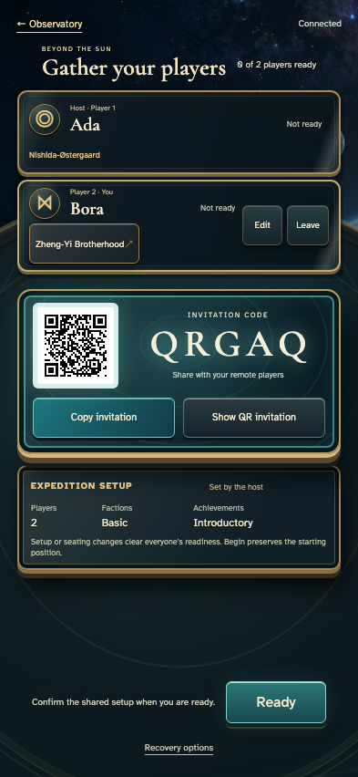](../../screenshots/choose-a-two-prerequisite-discovery-type-and-retain-the-exact-public-candidates/012-faction-1-chosen-desktop-darwin.png) |

- [x] Bora chooses their actual production faction
- [x] The saved automatic consequences settle before the public decision is photographed.
- [x] Public compact Technology objects retain physical separation.
- [x] The gameplay shell stays inside the actual viewport.

## 14. Ada confirms this exact configuration

Viewpoint: **Ada · independent host controller**.

| phone · 393 × 852 | desktop · 1440 × 1000 |
| --- | --- |
| [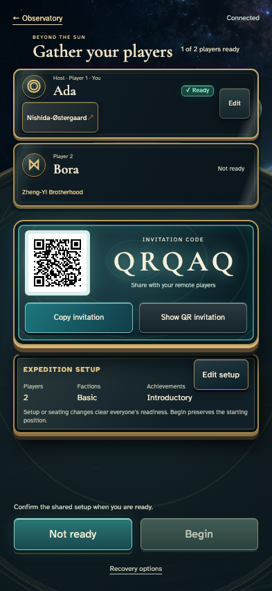](../../screenshots/choose-a-two-prerequisite-discovery-type-and-retain-the-exact-public-candidates/013-ready-0-phone-darwin.png) |  |

- [x] Ada confirms this exact configuration
- [x] The saved automatic consequences settle before the public decision is photographed.
- [x] Public compact Technology objects retain physical separation.
- [x] The gameplay shell stays inside the actual viewport.

## 15. Bora confirms this exact configuration

Viewpoint: **Bora · independent guest controller**.

| phone · 1440 × 1000 | desktop · 393 × 852 |
| --- | --- |
| [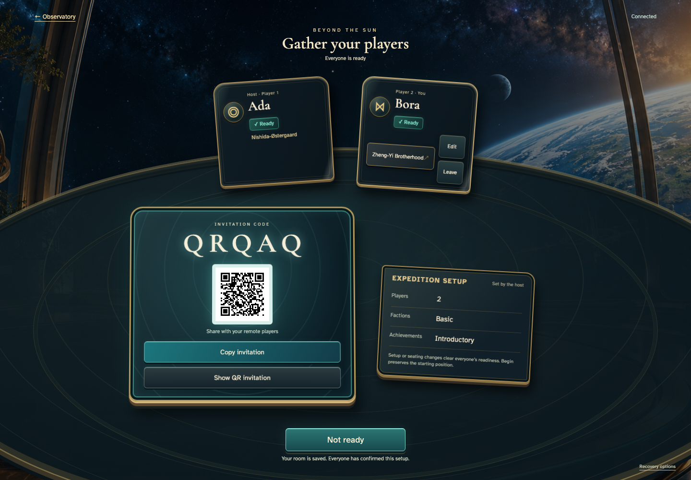](../../screenshots/choose-a-two-prerequisite-discovery-type-and-retain-the-exact-public-candidates/014-ready-1-phone-darwin.png) | [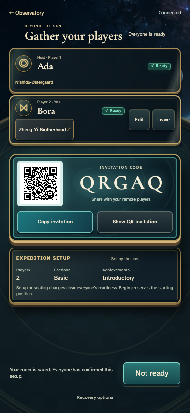](../../screenshots/choose-a-two-prerequisite-discovery-type-and-retain-the-exact-public-candidates/014-ready-1-desktop-darwin.png) |

- [x] Bora confirms this exact configuration
- [x] The saved automatic consequences settle before the public decision is photographed.
- [x] Public compact Technology objects retain physical separation.
- [x] The gameplay shell stays inside the actual viewport.

## 16. Begin creates the immutable seeded Basic game

Viewpoint: **Ada · independent host controller**.

| phone · 393 × 852 | desktop · 1440 × 1000 |
| --- | --- |
| [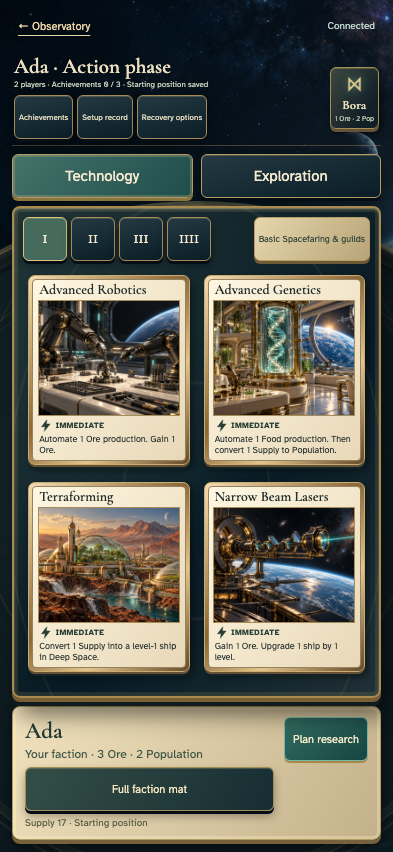](../../screenshots/choose-a-two-prerequisite-discovery-type-and-retain-the-exact-public-candidates/015-begun-phone-darwin.png) | [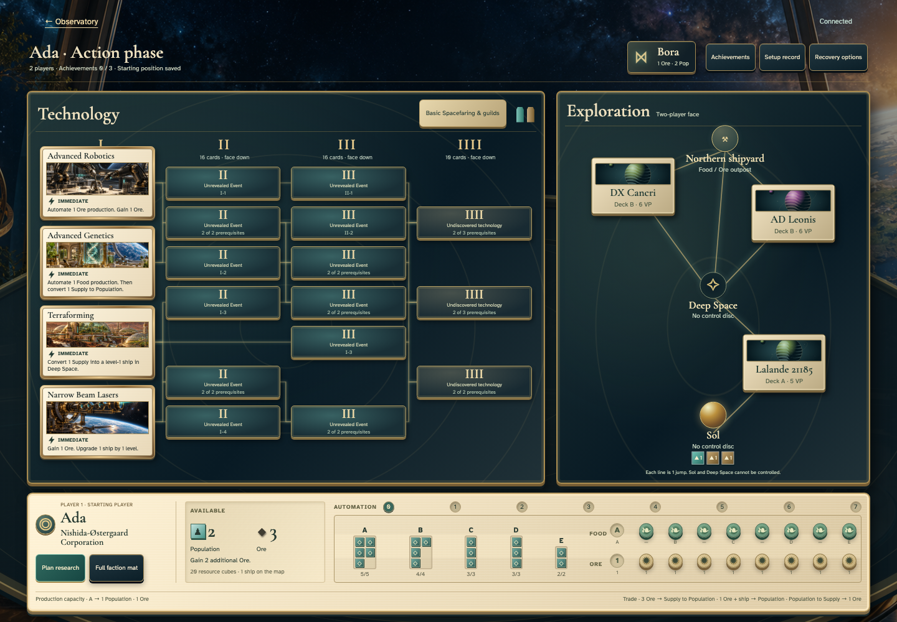](../../screenshots/choose-a-two-prerequisite-discovery-type-and-retain-the-exact-public-candidates/015-begun-desktop-darwin.png) |

- [x] Begin creates the immutable seeded Basic game
- [x] The saved automatic consequences settle before the public decision is photographed.
- [x] Public compact Technology objects retain physical separation.
- [x] The gameplay shell stays inside the actual viewport.

## 17. Ada plans a legal preparatory Level I turn

Viewpoint: **Ada · independent host controller**.

| phone · 393 × 852 | desktop · 1440 × 1000 |
| --- | --- |
|  |  |

- [x] Ada plans a legal preparatory Level I turn
- [x] The saved automatic consequences settle before the public decision is photographed.
- [x] Public compact Technology objects retain physical separation.
- [x] The gameplay shell stays inside the actual viewport.

## 18. Ada chooses the unoccupied printed Action space

Viewpoint: **Ada · independent host controller**.

| phone · 393 × 852 | desktop · 1440 × 1000 |
| --- | --- |
| [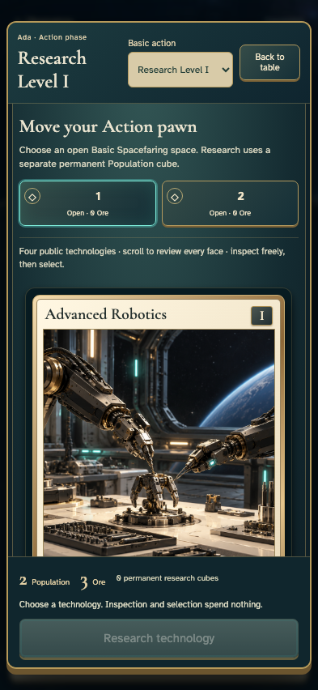](../../screenshots/choose-a-two-prerequisite-discovery-type-and-retain-the-exact-public-candidates/017-ada-first-space-phone-darwin.png) | [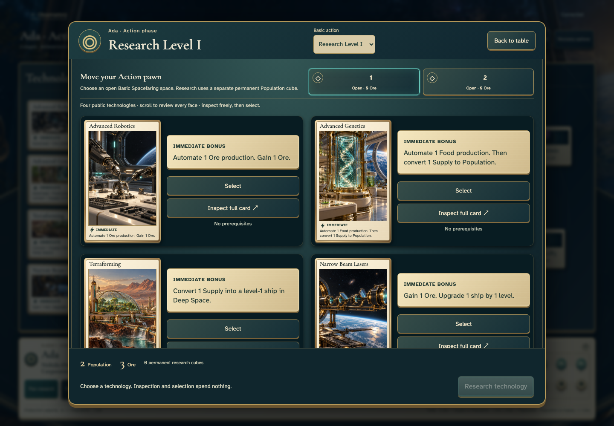](../../screenshots/choose-a-two-prerequisite-discovery-type-and-retain-the-exact-public-candidates/017-ada-first-space-desktop-darwin.png) |

- [x] Ada chooses the unoccupied printed Action space
- [x] The saved automatic consequences settle before the public decision is photographed.
- [x] Public compact Technology objects retain physical separation.
- [x] The gameplay shell stays inside the actual viewport.

## 19. Ada selects the public Advanced Robotics face

Viewpoint: **Ada · independent host controller**.

| phone · 393 × 852 | desktop · 1440 × 1000 |
| --- | --- |
| [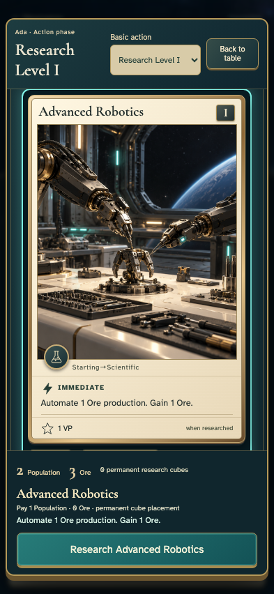](../../screenshots/choose-a-two-prerequisite-discovery-type-and-retain-the-exact-public-candidates/018-ada-first-card-phone-darwin.png) | [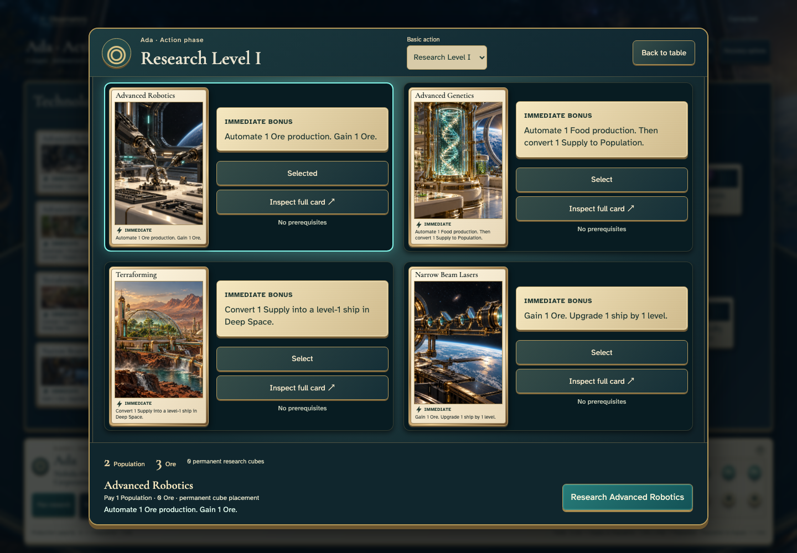](../../screenshots/choose-a-two-prerequisite-discovery-type-and-retain-the-exact-public-candidates/018-ada-first-card-desktop-darwin.png) |

- [x] Ada selects the public Advanced Robotics face
- [x] The saved automatic consequences settle before the public decision is photographed.
- [x] Public compact Technology objects retain physical separation.
- [x] The gameplay shell stays inside the actual viewport.

## 20. Ada pays permanent research Population and receives the printed immediate bonus

Viewpoint: **Ada · independent host controller**.

| phone · 393 × 852 | desktop · 1440 × 1000 |
| --- | --- |
|  | [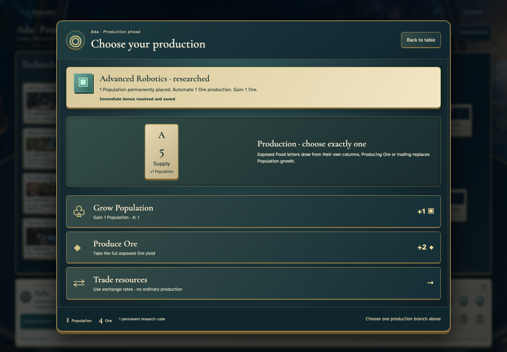](../../screenshots/choose-a-two-prerequisite-discovery-type-and-retain-the-exact-public-candidates/019-ada-first-paid-desktop-darwin.png) |

- [x] Ada pays permanent research Population and receives the printed immediate bonus
- [x] The saved automatic consequences settle before the public decision is photographed.
- [x] Public compact Technology objects retain physical separation.
- [x] The gameplay shell stays inside the actual viewport.

## 21. Ada completes ordinary production and hands off automatically

Viewpoint: **Ada · independent host controller**.

| phone · 393 × 852 | desktop · 1440 × 1000 |
| --- | --- |
|  |  |

- [x] Ada completes ordinary production and hands off automatically
- [x] The saved automatic consequences settle before the public decision is photographed.
- [x] Public compact Technology objects retain physical separation.
- [x] The gameplay shell stays inside the actual viewport.

## 22. The next independent controller sees the same canonical handoff

Viewpoint: **Bora · independent guest controller**.

| phone · 1440 × 1000 | desktop · 393 × 852 |
| --- | --- |
|  |  |

- [x] The next independent controller sees the same canonical handoff
- [x] The saved automatic consequences settle before the public decision is photographed.
- [x] Public compact Technology objects retain physical separation.
- [x] The gameplay shell stays inside the actual viewport.

## 23. Bora opens a legal preparatory turn

Viewpoint: **Bora · independent guest controller**.

| phone · 1440 × 1000 | desktop · 393 × 852 |
| --- | --- |
|  | [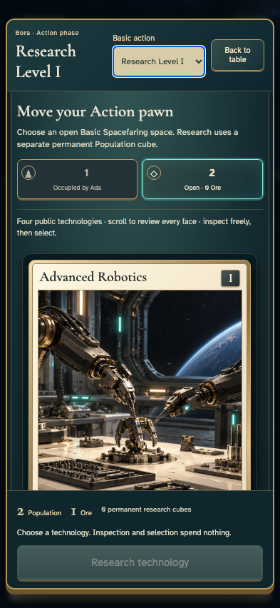](../../screenshots/choose-a-two-prerequisite-discovery-type-and-retain-the-exact-public-candidates/022-bora-gather-plan-desktop-darwin.png) |

- [x] Bora opens a legal preparatory turn
- [x] The saved automatic consequences settle before the public decision is photographed.
- [x] Public compact Technology objects retain physical separation.
- [x] The gameplay shell stays inside the actual viewport.

## 24. Gather frees the second research space for the next turn

Viewpoint: **Bora · independent guest controller**.

| phone · 1440 × 1000 | desktop · 393 × 852 |
| --- | --- |
| [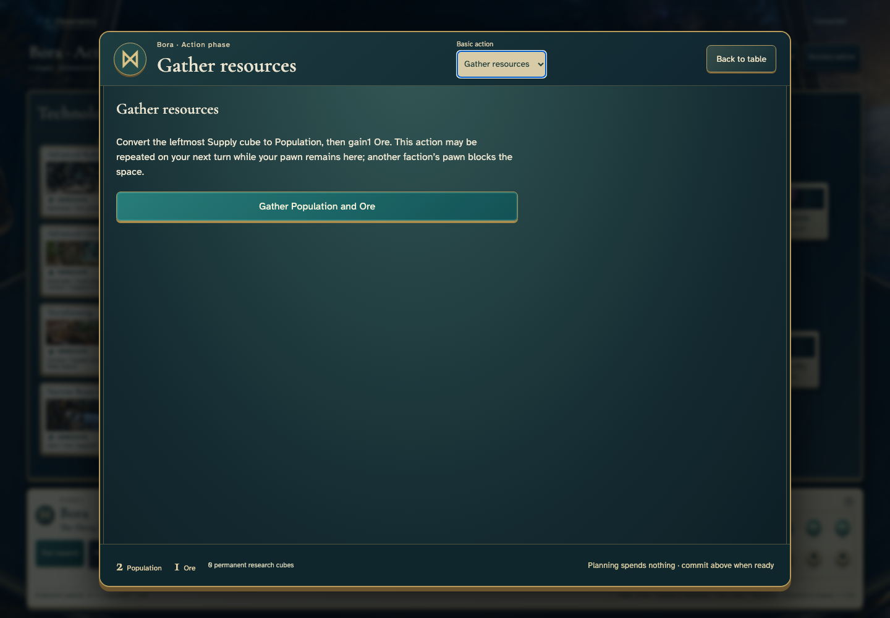](../../screenshots/choose-a-two-prerequisite-discovery-type-and-retain-the-exact-public-candidates/023-bora-gather-option-phone-darwin.png) |  |

- [x] Gather frees the second research space for the next turn
- [x] The saved automatic consequences settle before the public decision is photographed.
- [x] Public compact Technology objects retain physical separation.
- [x] The gameplay shell stays inside the actual viewport.

## 25. Bora converts Supply and gains Ore through the printed Gather action

Viewpoint: **Bora · independent guest controller**.

| phone · 1440 × 1000 | desktop · 393 × 852 |
| --- | --- |
| [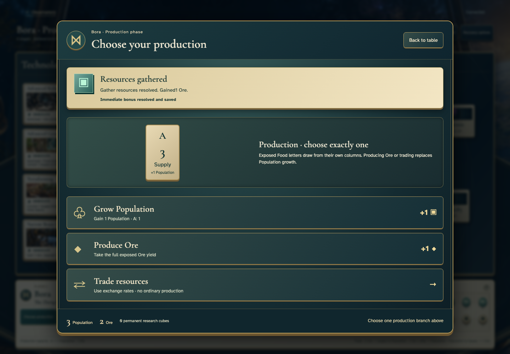](../../screenshots/choose-a-two-prerequisite-discovery-type-and-retain-the-exact-public-candidates/024-bora-gathered-phone-darwin.png) | [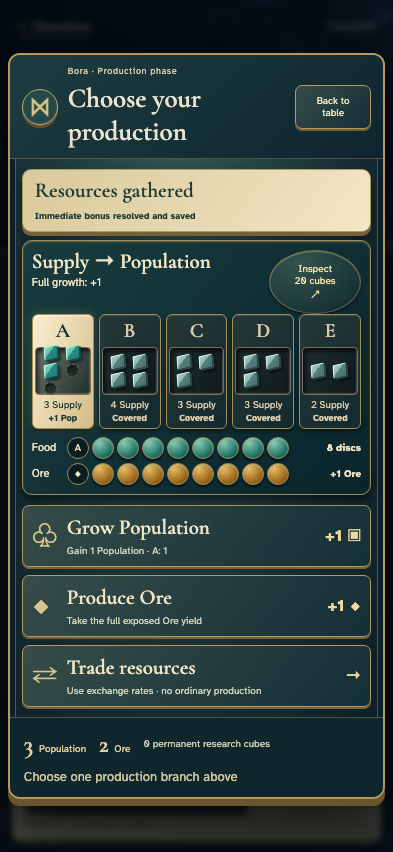](../../screenshots/choose-a-two-prerequisite-discovery-type-and-retain-the-exact-public-candidates/024-bora-gathered-desktop-darwin.png) |

- [x] Bora converts Supply and gains Ore through the printed Gather action
- [x] The saved automatic consequences settle before the public decision is photographed.
- [x] Public compact Technology objects retain physical separation.
- [x] The gameplay shell stays inside the actual viewport.

## 26. Bora completes ordinary production and hands off automatically

Viewpoint: **Bora · independent guest controller**.

| phone · 1440 × 1000 | desktop · 393 × 852 |
| --- | --- |
| [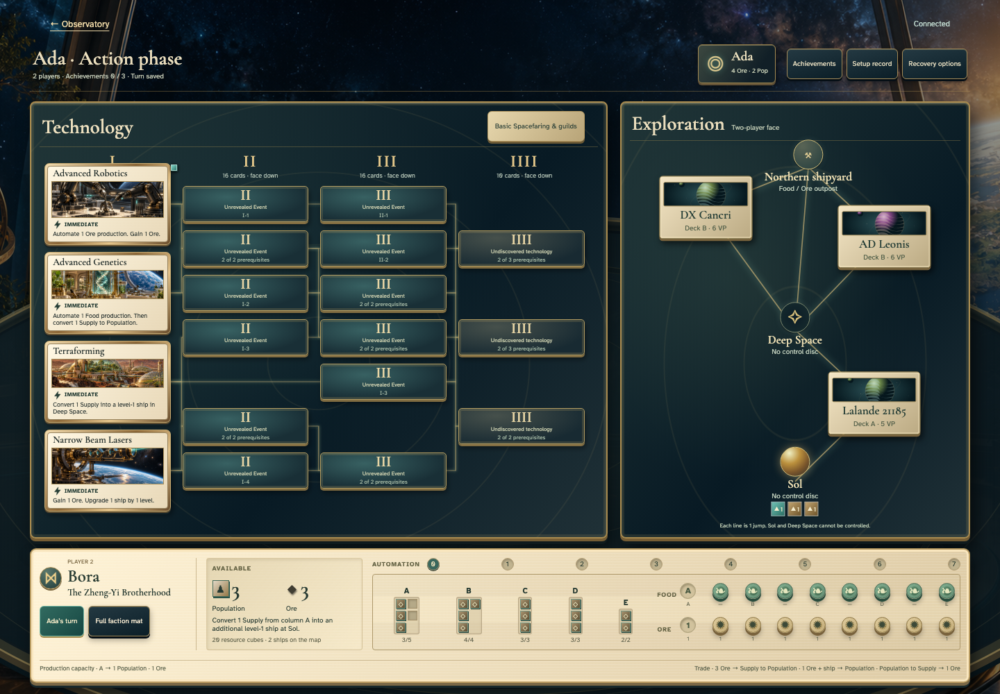](../../screenshots/choose-a-two-prerequisite-discovery-type-and-retain-the-exact-public-candidates/025-bora-first-handoff-phone-darwin.png) |  |

- [x] Bora completes ordinary production and hands off automatically
- [x] The saved automatic consequences settle before the public decision is photographed.
- [x] Public compact Technology objects retain physical separation.
- [x] The gameplay shell stays inside the actual viewport.

## 27. The next independent controller sees the same canonical handoff

Viewpoint: **Ada · independent host controller**.

| phone · 393 × 852 | desktop · 1440 × 1000 |
| --- | --- |
|  | [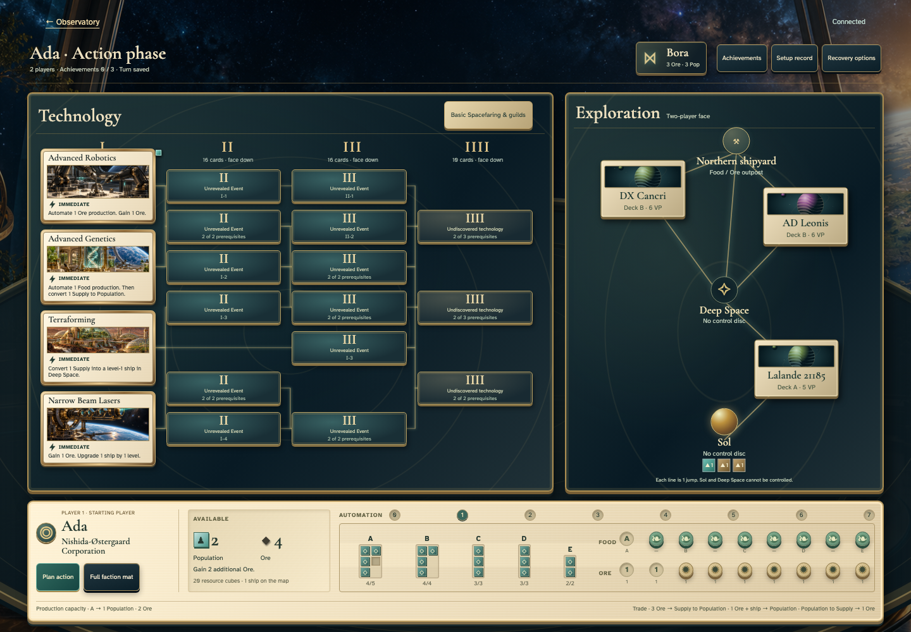](../../screenshots/choose-a-two-prerequisite-discovery-type-and-retain-the-exact-public-candidates/026-bora-first-handoff-next-desktop-darwin.png) |

- [x] The next independent controller sees the same canonical handoff
- [x] The saved automatic consequences settle before the public decision is photographed.
- [x] Public compact Technology objects retain physical separation.
- [x] The gameplay shell stays inside the actual viewport.

## 28. Ada plans a legal preparatory Level I turn

Viewpoint: **Ada · independent host controller**.

| phone · 393 × 852 | desktop · 1440 × 1000 |
| --- | --- |
| [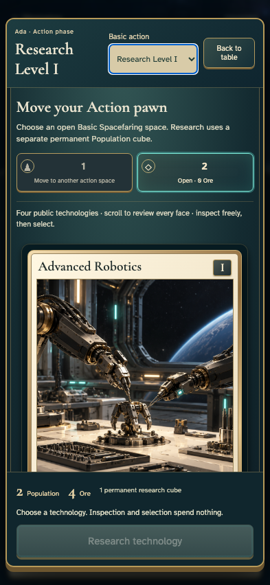](../../screenshots/choose-a-two-prerequisite-discovery-type-and-retain-the-exact-public-candidates/027-ada-second-plan-phone-darwin.png) |  |

- [x] Ada plans a legal preparatory Level I turn
- [x] The saved automatic consequences settle before the public decision is photographed.
- [x] Public compact Technology objects retain physical separation.
- [x] The gameplay shell stays inside the actual viewport.

## 29. Ada chooses the unoccupied printed Action space

Viewpoint: **Ada · independent host controller**.

| phone · 393 × 852 | desktop · 1440 × 1000 |
| --- | --- |
| [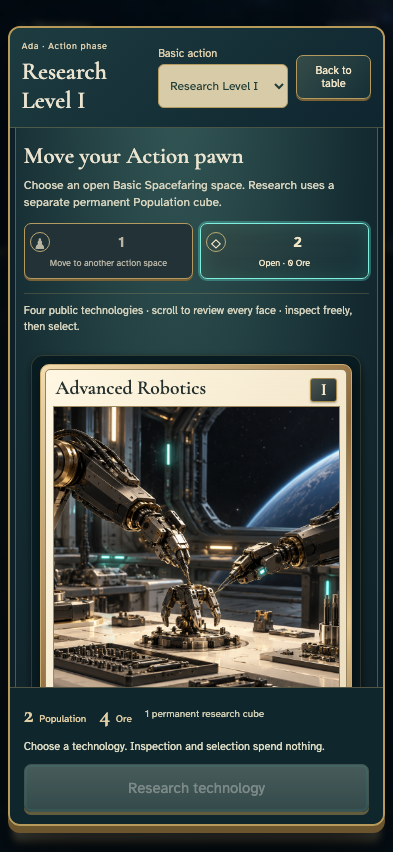](../../screenshots/choose-a-two-prerequisite-discovery-type-and-retain-the-exact-public-candidates/028-ada-second-space-phone-darwin.png) | [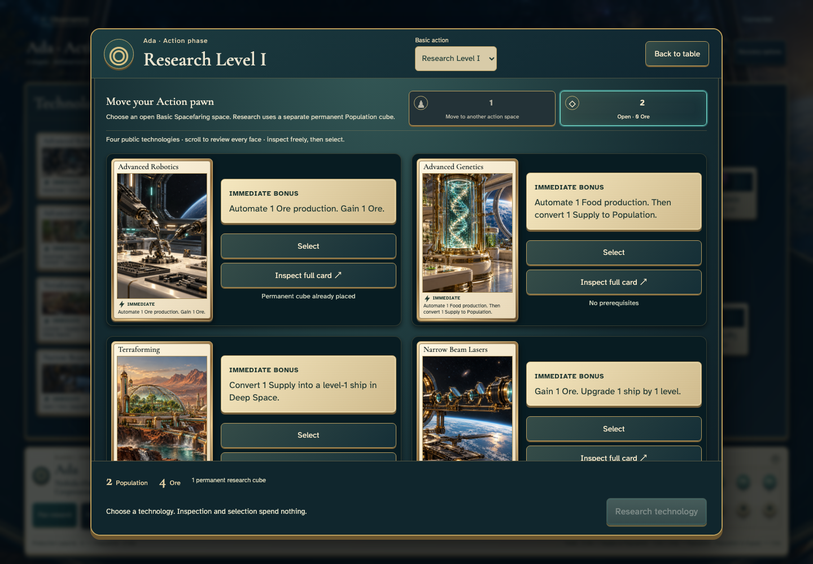](../../screenshots/choose-a-two-prerequisite-discovery-type-and-retain-the-exact-public-candidates/028-ada-second-space-desktop-darwin.png) |

- [x] Ada chooses the unoccupied printed Action space
- [x] The saved automatic consequences settle before the public decision is photographed.
- [x] Public compact Technology objects retain physical separation.
- [x] The gameplay shell stays inside the actual viewport.

## 30. Ada selects the public Advanced Genetics face

Viewpoint: **Ada · independent host controller**.

| phone · 393 × 852 | desktop · 1440 × 1000 |
| --- | --- |
|  |  |

- [x] Ada selects the public Advanced Genetics face
- [x] The saved automatic consequences settle before the public decision is photographed.
- [x] Public compact Technology objects retain physical separation.
- [x] The gameplay shell stays inside the actual viewport.

## 31. Ada pays permanent research Population and receives the printed immediate bonus

Viewpoint: **Ada · independent host controller**.

| phone · 393 × 852 | desktop · 1440 × 1000 |
| --- | --- |
| [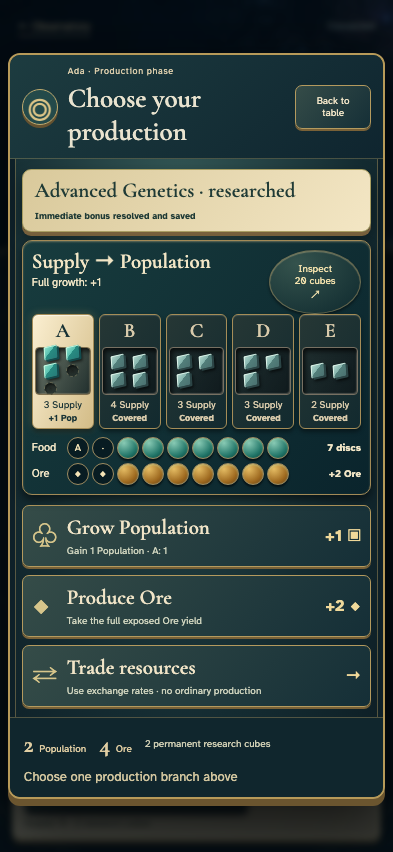](../../screenshots/choose-a-two-prerequisite-discovery-type-and-retain-the-exact-public-candidates/030-ada-second-paid-phone-darwin.png) | [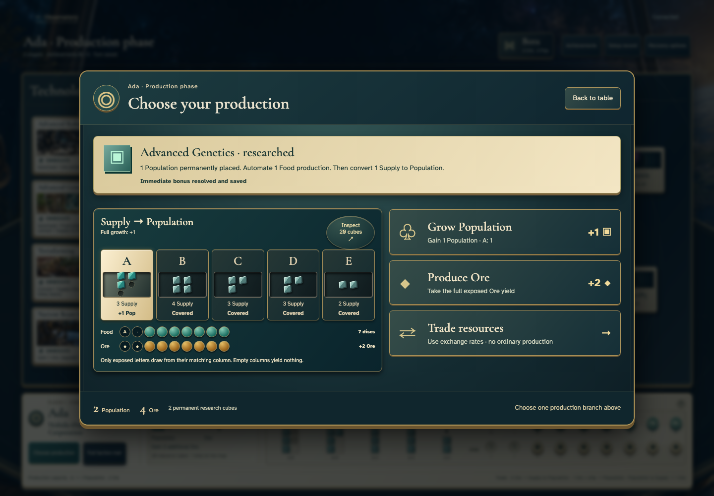](../../screenshots/choose-a-two-prerequisite-discovery-type-and-retain-the-exact-public-candidates/030-ada-second-paid-desktop-darwin.png) |

- [x] Ada pays permanent research Population and receives the printed immediate bonus
- [x] The saved automatic consequences settle before the public decision is photographed.
- [x] Public compact Technology objects retain physical separation.
- [x] The gameplay shell stays inside the actual viewport.

## 32. Ada completes ordinary production and hands off automatically

Viewpoint: **Ada · independent host controller**.

| phone · 393 × 852 | desktop · 1440 × 1000 |
| --- | --- |
| [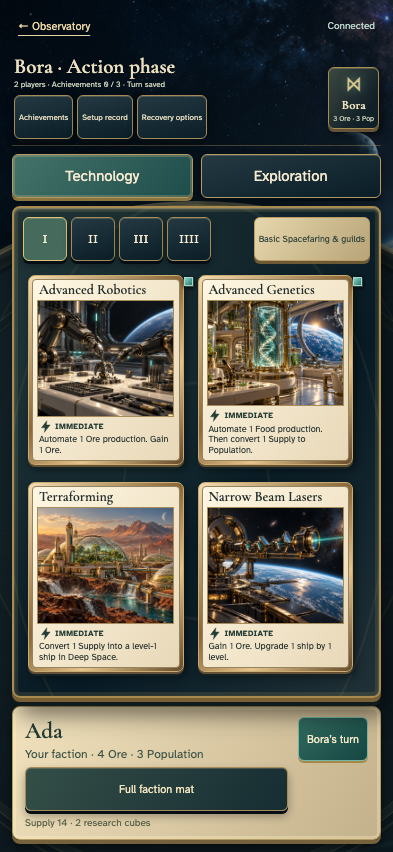](../../screenshots/choose-a-two-prerequisite-discovery-type-and-retain-the-exact-public-candidates/031-ada-second-handoff-phone-darwin.png) | [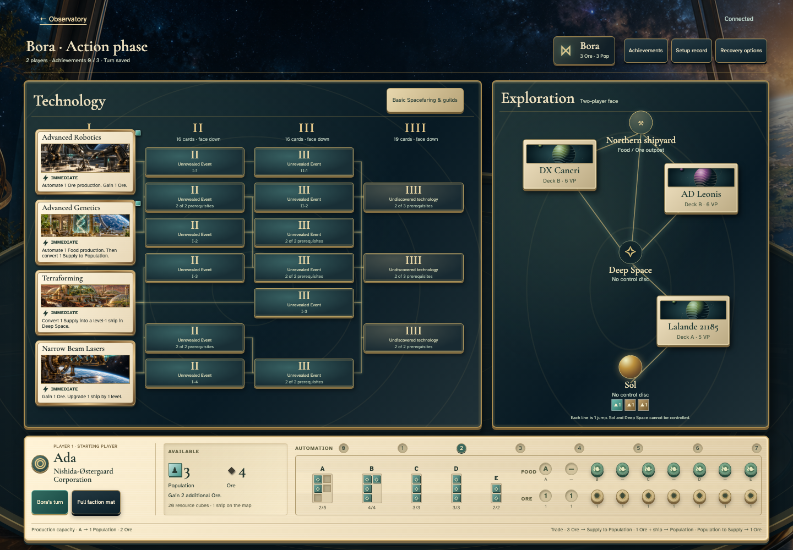](../../screenshots/choose-a-two-prerequisite-discovery-type-and-retain-the-exact-public-candidates/031-ada-second-handoff-desktop-darwin.png) |

- [x] Ada completes ordinary production and hands off automatically
- [x] The saved automatic consequences settle before the public decision is photographed.
- [x] Public compact Technology objects retain physical separation.
- [x] The gameplay shell stays inside the actual viewport.

## 33. The next independent controller sees the same canonical handoff

Viewpoint: **Bora · independent guest controller**.

| phone · 1440 × 1000 | desktop · 393 × 852 |
| --- | --- |
|  |  |

- [x] The next independent controller sees the same canonical handoff
- [x] The saved automatic consequences settle before the public decision is photographed.
- [x] Public compact Technology objects retain physical separation.
- [x] The gameplay shell stays inside the actual viewport.

## 34. Bora plans a legal preparatory Level I turn

Viewpoint: **Bora · independent guest controller**.

| phone · 1440 × 1000 | desktop · 393 × 852 |
| --- | --- |
|  | [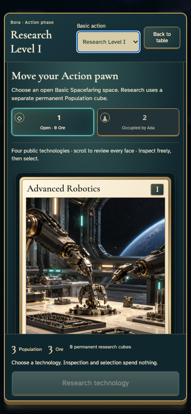](../../screenshots/choose-a-two-prerequisite-discovery-type-and-retain-the-exact-public-candidates/033-bora-second-plan-desktop-darwin.png) |

- [x] Bora plans a legal preparatory Level I turn
- [x] The saved automatic consequences settle before the public decision is photographed.
- [x] Public compact Technology objects retain physical separation.
- [x] The gameplay shell stays inside the actual viewport.

## 35. Bora chooses the unoccupied printed Action space

Viewpoint: **Bora · independent guest controller**.

| phone · 1440 × 1000 | desktop · 393 × 852 |
| --- | --- |
|  | [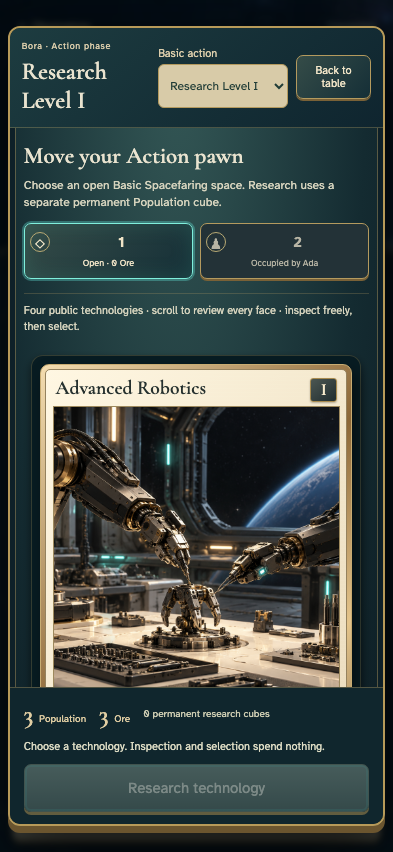](../../screenshots/choose-a-two-prerequisite-discovery-type-and-retain-the-exact-public-candidates/034-bora-second-space-desktop-darwin.png) |

- [x] Bora chooses the unoccupied printed Action space
- [x] The saved automatic consequences settle before the public decision is photographed.
- [x] Public compact Technology objects retain physical separation.
- [x] The gameplay shell stays inside the actual viewport.

## 36. Bora selects the public Advanced Genetics face

Viewpoint: **Bora · independent guest controller**.

| phone · 1440 × 1000 | desktop · 393 × 852 |
| --- | --- |
| [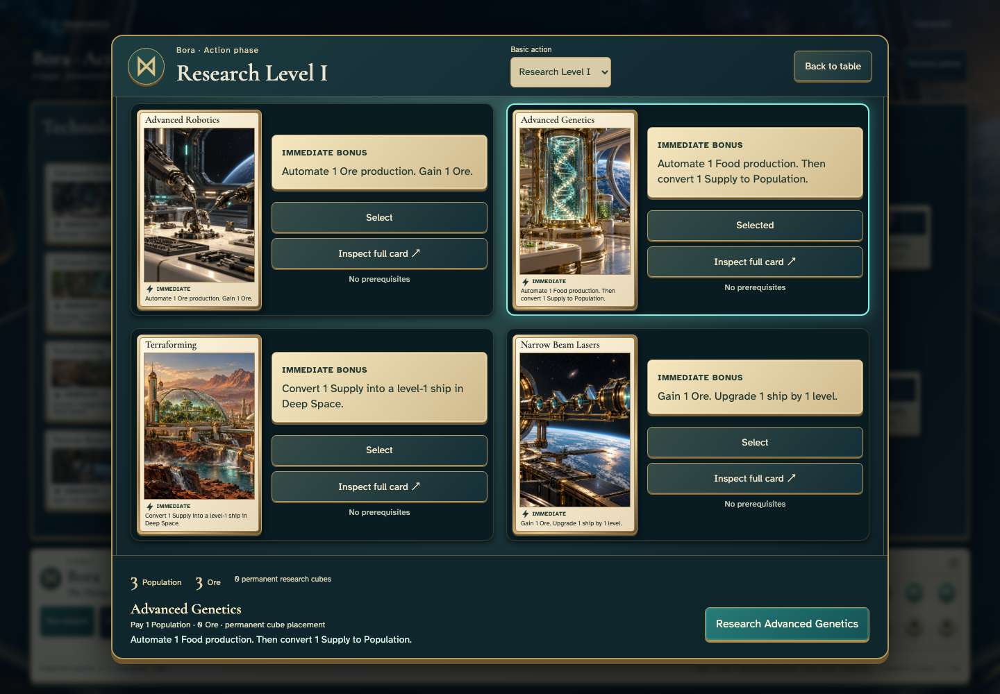](../../screenshots/choose-a-two-prerequisite-discovery-type-and-retain-the-exact-public-candidates/035-bora-second-card-phone-darwin.png) | [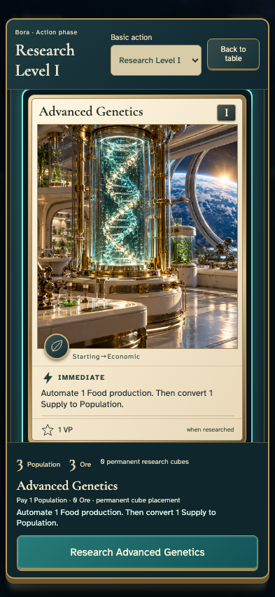](../../screenshots/choose-a-two-prerequisite-discovery-type-and-retain-the-exact-public-candidates/035-bora-second-card-desktop-darwin.png) |

- [x] Bora selects the public Advanced Genetics face
- [x] The saved automatic consequences settle before the public decision is photographed.
- [x] Public compact Technology objects retain physical separation.
- [x] The gameplay shell stays inside the actual viewport.

## 37. Bora pays permanent research Population and receives the printed immediate bonus

Viewpoint: **Bora · independent guest controller**.

| phone · 1440 × 1000 | desktop · 393 × 852 |
| --- | --- |
|  | [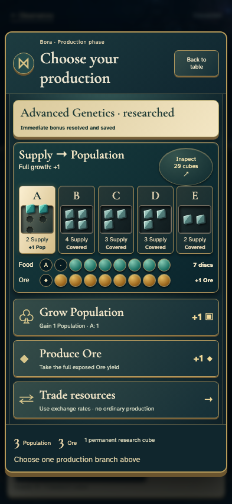](../../screenshots/choose-a-two-prerequisite-discovery-type-and-retain-the-exact-public-candidates/036-bora-second-paid-desktop-darwin.png) |

- [x] Bora pays permanent research Population and receives the printed immediate bonus
- [x] The saved automatic consequences settle before the public decision is photographed.
- [x] Public compact Technology objects retain physical separation.
- [x] The gameplay shell stays inside the actual viewport.

## 38. Bora completes ordinary production and hands off automatically

Viewpoint: **Bora · independent guest controller**.

| phone · 1440 × 1000 | desktop · 393 × 852 |
| --- | --- |
|  |  |

- [x] Bora completes ordinary production and hands off automatically
- [x] The saved automatic consequences settle before the public decision is photographed.
- [x] Public compact Technology objects retain physical separation.
- [x] The gameplay shell stays inside the actual viewport.

## 39. The next independent controller sees the same canonical handoff

Viewpoint: **Ada · independent host controller**.

| phone · 393 × 852 | desktop · 1440 × 1000 |
| --- | --- |
|  |  |

- [x] The next independent controller sees the same canonical handoff
- [x] The saved automatic consequences settle before the public decision is photographed.
- [x] Public compact Technology objects retain physical separation.
- [x] The gameplay shell stays inside the actual viewport.

## 40. The researcher opens the real Basic action instrument

Viewpoint: **Ada · independent host controller**.

| phone · 393 × 852 | desktop · 1440 × 1000 |
| --- | --- |
| [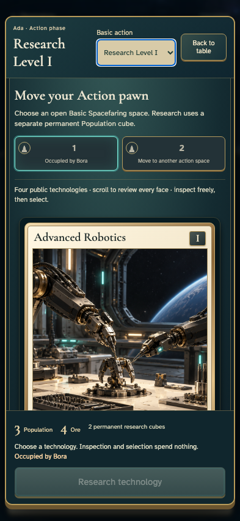](../../screenshots/choose-a-two-prerequisite-discovery-type-and-retain-the-exact-public-candidates/039-level-i-plan-phone-darwin.png) |  |

- [x] The researcher opens the real Basic action instrument
- [x] The saved automatic consequences settle before the public decision is photographed.
- [x] Public compact Technology objects retain physical separation.
- [x] The gameplay shell stays inside the actual viewport.

## 41. Choose Level II and inspect all six public prerequisites without revealing cards

Viewpoint: **Ada · independent host controller**.

| phone · 393 × 852 | desktop · 1440 × 1000 |
| --- | --- |
| [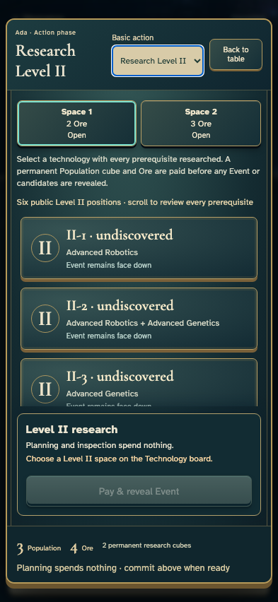](../../screenshots/choose-a-two-prerequisite-discovery-type-and-retain-the-exact-public-candidates/040-level-ii-plan-phone-darwin.png) | [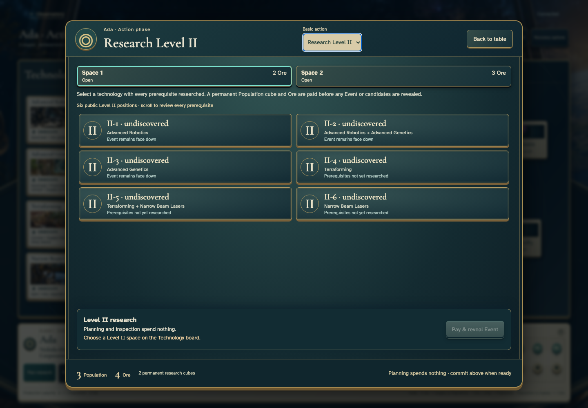](../../screenshots/choose-a-two-prerequisite-discovery-type-and-retain-the-exact-public-candidates/040-level-ii-plan-desktop-darwin.png) |

- [x] Choose Level II and inspect all six public prerequisites without revealing cards
- [x] The saved automatic consequences settle before the public decision is photographed.
- [x] Public compact Technology objects retain physical separation.
- [x] The gameplay shell stays inside the actual viewport.

## 42. Select a legal undiscovered position and read its permanent Population and Ore payment

Viewpoint: **Ada · independent host controller**.

| phone · 393 × 852 | desktop · 1440 × 1000 |
| --- | --- |
| [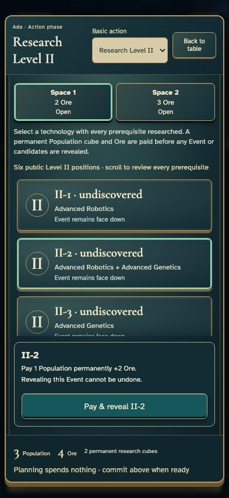](../../screenshots/choose-a-two-prerequisite-discovery-type-and-retain-the-exact-public-candidates/041-level-ii-target-phone-darwin.png) |  |

- [x] Select a legal undiscovered position and read its permanent Population and Ore payment
- [x] The saved automatic consequences settle before the public decision is photographed.
- [x] Public compact Technology objects retain physical separation.
- [x] The gameplay shell stays inside the actual viewport.

## 43. Payment reveals Maya Chaturvedi; all Event decisions resolve before candidates

Viewpoint: **Ada · independent host controller**.

| phone · 393 × 852 | desktop · 1440 × 1000 |
| --- | --- |
|  |  |

- [x] Payment reveals Maya Chaturvedi; all Event decisions resolve before candidates
- [x] The saved automatic consequences settle before the public decision is photographed.
- [x] Public compact Technology objects retain physical separation.
- [x] The gameplay shell stays inside the actual viewport.

## 44. Ada reads and owns this public Event decision

Viewpoint: **Ada · independent host controller**.

| phone · 393 × 852 | desktop · 1440 × 1000 |
| --- | --- |
| [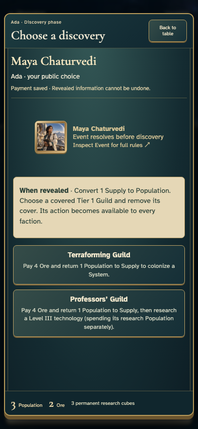](../../screenshots/choose-a-two-prerequisite-discovery-type-and-retain-the-exact-public-candidates/043-maya-guild-choice-phone-darwin.png) | [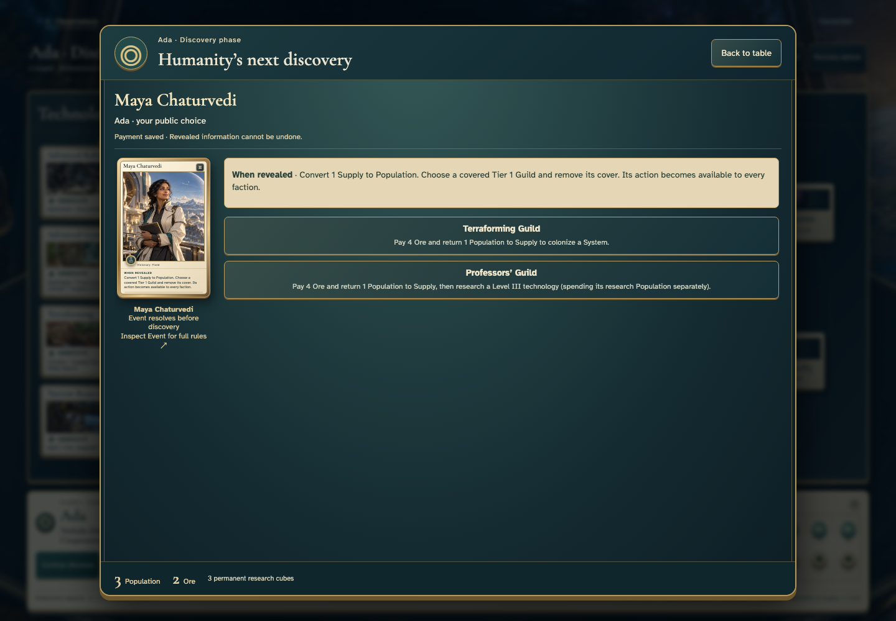](../../screenshots/choose-a-two-prerequisite-discovery-type-and-retain-the-exact-public-candidates/043-maya-guild-choice-desktop-darwin.png) |

- [x] Ada reads and owns this public Event decision
- [x] The saved automatic consequences settle before the public decision is photographed.
- [x] Public compact Technology objects retain physical separation.
- [x] The gameplay shell stays inside the actual viewport.

## 45. Maya Chaturvedi converts Supply to Population and opens the chosen real guild for everyone

Viewpoint: **Ada · independent host controller**.

| phone · 393 × 852 | desktop · 1440 × 1000 |
| --- | --- |
|  |  |

- [x] Maya Chaturvedi converts Supply to Population and opens the chosen real guild for everyone
- [x] The saved automatic consequences settle before the public decision is photographed.
- [x] Public compact Technology objects retain physical separation.
- [x] The gameplay shell stays inside the actual viewport.

## 46. Only the two actual researched-prerequisite types can be revealed

Viewpoint: **Ada · independent host controller**.

| phone · 393 × 852 | desktop · 1440 × 1000 |
| --- | --- |
|  |  |

- [x] Only the two actual researched-prerequisite types can be revealed
- [x] The saved automatic consequences settle before the public decision is photographed.
- [x] Public compact Technology objects retain physical separation.
- [x] The gameplay shell stays inside the actual viewport.

## 47. Reload restores the saved type choice rather than drawing cards

Viewpoint: **Ada · independent host controller**.

| phone · 393 × 852 | desktop · 1440 × 1000 |
| --- | --- |
|  |  |

- [x] Reload restores the saved type choice rather than drawing cards
- [x] The saved automatic consequences settle before the public decision is photographed.
- [x] Public compact Technology objects retain physical separation.
- [x] The gameplay shell stays inside the actual viewport.

## 48. Ada opens their saved public discovery decision

Viewpoint: **Ada · independent host controller**.

| phone · 393 × 852 | desktop · 1440 × 1000 |
| --- | --- |
| [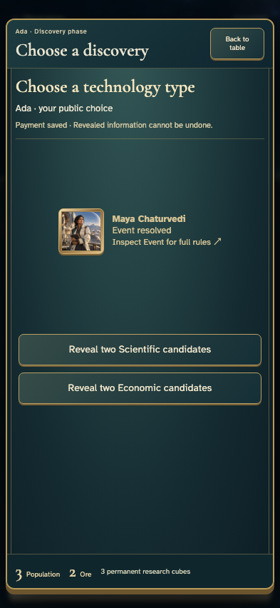](../../screenshots/choose-a-two-prerequisite-discovery-type-and-retain-the-exact-public-candidates/047-type-reopened-phone-darwin.png) |  |

- [x] Ada opens their saved public discovery decision
- [x] The saved automatic consequences settle before the public decision is photographed.
- [x] Public compact Technology objects retain physical separation.
- [x] The gameplay shell stays inside the actual viewport.

## 49. Both permitted type choices survive the retained history

Viewpoint: **Ada · independent host controller**.

| phone · 393 × 852 | desktop · 1440 × 1000 |
| --- | --- |
|  | [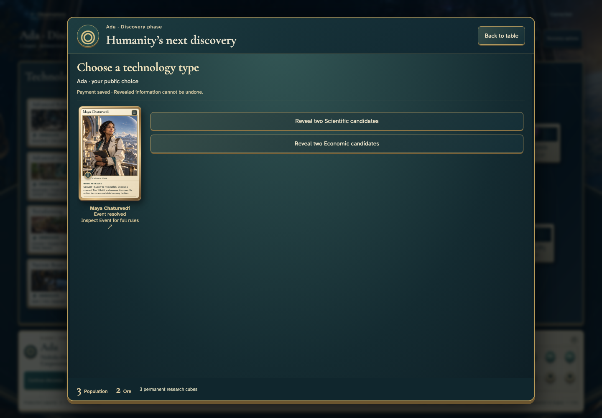](../../screenshots/choose-a-two-prerequisite-discovery-type-and-retain-the-exact-public-candidates/048-type-same-options-desktop-darwin.png) |

- [x] Both permitted type choices survive the retained history
- [x] The saved automatic consequences settle before the public decision is photographed.
- [x] Public compact Technology objects retain physical separation.
- [x] The gameplay shell stays inside the actual viewport.

## 50. Choose Scientific; exactly the matching public candidate pair appears

Viewpoint: **Ada · independent host controller**.

| phone · 393 × 852 | desktop · 1440 × 1000 |
| --- | --- |
|  |  |

- [x] Choose Scientific; exactly the matching public candidate pair appears
- [x] The saved automatic consequences settle before the public decision is photographed.
- [x] Public compact Technology objects retain physical separation.
- [x] The gameplay shell stays inside the actual viewport.

## 51. The public candidates appear only after the entire Event and type choice

Viewpoint: **Ada · independent host controller**.

| phone · 393 × 852 | desktop · 1440 × 1000 |
| --- | --- |
|  |  |

- [x] The public candidates appear only after the entire Event and type choice
- [x] The saved automatic consequences settle before the public decision is photographed.
- [x] Public compact Technology objects retain physical separation.
- [x] The gameplay shell stays inside the actual viewport.

## 52. The separate guest sees the same public discovery without research authority

Viewpoint: **Bora · independent guest controller**.

| phone · 1440 × 1000 | desktop · 393 × 852 |
| --- | --- |
| [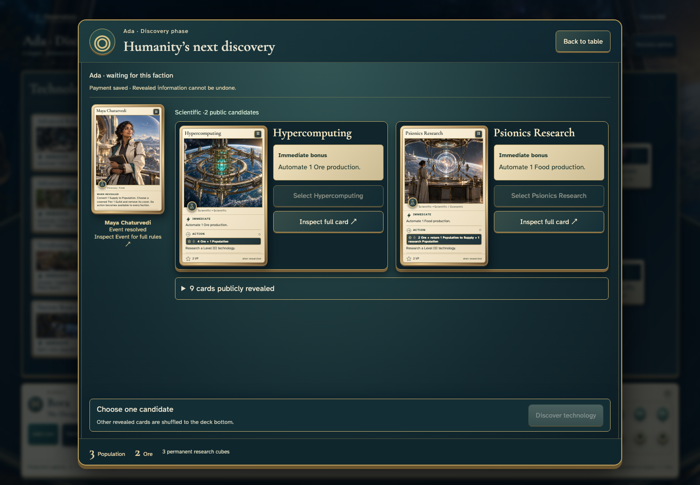](../../screenshots/choose-a-two-prerequisite-discovery-type-and-retain-the-exact-public-candidates/051-observer-candidates-phone-darwin.png) | [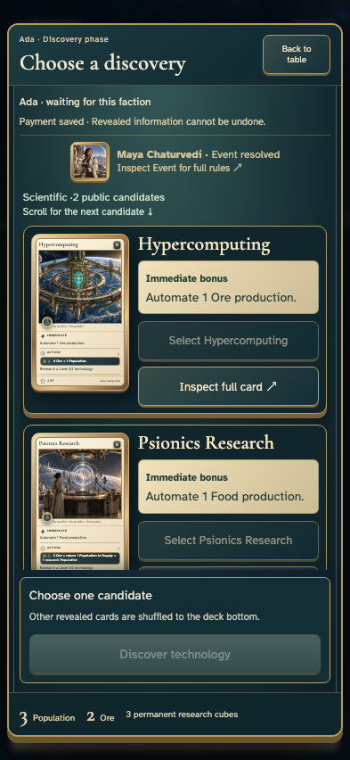](../../screenshots/choose-a-two-prerequisite-discovery-type-and-retain-the-exact-public-candidates/051-observer-candidates-desktop-darwin.png) |

- [x] The separate guest sees the same public discovery without research authority
- [x] The saved automatic consequences settle before the public decision is photographed.
- [x] Public compact Technology objects retain physical separation.
- [x] The gameplay shell stays inside the actual viewport.

## 53. Observation does not acquire the researching faction or its controls

Viewpoint: **Bora · independent guest controller**.

| phone · 1440 × 1000 | desktop · 393 × 852 |
| --- | --- |
|  | [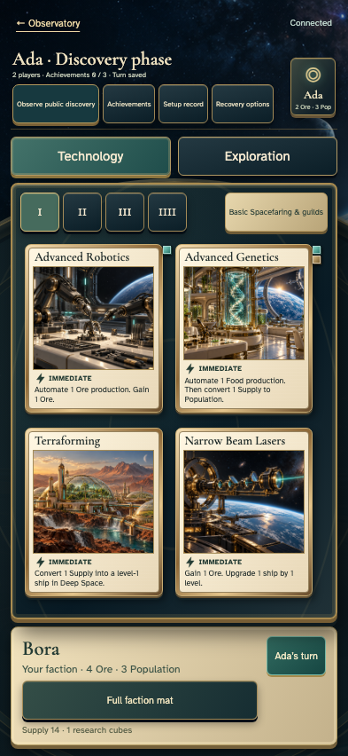](../../screenshots/choose-a-two-prerequisite-discovery-type-and-retain-the-exact-public-candidates/052-observer-return-desktop-darwin.png) |

- [x] Observation does not acquire the researching faction or its controls
- [x] The saved automatic consequences settle before the public decision is photographed.
- [x] Public compact Technology objects retain physical separation.
- [x] The gameplay shell stays inside the actual viewport.

## 54. Inspect the complete canonical Hypercomputing face

Viewpoint: **Ada · independent host controller**.

| phone · 393 × 852 | desktop · 1440 × 1000 |
| --- | --- |
|  |  |

- [x] Inspect the complete canonical Hypercomputing face
- [x] The saved automatic consequences settle before the public decision is photographed.
- [x] Public compact Technology objects retain physical separation.
- [x] The gameplay shell stays inside the actual viewport.

## 55. Read the complete face through its bounded full-size inspector

Viewpoint: **Ada · independent host controller**.

| phone · 393 × 852 | desktop · 1440 × 1000 |
| --- | --- |
|  |  |

- [x] Read the complete face through its bounded full-size inspector
- [x] The saved automatic consequences settle before the public decision is photographed.
- [x] Public compact Technology objects retain physical separation.
- [x] The gameplay shell stays inside the actual viewport.

## 56. Escape returns keyboard focus to the actual inspection source

Viewpoint: **Ada · independent host controller**.

| phone · 393 × 852 | desktop · 1440 × 1000 |
| --- | --- |
|  |  |

- [x] Escape returns keyboard focus to the actual inspection source
- [x] The saved automatic consequences settle before the public decision is photographed.
- [x] Public compact Technology objects retain physical separation.
- [x] The gameplay shell stays inside the actual viewport.

## 57. Reload retains the same revealed candidate set and research reservation

Viewpoint: **Ada · independent host controller**.

| phone · 393 × 852 | desktop · 1440 × 1000 |
| --- | --- |
|  |  |

- [x] Reload retains the same revealed candidate set and research reservation
- [x] The saved automatic consequences settle before the public decision is photographed.
- [x] Public compact Technology objects retain physical separation.
- [x] The gameplay shell stays inside the actual viewport.

## 58. Ada opens their saved public discovery decision

Viewpoint: **Ada · independent host controller**.

| phone · 393 × 852 | desktop · 1440 × 1000 |
| --- | --- |
|  |  |

- [x] Ada opens their saved public discovery decision
- [x] The saved automatic consequences settle before the public decision is photographed.
- [x] Public compact Technology objects retain physical separation.
- [x] The gameplay shell stays inside the actual viewport.

## 59. No reroll, new payment or replacement candidate appears on recovery

Viewpoint: **Ada · independent host controller**.

| phone · 393 × 852 | desktop · 1440 × 1000 |
| --- | --- |
|  |  |

- [x] No reroll, new payment or replacement candidate appears on recovery
- [x] The saved automatic consequences settle before the public decision is photographed.
- [x] Public compact Technology objects retain physical separation.
- [x] The gameplay shell stays inside the actual viewport.

## 60. The selected identity and immediate consequence remain beside the commit control

Viewpoint: **Ada · independent host controller**.

| phone · 393 × 852 | desktop · 1440 × 1000 |
| --- | --- |
|  |  |

- [x] The selected identity and immediate consequence remain beside the commit control
- [x] The saved automatic consequences settle before the public decision is photographed.
- [x] Public compact Technology objects retain physical separation.
- [x] The gameplay shell stays inside the actual viewport.

## 61. The saved discovery and its complete immediate bonus resume ordinary Production

Viewpoint: **Ada · independent host controller**.

| phone · 393 × 852 | desktop · 1440 × 1000 |
| --- | --- |
|  |  |

- [x] The saved discovery and its complete immediate bonus resume ordinary Production
- [x] The saved automatic consequences settle before the public decision is photographed.
- [x] Public compact Technology objects retain physical separation.
- [x] The gameplay shell stays inside the actual viewport.

## 62. Reload preserves the discovered technology and pending Production without duplicating the bonus

Viewpoint: **Ada · independent host controller**.

| phone · 393 × 852 | desktop · 1440 × 1000 |
| --- | --- |
|  |  |

- [x] Reload preserves the discovered technology and pending Production without duplicating the bonus
- [x] The saved automatic consequences settle before the public decision is photographed.
- [x] Public compact Technology objects retain physical separation.
- [x] The gameplay shell stays inside the actual viewport.

## 63. Resume the same exclusive production decision

Viewpoint: **Ada · independent host controller**.

| phone · 393 × 852 | desktop · 1440 × 1000 |
| --- | --- |
|  |  |

- [x] Resume the same exclusive production decision
- [x] The saved automatic consequences settle before the public decision is photographed.
- [x] Public compact Technology objects retain physical separation.
- [x] The gameplay shell stays inside the actual viewport.

## 64. Ada completes ordinary production and hands off automatically

Viewpoint: **Ada · independent host controller**.

| phone · 393 × 852 | desktop · 1440 × 1000 |
| --- | --- |
|  |  |

- [x] Ada completes ordinary production and hands off automatically
- [x] The saved automatic consequences settle before the public decision is photographed.
- [x] Public compact Technology objects retain physical separation.
- [x] The gameplay shell stays inside the actual viewport.

## 65. The next independent controller sees the same canonical handoff

Viewpoint: **Bora · independent guest controller**.

| phone · 1440 × 1000 | desktop · 393 × 852 |
| --- | --- |
|  |  |

- [x] The next independent controller sees the same canonical handoff
- [x] The saved automatic consequences settle before the public decision is photographed.
- [x] Public compact Technology objects retain physical separation.
- [x] The gameplay shell stays inside the actual viewport.

## 66. Reload retains the discovered public card, permanent research and canonical Bora handoff

Viewpoint: **Ada · independent host controller**.

| phone · 393 × 852 | desktop · 1440 × 1000 |
| --- | --- |
|  |  |

- [x] Reload retains the discovered public card, permanent research and canonical Bora handoff
- [x] The saved automatic consequences settle before the public decision is photographed.
- [x] Public compact Technology objects retain physical separation.
- [x] The gameplay shell stays inside the actual viewport.
