# Inspect a real attached Rift System in 4-player remote Exploration

Ordinary UI setup and legal preparatory turns; 4 independent remote identities, no state injection. Fixed initial entropy selects documented base-game seed 55555555-5555-4555-8555-000000000003. Every visible decision/input/result uses TestStepHelper. Revealed Events, candidates and mandatory bonuses remain on the canonical persisted queue. The saved Dimensional Rift attachment is exercised through the existing printed Basic build/jump Action, Exploration navigation and reload; no future gameplay is introduced.

## 1. Arrive through the actual observatory

Viewpoint: **Ada · independent host controller**.

| phone · 393 × 852 | desktop · 1440 × 1000 |
| --- | --- |
|  |  |

- [x] Arrive through the actual observatory
- [x] The saved automatic consequences settle before the public decision is photographed.
- [x] Public compact Technology objects retain physical separation.
- [x] The gameplay shell stays inside the actual viewport.

## 2. Choose the intended production interface

Viewpoint: **Ada · independent host controller**.

| phone · 393 × 852 | desktop · 1440 × 1000 |
| --- | --- |
|  |  |

- [x] Choose the intended production interface
- [x] The saved automatic consequences settle before the public decision is photographed.
- [x] Public compact Technology objects retain physical separation.
- [x] The gameplay shell stays inside the actual viewport.

## 3. Configure a real remote room

Viewpoint: **Ada · independent host controller**.

| phone · 393 × 852 | desktop · 1440 × 1000 |
| --- | --- |
|  |  |

- [x] Configure a real remote room
- [x] The saved automatic consequences settle before the public decision is photographed.
- [x] Public compact Technology objects retain physical separation.
- [x] The gameplay shell stays inside the actual viewport.

## 4. Configure the actual 4-player remote room

Viewpoint: **Ada · independent host controller**.

| phone · 393 × 852 | desktop · 1440 × 1000 |
| --- | --- |
|  |  |

- [x] Configure the actual 4-player remote room
- [x] The saved automatic consequences settle before the public decision is photographed.
- [x] Public compact Technology objects retain physical separation.
- [x] The gameplay shell stays inside the actual viewport.

## 5. Name the host before creating the room

Viewpoint: **Ada · independent host controller**.

| phone · 393 × 852 | desktop · 1440 × 1000 |
| --- | --- |
|  |  |

- [x] Name the host before creating the room
- [x] The saved automatic consequences settle before the public decision is photographed.
- [x] Public compact Technology objects retain physical separation.
- [x] The gameplay shell stays inside the actual viewport.

## 6. Create the canonical remote room and invitation

Viewpoint: **Ada · independent host controller**.

| phone · 393 × 852 | desktop · 1440 × 1000 |
| --- | --- |
| [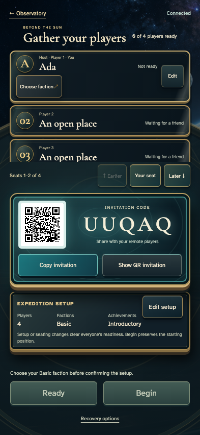](../../screenshots/inspect-a-real-attached-rift-system-in-4-player-remote-exploration/005-host-created-phone-darwin.png) | [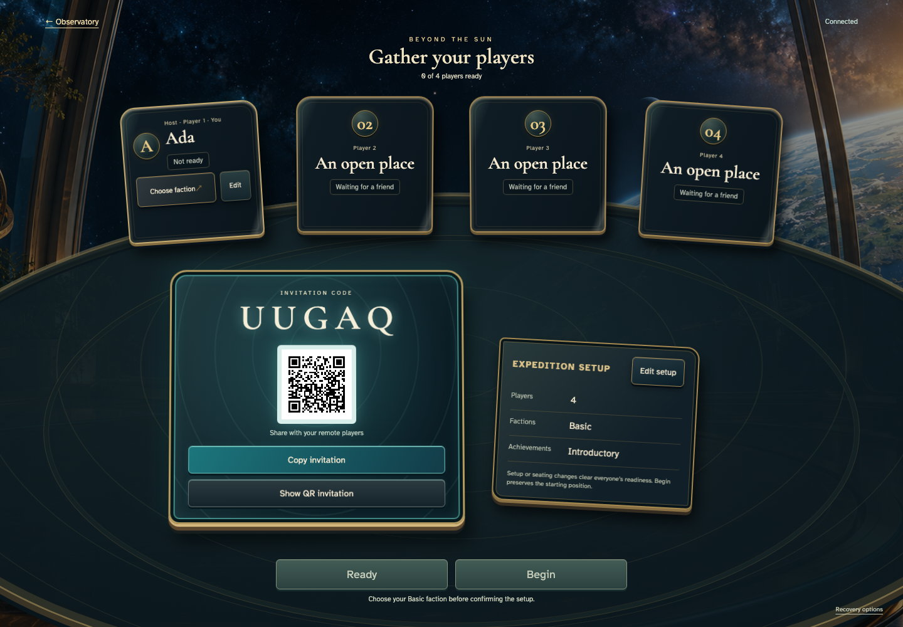](../../screenshots/inspect-a-real-attached-rift-system-in-4-player-remote-exploration/005-host-created-desktop-darwin.png) |

- [x] Create the canonical remote room and invitation
- [x] The saved automatic consequences settle before the public decision is photographed.
- [x] Public compact Technology objects retain physical separation.
- [x] The gameplay shell stays inside the actual viewport.

## 7. A separate identity previews the real invitation

Viewpoint: **Bora · independent guest controller**.

| phone · 393 × 852 | desktop · 1440 × 1000 |
| --- | --- |
| [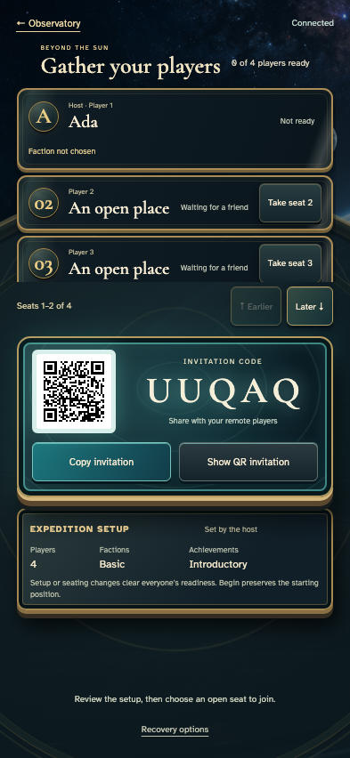](../../screenshots/inspect-a-real-attached-rift-system-in-4-player-remote-exploration/006-guest-preview-1-phone-darwin.png) | [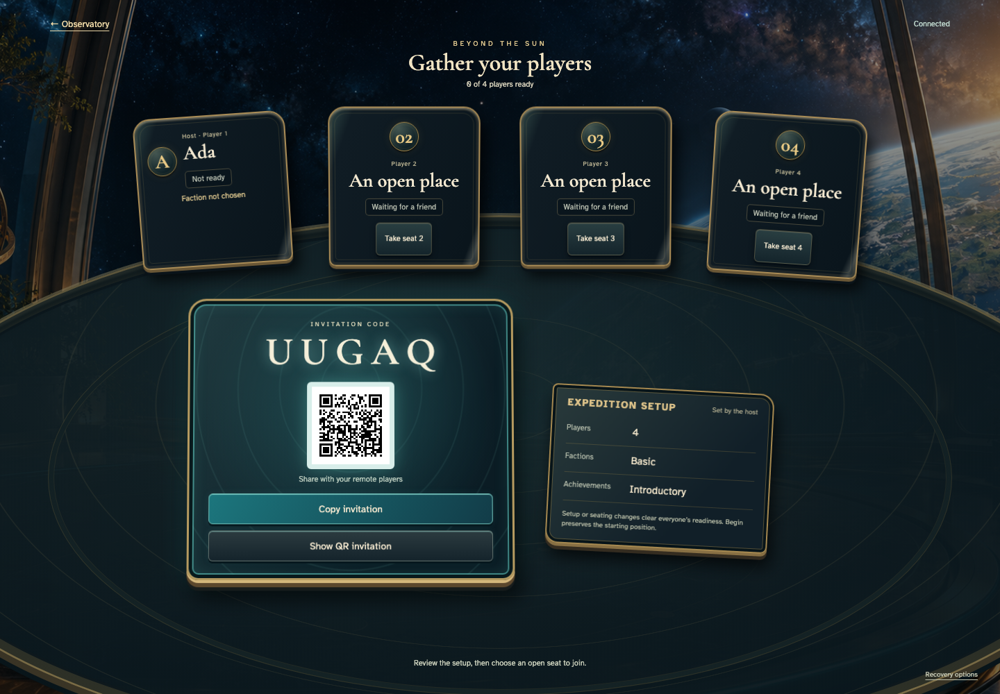](../../screenshots/inspect-a-real-attached-rift-system-in-4-player-remote-exploration/006-guest-preview-1-desktop-darwin.png) |

- [x] A separate identity previews the real invitation
- [x] The saved automatic consequences settle before the public decision is photographed.
- [x] Public compact Technology objects retain physical separation.
- [x] The gameplay shell stays inside the actual viewport.

## 8. The guest opens the ordinary seat editor

Viewpoint: **Bora · independent guest controller**.

| phone · 393 × 852 | desktop · 1440 × 1000 |
| --- | --- |
|  | [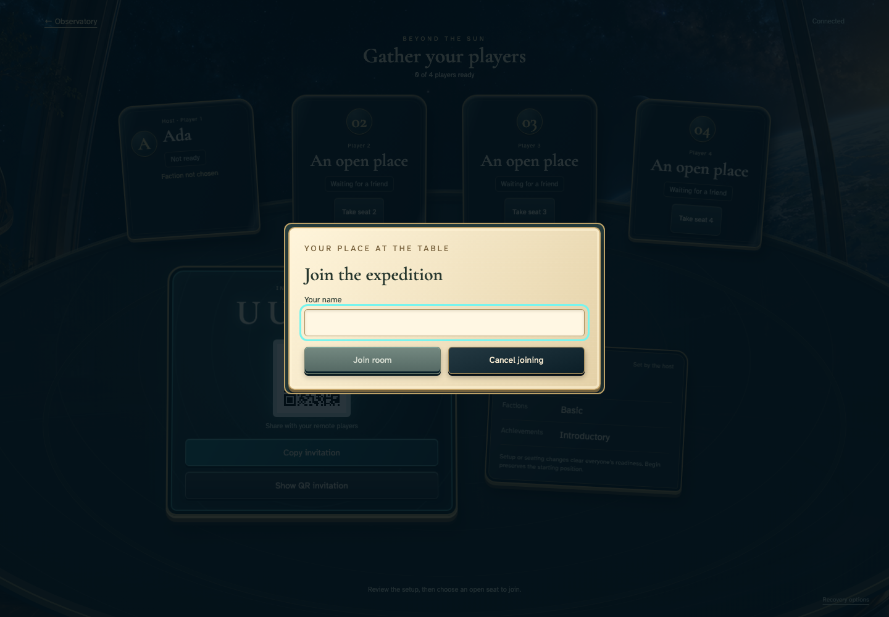](../../screenshots/inspect-a-real-attached-rift-system-in-4-player-remote-exploration/007-guest-editor-1-desktop-darwin.png) |

- [x] The guest opens the ordinary seat editor
- [x] The saved automatic consequences settle before the public decision is photographed.
- [x] Public compact Technology objects retain physical separation.
- [x] The gameplay shell stays inside the actual viewport.

## 9. Name the independent guest

Viewpoint: **Bora · independent guest controller**.

| phone · 393 × 852 | desktop · 1440 × 1000 |
| --- | --- |
|  |  |

- [x] Name the independent guest
- [x] The saved automatic consequences settle before the public decision is photographed.
- [x] Public compact Technology objects retain physical separation.
- [x] The gameplay shell stays inside the actual viewport.

## 10. Bora claims their own remote seat

Viewpoint: **Bora · independent guest controller**.

| phone · 393 × 852 | desktop · 1440 × 1000 |
| --- | --- |
| [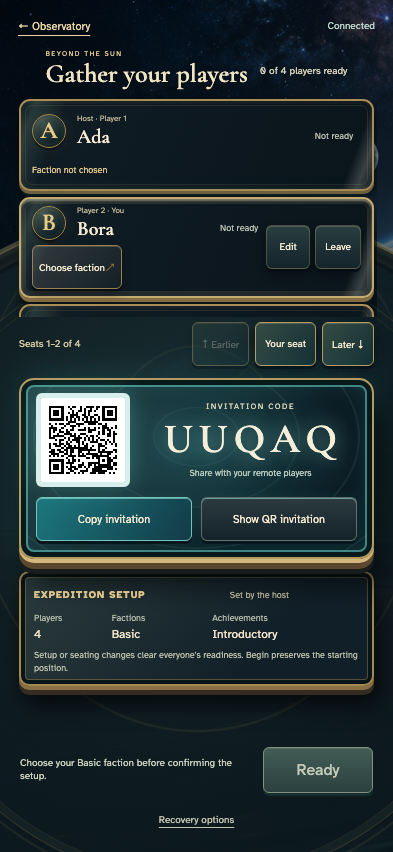](../../screenshots/inspect-a-real-attached-rift-system-in-4-player-remote-exploration/009-guest-joined-1-phone-darwin.png) | [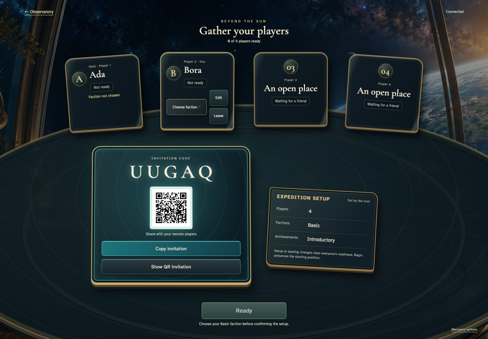](../../screenshots/inspect-a-real-attached-rift-system-in-4-player-remote-exploration/009-guest-joined-1-desktop-darwin.png) |

- [x] Bora claims their own remote seat
- [x] The saved automatic consequences settle before the public decision is photographed.
- [x] Public compact Technology objects retain physical separation.
- [x] The gameplay shell stays inside the actual viewport.

## 11. A separate identity previews the real invitation

Viewpoint: **Cleo · independent guest controller**.

| phone · 393 × 852 | desktop · 1440 × 1000 |
| --- | --- |
|  | [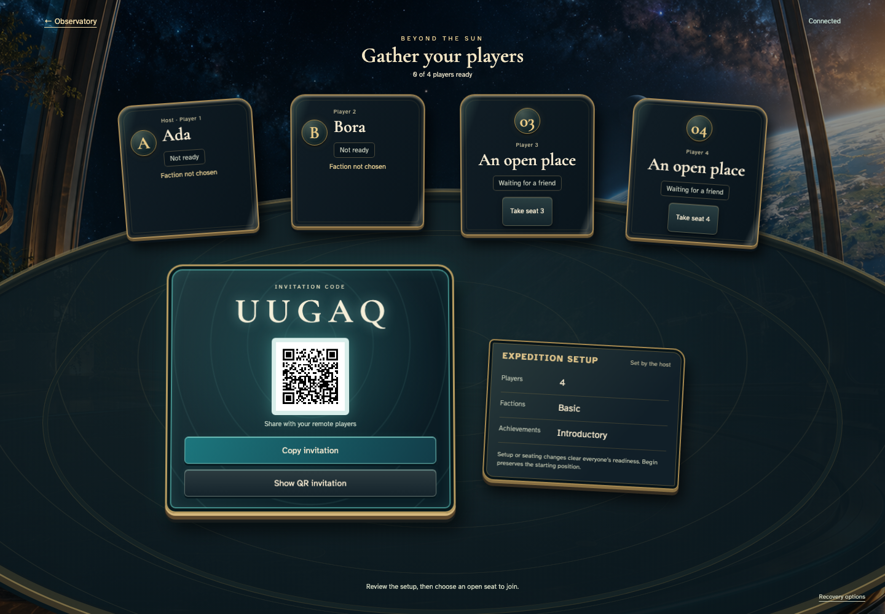](../../screenshots/inspect-a-real-attached-rift-system-in-4-player-remote-exploration/010-guest-preview-2-desktop-darwin.png) |

- [x] A separate identity previews the real invitation
- [x] The saved automatic consequences settle before the public decision is photographed.
- [x] Public compact Technology objects retain physical separation.
- [x] The gameplay shell stays inside the actual viewport.

## 12. The guest opens the ordinary seat editor

Viewpoint: **Cleo · independent guest controller**.

| phone · 393 × 852 | desktop · 1440 × 1000 |
| --- | --- |
| [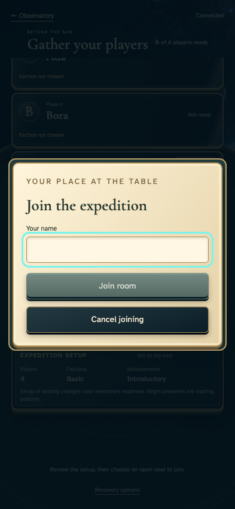](../../screenshots/inspect-a-real-attached-rift-system-in-4-player-remote-exploration/011-guest-editor-2-phone-darwin.png) | [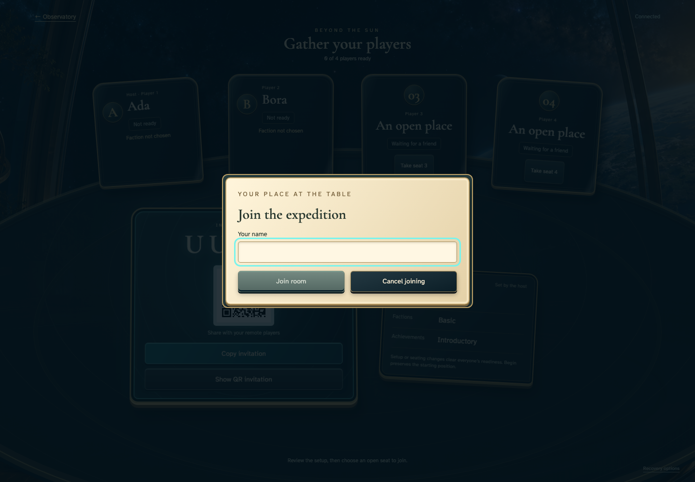](../../screenshots/inspect-a-real-attached-rift-system-in-4-player-remote-exploration/011-guest-editor-2-desktop-darwin.png) |

- [x] The guest opens the ordinary seat editor
- [x] The saved automatic consequences settle before the public decision is photographed.
- [x] Public compact Technology objects retain physical separation.
- [x] The gameplay shell stays inside the actual viewport.

## 13. Name the independent guest

Viewpoint: **Cleo · independent guest controller**.

| phone · 393 × 852 | desktop · 1440 × 1000 |
| --- | --- |
|  | [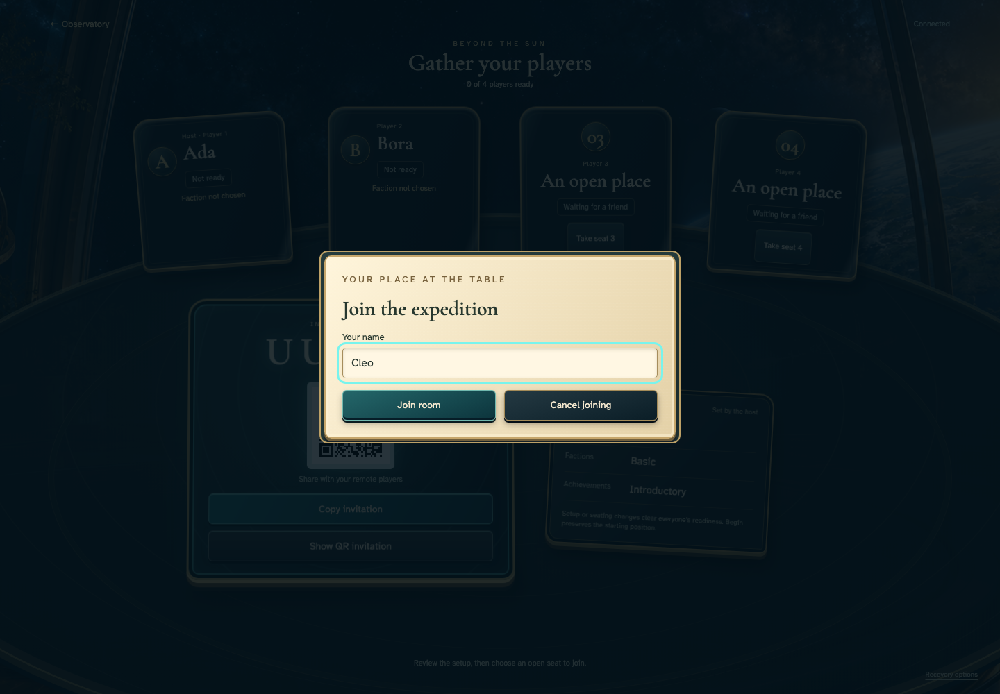](../../screenshots/inspect-a-real-attached-rift-system-in-4-player-remote-exploration/012-guest-name-2-desktop-darwin.png) |

- [x] Name the independent guest
- [x] The saved automatic consequences settle before the public decision is photographed.
- [x] Public compact Technology objects retain physical separation.
- [x] The gameplay shell stays inside the actual viewport.

## 14. Cleo claims their own remote seat

Viewpoint: **Cleo · independent guest controller**.

| phone · 393 × 852 | desktop · 1440 × 1000 |
| --- | --- |
| [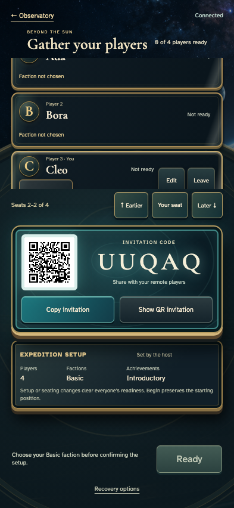](../../screenshots/inspect-a-real-attached-rift-system-in-4-player-remote-exploration/013-guest-joined-2-phone-darwin.png) | [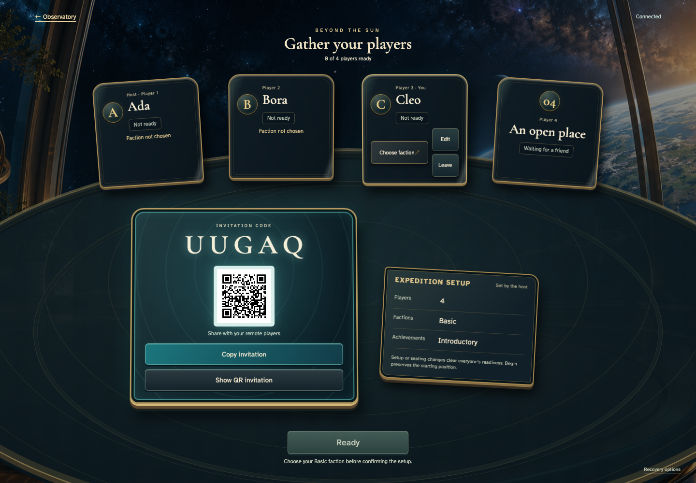](../../screenshots/inspect-a-real-attached-rift-system-in-4-player-remote-exploration/013-guest-joined-2-desktop-darwin.png) |

- [x] Cleo claims their own remote seat
- [x] The saved automatic consequences settle before the public decision is photographed.
- [x] Public compact Technology objects retain physical separation.
- [x] The gameplay shell stays inside the actual viewport.

## 15. A separate identity previews the real invitation

Viewpoint: **Dara · independent guest controller**.

| phone · 393 × 852 | desktop · 1440 × 1000 |
| --- | --- |
| [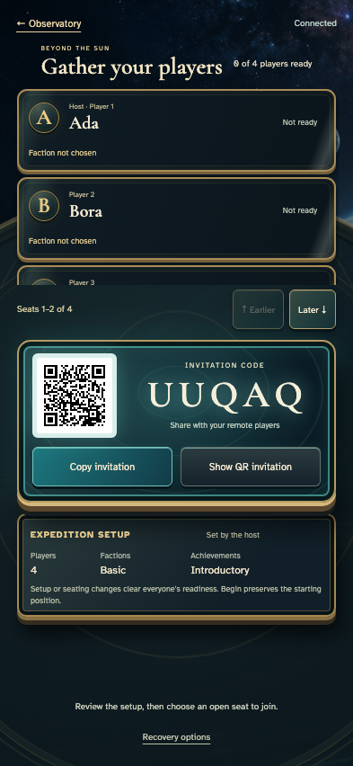](../../screenshots/inspect-a-real-attached-rift-system-in-4-player-remote-exploration/014-guest-preview-3-phone-darwin.png) | [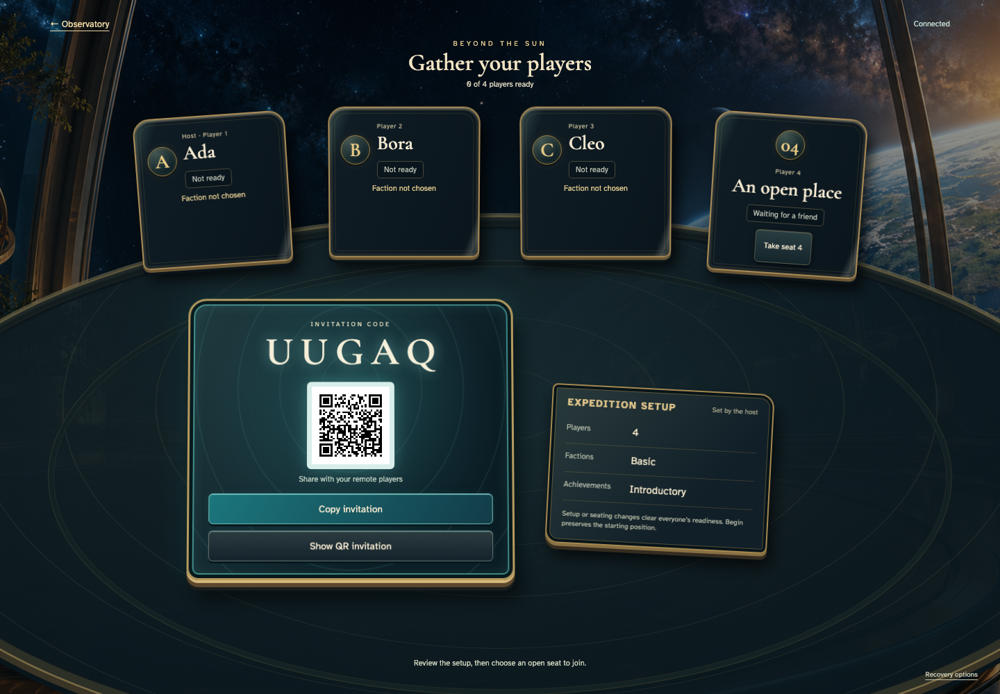](../../screenshots/inspect-a-real-attached-rift-system-in-4-player-remote-exploration/014-guest-preview-3-desktop-darwin.png) |

- [x] A separate identity previews the real invitation
- [x] The saved automatic consequences settle before the public decision is photographed.
- [x] Public compact Technology objects retain physical separation.
- [x] The gameplay shell stays inside the actual viewport.

## 16. The guest opens the ordinary seat editor

Viewpoint: **Dara · independent guest controller**.

| phone · 393 × 852 | desktop · 1440 × 1000 |
| --- | --- |
|  |  |

- [x] The guest opens the ordinary seat editor
- [x] The saved automatic consequences settle before the public decision is photographed.
- [x] Public compact Technology objects retain physical separation.
- [x] The gameplay shell stays inside the actual viewport.

## 17. Name the independent guest

Viewpoint: **Dara · independent guest controller**.

| phone · 393 × 852 | desktop · 1440 × 1000 |
| --- | --- |
|  | [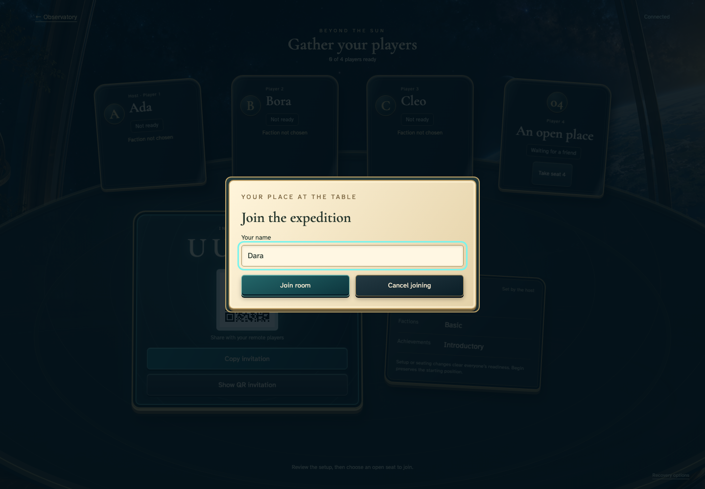](../../screenshots/inspect-a-real-attached-rift-system-in-4-player-remote-exploration/016-guest-name-3-desktop-darwin.png) |

- [x] Name the independent guest
- [x] The saved automatic consequences settle before the public decision is photographed.
- [x] Public compact Technology objects retain physical separation.
- [x] The gameplay shell stays inside the actual viewport.

## 18. Dara claims their own remote seat

Viewpoint: **Dara · independent guest controller**.

| phone · 393 × 852 | desktop · 1440 × 1000 |
| --- | --- |
| [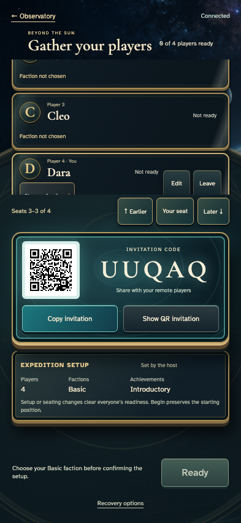](../../screenshots/inspect-a-real-attached-rift-system-in-4-player-remote-exploration/017-guest-joined-3-phone-darwin.png) | [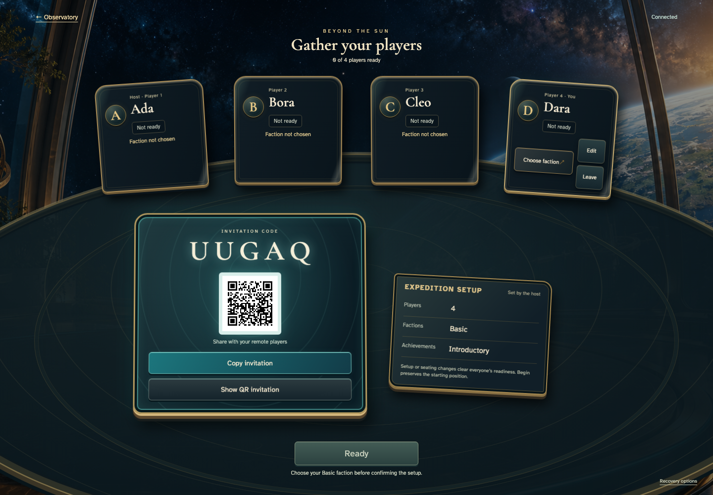](../../screenshots/inspect-a-real-attached-rift-system-in-4-player-remote-exploration/017-guest-joined-3-desktop-darwin.png) |

- [x] Dara claims their own remote seat
- [x] The saved automatic consequences settle before the public decision is photographed.
- [x] Public compact Technology objects retain physical separation.
- [x] The gameplay shell stays inside the actual viewport.

## 19. Ada reads the legal unique Basic factions

Viewpoint: **Ada · independent host controller**.

| phone · 393 × 852 | desktop · 1440 × 1000 |
| --- | --- |
|  |  |

- [x] Ada reads the legal unique Basic factions
- [x] The saved automatic consequences settle before the public decision is photographed.
- [x] Public compact Technology objects retain physical separation.
- [x] The gameplay shell stays inside the actual viewport.

## 20. Ada chooses their actual production faction

Viewpoint: **Ada · independent host controller**.

| phone · 393 × 852 | desktop · 1440 × 1000 |
| --- | --- |
| [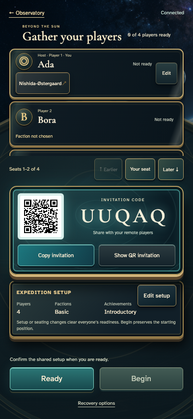](../../screenshots/inspect-a-real-attached-rift-system-in-4-player-remote-exploration/019-faction-0-chosen-phone-darwin.png) | [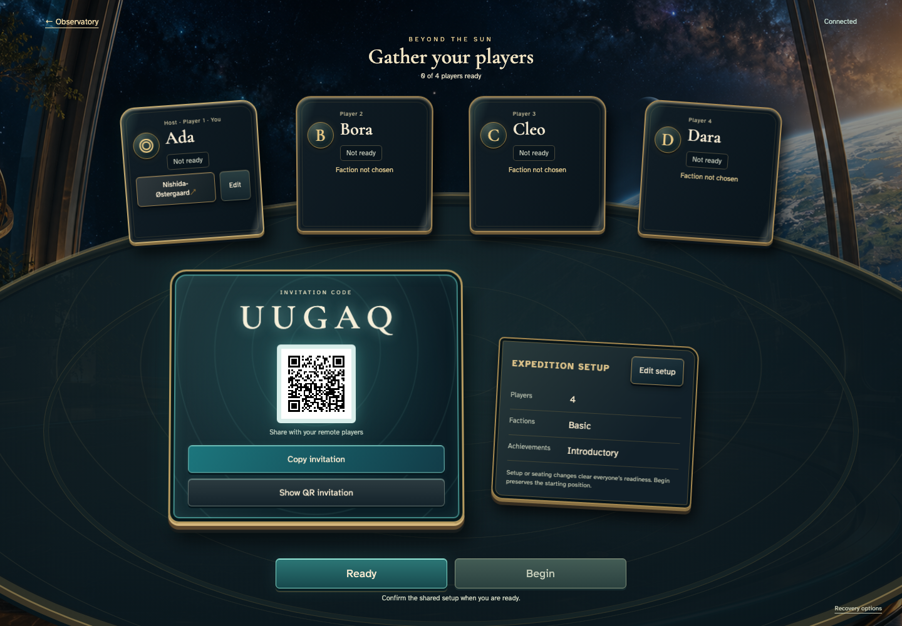](../../screenshots/inspect-a-real-attached-rift-system-in-4-player-remote-exploration/019-faction-0-chosen-desktop-darwin.png) |

- [x] Ada chooses their actual production faction
- [x] The saved automatic consequences settle before the public decision is photographed.
- [x] Public compact Technology objects retain physical separation.
- [x] The gameplay shell stays inside the actual viewport.

## 21. Bora reads the legal unique Basic factions

Viewpoint: **Bora · independent guest controller**.

| phone · 393 × 852 | desktop · 1440 × 1000 |
| --- | --- |
|  |  |

- [x] Bora reads the legal unique Basic factions
- [x] The saved automatic consequences settle before the public decision is photographed.
- [x] Public compact Technology objects retain physical separation.
- [x] The gameplay shell stays inside the actual viewport.

## 22. Bora chooses their actual production faction

Viewpoint: **Bora · independent guest controller**.

| phone · 393 × 852 | desktop · 1440 × 1000 |
| --- | --- |
| [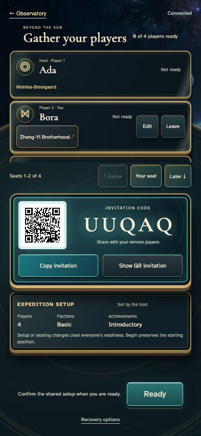](../../screenshots/inspect-a-real-attached-rift-system-in-4-player-remote-exploration/021-faction-1-chosen-phone-darwin.png) |  |

- [x] Bora chooses their actual production faction
- [x] The saved automatic consequences settle before the public decision is photographed.
- [x] Public compact Technology objects retain physical separation.
- [x] The gameplay shell stays inside the actual viewport.

## 23. Cleo reads the legal unique Basic factions

Viewpoint: **Cleo · independent guest controller**.

| phone · 393 × 852 | desktop · 1440 × 1000 |
| --- | --- |
| [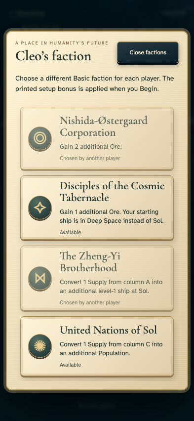](../../screenshots/inspect-a-real-attached-rift-system-in-4-player-remote-exploration/022-faction-2-choices-phone-darwin.png) |  |

- [x] Cleo reads the legal unique Basic factions
- [x] The saved automatic consequences settle before the public decision is photographed.
- [x] Public compact Technology objects retain physical separation.
- [x] The gameplay shell stays inside the actual viewport.

## 24. Cleo chooses their actual production faction

Viewpoint: **Cleo · independent guest controller**.

| phone · 393 × 852 | desktop · 1440 × 1000 |
| --- | --- |
| [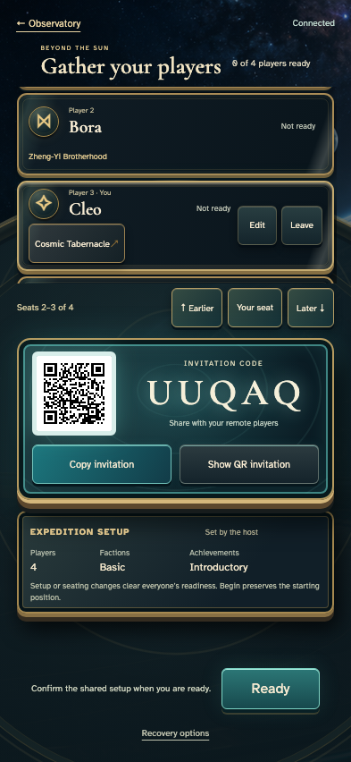](../../screenshots/inspect-a-real-attached-rift-system-in-4-player-remote-exploration/023-faction-2-chosen-phone-darwin.png) | [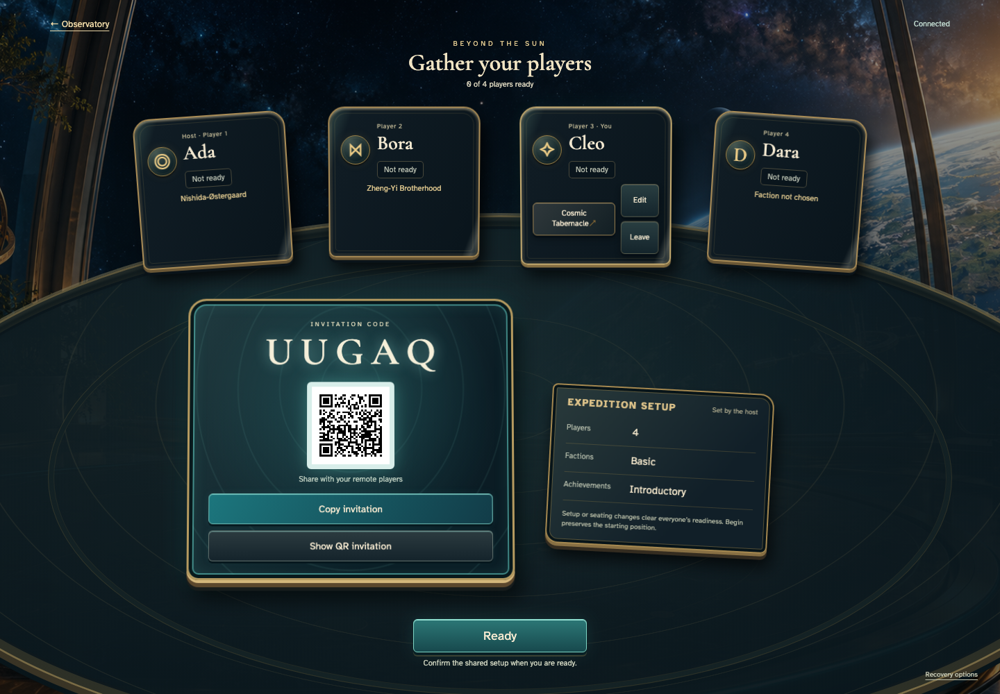](../../screenshots/inspect-a-real-attached-rift-system-in-4-player-remote-exploration/023-faction-2-chosen-desktop-darwin.png) |

- [x] Cleo chooses their actual production faction
- [x] The saved automatic consequences settle before the public decision is photographed.
- [x] Public compact Technology objects retain physical separation.
- [x] The gameplay shell stays inside the actual viewport.

## 25. Dara reads the legal unique Basic factions

Viewpoint: **Dara · independent guest controller**.

| phone · 393 × 852 | desktop · 1440 × 1000 |
| --- | --- |
|  | [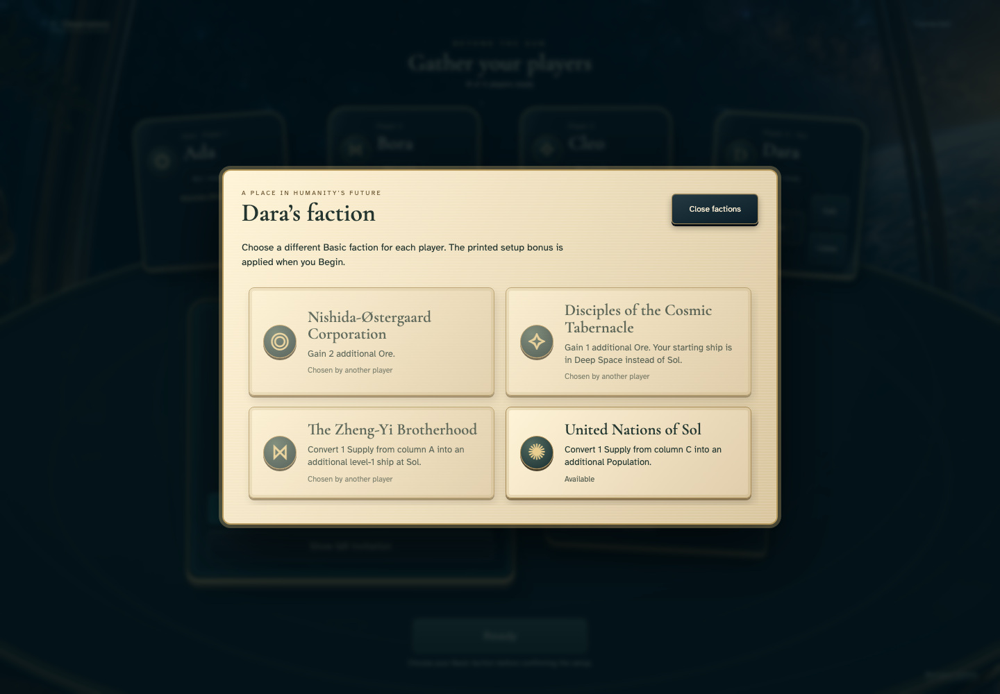](../../screenshots/inspect-a-real-attached-rift-system-in-4-player-remote-exploration/024-faction-3-choices-desktop-darwin.png) |

- [x] Dara reads the legal unique Basic factions
- [x] The saved automatic consequences settle before the public decision is photographed.
- [x] Public compact Technology objects retain physical separation.
- [x] The gameplay shell stays inside the actual viewport.

## 26. Dara chooses their actual production faction

Viewpoint: **Dara · independent guest controller**.

| phone · 393 × 852 | desktop · 1440 × 1000 |
| --- | --- |
| [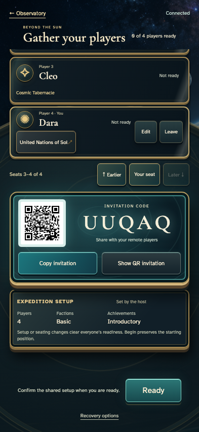](../../screenshots/inspect-a-real-attached-rift-system-in-4-player-remote-exploration/025-faction-3-chosen-phone-darwin.png) |  |

- [x] Dara chooses their actual production faction
- [x] The saved automatic consequences settle before the public decision is photographed.
- [x] Public compact Technology objects retain physical separation.
- [x] The gameplay shell stays inside the actual viewport.

## 27. Ada confirms this exact configuration

Viewpoint: **Ada · independent host controller**.

| phone · 393 × 852 | desktop · 1440 × 1000 |
| --- | --- |
|  | [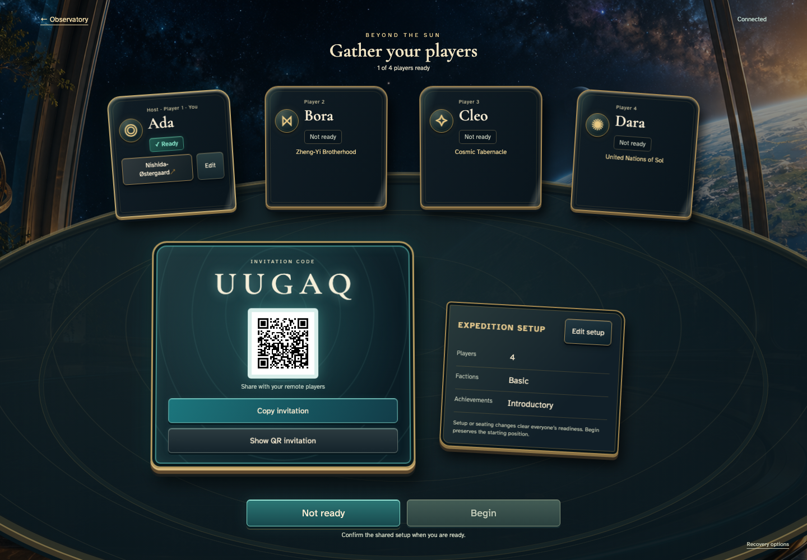](../../screenshots/inspect-a-real-attached-rift-system-in-4-player-remote-exploration/026-ready-0-desktop-darwin.png) |

- [x] Ada confirms this exact configuration
- [x] The saved automatic consequences settle before the public decision is photographed.
- [x] Public compact Technology objects retain physical separation.
- [x] The gameplay shell stays inside the actual viewport.

## 28. Bora confirms this exact configuration

Viewpoint: **Bora · independent guest controller**.

| phone · 393 × 852 | desktop · 1440 × 1000 |
| --- | --- |
| [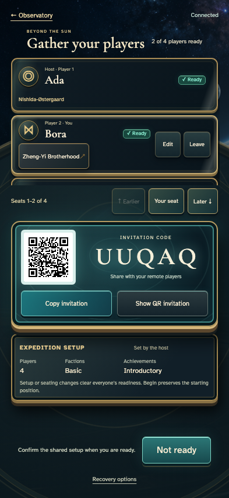](../../screenshots/inspect-a-real-attached-rift-system-in-4-player-remote-exploration/027-ready-1-phone-darwin.png) |  |

- [x] Bora confirms this exact configuration
- [x] The saved automatic consequences settle before the public decision is photographed.
- [x] Public compact Technology objects retain physical separation.
- [x] The gameplay shell stays inside the actual viewport.

## 29. Cleo confirms this exact configuration

Viewpoint: **Cleo · independent guest controller**.

| phone · 393 × 852 | desktop · 1440 × 1000 |
| --- | --- |
| [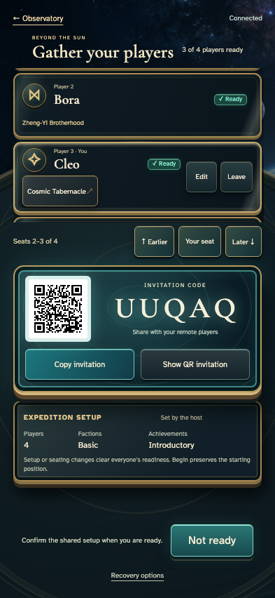](../../screenshots/inspect-a-real-attached-rift-system-in-4-player-remote-exploration/028-ready-2-phone-darwin.png) |  |

- [x] Cleo confirms this exact configuration
- [x] The saved automatic consequences settle before the public decision is photographed.
- [x] Public compact Technology objects retain physical separation.
- [x] The gameplay shell stays inside the actual viewport.

## 30. Dara confirms this exact configuration

Viewpoint: **Dara · independent guest controller**.

| phone · 393 × 852 | desktop · 1440 × 1000 |
| --- | --- |
| [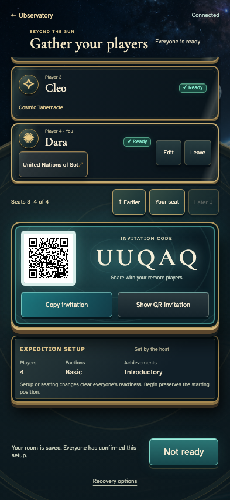](../../screenshots/inspect-a-real-attached-rift-system-in-4-player-remote-exploration/029-ready-3-phone-darwin.png) |  |

- [x] Dara confirms this exact configuration
- [x] The saved automatic consequences settle before the public decision is photographed.
- [x] Public compact Technology objects retain physical separation.
- [x] The gameplay shell stays inside the actual viewport.

## 31. Begin creates the immutable seeded Basic game

Viewpoint: **Ada · independent host controller**.

| phone · 393 × 852 | desktop · 1440 × 1000 |
| --- | --- |
| [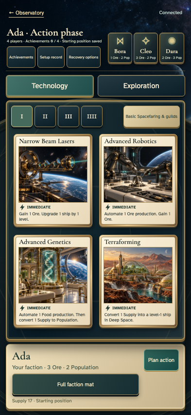](../../screenshots/inspect-a-real-attached-rift-system-in-4-player-remote-exploration/030-begun-phone-darwin.png) | [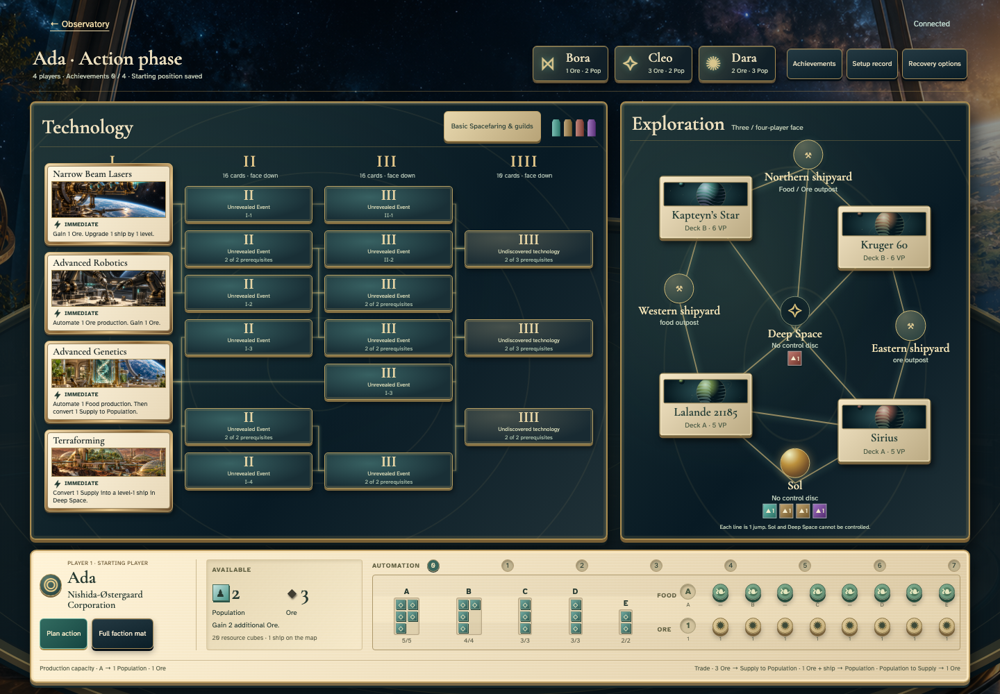](../../screenshots/inspect-a-real-attached-rift-system-in-4-player-remote-exploration/030-begun-desktop-darwin.png) |

- [x] Begin creates the immutable seeded Basic game
- [x] The saved automatic consequences settle before the public decision is photographed.
- [x] Public compact Technology objects retain physical separation.
- [x] The gameplay shell stays inside the actual viewport.

## 32. Ada plans a legal preparatory Level I turn

Viewpoint: **Ada · independent host controller**.

| phone · 393 × 852 | desktop · 1440 × 1000 |
| --- | --- |
|  |  |

- [x] Ada plans a legal preparatory Level I turn
- [x] The saved automatic consequences settle before the public decision is photographed.
- [x] Public compact Technology objects retain physical separation.
- [x] The gameplay shell stays inside the actual viewport.

## 33. Ada chooses the unoccupied printed Action space

Viewpoint: **Ada · independent host controller**.

| phone · 393 × 852 | desktop · 1440 × 1000 |
| --- | --- |
| [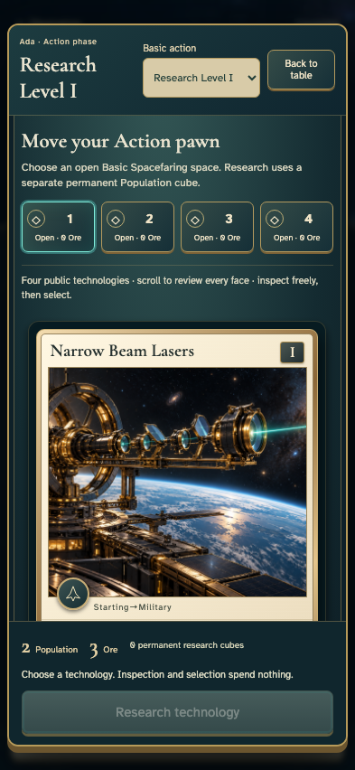](../../screenshots/inspect-a-real-attached-rift-system-in-4-player-remote-exploration/032-prep-0-space-phone-darwin.png) |  |

- [x] Ada chooses the unoccupied printed Action space
- [x] The saved automatic consequences settle before the public decision is photographed.
- [x] Public compact Technology objects retain physical separation.
- [x] The gameplay shell stays inside the actual viewport.

## 34. Ada selects the public Advanced Robotics face

Viewpoint: **Ada · independent host controller**.

| phone · 393 × 852 | desktop · 1440 × 1000 |
| --- | --- |
| [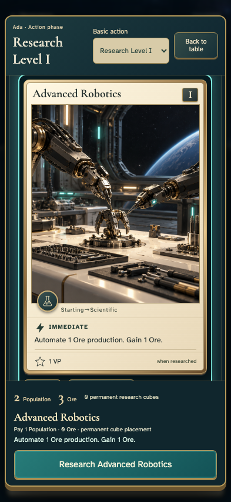](../../screenshots/inspect-a-real-attached-rift-system-in-4-player-remote-exploration/033-prep-0-card-phone-darwin.png) |  |

- [x] Ada selects the public Advanced Robotics face
- [x] The saved automatic consequences settle before the public decision is photographed.
- [x] Public compact Technology objects retain physical separation.
- [x] The gameplay shell stays inside the actual viewport.

## 35. Ada pays permanent research Population and receives the printed immediate bonus

Viewpoint: **Ada · independent host controller**.

| phone · 393 × 852 | desktop · 1440 × 1000 |
| --- | --- |
|  |  |

- [x] Ada pays permanent research Population and receives the printed immediate bonus
- [x] The saved automatic consequences settle before the public decision is photographed.
- [x] Public compact Technology objects retain physical separation.
- [x] The gameplay shell stays inside the actual viewport.

## 36. Ada completes ordinary production and hands off automatically

Viewpoint: **Ada · independent host controller**.

| phone · 393 × 852 | desktop · 1440 × 1000 |
| --- | --- |
| [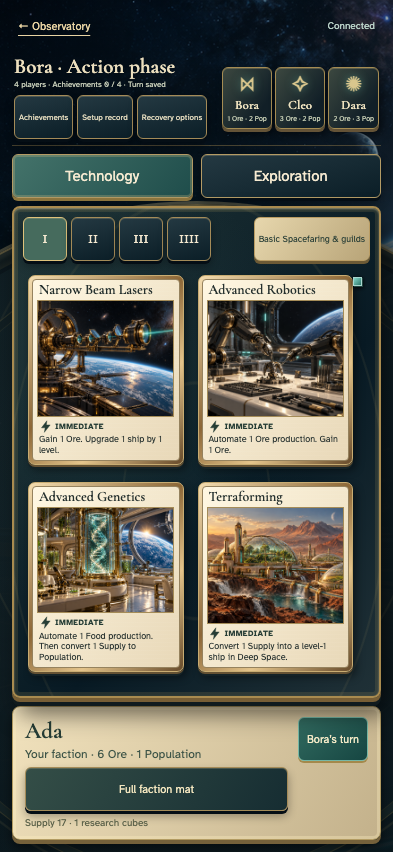](../../screenshots/inspect-a-real-attached-rift-system-in-4-player-remote-exploration/035-prep-0-handoff-phone-darwin.png) | [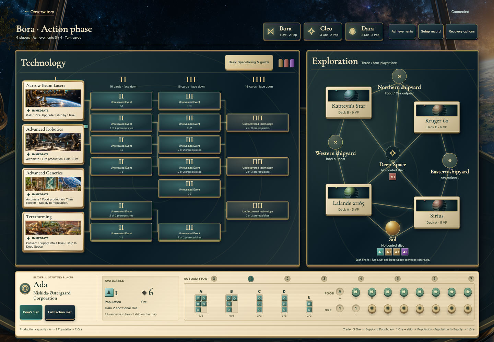](../../screenshots/inspect-a-real-attached-rift-system-in-4-player-remote-exploration/035-prep-0-handoff-desktop-darwin.png) |

- [x] Ada completes ordinary production and hands off automatically
- [x] The saved automatic consequences settle before the public decision is photographed.
- [x] Public compact Technology objects retain physical separation.
- [x] The gameplay shell stays inside the actual viewport.

## 37. The next independent controller sees the same canonical handoff

Viewpoint: **Bora · independent guest controller**.

| phone · 393 × 852 | desktop · 1440 × 1000 |
| --- | --- |
|  | [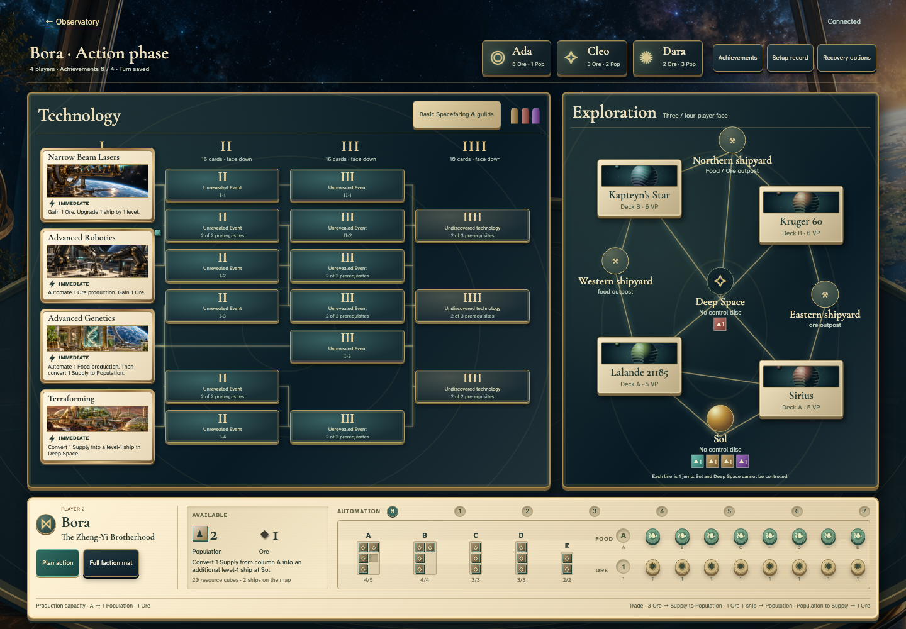](../../screenshots/inspect-a-real-attached-rift-system-in-4-player-remote-exploration/036-prep-0-handoff-next-desktop-darwin.png) |

- [x] The next independent controller sees the same canonical handoff
- [x] The saved automatic consequences settle before the public decision is photographed.
- [x] Public compact Technology objects retain physical separation.
- [x] The gameplay shell stays inside the actual viewport.

## 38. Bora plans a legal preparatory Level I turn

Viewpoint: **Bora · independent guest controller**.

| phone · 393 × 852 | desktop · 1440 × 1000 |
| --- | --- |
|  |  |

- [x] Bora plans a legal preparatory Level I turn
- [x] The saved automatic consequences settle before the public decision is photographed.
- [x] Public compact Technology objects retain physical separation.
- [x] The gameplay shell stays inside the actual viewport.

## 39. Bora chooses the unoccupied printed Action space

Viewpoint: **Bora · independent guest controller**.

| phone · 393 × 852 | desktop · 1440 × 1000 |
| --- | --- |
| [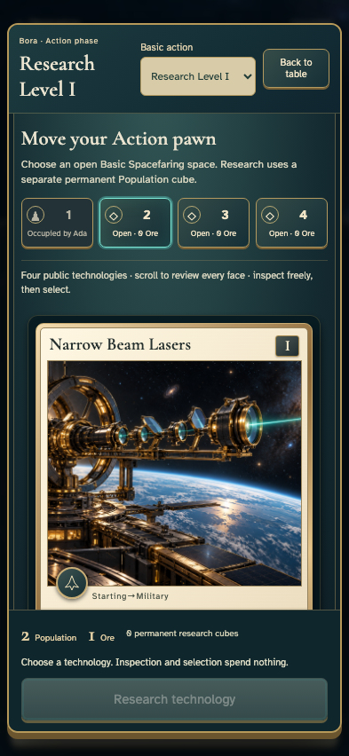](../../screenshots/inspect-a-real-attached-rift-system-in-4-player-remote-exploration/038-prep-1-space-phone-darwin.png) |  |

- [x] Bora chooses the unoccupied printed Action space
- [x] The saved automatic consequences settle before the public decision is photographed.
- [x] Public compact Technology objects retain physical separation.
- [x] The gameplay shell stays inside the actual viewport.

## 40. Bora selects the public Advanced Robotics face

Viewpoint: **Bora · independent guest controller**.

| phone · 393 × 852 | desktop · 1440 × 1000 |
| --- | --- |
|  | [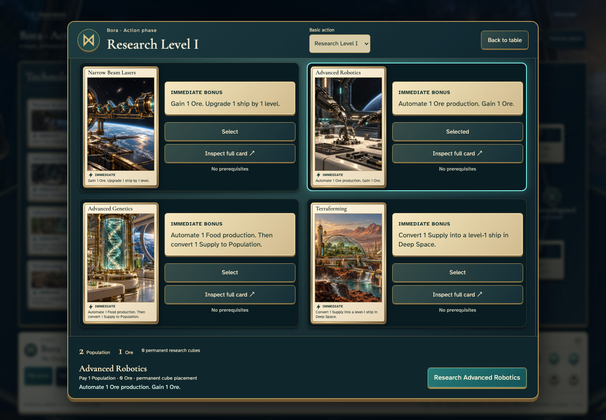](../../screenshots/inspect-a-real-attached-rift-system-in-4-player-remote-exploration/039-prep-1-card-desktop-darwin.png) |

- [x] Bora selects the public Advanced Robotics face
- [x] The saved automatic consequences settle before the public decision is photographed.
- [x] Public compact Technology objects retain physical separation.
- [x] The gameplay shell stays inside the actual viewport.

## 41. Bora pays permanent research Population and receives the printed immediate bonus

Viewpoint: **Bora · independent guest controller**.

| phone · 393 × 852 | desktop · 1440 × 1000 |
| --- | --- |
|  |  |

- [x] Bora pays permanent research Population and receives the printed immediate bonus
- [x] The saved automatic consequences settle before the public decision is photographed.
- [x] Public compact Technology objects retain physical separation.
- [x] The gameplay shell stays inside the actual viewport.

## 42. Bora completes ordinary production and hands off automatically

Viewpoint: **Bora · independent guest controller**.

| phone · 393 × 852 | desktop · 1440 × 1000 |
| --- | --- |
|  | [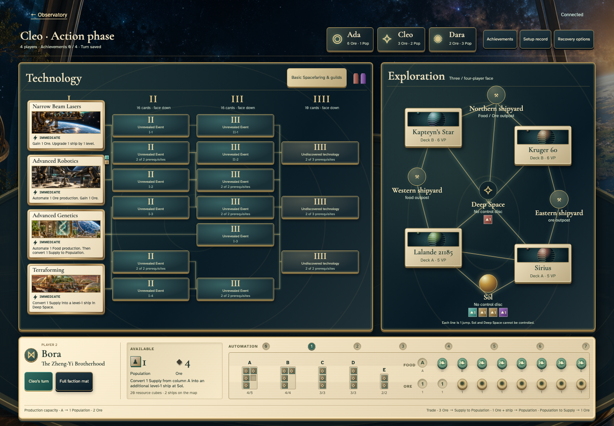](../../screenshots/inspect-a-real-attached-rift-system-in-4-player-remote-exploration/041-prep-1-handoff-desktop-darwin.png) |

- [x] Bora completes ordinary production and hands off automatically
- [x] The saved automatic consequences settle before the public decision is photographed.
- [x] Public compact Technology objects retain physical separation.
- [x] The gameplay shell stays inside the actual viewport.

## 43. The next independent controller sees the same canonical handoff

Viewpoint: **Cleo · independent guest controller**.

| phone · 393 × 852 | desktop · 1440 × 1000 |
| --- | --- |
| [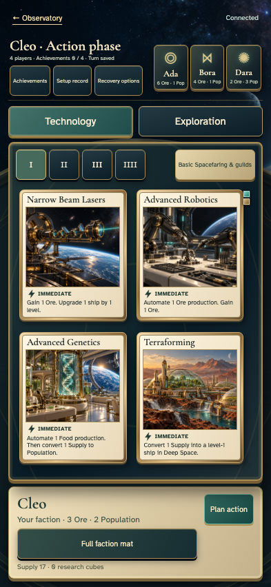](../../screenshots/inspect-a-real-attached-rift-system-in-4-player-remote-exploration/042-prep-1-handoff-next-phone-darwin.png) |  |

- [x] The next independent controller sees the same canonical handoff
- [x] The saved automatic consequences settle before the public decision is photographed.
- [x] Public compact Technology objects retain physical separation.
- [x] The gameplay shell stays inside the actual viewport.

## 44. Cleo plans a legal preparatory Level I turn

Viewpoint: **Cleo · independent guest controller**.

| phone · 393 × 852 | desktop · 1440 × 1000 |
| --- | --- |
| [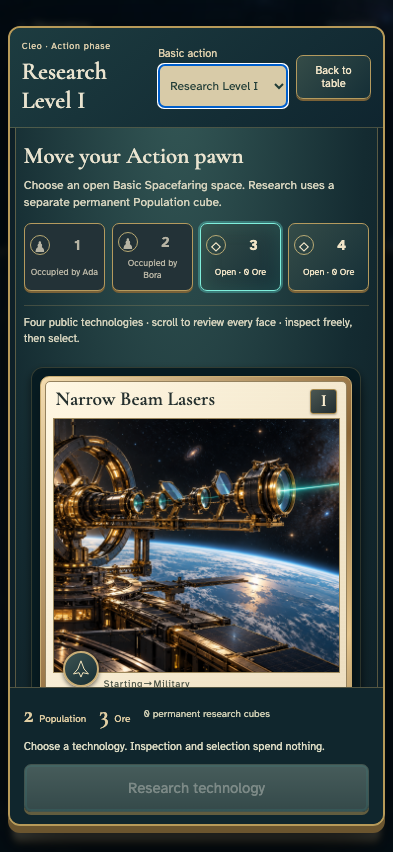](../../screenshots/inspect-a-real-attached-rift-system-in-4-player-remote-exploration/043-prep-2-plan-phone-darwin.png) |  |

- [x] Cleo plans a legal preparatory Level I turn
- [x] The saved automatic consequences settle before the public decision is photographed.
- [x] Public compact Technology objects retain physical separation.
- [x] The gameplay shell stays inside the actual viewport.

## 45. Cleo chooses the unoccupied printed Action space

Viewpoint: **Cleo · independent guest controller**.

| phone · 393 × 852 | desktop · 1440 × 1000 |
| --- | --- |
|  |  |

- [x] Cleo chooses the unoccupied printed Action space
- [x] The saved automatic consequences settle before the public decision is photographed.
- [x] Public compact Technology objects retain physical separation.
- [x] The gameplay shell stays inside the actual viewport.

## 46. Cleo selects the public Advanced Robotics face

Viewpoint: **Cleo · independent guest controller**.

| phone · 393 × 852 | desktop · 1440 × 1000 |
| --- | --- |
|  |  |

- [x] Cleo selects the public Advanced Robotics face
- [x] The saved automatic consequences settle before the public decision is photographed.
- [x] Public compact Technology objects retain physical separation.
- [x] The gameplay shell stays inside the actual viewport.

## 47. Cleo pays permanent research Population and receives the printed immediate bonus

Viewpoint: **Cleo · independent guest controller**.

| phone · 393 × 852 | desktop · 1440 × 1000 |
| --- | --- |
|  |  |

- [x] Cleo pays permanent research Population and receives the printed immediate bonus
- [x] The saved automatic consequences settle before the public decision is photographed.
- [x] Public compact Technology objects retain physical separation.
- [x] The gameplay shell stays inside the actual viewport.

## 48. Cleo completes ordinary production and hands off automatically

Viewpoint: **Cleo · independent guest controller**.

| phone · 393 × 852 | desktop · 1440 × 1000 |
| --- | --- |
|  |  |

- [x] Cleo completes ordinary production and hands off automatically
- [x] The saved automatic consequences settle before the public decision is photographed.
- [x] Public compact Technology objects retain physical separation.
- [x] The gameplay shell stays inside the actual viewport.

## 49. The next independent controller sees the same canonical handoff

Viewpoint: **Dara · independent guest controller**.

| phone · 393 × 852 | desktop · 1440 × 1000 |
| --- | --- |
|  | [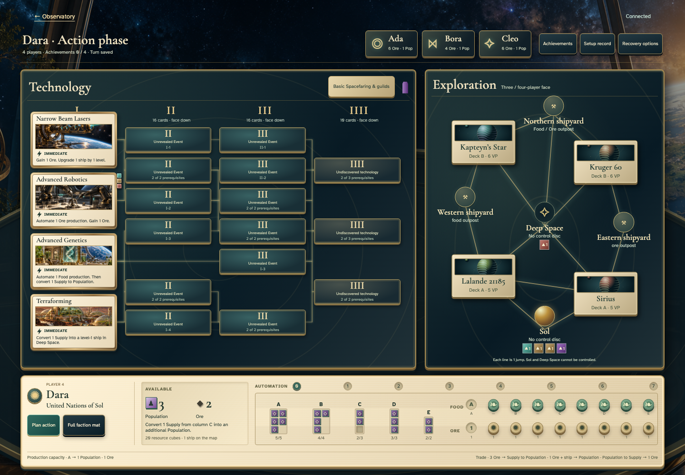](../../screenshots/inspect-a-real-attached-rift-system-in-4-player-remote-exploration/048-prep-2-handoff-next-desktop-darwin.png) |

- [x] The next independent controller sees the same canonical handoff
- [x] The saved automatic consequences settle before the public decision is photographed.
- [x] Public compact Technology objects retain physical separation.
- [x] The gameplay shell stays inside the actual viewport.

## 50. Dara plans a legal preparatory Level I turn

Viewpoint: **Dara · independent guest controller**.

| phone · 393 × 852 | desktop · 1440 × 1000 |
| --- | --- |
| [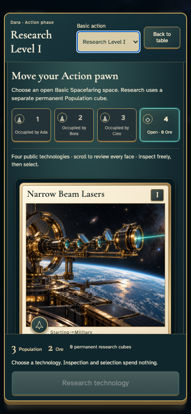](../../screenshots/inspect-a-real-attached-rift-system-in-4-player-remote-exploration/049-prep-3-plan-phone-darwin.png) | [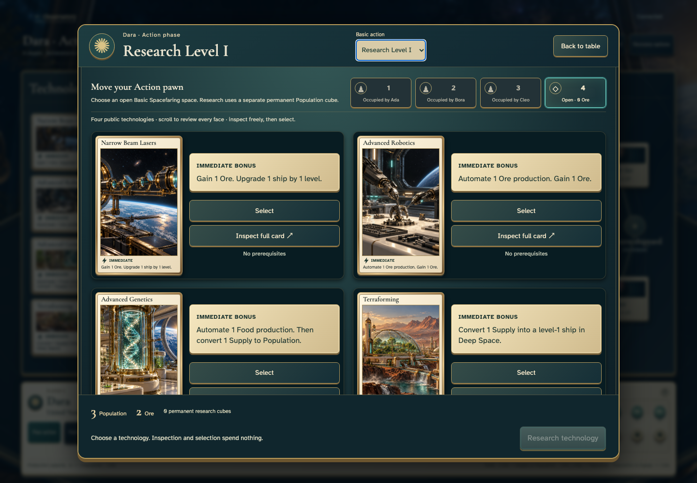](../../screenshots/inspect-a-real-attached-rift-system-in-4-player-remote-exploration/049-prep-3-plan-desktop-darwin.png) |

- [x] Dara plans a legal preparatory Level I turn
- [x] The saved automatic consequences settle before the public decision is photographed.
- [x] Public compact Technology objects retain physical separation.
- [x] The gameplay shell stays inside the actual viewport.

## 51. Dara chooses the unoccupied printed Action space

Viewpoint: **Dara · independent guest controller**.

| phone · 393 × 852 | desktop · 1440 × 1000 |
| --- | --- |
| [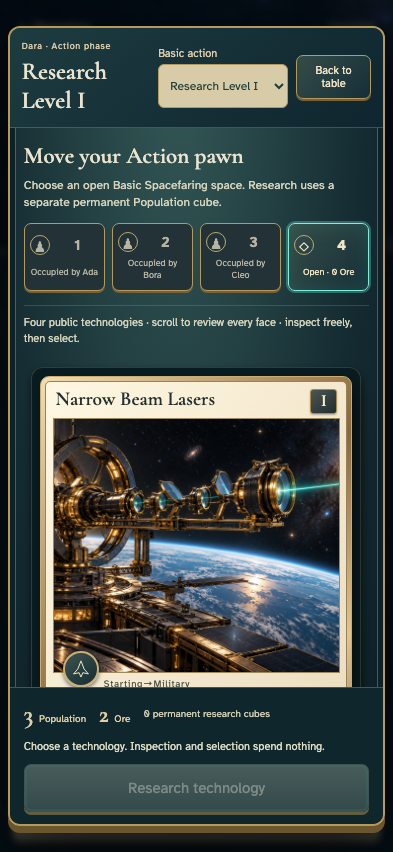](../../screenshots/inspect-a-real-attached-rift-system-in-4-player-remote-exploration/050-prep-3-space-phone-darwin.png) |  |

- [x] Dara chooses the unoccupied printed Action space
- [x] The saved automatic consequences settle before the public decision is photographed.
- [x] Public compact Technology objects retain physical separation.
- [x] The gameplay shell stays inside the actual viewport.

## 52. Dara selects the public Advanced Robotics face

Viewpoint: **Dara · independent guest controller**.

| phone · 393 × 852 | desktop · 1440 × 1000 |
| --- | --- |
|  | [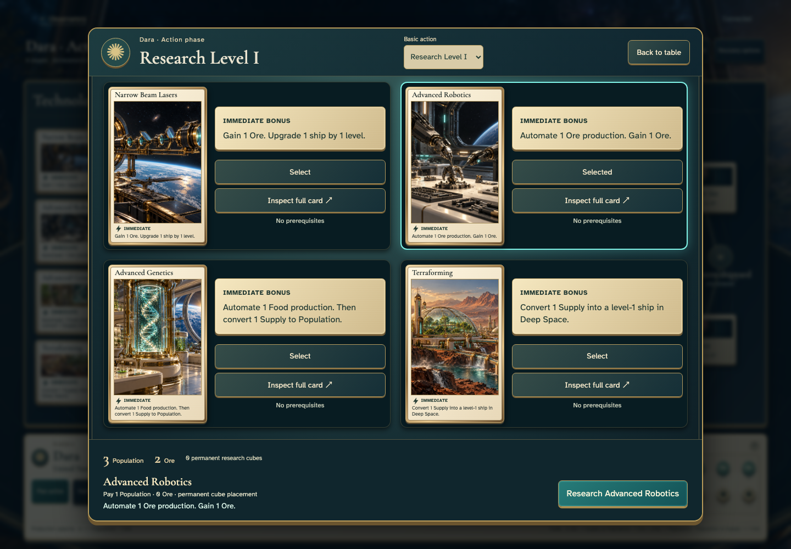](../../screenshots/inspect-a-real-attached-rift-system-in-4-player-remote-exploration/051-prep-3-card-desktop-darwin.png) |

- [x] Dara selects the public Advanced Robotics face
- [x] The saved automatic consequences settle before the public decision is photographed.
- [x] Public compact Technology objects retain physical separation.
- [x] The gameplay shell stays inside the actual viewport.

## 53. Dara pays permanent research Population and receives the printed immediate bonus

Viewpoint: **Dara · independent guest controller**.

| phone · 393 × 852 | desktop · 1440 × 1000 |
| --- | --- |
| [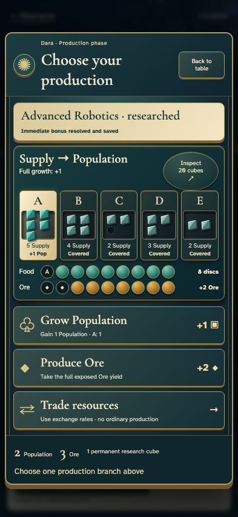](../../screenshots/inspect-a-real-attached-rift-system-in-4-player-remote-exploration/052-prep-3-paid-phone-darwin.png) | [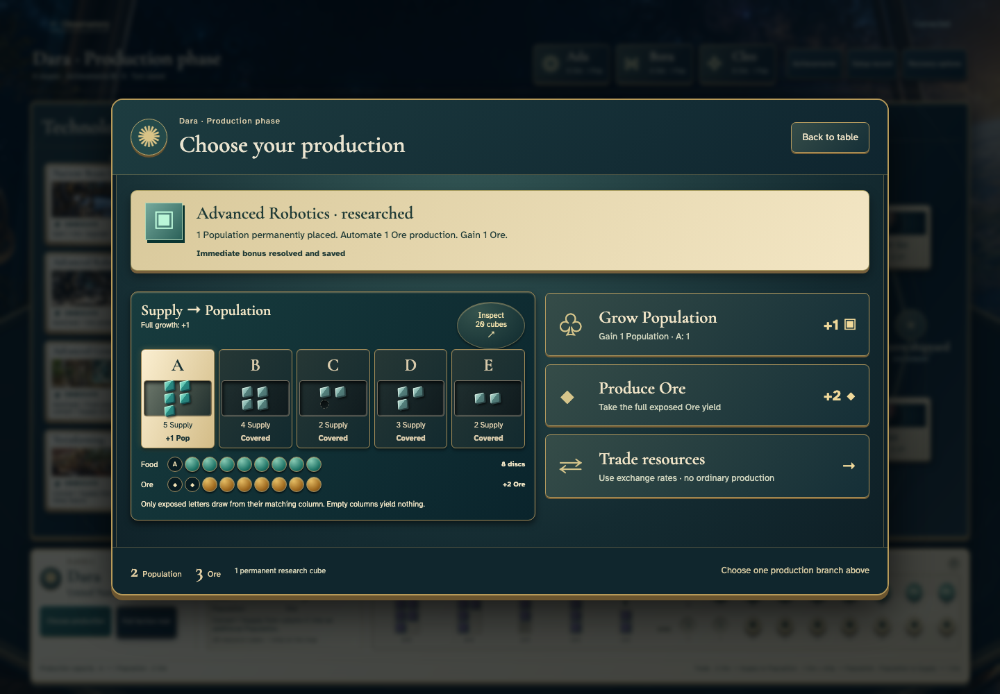](../../screenshots/inspect-a-real-attached-rift-system-in-4-player-remote-exploration/052-prep-3-paid-desktop-darwin.png) |

- [x] Dara pays permanent research Population and receives the printed immediate bonus
- [x] The saved automatic consequences settle before the public decision is photographed.
- [x] Public compact Technology objects retain physical separation.
- [x] The gameplay shell stays inside the actual viewport.

## 54. Dara completes ordinary production and hands off automatically

Viewpoint: **Dara · independent guest controller**.

| phone · 393 × 852 | desktop · 1440 × 1000 |
| --- | --- |
|  | [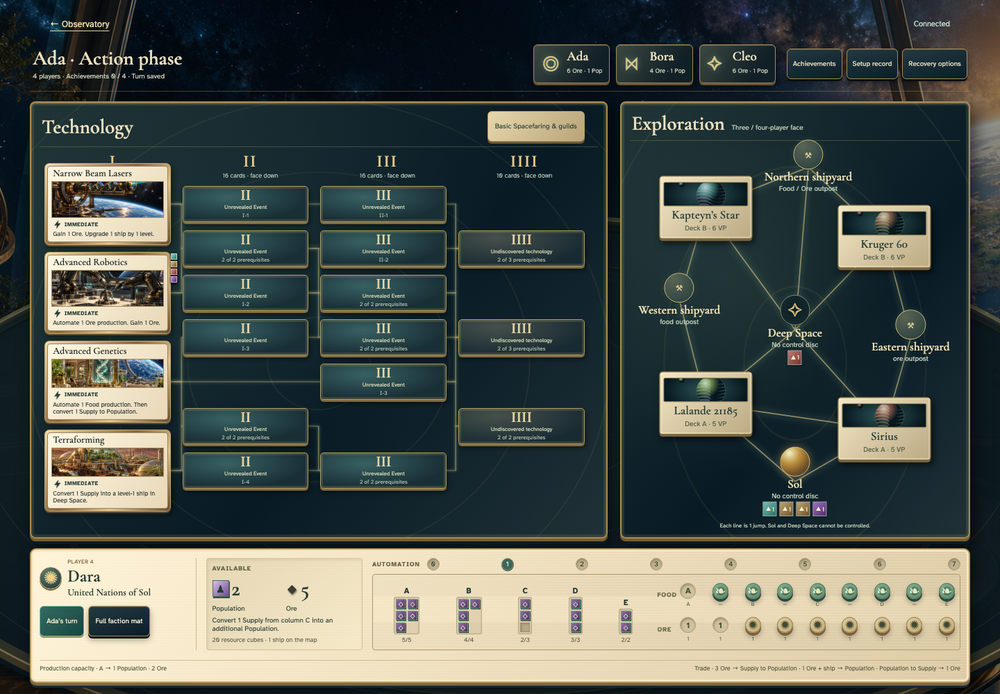](../../screenshots/inspect-a-real-attached-rift-system-in-4-player-remote-exploration/053-prep-3-handoff-desktop-darwin.png) |

- [x] Dara completes ordinary production and hands off automatically
- [x] The saved automatic consequences settle before the public decision is photographed.
- [x] Public compact Technology objects retain physical separation.
- [x] The gameplay shell stays inside the actual viewport.

## 55. The next independent controller sees the same canonical handoff

Viewpoint: **Ada · independent host controller**.

| phone · 393 × 852 | desktop · 1440 × 1000 |
| --- | --- |
|  |  |

- [x] The next independent controller sees the same canonical handoff
- [x] The saved automatic consequences settle before the public decision is photographed.
- [x] Public compact Technology objects retain physical separation.
- [x] The gameplay shell stays inside the actual viewport.

## 56. The researcher opens the real Basic action instrument

Viewpoint: **Ada · independent host controller**.

| phone · 393 × 852 | desktop · 1440 × 1000 |
| --- | --- |
|  |  |

- [x] The researcher opens the real Basic action instrument
- [x] The saved automatic consequences settle before the public decision is photographed.
- [x] Public compact Technology objects retain physical separation.
- [x] The gameplay shell stays inside the actual viewport.

## 57. Choose Level II and inspect all six public prerequisites without revealing cards

Viewpoint: **Ada · independent host controller**.

| phone · 393 × 852 | desktop · 1440 × 1000 |
| --- | --- |
|  |  |

- [x] Choose Level II and inspect all six public prerequisites without revealing cards
- [x] The saved automatic consequences settle before the public decision is photographed.
- [x] Public compact Technology objects retain physical separation.
- [x] The gameplay shell stays inside the actual viewport.

## 58. Select a legal undiscovered position and read its permanent Population and Ore payment

Viewpoint: **Ada · independent host controller**.

| phone · 393 × 852 | desktop · 1440 × 1000 |
| --- | --- |
|  |  |

- [x] Select a legal undiscovered position and read its permanent Population and Ore payment
- [x] The saved automatic consequences settle before the public decision is photographed.
- [x] Public compact Technology objects retain physical separation.
- [x] The gameplay shell stays inside the actual viewport.

## 59. Payment reveals Dimensional Rift; all Event decisions resolve before candidates

Viewpoint: **Ada · independent host controller**.

| phone · 393 × 852 | desktop · 1440 × 1000 |
| --- | --- |
|  |  |

- [x] Payment reveals Dimensional Rift; all Event decisions resolve before candidates
- [x] The saved automatic consequences settle before the public decision is photographed.
- [x] Public compact Technology objects retain physical separation.
- [x] The gameplay shell stays inside the actual viewport.

## 60. Ada reads and owns this public Event decision

Viewpoint: **Ada · independent host controller**.

| phone · 393 × 852 | desktop · 1440 × 1000 |
| --- | --- |
|  |  |

- [x] Ada reads and owns this public Event decision
- [x] The saved automatic consequences settle before the public decision is photographed.
- [x] Public compact Technology objects retain physical separation.
- [x] The gameplay shell stays inside the actual viewport.

## 61. Choose the System deck before any new System is visible

Viewpoint: **Ada · independent host controller**.

| phone · 393 × 852 | desktop · 1440 × 1000 |
| --- | --- |
|  |  |

- [x] Choose the System deck before any new System is visible
- [x] The saved automatic consequences settle before the public decision is photographed.
- [x] Public compact Technology objects retain physical separation.
- [x] The gameplay shell stays inside the actual viewport.

## 62. The newly revealed Teegarden’s Star is public before its attachment is chosen

Viewpoint: **Ada · independent host controller**.

| phone · 393 × 852 | desktop · 1440 × 1000 |
| --- | --- |
|  |  |

- [x] The newly revealed Teegarden’s Star is public before its attachment is chosen
- [x] The saved automatic consequences settle before the public decision is photographed.
- [x] Public compact Technology objects retain physical separation.
- [x] The gameplay shell stays inside the actual viewport.

## 63. Inspect the complete canonical Teegarden’s Star face

Viewpoint: **Ada · independent host controller**.

| phone · 393 × 852 | desktop · 1440 × 1000 |
| --- | --- |
|  |  |

- [x] Inspect the complete canonical Teegarden’s Star face
- [x] The saved automatic consequences settle before the public decision is photographed.
- [x] Public compact Technology objects retain physical separation.
- [x] The gameplay shell stays inside the actual viewport.

## 64. Read the complete face through its bounded full-size inspector

Viewpoint: **Ada · independent host controller**.

| phone · 393 × 852 | desktop · 1440 × 1000 |
| --- | --- |
|  |  |

- [x] Read the complete face through its bounded full-size inspector
- [x] The saved automatic consequences settle before the public decision is photographed.
- [x] Public compact Technology objects retain physical separation.
- [x] The gameplay shell stays inside the actual viewport.

## 65. Escape returns keyboard focus to the actual inspection source

Viewpoint: **Ada · independent host controller**.

| phone · 393 × 852 | desktop · 1440 × 1000 |
| --- | --- |
|  |  |

- [x] Escape returns keyboard focus to the actual inspection source
- [x] The saved automatic consequences settle before the public decision is photographed.
- [x] Public compact Technology objects retain physical separation.
- [x] The gameplay shell stays inside the actual viewport.

## 66. The same revealed System awaits the saved attachment choice after reload

Viewpoint: **Ada · independent host controller**.

| phone · 393 × 852 | desktop · 1440 × 1000 |
| --- | --- |
|  |  |

- [x] The same revealed System awaits the saved attachment choice after reload
- [x] The saved automatic consequences settle before the public decision is photographed.
- [x] Public compact Technology objects retain physical separation.
- [x] The gameplay shell stays inside the actual viewport.

## 67. Ada opens their saved public discovery decision

Viewpoint: **Ada · independent host controller**.

| phone · 393 × 852 | desktop · 1440 × 1000 |
| --- | --- |
|  |  |

- [x] Ada opens their saved public discovery decision
- [x] The saved automatic consequences settle before the public decision is photographed.
- [x] Public compact Technology objects retain physical separation.
- [x] The gameplay shell stays inside the actual viewport.

## 68. Recovery retains Teegarden’s Star and the uncommitted attachment

Viewpoint: **Ada · independent host controller**.

| phone · 393 × 852 | desktop · 1440 × 1000 |
| --- | --- |
|  |  |

- [x] Recovery retains Teegarden’s Star and the uncommitted attachment
- [x] The saved automatic consequences settle before the public decision is photographed.
- [x] Public compact Technology objects retain physical separation.
- [x] The gameplay shell stays inside the actual viewport.

## 69. Ada reads and owns this public Event decision

Viewpoint: **Ada · independent host controller**.

| phone · 393 × 852 | desktop · 1440 × 1000 |
| --- | --- |
|  |  |

- [x] Ada reads and owns this public Event decision
- [x] The saved automatic consequences settle before the public decision is photographed.
- [x] Public compact Technology objects retain physical separation.
- [x] The gameplay shell stays inside the actual viewport.

## 70. Attach the revealed System one actual jump from the chosen public location

Viewpoint: **Ada · independent host controller**.

| phone · 393 × 852 | desktop · 1440 × 1000 |
| --- | --- |
|  |  |

- [x] Attach the revealed System one actual jump from the chosen public location
- [x] The saved automatic consequences settle before the public decision is photographed.
- [x] Public compact Technology objects retain physical separation.
- [x] The gameplay shell stays inside the actual viewport.

## 71. The public candidates appear only after the entire Event and type choice

Viewpoint: **Ada · independent host controller**.

| phone · 393 × 852 | desktop · 1440 × 1000 |
| --- | --- |
|  |  |

- [x] The public candidates appear only after the entire Event and type choice
- [x] The saved automatic consequences settle before the public decision is photographed.
- [x] Public compact Technology objects retain physical separation.
- [x] The gameplay shell stays inside the actual viewport.

## 72. The separate guest sees the same public discovery without research authority

Viewpoint: **Bora · independent guest controller**.

| phone · 393 × 852 | desktop · 1440 × 1000 |
| --- | --- |
|  |  |

- [x] The separate guest sees the same public discovery without research authority
- [x] The saved automatic consequences settle before the public decision is photographed.
- [x] Public compact Technology objects retain physical separation.
- [x] The gameplay shell stays inside the actual viewport.

## 73. Observation does not acquire the researching faction or its controls

Viewpoint: **Bora · independent guest controller**.

| phone · 393 × 852 | desktop · 1440 × 1000 |
| --- | --- |
|  |  |

- [x] Observation does not acquire the researching faction or its controls
- [x] The saved automatic consequences settle before the public decision is photographed.
- [x] Public compact Technology objects retain physical separation.
- [x] The gameplay shell stays inside the actual viewport.

## 74. Inspect the complete canonical Psionics Research face

Viewpoint: **Ada · independent host controller**.

| phone · 393 × 852 | desktop · 1440 × 1000 |
| --- | --- |
|  |  |

- [x] Inspect the complete canonical Psionics Research face
- [x] The saved automatic consequences settle before the public decision is photographed.
- [x] Public compact Technology objects retain physical separation.
- [x] The gameplay shell stays inside the actual viewport.

## 75. Read the complete face through its bounded full-size inspector

Viewpoint: **Ada · independent host controller**.

| phone · 393 × 852 | desktop · 1440 × 1000 |
| --- | --- |
|  |  |

- [x] Read the complete face through its bounded full-size inspector
- [x] The saved automatic consequences settle before the public decision is photographed.
- [x] Public compact Technology objects retain physical separation.
- [x] The gameplay shell stays inside the actual viewport.

## 76. Escape returns keyboard focus to the actual inspection source

Viewpoint: **Ada · independent host controller**.

| phone · 393 × 852 | desktop · 1440 × 1000 |
| --- | --- |
|  |  |

- [x] Escape returns keyboard focus to the actual inspection source
- [x] The saved automatic consequences settle before the public decision is photographed.
- [x] Public compact Technology objects retain physical separation.
- [x] The gameplay shell stays inside the actual viewport.

## 77. Reload retains the same revealed candidate set and research reservation

Viewpoint: **Ada · independent host controller**.

| phone · 393 × 852 | desktop · 1440 × 1000 |
| --- | --- |
|  |  |

- [x] Reload retains the same revealed candidate set and research reservation
- [x] The saved automatic consequences settle before the public decision is photographed.
- [x] Public compact Technology objects retain physical separation.
- [x] The gameplay shell stays inside the actual viewport.

## 78. Ada opens their saved public discovery decision

Viewpoint: **Ada · independent host controller**.

| phone · 393 × 852 | desktop · 1440 × 1000 |
| --- | --- |
|  |  |

- [x] Ada opens their saved public discovery decision
- [x] The saved automatic consequences settle before the public decision is photographed.
- [x] Public compact Technology objects retain physical separation.
- [x] The gameplay shell stays inside the actual viewport.

## 79. No reroll, new payment or replacement candidate appears on recovery

Viewpoint: **Ada · independent host controller**.

| phone · 393 × 852 | desktop · 1440 × 1000 |
| --- | --- |
|  |  |

- [x] No reroll, new payment or replacement candidate appears on recovery
- [x] The saved automatic consequences settle before the public decision is photographed.
- [x] Public compact Technology objects retain physical separation.
- [x] The gameplay shell stays inside the actual viewport.

## 80. The selected identity and immediate consequence remain beside the commit control

Viewpoint: **Ada · independent host controller**.

| phone · 393 × 852 | desktop · 1440 × 1000 |
| --- | --- |
|  |  |

- [x] The selected identity and immediate consequence remain beside the commit control
- [x] The saved automatic consequences settle before the public decision is photographed.
- [x] Public compact Technology objects retain physical separation.
- [x] The gameplay shell stays inside the actual viewport.

## 81. The saved discovery and its complete immediate bonus resume ordinary Production

Viewpoint: **Ada · independent host controller**.

| phone · 393 × 852 | desktop · 1440 × 1000 |
| --- | --- |
|  |  |

- [x] The saved discovery and its complete immediate bonus resume ordinary Production
- [x] The saved automatic consequences settle before the public decision is photographed.
- [x] Public compact Technology objects retain physical separation.
- [x] The gameplay shell stays inside the actual viewport.

## 82. Reload preserves the discovered technology and pending Production without duplicating the bonus

Viewpoint: **Ada · independent host controller**.

| phone · 393 × 852 | desktop · 1440 × 1000 |
| --- | --- |
|  |  |

- [x] Reload preserves the discovered technology and pending Production without duplicating the bonus
- [x] The saved automatic consequences settle before the public decision is photographed.
- [x] Public compact Technology objects retain physical separation.
- [x] The gameplay shell stays inside the actual viewport.

## 83. Resume the same exclusive production decision

Viewpoint: **Ada · independent host controller**.

| phone · 393 × 852 | desktop · 1440 × 1000 |
| --- | --- |
|  |  |

- [x] Resume the same exclusive production decision
- [x] The saved automatic consequences settle before the public decision is photographed.
- [x] Public compact Technology objects retain physical separation.
- [x] The gameplay shell stays inside the actual viewport.

## 84. Ada completes ordinary production and hands off automatically

Viewpoint: **Ada · independent host controller**.

| phone · 393 × 852 | desktop · 1440 × 1000 |
| --- | --- |
|  |  |

- [x] Ada completes ordinary production and hands off automatically
- [x] The saved automatic consequences settle before the public decision is photographed.
- [x] Public compact Technology objects retain physical separation.
- [x] The gameplay shell stays inside the actual viewport.

## 85. The next independent controller sees the same canonical handoff

Viewpoint: **Bora · independent guest controller**.

| phone · 393 × 852 | desktop · 1440 × 1000 |
| --- | --- |
|  |  |

- [x] The next independent controller sees the same canonical handoff
- [x] The saved automatic consequences settle before the public decision is photographed.
- [x] Public compact Technology objects retain physical separation.
- [x] The gameplay shell stays inside the actual viewport.

## 86. Reload retains the discovered public card, permanent research and canonical Bora handoff

Viewpoint: **Ada · independent host controller**.

| phone · 393 × 852 | desktop · 1440 × 1000 |
| --- | --- |
|  |  |

- [x] Reload retains the discovered public card, permanent research and canonical Bora handoff
- [x] The saved automatic consequences settle before the public decision is photographed.
- [x] Public compact Technology objects retain physical separation.
- [x] The gameplay shell stays inside the actual viewport.

## 87. Open the public Exploration board to inspect the saved real attachment

Viewpoint: **Ada · independent host controller**.

| phone · 393 × 852 | desktop · 1440 × 1000 |
| --- | --- |
|  |  |

- [x] Open the public Exploration board to inspect the saved real attachment
- [x] The saved automatic consequences settle before the public decision is photographed.
- [x] Public compact Technology objects retain physical separation.
- [x] The gameplay shell stays inside the actual viewport.

## 88. The revealed System remains attached and inspectable after reload

Viewpoint: **Ada · independent host controller**.

| phone · 393 × 852 | desktop · 1440 × 1000 |
| --- | --- |
|  |  |

- [x] The revealed System remains attached and inspectable after reload
- [x] The saved automatic consequences settle before the public decision is photographed.
- [x] Public compact Technology objects retain physical separation.
- [x] The gameplay shell stays inside the actual viewport.

## 89. Bora opens an ordinary Action after the persisted Rift handoff

Viewpoint: **Bora · independent guest controller**.

| phone · 393 × 852 | desktop · 1440 × 1000 |
| --- | --- |
|  |  |

- [x] Bora opens an ordinary Action after the persisted Rift handoff
- [x] The saved automatic consequences settle before the public decision is photographed.
- [x] Public compact Technology objects retain physical separation.
- [x] The gameplay shell stays inside the actual viewport.

## 90. Choose the printed Basic build and jump Action

Viewpoint: **Bora · independent guest controller**.

| phone · 393 × 852 | desktop · 1440 × 1000 |
| --- | --- |
|  |  |

- [x] Choose the printed Basic build and jump Action
- [x] The saved automatic consequences settle before the public decision is photographed.
- [x] Public compact Technology objects retain physical separation.
- [x] The gameplay shell stays inside the actual viewport.

## 91. Use the real existing fleet without another Population conversion

Viewpoint: **Bora · independent guest controller**.

| phone · 393 × 852 | desktop · 1440 × 1000 |
| --- | --- |
|  |  |

- [x] Use the real existing fleet without another Population conversion
- [x] The saved automatic consequences settle before the public decision is photographed.
- [x] Public compact Technology objects retain physical separation.
- [x] The gameplay shell stays inside the actual viewport.

## 92. Commit the actual printed Action before planning optional jumps

Viewpoint: **Bora · independent guest controller**.

| phone · 393 × 852 | desktop · 1440 × 1000 |
| --- | --- |
|  |  |

- [x] Commit the actual printed Action before planning optional jumps
- [x] The saved automatic consequences settle before the public decision is photographed.
- [x] Public compact Technology objects retain physical separation.
- [x] The gameplay shell stays inside the actual viewport.

## 93. Exploration retains all nine printed locations and the real Rift System with its single connector

Viewpoint: **Bora · independent guest controller**.

| phone · 393 × 852 | desktop · 1440 × 1000 |
| --- | --- |
|  |  |

- [x] Exploration retains all nine printed locations and the real Rift System with its single connector
- [x] The saved automatic consequences settle before the public decision is photographed.
- [x] Public compact Technology objects retain physical separation.
- [x] The gameplay shell stays inside the actual viewport.

## 94. Plan the first real jump from Sol to the printed parent System

Viewpoint: **Bora · independent guest controller**.

| phone · 393 × 852 | desktop · 1440 × 1000 |
| --- | --- |
|  |  |

- [x] Plan the first real jump from Sol to the printed parent System
- [x] The saved automatic consequences settle before the public decision is photographed.
- [x] Public compact Technology objects retain physical separation.
- [x] The gameplay shell stays inside the actual viewport.

## 95. Use the single real attachment edge for the second unpaid jump

Viewpoint: **Bora · independent guest controller**.

| phone · 393 × 852 | desktop · 1440 × 1000 |
| --- | --- |
|  |  |

- [x] Use the single real attachment edge for the second unpaid jump
- [x] The saved automatic consequences settle before the public decision is photographed.
- [x] Public compact Technology objects retain physical separation.
- [x] The gameplay shell stays inside the actual viewport.

## 96. Read the complete two-leg route and inspect its real attached System endpoint

Viewpoint: **Bora · independent guest controller**.

| phone · 393 × 852 | desktop · 1440 × 1000 |
| --- | --- |
|  |  |

- [x] Read the complete two-leg route and inspect its real attached System endpoint
- [x] The saved automatic consequences settle before the public decision is photographed.
- [x] Public compact Technology objects retain physical separation.
- [x] The gameplay shell stays inside the actual viewport.

## 97. Inspect the complete canonical Teegarden’s Star face

Viewpoint: **Bora · independent guest controller**.

| phone · 393 × 852 | desktop · 1440 × 1000 |
| --- | --- |
|  |  |

- [x] Inspect the complete canonical Teegarden’s Star face
- [x] The saved automatic consequences settle before the public decision is photographed.
- [x] Public compact Technology objects retain physical separation.
- [x] The gameplay shell stays inside the actual viewport.

## 98. Read the complete face through its bounded full-size inspector

Viewpoint: **Bora · independent guest controller**.

| phone · 393 × 852 | desktop · 1440 × 1000 |
| --- | --- |
|  |  |

- [x] Read the complete face through its bounded full-size inspector
- [x] The saved automatic consequences settle before the public decision is photographed.
- [x] Public compact Technology objects retain physical separation.
- [x] The gameplay shell stays inside the actual viewport.

## 99. Escape returns keyboard focus to the actual inspection source

Viewpoint: **Bora · independent guest controller**.

| phone · 393 × 852 | desktop · 1440 × 1000 |
| --- | --- |
|  |  |

- [x] Escape returns keyboard focus to the actual inspection source
- [x] The saved automatic consequences settle before the public decision is photographed.
- [x] Public compact Technology objects retain physical separation.
- [x] The gameplay shell stays inside the actual viewport.

## 100. Clear both unpaid legs without moving ships or removing the attached System

Viewpoint: **Bora · independent guest controller**.

| phone · 393 × 852 | desktop · 1440 × 1000 |
| --- | --- |
|  |  |

- [x] Clear both unpaid legs without moving ships or removing the attached System
- [x] The saved automatic consequences settle before the public decision is photographed.
- [x] Public compact Technology objects retain physical separation.
- [x] The gameplay shell stays inside the actual viewport.

## 101. Return to Exploration without losing the pending jump budget or attached System

Viewpoint: **Bora · independent guest controller**.

| phone · 393 × 852 | desktop · 1440 × 1000 |
| --- | --- |
|  |  |

- [x] Return to Exploration without losing the pending jump budget or attached System
- [x] The saved automatic consequences settle before the public decision is photographed.
- [x] Public compact Technology objects retain physical separation.
- [x] The gameplay shell stays inside the actual viewport.

## 102. Reload restores the actual paid Action and pending movement, not a synthetic map fixture

Viewpoint: **Bora · independent guest controller**.

| phone · 393 × 852 | desktop · 1440 × 1000 |
| --- | --- |
|  |  |

- [x] Reload restores the actual paid Action and pending movement, not a synthetic map fixture
- [x] The saved automatic consequences settle before the public decision is photographed.
- [x] Public compact Technology objects retain physical separation.
- [x] The gameplay shell stays inside the actual viewport.

## 103. Resume the retained jump decision

Viewpoint: **Bora · independent guest controller**.

| phone · 393 × 852 | desktop · 1440 × 1000 |
| --- | --- |
|  |  |

- [x] Resume the retained jump decision
- [x] The saved automatic consequences settle before the public decision is photographed.
- [x] Public compact Technology objects retain physical separation.
- [x] The gameplay shell stays inside the actual viewport.

## 104. The attached System and all fifteen canonical connections survive recovery

Viewpoint: **Bora · independent guest controller**.

| phone · 393 × 852 | desktop · 1440 × 1000 |
| --- | --- |
|  |  |

- [x] The attached System and all fifteen canonical connections survive recovery
- [x] The saved automatic consequences settle before the public decision is photographed.
- [x] Public compact Technology objects retain physical separation.
- [x] The gameplay shell stays inside the actual viewport.

## 105. Return from the map overview to the actual route and commit controls

Viewpoint: **Bora · independent guest controller**.

| phone · 393 × 852 | desktop · 1440 × 1000 |
| --- | --- |
|  |  |

- [x] Return from the map overview to the actual route and commit controls
- [x] The saved automatic consequences settle before the public decision is photographed.
- [x] Public compact Technology objects retain physical separation.
- [x] The gameplay shell stays inside the actual viewport.

## 106. Pass optional movement through the ordinary control, preserving the real attached board

Viewpoint: **Bora · independent guest controller**.

| phone · 393 × 852 | desktop · 1440 × 1000 |
| --- | --- |
|  |  |

- [x] Pass optional movement through the ordinary control, preserving the real attached board
- [x] The saved automatic consequences settle before the public decision is photographed.
- [x] Public compact Technology objects retain physical separation.
- [x] The gameplay shell stays inside the actual viewport.
