# Offer four fleets and jump two distinct ships into real control bonuses

One real shared controller, 4 named cardinal seats, legal Basic factions and ordinary UI preparation. Fixed initial entropy selects base-game seed 55555555-5555-4555-8555-00000000000a; no injected game history or private device. Native seat-facing decisions, exact public effects and retained choices are captured through TestStepHelper. Compact720/640 overview/focus/lower navigation is included after the actual play sequence. Later-phase printed card Actions remain inspectable rather than fake turn controls.

## 1. Arrive through the actual observatory

Viewpoint: **Ada · West · single shared controller**.

| desktop · 1440 × 1000 |
| --- |
|  |

tabletop-4k · 3840 × 2160

- [x] Arrive through the actual observatory
- [x] The saved automatic consequences settle before the public decision is photographed.
- [x] Covered and discovered compact nodes retain physical separation.
- [x] The game stays inside its actual viewport.

## 2. Choose the intended production interface

Viewpoint: **Ada · West · single shared controller**.

| desktop · 1440 × 1000 |
| --- |
|  |

tabletop-4k · 3840 × 2160

- [x] Choose the intended production interface
- [x] The saved automatic consequences settle before the public decision is photographed.
- [x] Covered and discovered compact nodes retain physical separation.
- [x] The game stays inside its actual viewport.

## 3. All players join directly on the one shared display

Viewpoint: **Ada · West · single shared controller**.

| desktop · 1440 × 1000 |
| --- |
|  |

tabletop-4k · 3840 × 2160

- [x] All players join directly on the one shared display
- [x] The saved automatic consequences settle before the public decision is photographed.
- [x] Covered and discovered compact nodes retain physical separation.
- [x] The game stays inside its actual viewport.

## 4. Ada opens the physical West seat

Viewpoint: **Ada · West · single shared controller**.

| desktop · 1440 × 1000 |
| --- |
| [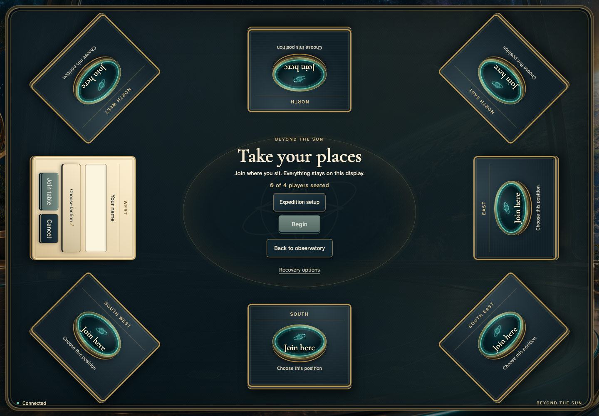](../../screenshots/offer-four-fleets-and-jump-two-distinct-ships-into-real-control-bonuses/003-seat-0-editor-desktop-darwin.png) |

tabletop-4k · 3840 × 2160

[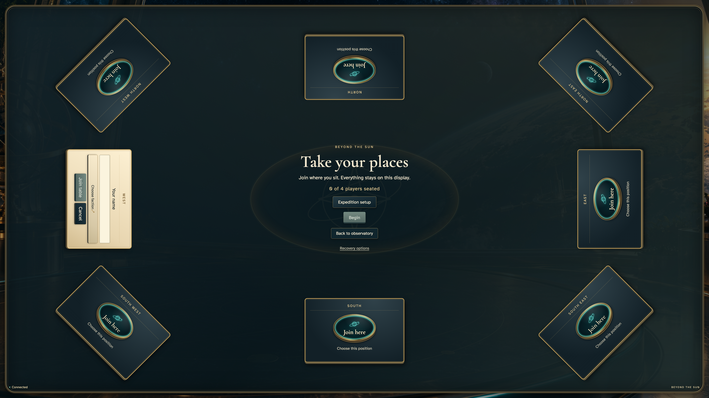](../../screenshots/offer-four-fleets-and-jump-two-distinct-ships-into-real-control-bonuses/003-seat-0-editor-tabletop-4k-darwin.png)

- [x] Ada opens the physical West seat
- [x] The saved automatic consequences settle before the public decision is photographed.
- [x] Covered and discovered compact nodes retain physical separation.
- [x] The game stays inside its actual viewport.

## 5. Ada names their local seat

Viewpoint: **Ada · West · single shared controller**.

| desktop · 1440 × 1000 |
| --- |
| [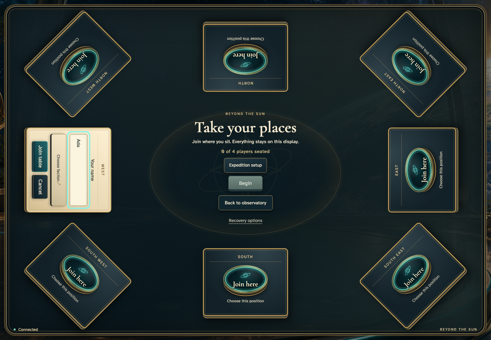](../../screenshots/offer-four-fleets-and-jump-two-distinct-ships-into-real-control-bonuses/004-seat-0-name-desktop-darwin.png) |

tabletop-4k · 3840 × 2160

[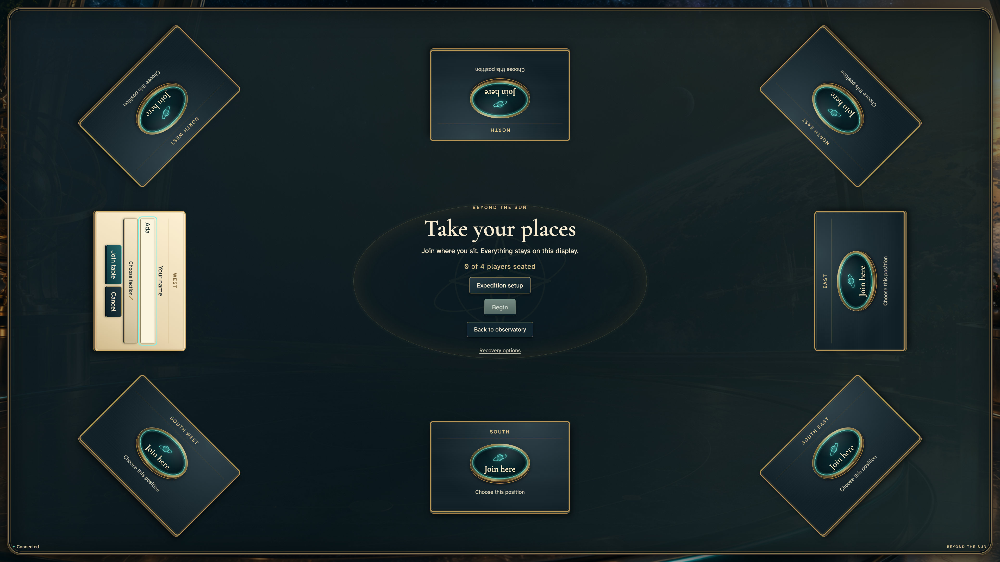](../../screenshots/offer-four-fleets-and-jump-two-distinct-ships-into-real-control-bonuses/004-seat-0-name-tabletop-4k-darwin.png)

- [x] Ada names their local seat
- [x] The saved automatic consequences settle before the public decision is photographed.
- [x] Covered and discovered compact nodes retain physical separation.
- [x] The game stays inside its actual viewport.

## 6. Ada joins the physical table

Viewpoint: **Ada · West · single shared controller**.

| desktop · 1440 × 1000 |
| --- |
| [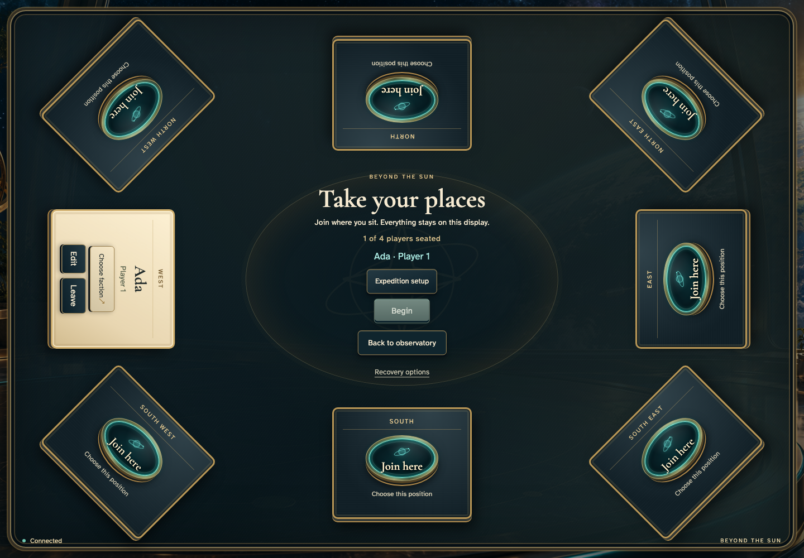](../../screenshots/offer-four-fleets-and-jump-two-distinct-ships-into-real-control-bonuses/005-seat-0-joined-desktop-darwin.png) |

tabletop-4k · 3840 × 2160

[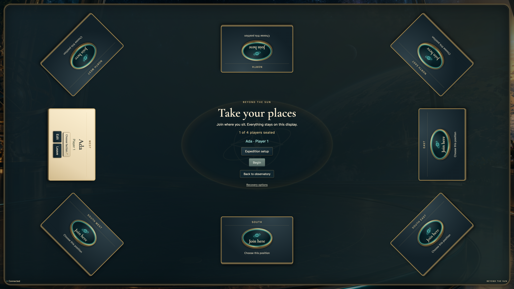](../../screenshots/offer-four-fleets-and-jump-two-distinct-ships-into-real-control-bonuses/005-seat-0-joined-tabletop-4k-darwin.png)

- [x] Ada joins the physical table
- [x] The saved automatic consequences settle before the public decision is photographed.
- [x] Covered and discovered compact nodes retain physical separation.
- [x] The game stays inside its actual viewport.

## 7. Bora opens the physical North seat

Viewpoint: **Bora · North · single shared controller**.

| desktop · 1440 × 1000 |
| --- |
| [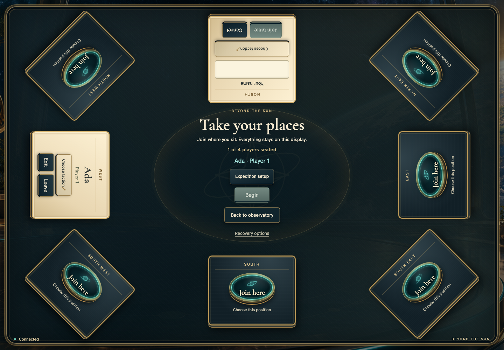](../../screenshots/offer-four-fleets-and-jump-two-distinct-ships-into-real-control-bonuses/006-seat-1-editor-desktop-darwin.png) |

tabletop-4k · 3840 × 2160

[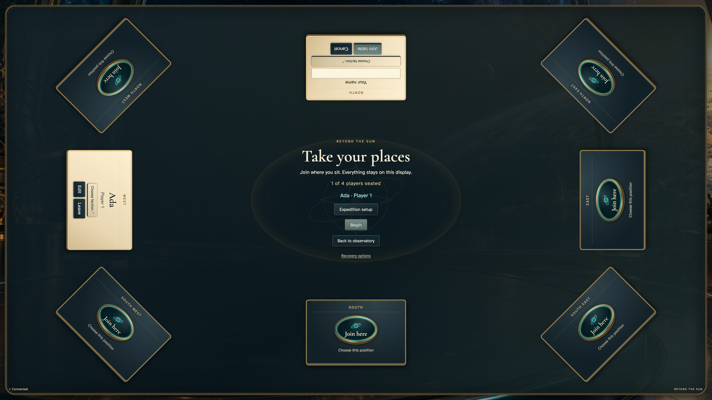](../../screenshots/offer-four-fleets-and-jump-two-distinct-ships-into-real-control-bonuses/006-seat-1-editor-tabletop-4k-darwin.png)

- [x] Bora opens the physical North seat
- [x] The saved automatic consequences settle before the public decision is photographed.
- [x] Covered and discovered compact nodes retain physical separation.
- [x] The game stays inside its actual viewport.

## 8. Bora names their local seat

Viewpoint: **Bora · North · single shared controller**.

| desktop · 1440 × 1000 |
| --- |
| [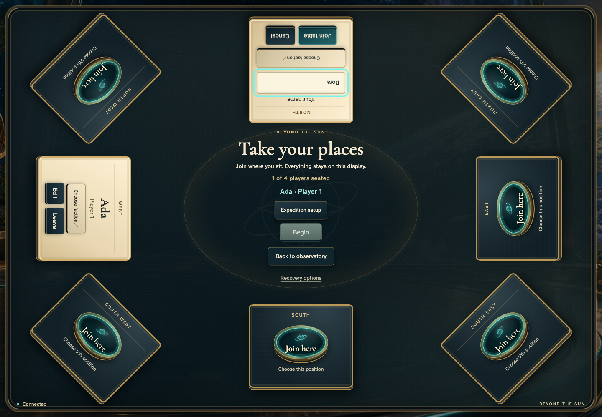](../../screenshots/offer-four-fleets-and-jump-two-distinct-ships-into-real-control-bonuses/007-seat-1-name-desktop-darwin.png) |

tabletop-4k · 3840 × 2160

- [x] Bora names their local seat
- [x] The saved automatic consequences settle before the public decision is photographed.
- [x] Covered and discovered compact nodes retain physical separation.
- [x] The game stays inside its actual viewport.

## 9. Bora joins the physical table

Viewpoint: **Bora · North · single shared controller**.

| desktop · 1440 × 1000 |
| --- |
| [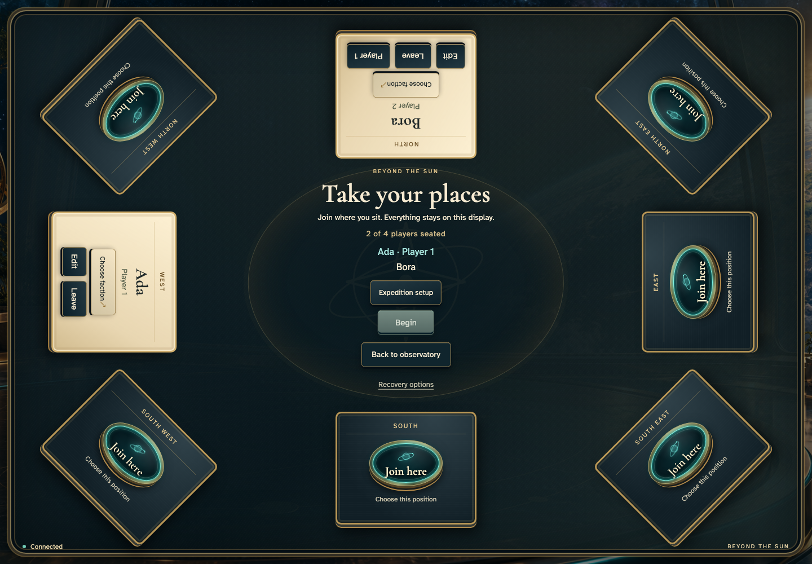](../../screenshots/offer-four-fleets-and-jump-two-distinct-ships-into-real-control-bonuses/008-seat-1-joined-desktop-darwin.png) |

tabletop-4k · 3840 × 2160

[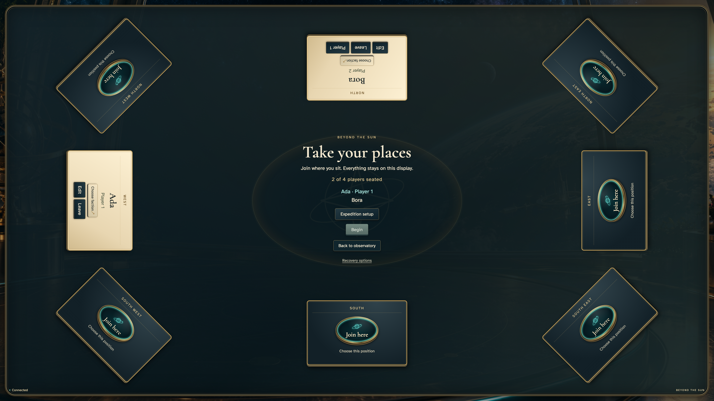](../../screenshots/offer-four-fleets-and-jump-two-distinct-ships-into-real-control-bonuses/008-seat-1-joined-tabletop-4k-darwin.png)

- [x] Bora joins the physical table
- [x] The saved automatic consequences settle before the public decision is photographed.
- [x] Covered and discovered compact nodes retain physical separation.
- [x] The game stays inside its actual viewport.

## 10. Cleo opens the physical East seat

Viewpoint: **Cleo · East · single shared controller**.

| desktop · 1440 × 1000 |
| --- |
| [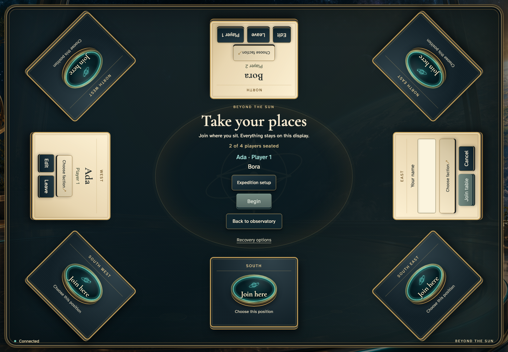](../../screenshots/offer-four-fleets-and-jump-two-distinct-ships-into-real-control-bonuses/009-seat-2-editor-desktop-darwin.png) |

tabletop-4k · 3840 × 2160

[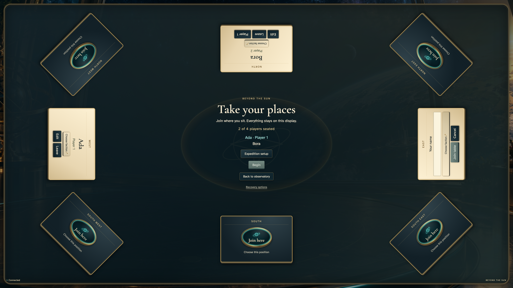](../../screenshots/offer-four-fleets-and-jump-two-distinct-ships-into-real-control-bonuses/009-seat-2-editor-tabletop-4k-darwin.png)

- [x] Cleo opens the physical East seat
- [x] The saved automatic consequences settle before the public decision is photographed.
- [x] Covered and discovered compact nodes retain physical separation.
- [x] The game stays inside its actual viewport.

## 11. Cleo names their local seat

Viewpoint: **Cleo · East · single shared controller**.

| desktop · 1440 × 1000 |
| --- |
| [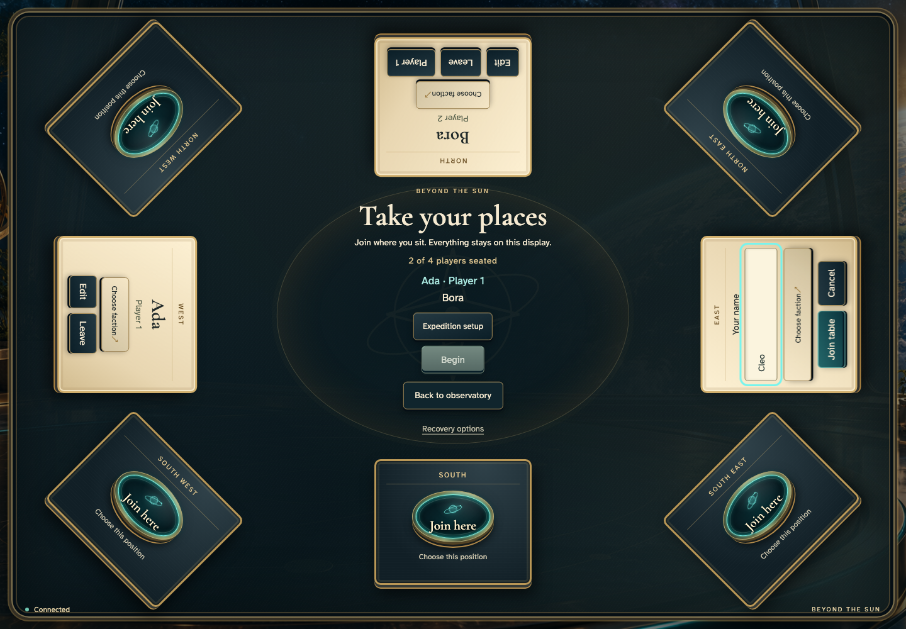](../../screenshots/offer-four-fleets-and-jump-two-distinct-ships-into-real-control-bonuses/010-seat-2-name-desktop-darwin.png) |

tabletop-4k · 3840 × 2160

[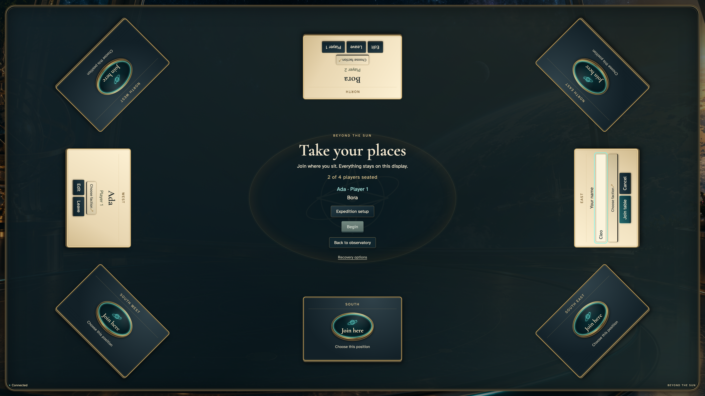](../../screenshots/offer-four-fleets-and-jump-two-distinct-ships-into-real-control-bonuses/010-seat-2-name-tabletop-4k-darwin.png)

- [x] Cleo names their local seat
- [x] The saved automatic consequences settle before the public decision is photographed.
- [x] Covered and discovered compact nodes retain physical separation.
- [x] The game stays inside its actual viewport.

## 12. Cleo joins the physical table

Viewpoint: **Cleo · East · single shared controller**.

| desktop · 1440 × 1000 |
| --- |
| [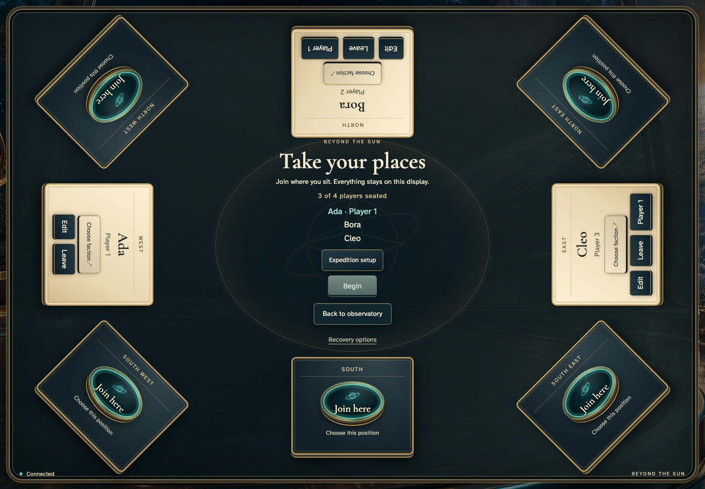](../../screenshots/offer-four-fleets-and-jump-two-distinct-ships-into-real-control-bonuses/011-seat-2-joined-desktop-darwin.png) |

tabletop-4k · 3840 × 2160

[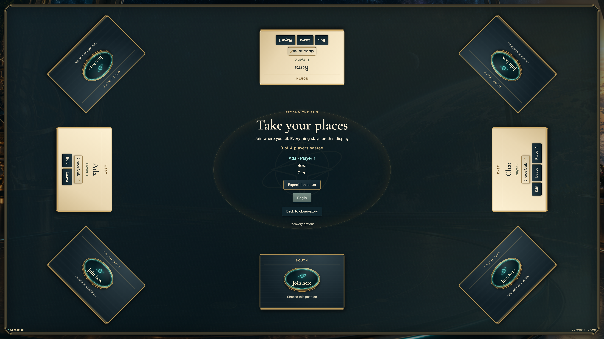](../../screenshots/offer-four-fleets-and-jump-two-distinct-ships-into-real-control-bonuses/011-seat-2-joined-tabletop-4k-darwin.png)

- [x] Cleo joins the physical table
- [x] The saved automatic consequences settle before the public decision is photographed.
- [x] Covered and discovered compact nodes retain physical separation.
- [x] The game stays inside its actual viewport.

## 13. Dara opens the physical South seat

Viewpoint: **Dara · South · single shared controller**.

| desktop · 1440 × 1000 |
| --- |
| [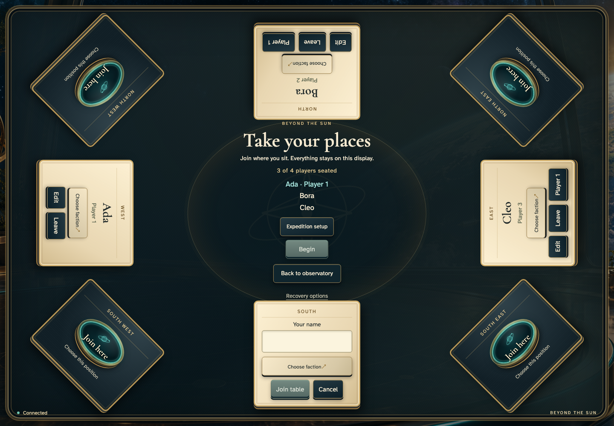](../../screenshots/offer-four-fleets-and-jump-two-distinct-ships-into-real-control-bonuses/012-seat-3-editor-desktop-darwin.png) |

tabletop-4k · 3840 × 2160

[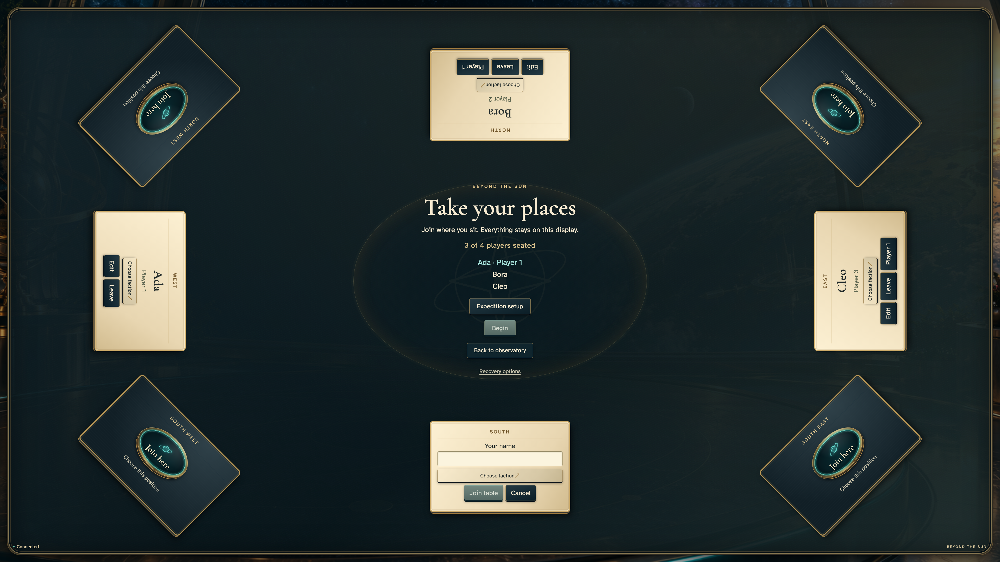](../../screenshots/offer-four-fleets-and-jump-two-distinct-ships-into-real-control-bonuses/012-seat-3-editor-tabletop-4k-darwin.png)

- [x] Dara opens the physical South seat
- [x] The saved automatic consequences settle before the public decision is photographed.
- [x] Covered and discovered compact nodes retain physical separation.
- [x] The game stays inside its actual viewport.

## 14. Dara names their local seat

Viewpoint: **Dara · South · single shared controller**.

| desktop · 1440 × 1000 |
| --- |
| [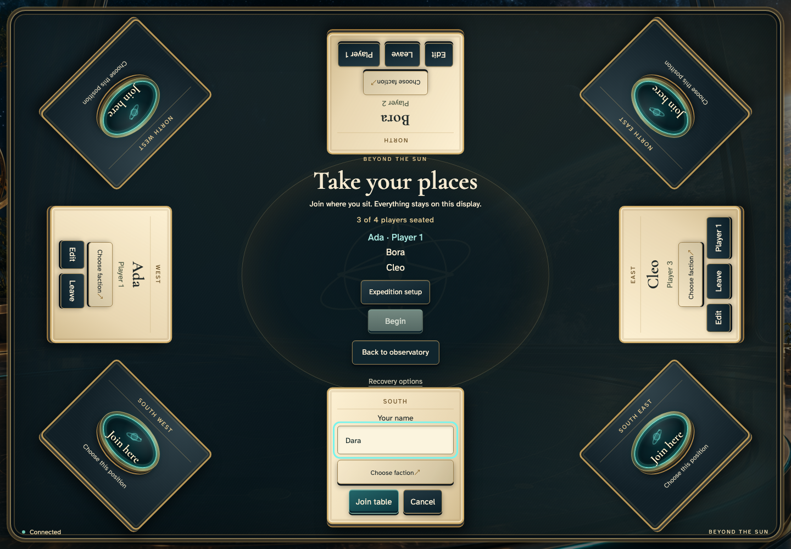](../../screenshots/offer-four-fleets-and-jump-two-distinct-ships-into-real-control-bonuses/013-seat-3-name-desktop-darwin.png) |

tabletop-4k · 3840 × 2160

[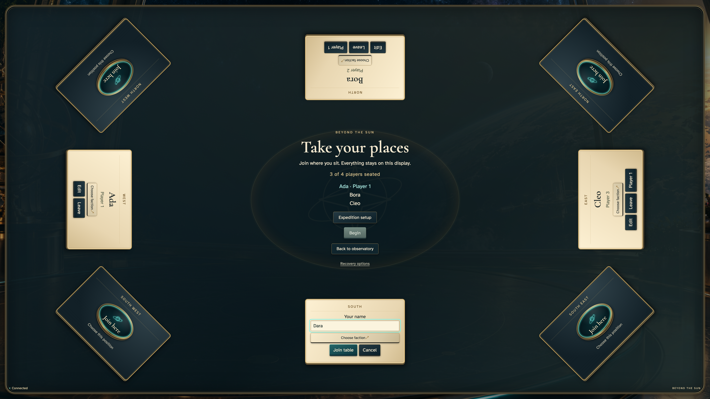](../../screenshots/offer-four-fleets-and-jump-two-distinct-ships-into-real-control-bonuses/013-seat-3-name-tabletop-4k-darwin.png)

- [x] Dara names their local seat
- [x] The saved automatic consequences settle before the public decision is photographed.
- [x] Covered and discovered compact nodes retain physical separation.
- [x] The game stays inside its actual viewport.

## 15. Dara joins the physical table

Viewpoint: **Dara · South · single shared controller**.

| desktop · 1440 × 1000 |
| --- |
|  |

tabletop-4k · 3840 × 2160

[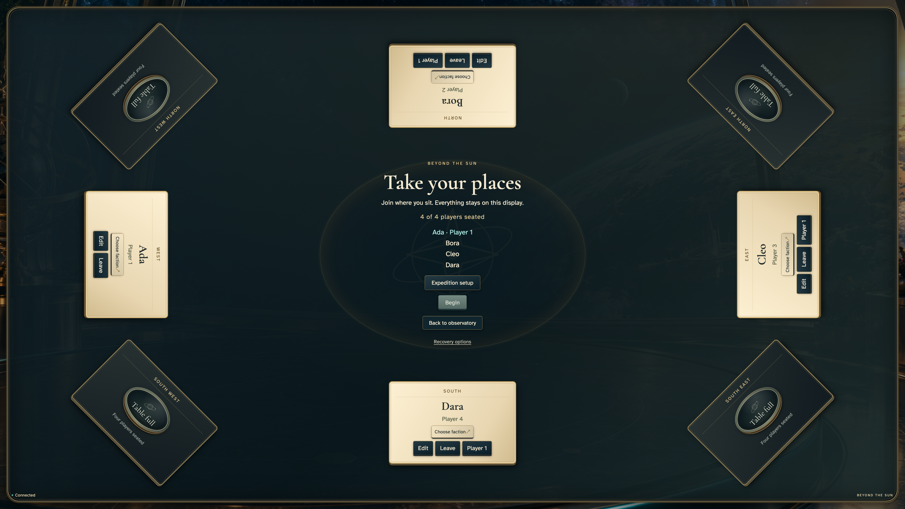](../../screenshots/offer-four-fleets-and-jump-two-distinct-ships-into-real-control-bonuses/014-seat-3-joined-tabletop-4k-darwin.png)

- [x] Dara joins the physical table
- [x] The saved automatic consequences settle before the public decision is photographed.
- [x] Covered and discovered compact nodes retain physical separation.
- [x] The game stays inside its actual viewport.

## 16. Ada reads the legal unique Basic factions

Viewpoint: **Ada · West · single shared controller**.

| desktop · 1440 × 1000 |
| --- |
| [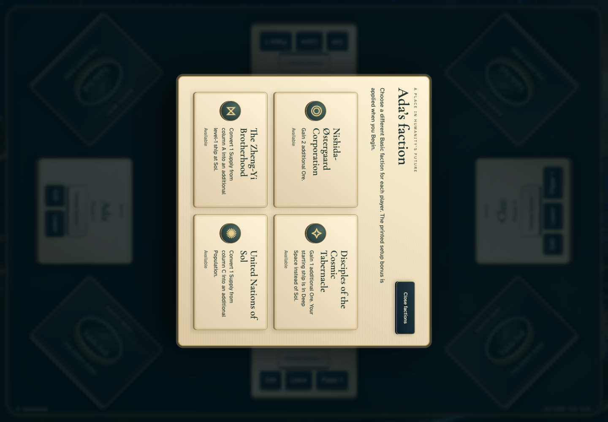](../../screenshots/offer-four-fleets-and-jump-two-distinct-ships-into-real-control-bonuses/015-faction-0-choices-desktop-darwin.png) |

tabletop-4k · 3840 × 2160

[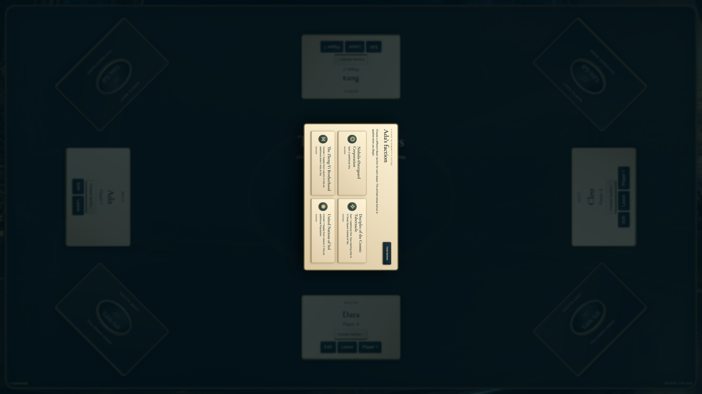](../../screenshots/offer-four-fleets-and-jump-two-distinct-ships-into-real-control-bonuses/015-faction-0-choices-tabletop-4k-darwin.png)

- [x] Ada reads the legal unique Basic factions
- [x] The saved automatic consequences settle before the public decision is photographed.
- [x] Covered and discovered compact nodes retain physical separation.
- [x] The game stays inside its actual viewport.

## 17. Ada chooses their actual production faction

Viewpoint: **Ada · West · single shared controller**.

| desktop · 1440 × 1000 |
| --- |
| [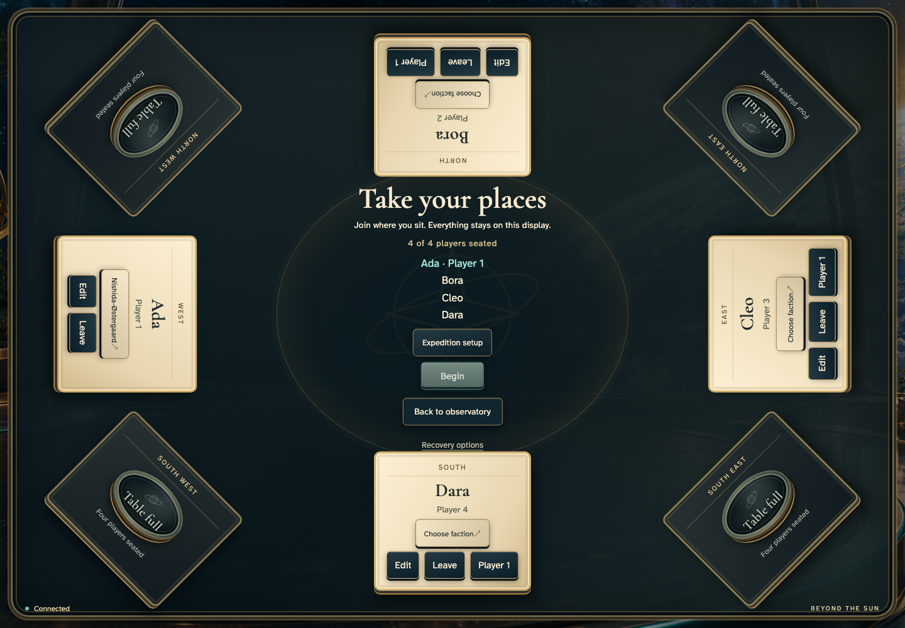](../../screenshots/offer-four-fleets-and-jump-two-distinct-ships-into-real-control-bonuses/016-faction-0-chosen-desktop-darwin.png) |

tabletop-4k · 3840 × 2160

- [x] Ada chooses their actual production faction
- [x] The saved automatic consequences settle before the public decision is photographed.
- [x] Covered and discovered compact nodes retain physical separation.
- [x] The game stays inside its actual viewport.

## 18. Bora reads the legal unique Basic factions

Viewpoint: **Bora · North · single shared controller**.

| desktop · 1440 × 1000 |
| --- |
| [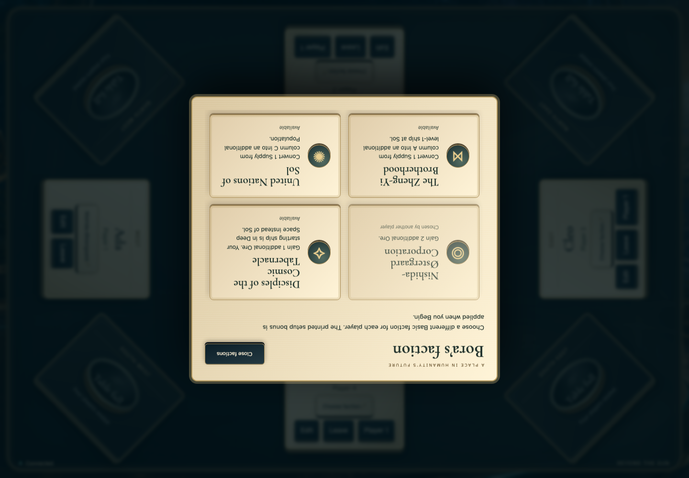](../../screenshots/offer-four-fleets-and-jump-two-distinct-ships-into-real-control-bonuses/017-faction-1-choices-desktop-darwin.png) |

tabletop-4k · 3840 × 2160

[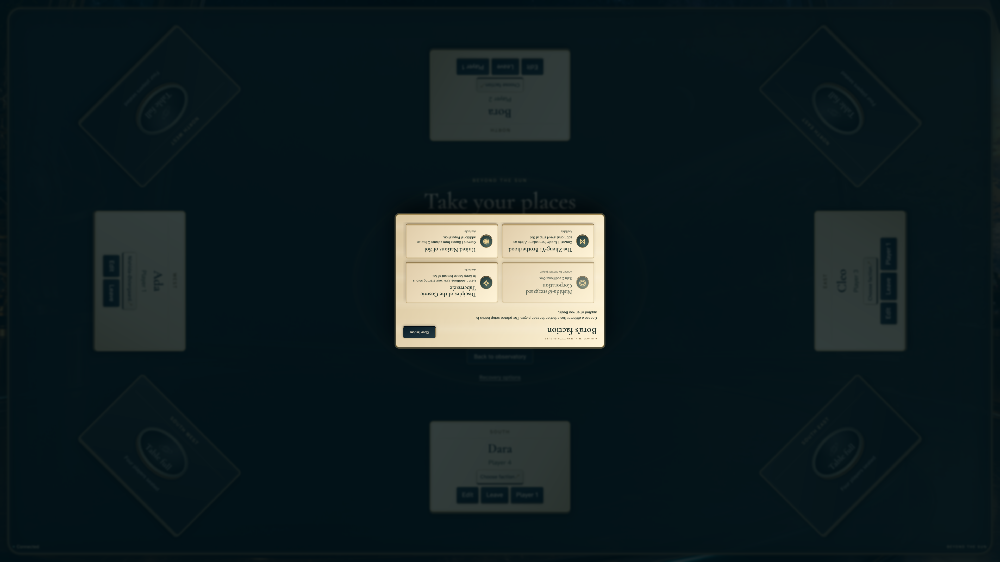](../../screenshots/offer-four-fleets-and-jump-two-distinct-ships-into-real-control-bonuses/017-faction-1-choices-tabletop-4k-darwin.png)

- [x] Bora reads the legal unique Basic factions
- [x] The saved automatic consequences settle before the public decision is photographed.
- [x] Covered and discovered compact nodes retain physical separation.
- [x] The game stays inside its actual viewport.

## 19. Bora chooses their actual production faction

Viewpoint: **Bora · North · single shared controller**.

| desktop · 1440 × 1000 |
| --- |
| [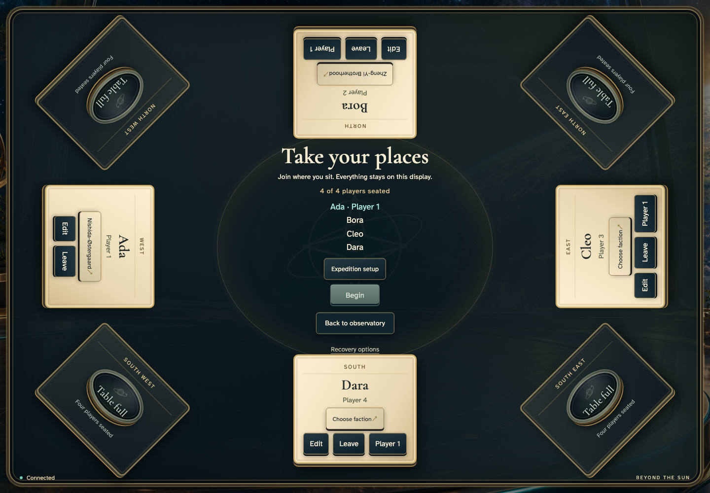](../../screenshots/offer-four-fleets-and-jump-two-distinct-ships-into-real-control-bonuses/018-faction-1-chosen-desktop-darwin.png) |

tabletop-4k · 3840 × 2160

[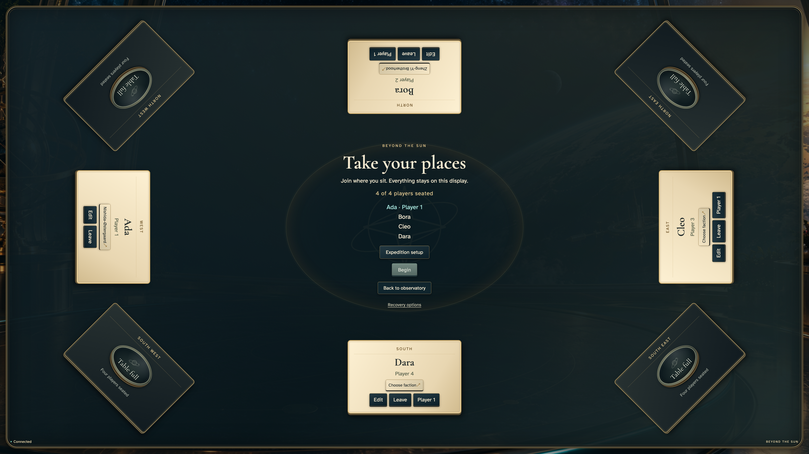](../../screenshots/offer-four-fleets-and-jump-two-distinct-ships-into-real-control-bonuses/018-faction-1-chosen-tabletop-4k-darwin.png)

- [x] Bora chooses their actual production faction
- [x] The saved automatic consequences settle before the public decision is photographed.
- [x] Covered and discovered compact nodes retain physical separation.
- [x] The game stays inside its actual viewport.

## 20. Cleo reads the legal unique Basic factions

Viewpoint: **Cleo · East · single shared controller**.

| desktop · 1440 × 1000 |
| --- |
| [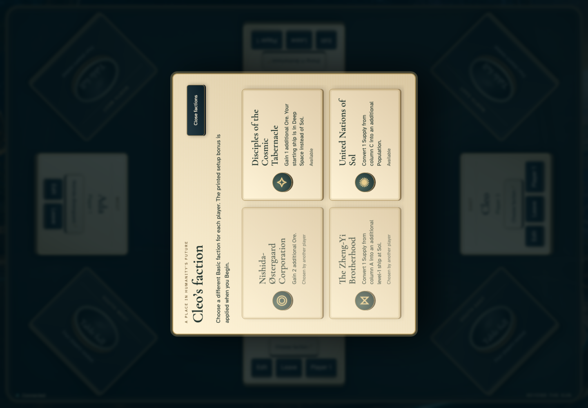](../../screenshots/offer-four-fleets-and-jump-two-distinct-ships-into-real-control-bonuses/019-faction-2-choices-desktop-darwin.png) |

tabletop-4k · 3840 × 2160

[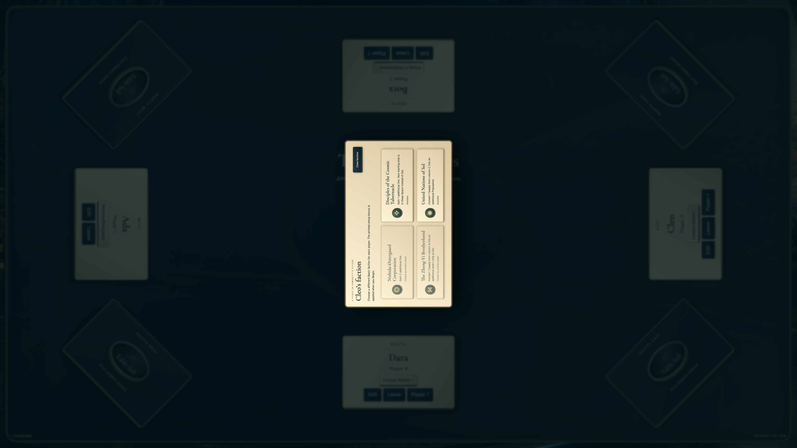](../../screenshots/offer-four-fleets-and-jump-two-distinct-ships-into-real-control-bonuses/019-faction-2-choices-tabletop-4k-darwin.png)

- [x] Cleo reads the legal unique Basic factions
- [x] The saved automatic consequences settle before the public decision is photographed.
- [x] Covered and discovered compact nodes retain physical separation.
- [x] The game stays inside its actual viewport.

## 21. Cleo chooses their actual production faction

Viewpoint: **Cleo · East · single shared controller**.

| desktop · 1440 × 1000 |
| --- |
|  |

tabletop-4k · 3840 × 2160

- [x] Cleo chooses their actual production faction
- [x] The saved automatic consequences settle before the public decision is photographed.
- [x] Covered and discovered compact nodes retain physical separation.
- [x] The game stays inside its actual viewport.

## 22. Dara reads the legal unique Basic factions

Viewpoint: **Dara · South · single shared controller**.

| desktop · 1440 × 1000 |
| --- |
| [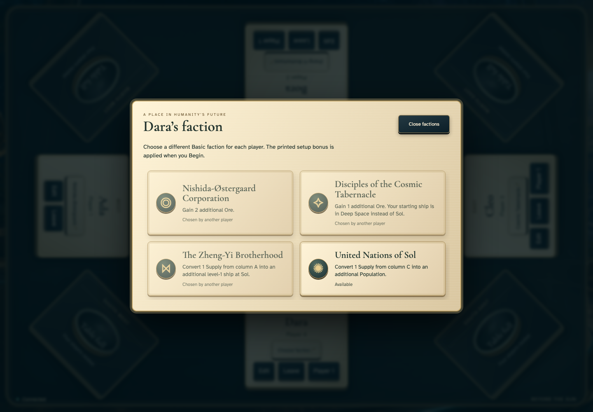](../../screenshots/offer-four-fleets-and-jump-two-distinct-ships-into-real-control-bonuses/021-faction-3-choices-desktop-darwin.png) |

tabletop-4k · 3840 × 2160

[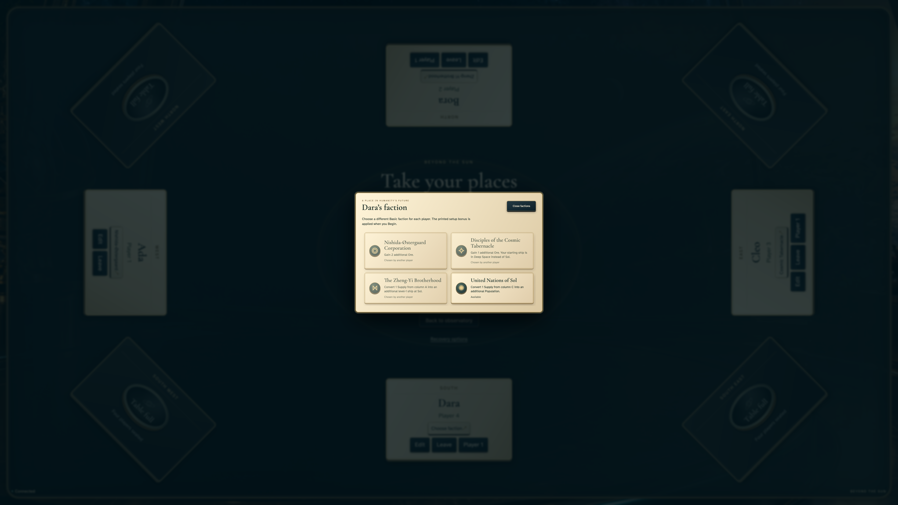](../../screenshots/offer-four-fleets-and-jump-two-distinct-ships-into-real-control-bonuses/021-faction-3-choices-tabletop-4k-darwin.png)

- [x] Dara reads the legal unique Basic factions
- [x] The saved automatic consequences settle before the public decision is photographed.
- [x] Covered and discovered compact nodes retain physical separation.
- [x] The game stays inside its actual viewport.

## 23. Dara chooses their actual production faction

Viewpoint: **Dara · South · single shared controller**.

| desktop · 1440 × 1000 |
| --- |
| [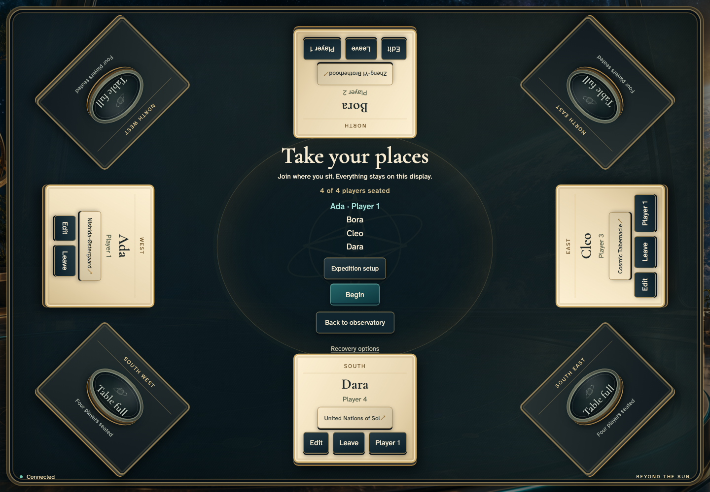](../../screenshots/offer-four-fleets-and-jump-two-distinct-ships-into-real-control-bonuses/022-faction-3-chosen-desktop-darwin.png) |

tabletop-4k · 3840 × 2160

[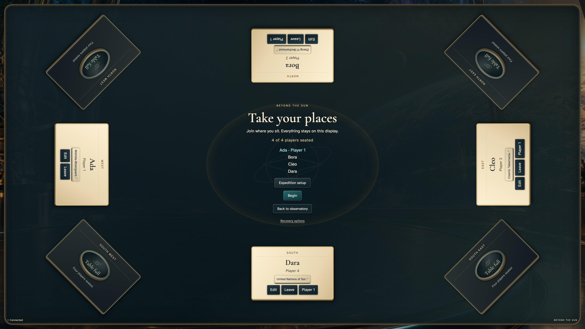](../../screenshots/offer-four-fleets-and-jump-two-distinct-ships-into-real-control-bonuses/022-faction-3-chosen-tabletop-4k-darwin.png)

- [x] Dara chooses their actual production faction
- [x] The saved automatic consequences settle before the public decision is photographed.
- [x] Covered and discovered compact nodes retain physical separation.
- [x] The game stays inside its actual viewport.

## 24. Begin creates the immutable seeded Basic game

Viewpoint: **Ada · West · single shared controller**.

| desktop · 1440 × 1000 |
| --- |
| [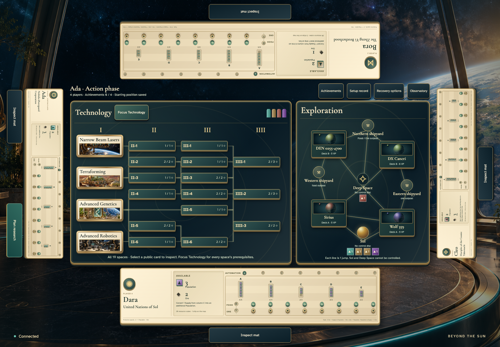](../../screenshots/offer-four-fleets-and-jump-two-distinct-ships-into-real-control-bonuses/023-begun-desktop-darwin.png) |

tabletop-4k · 3840 × 2160

[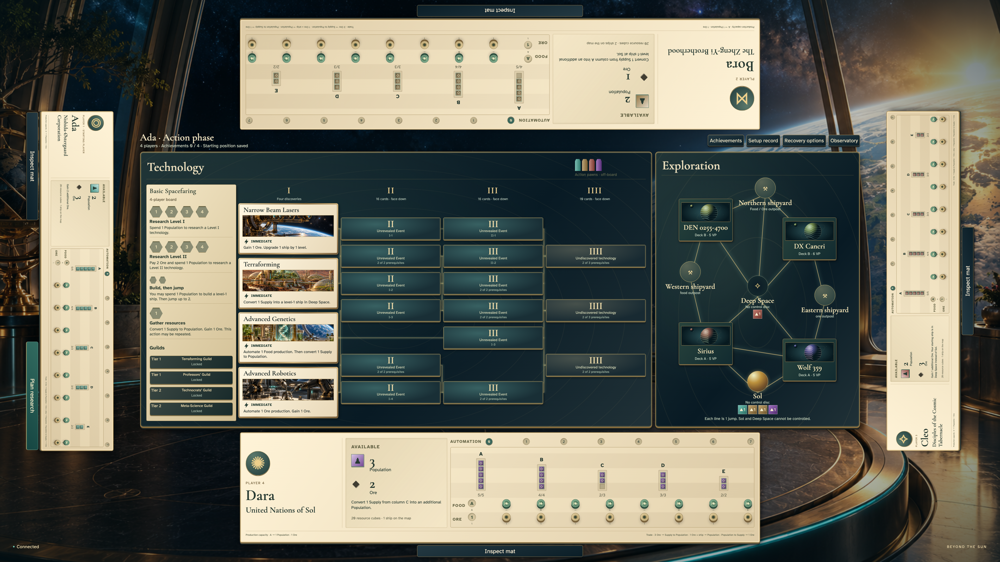](../../screenshots/offer-four-fleets-and-jump-two-distinct-ships-into-real-control-bonuses/023-begun-tabletop-4k-darwin.png)

- [x] Begin creates the immutable seeded Basic game
- [x] The saved automatic consequences settle before the public decision is photographed.
- [x] Covered and discovered compact nodes retain physical separation.
- [x] The game stays inside its actual viewport.

## 25. Ada plans a legal preparatory Level I turn

Viewpoint: **Ada · West · single shared controller**.

| desktop · 1440 × 1000 |
| --- |
| [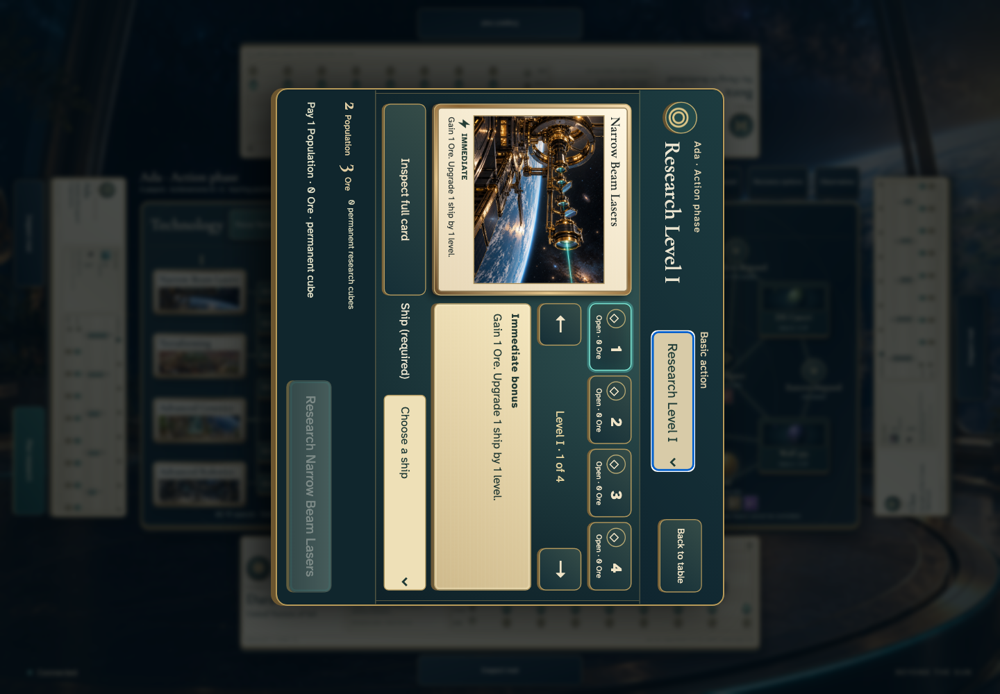](../../screenshots/offer-four-fleets-and-jump-two-distinct-ships-into-real-control-bonuses/024-prep-0-plan-desktop-darwin.png) |

tabletop-4k · 3840 × 2160

[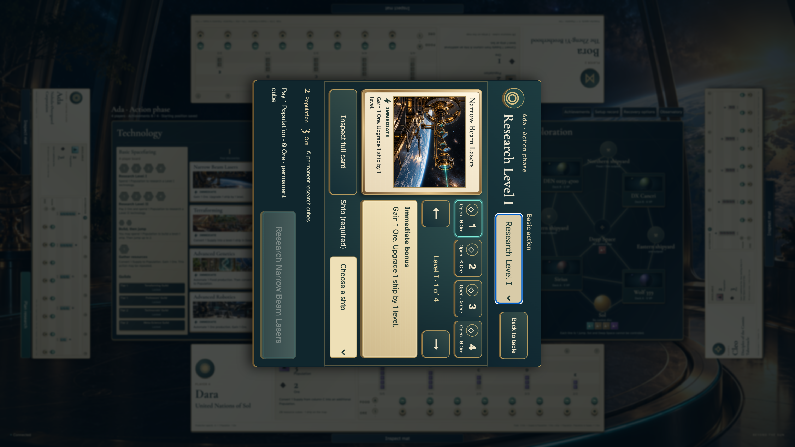](../../screenshots/offer-four-fleets-and-jump-two-distinct-ships-into-real-control-bonuses/024-prep-0-plan-tabletop-4k-darwin.png)

- [x] Ada plans a legal preparatory Level I turn
- [x] The saved automatic consequences settle before the public decision is photographed.
- [x] Covered and discovered compact nodes retain physical separation.
- [x] The game stays inside its actual viewport.

## 26. Ada chooses the unoccupied printed Action space

Viewpoint: **Ada · West · single shared controller**.

| desktop · 1440 × 1000 |
| --- |
|  |

tabletop-4k · 3840 × 2160

- [x] Ada chooses the unoccupied printed Action space
- [x] The saved automatic consequences settle before the public decision is photographed.
- [x] Covered and discovered compact nodes retain physical separation.
- [x] The game stays inside its actual viewport.

## 27. Ada browses the next public Level I face

Viewpoint: **Ada · West · single shared controller**.

| desktop · 1440 × 1000 |
| --- |
| [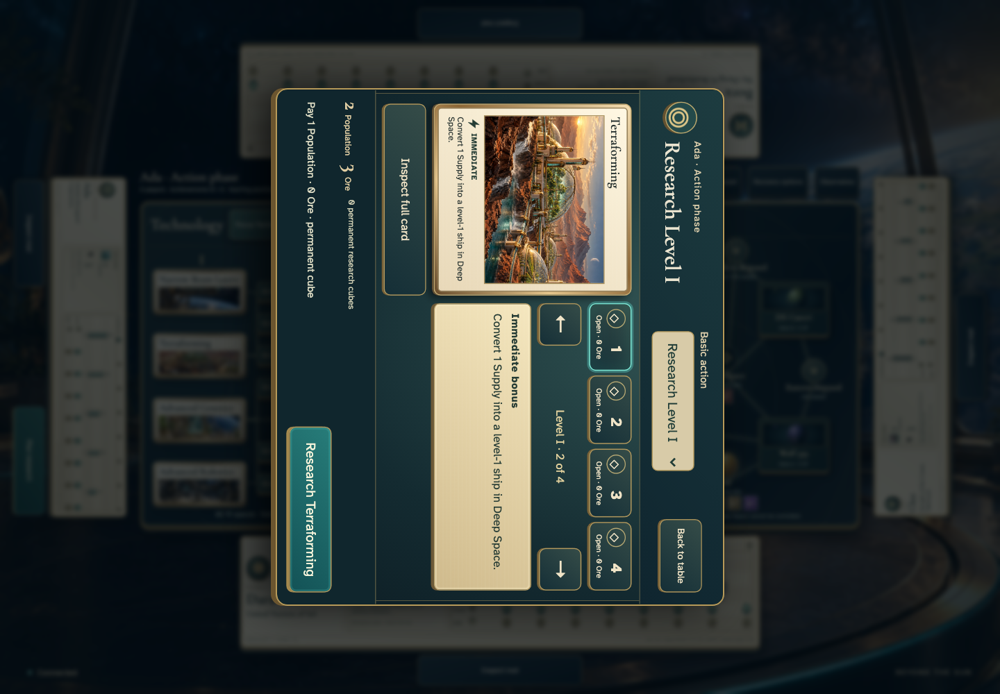](../../screenshots/offer-four-fleets-and-jump-two-distinct-ships-into-real-control-bonuses/026-prep-0-browse-0-desktop-darwin.png) |

tabletop-4k · 3840 × 2160

[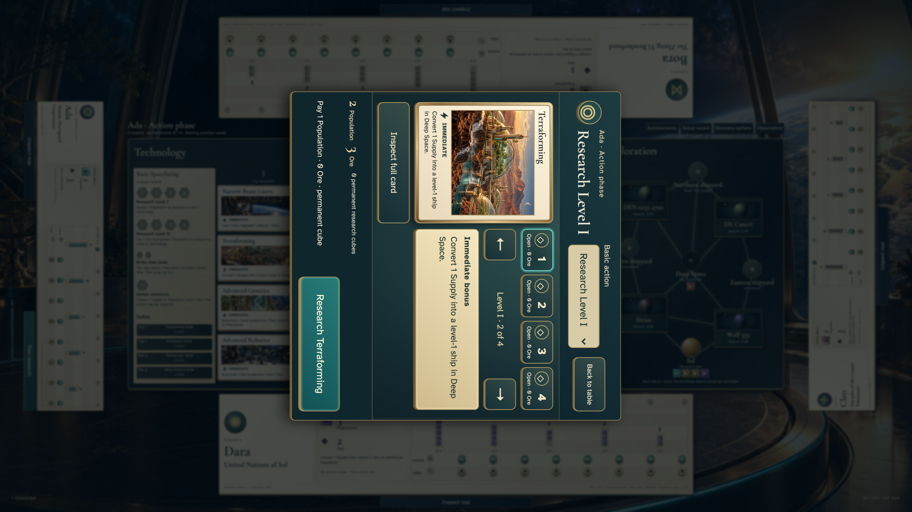](../../screenshots/offer-four-fleets-and-jump-two-distinct-ships-into-real-control-bonuses/026-prep-0-browse-0-tabletop-4k-darwin.png)

- [x] Ada browses the next public Level I face
- [x] The saved automatic consequences settle before the public decision is photographed.
- [x] Covered and discovered compact nodes retain physical separation.
- [x] The game stays inside its actual viewport.

## 28. Ada pays permanent research Population and receives the printed immediate bonus

Viewpoint: **Ada · West · single shared controller**.

| desktop · 1440 × 1000 |
| --- |
| [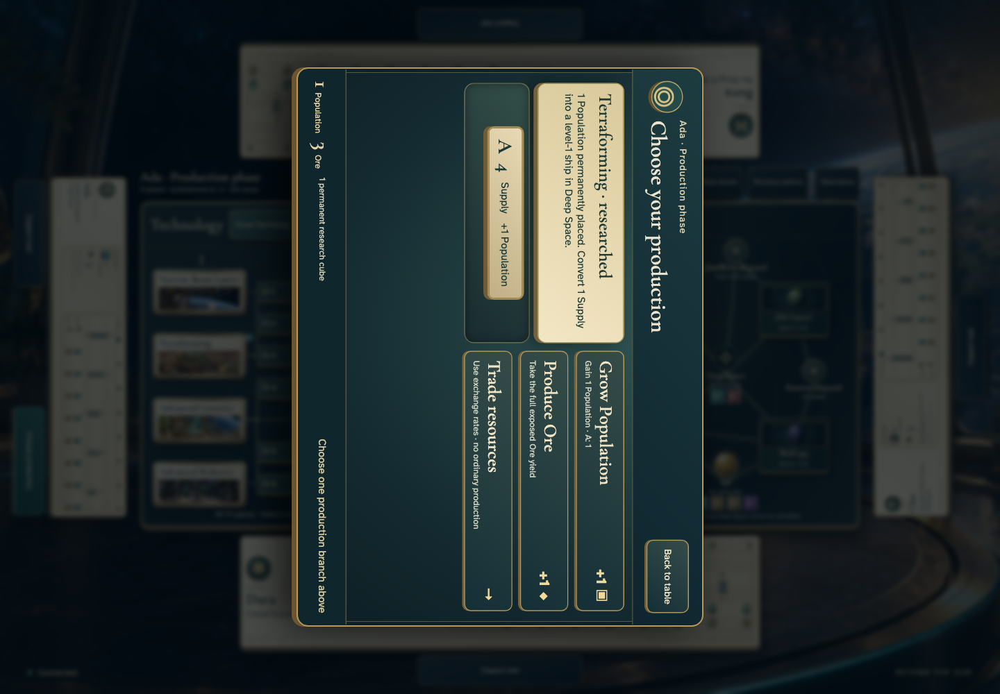](../../screenshots/offer-four-fleets-and-jump-two-distinct-ships-into-real-control-bonuses/027-prep-0-paid-desktop-darwin.png) |

tabletop-4k · 3840 × 2160

[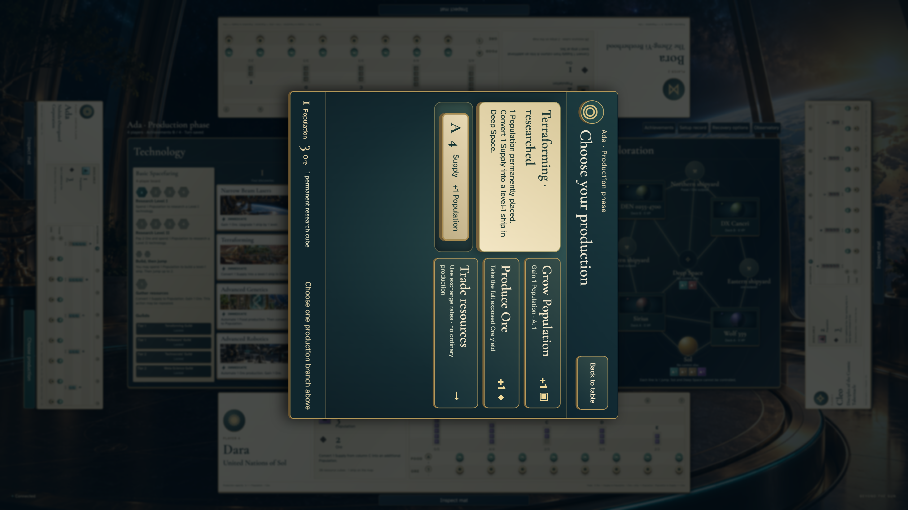](../../screenshots/offer-four-fleets-and-jump-two-distinct-ships-into-real-control-bonuses/027-prep-0-paid-tabletop-4k-darwin.png)

- [x] Ada pays permanent research Population and receives the printed immediate bonus
- [x] The saved automatic consequences settle before the public decision is photographed.
- [x] Covered and discovered compact nodes retain physical separation.
- [x] The game stays inside its actual viewport.

## 29. Ada completes ordinary production and hands off automatically

Viewpoint: **Ada · West · single shared controller**.

| desktop · 1440 × 1000 |
| --- |
| [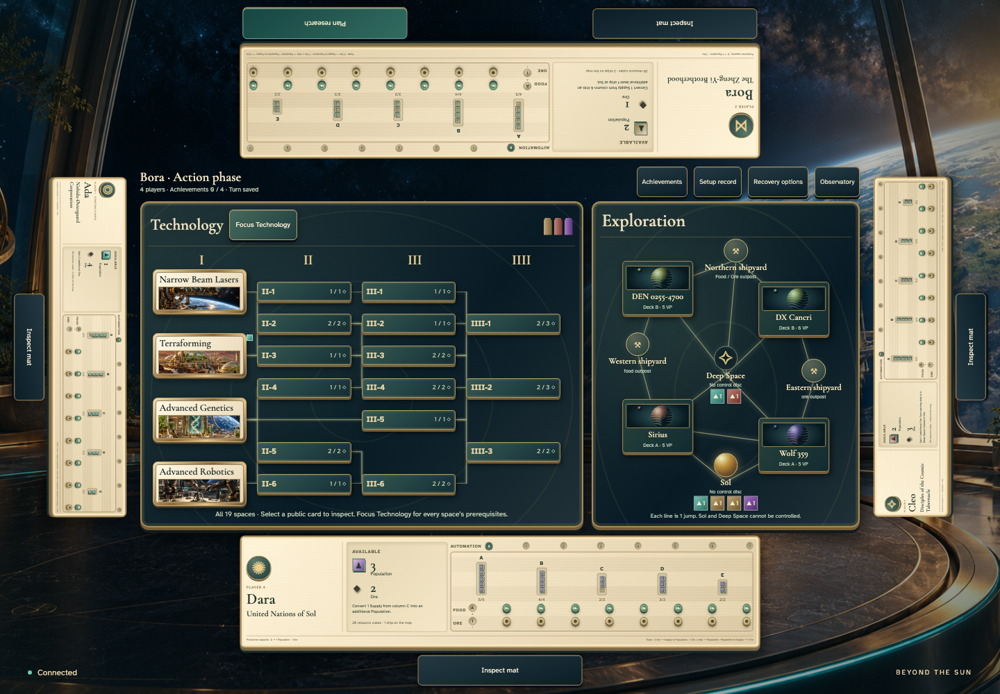](../../screenshots/offer-four-fleets-and-jump-two-distinct-ships-into-real-control-bonuses/028-prep-0-handoff-desktop-darwin.png) |

tabletop-4k · 3840 × 2160

[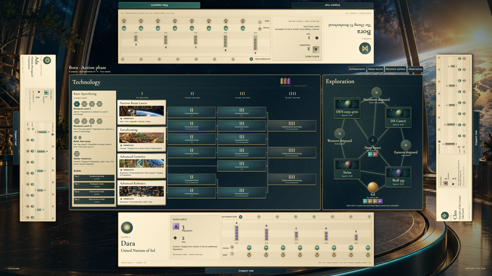](../../screenshots/offer-four-fleets-and-jump-two-distinct-ships-into-real-control-bonuses/028-prep-0-handoff-tabletop-4k-darwin.png)

- [x] Ada completes ordinary production and hands off automatically
- [x] The saved automatic consequences settle before the public decision is photographed.
- [x] Covered and discovered compact nodes retain physical separation.
- [x] The game stays inside its actual viewport.

## 30. Bora plans a legal preparatory Level I turn

Viewpoint: **Bora · North · single shared controller**.

| desktop · 1440 × 1000 |
| --- |
| [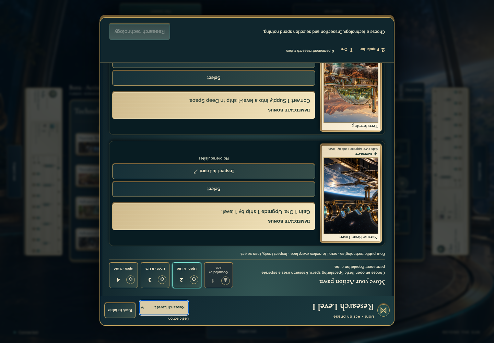](../../screenshots/offer-four-fleets-and-jump-two-distinct-ships-into-real-control-bonuses/029-prep-1-plan-desktop-darwin.png) |

tabletop-4k · 3840 × 2160

[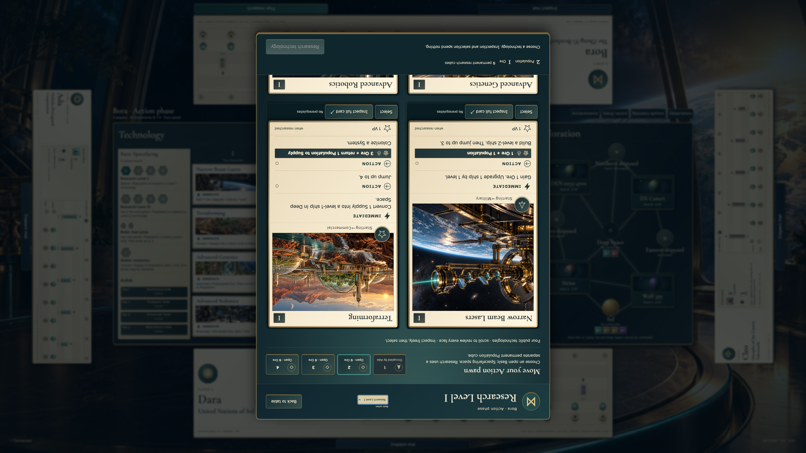](../../screenshots/offer-four-fleets-and-jump-two-distinct-ships-into-real-control-bonuses/029-prep-1-plan-tabletop-4k-darwin.png)

- [x] Bora plans a legal preparatory Level I turn
- [x] The saved automatic consequences settle before the public decision is photographed.
- [x] Covered and discovered compact nodes retain physical separation.
- [x] The game stays inside its actual viewport.

## 31. Bora chooses the unoccupied printed Action space

Viewpoint: **Bora · North · single shared controller**.

| desktop · 1440 × 1000 |
| --- |
| [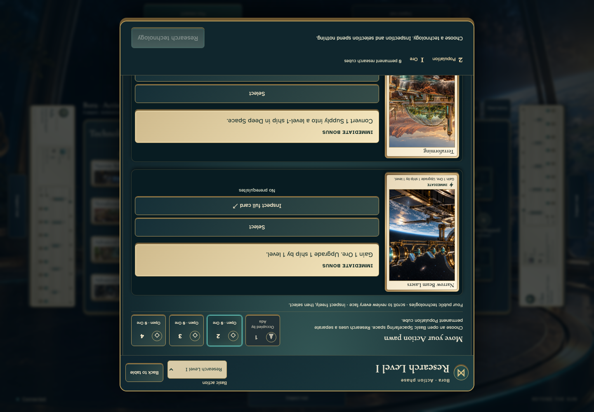](../../screenshots/offer-four-fleets-and-jump-two-distinct-ships-into-real-control-bonuses/030-prep-1-space-desktop-darwin.png) |

tabletop-4k · 3840 × 2160

- [x] Bora chooses the unoccupied printed Action space
- [x] The saved automatic consequences settle before the public decision is photographed.
- [x] Covered and discovered compact nodes retain physical separation.
- [x] The game stays inside its actual viewport.

## 32. Bora selects the public Advanced Robotics face

Viewpoint: **Bora · North · single shared controller**.

| desktop · 1440 × 1000 |
| --- |
| [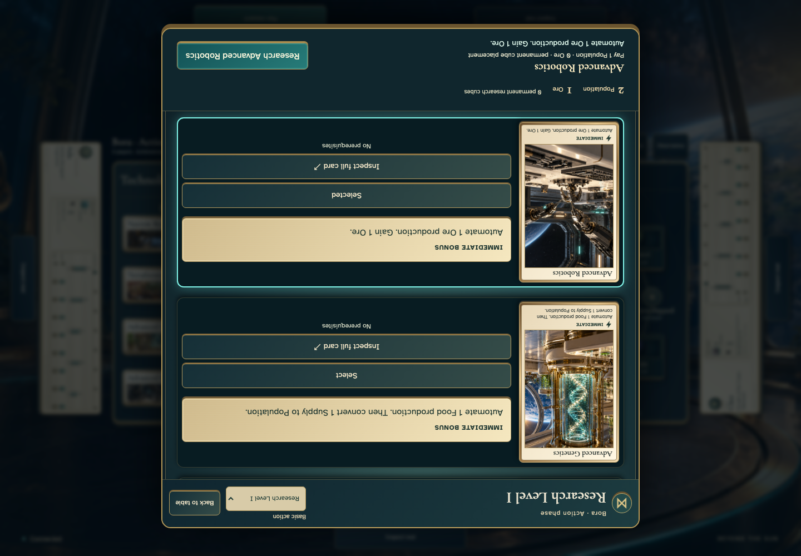](../../screenshots/offer-four-fleets-and-jump-two-distinct-ships-into-real-control-bonuses/031-prep-1-card-desktop-darwin.png) |

tabletop-4k · 3840 × 2160

[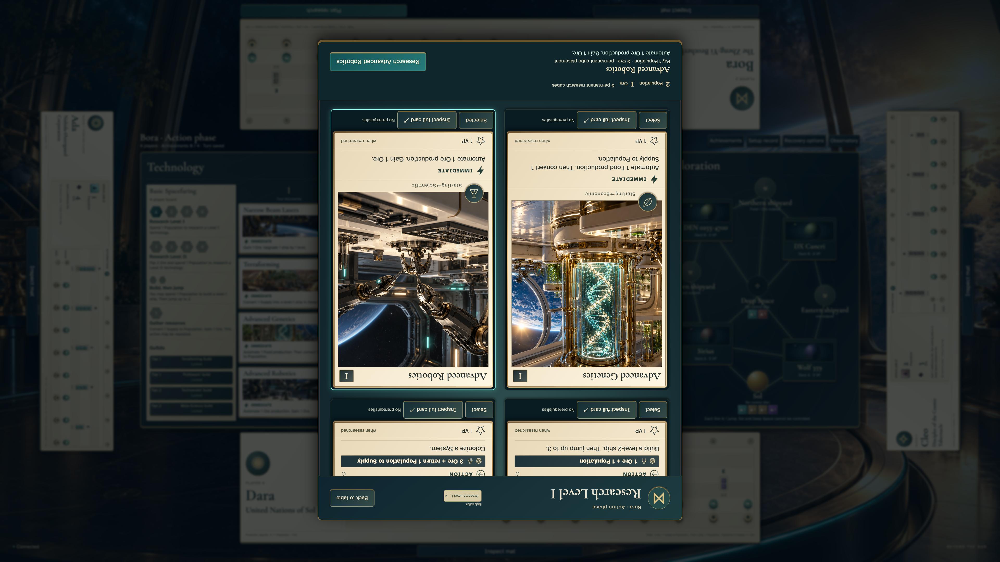](../../screenshots/offer-four-fleets-and-jump-two-distinct-ships-into-real-control-bonuses/031-prep-1-card-tabletop-4k-darwin.png)

- [x] Bora selects the public Advanced Robotics face
- [x] The saved automatic consequences settle before the public decision is photographed.
- [x] Covered and discovered compact nodes retain physical separation.
- [x] The game stays inside its actual viewport.

## 33. Bora pays permanent research Population and receives the printed immediate bonus

Viewpoint: **Bora · North · single shared controller**.

| desktop · 1440 × 1000 |
| --- |
|  |

tabletop-4k · 3840 × 2160

- [x] Bora pays permanent research Population and receives the printed immediate bonus
- [x] The saved automatic consequences settle before the public decision is photographed.
- [x] Covered and discovered compact nodes retain physical separation.
- [x] The game stays inside its actual viewport.

## 34. Bora completes ordinary production and hands off automatically

Viewpoint: **Bora · North · single shared controller**.

| desktop · 1440 × 1000 |
| --- |
|  |

tabletop-4k · 3840 × 2160

- [x] Bora completes ordinary production and hands off automatically
- [x] The saved automatic consequences settle before the public decision is photographed.
- [x] Covered and discovered compact nodes retain physical separation.
- [x] The game stays inside its actual viewport.

## 35. Cleo plans a legal preparatory Level I turn

Viewpoint: **Cleo · East · single shared controller**.

| desktop · 1440 × 1000 |
| --- |
|  |

tabletop-4k · 3840 × 2160

- [x] Cleo plans a legal preparatory Level I turn
- [x] The saved automatic consequences settle before the public decision is photographed.
- [x] Covered and discovered compact nodes retain physical separation.
- [x] The game stays inside its actual viewport.

## 36. Cleo chooses the unoccupied printed Action space

Viewpoint: **Cleo · East · single shared controller**.

| desktop · 1440 × 1000 |
| --- |
|  |

tabletop-4k · 3840 × 2160

- [x] Cleo chooses the unoccupied printed Action space
- [x] The saved automatic consequences settle before the public decision is photographed.
- [x] Covered and discovered compact nodes retain physical separation.
- [x] The game stays inside its actual viewport.

## 37. Cleo browses the next public Level I face

Viewpoint: **Cleo · East · single shared controller**.

| desktop · 1440 × 1000 |
| --- |
|  |

tabletop-4k · 3840 × 2160

- [x] Cleo browses the next public Level I face
- [x] The saved automatic consequences settle before the public decision is photographed.
- [x] Covered and discovered compact nodes retain physical separation.
- [x] The game stays inside its actual viewport.

## 38. Cleo browses the next public Level I face

Viewpoint: **Cleo · East · single shared controller**.

| desktop · 1440 × 1000 |
| --- |
|  |

tabletop-4k · 3840 × 2160

- [x] Cleo browses the next public Level I face
- [x] The saved automatic consequences settle before the public decision is photographed.
- [x] Covered and discovered compact nodes retain physical separation.
- [x] The game stays inside its actual viewport.

## 39. Cleo browses the next public Level I face

Viewpoint: **Cleo · East · single shared controller**.

| desktop · 1440 × 1000 |
| --- |
|  |

tabletop-4k · 3840 × 2160

- [x] Cleo browses the next public Level I face
- [x] The saved automatic consequences settle before the public decision is photographed.
- [x] Covered and discovered compact nodes retain physical separation.
- [x] The game stays inside its actual viewport.

## 40. Cleo pays permanent research Population and receives the printed immediate bonus

Viewpoint: **Cleo · East · single shared controller**.

| desktop · 1440 × 1000 |
| --- |
|  |

tabletop-4k · 3840 × 2160

- [x] Cleo pays permanent research Population and receives the printed immediate bonus
- [x] The saved automatic consequences settle before the public decision is photographed.
- [x] Covered and discovered compact nodes retain physical separation.
- [x] The game stays inside its actual viewport.

## 41. Cleo completes ordinary production and hands off automatically

Viewpoint: **Cleo · East · single shared controller**.

| desktop · 1440 × 1000 |
| --- |
|  |

tabletop-4k · 3840 × 2160

- [x] Cleo completes ordinary production and hands off automatically
- [x] The saved automatic consequences settle before the public decision is photographed.
- [x] Covered and discovered compact nodes retain physical separation.
- [x] The game stays inside its actual viewport.

## 42. Dara plans a legal preparatory Level I turn

Viewpoint: **Dara · South · single shared controller**.

| desktop · 1440 × 1000 |
| --- |
|  |

tabletop-4k · 3840 × 2160

- [x] Dara plans a legal preparatory Level I turn
- [x] The saved automatic consequences settle before the public decision is photographed.
- [x] Covered and discovered compact nodes retain physical separation.
- [x] The game stays inside its actual viewport.

## 43. Dara chooses the unoccupied printed Action space

Viewpoint: **Dara · South · single shared controller**.

| desktop · 1440 × 1000 |
| --- |
|  |

tabletop-4k · 3840 × 2160

- [x] Dara chooses the unoccupied printed Action space
- [x] The saved automatic consequences settle before the public decision is photographed.
- [x] Covered and discovered compact nodes retain physical separation.
- [x] The game stays inside its actual viewport.

## 44. Dara selects the public Advanced Robotics face

Viewpoint: **Dara · South · single shared controller**.

| desktop · 1440 × 1000 |
| --- |
|  |

tabletop-4k · 3840 × 2160

- [x] Dara selects the public Advanced Robotics face
- [x] The saved automatic consequences settle before the public decision is photographed.
- [x] Covered and discovered compact nodes retain physical separation.
- [x] The game stays inside its actual viewport.

## 45. Dara pays permanent research Population and receives the printed immediate bonus

Viewpoint: **Dara · South · single shared controller**.

| desktop · 1440 × 1000 |
| --- |
|  |

tabletop-4k · 3840 × 2160

- [x] Dara pays permanent research Population and receives the printed immediate bonus
- [x] The saved automatic consequences settle before the public decision is photographed.
- [x] Covered and discovered compact nodes retain physical separation.
- [x] The game stays inside its actual viewport.

## 46. Dara completes ordinary production and hands off automatically

Viewpoint: **Dara · South · single shared controller**.

| desktop · 1440 × 1000 |
| --- |
|  |

tabletop-4k · 3840 × 2160

- [x] Dara completes ordinary production and hands off automatically
- [x] The saved automatic consequences settle before the public decision is photographed.
- [x] Covered and discovered compact nodes retain physical separation.
- [x] The game stays inside its actual viewport.

## 47. The researcher opens the real Basic action instrument

Viewpoint: **Ada · West · single shared controller**.

| desktop · 1440 × 1000 |
| --- |
|  |

tabletop-4k · 3840 × 2160

- [x] The researcher opens the real Basic action instrument
- [x] The saved automatic consequences settle before the public decision is photographed.
- [x] Covered and discovered compact nodes retain physical separation.
- [x] The game stays inside its actual viewport.

## 48. Choose Level II and inspect all six public prerequisites without revealing cards

Viewpoint: **Ada · West · single shared controller**.

| desktop · 1440 × 1000 |
| --- |
|  |

tabletop-4k · 3840 × 2160

- [x] Choose Level II and inspect all six public prerequisites without revealing cards
- [x] The saved automatic consequences settle before the public decision is photographed.
- [x] Covered and discovered compact nodes retain physical separation.
- [x] The game stays inside its actual viewport.

## 49. Select a legal undiscovered position and read its permanent Population and Ore payment

Viewpoint: **Ada · West · single shared controller**.

| desktop · 1440 × 1000 |
| --- |
|  |

tabletop-4k · 3840 × 2160

- [x] Select a legal undiscovered position and read its permanent Population and Ore payment
- [x] The saved automatic consequences settle before the public decision is photographed.
- [x] Covered and discovered compact nodes retain physical separation.
- [x] The game stays inside its actual viewport.

## 50. Payment reveals Covert Arms Deal; all Event decisions resolve before candidates

Viewpoint: **Ada · West · single shared controller**.

| desktop · 1440 × 1000 |
| --- |
|  |

tabletop-4k · 3840 × 2160

- [x] Payment reveals Covert Arms Deal; all Event decisions resolve before candidates
- [x] The saved automatic consequences settle before the public decision is photographed.
- [x] Covered and discovered compact nodes retain physical separation.
- [x] The game stays inside its actual viewport.

## 51. Ada reads and owns this public Event decision

Viewpoint: **Ada · West · single shared controller**.

| desktop · 1440 × 1000 |
| --- |
|  |

tabletop-4k · 3840 × 2160

- [x] Ada reads and owns this public Event decision
- [x] The saved automatic consequences settle before the public decision is photographed.
- [x] Covered and discovered compact nodes retain physical separation.
- [x] The game stays inside its actual viewport.

## 52. Choose the same printed level-2 ship offer for every faction

Viewpoint: **Ada · West · single shared controller**.

| desktop · 1440 × 1000 |
| --- |
|  |

tabletop-4k · 3840 × 2160

- [x] Choose the same printed level-2 ship offer for every faction
- [x] The saved automatic consequences settle before the public decision is photographed.
- [x] Covered and discovered compact nodes retain physical separation.
- [x] The game stays inside its actual viewport.

## 53. Ada reads and owns this public Event decision

Viewpoint: **Ada · West · single shared controller**.

| desktop · 1440 × 1000 |
| --- |
|  |

tabletop-4k · 3840 × 2160

- [x] Ada reads and owns this public Event decision
- [x] The saved automatic consequences settle before the public decision is photographed.
- [x] Covered and discovered compact nodes retain physical separation.
- [x] The game stays inside its actual viewport.

## 54. Convert Supply into the offered Deep Space ship for this named faction

Viewpoint: **Ada · West · single shared controller**.

| desktop · 1440 × 1000 |
| --- |
|  |

tabletop-4k · 3840 × 2160

- [x] Convert Supply into the offered Deep Space ship for this named faction
- [x] The saved automatic consequences settle before the public decision is photographed.
- [x] Covered and discovered compact nodes retain physical separation.
- [x] The game stays inside its actual viewport.

## 55. Bora reads and owns this public Event decision

Viewpoint: **Bora · North · single shared controller**.

| desktop · 1440 × 1000 |
| --- |
|  |

tabletop-4k · 3840 × 2160

- [x] Bora reads and owns this public Event decision
- [x] The saved automatic consequences settle before the public decision is photographed.
- [x] Covered and discovered compact nodes retain physical separation.
- [x] The game stays inside its actual viewport.

## 56. Convert Supply into the offered Deep Space ship for this named faction

Viewpoint: **Bora · North · single shared controller**.

| desktop · 1440 × 1000 |
| --- |
|  |

tabletop-4k · 3840 × 2160

- [x] Convert Supply into the offered Deep Space ship for this named faction
- [x] The saved automatic consequences settle before the public decision is photographed.
- [x] Covered and discovered compact nodes retain physical separation.
- [x] The game stays inside its actual viewport.

## 57. Cleo reads and owns this public Event decision

Viewpoint: **Cleo · East · single shared controller**.

| desktop · 1440 × 1000 |
| --- |
|  |

tabletop-4k · 3840 × 2160

- [x] Cleo reads and owns this public Event decision
- [x] The saved automatic consequences settle before the public decision is photographed.
- [x] Covered and discovered compact nodes retain physical separation.
- [x] The game stays inside its actual viewport.

## 58. Convert Supply into the offered Deep Space ship for this named faction

Viewpoint: **Cleo · East · single shared controller**.

| desktop · 1440 × 1000 |
| --- |
|  |

tabletop-4k · 3840 × 2160

- [x] Convert Supply into the offered Deep Space ship for this named faction
- [x] The saved automatic consequences settle before the public decision is photographed.
- [x] Covered and discovered compact nodes retain physical separation.
- [x] The game stays inside its actual viewport.

## 59. Dara reads and owns this public Event decision

Viewpoint: **Dara · South · single shared controller**.

| desktop · 1440 × 1000 |
| --- |
|  |

tabletop-4k · 3840 × 2160

- [x] Dara reads and owns this public Event decision
- [x] The saved automatic consequences settle before the public decision is photographed.
- [x] Covered and discovered compact nodes retain physical separation.
- [x] The game stays inside its actual viewport.

## 60. Convert Supply into the offered Deep Space ship for this named faction

Viewpoint: **Dara · South · single shared controller**.

| desktop · 1440 × 1000 |
| --- |
|  |

tabletop-4k · 3840 × 2160

- [x] Convert Supply into the offered Deep Space ship for this named faction
- [x] The saved automatic consequences settle before the public decision is photographed.
- [x] Covered and discovered compact nodes retain physical separation.
- [x] The game stays inside its actual viewport.

## 61. The revealing faction has the printed optional upgrade after all ship offers

Viewpoint: **Ada · West · single shared controller**.

| desktop · 1440 × 1000 |
| --- |
|  |

tabletop-4k · 3840 × 2160

- [x] The revealing faction has the printed optional upgrade after all ship offers
- [x] The saved automatic consequences settle before the public decision is photographed.
- [x] Covered and discovered compact nodes retain physical separation.
- [x] The game stays inside its actual viewport.

## 62. Explicitly choose the original Sol ship for the optional upgrade

Viewpoint: **Ada · West · single shared controller**.

| desktop · 1440 × 1000 |
| --- |
|  |

tabletop-4k · 3840 × 2160

- [x] Explicitly choose the original Sol ship for the optional upgrade
- [x] The saved automatic consequences settle before the public decision is photographed.
- [x] Covered and discovered compact nodes retain physical separation.
- [x] The game stays inside its actual viewport.

## 63. Ada reads and owns this public Event decision

Viewpoint: **Ada · West · single shared controller**.

| desktop · 1440 × 1000 |
| --- |
|  |

tabletop-4k · 3840 × 2160

- [x] Ada reads and owns this public Event decision
- [x] The saved automatic consequences settle before the public decision is photographed.
- [x] Covered and discovered compact nodes retain physical separation.
- [x] The game stays inside its actual viewport.

## 64. Upgrade the selected ship once before technology candidates are revealed

Viewpoint: **Ada · West · single shared controller**.

| desktop · 1440 × 1000 |
| --- |
|  |

tabletop-4k · 3840 × 2160

- [x] Upgrade the selected ship once before technology candidates are revealed
- [x] The saved automatic consequences settle before the public decision is photographed.
- [x] Covered and discovered compact nodes retain physical separation.
- [x] The game stays inside its actual viewport.

## 65. The public candidates appear only after the entire Event and type choice

Viewpoint: **Ada · West · single shared controller**.

| desktop · 1440 × 1000 |
| --- |
|  |

tabletop-4k · 3840 × 2160

- [x] The public candidates appear only after the entire Event and type choice
- [x] The saved automatic consequences settle before the public decision is photographed.
- [x] Covered and discovered compact nodes retain physical separation.
- [x] The game stays inside its actual viewport.

## 66. Inspect the complete canonical Intersystem Diplomacy face

Viewpoint: **Ada · West · single shared controller**.

| desktop · 1440 × 1000 |
| --- |
|  |

tabletop-4k · 3840 × 2160

- [x] Inspect the complete canonical Intersystem Diplomacy face
- [x] The saved automatic consequences settle before the public decision is photographed.
- [x] Covered and discovered compact nodes retain physical separation.
- [x] The game stays inside its actual viewport.

## 67. Read the complete face through its bounded full-size inspector

Viewpoint: **Ada · West · single shared controller**.

| desktop · 1440 × 1000 |
| --- |
|  |

tabletop-4k · 3840 × 2160

- [x] Read the complete face through its bounded full-size inspector
- [x] The saved automatic consequences settle before the public decision is photographed.
- [x] Covered and discovered compact nodes retain physical separation.
- [x] The game stays inside its actual viewport.

## 68. Escape returns keyboard focus to the actual inspection source

Viewpoint: **Ada · West · single shared controller**.

| desktop · 1440 × 1000 |
| --- |
|  |

tabletop-4k · 3840 × 2160

- [x] Escape returns keyboard focus to the actual inspection source
- [x] The saved automatic consequences settle before the public decision is photographed.
- [x] Covered and discovered compact nodes retain physical separation.
- [x] The game stays inside its actual viewport.

## 69. Reload retains the same revealed candidate set and research reservation

Viewpoint: **Ada · West · single shared controller**.

| desktop · 1440 × 1000 |
| --- |
|  |

tabletop-4k · 3840 × 2160

- [x] Reload retains the same revealed candidate set and research reservation
- [x] The saved automatic consequences settle before the public decision is photographed.
- [x] Covered and discovered compact nodes retain physical separation.
- [x] The game stays inside its actual viewport.

## 70. Ada opens their saved public discovery decision

Viewpoint: **Ada · West · single shared controller**.

| desktop · 1440 × 1000 |
| --- |
|  |

tabletop-4k · 3840 × 2160

- [x] Ada opens their saved public discovery decision
- [x] The saved automatic consequences settle before the public decision is photographed.
- [x] Covered and discovered compact nodes retain physical separation.
- [x] The game stays inside its actual viewport.

## 71. No reroll, new payment or replacement candidate appears on recovery

Viewpoint: **Ada · West · single shared controller**.

| desktop · 1440 × 1000 |
| --- |
|  |

tabletop-4k · 3840 × 2160

- [x] No reroll, new payment or replacement candidate appears on recovery
- [x] The saved automatic consequences settle before the public decision is photographed.
- [x] Covered and discovered compact nodes retain physical separation.
- [x] The game stays inside its actual viewport.

## 72. Review the second public candidate before choosing it

Viewpoint: **Ada · West · single shared controller**.

| desktop · 1440 × 1000 |
| --- |
|  |

tabletop-4k · 3840 × 2160

- [x] Review the second public candidate before choosing it
- [x] The saved automatic consequences settle before the public decision is photographed.
- [x] Covered and discovered compact nodes retain physical separation.
- [x] The game stays inside its actual viewport.

## 73. The selected identity and immediate consequence remain beside the commit control

Viewpoint: **Ada · West · single shared controller**.

| desktop · 1440 × 1000 |
| --- |
|  |

tabletop-4k · 3840 × 2160

- [x] The selected identity and immediate consequence remain beside the commit control
- [x] The saved automatic consequences settle before the public decision is photographed.
- [x] Covered and discovered compact nodes retain physical separation.
- [x] The game stays inside its actual viewport.

## 74. Spacetime Anomaly Studies provides a real two-point simultaneous jump plan

Viewpoint: **Ada · West · single shared controller**.

| desktop · 1440 × 1000 |
| --- |
|  |

tabletop-4k · 3840 × 2160

- [x] Spacetime Anomaly Studies provides a real two-point simultaneous jump plan
- [x] The saved automatic consequences settle before the public decision is photographed.
- [x] Covered and discovered compact nodes retain physical separation.
- [x] The game stays inside its actual viewport.

## 75. Select the known level-1 Terraforming ship in Deep Space

Viewpoint: **Ada · West · single shared controller**.

| desktop · 1440 × 1000 |
| --- |
|  |

tabletop-4k · 3840 × 2160

- [x] Select the known level-1 Terraforming ship in Deep Space
- [x] The saved automatic consequences settle before the public decision is photographed.
- [x] Covered and discovered compact nodes retain physical separation.
- [x] The game stays inside its actual viewport.

## 76. Allocate the first jump from Deep Space to Sirius without moving or paying yet

Viewpoint: **Ada · West · single shared controller**.

| desktop · 1440 × 1000 |
| --- |
|  |

tabletop-4k · 3840 × 2160

- [x] Allocate the first jump from Deep Space to Sirius without moving or paying yet
- [x] The saved automatic consequences settle before the public decision is photographed.
- [x] Covered and discovered compact nodes retain physical separation.
- [x] The game stays inside its actual viewport.

## 77. Select the separately offered level-2 Deep Space ship

Viewpoint: **Ada · West · single shared controller**.

| desktop · 1440 × 1000 |
| --- |
|  |

tabletop-4k · 3840 × 2160

- [x] Select the separately offered level-2 Deep Space ship
- [x] The saved automatic consequences settle before the public decision is photographed.
- [x] Covered and discovered compact nodes retain physical separation.
- [x] The game stays inside its actual viewport.

## 78. Both distinct paths and the exact two-point commitment remain visible

Viewpoint: **Ada · West · single shared controller**.

| desktop · 1440 × 1000 |
| --- |
|  |

tabletop-4k · 3840 × 2160

- [x] Both distinct paths and the exact two-point commitment remain visible
- [x] The saved automatic consequences settle before the public decision is photographed.
- [x] Covered and discovered compact nodes retain physical separation.
- [x] The game stays inside its actual viewport.

## 79. The complete movement settles atomically before public control bonuses

Viewpoint: **Ada · West · single shared controller**.

| desktop · 1440 × 1000 |
| --- |
|  |

tabletop-4k · 3840 × 2160

- [x] The complete movement settles atomically before public control bonuses
- [x] The saved automatic consequences settle before the public decision is photographed.
- [x] Covered and discovered compact nodes retain physical separation.
- [x] The game stays inside its actual viewport.

## 80. Resolve Sirius first; DX Cancri then offers its actual optional Ore payment

Viewpoint: **Ada · West · single shared controller**.

| desktop · 1440 × 1000 |
| --- |
|  |

tabletop-4k · 3840 × 2160

- [x] Resolve Sirius first; DX Cancri then offers its actual optional Ore payment
- [x] The saved automatic consequences settle before the public decision is photographed.
- [x] Covered and discovered compact nodes retain physical separation.
- [x] The game stays inside its actual viewport.

## 81. Pay one Ore and enter the mandatory eligible-ship choice at DX Cancri

Viewpoint: **Ada · West · single shared controller**.

| desktop · 1440 × 1000 |
| --- |
|  |

tabletop-4k · 3840 × 2160

- [x] Pay one Ore and enter the mandatory eligible-ship choice at DX Cancri
- [x] The saved automatic consequences settle before the public decision is photographed.
- [x] Covered and discovered compact nodes retain physical separation.
- [x] The game stays inside its actual viewport.

## 82. The chosen ship at DX Cancri upgrades from level2 to3

Viewpoint: **Ada · West · single shared controller**.

| desktop · 1440 × 1000 |
| --- |
|  |

tabletop-4k · 3840 × 2160

- [x] The chosen ship at DX Cancri upgrades from level2 to3
- [x] The saved automatic consequences settle before the public decision is photographed.
- [x] Covered and discovered compact nodes retain physical separation.
- [x] The game stays inside its actual viewport.

## 83. The saved discovery and its complete immediate bonus resume ordinary Production

Viewpoint: **Ada · West · single shared controller**.

| desktop · 1440 × 1000 |
| --- |
|  |

tabletop-4k · 3840 × 2160

- [x] The saved discovery and its complete immediate bonus resume ordinary Production
- [x] The saved automatic consequences settle before the public decision is photographed.
- [x] Covered and discovered compact nodes retain physical separation.
- [x] The game stays inside its actual viewport.

## 84. Reload preserves the discovered technology and pending Production without duplicating the bonus

Viewpoint: **Ada · West · single shared controller**.

| desktop · 1440 × 1000 |
| --- |
|  |

tabletop-4k · 3840 × 2160

- [x] Reload preserves the discovered technology and pending Production without duplicating the bonus
- [x] The saved automatic consequences settle before the public decision is photographed.
- [x] Covered and discovered compact nodes retain physical separation.
- [x] The game stays inside its actual viewport.

## 85. Resume the same exclusive production decision

Viewpoint: **Ada · West · single shared controller**.

| desktop · 1440 × 1000 |
| --- |
|  |

tabletop-4k · 3840 × 2160

- [x] Resume the same exclusive production decision
- [x] The saved automatic consequences settle before the public decision is photographed.
- [x] Covered and discovered compact nodes retain physical separation.
- [x] The game stays inside its actual viewport.

## 86. Ada completes ordinary production and hands off automatically

Viewpoint: **Ada · West · single shared controller**.

| desktop · 1440 × 1000 |
| --- |
|  |

tabletop-4k · 3840 × 2160

- [x] Ada completes ordinary production and hands off automatically
- [x] The saved automatic consequences settle before the public decision is photographed.
- [x] Covered and discovered compact nodes retain physical separation.
- [x] The game stays inside its actual viewport.

## 87. Reload retains the discovered public card, permanent research and canonical Bora handoff

Viewpoint: **Ada · West · single shared controller**.

| desktop · 1440 × 1000 |
| --- |
|  |

tabletop-4k · 3840 × 2160

- [x] Reload retains the discovered public card, permanent research and canonical Bora handoff
- [x] The saved automatic consequences settle before the public decision is photographed.
- [x] Covered and discovered compact nodes retain physical separation.
- [x] The game stays inside its actual viewport.

## 88. Both moved ships leave their actual Ore control discs on the public board

Viewpoint: **Ada · West · single shared controller**.

| desktop · 1440 × 1000 |
| --- |
|  |

tabletop-4k · 3840 × 2160

- [x] Both moved ships leave their actual Ore control discs on the public board
- [x] The saved automatic consequences settle before the public decision is photographed.
- [x] Covered and discovered compact nodes retain physical separation.
- [x] The game stays inside its actual viewport.

## 89. The1280×720 complete overview preserves public node separation and explicit bounded scrolling

Viewpoint: **Ada · West · single shared controller**.

| desktop · 1280 × 720 |
| --- |
|  |

tabletop-4k · 1280 × 720

- [x] The1280×720 complete overview preserves public node separation and explicit bounded scrolling
- [x] The saved automatic consequences settle before the public decision is photographed.
- [x] Covered and discovered compact nodes retain physical separation.
- [x] The game stays inside its actual viewport.

## 90. Focus exposes readable real card objects and all prerequisite positions

Viewpoint: **Ada · West · single shared controller**.

| desktop · 1280 × 720 |
| --- |
|  |

tabletop-4k · 1280 × 720

- [x] Focus exposes readable real card objects and all prerequisite positions
- [x] The saved automatic consequences settle before the public decision is photographed.
- [x] Covered and discovered compact nodes retain physical separation.
- [x] The game stays inside its actual viewport.

## 91. Explicit lower navigation retains the entire lower public topology

Viewpoint: **Ada · West · single shared controller**.

| desktop · 1280 × 720 |
| --- |
|  |

tabletop-4k · 1280 × 720

- [x] Explicit lower navigation retains the entire lower public topology
- [x] The saved automatic consequences settle before the public decision is photographed.
- [x] Covered and discovered compact nodes retain physical separation.
- [x] The game stays inside its actual viewport.

## 92. Return to the balanced Technology and Exploration overview

Viewpoint: **Ada · West · single shared controller**.

| desktop · 1280 × 720 |
| --- |
|  |

tabletop-4k · 1280 × 720

- [x] Return to the balanced Technology and Exploration overview
- [x] The saved automatic consequences settle before the public decision is photographed.
- [x] Covered and discovered compact nodes retain physical separation.
- [x] The game stays inside its actual viewport.

## 93. The1280×640 complete overview preserves public node separation and explicit bounded scrolling

Viewpoint: **Ada · West · single shared controller**.

| desktop · 1280 × 640 |
| --- |
|  |

tabletop-4k · 1280 × 640

- [x] The1280×640 complete overview preserves public node separation and explicit bounded scrolling
- [x] The saved automatic consequences settle before the public decision is photographed.
- [x] Covered and discovered compact nodes retain physical separation.
- [x] The game stays inside its actual viewport.

## 94. Focus exposes readable real card objects and all prerequisite positions

Viewpoint: **Ada · West · single shared controller**.

| desktop · 1280 × 640 |
| --- |
|  |

tabletop-4k · 1280 × 640

- [x] Focus exposes readable real card objects and all prerequisite positions
- [x] The saved automatic consequences settle before the public decision is photographed.
- [x] Covered and discovered compact nodes retain physical separation.
- [x] The game stays inside its actual viewport.

## 95. Explicit lower navigation retains the entire lower public topology

Viewpoint: **Ada · West · single shared controller**.

| desktop · 1280 × 640 |
| --- |
|  |

tabletop-4k · 1280 × 640

- [x] Explicit lower navigation retains the entire lower public topology
- [x] The saved automatic consequences settle before the public decision is photographed.
- [x] Covered and discovered compact nodes retain physical separation.
- [x] The game stays inside its actual viewport.

## 96. Return to the balanced Technology and Exploration overview

Viewpoint: **Ada · West · single shared controller**.

| desktop · 1280 × 640 |
| --- |
|  |

tabletop-4k · 1280 × 640

- [x] Return to the balanced Technology and Exploration overview
- [x] The saved automatic consequences settle before the public decision is photographed.
- [x] Covered and discovered compact nodes retain physical separation.
- [x] The game stays inside its actual viewport.

## 97. Restore the original shared display with canonical state intact

Viewpoint: **Ada · West · single shared controller**.

| desktop · 1440 × 1000 |
| --- |
|  |

tabletop-4k · 3840 × 2160

- [x] Restore the original shared display with canonical state intact
- [x] The saved automatic consequences settle before the public decision is photographed.
- [x] Covered and discovered compact nodes retain physical separation.
- [x] The game stays inside its actual viewport.
