# Resolve four corner resource cubes and the complete Exo-Alloy queue

One real shared controller, 4 named corner seats, legal Basic factions and ordinary UI preparation. Fixed initial entropy selects base-game seed 55555555-5555-4555-8555-000000000002; no injected game history or private device. Native seat-facing decisions, exact public effects and retained choices are captured through TestStepHelper. Compact720/640 overview/focus/lower navigation is included after the actual play sequence. Later-phase printed card Actions remain inspectable rather than fake turn controls.

## 1. Arrive through the actual observatory

Viewpoint: **Ada · South West · single shared controller**.

| desktop · 1440 × 1000 |
| --- |
|  |

tabletop-4k · 3840 × 2160

- [x] Arrive through the actual observatory
- [x] The saved automatic consequences settle before the public decision is photographed.
- [x] Covered and discovered compact nodes retain physical separation.
- [x] The game stays inside its actual viewport.

## 2. Choose the intended production interface

Viewpoint: **Ada · South West · single shared controller**.

| desktop · 1440 × 1000 |
| --- |
|  |

tabletop-4k · 3840 × 2160

- [x] Choose the intended production interface
- [x] The saved automatic consequences settle before the public decision is photographed.
- [x] Covered and discovered compact nodes retain physical separation.
- [x] The game stays inside its actual viewport.

## 3. All players join directly on the one shared display

Viewpoint: **Ada · South West · single shared controller**.

| desktop · 1440 × 1000 |
| --- |
|  |

tabletop-4k · 3840 × 2160

- [x] All players join directly on the one shared display
- [x] The saved automatic consequences settle before the public decision is photographed.
- [x] Covered and discovered compact nodes retain physical separation.
- [x] The game stays inside its actual viewport.

## 4. Ada opens the physical South West seat

Viewpoint: **Ada · South West · single shared controller**.

| desktop · 1440 × 1000 |
| --- |
|  |

tabletop-4k · 3840 × 2160

- [x] Ada opens the physical South West seat
- [x] The saved automatic consequences settle before the public decision is photographed.
- [x] Covered and discovered compact nodes retain physical separation.
- [x] The game stays inside its actual viewport.

## 5. Ada names their local seat

Viewpoint: **Ada · South West · single shared controller**.

| desktop · 1440 × 1000 |
| --- |
|  |

tabletop-4k · 3840 × 2160

- [x] Ada names their local seat
- [x] The saved automatic consequences settle before the public decision is photographed.
- [x] Covered and discovered compact nodes retain physical separation.
- [x] The game stays inside its actual viewport.

## 6. Ada joins the physical table

Viewpoint: **Ada · South West · single shared controller**.

| desktop · 1440 × 1000 |
| --- |
|  |

tabletop-4k · 3840 × 2160

- [x] Ada joins the physical table
- [x] The saved automatic consequences settle before the public decision is photographed.
- [x] Covered and discovered compact nodes retain physical separation.
- [x] The game stays inside its actual viewport.

## 7. Bora opens the physical North West seat

Viewpoint: **Bora · North West · single shared controller**.

| desktop · 1440 × 1000 |
| --- |
|  |

tabletop-4k · 3840 × 2160

[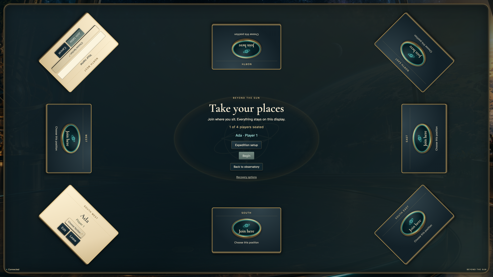](../../screenshots/resolve-four-corner-resource-cubes-and-the-complete-exo-alloy-queue/006-seat-1-editor-tabletop-4k-darwin.png)

- [x] Bora opens the physical North West seat
- [x] The saved automatic consequences settle before the public decision is photographed.
- [x] Covered and discovered compact nodes retain physical separation.
- [x] The game stays inside its actual viewport.

## 8. Bora names their local seat

Viewpoint: **Bora · North West · single shared controller**.

| desktop · 1440 × 1000 |
| --- |
|  |

tabletop-4k · 3840 × 2160

- [x] Bora names their local seat
- [x] The saved automatic consequences settle before the public decision is photographed.
- [x] Covered and discovered compact nodes retain physical separation.
- [x] The game stays inside its actual viewport.

## 9. Bora joins the physical table

Viewpoint: **Bora · North West · single shared controller**.

| desktop · 1440 × 1000 |
| --- |
|  |

tabletop-4k · 3840 × 2160

[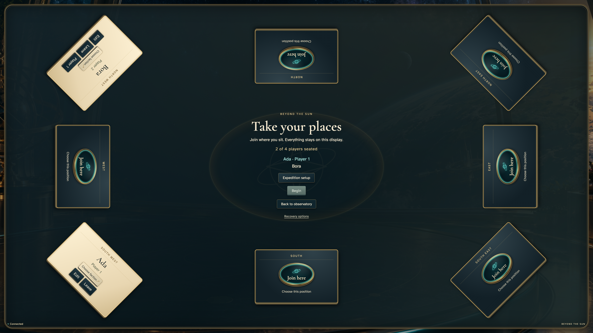](../../screenshots/resolve-four-corner-resource-cubes-and-the-complete-exo-alloy-queue/008-seat-1-joined-tabletop-4k-darwin.png)

- [x] Bora joins the physical table
- [x] The saved automatic consequences settle before the public decision is photographed.
- [x] Covered and discovered compact nodes retain physical separation.
- [x] The game stays inside its actual viewport.

## 10. Cleo opens the physical North East seat

Viewpoint: **Cleo · North East · single shared controller**.

| desktop · 1440 × 1000 |
| --- |
| [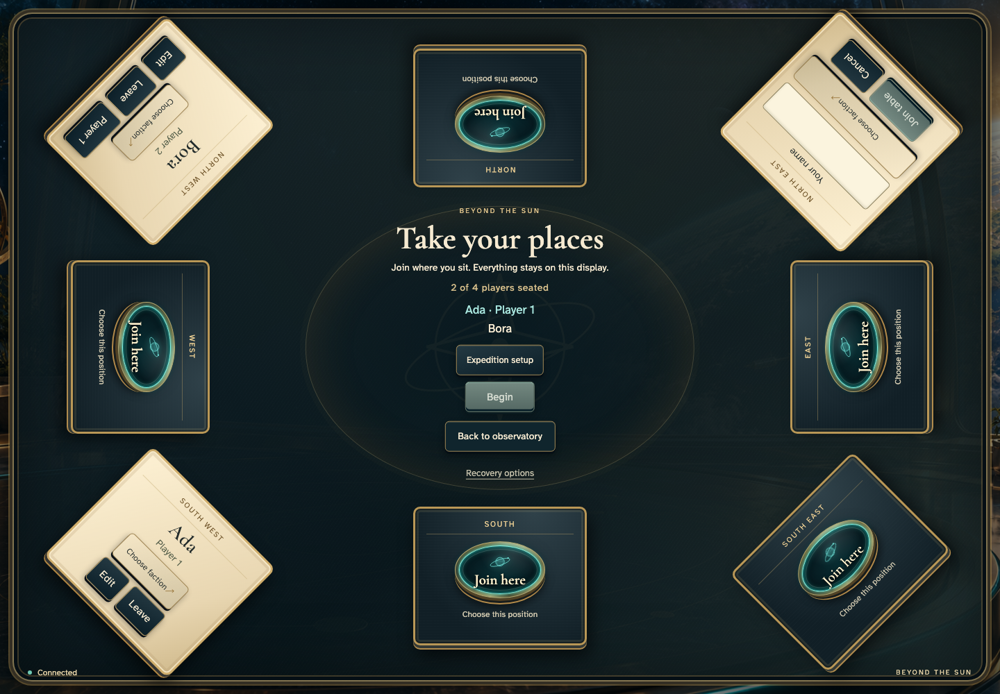](../../screenshots/resolve-four-corner-resource-cubes-and-the-complete-exo-alloy-queue/009-seat-2-editor-desktop-darwin.png) |

tabletop-4k · 3840 × 2160

- [x] Cleo opens the physical North East seat
- [x] The saved automatic consequences settle before the public decision is photographed.
- [x] Covered and discovered compact nodes retain physical separation.
- [x] The game stays inside its actual viewport.

## 11. Cleo names their local seat

Viewpoint: **Cleo · North East · single shared controller**.

| desktop · 1440 × 1000 |
| --- |
| [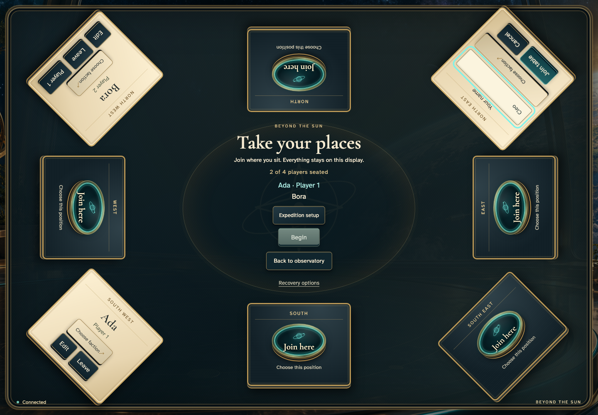](../../screenshots/resolve-four-corner-resource-cubes-and-the-complete-exo-alloy-queue/010-seat-2-name-desktop-darwin.png) |

tabletop-4k · 3840 × 2160

- [x] Cleo names their local seat
- [x] The saved automatic consequences settle before the public decision is photographed.
- [x] Covered and discovered compact nodes retain physical separation.
- [x] The game stays inside its actual viewport.

## 12. Cleo joins the physical table

Viewpoint: **Cleo · North East · single shared controller**.

| desktop · 1440 × 1000 |
| --- |
|  |

tabletop-4k · 3840 × 2160

[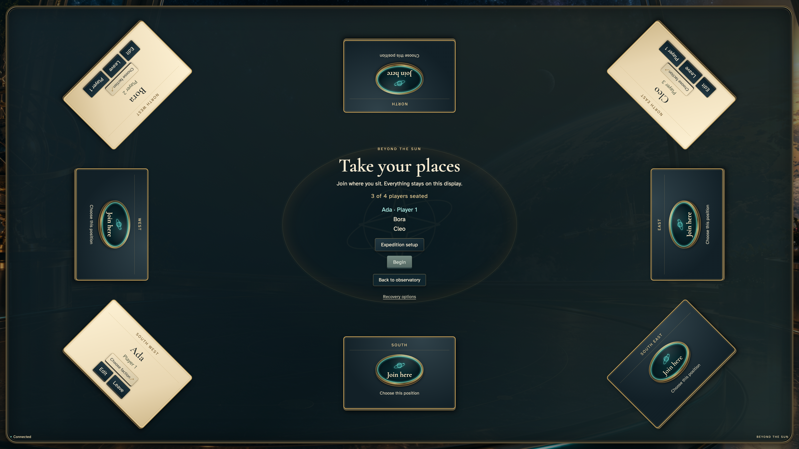](../../screenshots/resolve-four-corner-resource-cubes-and-the-complete-exo-alloy-queue/011-seat-2-joined-tabletop-4k-darwin.png)

- [x] Cleo joins the physical table
- [x] The saved automatic consequences settle before the public decision is photographed.
- [x] Covered and discovered compact nodes retain physical separation.
- [x] The game stays inside its actual viewport.

## 13. Dara opens the physical South East seat

Viewpoint: **Dara · South East · single shared controller**.

| desktop · 1440 × 1000 |
| --- |
|  |

tabletop-4k · 3840 × 2160

- [x] Dara opens the physical South East seat
- [x] The saved automatic consequences settle before the public decision is photographed.
- [x] Covered and discovered compact nodes retain physical separation.
- [x] The game stays inside its actual viewport.

## 14. Dara names their local seat

Viewpoint: **Dara · South East · single shared controller**.

| desktop · 1440 × 1000 |
| --- |
|  |

tabletop-4k · 3840 × 2160

- [x] Dara names their local seat
- [x] The saved automatic consequences settle before the public decision is photographed.
- [x] Covered and discovered compact nodes retain physical separation.
- [x] The game stays inside its actual viewport.

## 15. Dara joins the physical table

Viewpoint: **Dara · South East · single shared controller**.

| desktop · 1440 × 1000 |
| --- |
|  |

tabletop-4k · 3840 × 2160

- [x] Dara joins the physical table
- [x] The saved automatic consequences settle before the public decision is photographed.
- [x] Covered and discovered compact nodes retain physical separation.
- [x] The game stays inside its actual viewport.

## 16. Ada reads the legal unique Basic factions

Viewpoint: **Ada · South West · single shared controller**.

| desktop · 1440 × 1000 |
| --- |
|  |

tabletop-4k · 3840 × 2160

- [x] Ada reads the legal unique Basic factions
- [x] The saved automatic consequences settle before the public decision is photographed.
- [x] Covered and discovered compact nodes retain physical separation.
- [x] The game stays inside its actual viewport.

## 17. Ada chooses their actual production faction

Viewpoint: **Ada · South West · single shared controller**.

| desktop · 1440 × 1000 |
| --- |
|  |

tabletop-4k · 3840 × 2160

- [x] Ada chooses their actual production faction
- [x] The saved automatic consequences settle before the public decision is photographed.
- [x] Covered and discovered compact nodes retain physical separation.
- [x] The game stays inside its actual viewport.

## 18. Bora reads the legal unique Basic factions

Viewpoint: **Bora · North West · single shared controller**.

| desktop · 1440 × 1000 |
| --- |
| [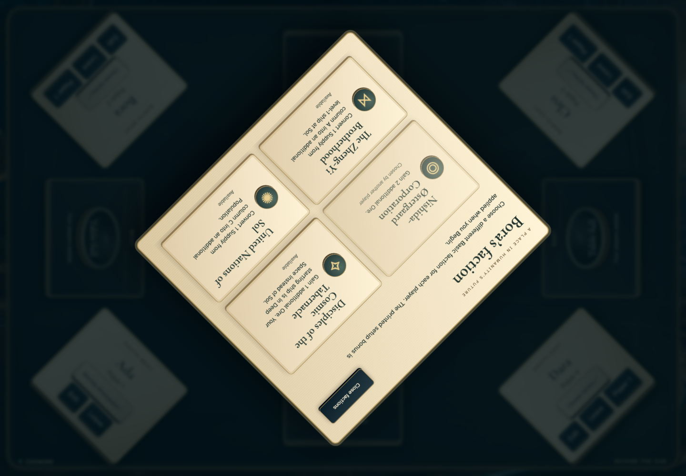](../../screenshots/resolve-four-corner-resource-cubes-and-the-complete-exo-alloy-queue/017-faction-1-choices-desktop-darwin.png) |

tabletop-4k · 3840 × 2160

- [x] Bora reads the legal unique Basic factions
- [x] The saved automatic consequences settle before the public decision is photographed.
- [x] Covered and discovered compact nodes retain physical separation.
- [x] The game stays inside its actual viewport.

## 19. Bora chooses their actual production faction

Viewpoint: **Bora · North West · single shared controller**.

| desktop · 1440 × 1000 |
| --- |
|  |

tabletop-4k · 3840 × 2160

[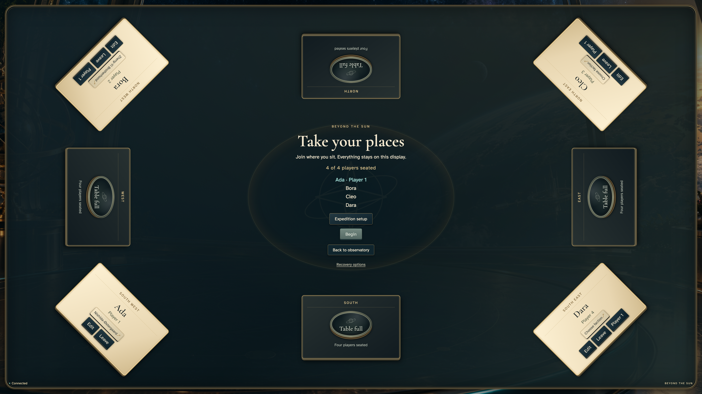](../../screenshots/resolve-four-corner-resource-cubes-and-the-complete-exo-alloy-queue/018-faction-1-chosen-tabletop-4k-darwin.png)

- [x] Bora chooses their actual production faction
- [x] The saved automatic consequences settle before the public decision is photographed.
- [x] Covered and discovered compact nodes retain physical separation.
- [x] The game stays inside its actual viewport.

## 20. Cleo reads the legal unique Basic factions

Viewpoint: **Cleo · North East · single shared controller**.

| desktop · 1440 × 1000 |
| --- |
|  |

tabletop-4k · 3840 × 2160

- [x] Cleo reads the legal unique Basic factions
- [x] The saved automatic consequences settle before the public decision is photographed.
- [x] Covered and discovered compact nodes retain physical separation.
- [x] The game stays inside its actual viewport.

## 21. Cleo chooses their actual production faction

Viewpoint: **Cleo · North East · single shared controller**.

| desktop · 1440 × 1000 |
| --- |
| [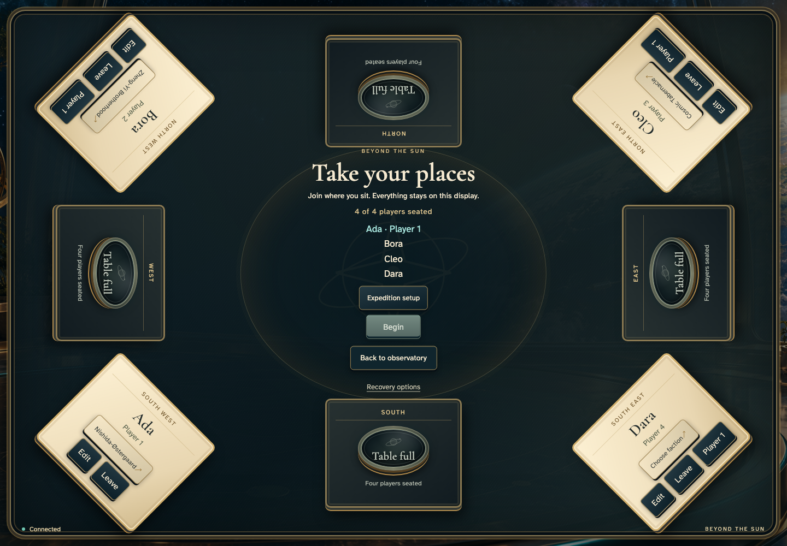](../../screenshots/resolve-four-corner-resource-cubes-and-the-complete-exo-alloy-queue/020-faction-2-chosen-desktop-darwin.png) |

tabletop-4k · 3840 × 2160

- [x] Cleo chooses their actual production faction
- [x] The saved automatic consequences settle before the public decision is photographed.
- [x] Covered and discovered compact nodes retain physical separation.
- [x] The game stays inside its actual viewport.

## 22. Dara reads the legal unique Basic factions

Viewpoint: **Dara · South East · single shared controller**.

| desktop · 1440 × 1000 |
| --- |
|  |

tabletop-4k · 3840 × 2160

- [x] Dara reads the legal unique Basic factions
- [x] The saved automatic consequences settle before the public decision is photographed.
- [x] Covered and discovered compact nodes retain physical separation.
- [x] The game stays inside its actual viewport.

## 23. Dara chooses their actual production faction

Viewpoint: **Dara · South East · single shared controller**.

| desktop · 1440 × 1000 |
| --- |
|  |

tabletop-4k · 3840 × 2160

[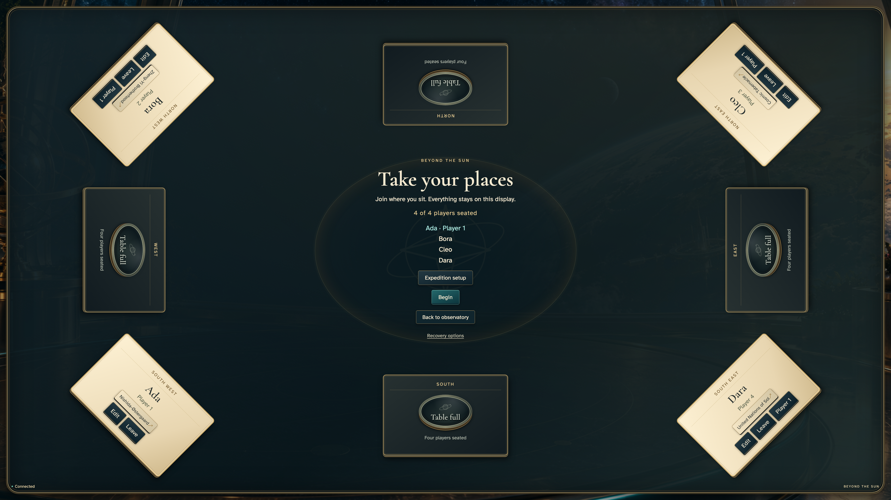](../../screenshots/resolve-four-corner-resource-cubes-and-the-complete-exo-alloy-queue/022-faction-3-chosen-tabletop-4k-darwin.png)

- [x] Dara chooses their actual production faction
- [x] The saved automatic consequences settle before the public decision is photographed.
- [x] Covered and discovered compact nodes retain physical separation.
- [x] The game stays inside its actual viewport.

## 24. Begin creates the immutable seeded Basic game

Viewpoint: **Ada · South West · single shared controller**.

| desktop · 1440 × 1000 |
| --- |
| [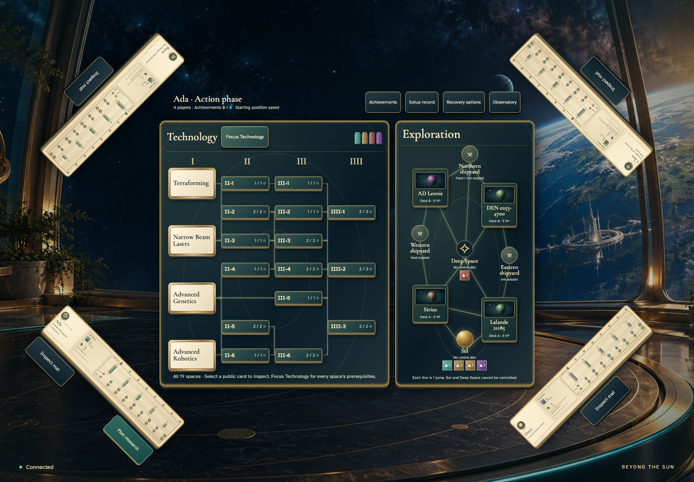](../../screenshots/resolve-four-corner-resource-cubes-and-the-complete-exo-alloy-queue/023-begun-desktop-darwin.png) |

tabletop-4k · 3840 × 2160

- [x] Begin creates the immutable seeded Basic game
- [x] The saved automatic consequences settle before the public decision is photographed.
- [x] Covered and discovered compact nodes retain physical separation.
- [x] The game stays inside its actual viewport.

## 25. Ada plans a legal preparatory Level I turn

Viewpoint: **Ada · South West · single shared controller**.

| desktop · 1440 × 1000 |
| --- |
| [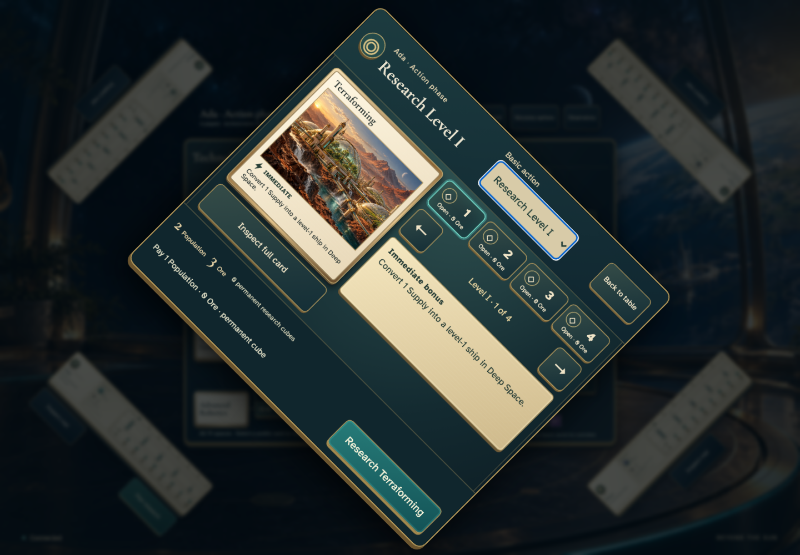](../../screenshots/resolve-four-corner-resource-cubes-and-the-complete-exo-alloy-queue/024-prep-0-plan-desktop-darwin.png) |

tabletop-4k · 3840 × 2160

[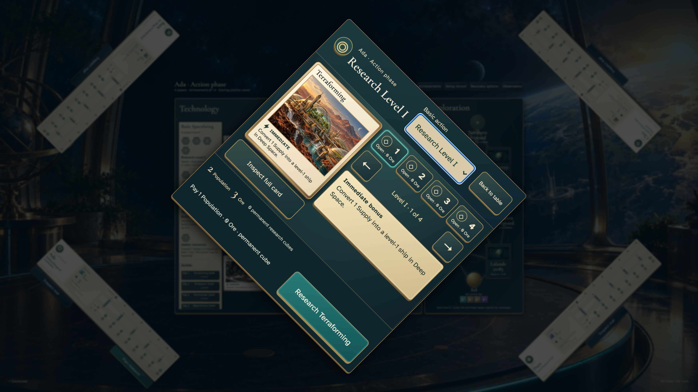](../../screenshots/resolve-four-corner-resource-cubes-and-the-complete-exo-alloy-queue/024-prep-0-plan-tabletop-4k-darwin.png)

- [x] Ada plans a legal preparatory Level I turn
- [x] The saved automatic consequences settle before the public decision is photographed.
- [x] Covered and discovered compact nodes retain physical separation.
- [x] The game stays inside its actual viewport.

## 26. Ada chooses the unoccupied printed Action space

Viewpoint: **Ada · South West · single shared controller**.

| desktop · 1440 × 1000 |
| --- |
| [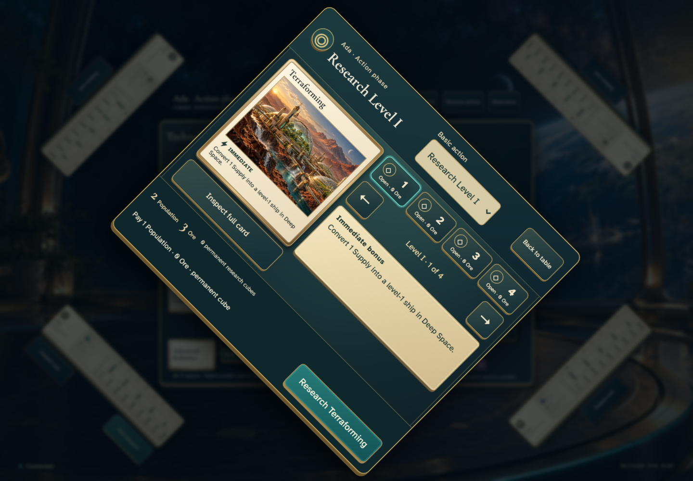](../../screenshots/resolve-four-corner-resource-cubes-and-the-complete-exo-alloy-queue/025-prep-0-space-desktop-darwin.png) |

tabletop-4k · 3840 × 2160

[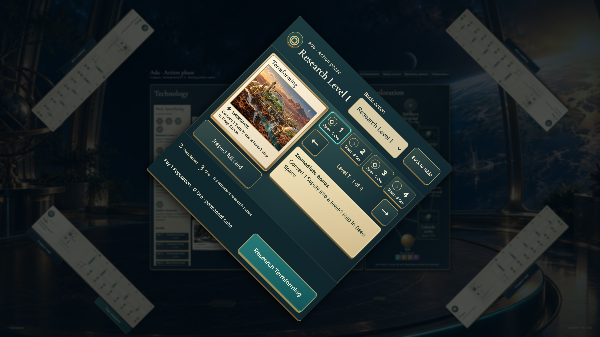](../../screenshots/resolve-four-corner-resource-cubes-and-the-complete-exo-alloy-queue/025-prep-0-space-tabletop-4k-darwin.png)

- [x] Ada chooses the unoccupied printed Action space
- [x] The saved automatic consequences settle before the public decision is photographed.
- [x] Covered and discovered compact nodes retain physical separation.
- [x] The game stays inside its actual viewport.

## 27. Ada browses the next public Level I face

Viewpoint: **Ada · South West · single shared controller**.

| desktop · 1440 × 1000 |
| --- |
|  |

tabletop-4k · 3840 × 2160

- [x] Ada browses the next public Level I face
- [x] The saved automatic consequences settle before the public decision is photographed.
- [x] Covered and discovered compact nodes retain physical separation.
- [x] The game stays inside its actual viewport.

## 28. Research remains disabled until an explicit owned ship is selected

Viewpoint: **Ada · South West · single shared controller**.

| desktop · 1440 × 1000 |
| --- |
| [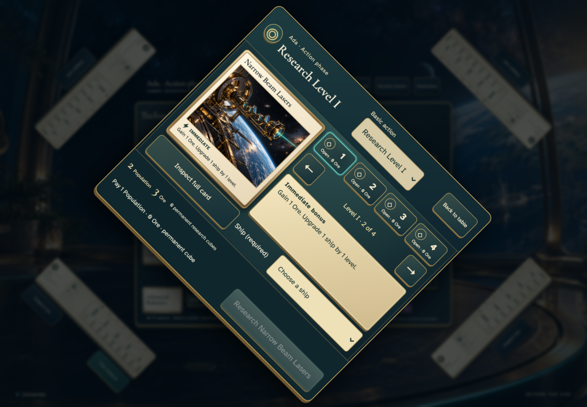](../../screenshots/resolve-four-corner-resource-cubes-and-the-complete-exo-alloy-queue/027-prep-0-target-required-desktop-darwin.png) |

tabletop-4k · 3840 × 2160

[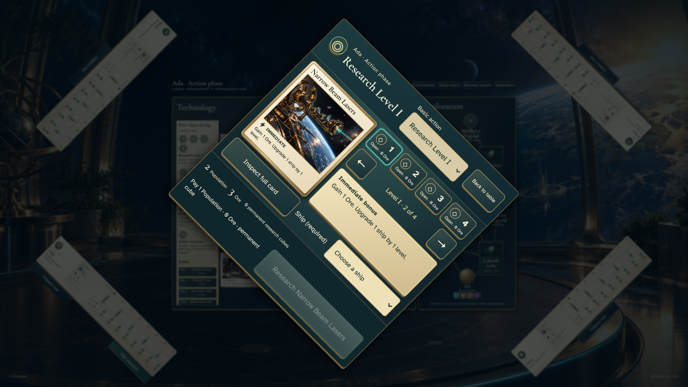](../../screenshots/resolve-four-corner-resource-cubes-and-the-complete-exo-alloy-queue/027-prep-0-target-required-tabletop-4k-darwin.png)

- [x] Research remains disabled until an explicit owned ship is selected
- [x] The saved automatic consequences settle before the public decision is photographed.
- [x] Covered and discovered compact nodes retain physical separation.
- [x] The game stays inside its actual viewport.

## 29. Ada explicitly chooses the first owned ship to upgrade

Viewpoint: **Ada · South West · single shared controller**.

| desktop · 1440 × 1000 |
| --- |
|  |

tabletop-4k · 3840 × 2160

- [x] Ada explicitly chooses the first owned ship to upgrade
- [x] The saved automatic consequences settle before the public decision is photographed.
- [x] Covered and discovered compact nodes retain physical separation.
- [x] The game stays inside its actual viewport.

## 30. Ada pays permanent research Population and receives the printed immediate bonus

Viewpoint: **Ada · South West · single shared controller**.

| desktop · 1440 × 1000 |
| --- |
| [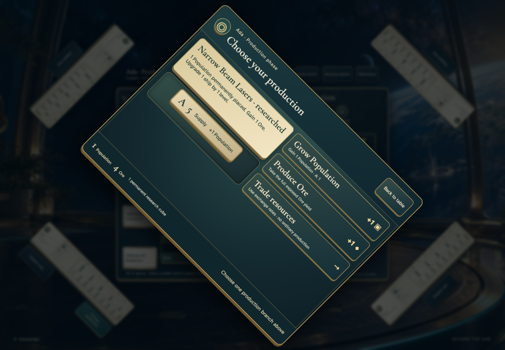](../../screenshots/resolve-four-corner-resource-cubes-and-the-complete-exo-alloy-queue/029-prep-0-paid-desktop-darwin.png) |

tabletop-4k · 3840 × 2160

[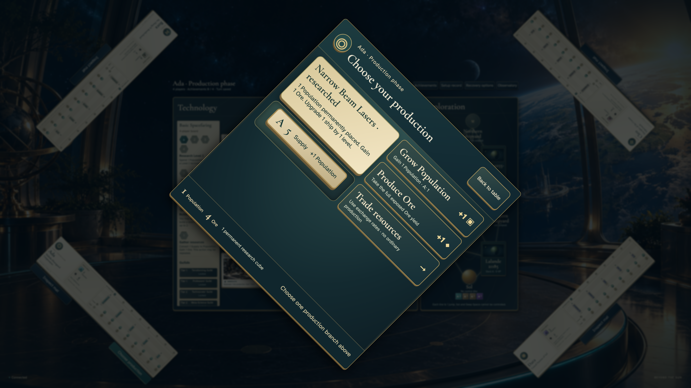](../../screenshots/resolve-four-corner-resource-cubes-and-the-complete-exo-alloy-queue/029-prep-0-paid-tabletop-4k-darwin.png)

- [x] Ada pays permanent research Population and receives the printed immediate bonus
- [x] The saved automatic consequences settle before the public decision is photographed.
- [x] Covered and discovered compact nodes retain physical separation.
- [x] The game stays inside its actual viewport.

## 31. Ada completes ordinary production and hands off automatically

Viewpoint: **Ada · South West · single shared controller**.

| desktop · 1440 × 1000 |
| --- |
|  |

tabletop-4k · 3840 × 2160

- [x] Ada completes ordinary production and hands off automatically
- [x] The saved automatic consequences settle before the public decision is photographed.
- [x] Covered and discovered compact nodes retain physical separation.
- [x] The game stays inside its actual viewport.

## 32. Bora plans a legal preparatory Level I turn

Viewpoint: **Bora · North West · single shared controller**.

| desktop · 1440 × 1000 |
| --- |
| [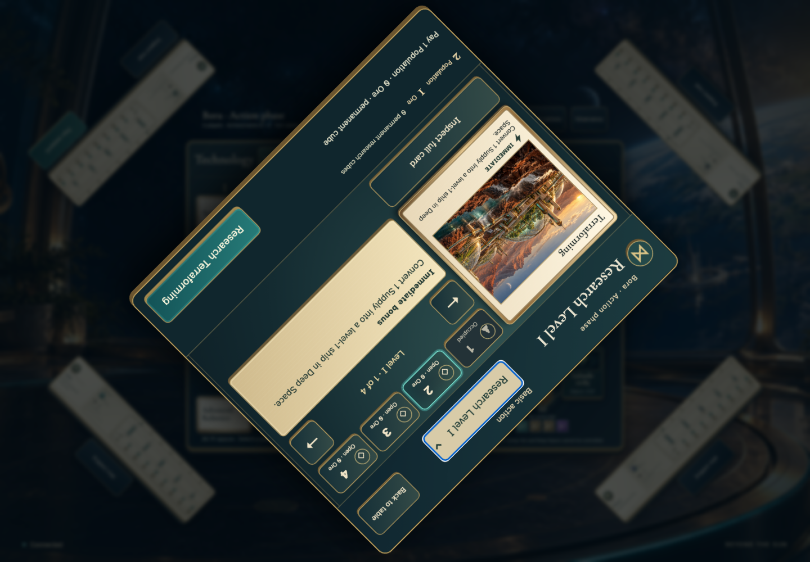](../../screenshots/resolve-four-corner-resource-cubes-and-the-complete-exo-alloy-queue/031-prep-1-plan-desktop-darwin.png) |

tabletop-4k · 3840 × 2160

[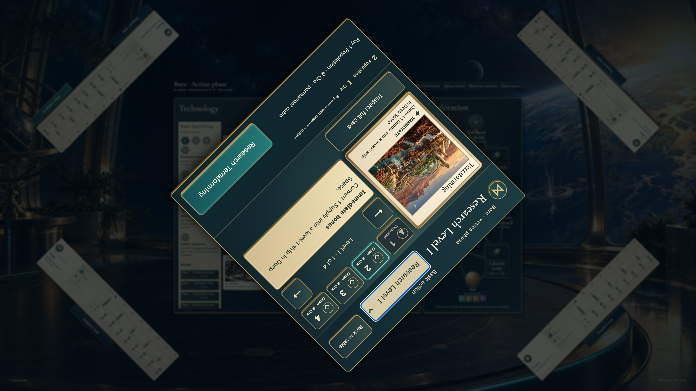](../../screenshots/resolve-four-corner-resource-cubes-and-the-complete-exo-alloy-queue/031-prep-1-plan-tabletop-4k-darwin.png)

- [x] Bora plans a legal preparatory Level I turn
- [x] The saved automatic consequences settle before the public decision is photographed.
- [x] Covered and discovered compact nodes retain physical separation.
- [x] The game stays inside its actual viewport.

## 33. Bora chooses the unoccupied printed Action space

Viewpoint: **Bora · North West · single shared controller**.

| desktop · 1440 × 1000 |
| --- |
|  |

tabletop-4k · 3840 × 2160

[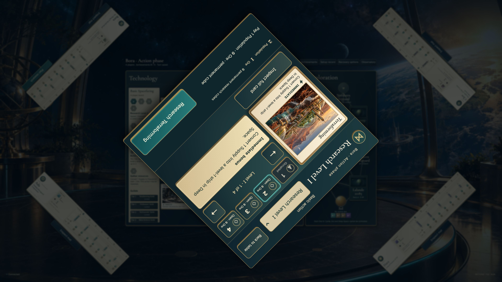](../../screenshots/resolve-four-corner-resource-cubes-and-the-complete-exo-alloy-queue/032-prep-1-space-tabletop-4k-darwin.png)

- [x] Bora chooses the unoccupied printed Action space
- [x] The saved automatic consequences settle before the public decision is photographed.
- [x] Covered and discovered compact nodes retain physical separation.
- [x] The game stays inside its actual viewport.

## 34. Bora browses the next public Level I face

Viewpoint: **Bora · North West · single shared controller**.

| desktop · 1440 × 1000 |
| --- |
| [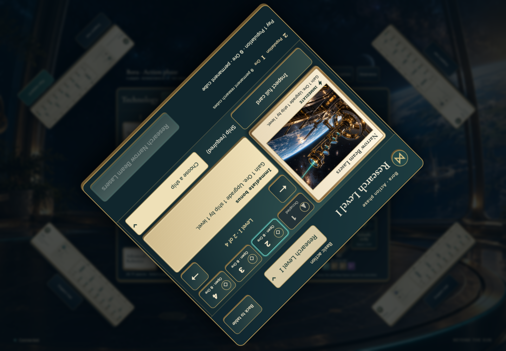](../../screenshots/resolve-four-corner-resource-cubes-and-the-complete-exo-alloy-queue/033-prep-1-browse-0-desktop-darwin.png) |

tabletop-4k · 3840 × 2160

[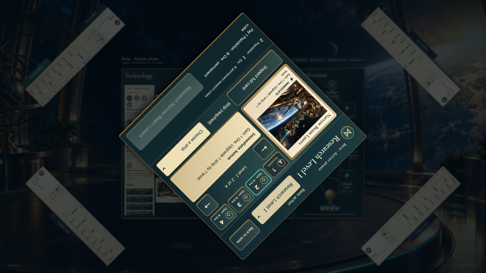](../../screenshots/resolve-four-corner-resource-cubes-and-the-complete-exo-alloy-queue/033-prep-1-browse-0-tabletop-4k-darwin.png)

- [x] Bora browses the next public Level I face
- [x] The saved automatic consequences settle before the public decision is photographed.
- [x] Covered and discovered compact nodes retain physical separation.
- [x] The game stays inside its actual viewport.

## 35. Bora browses the next public Level I face

Viewpoint: **Bora · North West · single shared controller**.

| desktop · 1440 × 1000 |
| --- |
| [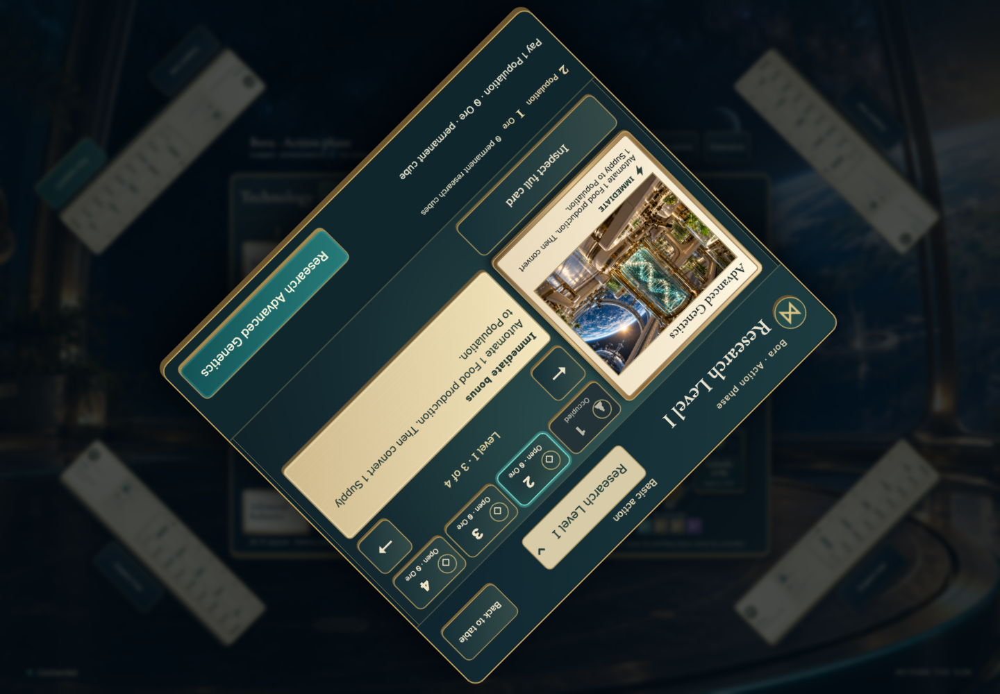](../../screenshots/resolve-four-corner-resource-cubes-and-the-complete-exo-alloy-queue/034-prep-1-browse-1-desktop-darwin.png) |

tabletop-4k · 3840 × 2160

[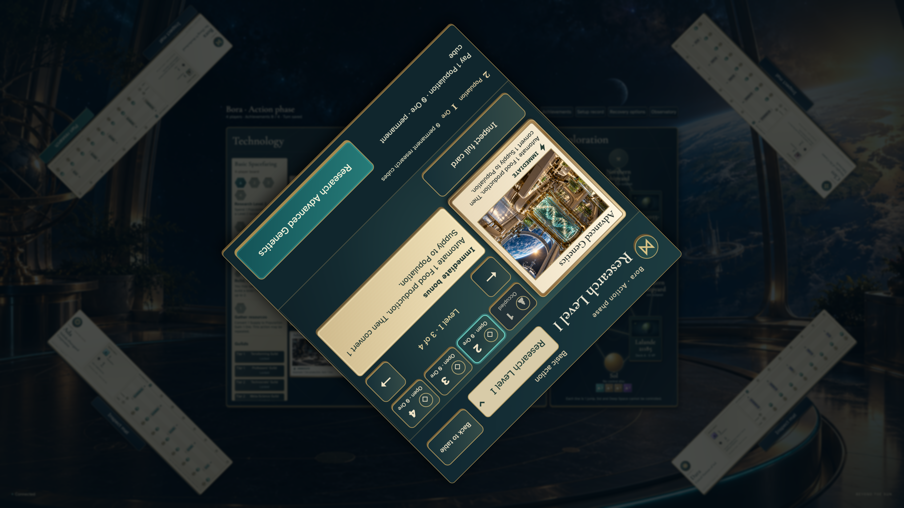](../../screenshots/resolve-four-corner-resource-cubes-and-the-complete-exo-alloy-queue/034-prep-1-browse-1-tabletop-4k-darwin.png)

- [x] Bora browses the next public Level I face
- [x] The saved automatic consequences settle before the public decision is photographed.
- [x] Covered and discovered compact nodes retain physical separation.
- [x] The game stays inside its actual viewport.

## 36. Bora browses the next public Level I face

Viewpoint: **Bora · North West · single shared controller**.

| desktop · 1440 × 1000 |
| --- |
| [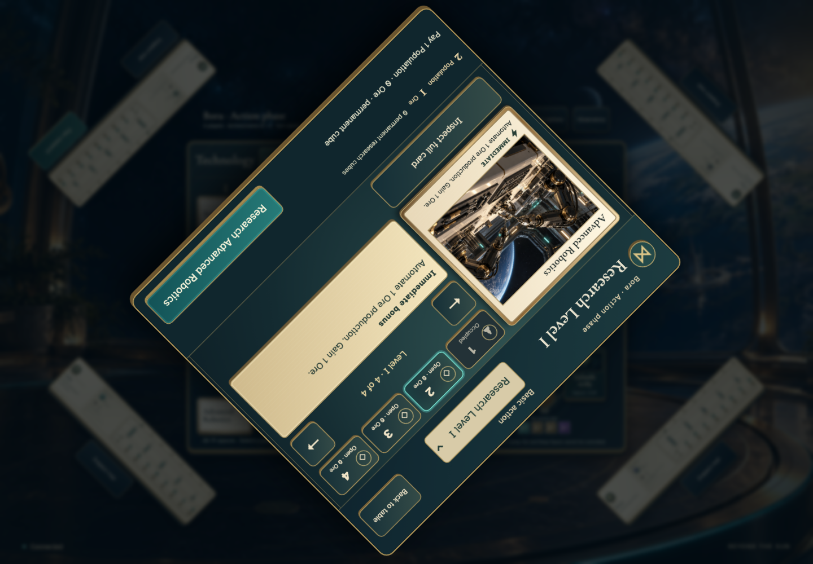](../../screenshots/resolve-four-corner-resource-cubes-and-the-complete-exo-alloy-queue/035-prep-1-browse-2-desktop-darwin.png) |

tabletop-4k · 3840 × 2160

[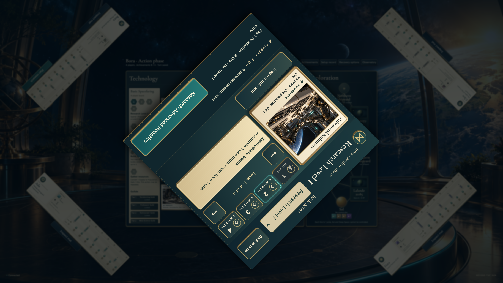](../../screenshots/resolve-four-corner-resource-cubes-and-the-complete-exo-alloy-queue/035-prep-1-browse-2-tabletop-4k-darwin.png)

- [x] Bora browses the next public Level I face
- [x] The saved automatic consequences settle before the public decision is photographed.
- [x] Covered and discovered compact nodes retain physical separation.
- [x] The game stays inside its actual viewport.

## 37. Bora pays permanent research Population and receives the printed immediate bonus

Viewpoint: **Bora · North West · single shared controller**.

| desktop · 1440 × 1000 |
| --- |
| [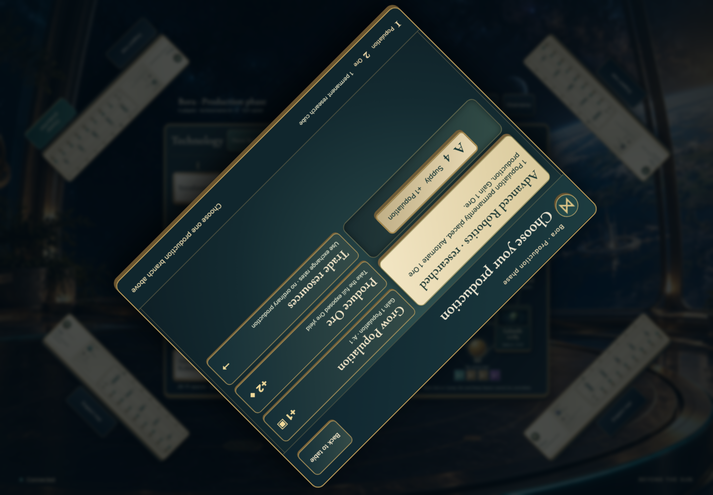](../../screenshots/resolve-four-corner-resource-cubes-and-the-complete-exo-alloy-queue/036-prep-1-paid-desktop-darwin.png) |

tabletop-4k · 3840 × 2160

[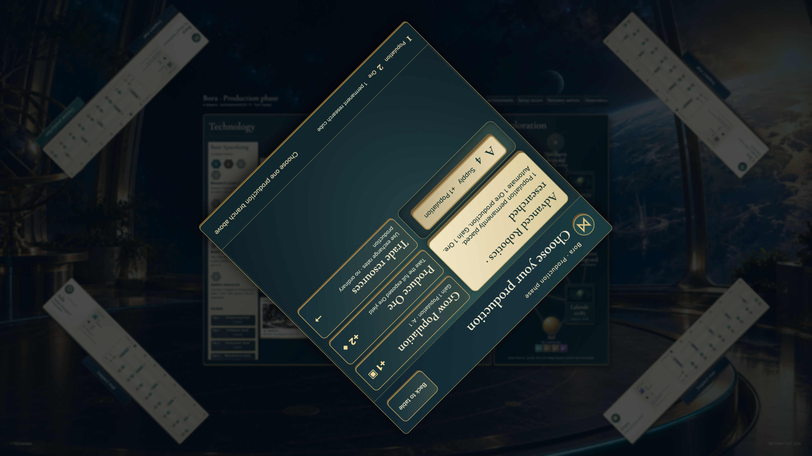](../../screenshots/resolve-four-corner-resource-cubes-and-the-complete-exo-alloy-queue/036-prep-1-paid-tabletop-4k-darwin.png)

- [x] Bora pays permanent research Population and receives the printed immediate bonus
- [x] The saved automatic consequences settle before the public decision is photographed.
- [x] Covered and discovered compact nodes retain physical separation.
- [x] The game stays inside its actual viewport.

## 38. Bora completes ordinary production and hands off automatically

Viewpoint: **Bora · North West · single shared controller**.

| desktop · 1440 × 1000 |
| --- |
| [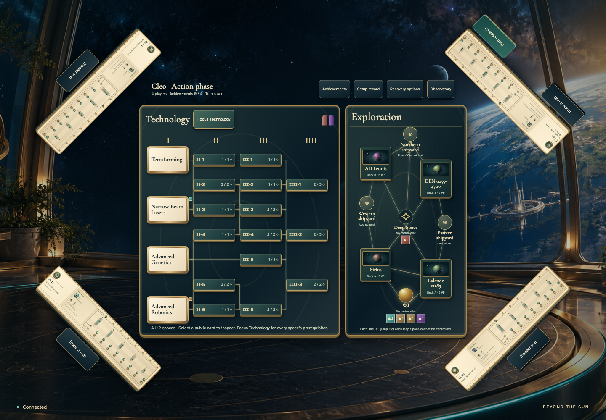](../../screenshots/resolve-four-corner-resource-cubes-and-the-complete-exo-alloy-queue/037-prep-1-handoff-desktop-darwin.png) |

tabletop-4k · 3840 × 2160

[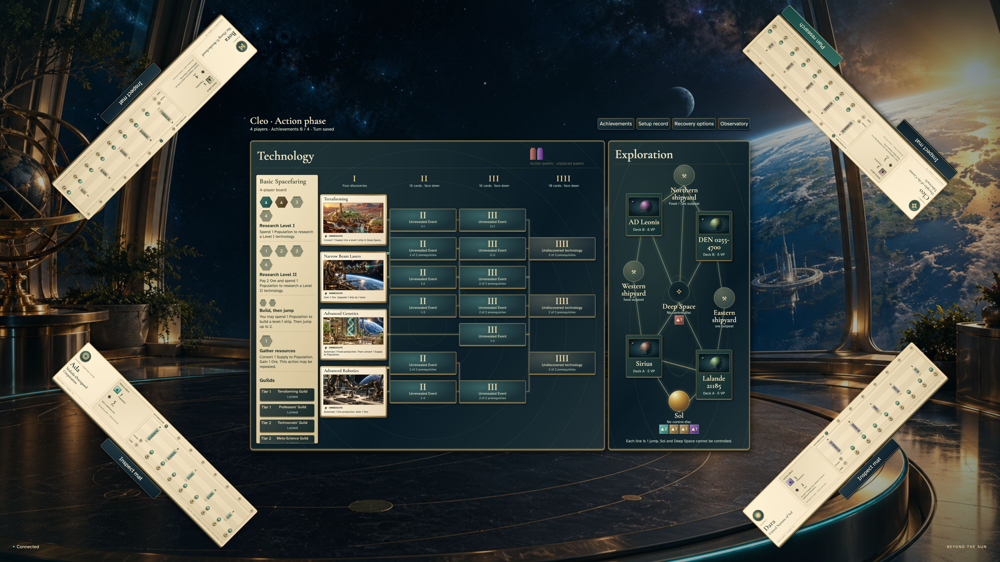](../../screenshots/resolve-four-corner-resource-cubes-and-the-complete-exo-alloy-queue/037-prep-1-handoff-tabletop-4k-darwin.png)

- [x] Bora completes ordinary production and hands off automatically
- [x] The saved automatic consequences settle before the public decision is photographed.
- [x] Covered and discovered compact nodes retain physical separation.
- [x] The game stays inside its actual viewport.

## 39. Cleo plans a legal preparatory Level I turn

Viewpoint: **Cleo · North East · single shared controller**.

| desktop · 1440 × 1000 |
| --- |
| [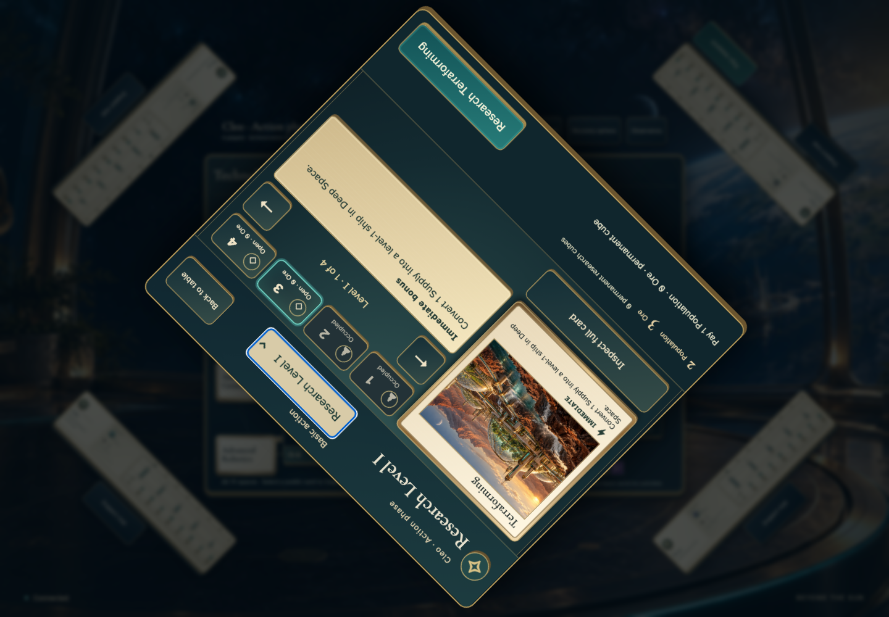](../../screenshots/resolve-four-corner-resource-cubes-and-the-complete-exo-alloy-queue/038-prep-2-plan-desktop-darwin.png) |

tabletop-4k · 3840 × 2160

- [x] Cleo plans a legal preparatory Level I turn
- [x] The saved automatic consequences settle before the public decision is photographed.
- [x] Covered and discovered compact nodes retain physical separation.
- [x] The game stays inside its actual viewport.

## 40. Cleo chooses the unoccupied printed Action space

Viewpoint: **Cleo · North East · single shared controller**.

| desktop · 1440 × 1000 |
| --- |
| [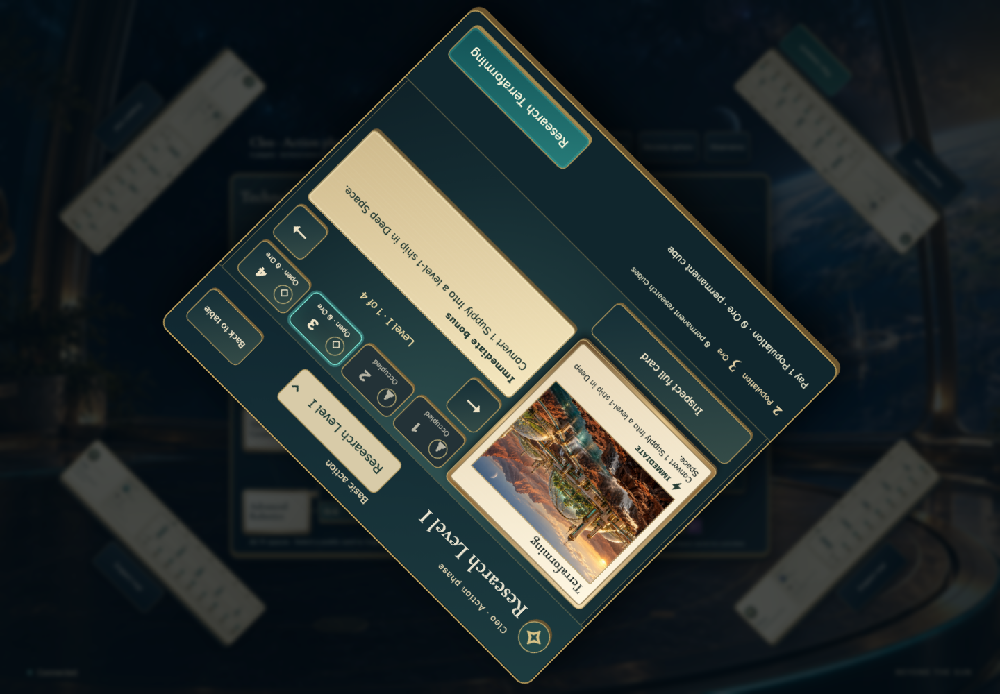](../../screenshots/resolve-four-corner-resource-cubes-and-the-complete-exo-alloy-queue/039-prep-2-space-desktop-darwin.png) |

tabletop-4k · 3840 × 2160

[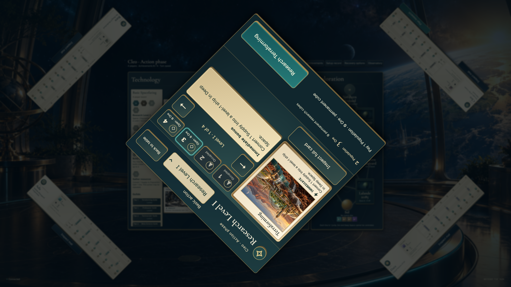](../../screenshots/resolve-four-corner-resource-cubes-and-the-complete-exo-alloy-queue/039-prep-2-space-tabletop-4k-darwin.png)

- [x] Cleo chooses the unoccupied printed Action space
- [x] The saved automatic consequences settle before the public decision is photographed.
- [x] Covered and discovered compact nodes retain physical separation.
- [x] The game stays inside its actual viewport.

## 41. Cleo browses the next public Level I face

Viewpoint: **Cleo · North East · single shared controller**.

| desktop · 1440 × 1000 |
| --- |
| [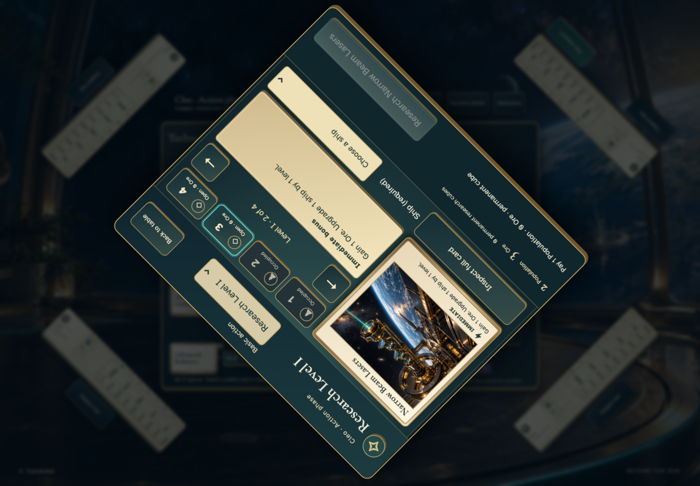](../../screenshots/resolve-four-corner-resource-cubes-and-the-complete-exo-alloy-queue/040-prep-2-browse-0-desktop-darwin.png) |

tabletop-4k · 3840 × 2160

[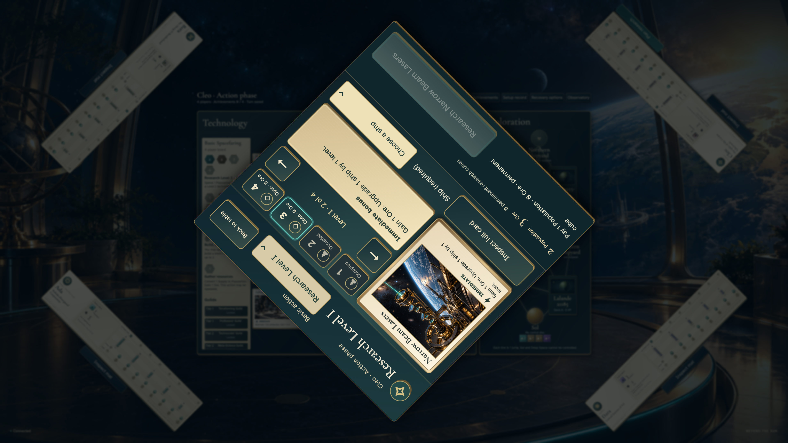](../../screenshots/resolve-four-corner-resource-cubes-and-the-complete-exo-alloy-queue/040-prep-2-browse-0-tabletop-4k-darwin.png)

- [x] Cleo browses the next public Level I face
- [x] The saved automatic consequences settle before the public decision is photographed.
- [x] Covered and discovered compact nodes retain physical separation.
- [x] The game stays inside its actual viewport.

## 42. Cleo browses the next public Level I face

Viewpoint: **Cleo · North East · single shared controller**.

| desktop · 1440 × 1000 |
| --- |
| [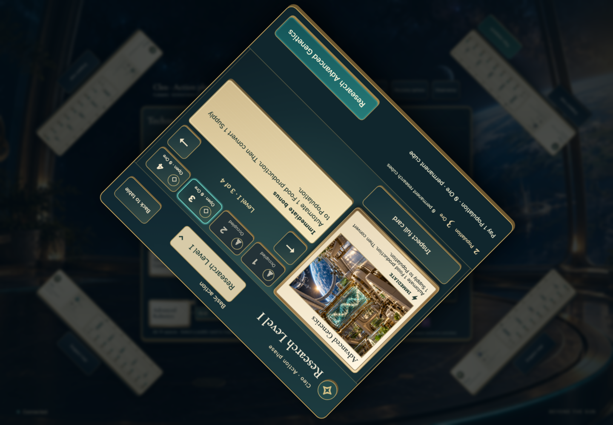](../../screenshots/resolve-four-corner-resource-cubes-and-the-complete-exo-alloy-queue/041-prep-2-browse-1-desktop-darwin.png) |

tabletop-4k · 3840 × 2160

[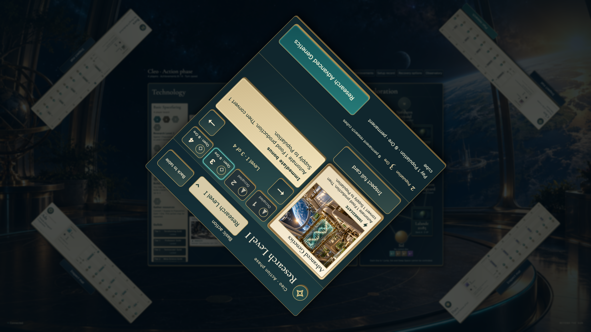](../../screenshots/resolve-four-corner-resource-cubes-and-the-complete-exo-alloy-queue/041-prep-2-browse-1-tabletop-4k-darwin.png)

- [x] Cleo browses the next public Level I face
- [x] The saved automatic consequences settle before the public decision is photographed.
- [x] Covered and discovered compact nodes retain physical separation.
- [x] The game stays inside its actual viewport.

## 43. Cleo browses the next public Level I face

Viewpoint: **Cleo · North East · single shared controller**.

| desktop · 1440 × 1000 |
| --- |
| [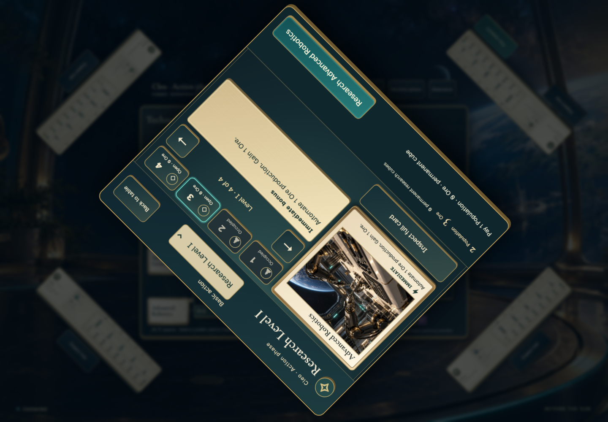](../../screenshots/resolve-four-corner-resource-cubes-and-the-complete-exo-alloy-queue/042-prep-2-browse-2-desktop-darwin.png) |

tabletop-4k · 3840 × 2160

[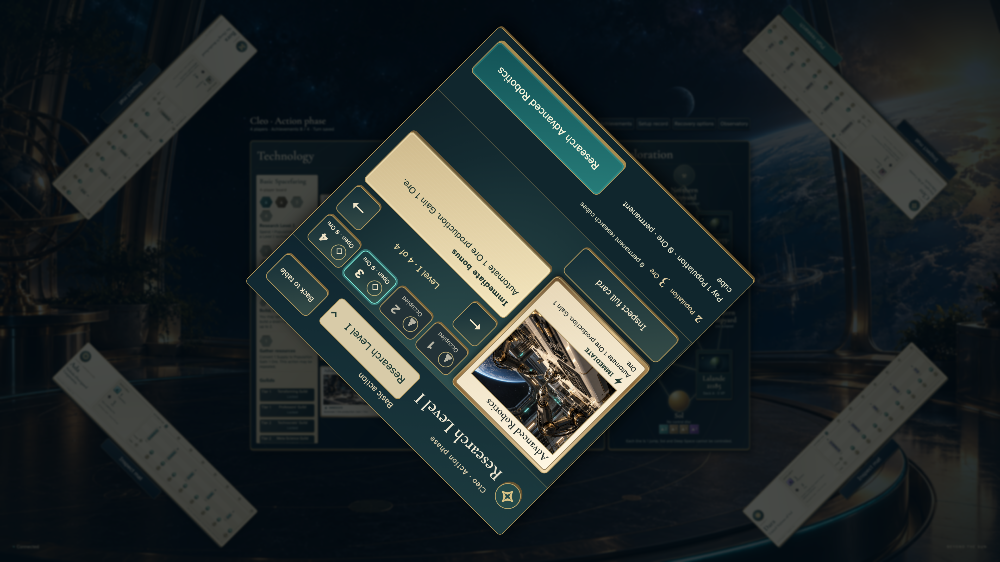](../../screenshots/resolve-four-corner-resource-cubes-and-the-complete-exo-alloy-queue/042-prep-2-browse-2-tabletop-4k-darwin.png)

- [x] Cleo browses the next public Level I face
- [x] The saved automatic consequences settle before the public decision is photographed.
- [x] Covered and discovered compact nodes retain physical separation.
- [x] The game stays inside its actual viewport.

## 44. Cleo pays permanent research Population and receives the printed immediate bonus

Viewpoint: **Cleo · North East · single shared controller**.

| desktop · 1440 × 1000 |
| --- |
| [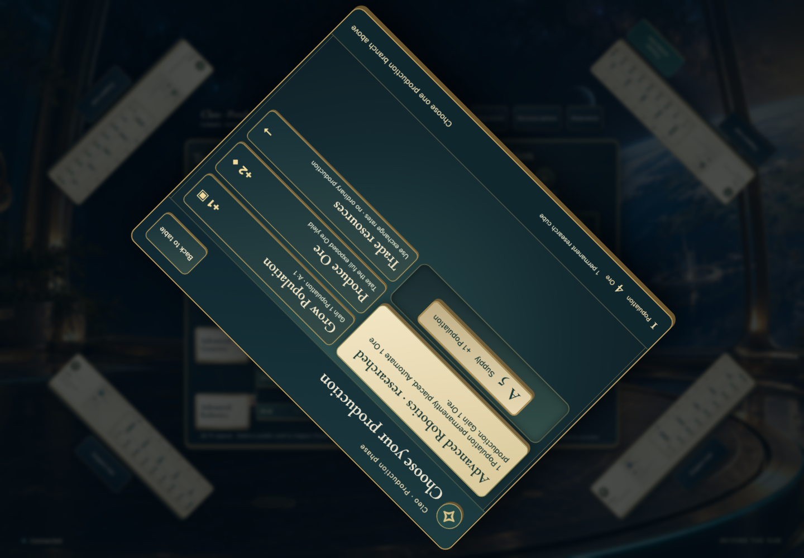](../../screenshots/resolve-four-corner-resource-cubes-and-the-complete-exo-alloy-queue/043-prep-2-paid-desktop-darwin.png) |

tabletop-4k · 3840 × 2160

[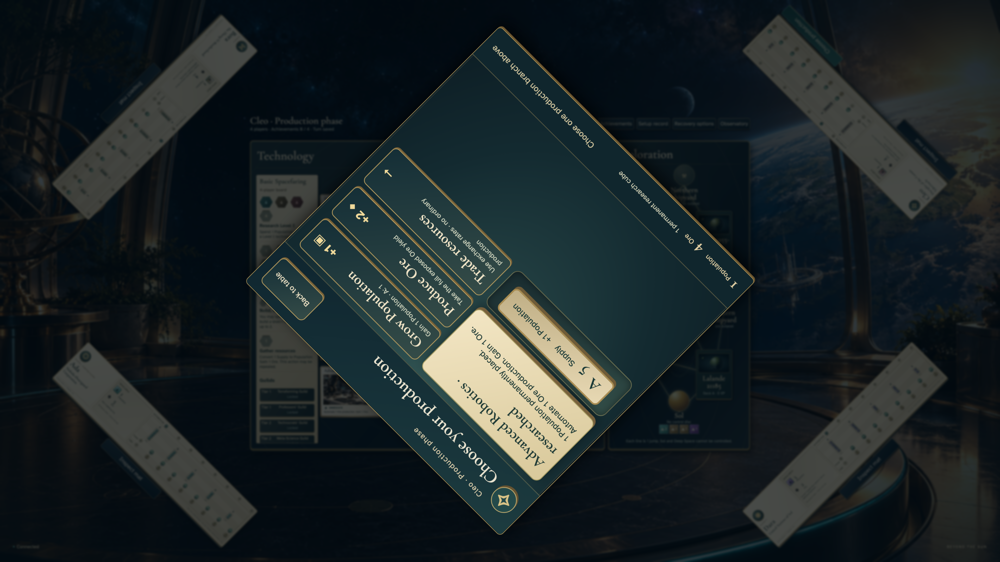](../../screenshots/resolve-four-corner-resource-cubes-and-the-complete-exo-alloy-queue/043-prep-2-paid-tabletop-4k-darwin.png)

- [x] Cleo pays permanent research Population and receives the printed immediate bonus
- [x] The saved automatic consequences settle before the public decision is photographed.
- [x] Covered and discovered compact nodes retain physical separation.
- [x] The game stays inside its actual viewport.

## 45. Cleo completes ordinary production and hands off automatically

Viewpoint: **Cleo · North East · single shared controller**.

| desktop · 1440 × 1000 |
| --- |
| [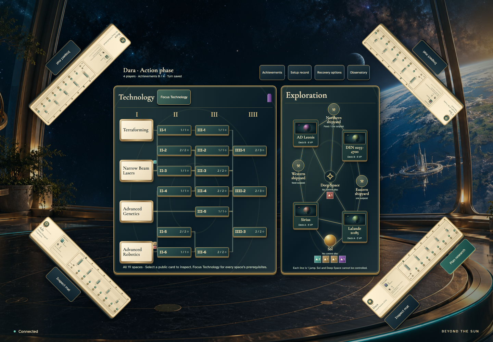](../../screenshots/resolve-four-corner-resource-cubes-and-the-complete-exo-alloy-queue/044-prep-2-handoff-desktop-darwin.png) |

tabletop-4k · 3840 × 2160

[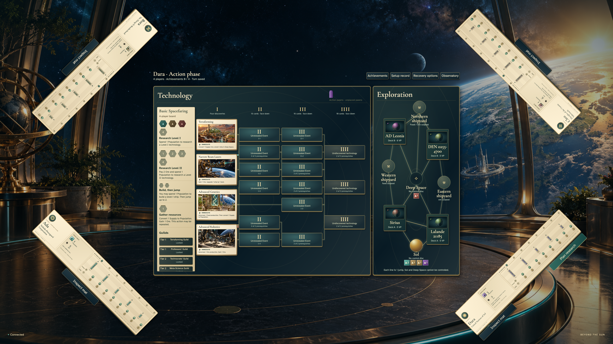](../../screenshots/resolve-four-corner-resource-cubes-and-the-complete-exo-alloy-queue/044-prep-2-handoff-tabletop-4k-darwin.png)

- [x] Cleo completes ordinary production and hands off automatically
- [x] The saved automatic consequences settle before the public decision is photographed.
- [x] Covered and discovered compact nodes retain physical separation.
- [x] The game stays inside its actual viewport.

## 46. Dara plans a legal preparatory Level I turn

Viewpoint: **Dara · South East · single shared controller**.

| desktop · 1440 × 1000 |
| --- |
|  |

tabletop-4k · 3840 × 2160

- [x] Dara plans a legal preparatory Level I turn
- [x] The saved automatic consequences settle before the public decision is photographed.
- [x] Covered and discovered compact nodes retain physical separation.
- [x] The game stays inside its actual viewport.

## 47. Dara chooses the unoccupied printed Action space

Viewpoint: **Dara · South East · single shared controller**.

| desktop · 1440 × 1000 |
| --- |
| [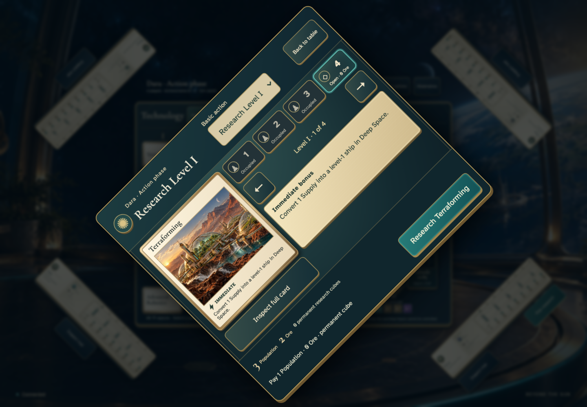](../../screenshots/resolve-four-corner-resource-cubes-and-the-complete-exo-alloy-queue/046-prep-3-space-desktop-darwin.png) |

tabletop-4k · 3840 × 2160

[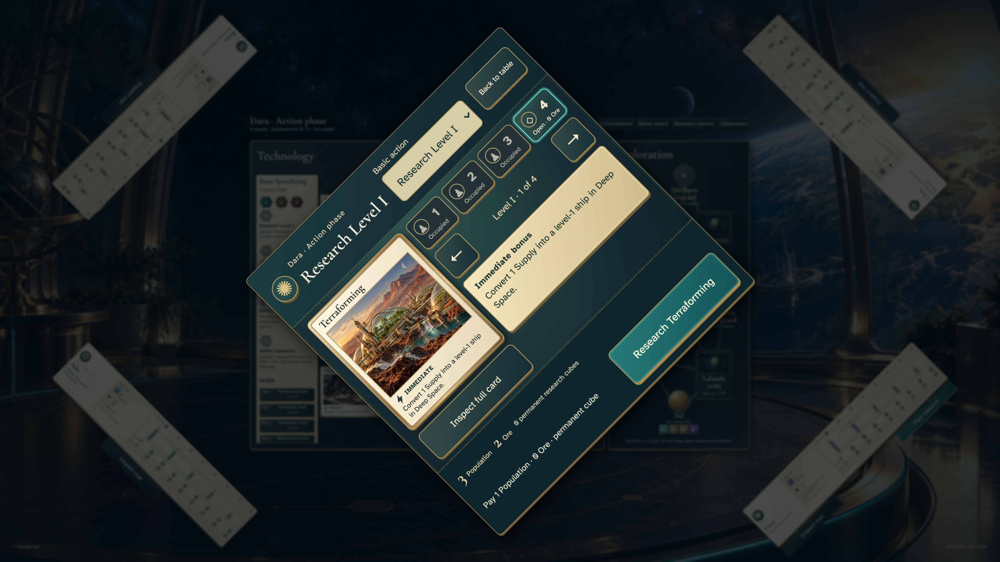](../../screenshots/resolve-four-corner-resource-cubes-and-the-complete-exo-alloy-queue/046-prep-3-space-tabletop-4k-darwin.png)

- [x] Dara chooses the unoccupied printed Action space
- [x] The saved automatic consequences settle before the public decision is photographed.
- [x] Covered and discovered compact nodes retain physical separation.
- [x] The game stays inside its actual viewport.

## 48. Dara browses the next public Level I face

Viewpoint: **Dara · South East · single shared controller**.

| desktop · 1440 × 1000 |
| --- |
| [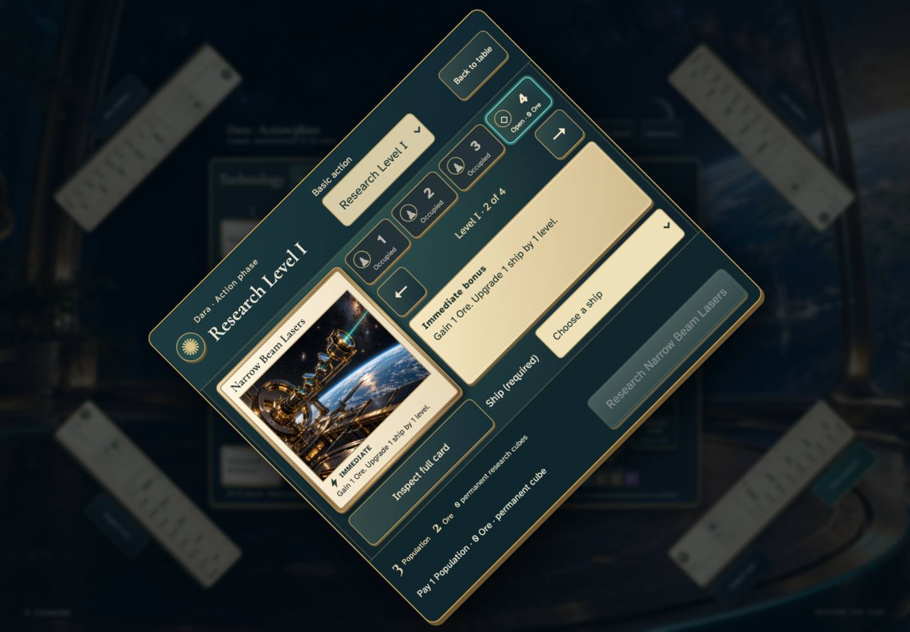](../../screenshots/resolve-four-corner-resource-cubes-and-the-complete-exo-alloy-queue/047-prep-3-browse-0-desktop-darwin.png) |

tabletop-4k · 3840 × 2160

[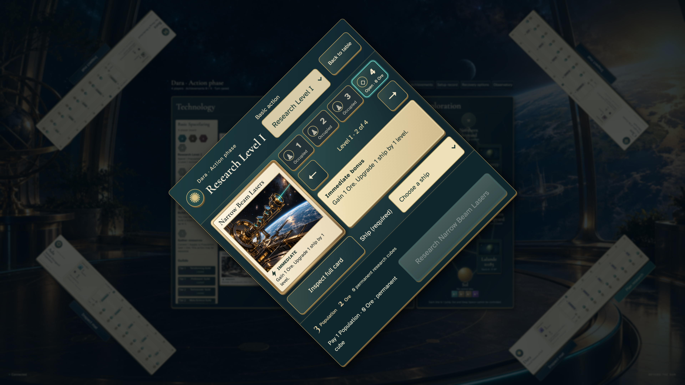](../../screenshots/resolve-four-corner-resource-cubes-and-the-complete-exo-alloy-queue/047-prep-3-browse-0-tabletop-4k-darwin.png)

- [x] Dara browses the next public Level I face
- [x] The saved automatic consequences settle before the public decision is photographed.
- [x] Covered and discovered compact nodes retain physical separation.
- [x] The game stays inside its actual viewport.

## 49. Dara browses the next public Level I face

Viewpoint: **Dara · South East · single shared controller**.

| desktop · 1440 × 1000 |
| --- |
| [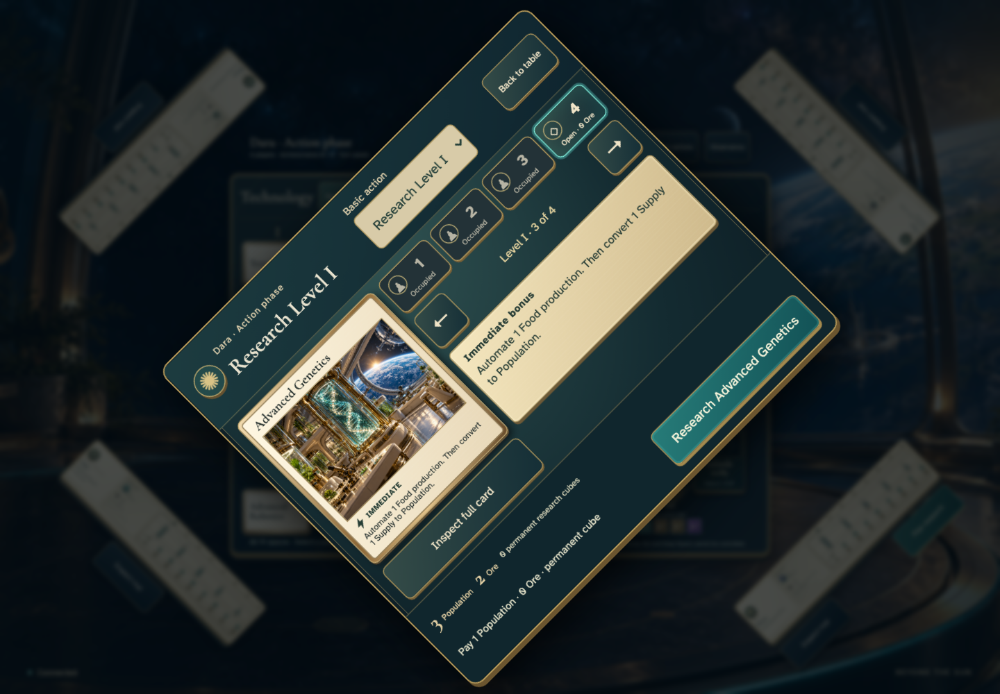](../../screenshots/resolve-four-corner-resource-cubes-and-the-complete-exo-alloy-queue/048-prep-3-browse-1-desktop-darwin.png) |

tabletop-4k · 3840 × 2160

[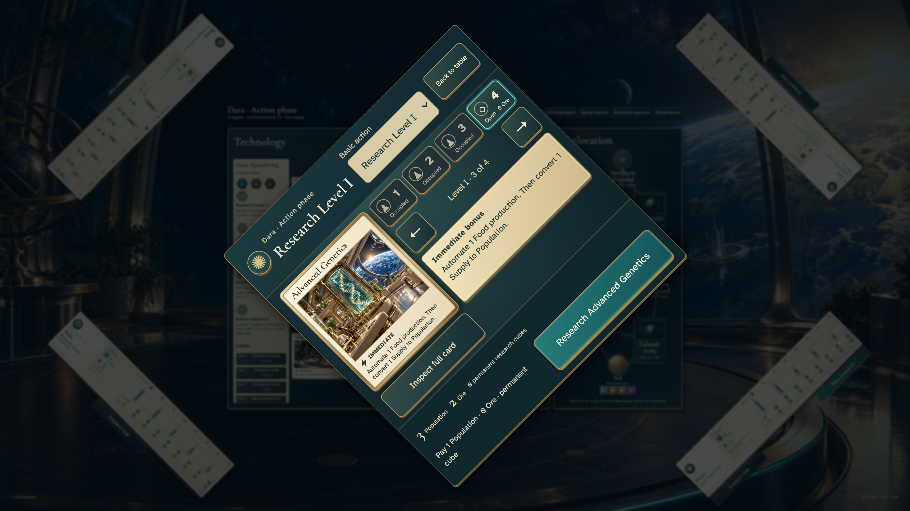](../../screenshots/resolve-four-corner-resource-cubes-and-the-complete-exo-alloy-queue/048-prep-3-browse-1-tabletop-4k-darwin.png)

- [x] Dara browses the next public Level I face
- [x] The saved automatic consequences settle before the public decision is photographed.
- [x] Covered and discovered compact nodes retain physical separation.
- [x] The game stays inside its actual viewport.

## 50. Dara browses the next public Level I face

Viewpoint: **Dara · South East · single shared controller**.

| desktop · 1440 × 1000 |
| --- |
|  |

tabletop-4k · 3840 × 2160

- [x] Dara browses the next public Level I face
- [x] The saved automatic consequences settle before the public decision is photographed.
- [x] Covered and discovered compact nodes retain physical separation.
- [x] The game stays inside its actual viewport.

## 51. Dara pays permanent research Population and receives the printed immediate bonus

Viewpoint: **Dara · South East · single shared controller**.

| desktop · 1440 × 1000 |
| --- |
|  |

tabletop-4k · 3840 × 2160

- [x] Dara pays permanent research Population and receives the printed immediate bonus
- [x] The saved automatic consequences settle before the public decision is photographed.
- [x] Covered and discovered compact nodes retain physical separation.
- [x] The game stays inside its actual viewport.

## 52. Dara completes ordinary production and hands off automatically

Viewpoint: **Dara · South East · single shared controller**.

| desktop · 1440 × 1000 |
| --- |
|  |

tabletop-4k · 3840 × 2160

- [x] Dara completes ordinary production and hands off automatically
- [x] The saved automatic consequences settle before the public decision is photographed.
- [x] Covered and discovered compact nodes retain physical separation.
- [x] The game stays inside its actual viewport.

## 53. The researcher opens the real Basic action instrument

Viewpoint: **Ada · South West · single shared controller**.

| desktop · 1440 × 1000 |
| --- |
|  |

tabletop-4k · 3840 × 2160

- [x] The researcher opens the real Basic action instrument
- [x] The saved automatic consequences settle before the public decision is photographed.
- [x] Covered and discovered compact nodes retain physical separation.
- [x] The game stays inside its actual viewport.

## 54. Choose Level II and inspect all six public prerequisites without revealing cards

Viewpoint: **Ada · South West · single shared controller**.

| desktop · 1440 × 1000 |
| --- |
|  |

tabletop-4k · 3840 × 2160

- [x] Choose Level II and inspect all six public prerequisites without revealing cards
- [x] The saved automatic consequences settle before the public decision is photographed.
- [x] Covered and discovered compact nodes retain physical separation.
- [x] The game stays inside its actual viewport.

## 55. Select a legal undiscovered position and read its permanent Population and Ore payment

Viewpoint: **Ada · South West · single shared controller**.

| desktop · 1440 × 1000 |
| --- |
|  |

tabletop-4k · 3840 × 2160

- [x] Select a legal undiscovered position and read its permanent Population and Ore payment
- [x] The saved automatic consequences settle before the public decision is photographed.
- [x] Covered and discovered compact nodes retain physical separation.
- [x] The game stays inside its actual viewport.

## 56. Payment reveals Experimental Prototypes; all Event decisions resolve before candidates

Viewpoint: **Ada · South West · single shared controller**.

| desktop · 1440 × 1000 |
| --- |
|  |

tabletop-4k · 3840 × 2160

- [x] Payment reveals Experimental Prototypes; all Event decisions resolve before candidates
- [x] The saved automatic consequences settle before the public decision is photographed.
- [x] Covered and discovered compact nodes retain physical separation.
- [x] The game stays inside its actual viewport.

## 57. The resource-cube face is a saved result rather than a numeric die

Viewpoint: **Ada · South West · single shared controller**.

| desktop · 1440 × 1000 |
| --- |
|  |

tabletop-4k · 3840 × 2160

- [x] The resource-cube face is a saved result rather than a numeric die
- [x] The saved automatic consequences settle before the public decision is photographed.
- [x] Covered and discovered compact nodes retain physical separation.
- [x] The game stays inside its actual viewport.

## 58. Reload preserves the pending public cube decision

Viewpoint: **Ada · South West · single shared controller**.

| desktop · 1440 × 1000 |
| --- |
|  |

tabletop-4k · 3840 × 2160

- [x] Reload preserves the pending public cube decision
- [x] The saved automatic consequences settle before the public decision is photographed.
- [x] Covered and discovered compact nodes retain physical separation.
- [x] The game stays inside its actual viewport.

## 59. Ada opens their saved public discovery decision

Viewpoint: **Ada · South West · single shared controller**.

| desktop · 1440 × 1000 |
| --- |
|  |

tabletop-4k · 3840 × 2160

- [x] Ada opens their saved public discovery decision
- [x] The saved automatic consequences settle before the public decision is photographed.
- [x] Covered and discovered compact nodes retain physical separation.
- [x] The game stays inside its actual viewport.

## 60. The identical saved resource face reappears after reload

Viewpoint: **Ada · South West · single shared controller**.

| desktop · 1440 × 1000 |
| --- |
|  |

tabletop-4k · 3840 × 2160

- [x] The identical saved resource face reappears after reload
- [x] The saved automatic consequences settle before the public decision is photographed.
- [x] Covered and discovered compact nodes retain physical separation.
- [x] The game stays inside its actual viewport.

## 61. Ada uses explicit reroll1 and receives its saved face

Viewpoint: **Ada · South West · single shared controller**.

| desktop · 1440 × 1000 |
| --- |
|  |

tabletop-4k · 3840 × 2160

- [x] Ada uses explicit reroll1 and receives its saved face
- [x] The saved automatic consequences settle before the public decision is photographed.
- [x] Covered and discovered compact nodes retain physical separation.
- [x] The game stays inside its actual viewport.

## 62. Ada uses explicit reroll2 and receives its saved face

Viewpoint: **Ada · South West · single shared controller**.

| desktop · 1440 × 1000 |
| --- |
|  |

tabletop-4k · 3840 × 2160

- [x] Ada uses explicit reroll2 and receives its saved face
- [x] The saved automatic consequences settle before the public decision is photographed.
- [x] Covered and discovered compact nodes retain physical separation.
- [x] The game stays inside its actual viewport.

## 63. After two rerolls the revealing faction must keep the third result

Viewpoint: **Ada · South West · single shared controller**.

| desktop · 1440 × 1000 |
| --- |
|  |

tabletop-4k · 3840 × 2160

- [x] After two rerolls the revealing faction must keep the third result
- [x] The saved automatic consequences settle before the public decision is photographed.
- [x] Covered and discovered compact nodes retain physical separation.
- [x] The game stays inside its actual viewport.

## 64. Ada reads and owns this public Event decision

Viewpoint: **Ada · South West · single shared controller**.

| desktop · 1440 × 1000 |
| --- |
|  |

tabletop-4k · 3840 × 2160

- [x] Ada reads and owns this public Event decision
- [x] The saved automatic consequences settle before the public decision is photographed.
- [x] Covered and discovered compact nodes retain physical separation.
- [x] The game stays inside its actual viewport.

## 65. Keep the printed result once and continue in clockwise responder order

Viewpoint: **Ada · South West · single shared controller**.

| desktop · 1440 × 1000 |
| --- |
|  |

tabletop-4k · 3840 × 2160

- [x] Keep the printed result once and continue in clockwise responder order
- [x] The saved automatic consequences settle before the public decision is photographed.
- [x] Covered and discovered compact nodes retain physical separation.
- [x] The game stays inside its actual viewport.

## 66. Bora sees their predetermined public cube face

Viewpoint: **Bora · North West · single shared controller**.

| desktop · 1440 × 1000 |
| --- |
|  |

tabletop-4k · 3840 × 2160

- [x] Bora sees their predetermined public cube face
- [x] The saved automatic consequences settle before the public decision is photographed.
- [x] Covered and discovered compact nodes retain physical separation.
- [x] The game stays inside its actual viewport.

## 67. Bora reads and owns this public Event decision

Viewpoint: **Bora · North West · single shared controller**.

| desktop · 1440 × 1000 |
| --- |
|  |

tabletop-4k · 3840 × 2160

- [x] Bora reads and owns this public Event decision
- [x] The saved automatic consequences settle before the public decision is photographed.
- [x] Covered and discovered compact nodes retain physical separation.
- [x] The game stays inside its actual viewport.

## 68. Keep the printed result once and continue in clockwise responder order

Viewpoint: **Bora · North West · single shared controller**.

| desktop · 1440 × 1000 |
| --- |
|  |

tabletop-4k · 3840 × 2160

- [x] Keep the printed result once and continue in clockwise responder order
- [x] The saved automatic consequences settle before the public decision is photographed.
- [x] Covered and discovered compact nodes retain physical separation.
- [x] The game stays inside its actual viewport.

## 69. Cleo sees their predetermined public cube face

Viewpoint: **Cleo · North East · single shared controller**.

| desktop · 1440 × 1000 |
| --- |
|  |

tabletop-4k · 3840 × 2160

- [x] Cleo sees their predetermined public cube face
- [x] The saved automatic consequences settle before the public decision is photographed.
- [x] Covered and discovered compact nodes retain physical separation.
- [x] The game stays inside its actual viewport.

## 70. Cleo reads and owns this public Event decision

Viewpoint: **Cleo · North East · single shared controller**.

| desktop · 1440 × 1000 |
| --- |
|  |

tabletop-4k · 3840 × 2160

- [x] Cleo reads and owns this public Event decision
- [x] The saved automatic consequences settle before the public decision is photographed.
- [x] Covered and discovered compact nodes retain physical separation.
- [x] The game stays inside its actual viewport.

## 71. Keep the printed result once and continue in clockwise responder order

Viewpoint: **Cleo · North East · single shared controller**.

| desktop · 1440 × 1000 |
| --- |
|  |

tabletop-4k · 3840 × 2160

- [x] Keep the printed result once and continue in clockwise responder order
- [x] The saved automatic consequences settle before the public decision is photographed.
- [x] Covered and discovered compact nodes retain physical separation.
- [x] The game stays inside its actual viewport.

## 72. Dara sees their predetermined public cube face

Viewpoint: **Dara · South East · single shared controller**.

| desktop · 1440 × 1000 |
| --- |
|  |

tabletop-4k · 3840 × 2160

- [x] Dara sees their predetermined public cube face
- [x] The saved automatic consequences settle before the public decision is photographed.
- [x] Covered and discovered compact nodes retain physical separation.
- [x] The game stays inside its actual viewport.

## 73. Dara reads and owns this public Event decision

Viewpoint: **Dara · South East · single shared controller**.

| desktop · 1440 × 1000 |
| --- |
|  |

tabletop-4k · 3840 × 2160

- [x] Dara reads and owns this public Event decision
- [x] The saved automatic consequences settle before the public decision is photographed.
- [x] Covered and discovered compact nodes retain physical separation.
- [x] The game stays inside its actual viewport.

## 74. Keep the printed result once and continue in clockwise responder order

Viewpoint: **Dara · South East · single shared controller**.

| desktop · 1440 × 1000 |
| --- |
|  |

tabletop-4k · 3840 × 2160

- [x] Keep the printed result once and continue in clockwise responder order
- [x] The saved automatic consequences settle before the public decision is photographed.
- [x] Covered and discovered compact nodes retain physical separation.
- [x] The game stays inside its actual viewport.

## 75. The public candidates appear only after the entire Event and type choice

Viewpoint: **Ada · South West · single shared controller**.

| desktop · 1440 × 1000 |
| --- |
|  |

tabletop-4k · 3840 × 2160

- [x] The public candidates appear only after the entire Event and type choice
- [x] The saved automatic consequences settle before the public decision is photographed.
- [x] Covered and discovered compact nodes retain physical separation.
- [x] The game stays inside its actual viewport.

## 76. Inspect the complete canonical Exo-Alloy Refinement face

Viewpoint: **Ada · South West · single shared controller**.

| desktop · 1440 × 1000 |
| --- |
|  |

tabletop-4k · 3840 × 2160

- [x] Inspect the complete canonical Exo-Alloy Refinement face
- [x] The saved automatic consequences settle before the public decision is photographed.
- [x] Covered and discovered compact nodes retain physical separation.
- [x] The game stays inside its actual viewport.

## 77. Read the complete face through its bounded full-size inspector

Viewpoint: **Ada · South West · single shared controller**.

| desktop · 1440 × 1000 |
| --- |
|  |

tabletop-4k · 3840 × 2160

- [x] Read the complete face through its bounded full-size inspector
- [x] The saved automatic consequences settle before the public decision is photographed.
- [x] Covered and discovered compact nodes retain physical separation.
- [x] The game stays inside its actual viewport.

## 78. Escape returns keyboard focus to the actual inspection source

Viewpoint: **Ada · South West · single shared controller**.

| desktop · 1440 × 1000 |
| --- |
|  |

tabletop-4k · 3840 × 2160

- [x] Escape returns keyboard focus to the actual inspection source
- [x] The saved automatic consequences settle before the public decision is photographed.
- [x] Covered and discovered compact nodes retain physical separation.
- [x] The game stays inside its actual viewport.

## 79. Reload retains the same revealed candidate set and research reservation

Viewpoint: **Ada · South West · single shared controller**.

| desktop · 1440 × 1000 |
| --- |
|  |

tabletop-4k · 3840 × 2160

- [x] Reload retains the same revealed candidate set and research reservation
- [x] The saved automatic consequences settle before the public decision is photographed.
- [x] Covered and discovered compact nodes retain physical separation.
- [x] The game stays inside its actual viewport.

## 80. Ada opens their saved public discovery decision

Viewpoint: **Ada · South West · single shared controller**.

| desktop · 1440 × 1000 |
| --- |
|  |

tabletop-4k · 3840 × 2160

- [x] Ada opens their saved public discovery decision
- [x] The saved automatic consequences settle before the public decision is photographed.
- [x] Covered and discovered compact nodes retain physical separation.
- [x] The game stays inside its actual viewport.

## 81. No reroll, new payment or replacement candidate appears on recovery

Viewpoint: **Ada · South West · single shared controller**.

| desktop · 1440 × 1000 |
| --- |
|  |

tabletop-4k · 3840 × 2160

- [x] No reroll, new payment or replacement candidate appears on recovery
- [x] The saved automatic consequences settle before the public decision is photographed.
- [x] Covered and discovered compact nodes retain physical separation.
- [x] The game stays inside its actual viewport.

## 82. The selected identity and immediate consequence remain beside the commit control

Viewpoint: **Ada · South West · single shared controller**.

| desktop · 1440 × 1000 |
| --- |
|  |

tabletop-4k · 3840 × 2160

- [x] The selected identity and immediate consequence remain beside the commit control
- [x] The saved automatic consequences settle before the public decision is photographed.
- [x] Covered and discovered compact nodes retain physical separation.
- [x] The game stays inside its actual viewport.

## 83. Exo-Alloy requires an explicit owned ship before its optional choice

Viewpoint: **Ada · South West · single shared controller**.

| desktop · 1440 × 1000 |
| --- |
|  |

tabletop-4k · 3840 × 2160

- [x] Exo-Alloy requires an explicit owned ship before its optional choice
- [x] The saved automatic consequences settle before the public decision is photographed.
- [x] Covered and discovered compact nodes retain physical separation.
- [x] The game stays inside its actual viewport.

## 84. Upgrade the original level-2 Sol ship by two levels

Viewpoint: **Ada · South West · single shared controller**.

| desktop · 1440 × 1000 |
| --- |
|  |

tabletop-4k · 3840 × 2160

- [x] Upgrade the original level-2 Sol ship by two levels
- [x] The saved automatic consequences settle before the public decision is photographed.
- [x] Covered and discovered compact nodes retain physical separation.
- [x] The game stays inside its actual viewport.

## 85. The upgrade resolves before the separate optional Exo-Alloy decision

Viewpoint: **Ada · South West · single shared controller**.

| desktop · 1440 × 1000 |
| --- |
|  |

tabletop-4k · 3840 × 2160

- [x] The upgrade resolves before the separate optional Exo-Alloy decision
- [x] The saved automatic consequences settle before the public decision is photographed.
- [x] Covered and discovered compact nodes retain physical separation.
- [x] The game stays inside its actual viewport.

## 86. A reload retains the unconsumed optional bonus after the permanent upgrade

Viewpoint: **Ada · South West · single shared controller**.

| desktop · 1440 × 1000 |
| --- |
|  |

tabletop-4k · 3840 × 2160

- [x] A reload retains the unconsumed optional bonus after the permanent upgrade
- [x] The saved automatic consequences settle before the public decision is photographed.
- [x] Covered and discovered compact nodes retain physical separation.
- [x] The game stays inside its actual viewport.

## 87. Ada opens their saved public discovery decision

Viewpoint: **Ada · South West · single shared controller**.

| desktop · 1440 × 1000 |
| --- |
|  |

tabletop-4k · 3840 × 2160

- [x] Ada opens their saved public discovery decision
- [x] The saved automatic consequences settle before the public decision is photographed.
- [x] Covered and discovered compact nodes retain physical separation.
- [x] The game stays inside its actual viewport.

## 88. The saved discovery and its complete immediate bonus resume ordinary Production

Viewpoint: **Ada · South West · single shared controller**.

| desktop · 1440 × 1000 |
| --- |
|  |

tabletop-4k · 3840 × 2160

- [x] The saved discovery and its complete immediate bonus resume ordinary Production
- [x] The saved automatic consequences settle before the public decision is photographed.
- [x] Covered and discovered compact nodes retain physical separation.
- [x] The game stays inside its actual viewport.

## 89. Reload preserves the discovered technology and pending Production without duplicating the bonus

Viewpoint: **Ada · South West · single shared controller**.

| desktop · 1440 × 1000 |
| --- |
|  |

tabletop-4k · 3840 × 2160

- [x] Reload preserves the discovered technology and pending Production without duplicating the bonus
- [x] The saved automatic consequences settle before the public decision is photographed.
- [x] Covered and discovered compact nodes retain physical separation.
- [x] The game stays inside its actual viewport.

## 90. Resume the same exclusive production decision

Viewpoint: **Ada · South West · single shared controller**.

| desktop · 1440 × 1000 |
| --- |
|  |

tabletop-4k · 3840 × 2160

- [x] Resume the same exclusive production decision
- [x] The saved automatic consequences settle before the public decision is photographed.
- [x] Covered and discovered compact nodes retain physical separation.
- [x] The game stays inside its actual viewport.

## 91. Ada completes ordinary production and hands off automatically

Viewpoint: **Ada · South West · single shared controller**.

| desktop · 1440 × 1000 |
| --- |
|  |

tabletop-4k · 3840 × 2160

- [x] Ada completes ordinary production and hands off automatically
- [x] The saved automatic consequences settle before the public decision is photographed.
- [x] Covered and discovered compact nodes retain physical separation.
- [x] The game stays inside its actual viewport.

## 92. Reload retains the discovered public card, permanent research and canonical Bora handoff

Viewpoint: **Ada · South West · single shared controller**.

| desktop · 1440 × 1000 |
| --- |
|  |

tabletop-4k · 3840 × 2160

- [x] Reload retains the discovered public card, permanent research and canonical Bora handoff
- [x] The saved automatic consequences settle before the public decision is photographed.
- [x] Covered and discovered compact nodes retain physical separation.
- [x] The game stays inside its actual viewport.

## 93. The1280×720 complete overview preserves public node separation and explicit bounded scrolling

Viewpoint: **Ada · South West · single shared controller**.

| desktop · 1280 × 720 |
| --- |
|  |

tabletop-4k · 1280 × 720

- [x] The1280×720 complete overview preserves public node separation and explicit bounded scrolling
- [x] The saved automatic consequences settle before the public decision is photographed.
- [x] Covered and discovered compact nodes retain physical separation.
- [x] The game stays inside its actual viewport.

## 94. Focus exposes readable real card objects and all prerequisite positions

Viewpoint: **Ada · South West · single shared controller**.

| desktop · 1280 × 720 |
| --- |
|  |

tabletop-4k · 1280 × 720

- [x] Focus exposes readable real card objects and all prerequisite positions
- [x] The saved automatic consequences settle before the public decision is photographed.
- [x] Covered and discovered compact nodes retain physical separation.
- [x] The game stays inside its actual viewport.

## 95. Explicit lower navigation retains the entire lower public topology

Viewpoint: **Ada · South West · single shared controller**.

| desktop · 1280 × 720 |
| --- |
|  |

tabletop-4k · 1280 × 720

- [x] Explicit lower navigation retains the entire lower public topology
- [x] The saved automatic consequences settle before the public decision is photographed.
- [x] Covered and discovered compact nodes retain physical separation.
- [x] The game stays inside its actual viewport.

## 96. Return to the balanced Technology and Exploration overview

Viewpoint: **Ada · South West · single shared controller**.

| desktop · 1280 × 720 |
| --- |
|  |

tabletop-4k · 1280 × 720

- [x] Return to the balanced Technology and Exploration overview
- [x] The saved automatic consequences settle before the public decision is photographed.
- [x] Covered and discovered compact nodes retain physical separation.
- [x] The game stays inside its actual viewport.

## 97. The1280×640 complete overview preserves public node separation and explicit bounded scrolling

Viewpoint: **Ada · South West · single shared controller**.

| desktop · 1280 × 640 |
| --- |
|  |

tabletop-4k · 1280 × 640

- [x] The1280×640 complete overview preserves public node separation and explicit bounded scrolling
- [x] The saved automatic consequences settle before the public decision is photographed.
- [x] Covered and discovered compact nodes retain physical separation.
- [x] The game stays inside its actual viewport.

## 98. Focus exposes readable real card objects and all prerequisite positions

Viewpoint: **Ada · South West · single shared controller**.

| desktop · 1280 × 640 |
| --- |
|  |

tabletop-4k · 1280 × 640

- [x] Focus exposes readable real card objects and all prerequisite positions
- [x] The saved automatic consequences settle before the public decision is photographed.
- [x] Covered and discovered compact nodes retain physical separation.
- [x] The game stays inside its actual viewport.

## 99. Explicit lower navigation retains the entire lower public topology

Viewpoint: **Ada · South West · single shared controller**.

| desktop · 1280 × 640 |
| --- |
|  |

tabletop-4k · 1280 × 640

- [x] Explicit lower navigation retains the entire lower public topology
- [x] The saved automatic consequences settle before the public decision is photographed.
- [x] Covered and discovered compact nodes retain physical separation.
- [x] The game stays inside its actual viewport.

## 100. Return to the balanced Technology and Exploration overview

Viewpoint: **Ada · South West · single shared controller**.

| desktop · 1280 × 640 |
| --- |
|  |

tabletop-4k · 1280 × 640

- [x] Return to the balanced Technology and Exploration overview
- [x] The saved automatic consequences settle before the public decision is photographed.
- [x] Covered and discovered compact nodes retain physical separation.
- [x] The game stays inside its actual viewport.

## 101. Restore the original shared display with canonical state intact

Viewpoint: **Ada · South West · single shared controller**.

| desktop · 1440 × 1000 |
| --- |
|  |

tabletop-4k · 3840 × 2160

- [x] Restore the original shared display with canonical state intact
- [x] The saved automatic consequences settle before the public decision is photographed.
- [x] Covered and discovered compact nodes retain physical separation.
- [x] The game stays inside its actual viewport.
