# Resolve separate March responders and research the same public discovery twice

Ordinary UI setup and legal preparatory turns; two independent remote identities, no state injection. Fixed initial entropy selects documented base-game seed 55555555-5555-4555-8555-00000000000d. Every visible decision/input/result uses TestStepHelper. Revealed Events, candidates and mandatory bonuses remain on the canonical persisted queue. Printed technology Actions are inspectable; later-phase turn actions are not implemented by this increment.

## 1. Arrive through the actual observatory

Viewpoint: **Ada · independent host controller**.

| phone · 393 × 852 | desktop · 1440 × 1000 |
| --- | --- |
|  |  |

- [x] Arrive through the actual observatory
- [x] The saved automatic consequences settle before the public decision is photographed.
- [x] Public compact Technology objects retain physical separation.
- [x] The gameplay shell stays inside the actual viewport.

## 2. Choose the intended production interface

Viewpoint: **Ada · independent host controller**.

| phone · 393 × 852 | desktop · 1440 × 1000 |
| --- | --- |
|  |  |

- [x] Choose the intended production interface
- [x] The saved automatic consequences settle before the public decision is photographed.
- [x] Public compact Technology objects retain physical separation.
- [x] The gameplay shell stays inside the actual viewport.

## 3. Configure a real remote room

Viewpoint: **Ada · independent host controller**.

| phone · 393 × 852 | desktop · 1440 × 1000 |
| --- | --- |
|  |  |

- [x] Configure a real remote room
- [x] The saved automatic consequences settle before the public decision is photographed.
- [x] Public compact Technology objects retain physical separation.
- [x] The gameplay shell stays inside the actual viewport.

## 4. Name the host before creating the room

Viewpoint: **Ada · independent host controller**.

| phone · 393 × 852 | desktop · 1440 × 1000 |
| --- | --- |
|  |  |

- [x] Name the host before creating the room
- [x] The saved automatic consequences settle before the public decision is photographed.
- [x] Public compact Technology objects retain physical separation.
- [x] The gameplay shell stays inside the actual viewport.

## 5. Create the canonical remote room and invitation

Viewpoint: **Ada · independent host controller**.

| phone · 393 × 852 | desktop · 1440 × 1000 |
| --- | --- |
| [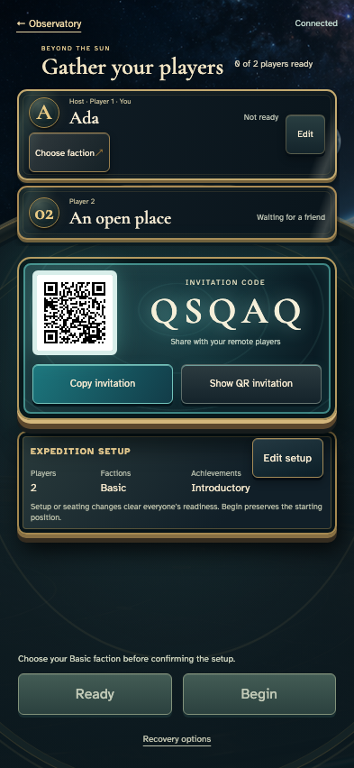](../../screenshots/resolve-separate-march-responders-and-research-the-same-public-discovery-twice/004-host-created-phone-darwin.png) | [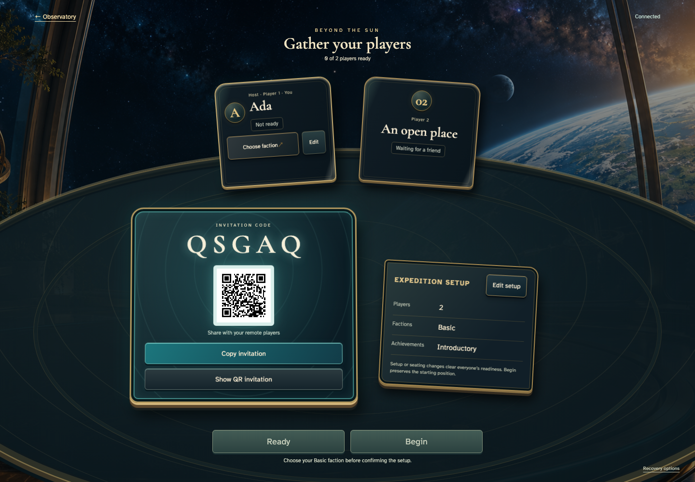](../../screenshots/resolve-separate-march-responders-and-research-the-same-public-discovery-twice/004-host-created-desktop-darwin.png) |

- [x] Create the canonical remote room and invitation
- [x] The saved automatic consequences settle before the public decision is photographed.
- [x] Public compact Technology objects retain physical separation.
- [x] The gameplay shell stays inside the actual viewport.

## 6. A separate identity previews the real invitation

Viewpoint: **Bora · independent guest controller**.

| phone · 1440 × 1000 | desktop · 393 × 852 |
| --- | --- |
| [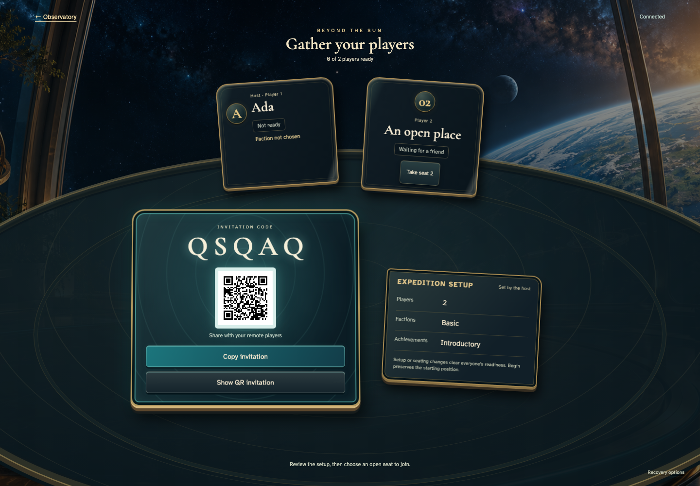](../../screenshots/resolve-separate-march-responders-and-research-the-same-public-discovery-twice/005-guest-preview-phone-darwin.png) | [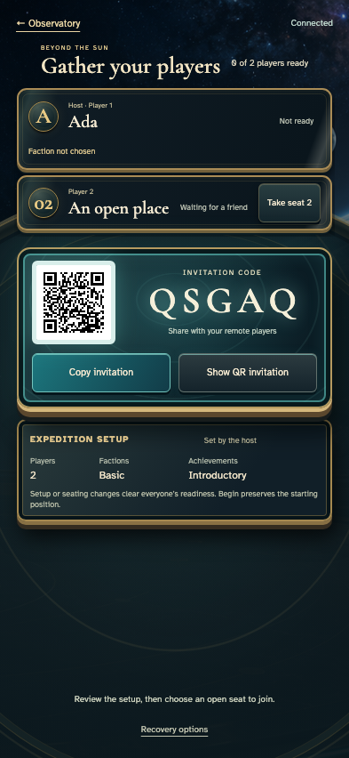](../../screenshots/resolve-separate-march-responders-and-research-the-same-public-discovery-twice/005-guest-preview-desktop-darwin.png) |

- [x] A separate identity previews the real invitation
- [x] The saved automatic consequences settle before the public decision is photographed.
- [x] Public compact Technology objects retain physical separation.
- [x] The gameplay shell stays inside the actual viewport.

## 7. The guest opens the ordinary seat editor

Viewpoint: **Bora · independent guest controller**.

| phone · 1440 × 1000 | desktop · 393 × 852 |
| --- | --- |
| [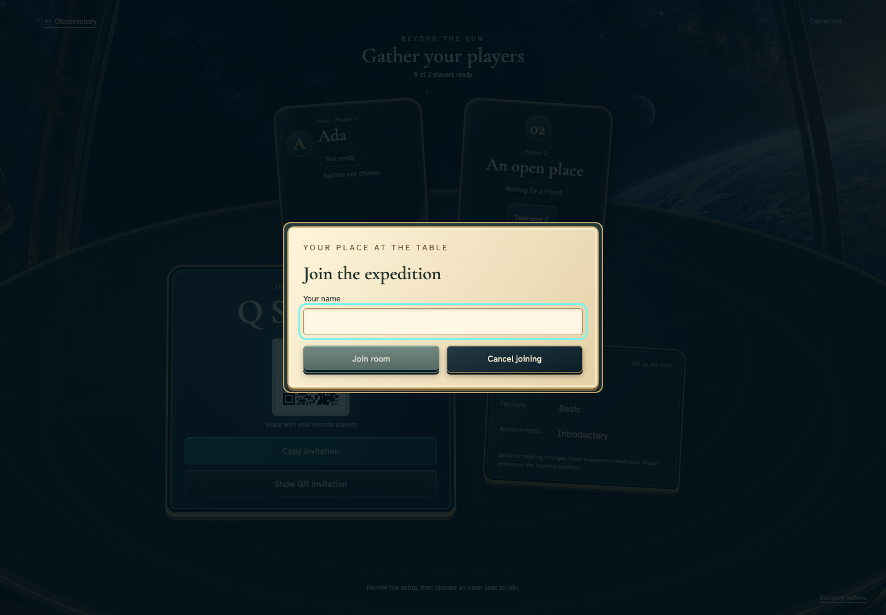](../../screenshots/resolve-separate-march-responders-and-research-the-same-public-discovery-twice/006-guest-editor-phone-darwin.png) |  |

- [x] The guest opens the ordinary seat editor
- [x] The saved automatic consequences settle before the public decision is photographed.
- [x] Public compact Technology objects retain physical separation.
- [x] The gameplay shell stays inside the actual viewport.

## 8. Name the independent guest

Viewpoint: **Bora · independent guest controller**.

| phone · 1440 × 1000 | desktop · 393 × 852 |
| --- | --- |
| [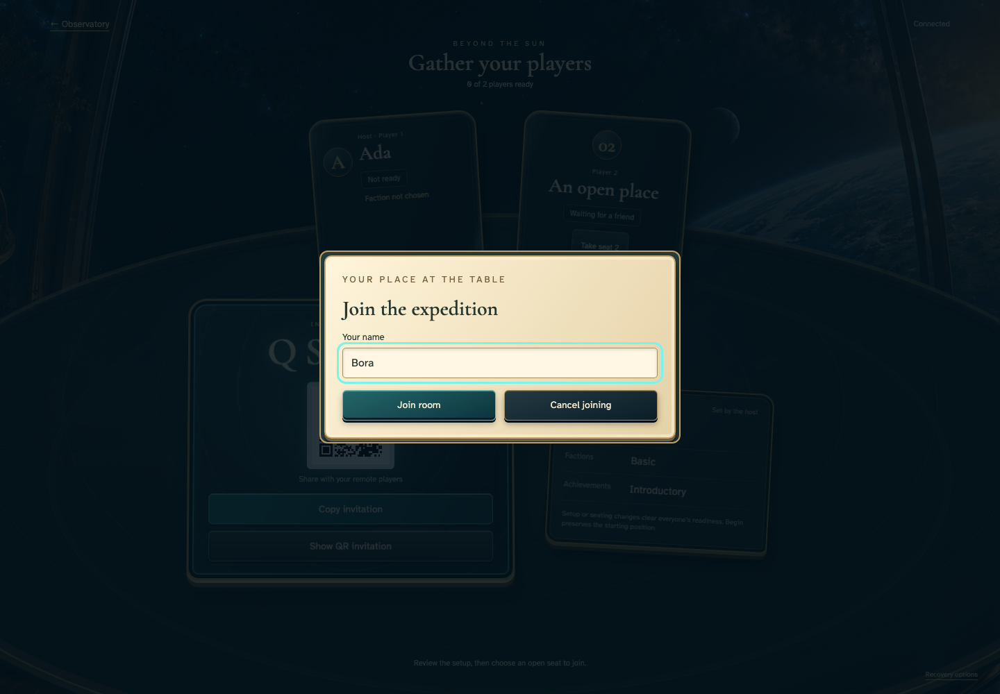](../../screenshots/resolve-separate-march-responders-and-research-the-same-public-discovery-twice/007-guest-name-phone-darwin.png) |  |

- [x] Name the independent guest
- [x] The saved automatic consequences settle before the public decision is photographed.
- [x] Public compact Technology objects retain physical separation.
- [x] The gameplay shell stays inside the actual viewport.

## 9. Bora claims their own remote seat

Viewpoint: **Bora · independent guest controller**.

| phone · 1440 × 1000 | desktop · 393 × 852 |
| --- | --- |
| [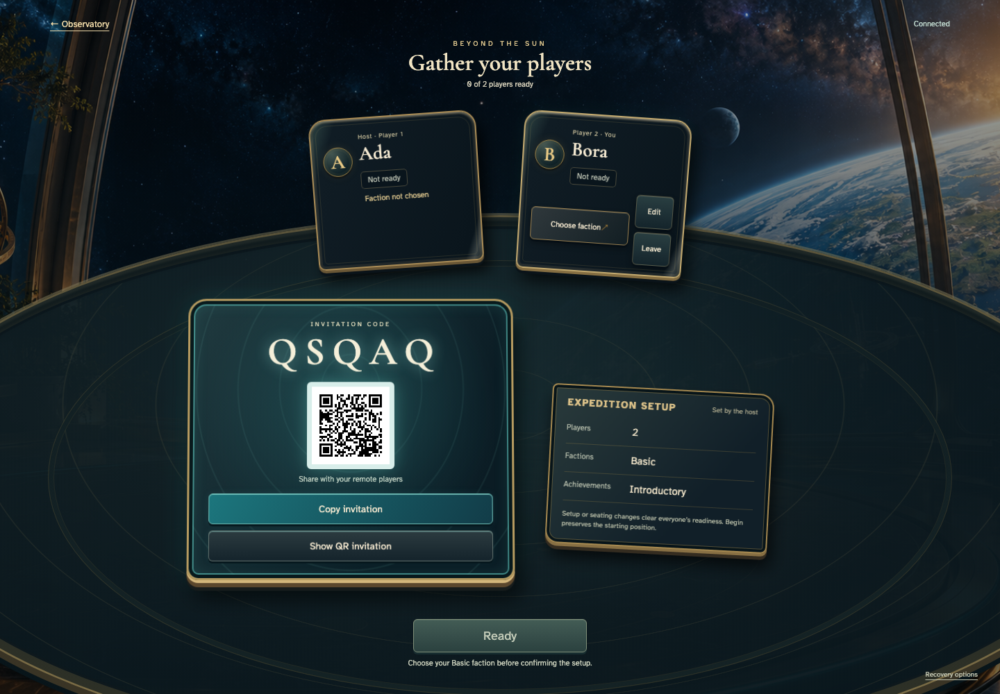](../../screenshots/resolve-separate-march-responders-and-research-the-same-public-discovery-twice/008-guest-joined-phone-darwin.png) | [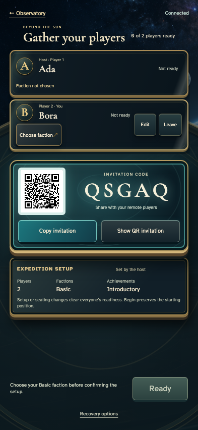](../../screenshots/resolve-separate-march-responders-and-research-the-same-public-discovery-twice/008-guest-joined-desktop-darwin.png) |

- [x] Bora claims their own remote seat
- [x] The saved automatic consequences settle before the public decision is photographed.
- [x] Public compact Technology objects retain physical separation.
- [x] The gameplay shell stays inside the actual viewport.

## 10. Ada reads the legal unique Basic factions

Viewpoint: **Ada · independent host controller**.

| phone · 393 × 852 | desktop · 1440 × 1000 |
| --- | --- |
|  |  |

- [x] Ada reads the legal unique Basic factions
- [x] The saved automatic consequences settle before the public decision is photographed.
- [x] Public compact Technology objects retain physical separation.
- [x] The gameplay shell stays inside the actual viewport.

## 11. Ada chooses their actual production faction

Viewpoint: **Ada · independent host controller**.

| phone · 393 × 852 | desktop · 1440 × 1000 |
| --- | --- |
| [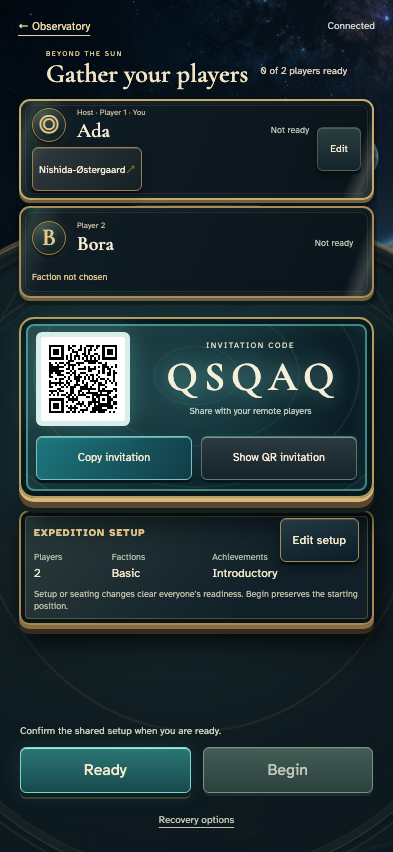](../../screenshots/resolve-separate-march-responders-and-research-the-same-public-discovery-twice/010-faction-0-chosen-phone-darwin.png) |  |

- [x] Ada chooses their actual production faction
- [x] The saved automatic consequences settle before the public decision is photographed.
- [x] Public compact Technology objects retain physical separation.
- [x] The gameplay shell stays inside the actual viewport.

## 12. Bora reads the legal unique Basic factions

Viewpoint: **Bora · independent guest controller**.

| phone · 1440 × 1000 | desktop · 393 × 852 |
| --- | --- |
|  |  |

- [x] Bora reads the legal unique Basic factions
- [x] The saved automatic consequences settle before the public decision is photographed.
- [x] Public compact Technology objects retain physical separation.
- [x] The gameplay shell stays inside the actual viewport.

## 13. Bora chooses their actual production faction

Viewpoint: **Bora · independent guest controller**.

| phone · 1440 × 1000 | desktop · 393 × 852 |
| --- | --- |
| [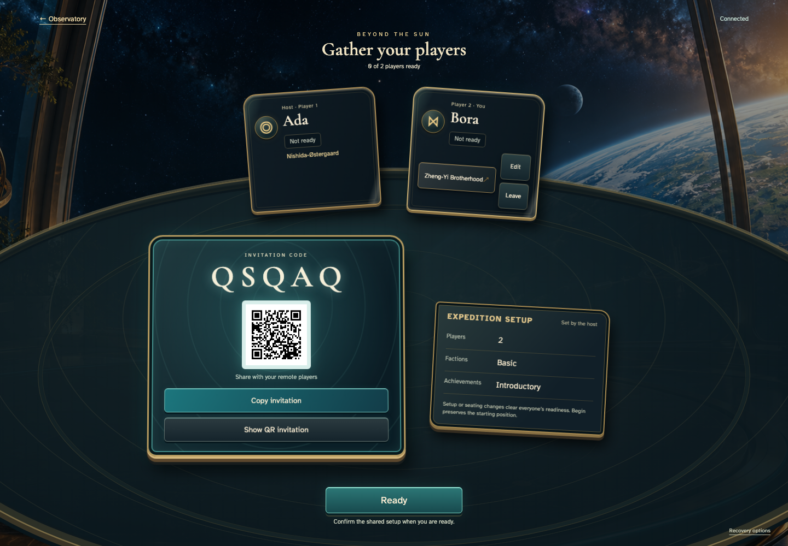](../../screenshots/resolve-separate-march-responders-and-research-the-same-public-discovery-twice/012-faction-1-chosen-phone-darwin.png) | [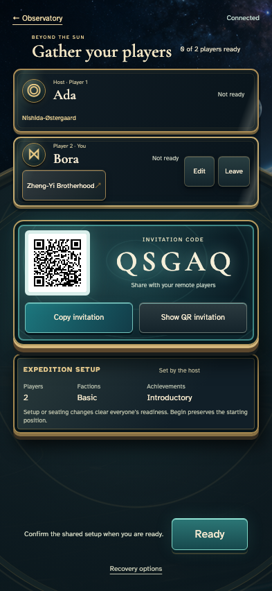](../../screenshots/resolve-separate-march-responders-and-research-the-same-public-discovery-twice/012-faction-1-chosen-desktop-darwin.png) |

- [x] Bora chooses their actual production faction
- [x] The saved automatic consequences settle before the public decision is photographed.
- [x] Public compact Technology objects retain physical separation.
- [x] The gameplay shell stays inside the actual viewport.

## 14. Ada confirms this exact configuration

Viewpoint: **Ada · independent host controller**.

| phone · 393 × 852 | desktop · 1440 × 1000 |
| --- | --- |
| [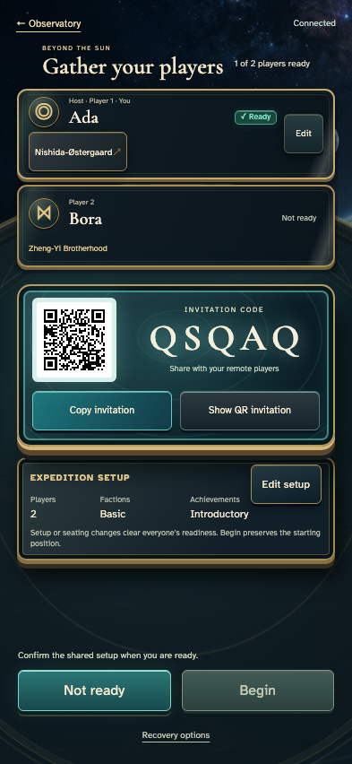](../../screenshots/resolve-separate-march-responders-and-research-the-same-public-discovery-twice/013-ready-0-phone-darwin.png) | [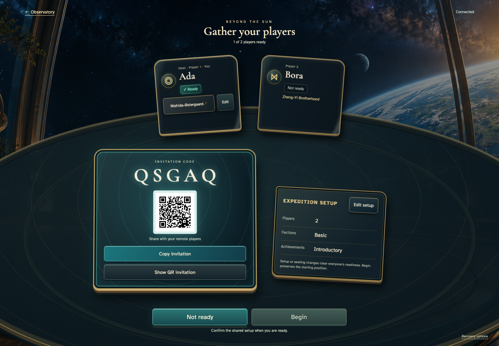](../../screenshots/resolve-separate-march-responders-and-research-the-same-public-discovery-twice/013-ready-0-desktop-darwin.png) |

- [x] Ada confirms this exact configuration
- [x] The saved automatic consequences settle before the public decision is photographed.
- [x] Public compact Technology objects retain physical separation.
- [x] The gameplay shell stays inside the actual viewport.

## 15. Bora confirms this exact configuration

Viewpoint: **Bora · independent guest controller**.

| phone · 1440 × 1000 | desktop · 393 × 852 |
| --- | --- |
|  | [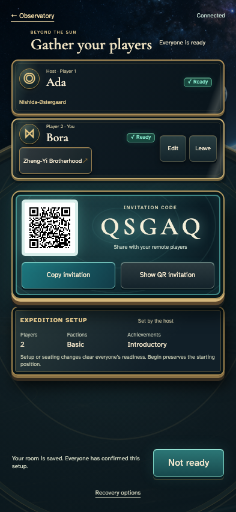](../../screenshots/resolve-separate-march-responders-and-research-the-same-public-discovery-twice/014-ready-1-desktop-darwin.png) |

- [x] Bora confirms this exact configuration
- [x] The saved automatic consequences settle before the public decision is photographed.
- [x] Public compact Technology objects retain physical separation.
- [x] The gameplay shell stays inside the actual viewport.

## 16. Begin creates the immutable seeded Basic game

Viewpoint: **Ada · independent host controller**.

| phone · 393 × 852 | desktop · 1440 × 1000 |
| --- | --- |
| [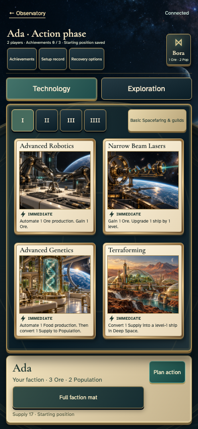](../../screenshots/resolve-separate-march-responders-and-research-the-same-public-discovery-twice/015-begun-phone-darwin.png) | [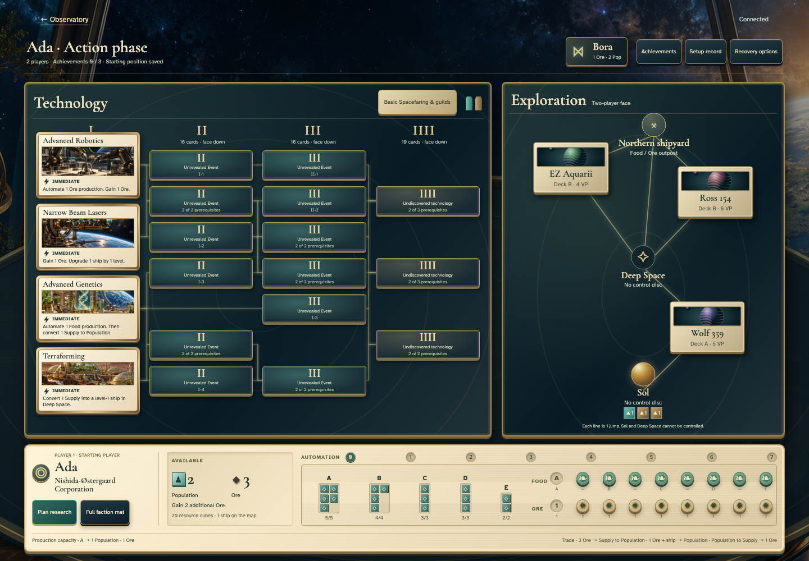](../../screenshots/resolve-separate-march-responders-and-research-the-same-public-discovery-twice/015-begun-desktop-darwin.png) |

- [x] Begin creates the immutable seeded Basic game
- [x] The saved automatic consequences settle before the public decision is photographed.
- [x] Public compact Technology objects retain physical separation.
- [x] The gameplay shell stays inside the actual viewport.

## 17. Ada plans a legal preparatory Level I turn

Viewpoint: **Ada · independent host controller**.

| phone · 393 × 852 | desktop · 1440 × 1000 |
| --- | --- |
| [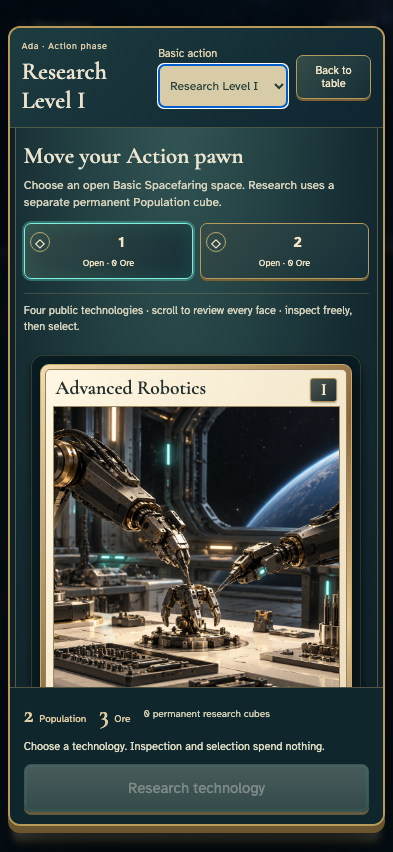](../../screenshots/resolve-separate-march-responders-and-research-the-same-public-discovery-twice/016-prep-0-plan-phone-darwin.png) |  |

- [x] Ada plans a legal preparatory Level I turn
- [x] The saved automatic consequences settle before the public decision is photographed.
- [x] Public compact Technology objects retain physical separation.
- [x] The gameplay shell stays inside the actual viewport.

## 18. Ada chooses the unoccupied printed Action space

Viewpoint: **Ada · independent host controller**.

| phone · 393 × 852 | desktop · 1440 × 1000 |
| --- | --- |
|  |  |

- [x] Ada chooses the unoccupied printed Action space
- [x] The saved automatic consequences settle before the public decision is photographed.
- [x] Public compact Technology objects retain physical separation.
- [x] The gameplay shell stays inside the actual viewport.

## 19. Ada selects the public Narrow Beam Lasers face

Viewpoint: **Ada · independent host controller**.

| phone · 393 × 852 | desktop · 1440 × 1000 |
| --- | --- |
|  | [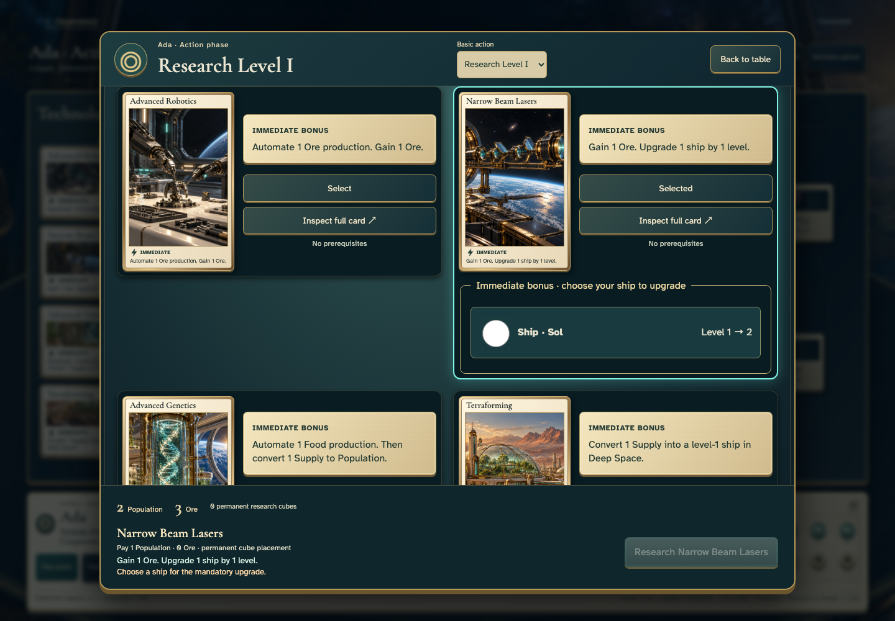](../../screenshots/resolve-separate-march-responders-and-research-the-same-public-discovery-twice/018-prep-0-card-desktop-darwin.png) |

- [x] Ada selects the public Narrow Beam Lasers face
- [x] The saved automatic consequences settle before the public decision is photographed.
- [x] Public compact Technology objects retain physical separation.
- [x] The gameplay shell stays inside the actual viewport.

## 20. Research remains disabled until an explicit owned ship is selected

Viewpoint: **Ada · independent host controller**.

| phone · 393 × 852 | desktop · 1440 × 1000 |
| --- | --- |
| [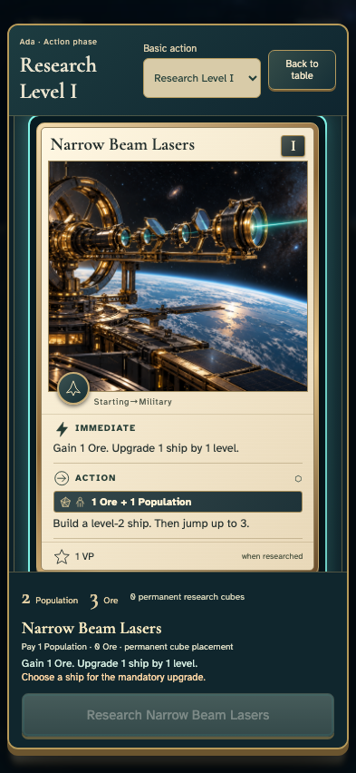](../../screenshots/resolve-separate-march-responders-and-research-the-same-public-discovery-twice/019-prep-0-target-required-phone-darwin.png) |  |

- [x] Research remains disabled until an explicit owned ship is selected
- [x] The saved automatic consequences settle before the public decision is photographed.
- [x] Public compact Technology objects retain physical separation.
- [x] The gameplay shell stays inside the actual viewport.

## 21. Ada explicitly chooses the first owned ship to upgrade

Viewpoint: **Ada · independent host controller**.

| phone · 393 × 852 | desktop · 1440 × 1000 |
| --- | --- |
|  | [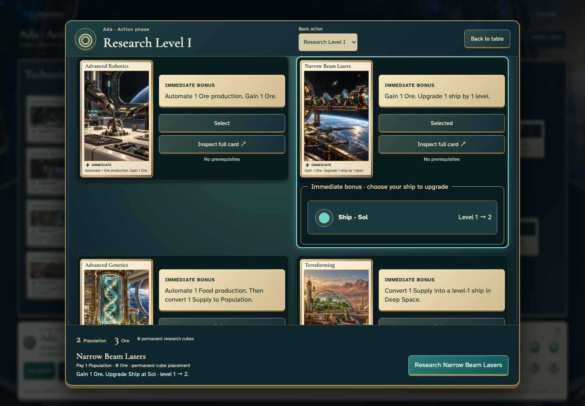](../../screenshots/resolve-separate-march-responders-and-research-the-same-public-discovery-twice/020-prep-0-target-desktop-darwin.png) |

- [x] Ada explicitly chooses the first owned ship to upgrade
- [x] The saved automatic consequences settle before the public decision is photographed.
- [x] Public compact Technology objects retain physical separation.
- [x] The gameplay shell stays inside the actual viewport.

## 22. Ada pays permanent research Population and receives the printed immediate bonus

Viewpoint: **Ada · independent host controller**.

| phone · 393 × 852 | desktop · 1440 × 1000 |
| --- | --- |
|  | [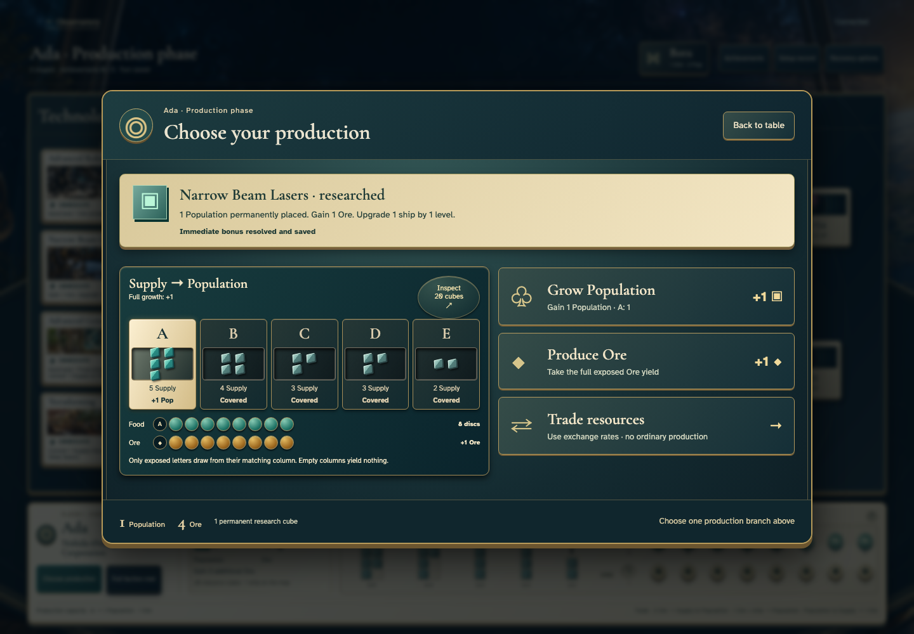](../../screenshots/resolve-separate-march-responders-and-research-the-same-public-discovery-twice/021-prep-0-paid-desktop-darwin.png) |

- [x] Ada pays permanent research Population and receives the printed immediate bonus
- [x] The saved automatic consequences settle before the public decision is photographed.
- [x] Public compact Technology objects retain physical separation.
- [x] The gameplay shell stays inside the actual viewport.

## 23. Ada completes ordinary production and hands off automatically

Viewpoint: **Ada · independent host controller**.

| phone · 393 × 852 | desktop · 1440 × 1000 |
| --- | --- |
|  | [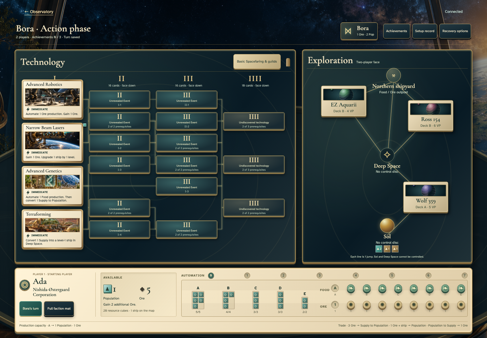](../../screenshots/resolve-separate-march-responders-and-research-the-same-public-discovery-twice/022-prep-0-handoff-desktop-darwin.png) |

- [x] Ada completes ordinary production and hands off automatically
- [x] The saved automatic consequences settle before the public decision is photographed.
- [x] Public compact Technology objects retain physical separation.
- [x] The gameplay shell stays inside the actual viewport.

## 24. The next independent controller sees the same canonical handoff

Viewpoint: **Bora · independent guest controller**.

| phone · 1440 × 1000 | desktop · 393 × 852 |
| --- | --- |
|  |  |

- [x] The next independent controller sees the same canonical handoff
- [x] The saved automatic consequences settle before the public decision is photographed.
- [x] Public compact Technology objects retain physical separation.
- [x] The gameplay shell stays inside the actual viewport.

## 25. Bora plans a legal preparatory Level I turn

Viewpoint: **Bora · independent guest controller**.

| phone · 1440 × 1000 | desktop · 393 × 852 |
| --- | --- |
| [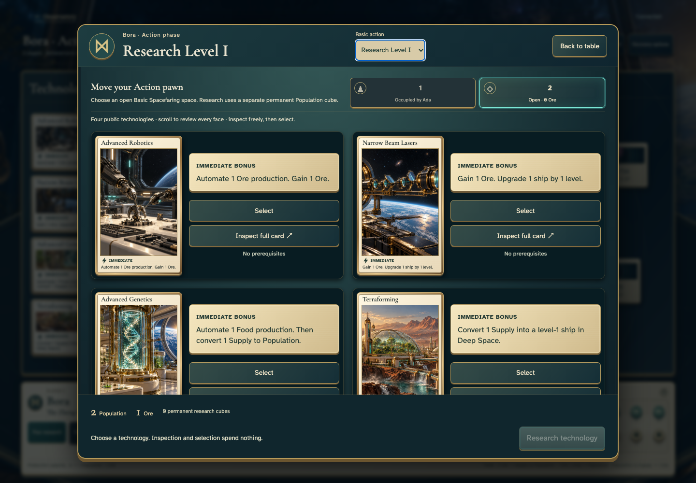](../../screenshots/resolve-separate-march-responders-and-research-the-same-public-discovery-twice/024-prep-1-plan-phone-darwin.png) |  |

- [x] Bora plans a legal preparatory Level I turn
- [x] The saved automatic consequences settle before the public decision is photographed.
- [x] Public compact Technology objects retain physical separation.
- [x] The gameplay shell stays inside the actual viewport.

## 26. Bora chooses the unoccupied printed Action space

Viewpoint: **Bora · independent guest controller**.

| phone · 1440 × 1000 | desktop · 393 × 852 |
| --- | --- |
| [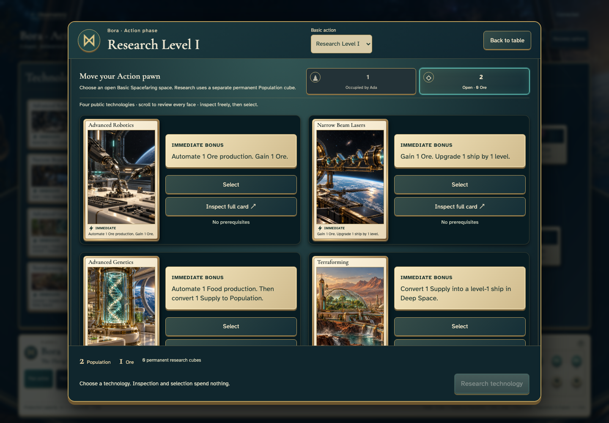](../../screenshots/resolve-separate-march-responders-and-research-the-same-public-discovery-twice/025-prep-1-space-phone-darwin.png) | [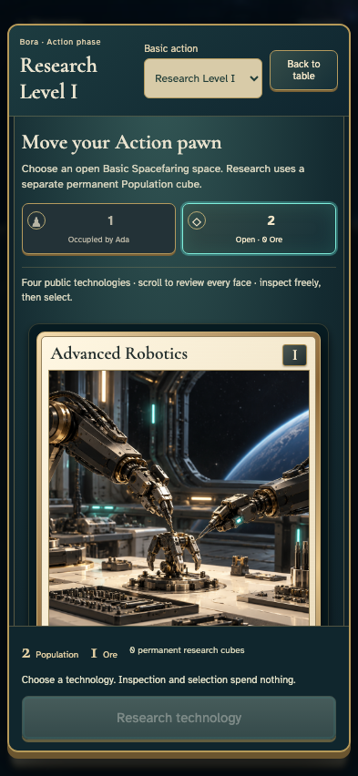](../../screenshots/resolve-separate-march-responders-and-research-the-same-public-discovery-twice/025-prep-1-space-desktop-darwin.png) |

- [x] Bora chooses the unoccupied printed Action space
- [x] The saved automatic consequences settle before the public decision is photographed.
- [x] Public compact Technology objects retain physical separation.
- [x] The gameplay shell stays inside the actual viewport.

## 27. Bora selects the public Narrow Beam Lasers face

Viewpoint: **Bora · independent guest controller**.

| phone · 1440 × 1000 | desktop · 393 × 852 |
| --- | --- |
| [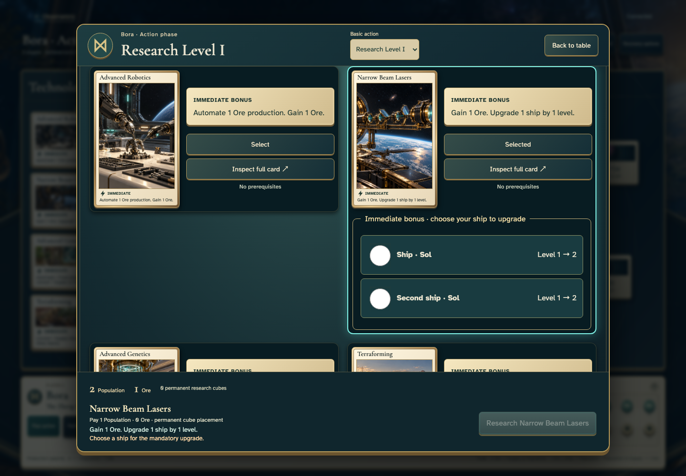](../../screenshots/resolve-separate-march-responders-and-research-the-same-public-discovery-twice/026-prep-1-card-phone-darwin.png) |  |

- [x] Bora selects the public Narrow Beam Lasers face
- [x] The saved automatic consequences settle before the public decision is photographed.
- [x] Public compact Technology objects retain physical separation.
- [x] The gameplay shell stays inside the actual viewport.

## 28. Research remains disabled until an explicit owned ship is selected

Viewpoint: **Bora · independent guest controller**.

| phone · 1440 × 1000 | desktop · 393 × 852 |
| --- | --- |
|  |  |

- [x] Research remains disabled until an explicit owned ship is selected
- [x] The saved automatic consequences settle before the public decision is photographed.
- [x] Public compact Technology objects retain physical separation.
- [x] The gameplay shell stays inside the actual viewport.

## 29. Bora explicitly chooses the first owned ship to upgrade

Viewpoint: **Bora · independent guest controller**.

| phone · 1440 × 1000 | desktop · 393 × 852 |
| --- | --- |
| [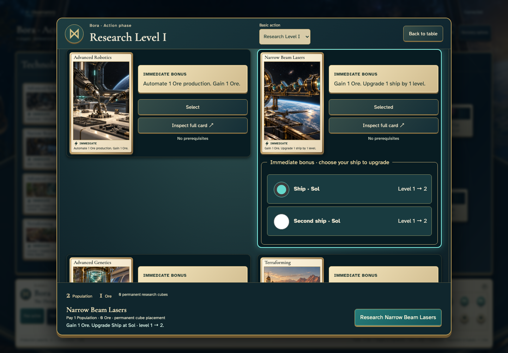](../../screenshots/resolve-separate-march-responders-and-research-the-same-public-discovery-twice/028-prep-1-target-phone-darwin.png) | [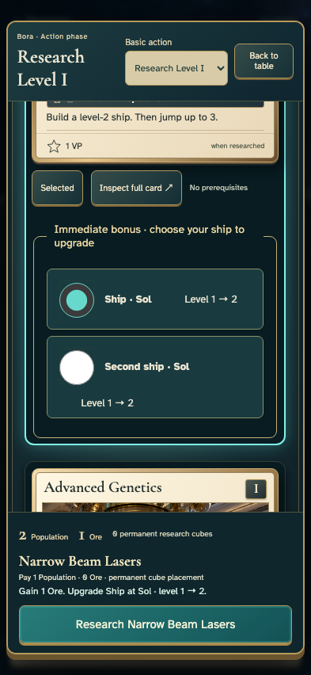](../../screenshots/resolve-separate-march-responders-and-research-the-same-public-discovery-twice/028-prep-1-target-desktop-darwin.png) |

- [x] Bora explicitly chooses the first owned ship to upgrade
- [x] The saved automatic consequences settle before the public decision is photographed.
- [x] Public compact Technology objects retain physical separation.
- [x] The gameplay shell stays inside the actual viewport.

## 30. Bora pays permanent research Population and receives the printed immediate bonus

Viewpoint: **Bora · independent guest controller**.

| phone · 1440 × 1000 | desktop · 393 × 852 |
| --- | --- |
| [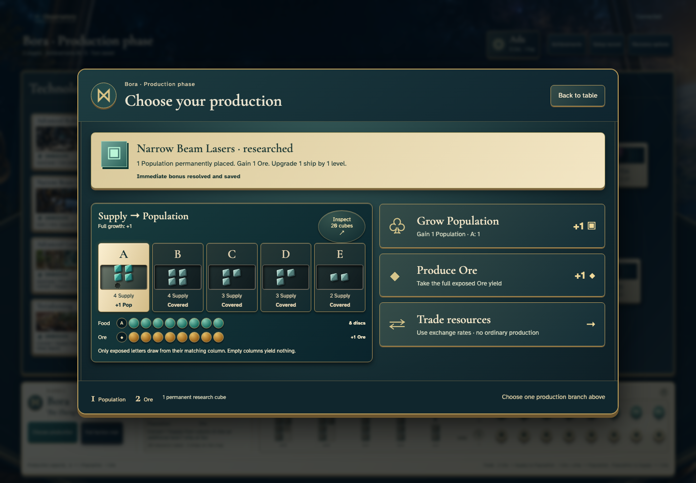](../../screenshots/resolve-separate-march-responders-and-research-the-same-public-discovery-twice/029-prep-1-paid-phone-darwin.png) | [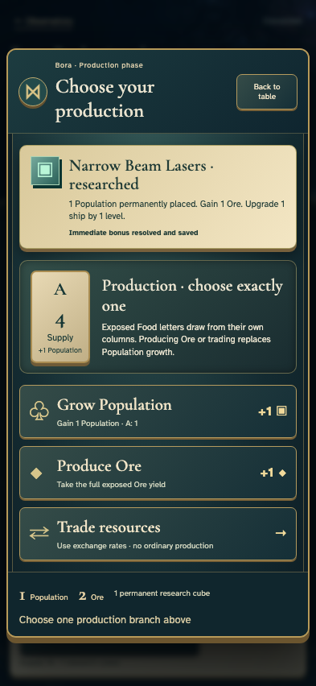](../../screenshots/resolve-separate-march-responders-and-research-the-same-public-discovery-twice/029-prep-1-paid-desktop-darwin.png) |

- [x] Bora pays permanent research Population and receives the printed immediate bonus
- [x] The saved automatic consequences settle before the public decision is photographed.
- [x] Public compact Technology objects retain physical separation.
- [x] The gameplay shell stays inside the actual viewport.

## 31. Bora completes ordinary production and hands off automatically

Viewpoint: **Bora · independent guest controller**.

| phone · 1440 × 1000 | desktop · 393 × 852 |
| --- | --- |
|  |  |

- [x] Bora completes ordinary production and hands off automatically
- [x] The saved automatic consequences settle before the public decision is photographed.
- [x] Public compact Technology objects retain physical separation.
- [x] The gameplay shell stays inside the actual viewport.

## 32. The next independent controller sees the same canonical handoff

Viewpoint: **Ada · independent host controller**.

| phone · 393 × 852 | desktop · 1440 × 1000 |
| --- | --- |
|  |  |

- [x] The next independent controller sees the same canonical handoff
- [x] The saved automatic consequences settle before the public decision is photographed.
- [x] Public compact Technology objects retain physical separation.
- [x] The gameplay shell stays inside the actual viewport.

## 33. The researcher opens the real Basic action instrument

Viewpoint: **Ada · independent host controller**.

| phone · 393 × 852 | desktop · 1440 × 1000 |
| --- | --- |
| [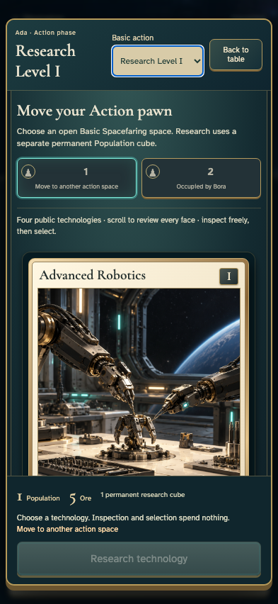](../../screenshots/resolve-separate-march-responders-and-research-the-same-public-discovery-twice/032-level-i-plan-phone-darwin.png) |  |

- [x] The researcher opens the real Basic action instrument
- [x] The saved automatic consequences settle before the public decision is photographed.
- [x] Public compact Technology objects retain physical separation.
- [x] The gameplay shell stays inside the actual viewport.

## 34. Choose Level II and inspect all six public prerequisites without revealing cards

Viewpoint: **Ada · independent host controller**.

| phone · 393 × 852 | desktop · 1440 × 1000 |
| --- | --- |
| [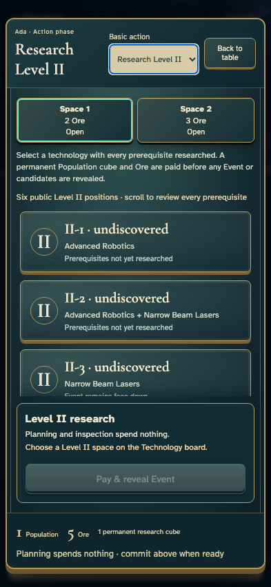](../../screenshots/resolve-separate-march-responders-and-research-the-same-public-discovery-twice/033-level-ii-plan-phone-darwin.png) |  |

- [x] Choose Level II and inspect all six public prerequisites without revealing cards
- [x] The saved automatic consequences settle before the public decision is photographed.
- [x] Public compact Technology objects retain physical separation.
- [x] The gameplay shell stays inside the actual viewport.

## 35. Select a legal undiscovered position and read its permanent Population and Ore payment

Viewpoint: **Ada · independent host controller**.

| phone · 393 × 852 | desktop · 1440 × 1000 |
| --- | --- |
| [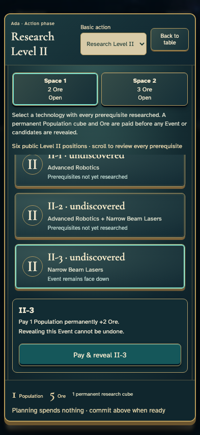](../../screenshots/resolve-separate-march-responders-and-research-the-same-public-discovery-twice/034-level-ii-target-phone-darwin.png) |  |

- [x] Select a legal undiscovered position and read its permanent Population and Ore payment
- [x] The saved automatic consequences settle before the public decision is photographed.
- [x] Public compact Technology objects retain physical separation.
- [x] The gameplay shell stays inside the actual viewport.

## 36. Payment reveals March of Progress; all Event decisions resolve before candidates

Viewpoint: **Ada · independent host controller**.

| phone · 393 × 852 | desktop · 1440 × 1000 |
| --- | --- |
|  |  |

- [x] Payment reveals March of Progress; all Event decisions resolve before candidates
- [x] The saved automatic consequences settle before the public decision is photographed.
- [x] Public compact Technology objects retain physical separation.
- [x] The gameplay shell stays inside the actual viewport.

## 37. Ada reads and owns this public Event decision

Viewpoint: **Ada · independent host controller**.

| phone · 393 × 852 | desktop · 1440 × 1000 |
| --- | --- |
| [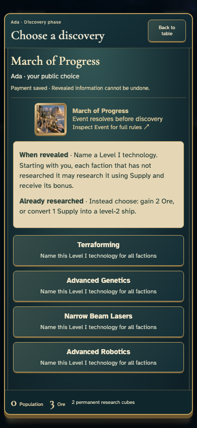](../../screenshots/resolve-separate-march-responders-and-research-the-same-public-discovery-twice/036-march-named-choice-phone-darwin.png) | [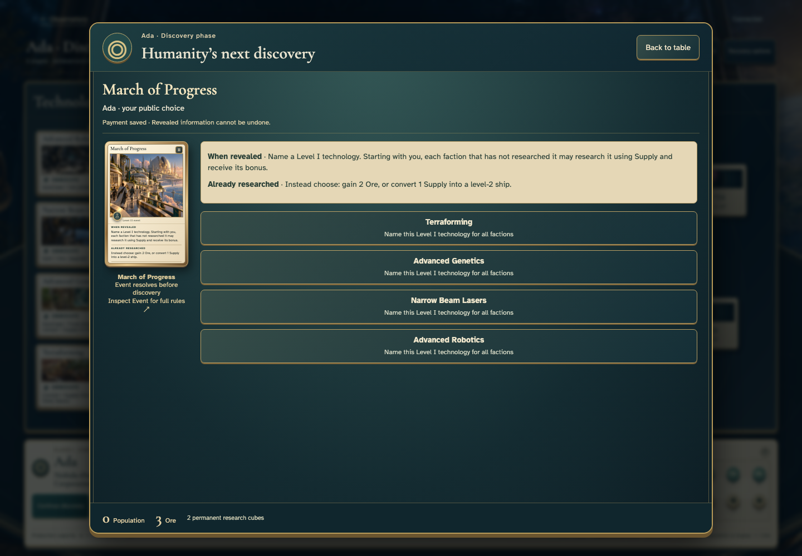](../../screenshots/resolve-separate-march-responders-and-research-the-same-public-discovery-twice/036-march-named-choice-desktop-darwin.png) |

- [x] Ada reads and owns this public Event decision
- [x] The saved automatic consequences settle before the public decision is photographed.
- [x] Public compact Technology objects retain physical separation.
- [x] The gameplay shell stays inside the actual viewport.

## 38. Name the printed Level I technology for every responding faction

Viewpoint: **Ada · independent host controller**.

| phone · 393 × 852 | desktop · 1440 × 1000 |
| --- | --- |
|  |  |

- [x] Name the printed Level I technology for every responding faction
- [x] The saved automatic consequences settle before the public decision is photographed.
- [x] Public compact Technology objects retain physical separation.
- [x] The gameplay shell stays inside the actual viewport.

## 39. Ada reads and owns this public Event decision

Viewpoint: **Ada · independent host controller**.

| phone · 393 × 852 | desktop · 1440 × 1000 |
| --- | --- |
|  |  |

- [x] Ada reads and owns this public Event decision
- [x] The saved automatic consequences settle before the public decision is photographed.
- [x] Public compact Technology objects retain physical separation.
- [x] The gameplay shell stays inside the actual viewport.

## 40. Ada commits her own once-only March of Progress response

Viewpoint: **Ada · independent host controller**.

| phone · 393 × 852 | desktop · 1440 × 1000 |
| --- | --- |
| [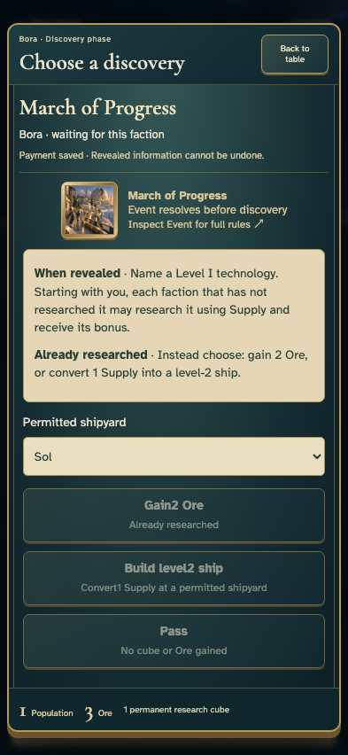](../../screenshots/resolve-separate-march-responders-and-research-the-same-public-discovery-twice/039-march-ada-saved-phone-darwin.png) | [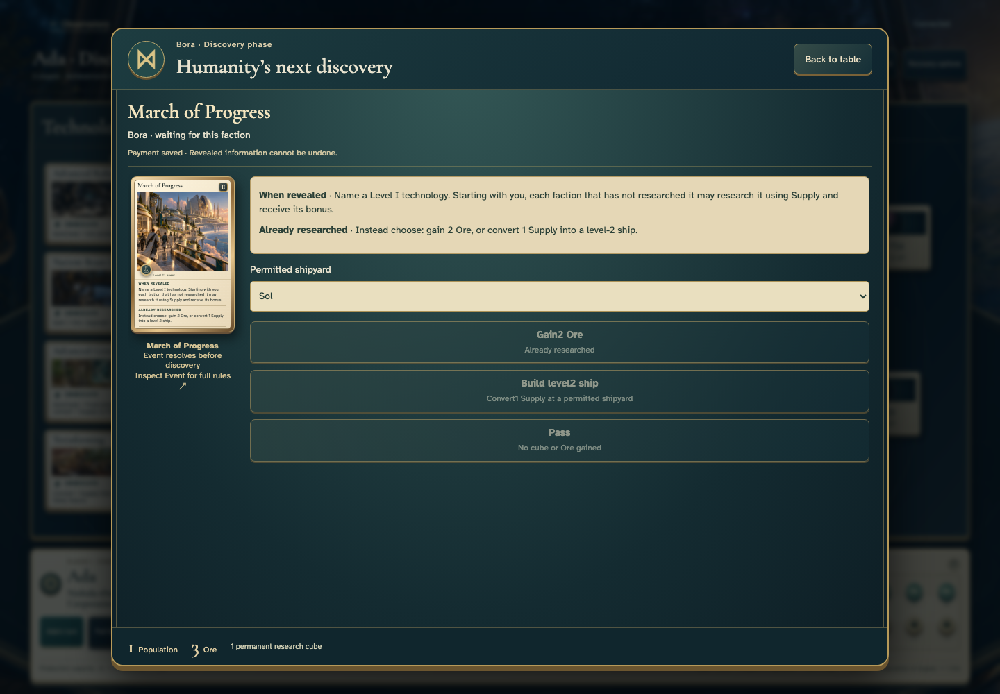](../../screenshots/resolve-separate-march-responders-and-research-the-same-public-discovery-twice/039-march-ada-saved-desktop-darwin.png) |

- [x] Ada commits her own once-only March of Progress response
- [x] The saved automatic consequences settle before the public decision is photographed.
- [x] Public compact Technology objects retain physical separation.
- [x] The gameplay shell stays inside the actual viewport.

## 41. Bora opens their saved public discovery decision

Viewpoint: **Bora · independent guest controller**.

| phone · 1440 × 1000 | desktop · 393 × 852 |
| --- | --- |
|  |  |

- [x] Bora opens their saved public discovery decision
- [x] The saved automatic consequences settle before the public decision is photographed.
- [x] Public compact Technology objects retain physical separation.
- [x] The gameplay shell stays inside the actual viewport.

## 42. Bora reads and owns this public Event decision

Viewpoint: **Bora · independent guest controller**.

| phone · 1440 × 1000 | desktop · 393 × 852 |
| --- | --- |
|  | [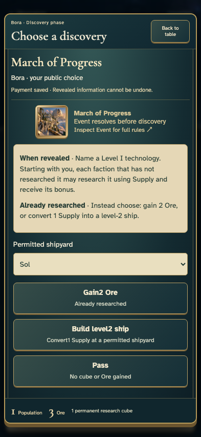](../../screenshots/resolve-separate-march-responders-and-research-the-same-public-discovery-twice/041-march-bora-choice-desktop-darwin.png) |

- [x] Bora reads and owns this public Event decision
- [x] The saved automatic consequences settle before the public decision is photographed.
- [x] Public compact Technology objects retain physical separation.
- [x] The gameplay shell stays inside the actual viewport.

## 43. Bora independently commits the printed Ore or Supply-to-ship response

Viewpoint: **Bora · independent guest controller**.

| phone · 1440 × 1000 | desktop · 393 × 852 |
| --- | --- |
| [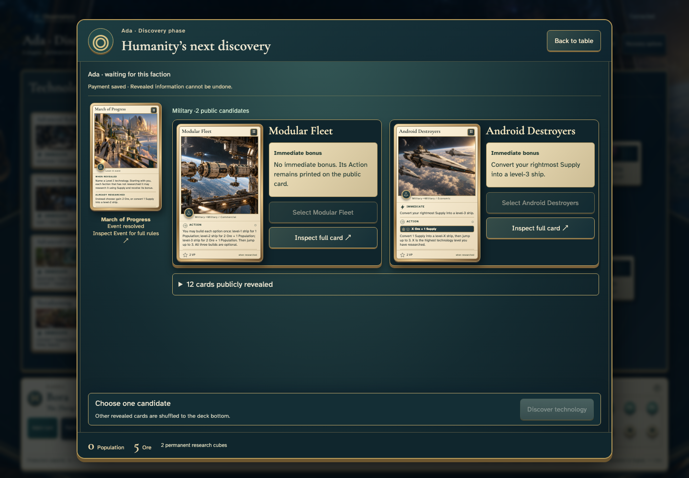](../../screenshots/resolve-separate-march-responders-and-research-the-same-public-discovery-twice/042-march-bora-saved-phone-darwin.png) |  |

- [x] Bora independently commits the printed Ore or Supply-to-ship response
- [x] The saved automatic consequences settle before the public decision is photographed.
- [x] Public compact Technology objects retain physical separation.
- [x] The gameplay shell stays inside the actual viewport.

## 44. The public candidates appear only after the entire Event and type choice

Viewpoint: **Ada · independent host controller**.

| phone · 393 × 852 | desktop · 1440 × 1000 |
| --- | --- |
|  |  |

- [x] The public candidates appear only after the entire Event and type choice
- [x] The saved automatic consequences settle before the public decision is photographed.
- [x] Public compact Technology objects retain physical separation.
- [x] The gameplay shell stays inside the actual viewport.

## 45. The separate guest sees the same public discovery without research authority

Viewpoint: **Bora · independent guest controller**.

| phone · 1440 × 1000 | desktop · 393 × 852 |
| --- | --- |
|  | [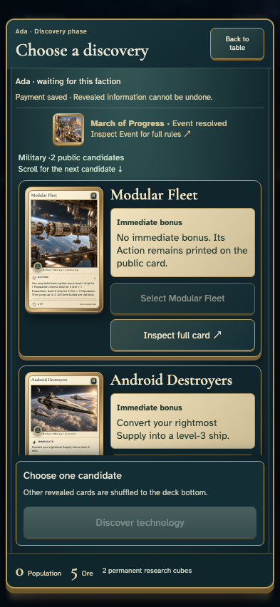](../../screenshots/resolve-separate-march-responders-and-research-the-same-public-discovery-twice/044-observer-candidates-desktop-darwin.png) |

- [x] The separate guest sees the same public discovery without research authority
- [x] The saved automatic consequences settle before the public decision is photographed.
- [x] Public compact Technology objects retain physical separation.
- [x] The gameplay shell stays inside the actual viewport.

## 46. Observation does not acquire the researching faction or its controls

Viewpoint: **Bora · independent guest controller**.

| phone · 1440 × 1000 | desktop · 393 × 852 |
| --- | --- |
| [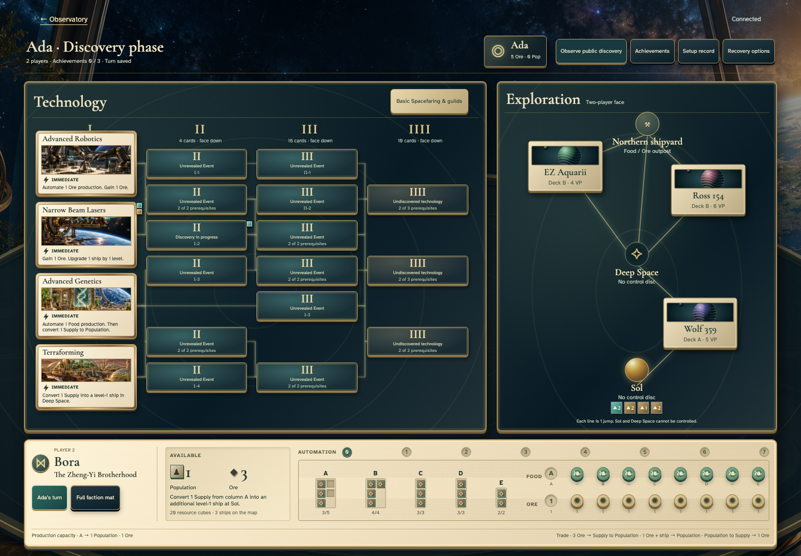](../../screenshots/resolve-separate-march-responders-and-research-the-same-public-discovery-twice/045-observer-return-phone-darwin.png) | [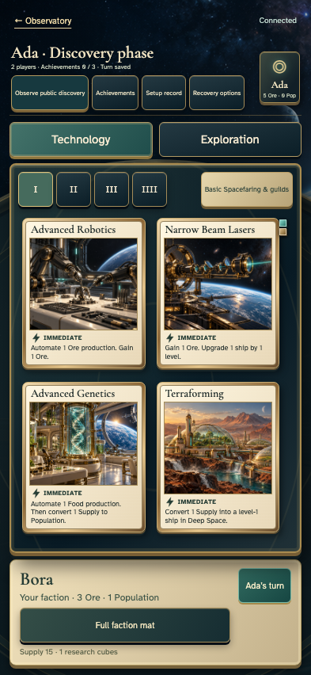](../../screenshots/resolve-separate-march-responders-and-research-the-same-public-discovery-twice/045-observer-return-desktop-darwin.png) |

- [x] Observation does not acquire the researching faction or its controls
- [x] The saved automatic consequences settle before the public decision is photographed.
- [x] Public compact Technology objects retain physical separation.
- [x] The gameplay shell stays inside the actual viewport.

## 47. Inspect the complete canonical Modular Fleet face

Viewpoint: **Ada · independent host controller**.

| phone · 393 × 852 | desktop · 1440 × 1000 |
| --- | --- |
| [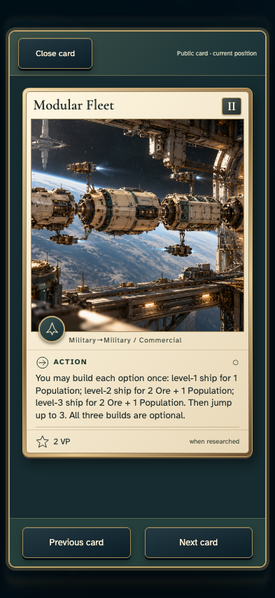](../../screenshots/resolve-separate-march-responders-and-research-the-same-public-discovery-twice/046-candidate-inspected-phone-darwin.png) | [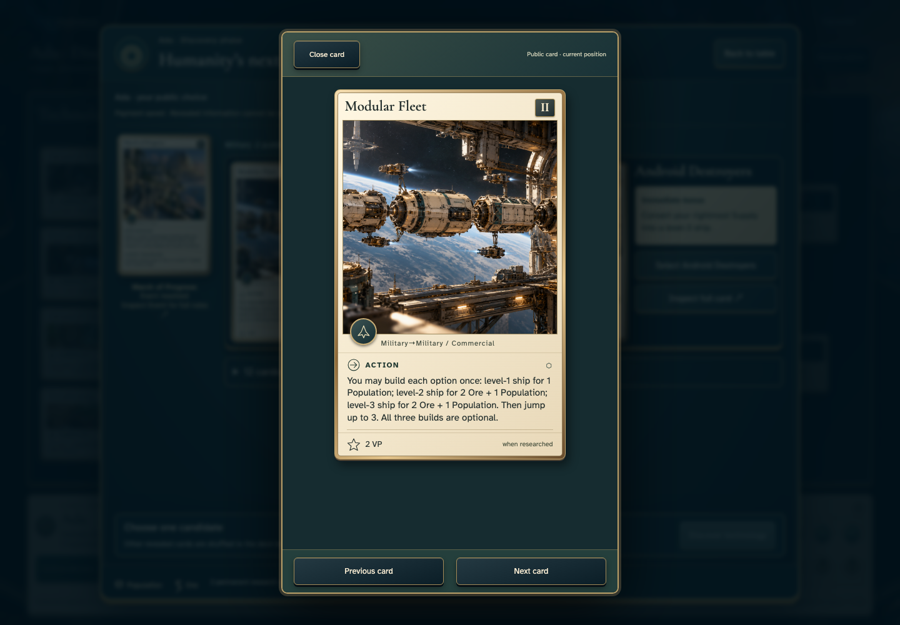](../../screenshots/resolve-separate-march-responders-and-research-the-same-public-discovery-twice/046-candidate-inspected-desktop-darwin.png) |

- [x] Inspect the complete canonical Modular Fleet face
- [x] The saved automatic consequences settle before the public decision is photographed.
- [x] Public compact Technology objects retain physical separation.
- [x] The gameplay shell stays inside the actual viewport.

## 48. Read the complete face through its bounded full-size inspector

Viewpoint: **Ada · independent host controller**.

| phone · 393 × 852 | desktop · 1440 × 1000 |
| --- | --- |
|  |  |

- [x] Read the complete face through its bounded full-size inspector
- [x] The saved automatic consequences settle before the public decision is photographed.
- [x] Public compact Technology objects retain physical separation.
- [x] The gameplay shell stays inside the actual viewport.

## 49. Escape returns keyboard focus to the actual inspection source

Viewpoint: **Ada · independent host controller**.

| phone · 393 × 852 | desktop · 1440 × 1000 |
| --- | --- |
| [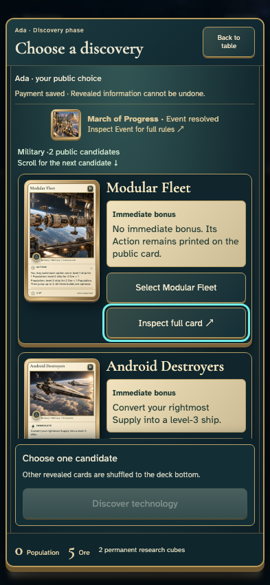](../../screenshots/resolve-separate-march-responders-and-research-the-same-public-discovery-twice/048-candidate-inspected-return-phone-darwin.png) |  |

- [x] Escape returns keyboard focus to the actual inspection source
- [x] The saved automatic consequences settle before the public decision is photographed.
- [x] Public compact Technology objects retain physical separation.
- [x] The gameplay shell stays inside the actual viewport.

## 50. Reload retains the same revealed candidate set and research reservation

Viewpoint: **Ada · independent host controller**.

| phone · 393 × 852 | desktop · 1440 × 1000 |
| --- | --- |
| [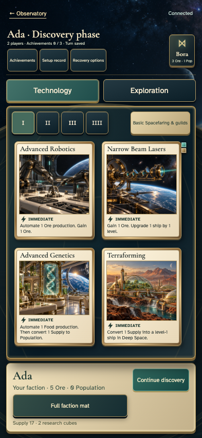](../../screenshots/resolve-separate-march-responders-and-research-the-same-public-discovery-twice/049-candidates-pending-restored-phone-darwin.png) | [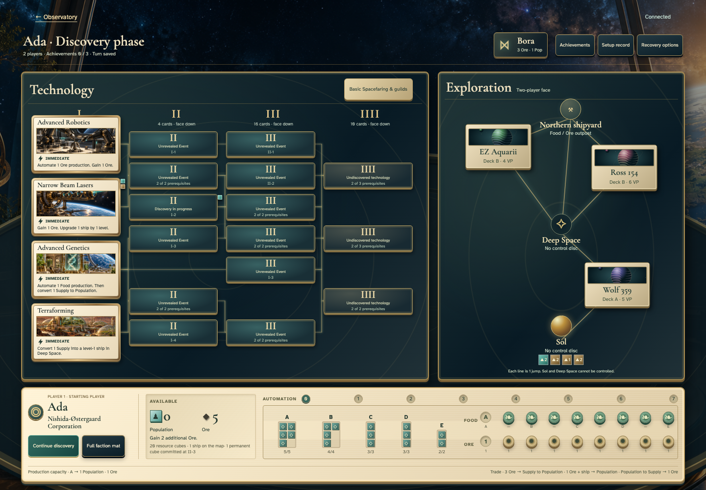](../../screenshots/resolve-separate-march-responders-and-research-the-same-public-discovery-twice/049-candidates-pending-restored-desktop-darwin.png) |

- [x] Reload retains the same revealed candidate set and research reservation
- [x] The saved automatic consequences settle before the public decision is photographed.
- [x] Public compact Technology objects retain physical separation.
- [x] The gameplay shell stays inside the actual viewport.

## 51. Ada opens their saved public discovery decision

Viewpoint: **Ada · independent host controller**.

| phone · 393 × 852 | desktop · 1440 × 1000 |
| --- | --- |
| [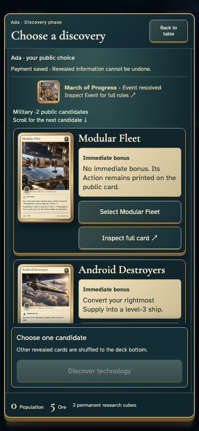](../../screenshots/resolve-separate-march-responders-and-research-the-same-public-discovery-twice/050-candidates-reopened-phone-darwin.png) |  |

- [x] Ada opens their saved public discovery decision
- [x] The saved automatic consequences settle before the public decision is photographed.
- [x] Public compact Technology objects retain physical separation.
- [x] The gameplay shell stays inside the actual viewport.

## 52. No reroll, new payment or replacement candidate appears on recovery

Viewpoint: **Ada · independent host controller**.

| phone · 393 × 852 | desktop · 1440 × 1000 |
| --- | --- |
|  |  |

- [x] No reroll, new payment or replacement candidate appears on recovery
- [x] The saved automatic consequences settle before the public decision is photographed.
- [x] Public compact Technology objects retain physical separation.
- [x] The gameplay shell stays inside the actual viewport.

## 53. The selected identity and immediate consequence remain beside the commit control

Viewpoint: **Ada · independent host controller**.

| phone · 393 × 852 | desktop · 1440 × 1000 |
| --- | --- |
| [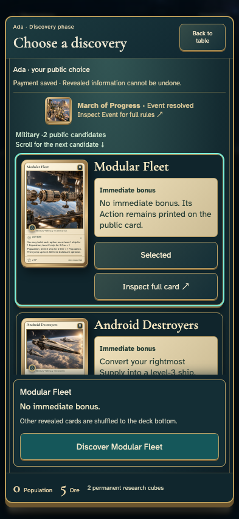](../../screenshots/resolve-separate-march-responders-and-research-the-same-public-discovery-twice/052-candidate-selected-phone-darwin.png) | [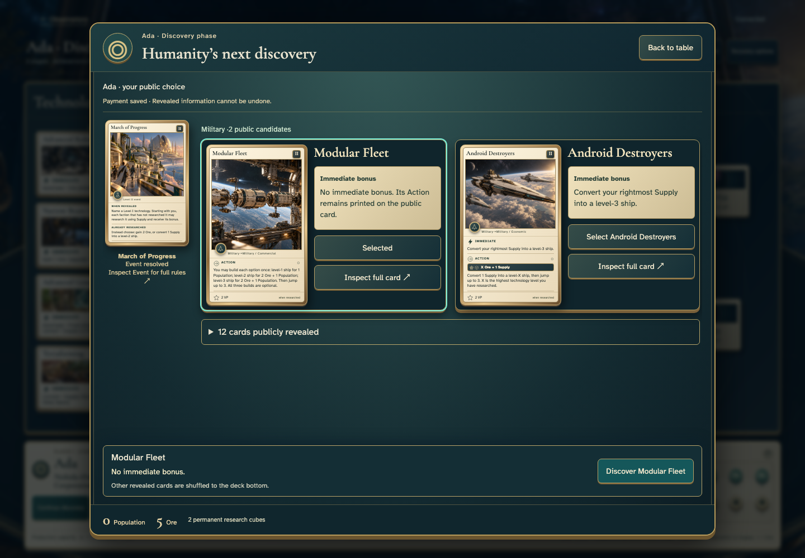](../../screenshots/resolve-separate-march-responders-and-research-the-same-public-discovery-twice/052-candidate-selected-desktop-darwin.png) |

- [x] The selected identity and immediate consequence remain beside the commit control
- [x] The saved automatic consequences settle before the public decision is photographed.
- [x] Public compact Technology objects retain physical separation.
- [x] The gameplay shell stays inside the actual viewport.

## 54. The saved discovery and its complete immediate bonus resume ordinary Production

Viewpoint: **Ada · independent host controller**.

| phone · 393 × 852 | desktop · 1440 × 1000 |
| --- | --- |
|  |  |

- [x] The saved discovery and its complete immediate bonus resume ordinary Production
- [x] The saved automatic consequences settle before the public decision is photographed.
- [x] Public compact Technology objects retain physical separation.
- [x] The gameplay shell stays inside the actual viewport.

## 55. Reload preserves the discovered technology and pending Production without duplicating the bonus

Viewpoint: **Ada · independent host controller**.

| phone · 393 × 852 | desktop · 1440 × 1000 |
| --- | --- |
|  |  |

- [x] Reload preserves the discovered technology and pending Production without duplicating the bonus
- [x] The saved automatic consequences settle before the public decision is photographed.
- [x] Public compact Technology objects retain physical separation.
- [x] The gameplay shell stays inside the actual viewport.

## 56. Resume the same exclusive production decision

Viewpoint: **Ada · independent host controller**.

| phone · 393 × 852 | desktop · 1440 × 1000 |
| --- | --- |
|  |  |

- [x] Resume the same exclusive production decision
- [x] The saved automatic consequences settle before the public decision is photographed.
- [x] Public compact Technology objects retain physical separation.
- [x] The gameplay shell stays inside the actual viewport.

## 57. Ada completes ordinary production and hands off automatically

Viewpoint: **Ada · independent host controller**.

| phone · 393 × 852 | desktop · 1440 × 1000 |
| --- | --- |
|  |  |

- [x] Ada completes ordinary production and hands off automatically
- [x] The saved automatic consequences settle before the public decision is photographed.
- [x] Public compact Technology objects retain physical separation.
- [x] The gameplay shell stays inside the actual viewport.

## 58. The next independent controller sees the same canonical handoff

Viewpoint: **Bora · independent guest controller**.

| phone · 1440 × 1000 | desktop · 393 × 852 |
| --- | --- |
|  |  |

- [x] The next independent controller sees the same canonical handoff
- [x] The saved automatic consequences settle before the public decision is photographed.
- [x] Public compact Technology objects retain physical separation.
- [x] The gameplay shell stays inside the actual viewport.

## 59. Reload retains the discovered public card, permanent research and canonical Bora handoff

Viewpoint: **Ada · independent host controller**.

| phone · 393 × 852 | desktop · 1440 × 1000 |
| --- | --- |
|  |  |

- [x] Reload retains the discovered public card, permanent research and canonical Bora handoff
- [x] The saved automatic consequences settle before the public decision is photographed.
- [x] Public compact Technology objects retain physical separation.
- [x] The gameplay shell stays inside the actual viewport.

## 60. Bora can research the actual shared discovery after meeting its printed prerequisite

Viewpoint: **Bora · independent guest controller**.

| phone · 1440 × 1000 | desktop · 393 × 852 |
| --- | --- |
|  |  |

- [x] Bora can research the actual shared discovery after meeting its printed prerequisite
- [x] The saved automatic consequences settle before the public decision is photographed.
- [x] Public compact Technology objects retain physical separation.
- [x] The gameplay shell stays inside the actual viewport.

## 61. The first Level II space is occupied by Ada; the second has its printed surcharge

Viewpoint: **Bora · independent guest controller**.

| phone · 1440 × 1000 | desktop · 393 × 852 |
| --- | --- |
|  |  |

- [x] The first Level II space is occupied by Ada; the second has its printed surcharge
- [x] The saved automatic consequences settle before the public decision is photographed.
- [x] Public compact Technology objects retain physical separation.
- [x] The gameplay shell stays inside the actual viewport.

## 62. Bora explicitly chooses the legal three-Ore second action space

Viewpoint: **Bora · independent guest controller**.

| phone · 1440 × 1000 | desktop · 393 × 852 |
| --- | --- |
|  |  |

- [x] Bora explicitly chooses the legal three-Ore second action space
- [x] The saved automatic consequences settle before the public decision is photographed.
- [x] Public compact Technology objects retain physical separation.
- [x] The gameplay shell stays inside the actual viewport.

## 63. Select the existing Modular Fleet; no future Event or deck is revealed

Viewpoint: **Bora · independent guest controller**.

| phone · 1440 × 1000 | desktop · 393 × 852 |
| --- | --- |
|  |  |

- [x] Select the existing Modular Fleet; no future Event or deck is revealed
- [x] The saved automatic consequences settle before the public decision is photographed.
- [x] Public compact Technology objects retain physical separation.
- [x] The gameplay shell stays inside the actual viewport.

## 64. Bora pays once and receives the existing card without repeating the discovery Event

Viewpoint: **Bora · independent guest controller**.

| phone · 1440 × 1000 | desktop · 393 × 852 |
| --- | --- |
|  |  |

- [x] Bora pays once and receives the existing card without repeating the discovery Event
- [x] The saved automatic consequences settle before the public decision is photographed.
- [x] Public compact Technology objects retain physical separation.
- [x] The gameplay shell stays inside the actual viewport.

## 65. Bora completes ordinary production and hands off automatically

Viewpoint: **Bora · independent guest controller**.

| phone · 1440 × 1000 | desktop · 393 × 852 |
| --- | --- |
|  |  |

- [x] Bora completes ordinary production and hands off automatically
- [x] The saved automatic consequences settle before the public decision is photographed.
- [x] Public compact Technology objects retain physical separation.
- [x] The gameplay shell stays inside the actual viewport.

## 66. The next independent controller sees the same canonical handoff

Viewpoint: **Ada · independent host controller**.

| phone · 393 × 852 | desktop · 1440 × 1000 |
| --- | --- |
|  |  |

- [x] The next independent controller sees the same canonical handoff
- [x] The saved automatic consequences settle before the public decision is photographed.
- [x] Public compact Technology objects retain physical separation.
- [x] The gameplay shell stays inside the actual viewport.
