# Retain resource-cube rerolls and complete the mandatory upgrade and optional bonus

Ordinary UI setup and legal preparatory turns; two independent remote identities, no state injection. Fixed initial entropy selects documented base-game seed 55555555-5555-4555-8555-000000000002. Every visible decision/input/result uses TestStepHelper. Revealed Events, candidates and mandatory bonuses remain on the canonical persisted queue. Printed technology Actions are inspectable; later-phase turn actions are not implemented by this increment.

## 1. Arrive through the actual observatory

Viewpoint: **Ada · independent host controller**.

| phone · 393 × 852 | desktop · 1440 × 1000 |
| --- | --- |
| [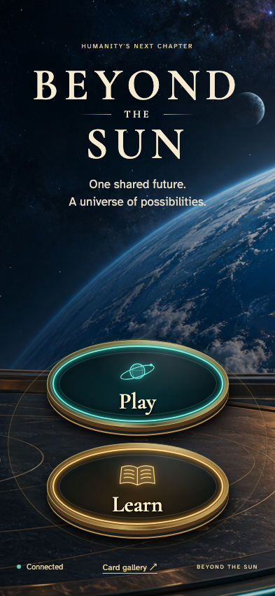](../../screenshots/retain-resource-cube-rerolls-and-complete-the-mandatory-upgrade-and-optional-bonus/000-arrival-phone-darwin.png) |  |

- [x] Arrive through the actual observatory
- [x] The saved automatic consequences settle before the public decision is photographed.
- [x] Public compact Technology objects retain physical separation.
- [x] The gameplay shell stays inside the actual viewport.

## 2. Choose the intended production interface

Viewpoint: **Ada · independent host controller**.

| phone · 393 × 852 | desktop · 1440 × 1000 |
| --- | --- |
|  |  |

- [x] Choose the intended production interface
- [x] The saved automatic consequences settle before the public decision is photographed.
- [x] Public compact Technology objects retain physical separation.
- [x] The gameplay shell stays inside the actual viewport.

## 3. Configure a real two-player remote room

Viewpoint: **Ada · independent host controller**.

| phone · 393 × 852 | desktop · 1440 × 1000 |
| --- | --- |
|  |  |

- [x] Configure a real two-player remote room
- [x] The saved automatic consequences settle before the public decision is photographed.
- [x] Public compact Technology objects retain physical separation.
- [x] The gameplay shell stays inside the actual viewport.

## 4. Name the host before creating the room

Viewpoint: **Ada · independent host controller**.

| phone · 393 × 852 | desktop · 1440 × 1000 |
| --- | --- |
|  |  |

- [x] Name the host before creating the room
- [x] The saved automatic consequences settle before the public decision is photographed.
- [x] Public compact Technology objects retain physical separation.
- [x] The gameplay shell stays inside the actual viewport.

## 5. Create the canonical remote room and invitation

Viewpoint: **Ada · independent host controller**.

| phone · 393 × 852 | desktop · 1440 × 1000 |
| --- | --- |
| [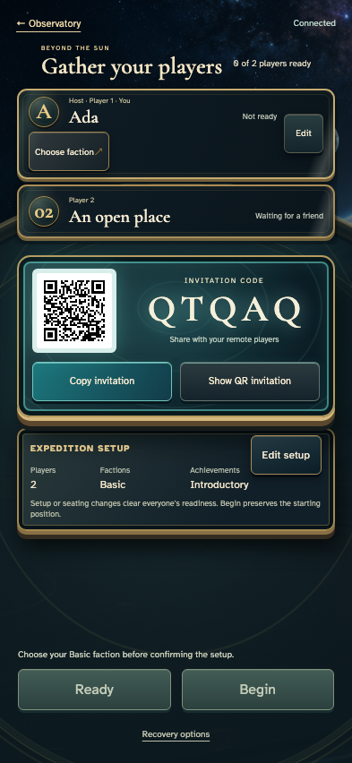](../../screenshots/retain-resource-cube-rerolls-and-complete-the-mandatory-upgrade-and-optional-bonus/004-host-created-phone-darwin.png) | [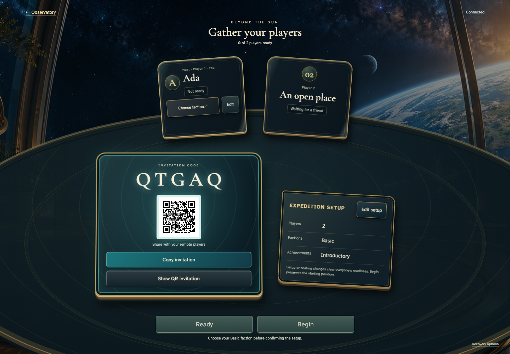](../../screenshots/retain-resource-cube-rerolls-and-complete-the-mandatory-upgrade-and-optional-bonus/004-host-created-desktop-darwin.png) |

- [x] Create the canonical remote room and invitation
- [x] The saved automatic consequences settle before the public decision is photographed.
- [x] Public compact Technology objects retain physical separation.
- [x] The gameplay shell stays inside the actual viewport.

## 6. A separate identity previews the real invitation

Viewpoint: **Bora · independent guest controller**.

| phone · 1440 × 1000 | desktop · 393 × 852 |
| --- | --- |
| [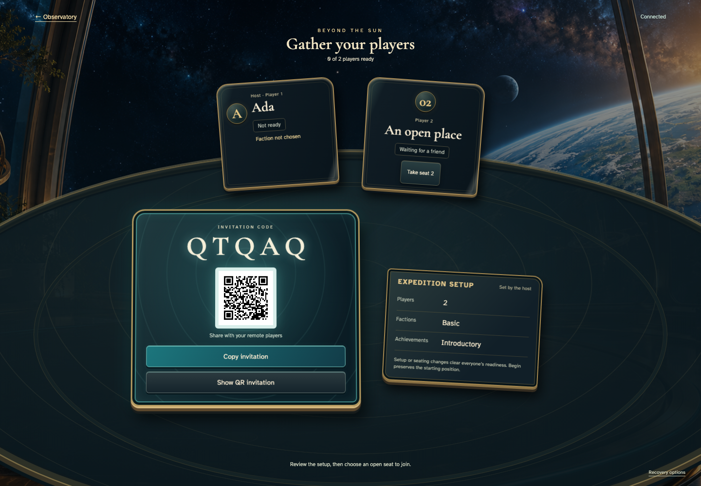](../../screenshots/retain-resource-cube-rerolls-and-complete-the-mandatory-upgrade-and-optional-bonus/005-guest-preview-phone-darwin.png) | [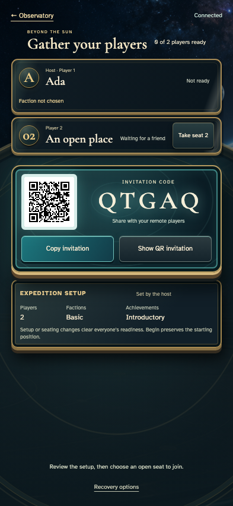](../../screenshots/retain-resource-cube-rerolls-and-complete-the-mandatory-upgrade-and-optional-bonus/005-guest-preview-desktop-darwin.png) |

- [x] A separate identity previews the real invitation
- [x] The saved automatic consequences settle before the public decision is photographed.
- [x] Public compact Technology objects retain physical separation.
- [x] The gameplay shell stays inside the actual viewport.

## 7. The guest opens the ordinary seat editor

Viewpoint: **Bora · independent guest controller**.

| phone · 1440 × 1000 | desktop · 393 × 852 |
| --- | --- |
| [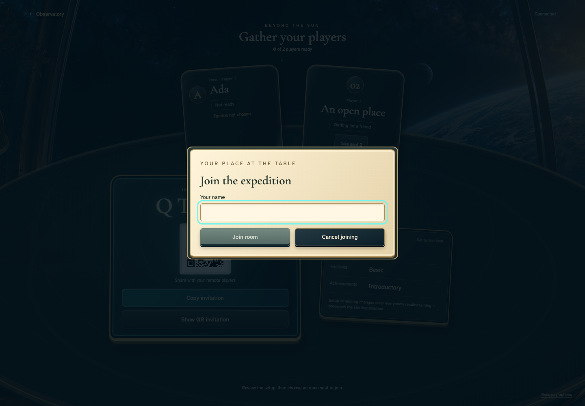](../../screenshots/retain-resource-cube-rerolls-and-complete-the-mandatory-upgrade-and-optional-bonus/006-guest-editor-phone-darwin.png) |  |

- [x] The guest opens the ordinary seat editor
- [x] The saved automatic consequences settle before the public decision is photographed.
- [x] Public compact Technology objects retain physical separation.
- [x] The gameplay shell stays inside the actual viewport.

## 8. Name the independent guest

Viewpoint: **Bora · independent guest controller**.

| phone · 1440 × 1000 | desktop · 393 × 852 |
| --- | --- |
| [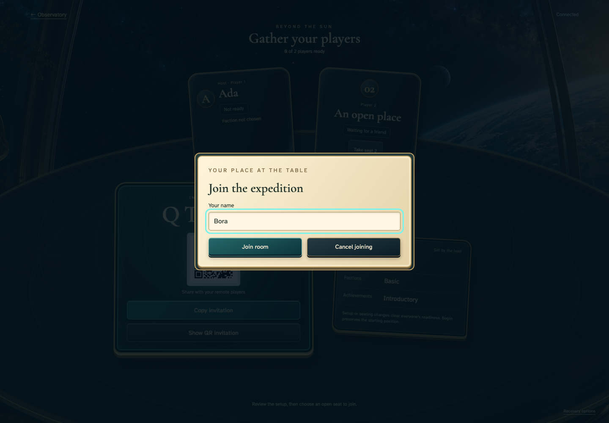](../../screenshots/retain-resource-cube-rerolls-and-complete-the-mandatory-upgrade-and-optional-bonus/007-guest-name-phone-darwin.png) |  |

- [x] Name the independent guest
- [x] The saved automatic consequences settle before the public decision is photographed.
- [x] Public compact Technology objects retain physical separation.
- [x] The gameplay shell stays inside the actual viewport.

## 9. Bora claims their own remote seat

Viewpoint: **Bora · independent guest controller**.

| phone · 1440 × 1000 | desktop · 393 × 852 |
| --- | --- |
| [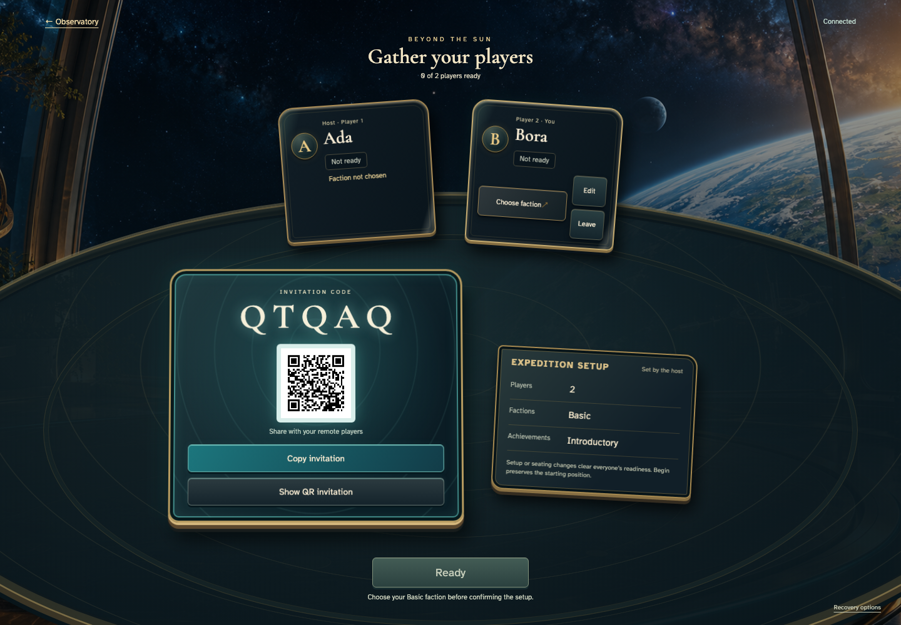](../../screenshots/retain-resource-cube-rerolls-and-complete-the-mandatory-upgrade-and-optional-bonus/008-guest-joined-phone-darwin.png) | [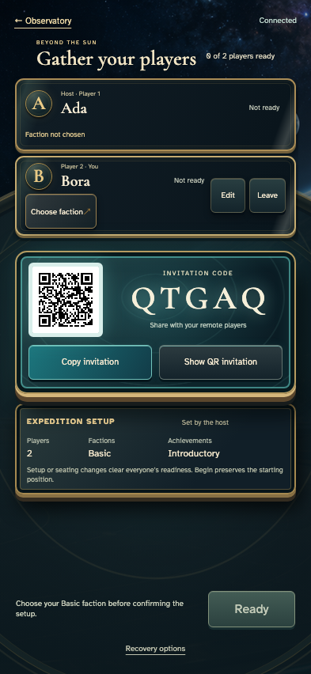](../../screenshots/retain-resource-cube-rerolls-and-complete-the-mandatory-upgrade-and-optional-bonus/008-guest-joined-desktop-darwin.png) |

- [x] Bora claims their own remote seat
- [x] The saved automatic consequences settle before the public decision is photographed.
- [x] Public compact Technology objects retain physical separation.
- [x] The gameplay shell stays inside the actual viewport.

## 10. Ada reads the legal unique Basic factions

Viewpoint: **Ada · independent host controller**.

| phone · 393 × 852 | desktop · 1440 × 1000 |
| --- | --- |
|  |  |

- [x] Ada reads the legal unique Basic factions
- [x] The saved automatic consequences settle before the public decision is photographed.
- [x] Public compact Technology objects retain physical separation.
- [x] The gameplay shell stays inside the actual viewport.

## 11. Ada chooses their actual production faction

Viewpoint: **Ada · independent host controller**.

| phone · 393 × 852 | desktop · 1440 × 1000 |
| --- | --- |
| [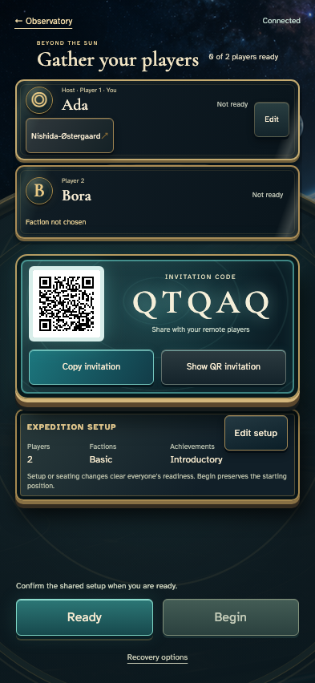](../../screenshots/retain-resource-cube-rerolls-and-complete-the-mandatory-upgrade-and-optional-bonus/010-faction-0-chosen-phone-darwin.png) |  |

- [x] Ada chooses their actual production faction
- [x] The saved automatic consequences settle before the public decision is photographed.
- [x] Public compact Technology objects retain physical separation.
- [x] The gameplay shell stays inside the actual viewport.

## 12. Bora reads the legal unique Basic factions

Viewpoint: **Bora · independent guest controller**.

| phone · 1440 × 1000 | desktop · 393 × 852 |
| --- | --- |
|  |  |

- [x] Bora reads the legal unique Basic factions
- [x] The saved automatic consequences settle before the public decision is photographed.
- [x] Public compact Technology objects retain physical separation.
- [x] The gameplay shell stays inside the actual viewport.

## 13. Bora chooses their actual production faction

Viewpoint: **Bora · independent guest controller**.

| phone · 1440 × 1000 | desktop · 393 × 852 |
| --- | --- |
|  | [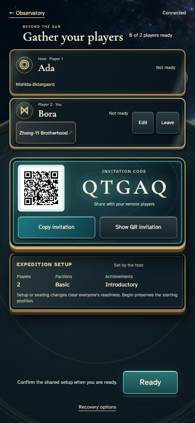](../../screenshots/retain-resource-cube-rerolls-and-complete-the-mandatory-upgrade-and-optional-bonus/012-faction-1-chosen-desktop-darwin.png) |

- [x] Bora chooses their actual production faction
- [x] The saved automatic consequences settle before the public decision is photographed.
- [x] Public compact Technology objects retain physical separation.
- [x] The gameplay shell stays inside the actual viewport.

## 14. Ada confirms this exact configuration

Viewpoint: **Ada · independent host controller**.

| phone · 393 × 852 | desktop · 1440 × 1000 |
| --- | --- |
| [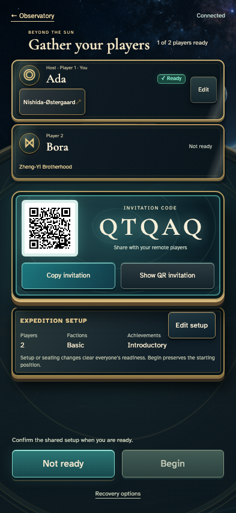](../../screenshots/retain-resource-cube-rerolls-and-complete-the-mandatory-upgrade-and-optional-bonus/013-ready-0-phone-darwin.png) | [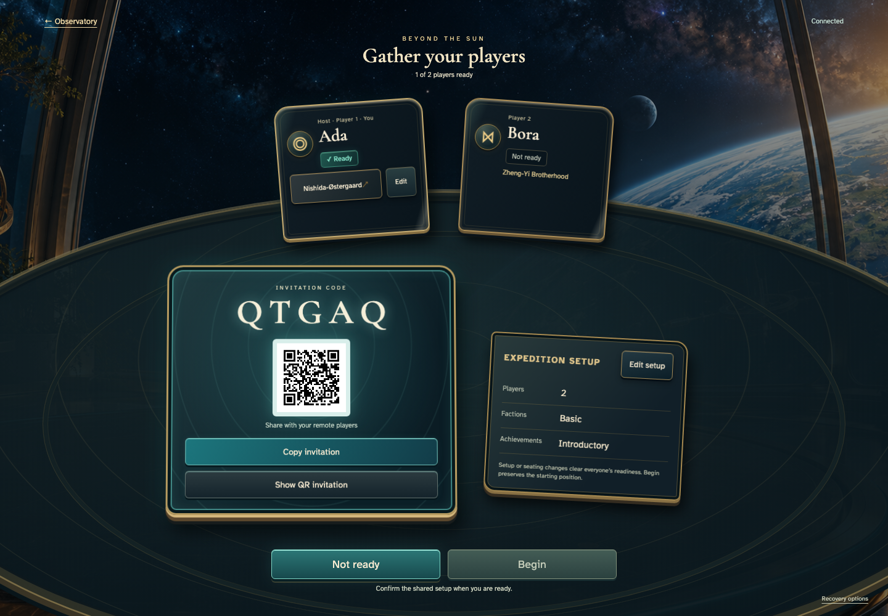](../../screenshots/retain-resource-cube-rerolls-and-complete-the-mandatory-upgrade-and-optional-bonus/013-ready-0-desktop-darwin.png) |

- [x] Ada confirms this exact configuration
- [x] The saved automatic consequences settle before the public decision is photographed.
- [x] Public compact Technology objects retain physical separation.
- [x] The gameplay shell stays inside the actual viewport.

## 15. Bora confirms this exact configuration

Viewpoint: **Bora · independent guest controller**.

| phone · 1440 × 1000 | desktop · 393 × 852 |
| --- | --- |
| [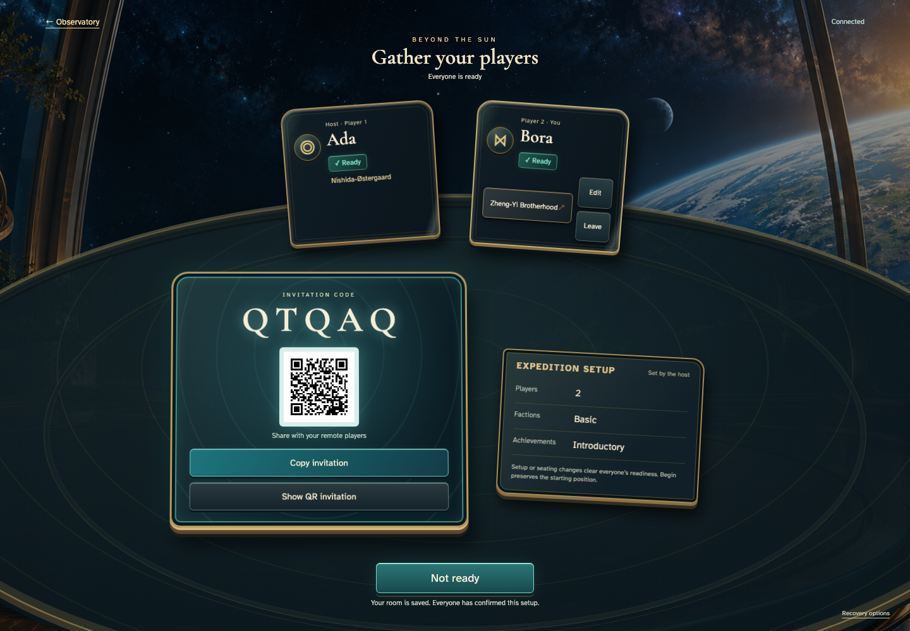](../../screenshots/retain-resource-cube-rerolls-and-complete-the-mandatory-upgrade-and-optional-bonus/014-ready-1-phone-darwin.png) | [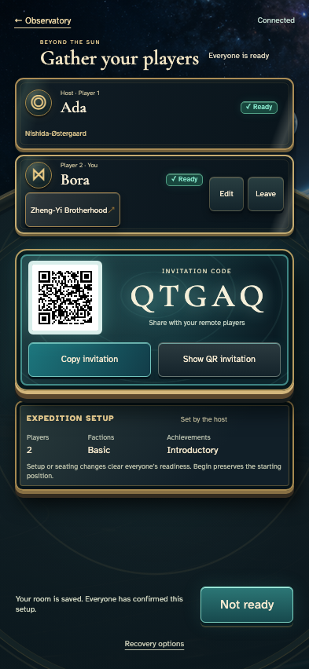](../../screenshots/retain-resource-cube-rerolls-and-complete-the-mandatory-upgrade-and-optional-bonus/014-ready-1-desktop-darwin.png) |

- [x] Bora confirms this exact configuration
- [x] The saved automatic consequences settle before the public decision is photographed.
- [x] Public compact Technology objects retain physical separation.
- [x] The gameplay shell stays inside the actual viewport.

## 16. Begin creates the immutable seeded Basic game

Viewpoint: **Ada · independent host controller**.

| phone · 393 × 852 | desktop · 1440 × 1000 |
| --- | --- |
|  |  |

- [x] Begin creates the immutable seeded Basic game
- [x] The saved automatic consequences settle before the public decision is photographed.
- [x] Public compact Technology objects retain physical separation.
- [x] The gameplay shell stays inside the actual viewport.

## 17. Ada plans a legal preparatory Level I turn

Viewpoint: **Ada · independent host controller**.

| phone · 393 × 852 | desktop · 1440 × 1000 |
| --- | --- |
| [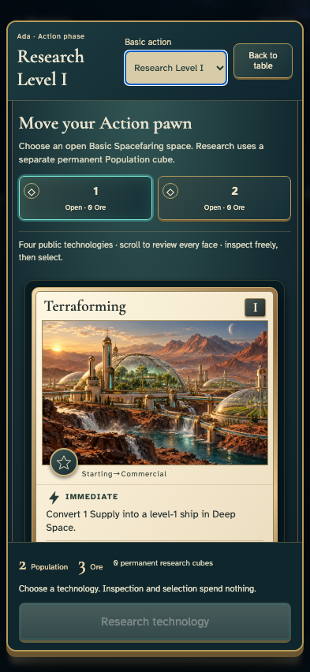](../../screenshots/retain-resource-cube-rerolls-and-complete-the-mandatory-upgrade-and-optional-bonus/016-prep-0-plan-phone-darwin.png) | [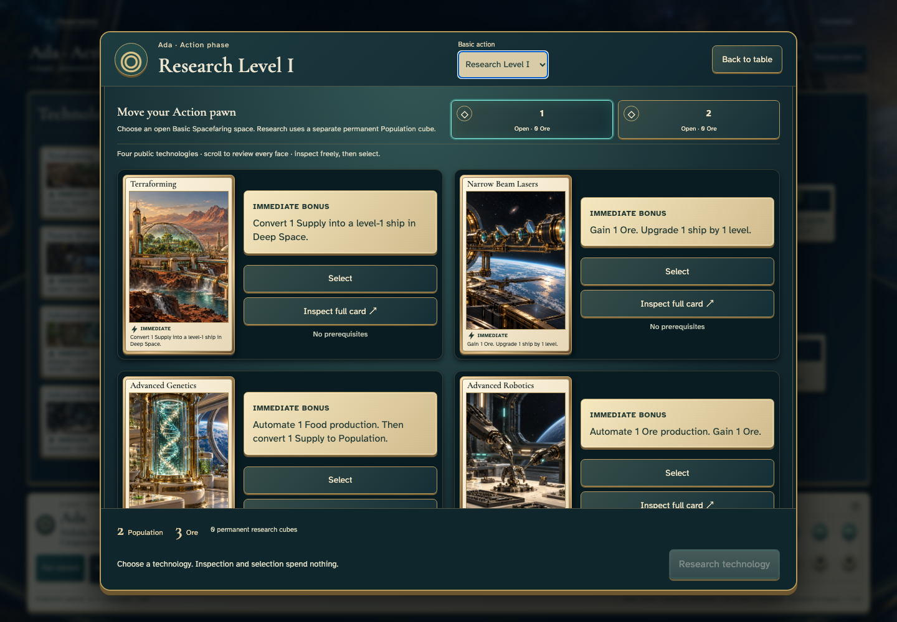](../../screenshots/retain-resource-cube-rerolls-and-complete-the-mandatory-upgrade-and-optional-bonus/016-prep-0-plan-desktop-darwin.png) |

- [x] Ada plans a legal preparatory Level I turn
- [x] The saved automatic consequences settle before the public decision is photographed.
- [x] Public compact Technology objects retain physical separation.
- [x] The gameplay shell stays inside the actual viewport.

## 18. Ada chooses the unoccupied printed Action space

Viewpoint: **Ada · independent host controller**.

| phone · 393 × 852 | desktop · 1440 × 1000 |
| --- | --- |
| [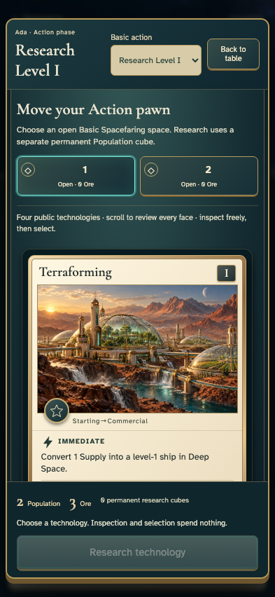](../../screenshots/retain-resource-cube-rerolls-and-complete-the-mandatory-upgrade-and-optional-bonus/017-prep-0-space-phone-darwin.png) |  |

- [x] Ada chooses the unoccupied printed Action space
- [x] The saved automatic consequences settle before the public decision is photographed.
- [x] Public compact Technology objects retain physical separation.
- [x] The gameplay shell stays inside the actual viewport.

## 19. Ada selects the public Narrow Beam Lasers face

Viewpoint: **Ada · independent host controller**.

| phone · 393 × 852 | desktop · 1440 × 1000 |
| --- | --- |
|  |  |

- [x] Ada selects the public Narrow Beam Lasers face
- [x] The saved automatic consequences settle before the public decision is photographed.
- [x] Public compact Technology objects retain physical separation.
- [x] The gameplay shell stays inside the actual viewport.

## 20. Research remains disabled until an explicit owned ship is selected

Viewpoint: **Ada · independent host controller**.

| phone · 393 × 852 | desktop · 1440 × 1000 |
| --- | --- |
|  | [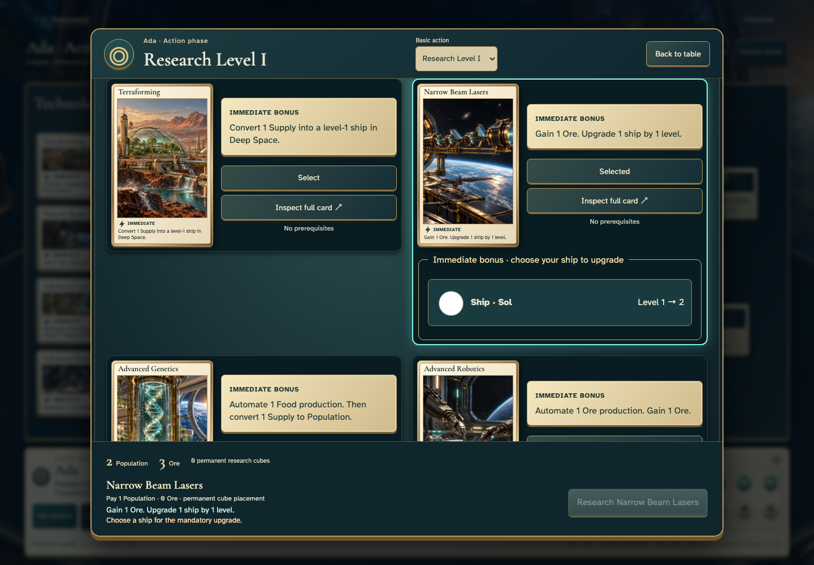](../../screenshots/retain-resource-cube-rerolls-and-complete-the-mandatory-upgrade-and-optional-bonus/019-prep-0-target-required-desktop-darwin.png) |

- [x] Research remains disabled until an explicit owned ship is selected
- [x] The saved automatic consequences settle before the public decision is photographed.
- [x] Public compact Technology objects retain physical separation.
- [x] The gameplay shell stays inside the actual viewport.

## 21. Ada explicitly chooses the first owned ship to upgrade

Viewpoint: **Ada · independent host controller**.

| phone · 393 × 852 | desktop · 1440 × 1000 |
| --- | --- |
| [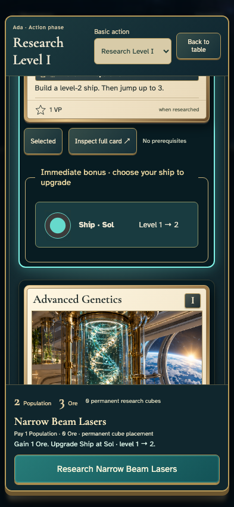](../../screenshots/retain-resource-cube-rerolls-and-complete-the-mandatory-upgrade-and-optional-bonus/020-prep-0-target-phone-darwin.png) | [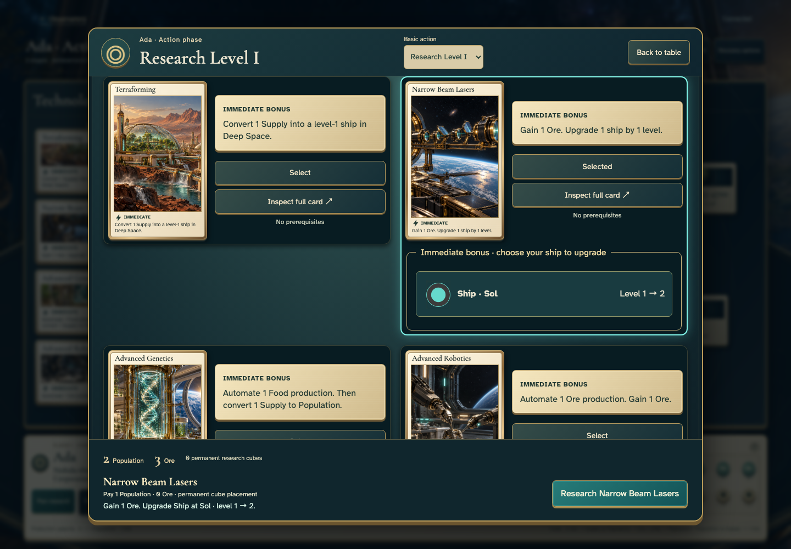](../../screenshots/retain-resource-cube-rerolls-and-complete-the-mandatory-upgrade-and-optional-bonus/020-prep-0-target-desktop-darwin.png) |

- [x] Ada explicitly chooses the first owned ship to upgrade
- [x] The saved automatic consequences settle before the public decision is photographed.
- [x] Public compact Technology objects retain physical separation.
- [x] The gameplay shell stays inside the actual viewport.

## 22. Ada pays permanent research Population and receives the printed immediate bonus

Viewpoint: **Ada · independent host controller**.

| phone · 393 × 852 | desktop · 1440 × 1000 |
| --- | --- |
|  | [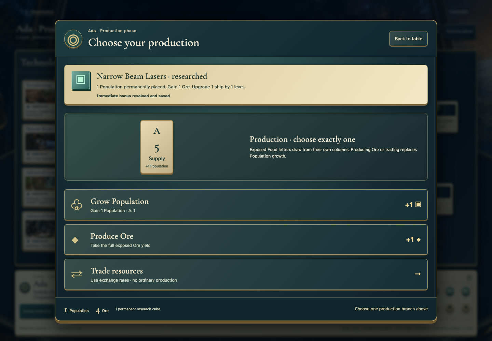](../../screenshots/retain-resource-cube-rerolls-and-complete-the-mandatory-upgrade-and-optional-bonus/021-prep-0-paid-desktop-darwin.png) |

- [x] Ada pays permanent research Population and receives the printed immediate bonus
- [x] The saved automatic consequences settle before the public decision is photographed.
- [x] Public compact Technology objects retain physical separation.
- [x] The gameplay shell stays inside the actual viewport.

## 23. Ada completes ordinary production and hands off automatically

Viewpoint: **Ada · independent host controller**.

| phone · 393 × 852 | desktop · 1440 × 1000 |
| --- | --- |
| [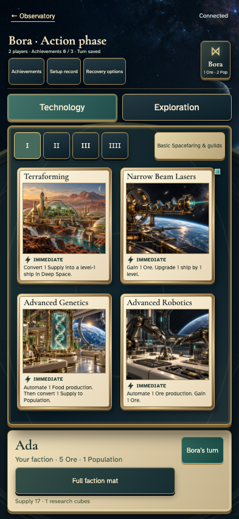](../../screenshots/retain-resource-cube-rerolls-and-complete-the-mandatory-upgrade-and-optional-bonus/022-prep-0-handoff-phone-darwin.png) |  |

- [x] Ada completes ordinary production and hands off automatically
- [x] The saved automatic consequences settle before the public decision is photographed.
- [x] Public compact Technology objects retain physical separation.
- [x] The gameplay shell stays inside the actual viewport.

## 24. The next independent controller sees the same canonical handoff

Viewpoint: **Bora · independent guest controller**.

| phone · 1440 × 1000 | desktop · 393 × 852 |
| --- | --- |
| [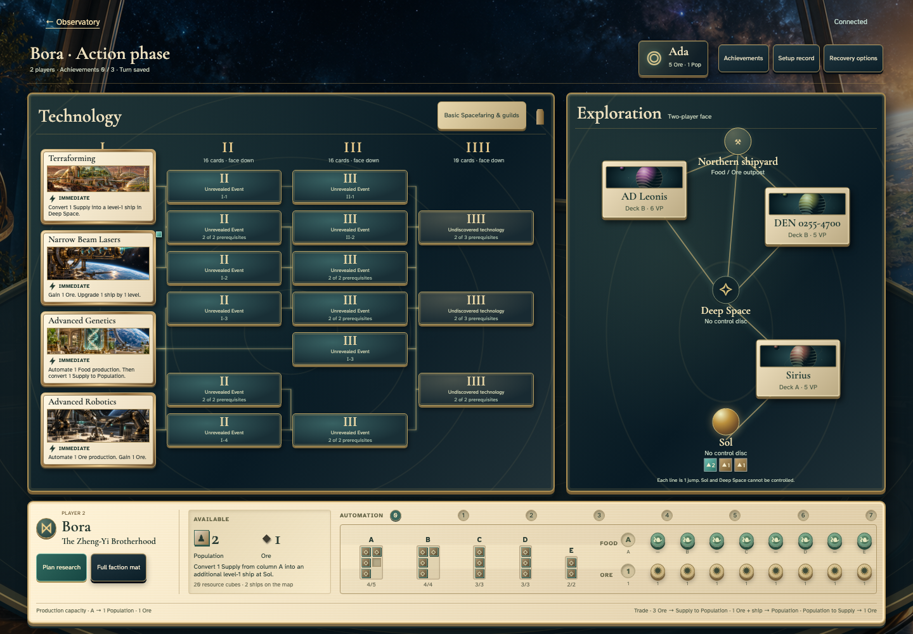](../../screenshots/retain-resource-cube-rerolls-and-complete-the-mandatory-upgrade-and-optional-bonus/023-prep-0-handoff-next-phone-darwin.png) | [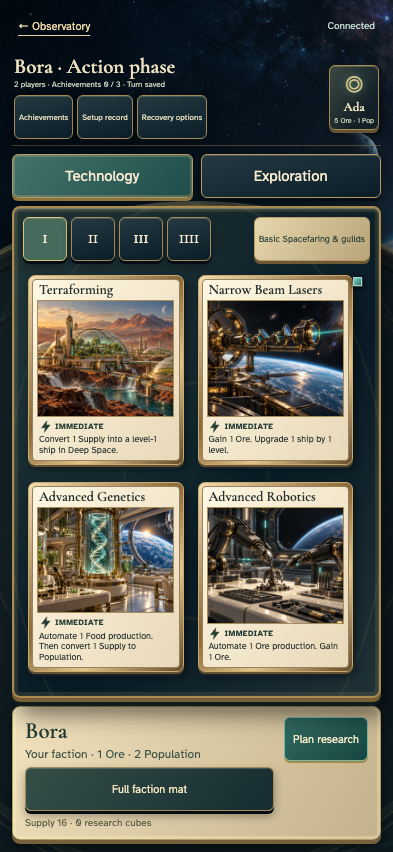](../../screenshots/retain-resource-cube-rerolls-and-complete-the-mandatory-upgrade-and-optional-bonus/023-prep-0-handoff-next-desktop-darwin.png) |

- [x] The next independent controller sees the same canonical handoff
- [x] The saved automatic consequences settle before the public decision is photographed.
- [x] Public compact Technology objects retain physical separation.
- [x] The gameplay shell stays inside the actual viewport.

## 25. Bora plans a legal preparatory Level I turn

Viewpoint: **Bora · independent guest controller**.

| phone · 1440 × 1000 | desktop · 393 × 852 |
| --- | --- |
|  |  |

- [x] Bora plans a legal preparatory Level I turn
- [x] The saved automatic consequences settle before the public decision is photographed.
- [x] Public compact Technology objects retain physical separation.
- [x] The gameplay shell stays inside the actual viewport.

## 26. Bora chooses the unoccupied printed Action space

Viewpoint: **Bora · independent guest controller**.

| phone · 1440 × 1000 | desktop · 393 × 852 |
| --- | --- |
| [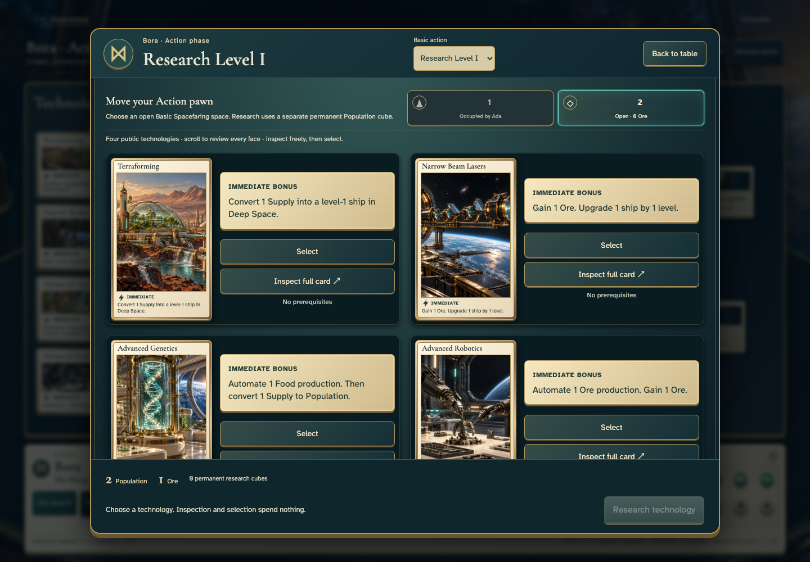](../../screenshots/retain-resource-cube-rerolls-and-complete-the-mandatory-upgrade-and-optional-bonus/025-prep-1-space-phone-darwin.png) | [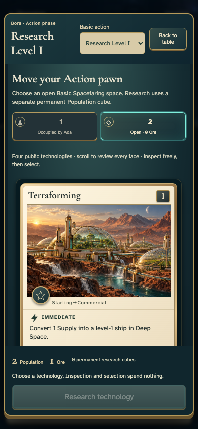](../../screenshots/retain-resource-cube-rerolls-and-complete-the-mandatory-upgrade-and-optional-bonus/025-prep-1-space-desktop-darwin.png) |

- [x] Bora chooses the unoccupied printed Action space
- [x] The saved automatic consequences settle before the public decision is photographed.
- [x] Public compact Technology objects retain physical separation.
- [x] The gameplay shell stays inside the actual viewport.

## 27. Bora selects the public Advanced Robotics face

Viewpoint: **Bora · independent guest controller**.

| phone · 1440 × 1000 | desktop · 393 × 852 |
| --- | --- |
| [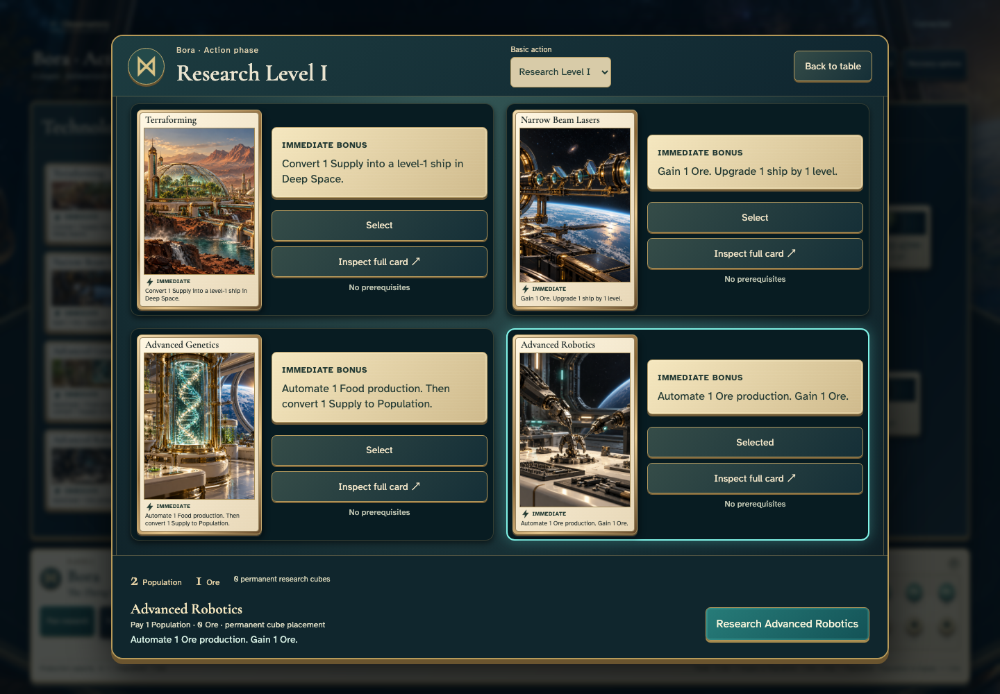](../../screenshots/retain-resource-cube-rerolls-and-complete-the-mandatory-upgrade-and-optional-bonus/026-prep-1-card-phone-darwin.png) | [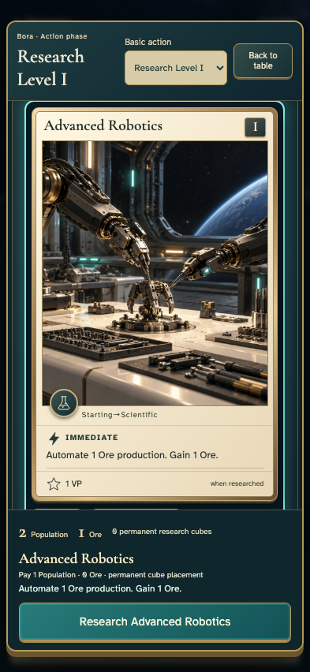](../../screenshots/retain-resource-cube-rerolls-and-complete-the-mandatory-upgrade-and-optional-bonus/026-prep-1-card-desktop-darwin.png) |

- [x] Bora selects the public Advanced Robotics face
- [x] The saved automatic consequences settle before the public decision is photographed.
- [x] Public compact Technology objects retain physical separation.
- [x] The gameplay shell stays inside the actual viewport.

## 28. Bora pays permanent research Population and receives the printed immediate bonus

Viewpoint: **Bora · independent guest controller**.

| phone · 1440 × 1000 | desktop · 393 × 852 |
| --- | --- |
| [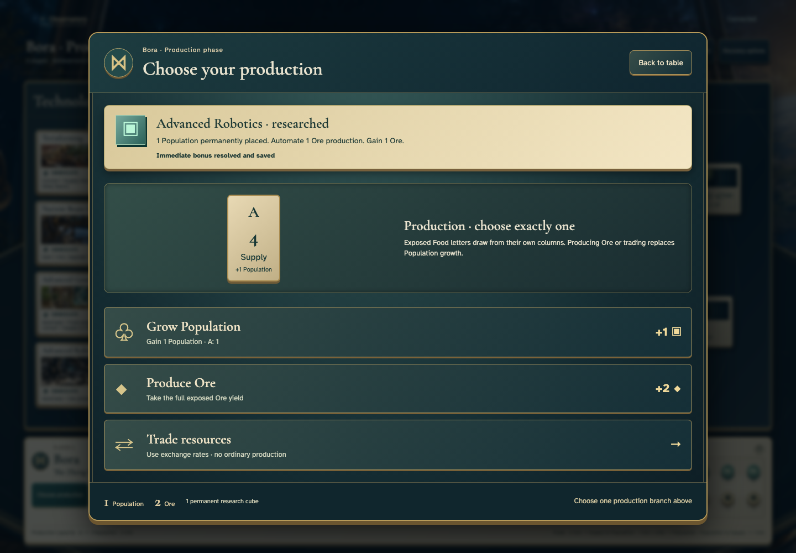](../../screenshots/retain-resource-cube-rerolls-and-complete-the-mandatory-upgrade-and-optional-bonus/027-prep-1-paid-phone-darwin.png) |  |

- [x] Bora pays permanent research Population and receives the printed immediate bonus
- [x] The saved automatic consequences settle before the public decision is photographed.
- [x] Public compact Technology objects retain physical separation.
- [x] The gameplay shell stays inside the actual viewport.

## 29. Bora completes ordinary production and hands off automatically

Viewpoint: **Bora · independent guest controller**.

| phone · 1440 × 1000 | desktop · 393 × 852 |
| --- | --- |
|  |  |

- [x] Bora completes ordinary production and hands off automatically
- [x] The saved automatic consequences settle before the public decision is photographed.
- [x] Public compact Technology objects retain physical separation.
- [x] The gameplay shell stays inside the actual viewport.

## 30. The next independent controller sees the same canonical handoff

Viewpoint: **Ada · independent host controller**.

| phone · 393 × 852 | desktop · 1440 × 1000 |
| --- | --- |
|  | [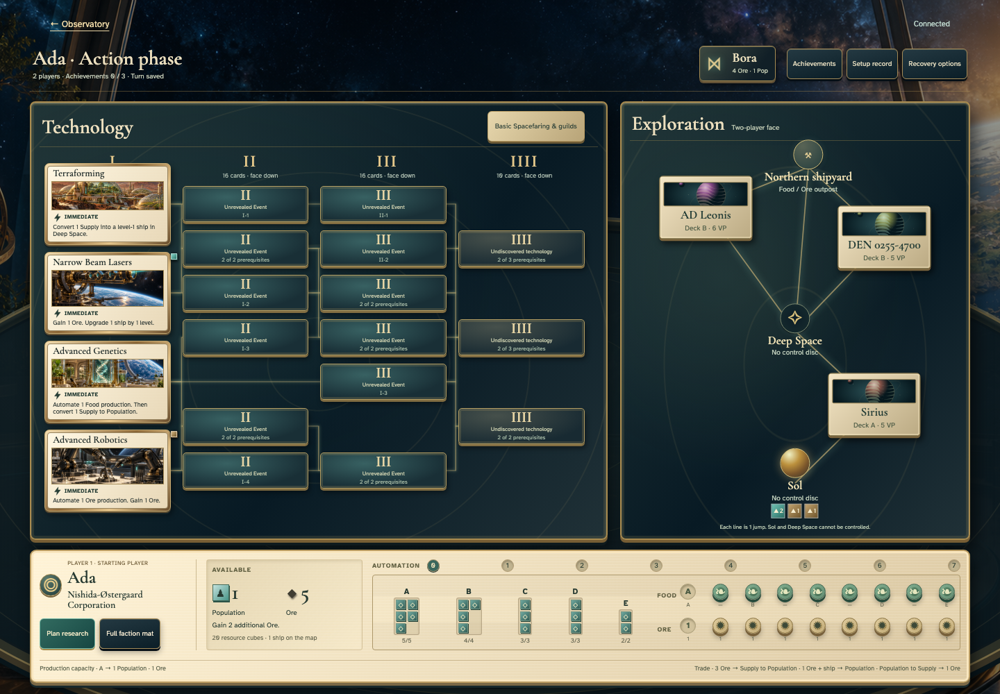](../../screenshots/retain-resource-cube-rerolls-and-complete-the-mandatory-upgrade-and-optional-bonus/029-prep-1-handoff-next-desktop-darwin.png) |

- [x] The next independent controller sees the same canonical handoff
- [x] The saved automatic consequences settle before the public decision is photographed.
- [x] Public compact Technology objects retain physical separation.
- [x] The gameplay shell stays inside the actual viewport.

## 31. The researcher opens the real Basic action instrument

Viewpoint: **Ada · independent host controller**.

| phone · 393 × 852 | desktop · 1440 × 1000 |
| --- | --- |
| [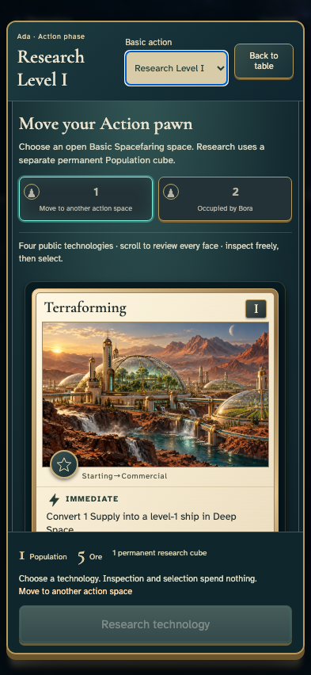](../../screenshots/retain-resource-cube-rerolls-and-complete-the-mandatory-upgrade-and-optional-bonus/030-level-i-plan-phone-darwin.png) | [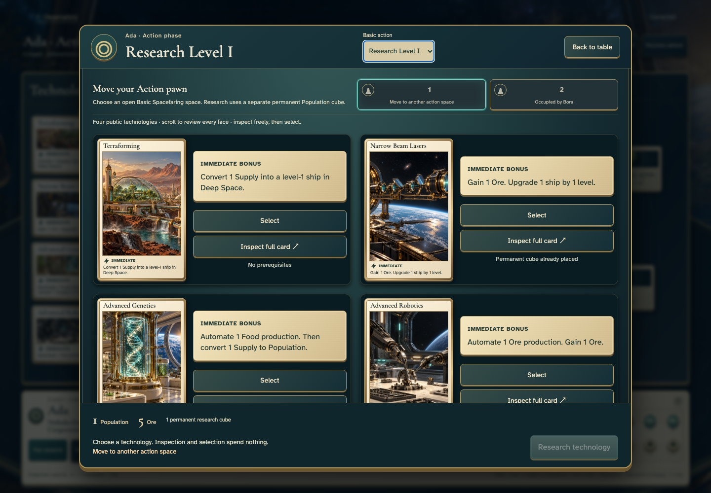](../../screenshots/retain-resource-cube-rerolls-and-complete-the-mandatory-upgrade-and-optional-bonus/030-level-i-plan-desktop-darwin.png) |

- [x] The researcher opens the real Basic action instrument
- [x] The saved automatic consequences settle before the public decision is photographed.
- [x] Public compact Technology objects retain physical separation.
- [x] The gameplay shell stays inside the actual viewport.

## 32. Choose Level II and inspect all six public prerequisites without revealing cards

Viewpoint: **Ada · independent host controller**.

| phone · 393 × 852 | desktop · 1440 × 1000 |
| --- | --- |
| [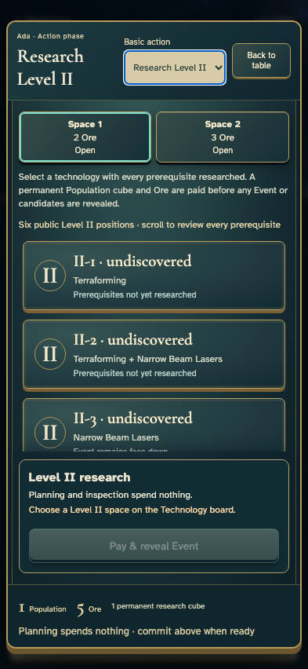](../../screenshots/retain-resource-cube-rerolls-and-complete-the-mandatory-upgrade-and-optional-bonus/031-level-ii-plan-phone-darwin.png) | [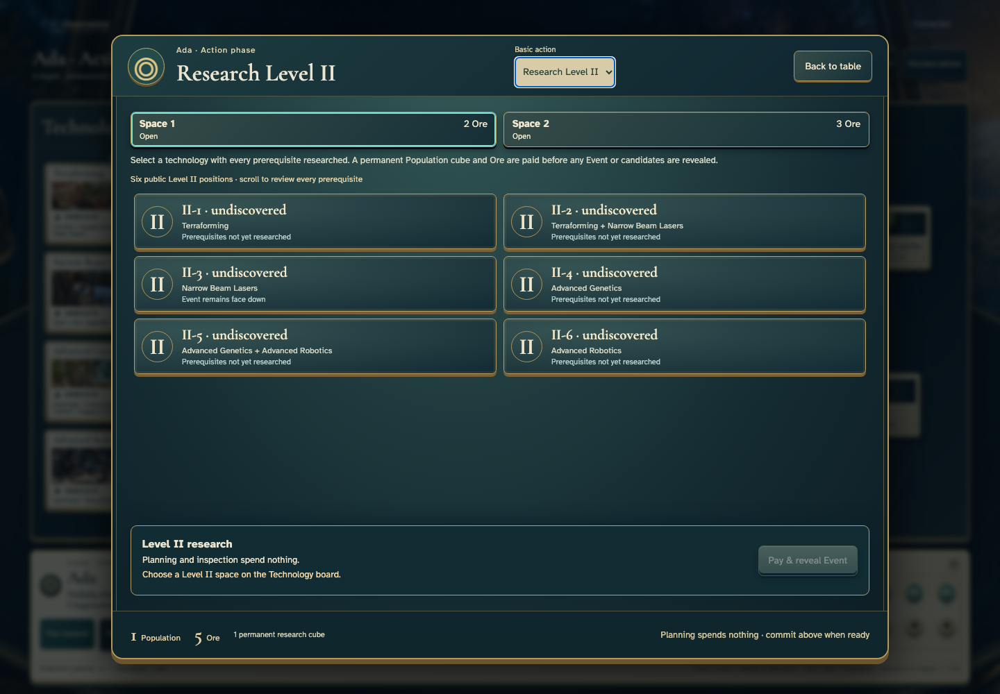](../../screenshots/retain-resource-cube-rerolls-and-complete-the-mandatory-upgrade-and-optional-bonus/031-level-ii-plan-desktop-darwin.png) |

- [x] Choose Level II and inspect all six public prerequisites without revealing cards
- [x] The saved automatic consequences settle before the public decision is photographed.
- [x] Public compact Technology objects retain physical separation.
- [x] The gameplay shell stays inside the actual viewport.

## 33. Select a legal undiscovered position and read its permanent Population and Ore payment

Viewpoint: **Ada · independent host controller**.

| phone · 393 × 852 | desktop · 1440 × 1000 |
| --- | --- |
| [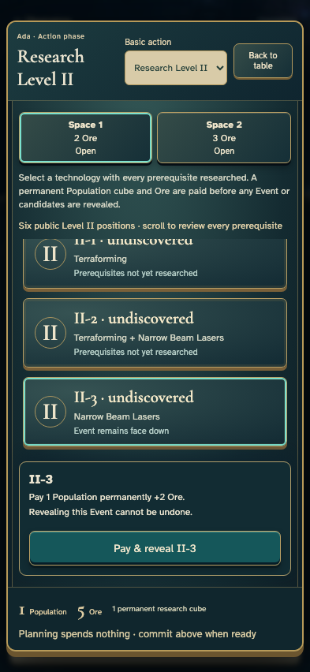](../../screenshots/retain-resource-cube-rerolls-and-complete-the-mandatory-upgrade-and-optional-bonus/032-level-ii-target-phone-darwin.png) | [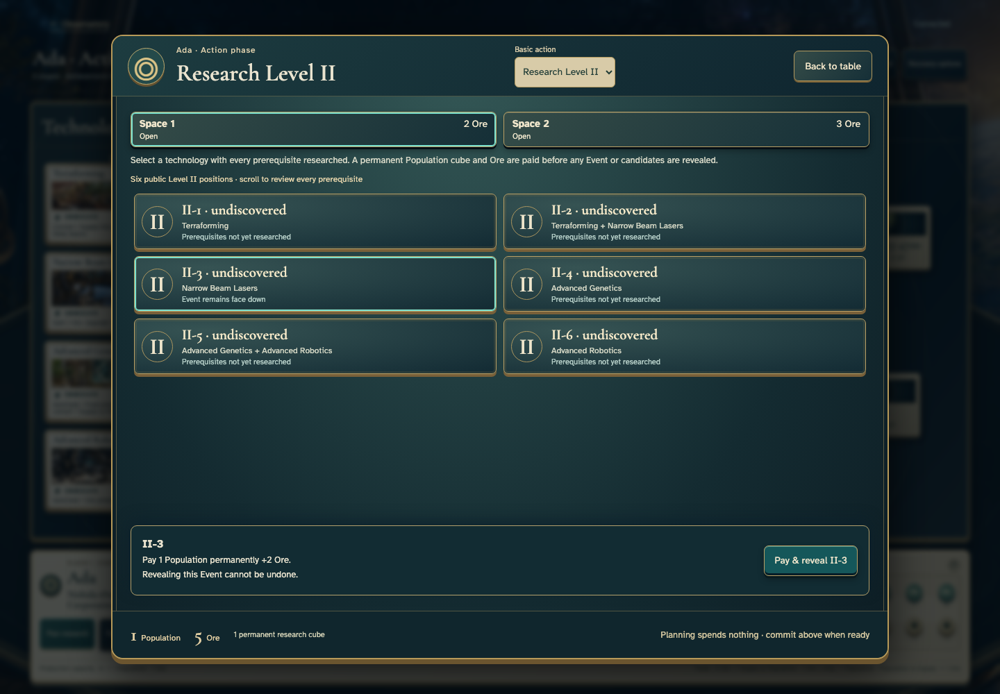](../../screenshots/retain-resource-cube-rerolls-and-complete-the-mandatory-upgrade-and-optional-bonus/032-level-ii-target-desktop-darwin.png) |

- [x] Select a legal undiscovered position and read its permanent Population and Ore payment
- [x] The saved automatic consequences settle before the public decision is photographed.
- [x] Public compact Technology objects retain physical separation.
- [x] The gameplay shell stays inside the actual viewport.

## 34. Payment reveals Experimental Prototypes; all Event decisions resolve before candidates

Viewpoint: **Ada · independent host controller**.

| phone · 393 × 852 | desktop · 1440 × 1000 |
| --- | --- |
| [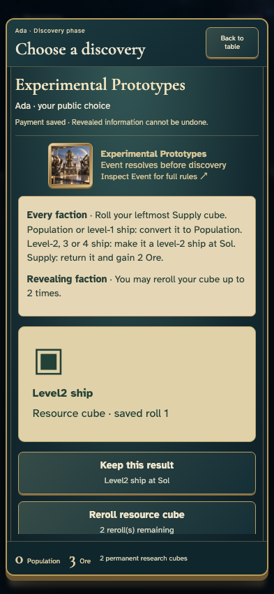](../../screenshots/retain-resource-cube-rerolls-and-complete-the-mandatory-upgrade-and-optional-bonus/033-event-revealed-phone-darwin.png) |  |

- [x] Payment reveals Experimental Prototypes; all Event decisions resolve before candidates
- [x] The saved automatic consequences settle before the public decision is photographed.
- [x] Public compact Technology objects retain physical separation.
- [x] The gameplay shell stays inside the actual viewport.

## 35. The resource-cube face is a saved result rather than a numeric die

Viewpoint: **Ada · independent host controller**.

| phone · 393 × 852 | desktop · 1440 × 1000 |
| --- | --- |
|  |  |

- [x] The resource-cube face is a saved result rather than a numeric die
- [x] The saved automatic consequences settle before the public decision is photographed.
- [x] Public compact Technology objects retain physical separation.
- [x] The gameplay shell stays inside the actual viewport.

## 36. Reload preserves the pending public cube decision

Viewpoint: **Ada · independent host controller**.

| phone · 393 × 852 | desktop · 1440 × 1000 |
| --- | --- |
|  |  |

- [x] Reload preserves the pending public cube decision
- [x] The saved automatic consequences settle before the public decision is photographed.
- [x] Public compact Technology objects retain physical separation.
- [x] The gameplay shell stays inside the actual viewport.

## 37. Ada opens their saved public discovery decision

Viewpoint: **Ada · independent host controller**.

| phone · 393 × 852 | desktop · 1440 × 1000 |
| --- | --- |
|  |  |

- [x] Ada opens their saved public discovery decision
- [x] The saved automatic consequences settle before the public decision is photographed.
- [x] Public compact Technology objects retain physical separation.
- [x] The gameplay shell stays inside the actual viewport.

## 38. The identical saved resource face reappears after reload

Viewpoint: **Ada · independent host controller**.

| phone · 393 × 852 | desktop · 1440 × 1000 |
| --- | --- |
|  |  |

- [x] The identical saved resource face reappears after reload
- [x] The saved automatic consequences settle before the public decision is photographed.
- [x] Public compact Technology objects retain physical separation.
- [x] The gameplay shell stays inside the actual viewport.

## 39. Ada uses explicit reroll1 and receives its saved face

Viewpoint: **Ada · independent host controller**.

| phone · 393 × 852 | desktop · 1440 × 1000 |
| --- | --- |
|  |  |

- [x] Ada uses explicit reroll1 and receives its saved face
- [x] The saved automatic consequences settle before the public decision is photographed.
- [x] Public compact Technology objects retain physical separation.
- [x] The gameplay shell stays inside the actual viewport.

## 40. Ada uses explicit reroll2 and receives its saved face

Viewpoint: **Ada · independent host controller**.

| phone · 393 × 852 | desktop · 1440 × 1000 |
| --- | --- |
| [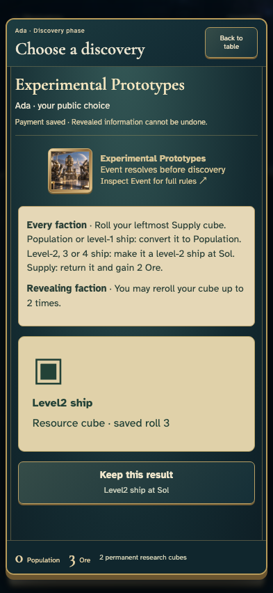](../../screenshots/retain-resource-cube-rerolls-and-complete-the-mandatory-upgrade-and-optional-bonus/039-cube-reroll-2-phone-darwin.png) | [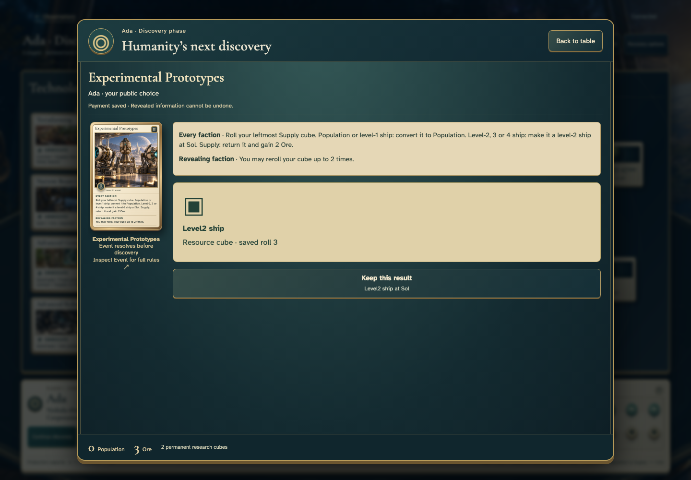](../../screenshots/retain-resource-cube-rerolls-and-complete-the-mandatory-upgrade-and-optional-bonus/039-cube-reroll-2-desktop-darwin.png) |

- [x] Ada uses explicit reroll2 and receives its saved face
- [x] The saved automatic consequences settle before the public decision is photographed.
- [x] Public compact Technology objects retain physical separation.
- [x] The gameplay shell stays inside the actual viewport.

## 41. After two rerolls the revealing faction must keep the third result

Viewpoint: **Ada · independent host controller**.

| phone · 393 × 852 | desktop · 1440 × 1000 |
| --- | --- |
|  |  |

- [x] After two rerolls the revealing faction must keep the third result
- [x] The saved automatic consequences settle before the public decision is photographed.
- [x] Public compact Technology objects retain physical separation.
- [x] The gameplay shell stays inside the actual viewport.

## 42. Ada reads and owns this public Event decision

Viewpoint: **Ada · independent host controller**.

| phone · 393 × 852 | desktop · 1440 × 1000 |
| --- | --- |
|  |  |

- [x] Ada reads and owns this public Event decision
- [x] The saved automatic consequences settle before the public decision is photographed.
- [x] Public compact Technology objects retain physical separation.
- [x] The gameplay shell stays inside the actual viewport.

## 43. Keep the printed result once and continue in clockwise responder order

Viewpoint: **Ada · independent host controller**.

| phone · 393 × 852 | desktop · 1440 × 1000 |
| --- | --- |
| [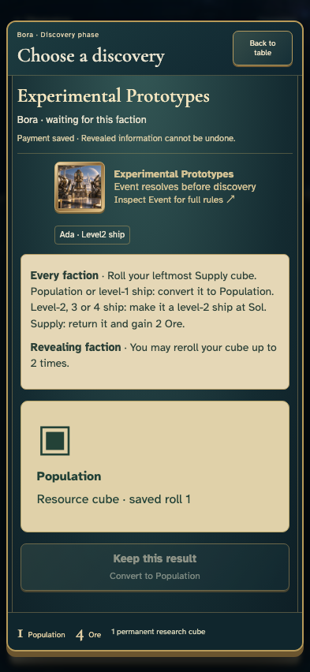](../../screenshots/retain-resource-cube-rerolls-and-complete-the-mandatory-upgrade-and-optional-bonus/042-cube-kept-0-saved-phone-darwin.png) |  |

- [x] Keep the printed result once and continue in clockwise responder order
- [x] The saved automatic consequences settle before the public decision is photographed.
- [x] Public compact Technology objects retain physical separation.
- [x] The gameplay shell stays inside the actual viewport.

## 44. Bora opens their saved public discovery decision

Viewpoint: **Bora · independent guest controller**.

| phone · 1440 × 1000 | desktop · 393 × 852 |
| --- | --- |
|  |  |

- [x] Bora opens their saved public discovery decision
- [x] The saved automatic consequences settle before the public decision is photographed.
- [x] Public compact Technology objects retain physical separation.
- [x] The gameplay shell stays inside the actual viewport.

## 45. Bora sees their predetermined public cube face

Viewpoint: **Bora · independent guest controller**.

| phone · 1440 × 1000 | desktop · 393 × 852 |
| --- | --- |
|  | [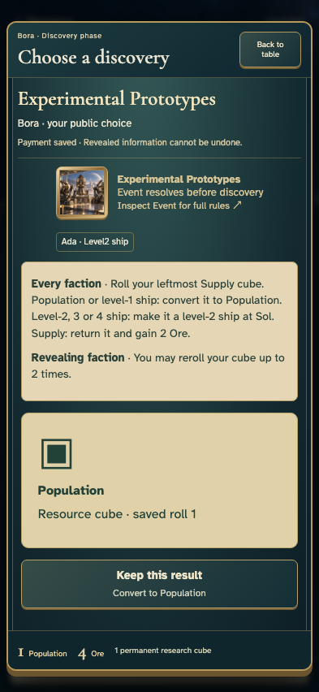](../../screenshots/retain-resource-cube-rerolls-and-complete-the-mandatory-upgrade-and-optional-bonus/044-cube-face-1-desktop-darwin.png) |

- [x] Bora sees their predetermined public cube face
- [x] The saved automatic consequences settle before the public decision is photographed.
- [x] Public compact Technology objects retain physical separation.
- [x] The gameplay shell stays inside the actual viewport.

## 46. Bora reads and owns this public Event decision

Viewpoint: **Bora · independent guest controller**.

| phone · 1440 × 1000 | desktop · 393 × 852 |
| --- | --- |
|  |  |

- [x] Bora reads and owns this public Event decision
- [x] The saved automatic consequences settle before the public decision is photographed.
- [x] Public compact Technology objects retain physical separation.
- [x] The gameplay shell stays inside the actual viewport.

## 47. Keep the printed result once and continue in clockwise responder order

Viewpoint: **Bora · independent guest controller**.

| phone · 1440 × 1000 | desktop · 393 × 852 |
| --- | --- |
|  | [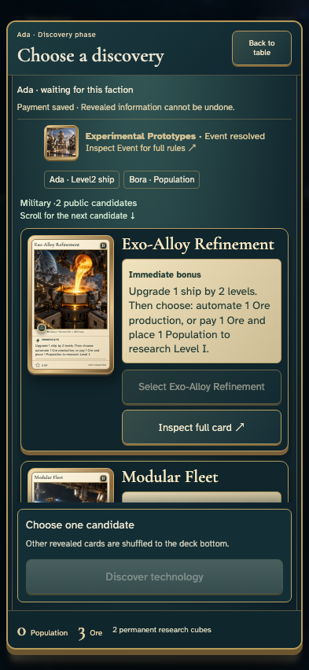](../../screenshots/retain-resource-cube-rerolls-and-complete-the-mandatory-upgrade-and-optional-bonus/046-cube-kept-1-saved-desktop-darwin.png) |

- [x] Keep the printed result once and continue in clockwise responder order
- [x] The saved automatic consequences settle before the public decision is photographed.
- [x] Public compact Technology objects retain physical separation.
- [x] The gameplay shell stays inside the actual viewport.

## 48. The public candidates appear only after the entire Event and type choice

Viewpoint: **Ada · independent host controller**.

| phone · 393 × 852 | desktop · 1440 × 1000 |
| --- | --- |
| [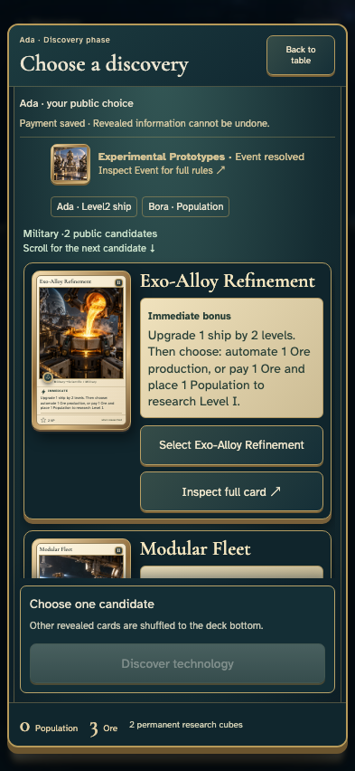](../../screenshots/retain-resource-cube-rerolls-and-complete-the-mandatory-upgrade-and-optional-bonus/047-public-candidates-phone-darwin.png) |  |

- [x] The public candidates appear only after the entire Event and type choice
- [x] The saved automatic consequences settle before the public decision is photographed.
- [x] Public compact Technology objects retain physical separation.
- [x] The gameplay shell stays inside the actual viewport.

## 49. The separate guest sees the same public discovery without research authority

Viewpoint: **Bora · independent guest controller**.

| phone · 1440 × 1000 | desktop · 393 × 852 |
| --- | --- |
| [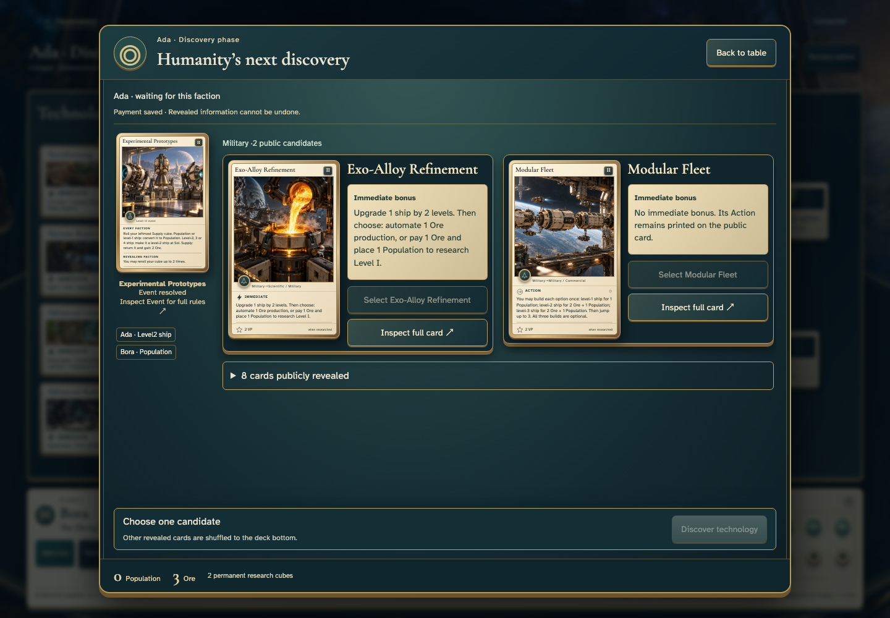](../../screenshots/retain-resource-cube-rerolls-and-complete-the-mandatory-upgrade-and-optional-bonus/048-observer-candidates-phone-darwin.png) |  |

- [x] The separate guest sees the same public discovery without research authority
- [x] The saved automatic consequences settle before the public decision is photographed.
- [x] Public compact Technology objects retain physical separation.
- [x] The gameplay shell stays inside the actual viewport.

## 50. Observation does not acquire the researching faction or its controls

Viewpoint: **Bora · independent guest controller**.

| phone · 1440 × 1000 | desktop · 393 × 852 |
| --- | --- |
| [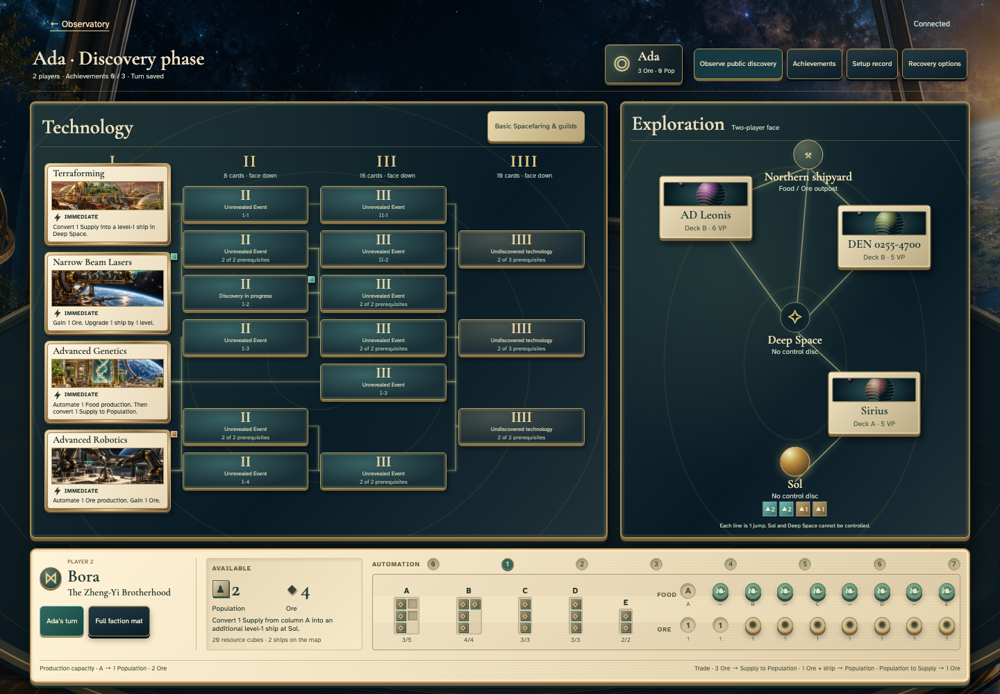](../../screenshots/retain-resource-cube-rerolls-and-complete-the-mandatory-upgrade-and-optional-bonus/049-observer-return-phone-darwin.png) |  |

- [x] Observation does not acquire the researching faction or its controls
- [x] The saved automatic consequences settle before the public decision is photographed.
- [x] Public compact Technology objects retain physical separation.
- [x] The gameplay shell stays inside the actual viewport.

## 51. Inspect the complete canonical Exo-Alloy Refinement face

Viewpoint: **Ada · independent host controller**.

| phone · 393 × 852 | desktop · 1440 × 1000 |
| --- | --- |
| [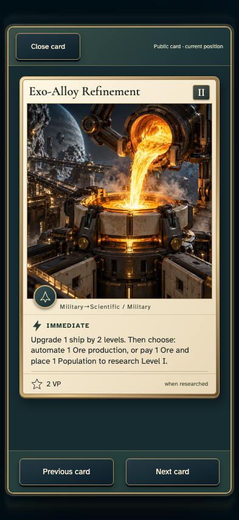](../../screenshots/retain-resource-cube-rerolls-and-complete-the-mandatory-upgrade-and-optional-bonus/050-candidate-inspected-phone-darwin.png) | [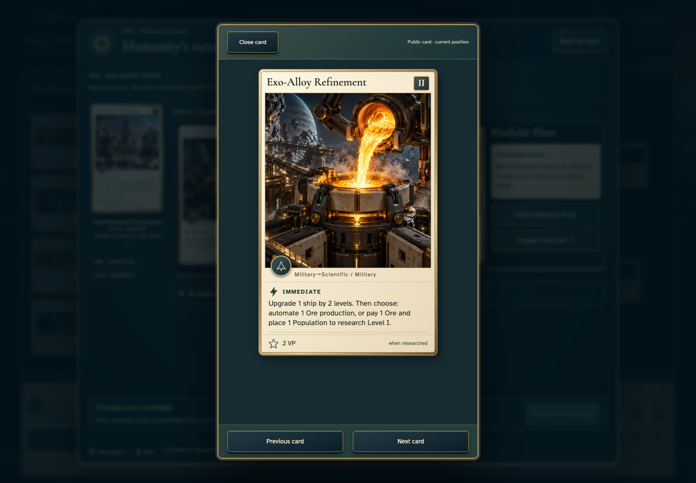](../../screenshots/retain-resource-cube-rerolls-and-complete-the-mandatory-upgrade-and-optional-bonus/050-candidate-inspected-desktop-darwin.png) |

- [x] Inspect the complete canonical Exo-Alloy Refinement face
- [x] The saved automatic consequences settle before the public decision is photographed.
- [x] Public compact Technology objects retain physical separation.
- [x] The gameplay shell stays inside the actual viewport.

## 52. Read the complete face through its bounded full-size inspector

Viewpoint: **Ada · independent host controller**.

| phone · 393 × 852 | desktop · 1440 × 1000 |
| --- | --- |
| [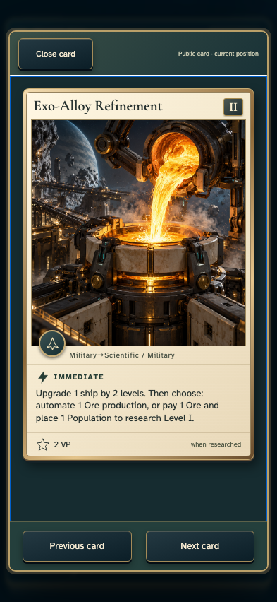](../../screenshots/retain-resource-cube-rerolls-and-complete-the-mandatory-upgrade-and-optional-bonus/051-candidate-inspected-rules-phone-darwin.png) | [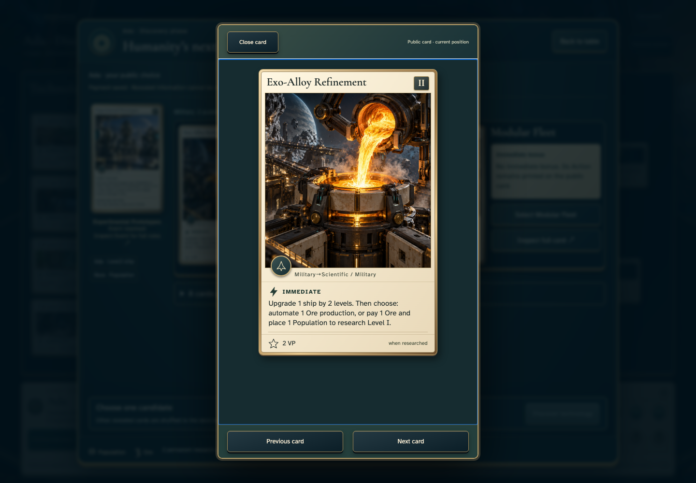](../../screenshots/retain-resource-cube-rerolls-and-complete-the-mandatory-upgrade-and-optional-bonus/051-candidate-inspected-rules-desktop-darwin.png) |

- [x] Read the complete face through its bounded full-size inspector
- [x] The saved automatic consequences settle before the public decision is photographed.
- [x] Public compact Technology objects retain physical separation.
- [x] The gameplay shell stays inside the actual viewport.

## 53. Escape returns keyboard focus to the actual inspection source

Viewpoint: **Ada · independent host controller**.

| phone · 393 × 852 | desktop · 1440 × 1000 |
| --- | --- |
|  |  |

- [x] Escape returns keyboard focus to the actual inspection source
- [x] The saved automatic consequences settle before the public decision is photographed.
- [x] Public compact Technology objects retain physical separation.
- [x] The gameplay shell stays inside the actual viewport.

## 54. Reload retains the same revealed candidate set and research reservation

Viewpoint: **Ada · independent host controller**.

| phone · 393 × 852 | desktop · 1440 × 1000 |
| --- | --- |
|  |  |

- [x] Reload retains the same revealed candidate set and research reservation
- [x] The saved automatic consequences settle before the public decision is photographed.
- [x] Public compact Technology objects retain physical separation.
- [x] The gameplay shell stays inside the actual viewport.

## 55. Ada opens their saved public discovery decision

Viewpoint: **Ada · independent host controller**.

| phone · 393 × 852 | desktop · 1440 × 1000 |
| --- | --- |
|  |  |

- [x] Ada opens their saved public discovery decision
- [x] The saved automatic consequences settle before the public decision is photographed.
- [x] Public compact Technology objects retain physical separation.
- [x] The gameplay shell stays inside the actual viewport.

## 56. No reroll, new payment or replacement candidate appears on recovery

Viewpoint: **Ada · independent host controller**.

| phone · 393 × 852 | desktop · 1440 × 1000 |
| --- | --- |
|  |  |

- [x] No reroll, new payment or replacement candidate appears on recovery
- [x] The saved automatic consequences settle before the public decision is photographed.
- [x] Public compact Technology objects retain physical separation.
- [x] The gameplay shell stays inside the actual viewport.

## 57. The selected identity and immediate consequence remain beside the commit control

Viewpoint: **Ada · independent host controller**.

| phone · 393 × 852 | desktop · 1440 × 1000 |
| --- | --- |
|  |  |

- [x] The selected identity and immediate consequence remain beside the commit control
- [x] The saved automatic consequences settle before the public decision is photographed.
- [x] Public compact Technology objects retain physical separation.
- [x] The gameplay shell stays inside the actual viewport.

## 58. Exo-Alloy requires an explicit owned ship before its optional choice

Viewpoint: **Ada · independent host controller**.

| phone · 393 × 852 | desktop · 1440 × 1000 |
| --- | --- |
|  |  |

- [x] Exo-Alloy requires an explicit owned ship before its optional choice
- [x] The saved automatic consequences settle before the public decision is photographed.
- [x] Public compact Technology objects retain physical separation.
- [x] The gameplay shell stays inside the actual viewport.

## 59. Upgrade the original level-2 Sol ship by two levels

Viewpoint: **Ada · independent host controller**.

| phone · 393 × 852 | desktop · 1440 × 1000 |
| --- | --- |
|  |  |

- [x] Upgrade the original level-2 Sol ship by two levels
- [x] The saved automatic consequences settle before the public decision is photographed.
- [x] Public compact Technology objects retain physical separation.
- [x] The gameplay shell stays inside the actual viewport.

## 60. The upgrade resolves before the separate optional Exo-Alloy decision

Viewpoint: **Ada · independent host controller**.

| phone · 393 × 852 | desktop · 1440 × 1000 |
| --- | --- |
|  |  |

- [x] The upgrade resolves before the separate optional Exo-Alloy decision
- [x] The saved automatic consequences settle before the public decision is photographed.
- [x] Public compact Technology objects retain physical separation.
- [x] The gameplay shell stays inside the actual viewport.

## 61. A reload retains the unconsumed optional bonus after the permanent upgrade

Viewpoint: **Ada · independent host controller**.

| phone · 393 × 852 | desktop · 1440 × 1000 |
| --- | --- |
|  |  |

- [x] A reload retains the unconsumed optional bonus after the permanent upgrade
- [x] The saved automatic consequences settle before the public decision is photographed.
- [x] Public compact Technology objects retain physical separation.
- [x] The gameplay shell stays inside the actual viewport.

## 62. Ada opens their saved public discovery decision

Viewpoint: **Ada · independent host controller**.

| phone · 393 × 852 | desktop · 1440 × 1000 |
| --- | --- |
|  |  |

- [x] Ada opens their saved public discovery decision
- [x] The saved automatic consequences settle before the public decision is photographed.
- [x] Public compact Technology objects retain physical separation.
- [x] The gameplay shell stays inside the actual viewport.

## 63. The saved discovery and its complete immediate bonus resume ordinary Production

Viewpoint: **Ada · independent host controller**.

| phone · 393 × 852 | desktop · 1440 × 1000 |
| --- | --- |
|  |  |

- [x] The saved discovery and its complete immediate bonus resume ordinary Production
- [x] The saved automatic consequences settle before the public decision is photographed.
- [x] Public compact Technology objects retain physical separation.
- [x] The gameplay shell stays inside the actual viewport.

## 64. Reload preserves the discovered technology and pending Production without duplicating the bonus

Viewpoint: **Ada · independent host controller**.

| phone · 393 × 852 | desktop · 1440 × 1000 |
| --- | --- |
|  |  |

- [x] Reload preserves the discovered technology and pending Production without duplicating the bonus
- [x] The saved automatic consequences settle before the public decision is photographed.
- [x] Public compact Technology objects retain physical separation.
- [x] The gameplay shell stays inside the actual viewport.

## 65. Resume the same exclusive production decision

Viewpoint: **Ada · independent host controller**.

| phone · 393 × 852 | desktop · 1440 × 1000 |
| --- | --- |
|  |  |

- [x] Resume the same exclusive production decision
- [x] The saved automatic consequences settle before the public decision is photographed.
- [x] Public compact Technology objects retain physical separation.
- [x] The gameplay shell stays inside the actual viewport.

## 66. Ada completes ordinary production and hands off automatically

Viewpoint: **Ada · independent host controller**.

| phone · 393 × 852 | desktop · 1440 × 1000 |
| --- | --- |
|  |  |

- [x] Ada completes ordinary production and hands off automatically
- [x] The saved automatic consequences settle before the public decision is photographed.
- [x] Public compact Technology objects retain physical separation.
- [x] The gameplay shell stays inside the actual viewport.

## 67. The next independent controller sees the same canonical handoff

Viewpoint: **Bora · independent guest controller**.

| phone · 1440 × 1000 | desktop · 393 × 852 |
| --- | --- |
|  |  |

- [x] The next independent controller sees the same canonical handoff
- [x] The saved automatic consequences settle before the public decision is photographed.
- [x] Public compact Technology objects retain physical separation.
- [x] The gameplay shell stays inside the actual viewport.

## 68. Reload retains the discovered public card, permanent research and canonical Bora handoff

Viewpoint: **Ada · independent host controller**.

| phone · 393 × 852 | desktop · 1440 × 1000 |
| --- | --- |
|  |  |

- [x] Reload retains the discovered public card, permanent research and canonical Bora handoff
- [x] The saved automatic consequences settle before the public decision is photographed.
- [x] Public compact Technology objects retain physical separation.
- [x] The gameplay shell stays inside the actual viewport.
