# Reveal attach and recover a real Dimensional Rift System

One real shared controller, 2 named cardinal seats, legal Basic factions and ordinary UI preparation. Fixed initial entropy selects base-game seed 55555555-5555-4555-8555-000000000003; no injected game history or private device. Native seat-facing decisions, exact public effects and retained choices are captured through TestStepHelper. Compact720/640 overview/focus/lower navigation is included after the actual play sequence. Later-phase printed card Actions remain inspectable rather than fake turn controls.

## 1. Arrive through the actual observatory

Viewpoint: **Ada · South · single shared controller**.

| desktop · 1440 × 1000 |
| --- |
|  |

tabletop-4k · 3840 × 2160

- [x] Arrive through the actual observatory
- [x] The saved automatic consequences settle before the public decision is photographed.
- [x] Covered and discovered compact nodes retain physical separation.
- [x] The game stays inside its actual viewport.

## 2. Choose the intended production interface

Viewpoint: **Ada · South · single shared controller**.

| desktop · 1440 × 1000 |
| --- |
|  |

tabletop-4k · 3840 × 2160

- [x] Choose the intended production interface
- [x] The saved automatic consequences settle before the public decision is photographed.
- [x] Covered and discovered compact nodes retain physical separation.
- [x] The game stays inside its actual viewport.

## 3. All players join directly on the one shared display

Viewpoint: **Ada · South · single shared controller**.

| desktop · 1440 × 1000 |
| --- |
|  |

tabletop-4k · 3840 × 2160

- [x] All players join directly on the one shared display
- [x] The saved automatic consequences settle before the public decision is photographed.
- [x] Covered and discovered compact nodes retain physical separation.
- [x] The game stays inside its actual viewport.

## 4. Ada opens the physical South seat

Viewpoint: **Ada · South · single shared controller**.

| desktop · 1440 × 1000 |
| --- |
|  |

tabletop-4k · 3840 × 2160

- [x] Ada opens the physical South seat
- [x] The saved automatic consequences settle before the public decision is photographed.
- [x] Covered and discovered compact nodes retain physical separation.
- [x] The game stays inside its actual viewport.

## 5. Ada names their local seat

Viewpoint: **Ada · South · single shared controller**.

| desktop · 1440 × 1000 |
| --- |
|  |

tabletop-4k · 3840 × 2160

- [x] Ada names their local seat
- [x] The saved automatic consequences settle before the public decision is photographed.
- [x] Covered and discovered compact nodes retain physical separation.
- [x] The game stays inside its actual viewport.

## 6. Ada joins the physical table

Viewpoint: **Ada · South · single shared controller**.

| desktop · 1440 × 1000 |
| --- |
|  |

tabletop-4k · 3840 × 2160

- [x] Ada joins the physical table
- [x] The saved automatic consequences settle before the public decision is photographed.
- [x] Covered and discovered compact nodes retain physical separation.
- [x] The game stays inside its actual viewport.

## 7. Bora opens the physical North seat

Viewpoint: **Bora · North · single shared controller**.

| desktop · 1440 × 1000 |
| --- |
|  |

tabletop-4k · 3840 × 2160

- [x] Bora opens the physical North seat
- [x] The saved automatic consequences settle before the public decision is photographed.
- [x] Covered and discovered compact nodes retain physical separation.
- [x] The game stays inside its actual viewport.

## 8. Bora names their local seat

Viewpoint: **Bora · North · single shared controller**.

| desktop · 1440 × 1000 |
| --- |
|  |

tabletop-4k · 3840 × 2160

- [x] Bora names their local seat
- [x] The saved automatic consequences settle before the public decision is photographed.
- [x] Covered and discovered compact nodes retain physical separation.
- [x] The game stays inside its actual viewport.

## 9. Bora joins the physical table

Viewpoint: **Bora · North · single shared controller**.

| desktop · 1440 × 1000 |
| --- |
| [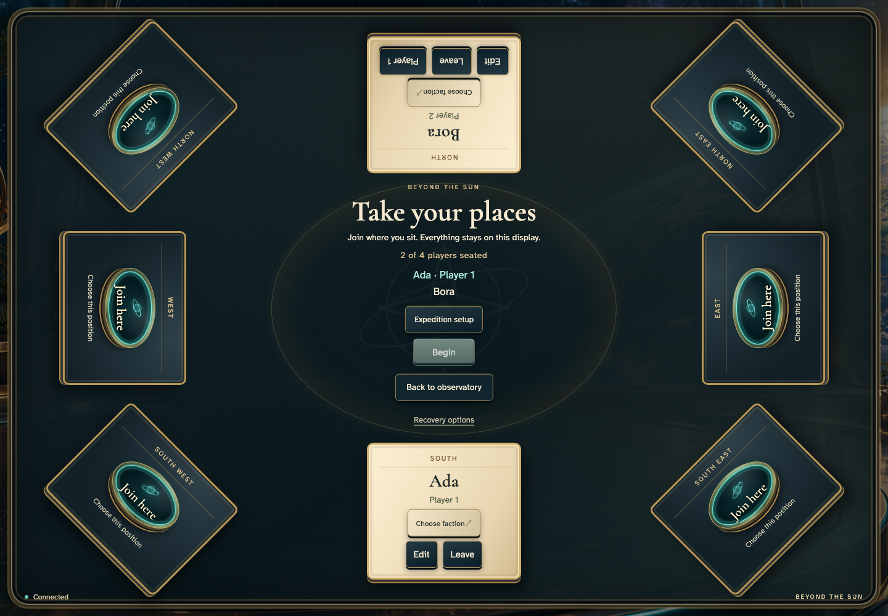](../../screenshots/reveal-attach-and-recover-a-real-dimensional-rift-system/008-seat-1-joined-desktop-darwin.png) |

tabletop-4k · 3840 × 2160

- [x] Bora joins the physical table
- [x] The saved automatic consequences settle before the public decision is photographed.
- [x] Covered and discovered compact nodes retain physical separation.
- [x] The game stays inside its actual viewport.

## 10. Ada reads the legal unique Basic factions

Viewpoint: **Ada · South · single shared controller**.

| desktop · 1440 × 1000 |
| --- |
| [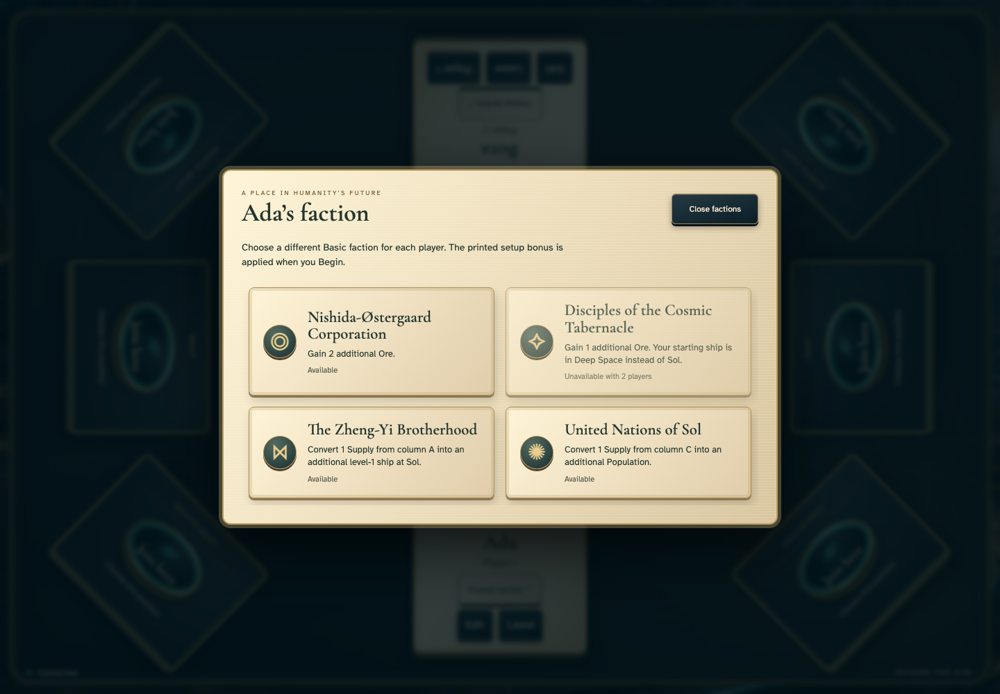](../../screenshots/reveal-attach-and-recover-a-real-dimensional-rift-system/009-faction-0-choices-desktop-darwin.png) |

tabletop-4k · 3840 × 2160

- [x] Ada reads the legal unique Basic factions
- [x] The saved automatic consequences settle before the public decision is photographed.
- [x] Covered and discovered compact nodes retain physical separation.
- [x] The game stays inside its actual viewport.

## 11. Ada chooses their actual production faction

Viewpoint: **Ada · South · single shared controller**.

| desktop · 1440 × 1000 |
| --- |
|  |

tabletop-4k · 3840 × 2160

- [x] Ada chooses their actual production faction
- [x] The saved automatic consequences settle before the public decision is photographed.
- [x] Covered and discovered compact nodes retain physical separation.
- [x] The game stays inside its actual viewport.

## 12. Bora reads the legal unique Basic factions

Viewpoint: **Bora · North · single shared controller**.

| desktop · 1440 × 1000 |
| --- |
|  |

tabletop-4k · 3840 × 2160

- [x] Bora reads the legal unique Basic factions
- [x] The saved automatic consequences settle before the public decision is photographed.
- [x] Covered and discovered compact nodes retain physical separation.
- [x] The game stays inside its actual viewport.

## 13. Bora chooses their actual production faction

Viewpoint: **Bora · North · single shared controller**.

| desktop · 1440 × 1000 |
| --- |
|  |

tabletop-4k · 3840 × 2160

- [x] Bora chooses their actual production faction
- [x] The saved automatic consequences settle before the public decision is photographed.
- [x] Covered and discovered compact nodes retain physical separation.
- [x] The game stays inside its actual viewport.

## 14. Begin creates the immutable seeded Basic game

Viewpoint: **Ada · South · single shared controller**.

| desktop · 1440 × 1000 |
| --- |
| [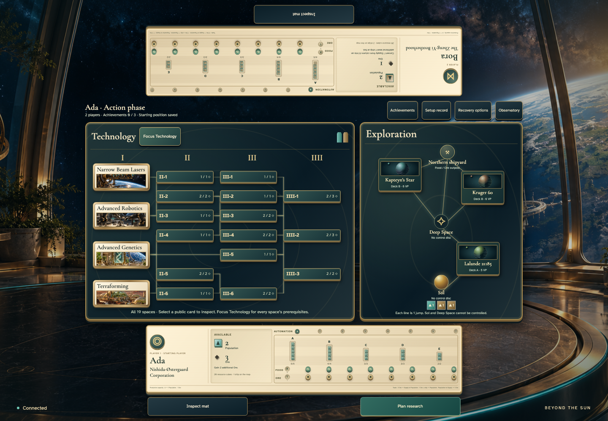](../../screenshots/reveal-attach-and-recover-a-real-dimensional-rift-system/013-begun-desktop-darwin.png) |

tabletop-4k · 3840 × 2160

[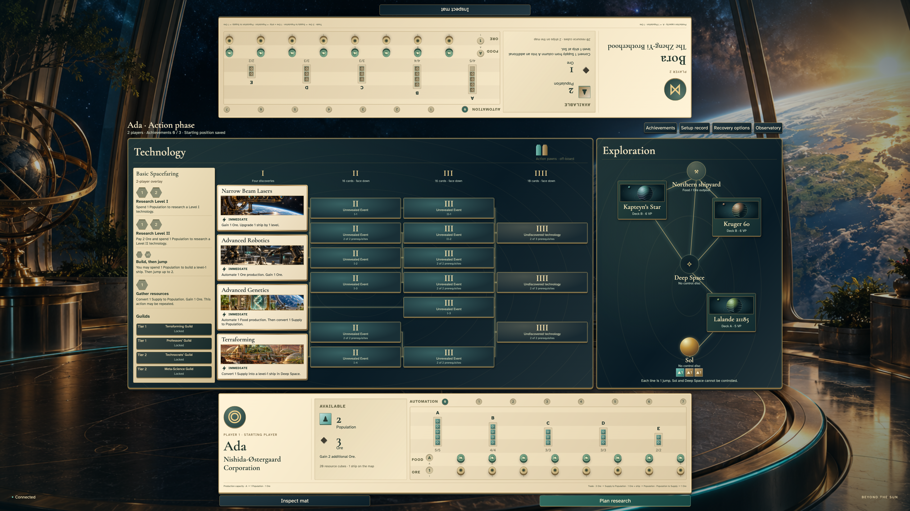](../../screenshots/reveal-attach-and-recover-a-real-dimensional-rift-system/013-begun-tabletop-4k-darwin.png)

- [x] Begin creates the immutable seeded Basic game
- [x] The saved automatic consequences settle before the public decision is photographed.
- [x] Covered and discovered compact nodes retain physical separation.
- [x] The game stays inside its actual viewport.

## 15. Ada plans a legal preparatory Level I turn

Viewpoint: **Ada · South · single shared controller**.

| desktop · 1440 × 1000 |
| --- |
| [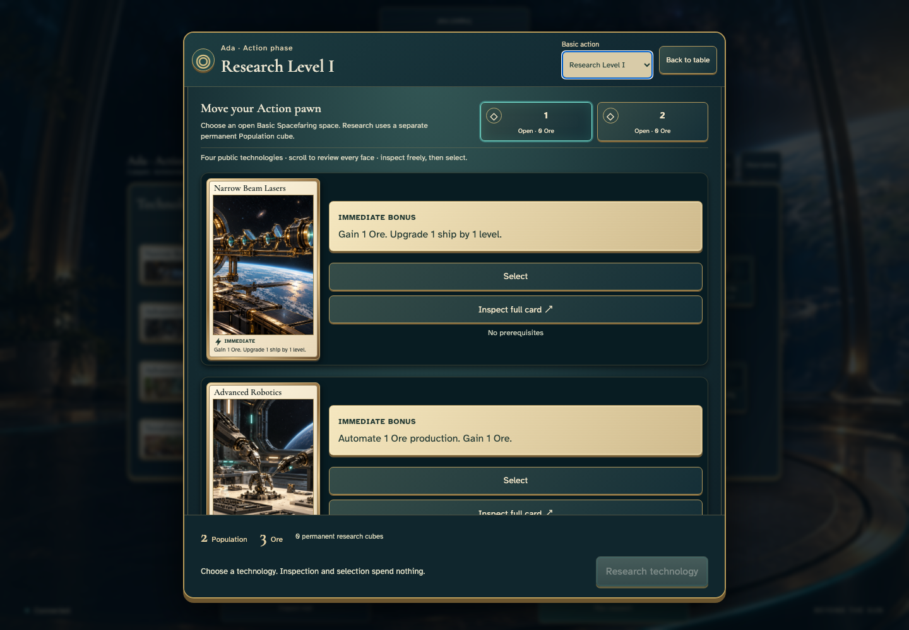](../../screenshots/reveal-attach-and-recover-a-real-dimensional-rift-system/014-prep-0-plan-desktop-darwin.png) |

tabletop-4k · 3840 × 2160

[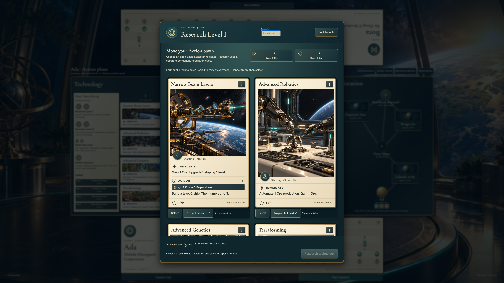](../../screenshots/reveal-attach-and-recover-a-real-dimensional-rift-system/014-prep-0-plan-tabletop-4k-darwin.png)

- [x] Ada plans a legal preparatory Level I turn
- [x] The saved automatic consequences settle before the public decision is photographed.
- [x] Covered and discovered compact nodes retain physical separation.
- [x] The game stays inside its actual viewport.

## 16. Ada chooses the unoccupied printed Action space

Viewpoint: **Ada · South · single shared controller**.

| desktop · 1440 × 1000 |
| --- |
| [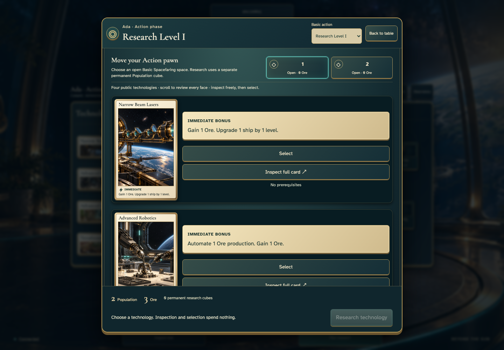](../../screenshots/reveal-attach-and-recover-a-real-dimensional-rift-system/015-prep-0-space-desktop-darwin.png) |

tabletop-4k · 3840 × 2160

[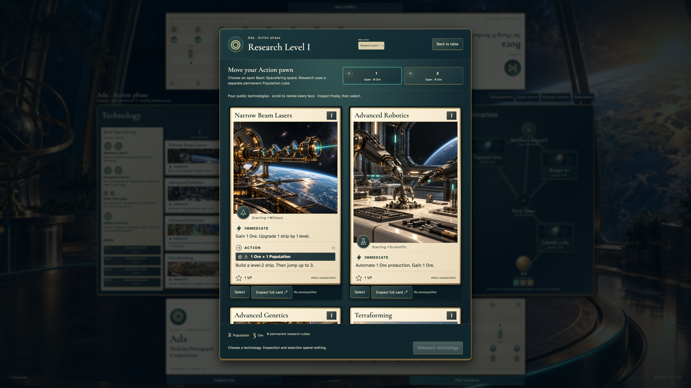](../../screenshots/reveal-attach-and-recover-a-real-dimensional-rift-system/015-prep-0-space-tabletop-4k-darwin.png)

- [x] Ada chooses the unoccupied printed Action space
- [x] The saved automatic consequences settle before the public decision is photographed.
- [x] Covered and discovered compact nodes retain physical separation.
- [x] The game stays inside its actual viewport.

## 17. Ada selects the public Advanced Robotics face

Viewpoint: **Ada · South · single shared controller**.

| desktop · 1440 × 1000 |
| --- |
| [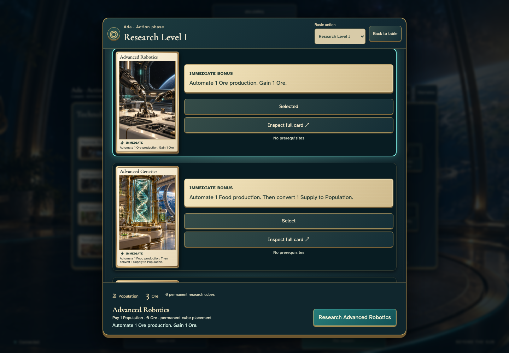](../../screenshots/reveal-attach-and-recover-a-real-dimensional-rift-system/016-prep-0-card-desktop-darwin.png) |

tabletop-4k · 3840 × 2160

[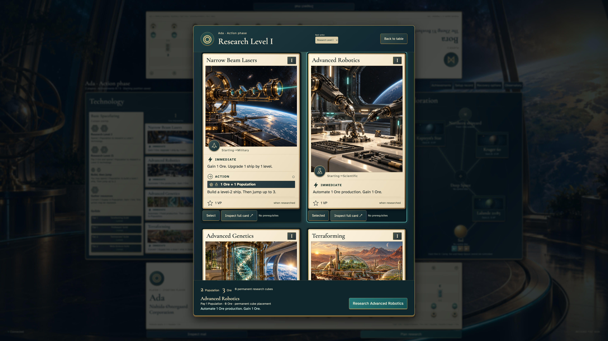](../../screenshots/reveal-attach-and-recover-a-real-dimensional-rift-system/016-prep-0-card-tabletop-4k-darwin.png)

- [x] Ada selects the public Advanced Robotics face
- [x] The saved automatic consequences settle before the public decision is photographed.
- [x] Covered and discovered compact nodes retain physical separation.
- [x] The game stays inside its actual viewport.

## 18. Ada pays permanent research Population and receives the printed immediate bonus

Viewpoint: **Ada · South · single shared controller**.

| desktop · 1440 × 1000 |
| --- |
| [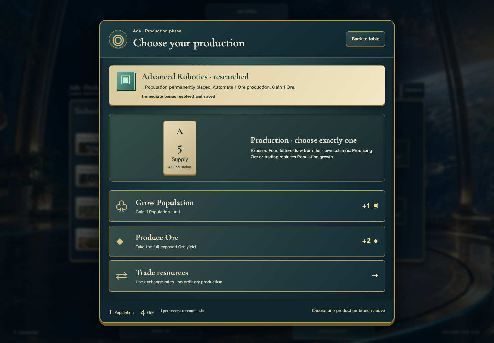](../../screenshots/reveal-attach-and-recover-a-real-dimensional-rift-system/017-prep-0-paid-desktop-darwin.png) |

tabletop-4k · 3840 × 2160

[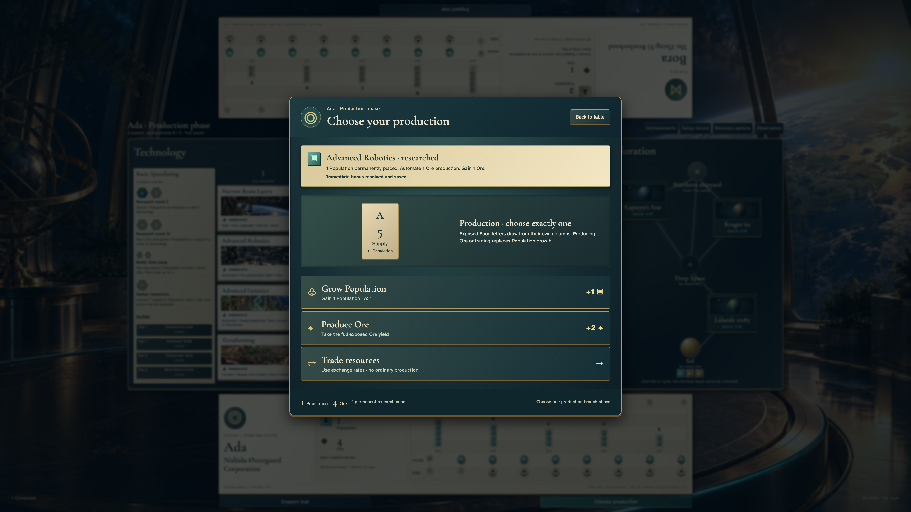](../../screenshots/reveal-attach-and-recover-a-real-dimensional-rift-system/017-prep-0-paid-tabletop-4k-darwin.png)

- [x] Ada pays permanent research Population and receives the printed immediate bonus
- [x] The saved automatic consequences settle before the public decision is photographed.
- [x] Covered and discovered compact nodes retain physical separation.
- [x] The game stays inside its actual viewport.

## 19. Ada completes ordinary production and hands off automatically

Viewpoint: **Ada · South · single shared controller**.

| desktop · 1440 × 1000 |
| --- |
| [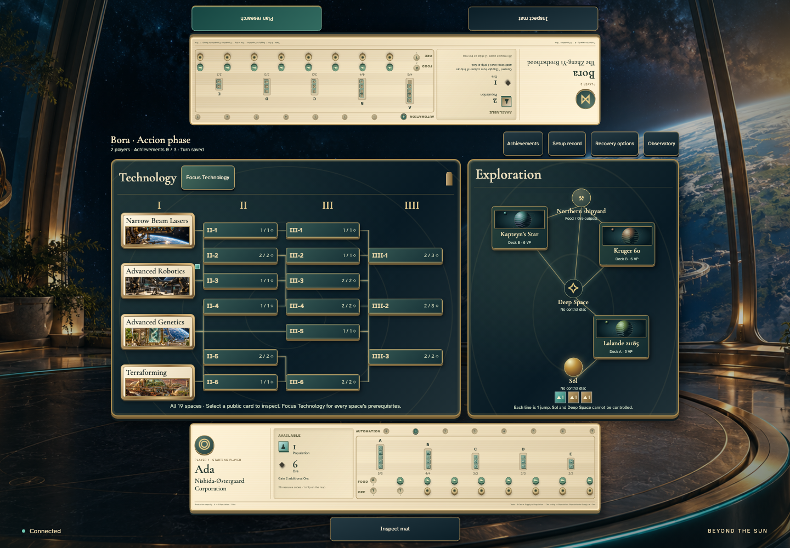](../../screenshots/reveal-attach-and-recover-a-real-dimensional-rift-system/018-prep-0-handoff-desktop-darwin.png) |

tabletop-4k · 3840 × 2160

[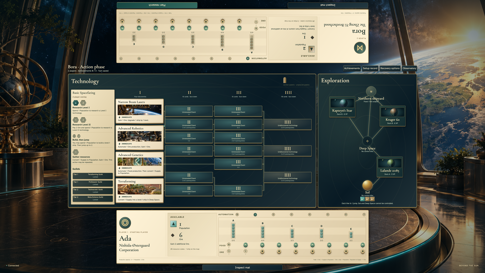](../../screenshots/reveal-attach-and-recover-a-real-dimensional-rift-system/018-prep-0-handoff-tabletop-4k-darwin.png)

- [x] Ada completes ordinary production and hands off automatically
- [x] The saved automatic consequences settle before the public decision is photographed.
- [x] Covered and discovered compact nodes retain physical separation.
- [x] The game stays inside its actual viewport.

## 20. Bora plans a legal preparatory Level I turn

Viewpoint: **Bora · North · single shared controller**.

| desktop · 1440 × 1000 |
| --- |
|  |

tabletop-4k · 3840 × 2160

[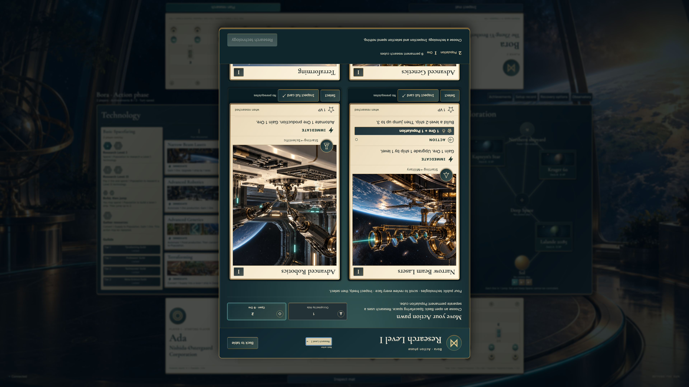](../../screenshots/reveal-attach-and-recover-a-real-dimensional-rift-system/019-prep-1-plan-tabletop-4k-darwin.png)

- [x] Bora plans a legal preparatory Level I turn
- [x] The saved automatic consequences settle before the public decision is photographed.
- [x] Covered and discovered compact nodes retain physical separation.
- [x] The game stays inside its actual viewport.

## 21. Bora chooses the unoccupied printed Action space

Viewpoint: **Bora · North · single shared controller**.

| desktop · 1440 × 1000 |
| --- |
| [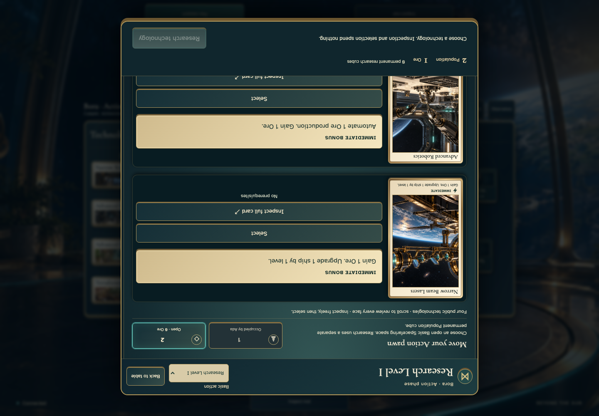](../../screenshots/reveal-attach-and-recover-a-real-dimensional-rift-system/020-prep-1-space-desktop-darwin.png) |

tabletop-4k · 3840 × 2160

- [x] Bora chooses the unoccupied printed Action space
- [x] The saved automatic consequences settle before the public decision is photographed.
- [x] Covered and discovered compact nodes retain physical separation.
- [x] The game stays inside its actual viewport.

## 22. Bora selects the public Advanced Robotics face

Viewpoint: **Bora · North · single shared controller**.

| desktop · 1440 × 1000 |
| --- |
| [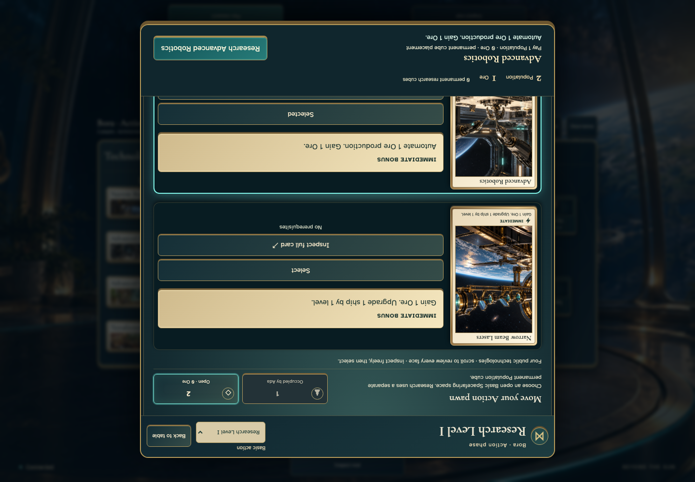](../../screenshots/reveal-attach-and-recover-a-real-dimensional-rift-system/021-prep-1-card-desktop-darwin.png) |

tabletop-4k · 3840 × 2160

[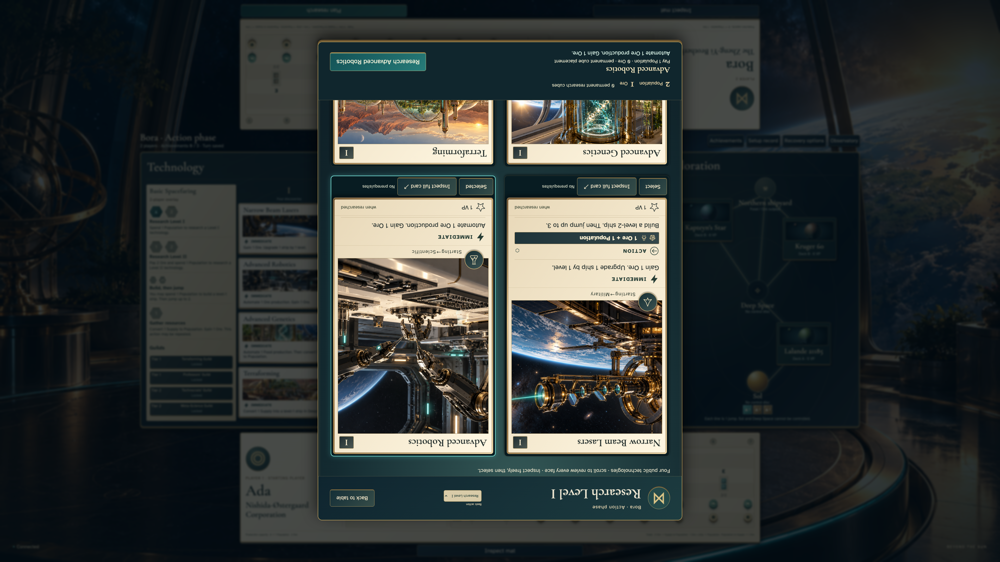](../../screenshots/reveal-attach-and-recover-a-real-dimensional-rift-system/021-prep-1-card-tabletop-4k-darwin.png)

- [x] Bora selects the public Advanced Robotics face
- [x] The saved automatic consequences settle before the public decision is photographed.
- [x] Covered and discovered compact nodes retain physical separation.
- [x] The game stays inside its actual viewport.

## 23. Bora pays permanent research Population and receives the printed immediate bonus

Viewpoint: **Bora · North · single shared controller**.

| desktop · 1440 × 1000 |
| --- |
| [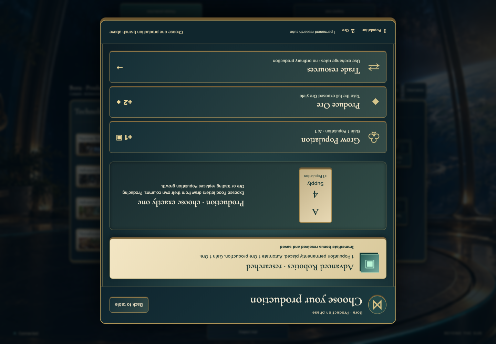](../../screenshots/reveal-attach-and-recover-a-real-dimensional-rift-system/022-prep-1-paid-desktop-darwin.png) |

tabletop-4k · 3840 × 2160

[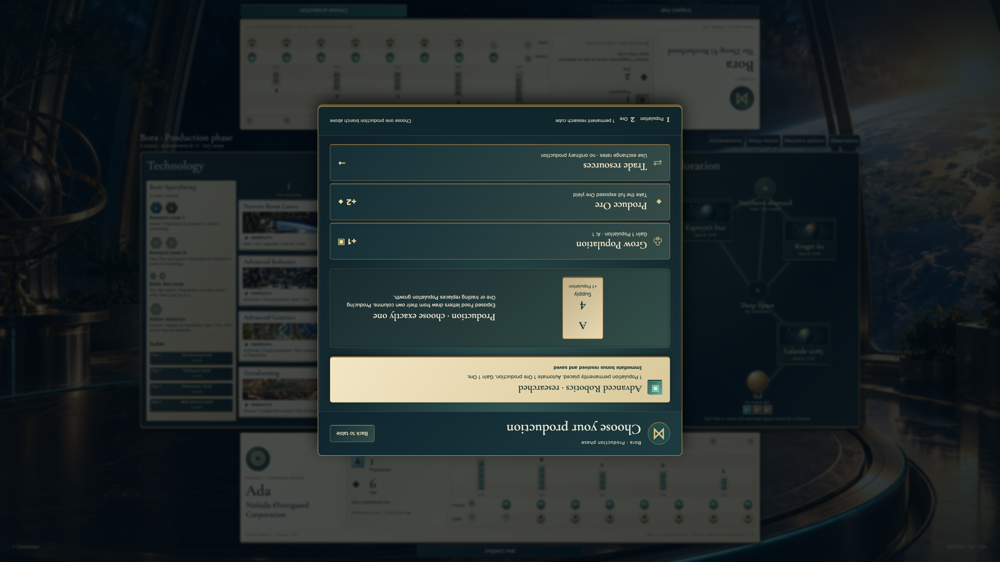](../../screenshots/reveal-attach-and-recover-a-real-dimensional-rift-system/022-prep-1-paid-tabletop-4k-darwin.png)

- [x] Bora pays permanent research Population and receives the printed immediate bonus
- [x] The saved automatic consequences settle before the public decision is photographed.
- [x] Covered and discovered compact nodes retain physical separation.
- [x] The game stays inside its actual viewport.

## 24. Bora completes ordinary production and hands off automatically

Viewpoint: **Bora · North · single shared controller**.

| desktop · 1440 × 1000 |
| --- |
| [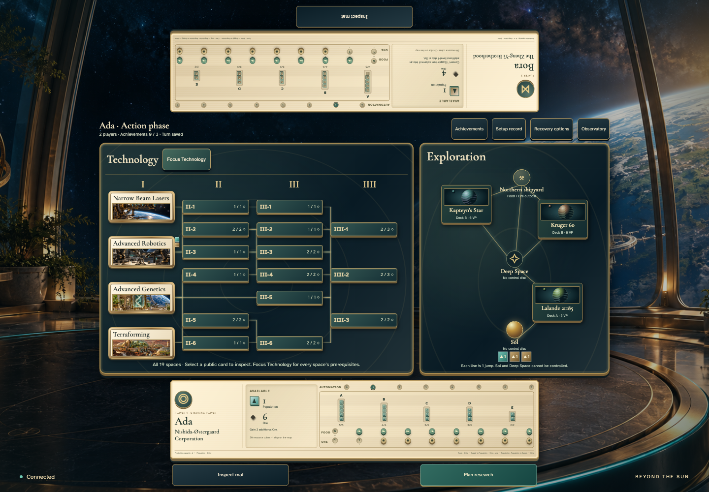](../../screenshots/reveal-attach-and-recover-a-real-dimensional-rift-system/023-prep-1-handoff-desktop-darwin.png) |

tabletop-4k · 3840 × 2160

- [x] Bora completes ordinary production and hands off automatically
- [x] The saved automatic consequences settle before the public decision is photographed.
- [x] Covered and discovered compact nodes retain physical separation.
- [x] The game stays inside its actual viewport.

## 25. The researcher opens the real Basic action instrument

Viewpoint: **Ada · South · single shared controller**.

| desktop · 1440 × 1000 |
| --- |
| [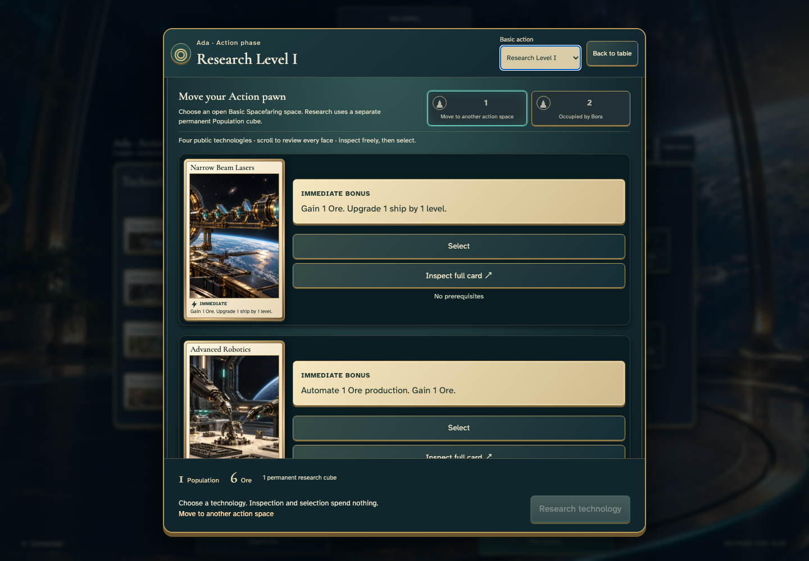](../../screenshots/reveal-attach-and-recover-a-real-dimensional-rift-system/024-level-i-plan-desktop-darwin.png) |

tabletop-4k · 3840 × 2160

[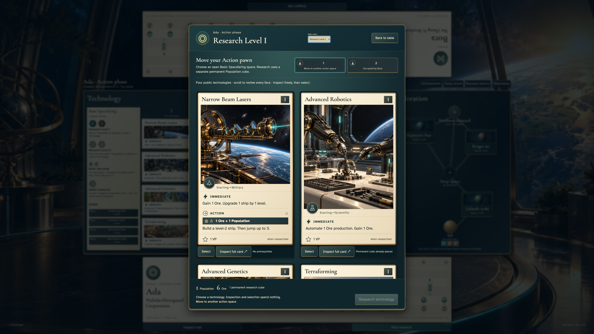](../../screenshots/reveal-attach-and-recover-a-real-dimensional-rift-system/024-level-i-plan-tabletop-4k-darwin.png)

- [x] The researcher opens the real Basic action instrument
- [x] The saved automatic consequences settle before the public decision is photographed.
- [x] Covered and discovered compact nodes retain physical separation.
- [x] The game stays inside its actual viewport.

## 26. Choose Level II and inspect all six public prerequisites without revealing cards

Viewpoint: **Ada · South · single shared controller**.

| desktop · 1440 × 1000 |
| --- |
| [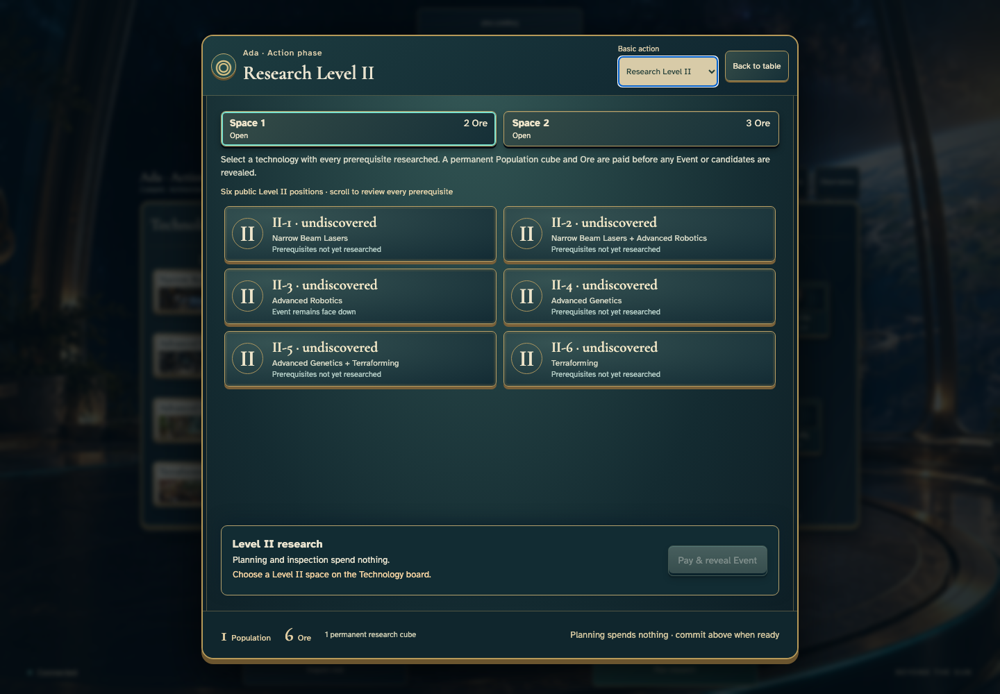](../../screenshots/reveal-attach-and-recover-a-real-dimensional-rift-system/025-level-ii-plan-desktop-darwin.png) |

tabletop-4k · 3840 × 2160

[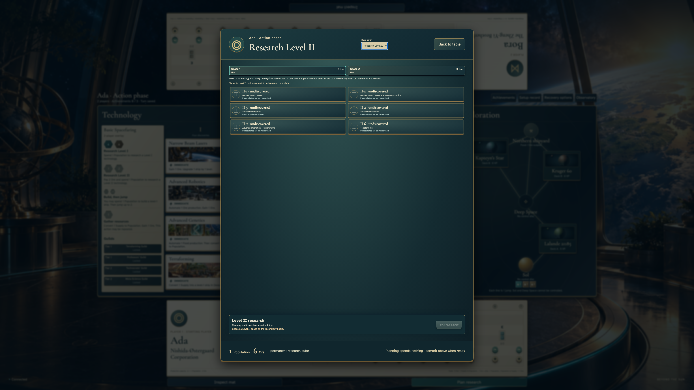](../../screenshots/reveal-attach-and-recover-a-real-dimensional-rift-system/025-level-ii-plan-tabletop-4k-darwin.png)

- [x] Choose Level II and inspect all six public prerequisites without revealing cards
- [x] The saved automatic consequences settle before the public decision is photographed.
- [x] Covered and discovered compact nodes retain physical separation.
- [x] The game stays inside its actual viewport.

## 27. Select a legal undiscovered position and read its permanent Population and Ore payment

Viewpoint: **Ada · South · single shared controller**.

| desktop · 1440 × 1000 |
| --- |
| [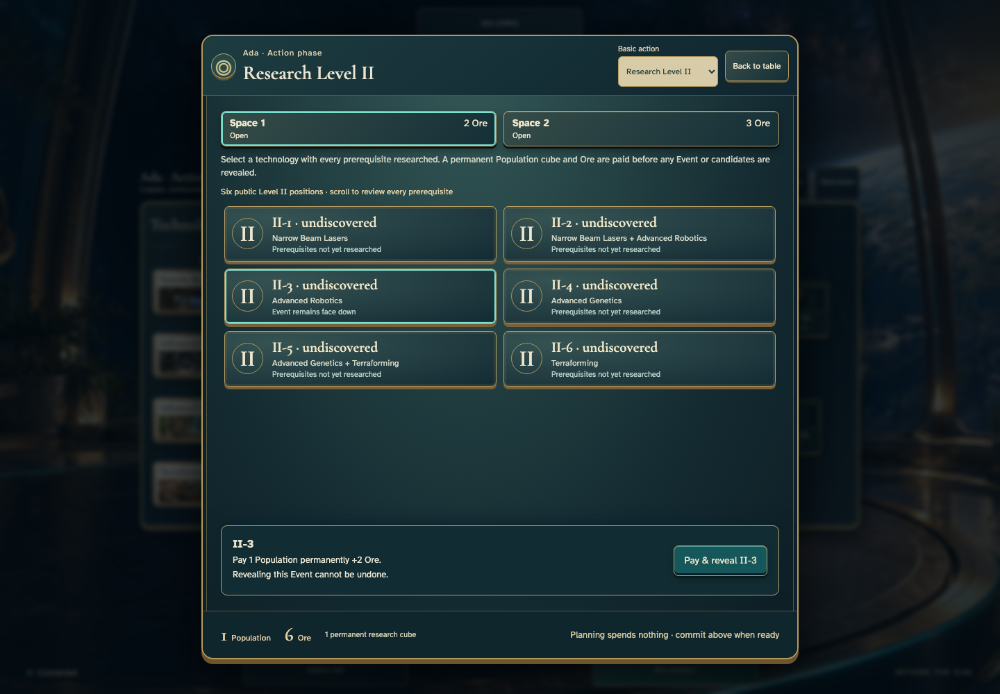](../../screenshots/reveal-attach-and-recover-a-real-dimensional-rift-system/026-level-ii-target-desktop-darwin.png) |

tabletop-4k · 3840 × 2160

[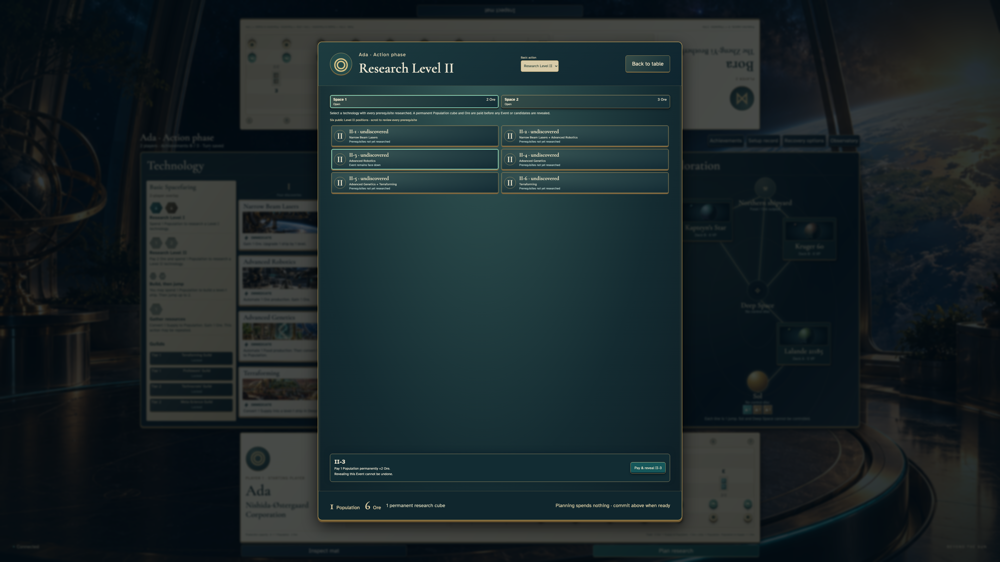](../../screenshots/reveal-attach-and-recover-a-real-dimensional-rift-system/026-level-ii-target-tabletop-4k-darwin.png)

- [x] Select a legal undiscovered position and read its permanent Population and Ore payment
- [x] The saved automatic consequences settle before the public decision is photographed.
- [x] Covered and discovered compact nodes retain physical separation.
- [x] The game stays inside its actual viewport.

## 28. Payment reveals Dimensional Rift; all Event decisions resolve before candidates

Viewpoint: **Ada · South · single shared controller**.

| desktop · 1440 × 1000 |
| --- |
|  |

tabletop-4k · 3840 × 2160

[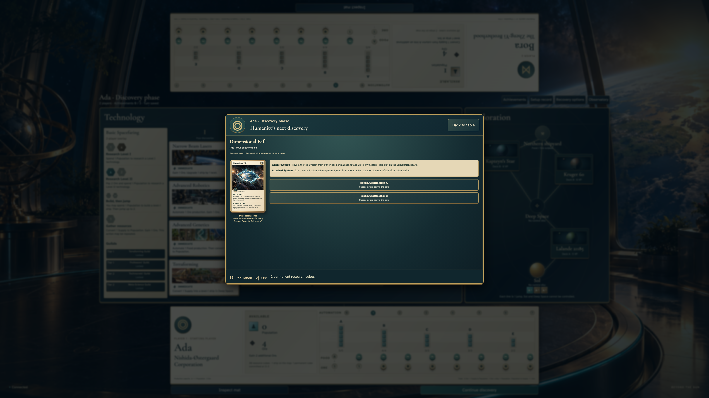](../../screenshots/reveal-attach-and-recover-a-real-dimensional-rift-system/027-event-revealed-tabletop-4k-darwin.png)

- [x] Payment reveals Dimensional Rift; all Event decisions resolve before candidates
- [x] The saved automatic consequences settle before the public decision is photographed.
- [x] Covered and discovered compact nodes retain physical separation.
- [x] The game stays inside its actual viewport.

## 29. Ada reads and owns this public Event decision

Viewpoint: **Ada · South · single shared controller**.

| desktop · 1440 × 1000 |
| --- |
| [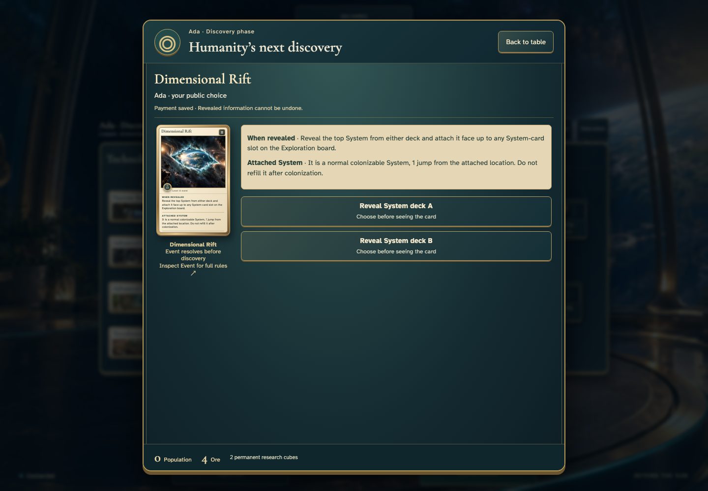](../../screenshots/reveal-attach-and-recover-a-real-dimensional-rift-system/028-rift-deck-choice-desktop-darwin.png) |

tabletop-4k · 3840 × 2160

- [x] Ada reads and owns this public Event decision
- [x] The saved automatic consequences settle before the public decision is photographed.
- [x] Covered and discovered compact nodes retain physical separation.
- [x] The game stays inside its actual viewport.

## 30. Choose the System deck before any new System is visible

Viewpoint: **Ada · South · single shared controller**.

| desktop · 1440 × 1000 |
| --- |
| [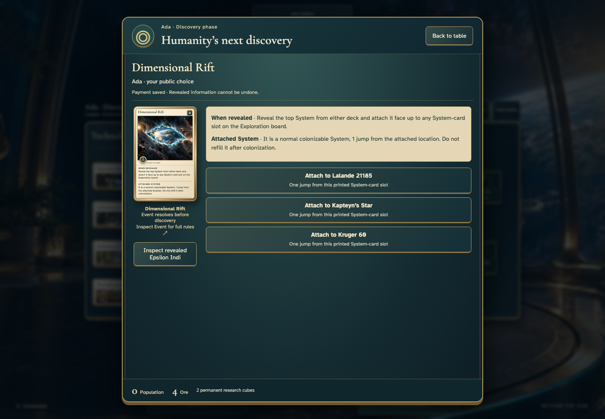](../../screenshots/reveal-attach-and-recover-a-real-dimensional-rift-system/029-rift-deck-saved-desktop-darwin.png) |

tabletop-4k · 3840 × 2160

- [x] Choose the System deck before any new System is visible
- [x] The saved automatic consequences settle before the public decision is photographed.
- [x] Covered and discovered compact nodes retain physical separation.
- [x] The game stays inside its actual viewport.

## 31. The newly revealed Epsilon Indi is public before its attachment is chosen

Viewpoint: **Ada · South · single shared controller**.

| desktop · 1440 × 1000 |
| --- |
|  |

tabletop-4k · 3840 × 2160

- [x] The newly revealed Epsilon Indi is public before its attachment is chosen
- [x] The saved automatic consequences settle before the public decision is photographed.
- [x] Covered and discovered compact nodes retain physical separation.
- [x] The game stays inside its actual viewport.

## 32. Inspect the complete canonical Epsilon Indi face

Viewpoint: **Ada · South · single shared controller**.

| desktop · 1440 × 1000 |
| --- |
| [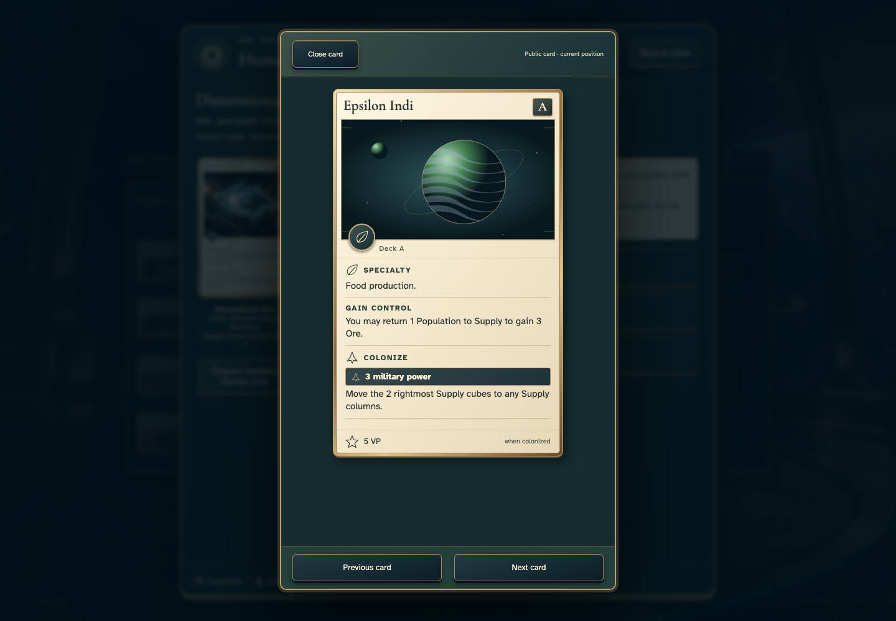](../../screenshots/reveal-attach-and-recover-a-real-dimensional-rift-system/031-rift-inspection-desktop-darwin.png) |

tabletop-4k · 3840 × 2160

[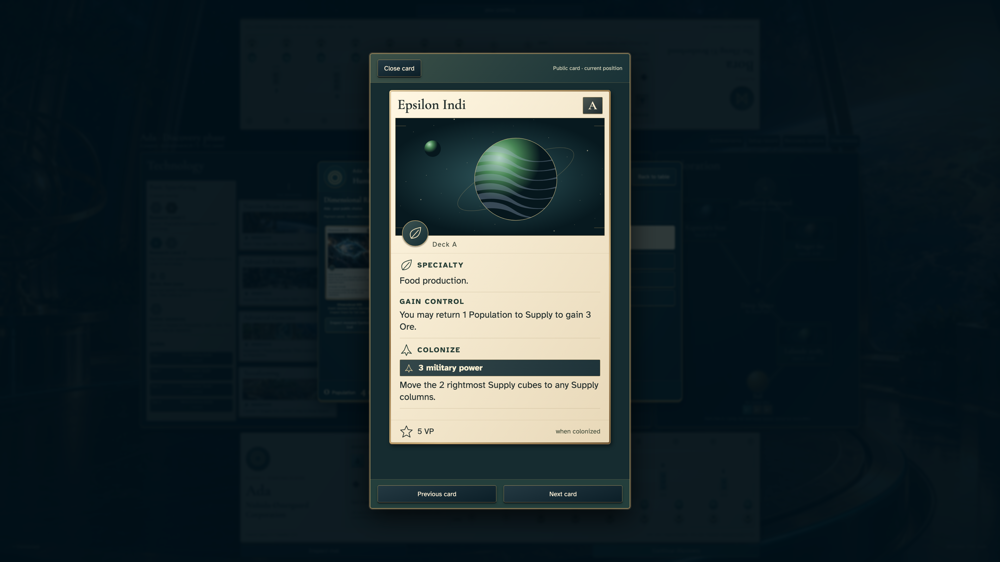](../../screenshots/reveal-attach-and-recover-a-real-dimensional-rift-system/031-rift-inspection-tabletop-4k-darwin.png)

- [x] Inspect the complete canonical Epsilon Indi face
- [x] The saved automatic consequences settle before the public decision is photographed.
- [x] Covered and discovered compact nodes retain physical separation.
- [x] The game stays inside its actual viewport.

## 33. Read the complete face through its bounded full-size inspector

Viewpoint: **Ada · South · single shared controller**.

| desktop · 1440 × 1000 |
| --- |
| [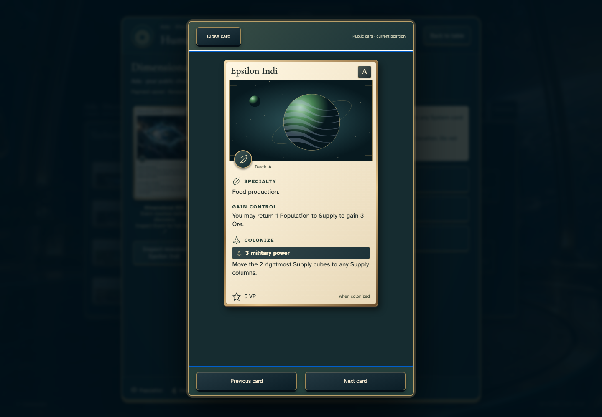](../../screenshots/reveal-attach-and-recover-a-real-dimensional-rift-system/032-rift-inspection-rules-desktop-darwin.png) |

tabletop-4k · 3840 × 2160

[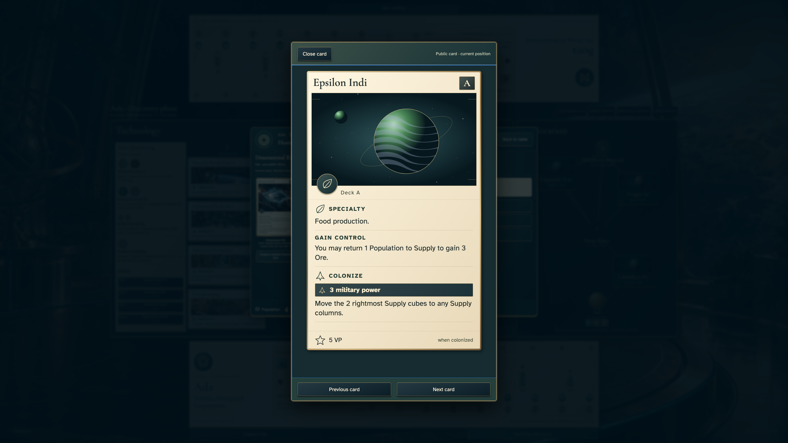](../../screenshots/reveal-attach-and-recover-a-real-dimensional-rift-system/032-rift-inspection-rules-tabletop-4k-darwin.png)

- [x] Read the complete face through its bounded full-size inspector
- [x] The saved automatic consequences settle before the public decision is photographed.
- [x] Covered and discovered compact nodes retain physical separation.
- [x] The game stays inside its actual viewport.

## 34. Escape returns keyboard focus to the actual inspection source

Viewpoint: **Ada · South · single shared controller**.

| desktop · 1440 × 1000 |
| --- |
| [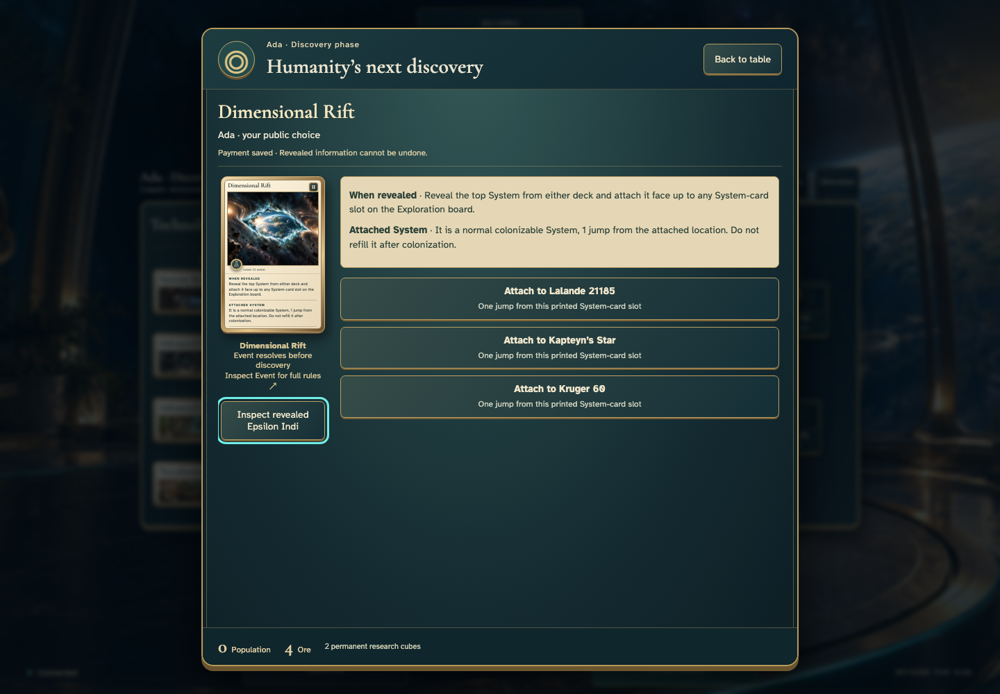](../../screenshots/reveal-attach-and-recover-a-real-dimensional-rift-system/033-rift-inspection-return-desktop-darwin.png) |

tabletop-4k · 3840 × 2160

[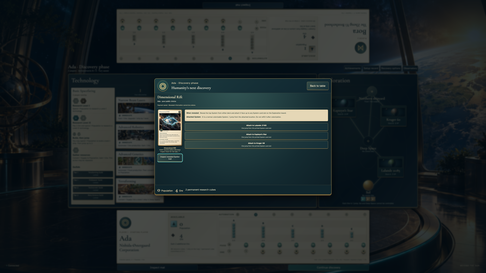](../../screenshots/reveal-attach-and-recover-a-real-dimensional-rift-system/033-rift-inspection-return-tabletop-4k-darwin.png)

- [x] Escape returns keyboard focus to the actual inspection source
- [x] The saved automatic consequences settle before the public decision is photographed.
- [x] Covered and discovered compact nodes retain physical separation.
- [x] The game stays inside its actual viewport.

## 35. The same revealed System awaits the saved attachment choice after reload

Viewpoint: **Ada · South · single shared controller**.

| desktop · 1440 × 1000 |
| --- |
|  |

tabletop-4k · 3840 × 2160

- [x] The same revealed System awaits the saved attachment choice after reload
- [x] The saved automatic consequences settle before the public decision is photographed.
- [x] Covered and discovered compact nodes retain physical separation.
- [x] The game stays inside its actual viewport.

## 36. Ada opens their saved public discovery decision

Viewpoint: **Ada · South · single shared controller**.

| desktop · 1440 × 1000 |
| --- |
|  |

tabletop-4k · 3840 × 2160

- [x] Ada opens their saved public discovery decision
- [x] The saved automatic consequences settle before the public decision is photographed.
- [x] Covered and discovered compact nodes retain physical separation.
- [x] The game stays inside its actual viewport.

## 37. Recovery retains Epsilon Indi and the uncommitted attachment

Viewpoint: **Ada · South · single shared controller**.

| desktop · 1440 × 1000 |
| --- |
|  |

tabletop-4k · 3840 × 2160

- [x] Recovery retains Epsilon Indi and the uncommitted attachment
- [x] The saved automatic consequences settle before the public decision is photographed.
- [x] Covered and discovered compact nodes retain physical separation.
- [x] The game stays inside its actual viewport.

## 38. Ada reads and owns this public Event decision

Viewpoint: **Ada · South · single shared controller**.

| desktop · 1440 × 1000 |
| --- |
|  |

tabletop-4k · 3840 × 2160

- [x] Ada reads and owns this public Event decision
- [x] The saved automatic consequences settle before the public decision is photographed.
- [x] Covered and discovered compact nodes retain physical separation.
- [x] The game stays inside its actual viewport.

## 39. Attach the revealed System one actual jump from the chosen public location

Viewpoint: **Ada · South · single shared controller**.

| desktop · 1440 × 1000 |
| --- |
|  |

tabletop-4k · 3840 × 2160

- [x] Attach the revealed System one actual jump from the chosen public location
- [x] The saved automatic consequences settle before the public decision is photographed.
- [x] Covered and discovered compact nodes retain physical separation.
- [x] The game stays inside its actual viewport.

## 40. The public candidates appear only after the entire Event and type choice

Viewpoint: **Ada · South · single shared controller**.

| desktop · 1440 × 1000 |
| --- |
| [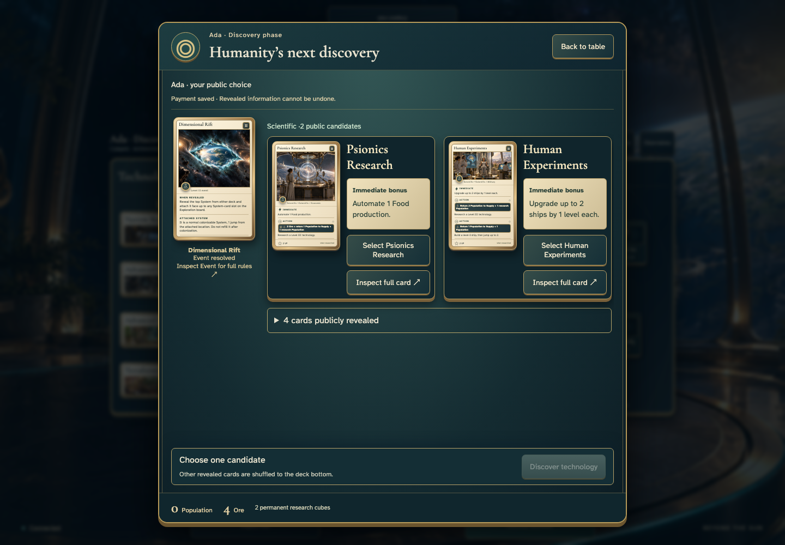](../../screenshots/reveal-attach-and-recover-a-real-dimensional-rift-system/039-public-candidates-desktop-darwin.png) |

tabletop-4k · 3840 × 2160

[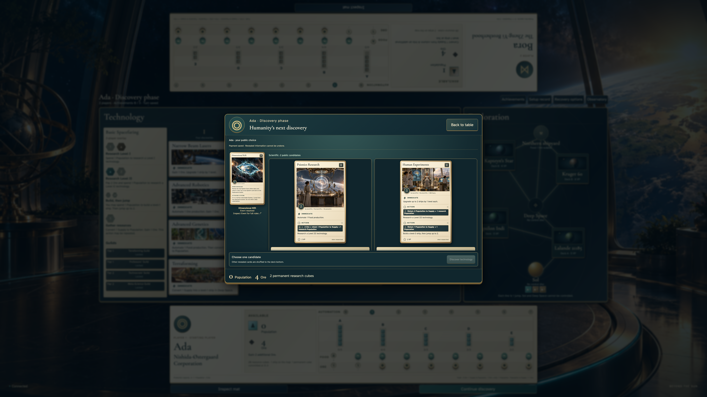](../../screenshots/reveal-attach-and-recover-a-real-dimensional-rift-system/039-public-candidates-tabletop-4k-darwin.png)

- [x] The public candidates appear only after the entire Event and type choice
- [x] The saved automatic consequences settle before the public decision is photographed.
- [x] Covered and discovered compact nodes retain physical separation.
- [x] The game stays inside its actual viewport.

## 41. Inspect the complete canonical Psionics Research face

Viewpoint: **Ada · South · single shared controller**.

| desktop · 1440 × 1000 |
| --- |
| [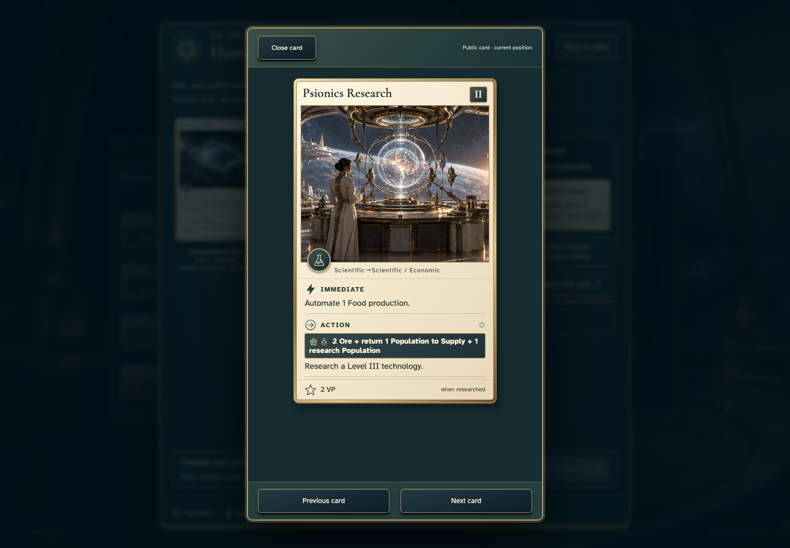](../../screenshots/reveal-attach-and-recover-a-real-dimensional-rift-system/040-candidate-inspected-desktop-darwin.png) |

tabletop-4k · 3840 × 2160

- [x] Inspect the complete canonical Psionics Research face
- [x] The saved automatic consequences settle before the public decision is photographed.
- [x] Covered and discovered compact nodes retain physical separation.
- [x] The game stays inside its actual viewport.

## 42. Read the complete face through its bounded full-size inspector

Viewpoint: **Ada · South · single shared controller**.

| desktop · 1440 × 1000 |
| --- |
| [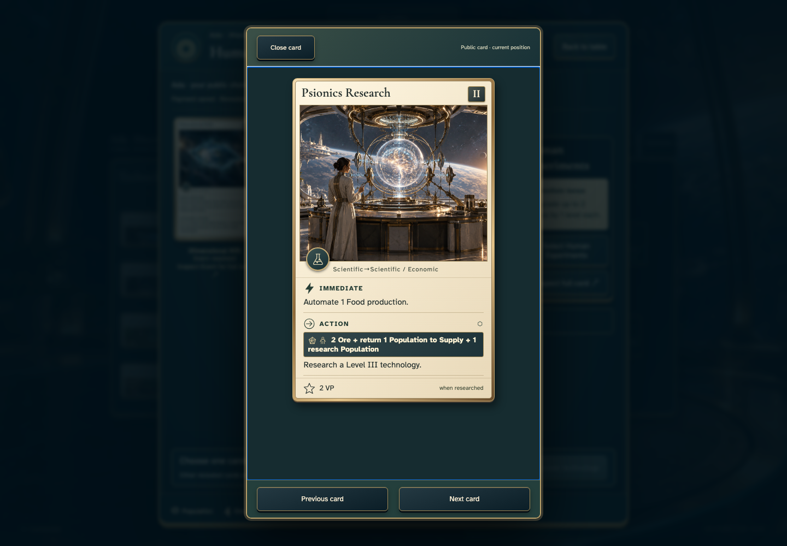](../../screenshots/reveal-attach-and-recover-a-real-dimensional-rift-system/041-candidate-inspected-rules-desktop-darwin.png) |

tabletop-4k · 3840 × 2160

[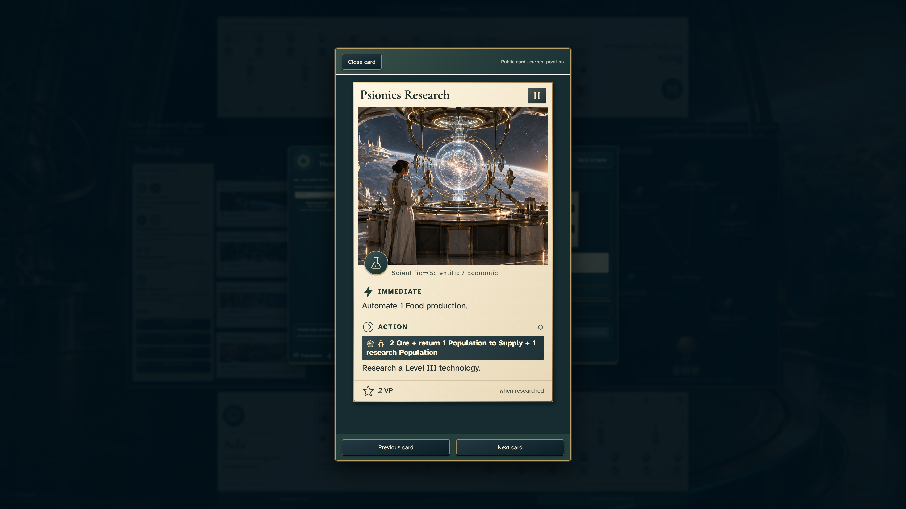](../../screenshots/reveal-attach-and-recover-a-real-dimensional-rift-system/041-candidate-inspected-rules-tabletop-4k-darwin.png)

- [x] Read the complete face through its bounded full-size inspector
- [x] The saved automatic consequences settle before the public decision is photographed.
- [x] Covered and discovered compact nodes retain physical separation.
- [x] The game stays inside its actual viewport.

## 43. Escape returns keyboard focus to the actual inspection source

Viewpoint: **Ada · South · single shared controller**.

| desktop · 1440 × 1000 |
| --- |
| [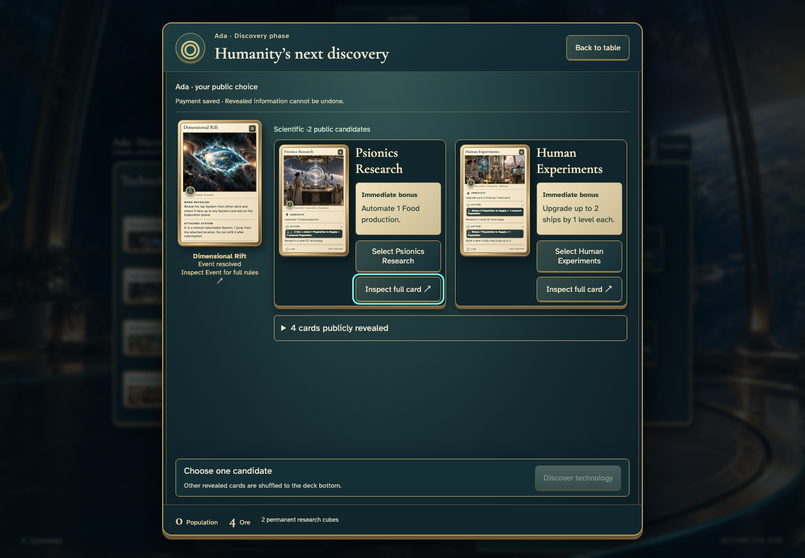](../../screenshots/reveal-attach-and-recover-a-real-dimensional-rift-system/042-candidate-inspected-return-desktop-darwin.png) |

tabletop-4k · 3840 × 2160

[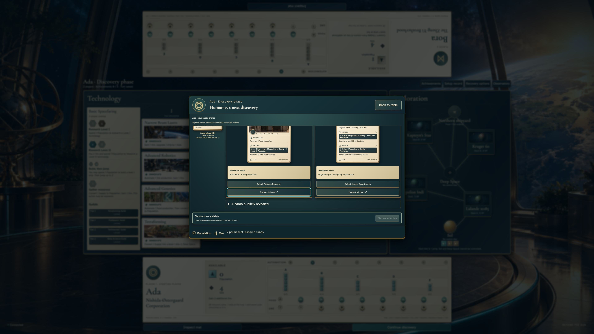](../../screenshots/reveal-attach-and-recover-a-real-dimensional-rift-system/042-candidate-inspected-return-tabletop-4k-darwin.png)

- [x] Escape returns keyboard focus to the actual inspection source
- [x] The saved automatic consequences settle before the public decision is photographed.
- [x] Covered and discovered compact nodes retain physical separation.
- [x] The game stays inside its actual viewport.

## 44. Reload retains the same revealed candidate set and research reservation

Viewpoint: **Ada · South · single shared controller**.

| desktop · 1440 × 1000 |
| --- |
|  |

tabletop-4k · 3840 × 2160

[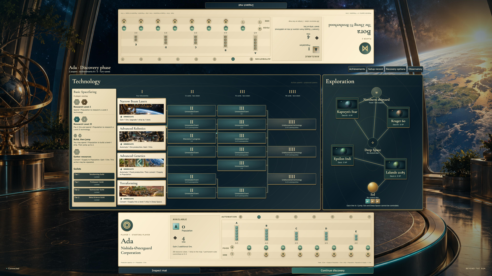](../../screenshots/reveal-attach-and-recover-a-real-dimensional-rift-system/043-candidates-pending-restored-tabletop-4k-darwin.png)

- [x] Reload retains the same revealed candidate set and research reservation
- [x] The saved automatic consequences settle before the public decision is photographed.
- [x] Covered and discovered compact nodes retain physical separation.
- [x] The game stays inside its actual viewport.

## 45. Ada opens their saved public discovery decision

Viewpoint: **Ada · South · single shared controller**.

| desktop · 1440 × 1000 |
| --- |
|  |

tabletop-4k · 3840 × 2160

- [x] Ada opens their saved public discovery decision
- [x] The saved automatic consequences settle before the public decision is photographed.
- [x] Covered and discovered compact nodes retain physical separation.
- [x] The game stays inside its actual viewport.

## 46. No reroll, new payment or replacement candidate appears on recovery

Viewpoint: **Ada · South · single shared controller**.

| desktop · 1440 × 1000 |
| --- |
|  |

tabletop-4k · 3840 × 2160

- [x] No reroll, new payment or replacement candidate appears on recovery
- [x] The saved automatic consequences settle before the public decision is photographed.
- [x] Covered and discovered compact nodes retain physical separation.
- [x] The game stays inside its actual viewport.

## 47. The selected identity and immediate consequence remain beside the commit control

Viewpoint: **Ada · South · single shared controller**.

| desktop · 1440 × 1000 |
| --- |
| [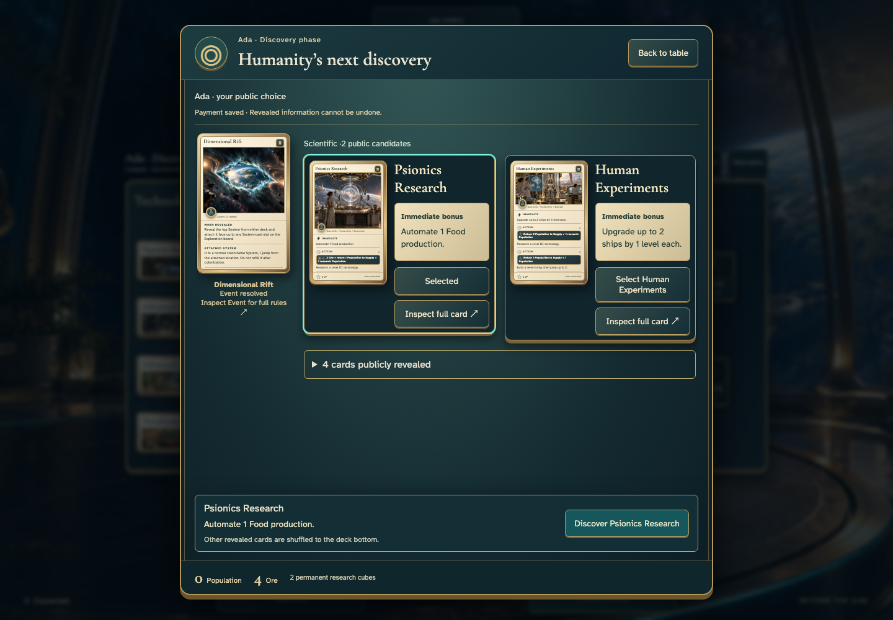](../../screenshots/reveal-attach-and-recover-a-real-dimensional-rift-system/046-candidate-selected-desktop-darwin.png) |

tabletop-4k · 3840 × 2160

- [x] The selected identity and immediate consequence remain beside the commit control
- [x] The saved automatic consequences settle before the public decision is photographed.
- [x] Covered and discovered compact nodes retain physical separation.
- [x] The game stays inside its actual viewport.

## 48. The saved discovery and its complete immediate bonus resume ordinary Production

Viewpoint: **Ada · South · single shared controller**.

| desktop · 1440 × 1000 |
| --- |
|  |

tabletop-4k · 3840 × 2160

- [x] The saved discovery and its complete immediate bonus resume ordinary Production
- [x] The saved automatic consequences settle before the public decision is photographed.
- [x] Covered and discovered compact nodes retain physical separation.
- [x] The game stays inside its actual viewport.

## 49. Reload preserves the discovered technology and pending Production without duplicating the bonus

Viewpoint: **Ada · South · single shared controller**.

| desktop · 1440 × 1000 |
| --- |
| [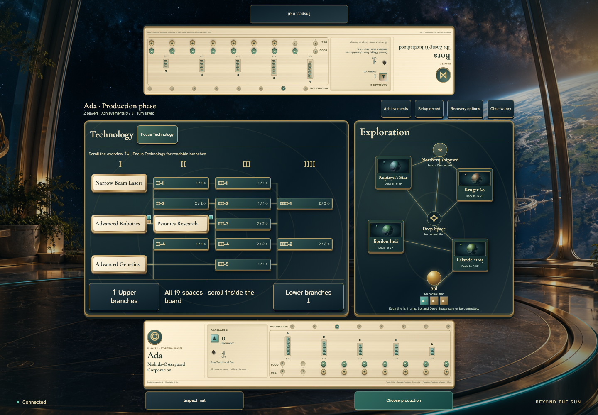](../../screenshots/reveal-attach-and-recover-a-real-dimensional-rift-system/048-production-pending-restored-desktop-darwin.png) |

tabletop-4k · 3840 × 2160

[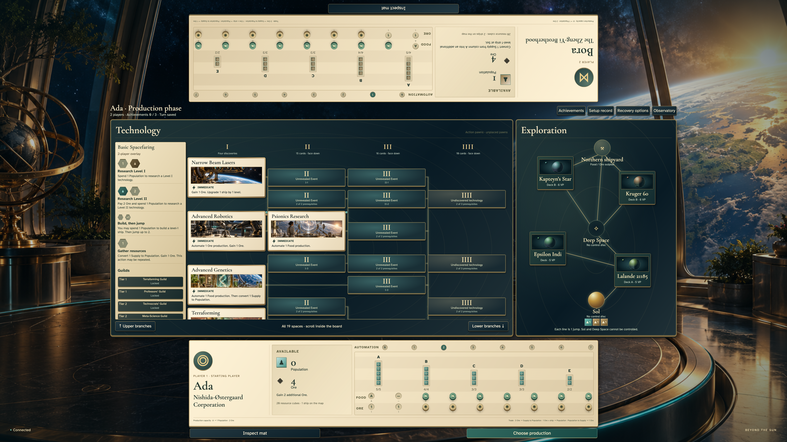](../../screenshots/reveal-attach-and-recover-a-real-dimensional-rift-system/048-production-pending-restored-tabletop-4k-darwin.png)

- [x] Reload preserves the discovered technology and pending Production without duplicating the bonus
- [x] The saved automatic consequences settle before the public decision is photographed.
- [x] Covered and discovered compact nodes retain physical separation.
- [x] The game stays inside its actual viewport.

## 50. Resume the same exclusive production decision

Viewpoint: **Ada · South · single shared controller**.

| desktop · 1440 × 1000 |
| --- |
|  |

tabletop-4k · 3840 × 2160

[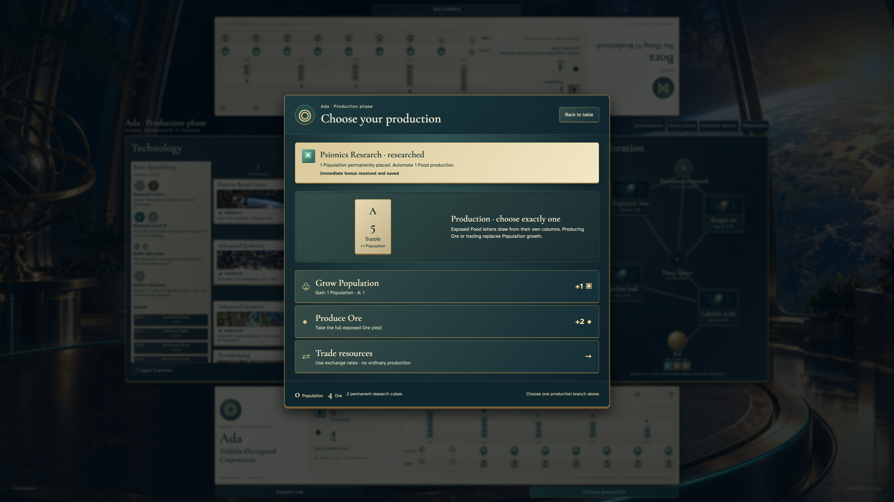](../../screenshots/reveal-attach-and-recover-a-real-dimensional-rift-system/049-production-reopened-tabletop-4k-darwin.png)

- [x] Resume the same exclusive production decision
- [x] The saved automatic consequences settle before the public decision is photographed.
- [x] Covered and discovered compact nodes retain physical separation.
- [x] The game stays inside its actual viewport.

## 51. Ada completes ordinary production and hands off automatically

Viewpoint: **Ada · South · single shared controller**.

| desktop · 1440 × 1000 |
| --- |
| [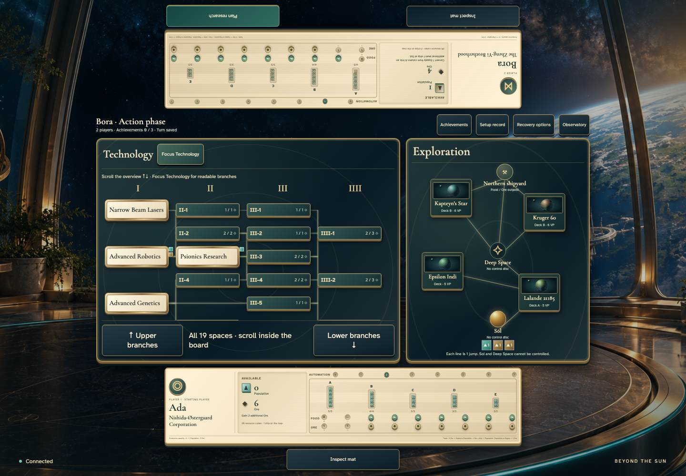](../../screenshots/reveal-attach-and-recover-a-real-dimensional-rift-system/050-discovery-handoff-desktop-darwin.png) |

tabletop-4k · 3840 × 2160

- [x] Ada completes ordinary production and hands off automatically
- [x] The saved automatic consequences settle before the public decision is photographed.
- [x] Covered and discovered compact nodes retain physical separation.
- [x] The game stays inside its actual viewport.

## 52. Reload retains the discovered public card, permanent research and canonical Bora handoff

Viewpoint: **Ada · South · single shared controller**.

| desktop · 1440 × 1000 |
| --- |
|  |

tabletop-4k · 3840 × 2160

- [x] Reload retains the discovered public card, permanent research and canonical Bora handoff
- [x] The saved automatic consequences settle before the public decision is photographed.
- [x] Covered and discovered compact nodes retain physical separation.
- [x] The game stays inside its actual viewport.

## 53. The revealed System remains attached and inspectable after reload

Viewpoint: **Ada · South · single shared controller**.

| desktop · 1440 × 1000 |
| --- |
|  |

tabletop-4k · 3840 × 2160

[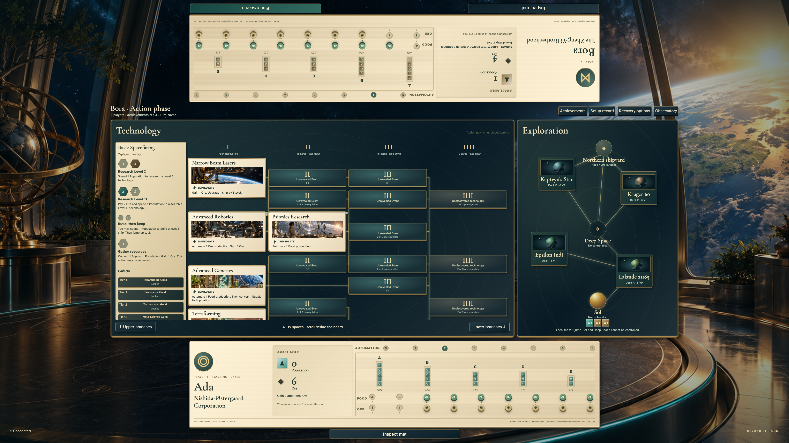](../../screenshots/reveal-attach-and-recover-a-real-dimensional-rift-system/052-attached-map-tabletop-4k-darwin.png)

- [x] The revealed System remains attached and inspectable after reload
- [x] The saved automatic consequences settle before the public decision is photographed.
- [x] Covered and discovered compact nodes retain physical separation.
- [x] The game stays inside its actual viewport.

## 54. The1280×720 complete overview preserves public node separation and explicit bounded scrolling

Viewpoint: **Ada · South · single shared controller**.

| desktop · 1280 × 720 |
| --- |
|  |

tabletop-4k · 1280 × 720

- [x] The1280×720 complete overview preserves public node separation and explicit bounded scrolling
- [x] The saved automatic consequences settle before the public decision is photographed.
- [x] Covered and discovered compact nodes retain physical separation.
- [x] The game stays inside its actual viewport.

## 55. Focus exposes readable real card objects and all prerequisite positions

Viewpoint: **Ada · South · single shared controller**.

| desktop · 1280 × 720 |
| --- |
|  |

tabletop-4k · 1280 × 720

- [x] Focus exposes readable real card objects and all prerequisite positions
- [x] The saved automatic consequences settle before the public decision is photographed.
- [x] Covered and discovered compact nodes retain physical separation.
- [x] The game stays inside its actual viewport.

## 56. Explicit lower navigation retains the entire lower public topology

Viewpoint: **Ada · South · single shared controller**.

| desktop · 1280 × 720 |
| --- |
|  |

tabletop-4k · 1280 × 720

- [x] Explicit lower navigation retains the entire lower public topology
- [x] The saved automatic consequences settle before the public decision is photographed.
- [x] Covered and discovered compact nodes retain physical separation.
- [x] The game stays inside its actual viewport.

## 57. Return to the balanced Technology and Exploration overview

Viewpoint: **Ada · South · single shared controller**.

| desktop · 1280 × 720 |
| --- |
|  |

tabletop-4k · 1280 × 720

- [x] Return to the balanced Technology and Exploration overview
- [x] The saved automatic consequences settle before the public decision is photographed.
- [x] Covered and discovered compact nodes retain physical separation.
- [x] The game stays inside its actual viewport.

## 58. The1280×640 complete overview preserves public node separation and explicit bounded scrolling

Viewpoint: **Ada · South · single shared controller**.

| desktop · 1280 × 640 |
| --- |
|  |

tabletop-4k · 1280 × 640

- [x] The1280×640 complete overview preserves public node separation and explicit bounded scrolling
- [x] The saved automatic consequences settle before the public decision is photographed.
- [x] Covered and discovered compact nodes retain physical separation.
- [x] The game stays inside its actual viewport.

## 59. Focus exposes readable real card objects and all prerequisite positions

Viewpoint: **Ada · South · single shared controller**.

| desktop · 1280 × 640 |
| --- |
|  |

tabletop-4k · 1280 × 640

- [x] Focus exposes readable real card objects and all prerequisite positions
- [x] The saved automatic consequences settle before the public decision is photographed.
- [x] Covered and discovered compact nodes retain physical separation.
- [x] The game stays inside its actual viewport.

## 60. Explicit lower navigation retains the entire lower public topology

Viewpoint: **Ada · South · single shared controller**.

| desktop · 1280 × 640 |
| --- |
|  |

tabletop-4k · 1280 × 640

- [x] Explicit lower navigation retains the entire lower public topology
- [x] The saved automatic consequences settle before the public decision is photographed.
- [x] Covered and discovered compact nodes retain physical separation.
- [x] The game stays inside its actual viewport.

## 61. Return to the balanced Technology and Exploration overview

Viewpoint: **Ada · South · single shared controller**.

| desktop · 1280 × 640 |
| --- |
|  |

tabletop-4k · 1280 × 640

- [x] Return to the balanced Technology and Exploration overview
- [x] The saved automatic consequences settle before the public decision is photographed.
- [x] Covered and discovered compact nodes retain physical separation.
- [x] The game stays inside its actual viewport.

## 62. Restore the original shared display with canonical state intact

Viewpoint: **Ada · South · single shared controller**.

| desktop · 1440 × 1000 |
| --- |
|  |

tabletop-4k · 3840 × 2160

- [x] Restore the original shared display with canonical state intact
- [x] The saved automatic consequences settle before the public decision is photographed.
- [x] Covered and discovered compact nodes retain physical separation.
- [x] The game stays inside its actual viewport.
