# Pay the printed laser Action and retain a complete three-point jump

Two separate authenticated remote controllers; ordinary UI setup and legal preparatory turns. Only initial setup entropy is fixed to66666666-6666-4666-8666-000000000009. No game-state injection or future-deck inspection. Actual printed research access, payment, occupancy, effects and recovery use production components.

## 1. Arrive using the actual production client

Viewpoint: **Ada · separate host controller**.

| phone · 393 × 852 | desktop · 1440 × 1000 |
| --- | --- |
|  |  |

- [x] Arrive using the actual production client
- [x] Canonical effects settle before capture.
- [x] Any printed Action plan is ready.
- [x] Public compact topology remains physically separated.
- [x] The gameplay shell fits the actual viewport.

## 2. Choose a real production play mode

Viewpoint: **Ada · separate host controller**.

| phone · 393 × 852 | desktop · 1440 × 1000 |
| --- | --- |
|  |  |

- [x] Choose a real production play mode
- [x] Canonical effects settle before capture.
- [x] Any printed Action plan is ready.
- [x] Public compact topology remains physically separated.
- [x] The gameplay shell fits the actual viewport.

## 3. Create an independent remote host controller

Viewpoint: **Ada · separate host controller**.

| phone · 393 × 852 | desktop · 1440 × 1000 |
| --- | --- |
|  |  |

- [x] Create an independent remote host controller
- [x] Canonical effects settle before capture.
- [x] Any printed Action plan is ready.
- [x] Public compact topology remains physically separated.
- [x] The gameplay shell fits the actual viewport.

## 4. Name the host Ada

Viewpoint: **Ada · separate host controller**.

| phone · 393 × 852 | desktop · 1440 × 1000 |
| --- | --- |
|  |  |

- [x] Name the host Ada
- [x] Canonical effects settle before capture.
- [x] Any printed Action plan is ready.
- [x] Public compact topology remains physically separated.
- [x] The gameplay shell fits the actual viewport.

## 5. The canonical remote room exposes its actual invitation code

Viewpoint: **Ada · separate host controller**.

| phone · 393 × 852 | desktop · 1440 × 1000 |
| --- | --- |
| [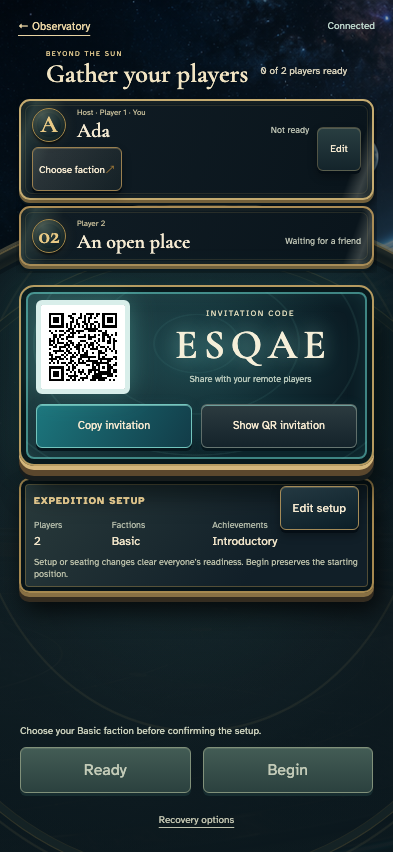](../../screenshots/pay-the-printed-laser-action-and-retain-a-complete-three-point-jump/004-host-room-phone-darwin.png) | [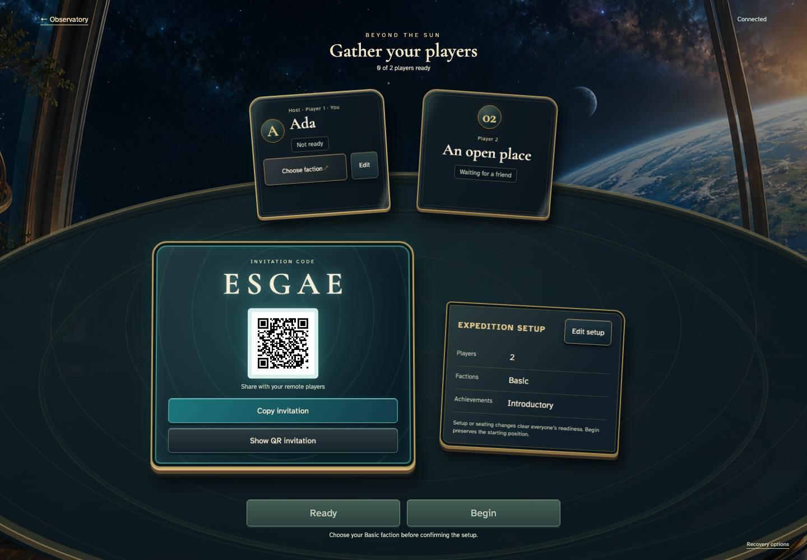](../../screenshots/pay-the-printed-laser-action-and-retain-a-complete-three-point-jump/004-host-room-desktop-darwin.png) |

- [x] The canonical remote room exposes its actual invitation code
- [x] Canonical effects settle before capture.
- [x] Any printed Action plan is ready.
- [x] Public compact topology remains physically separated.
- [x] The gameplay shell fits the actual viewport.

## 6. A different identity previews the public invitation

Viewpoint: **Bora · separate guest controller**.

| phone · 1440 × 1000 | desktop · 393 × 852 |
| --- | --- |
| [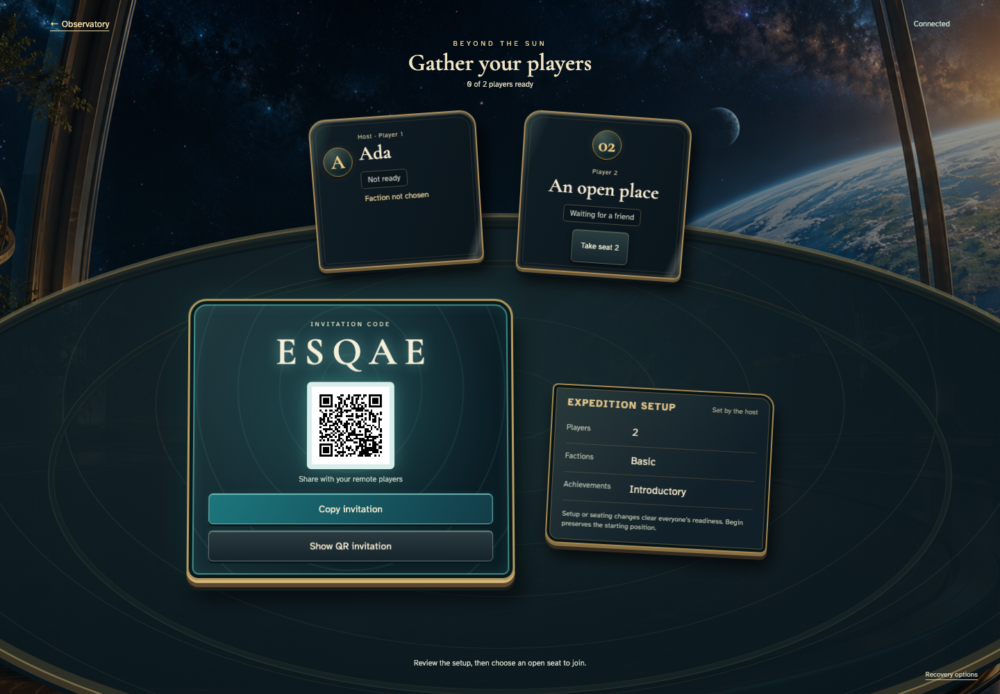](../../screenshots/pay-the-printed-laser-action-and-retain-a-complete-three-point-jump/005-guest-preview-phone-darwin.png) | [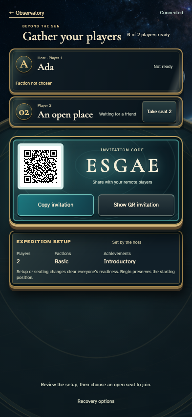](../../screenshots/pay-the-printed-laser-action-and-retain-a-complete-three-point-jump/005-guest-preview-desktop-darwin.png) |

- [x] A different identity previews the public invitation
- [x] Canonical effects settle before capture.
- [x] Any printed Action plan is ready.
- [x] Public compact topology remains physically separated.
- [x] The gameplay shell fits the actual viewport.

## 7. The guest claims only the remote seat

Viewpoint: **Bora · separate guest controller**.

| phone · 1440 × 1000 | desktop · 393 × 852 |
| --- | --- |
| [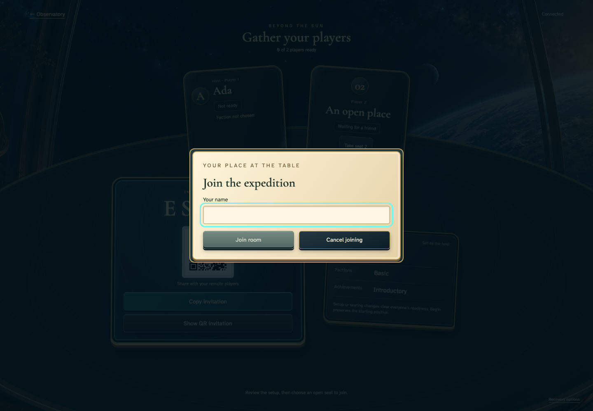](../../screenshots/pay-the-printed-laser-action-and-retain-a-complete-three-point-jump/006-guest-editor-phone-darwin.png) |  |

- [x] The guest claims only the remote seat
- [x] Canonical effects settle before capture.
- [x] Any printed Action plan is ready.
- [x] Public compact topology remains physically separated.
- [x] The gameplay shell fits the actual viewport.

## 8. Name the independent guest Bora

Viewpoint: **Bora · separate guest controller**.

| phone · 1440 × 1000 | desktop · 393 × 852 |
| --- | --- |
| [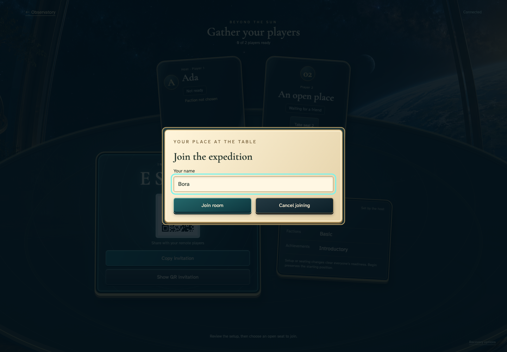](../../screenshots/pay-the-printed-laser-action-and-retain-a-complete-three-point-jump/007-guest-name-phone-darwin.png) |  |

- [x] Name the independent guest Bora
- [x] Canonical effects settle before capture.
- [x] Any printed Action plan is ready.
- [x] Public compact topology remains physically separated.
- [x] The gameplay shell fits the actual viewport.

## 9. Both named remote identities share the same room

Viewpoint: **Bora · separate guest controller**.

| phone · 1440 × 1000 | desktop · 393 × 852 |
| --- | --- |
| [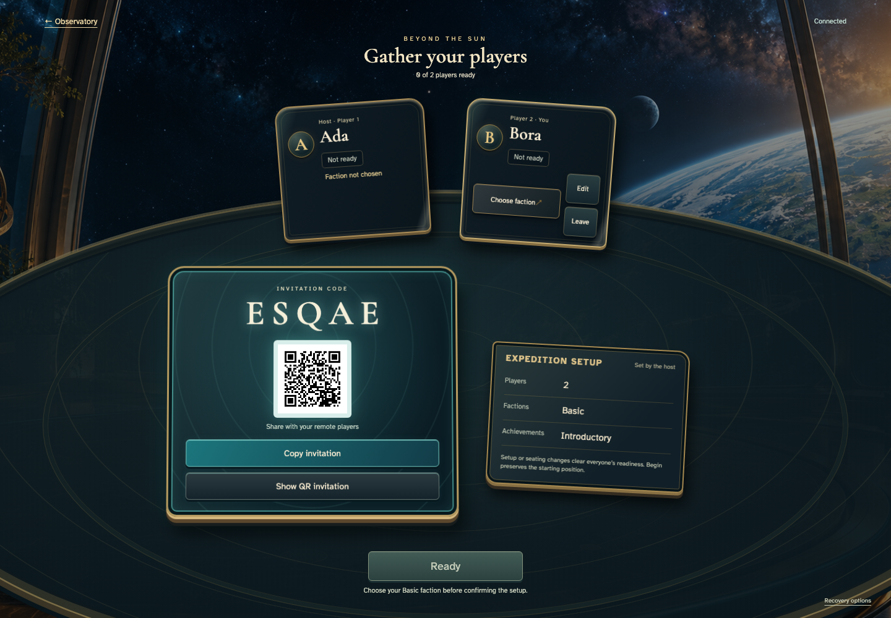](../../screenshots/pay-the-printed-laser-action-and-retain-a-complete-three-point-jump/008-guest-joined-phone-darwin.png) | [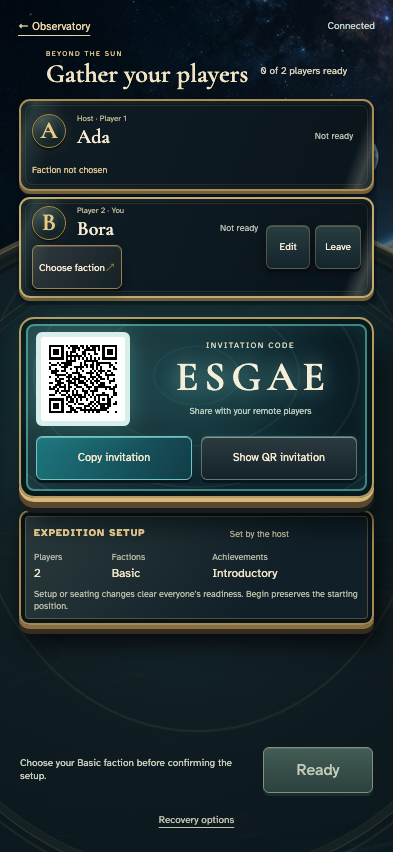](../../screenshots/pay-the-printed-laser-action-and-retain-a-complete-three-point-jump/008-guest-joined-desktop-darwin.png) |

- [x] Both named remote identities share the same room
- [x] Canonical effects settle before capture.
- [x] Any printed Action plan is ready.
- [x] Public compact topology remains physically separated.
- [x] The gameplay shell fits the actual viewport.

## 10. Ada chooses a legal unique Basic faction

Viewpoint: **Ada · separate host controller**.

| phone · 393 × 852 | desktop · 1440 × 1000 |
| --- | --- |
|  |  |

- [x] Ada chooses a legal unique Basic faction
- [x] Canonical effects settle before capture.
- [x] Any printed Action plan is ready.
- [x] Public compact topology remains physically separated.
- [x] The gameplay shell fits the actual viewport.

## 11. Ada retains Nishida-Østergaard Corporation

Viewpoint: **Ada · separate host controller**.

| phone · 393 × 852 | desktop · 1440 × 1000 |
| --- | --- |
| [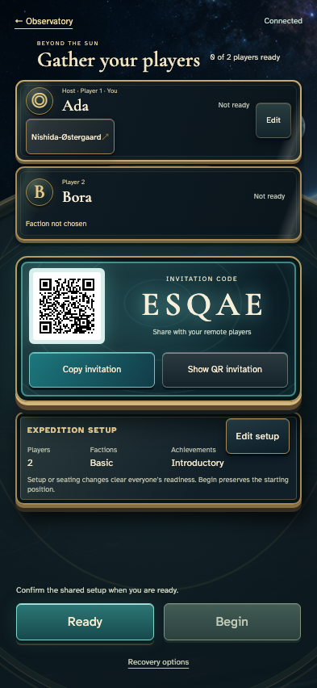](../../screenshots/pay-the-printed-laser-action-and-retain-a-complete-three-point-jump/010-faction-0-chosen-phone-darwin.png) | [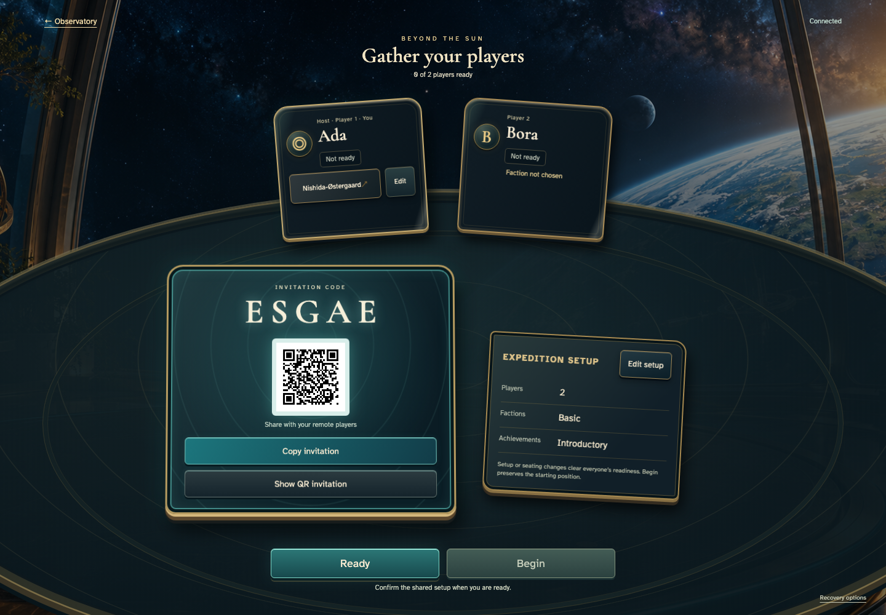](../../screenshots/pay-the-printed-laser-action-and-retain-a-complete-three-point-jump/010-faction-0-chosen-desktop-darwin.png) |

- [x] Ada retains Nishida-Østergaard Corporation
- [x] Canonical effects settle before capture.
- [x] Any printed Action plan is ready.
- [x] Public compact topology remains physically separated.
- [x] The gameplay shell fits the actual viewport.

## 12. Bora chooses a legal unique Basic faction

Viewpoint: **Bora · separate guest controller**.

| phone · 1440 × 1000 | desktop · 393 × 852 |
| --- | --- |
|  |  |

- [x] Bora chooses a legal unique Basic faction
- [x] Canonical effects settle before capture.
- [x] Any printed Action plan is ready.
- [x] Public compact topology remains physically separated.
- [x] The gameplay shell fits the actual viewport.

## 13. Bora retains The Zheng-Yi Brotherhood

Viewpoint: **Bora · separate guest controller**.

| phone · 1440 × 1000 | desktop · 393 × 852 |
| --- | --- |
| [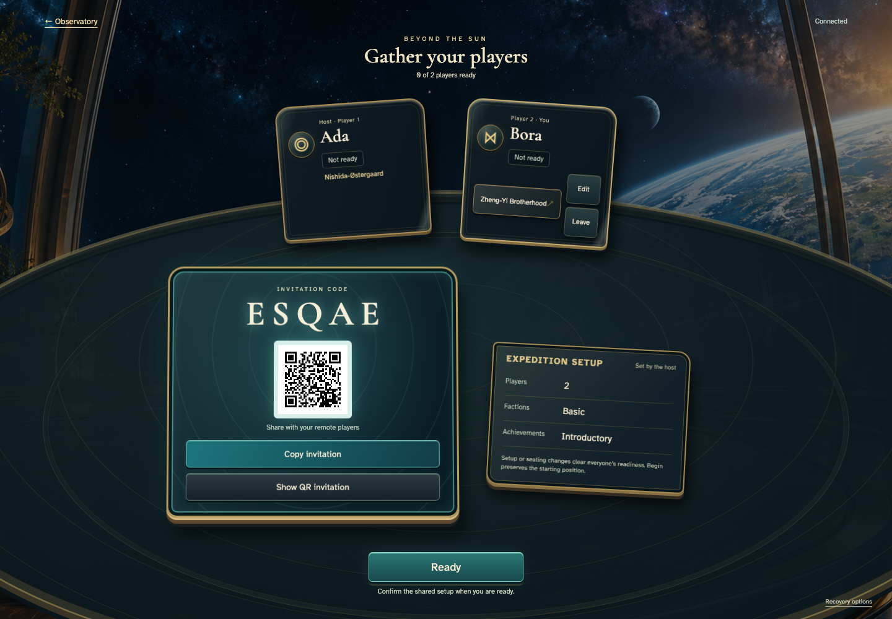](../../screenshots/pay-the-printed-laser-action-and-retain-a-complete-three-point-jump/012-faction-1-chosen-phone-darwin.png) | [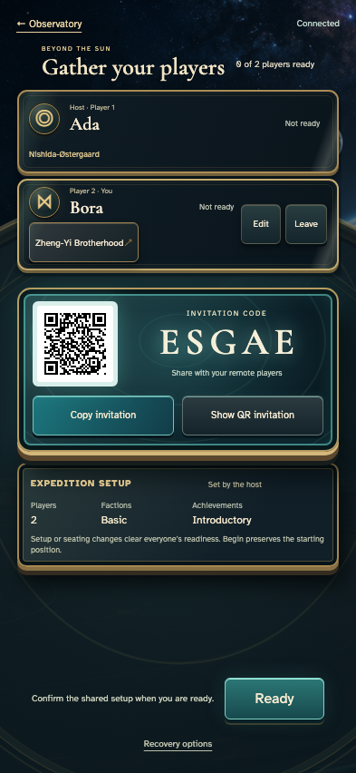](../../screenshots/pay-the-printed-laser-action-and-retain-a-complete-three-point-jump/012-faction-1-chosen-desktop-darwin.png) |

- [x] Bora retains The Zheng-Yi Brotherhood
- [x] Canonical effects settle before capture.
- [x] Any printed Action plan is ready.
- [x] Public compact topology remains physically separated.
- [x] The gameplay shell fits the actual viewport.

## 14. Confirm this identity is ready for the exact saved configuration

Viewpoint: **Bora · separate guest controller**.

| phone · 1440 × 1000 | desktop · 393 × 852 |
| --- | --- |
| [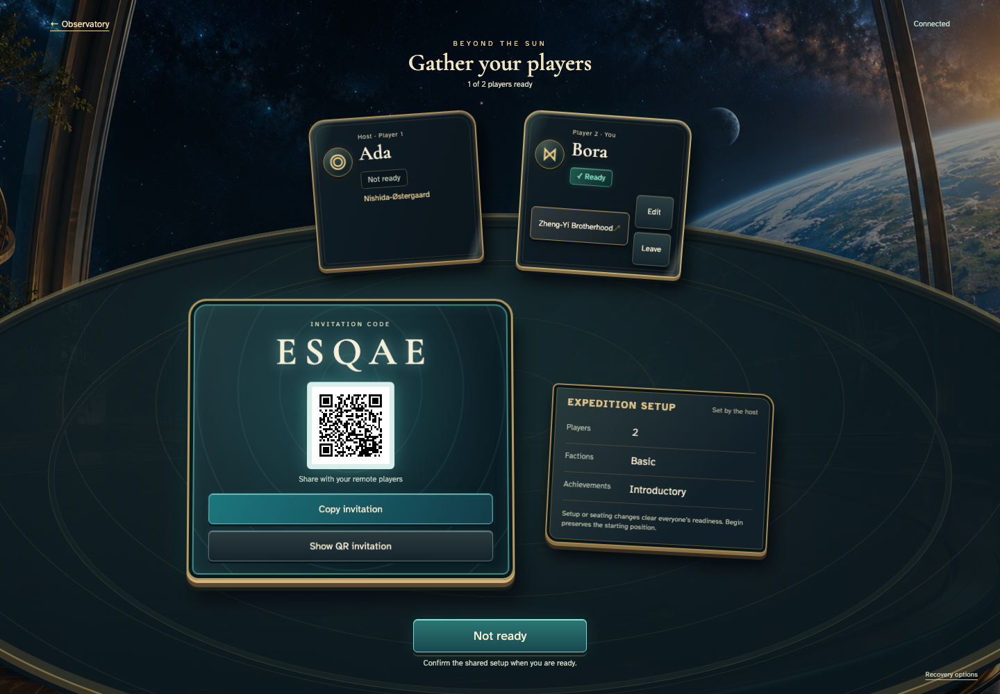](../../screenshots/pay-the-printed-laser-action-and-retain-a-complete-three-point-jump/013-ready-1-phone-darwin.png) | [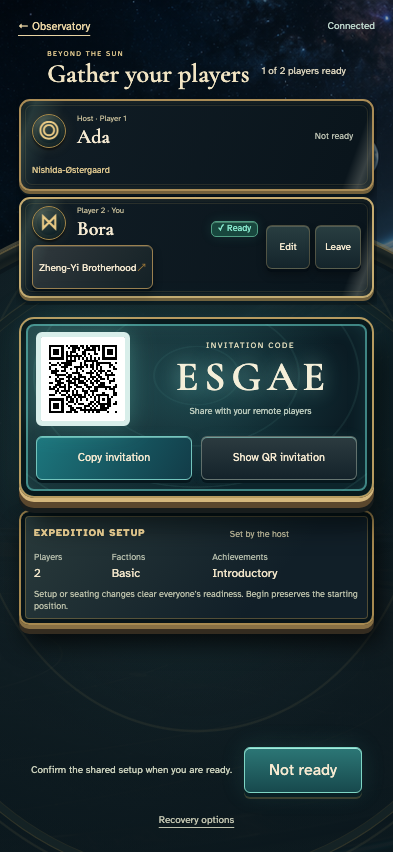](../../screenshots/pay-the-printed-laser-action-and-retain-a-complete-three-point-jump/013-ready-1-desktop-darwin.png) |

- [x] Confirm this identity is ready for the exact saved configuration
- [x] Canonical effects settle before capture.
- [x] Any printed Action plan is ready.
- [x] Public compact topology remains physically separated.
- [x] The gameplay shell fits the actual viewport.

## 15. Confirm this identity is ready for the exact saved configuration

Viewpoint: **Ada · separate host controller**.

| phone · 393 × 852 | desktop · 1440 × 1000 |
| --- | --- |
| [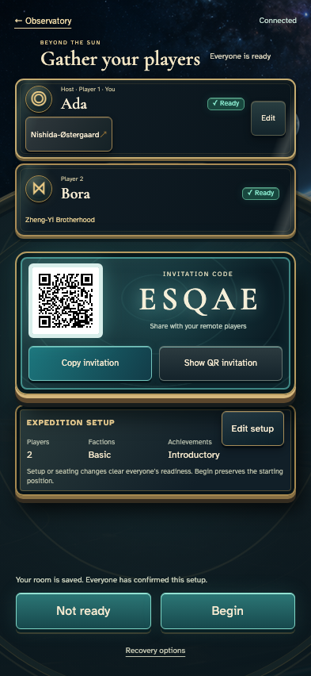](../../screenshots/pay-the-printed-laser-action-and-retain-a-complete-three-point-jump/014-ready-0-phone-darwin.png) |  |

- [x] Confirm this identity is ready for the exact saved configuration
- [x] Canonical effects settle before capture.
- [x] Any printed Action plan is ready.
- [x] Public compact topology remains physically separated.
- [x] The gameplay shell fits the actual viewport.

## 16. Begin the immutable source-reviewed Basic setup through the ordinary UI

Viewpoint: **Ada · separate host controller**.

| phone · 393 × 852 | desktop · 1440 × 1000 |
| --- | --- |
|  |  |

- [x] Begin the immutable source-reviewed Basic setup through the ordinary UI
- [x] Canonical effects settle before capture.
- [x] Any printed Action plan is ready.
- [x] Public compact topology remains physically separated.
- [x] The gameplay shell fits the actual viewport.

## 17. Ada opens the actual research and Action instrument

Viewpoint: **Ada · separate host controller**.

| phone · 393 × 852 | desktop · 1440 × 1000 |
| --- | --- |
|  |  |

- [x] Ada opens the actual research and Action instrument
- [x] Canonical effects settle before capture.
- [x] Any printed Action plan is ready.
- [x] Public compact topology remains physically separated.
- [x] The gameplay shell fits the actual viewport.

## 18. Ada selects the legal printed space 1

Viewpoint: **Ada · separate host controller**.

| phone · 393 × 852 | desktop · 1440 × 1000 |
| --- | --- |
|  | [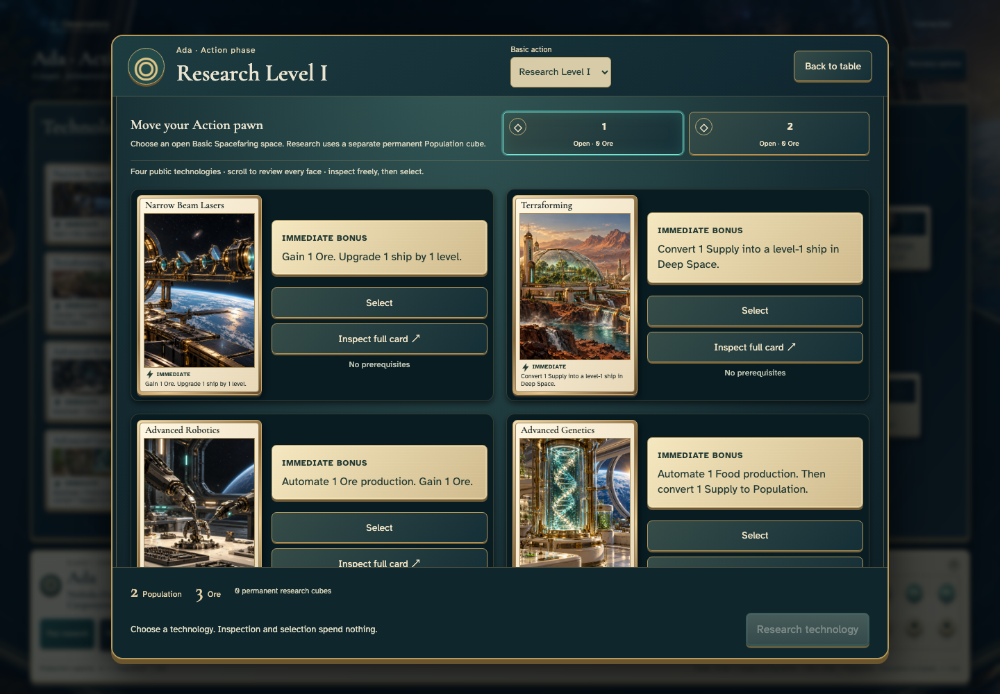](../../screenshots/pay-the-printed-laser-action-and-retain-a-complete-three-point-jump/017-first-space-desktop-darwin.png) |

- [x] Ada selects the legal printed space 1
- [x] Canonical effects settle before capture.
- [x] Any printed Action plan is ready.
- [x] Public compact topology remains physically separated.
- [x] The gameplay shell fits the actual viewport.

## 19. Select Narrow Beam Lasers with its printed cost and consequence

Viewpoint: **Ada · separate host controller**.

| phone · 393 × 852 | desktop · 1440 × 1000 |
| --- | --- |
|  |  |

- [x] Select Narrow Beam Lasers with its printed cost and consequence
- [x] Canonical effects settle before capture.
- [x] Any printed Action plan is ready.
- [x] Public compact topology remains physically separated.
- [x] The gameplay shell fits the actual viewport.

## 20. The immediate bonus requires an explicit owned target

Viewpoint: **Ada · separate host controller**.

| phone · 393 × 852 | desktop · 1440 × 1000 |
| --- | --- |
|  |  |

- [x] The immediate bonus requires an explicit owned target
- [x] Canonical effects settle before capture.
- [x] Any printed Action plan is ready.
- [x] Public compact topology remains physically separated.
- [x] The gameplay shell fits the actual viewport.

## 21. Choose the original Sol ship for the one-level upgrade

Viewpoint: **Ada · separate host controller**.

| phone · 393 × 852 | desktop · 1440 × 1000 |
| --- | --- |
| [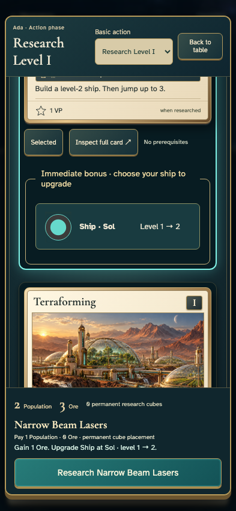](../../screenshots/pay-the-printed-laser-action-and-retain-a-complete-three-point-jump/020-first-ship-phone-darwin.png) | [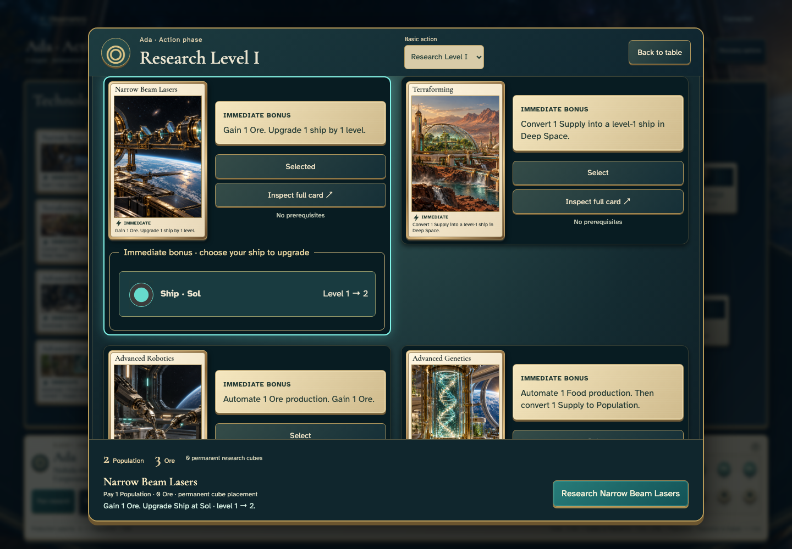](../../screenshots/pay-the-printed-laser-action-and-retain-a-complete-three-point-jump/020-first-ship-desktop-darwin.png) |

- [x] Choose the original Sol ship for the one-level upgrade
- [x] Canonical effects settle before capture.
- [x] Any printed Action plan is ready.
- [x] Public compact topology remains physically separated.
- [x] The gameplay shell fits the actual viewport.

## 22. Pay once and receive Narrow Beam Lasers's immediate bonus

Viewpoint: **Ada · separate host controller**.

| phone · 393 × 852 | desktop · 1440 × 1000 |
| --- | --- |
|  |  |

- [x] Pay once and receive Narrow Beam Lasers's immediate bonus
- [x] Canonical effects settle before capture.
- [x] Any printed Action plan is ready.
- [x] Public compact topology remains physically separated.
- [x] The gameplay shell fits the actual viewport.

## 23. Ada completes production and hands off to Bora

Viewpoint: **Ada · separate host controller**.

| phone · 393 × 852 | desktop · 1440 × 1000 |
| --- | --- |
|  |  |

- [x] Ada completes production and hands off to Bora
- [x] Canonical effects settle before capture.
- [x] Any printed Action plan is ready.
- [x] Public compact topology remains physically separated.
- [x] The gameplay shell fits the actual viewport.

## 24. The independent next controller sees the canonical handoff

Viewpoint: **Bora · separate guest controller**.

| phone · 1440 × 1000 | desktop · 393 × 852 |
| --- | --- |
|  |  |

- [x] The independent next controller sees the canonical handoff
- [x] Canonical effects settle before capture.
- [x] Any printed Action plan is ready.
- [x] Public compact topology remains physically separated.
- [x] The gameplay shell fits the actual viewport.

## 25. Bora opens the actual research and Action instrument

Viewpoint: **Bora · separate guest controller**.

| phone · 1440 × 1000 | desktop · 393 × 852 |
| --- | --- |
|  | [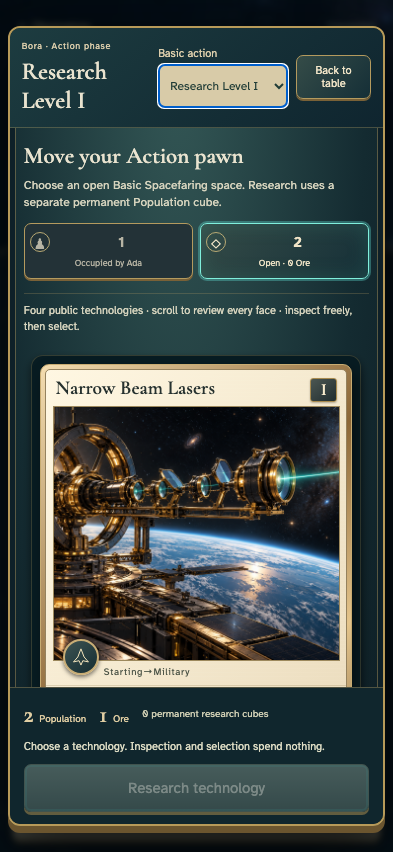](../../screenshots/pay-the-printed-laser-action-and-retain-a-complete-three-point-jump/024-second-plan-desktop-darwin.png) |

- [x] Bora opens the actual research and Action instrument
- [x] Canonical effects settle before capture.
- [x] Any printed Action plan is ready.
- [x] Public compact topology remains physically separated.
- [x] The gameplay shell fits the actual viewport.

## 26. Bora selects the legal printed space 2

Viewpoint: **Bora · separate guest controller**.

| phone · 1440 × 1000 | desktop · 393 × 852 |
| --- | --- |
|  |  |

- [x] Bora selects the legal printed space 2
- [x] Canonical effects settle before capture.
- [x] Any printed Action plan is ready.
- [x] Public compact topology remains physically separated.
- [x] The gameplay shell fits the actual viewport.

## 27. Select Advanced Genetics with its printed cost and consequence

Viewpoint: **Bora · separate guest controller**.

| phone · 1440 × 1000 | desktop · 393 × 852 |
| --- | --- |
| [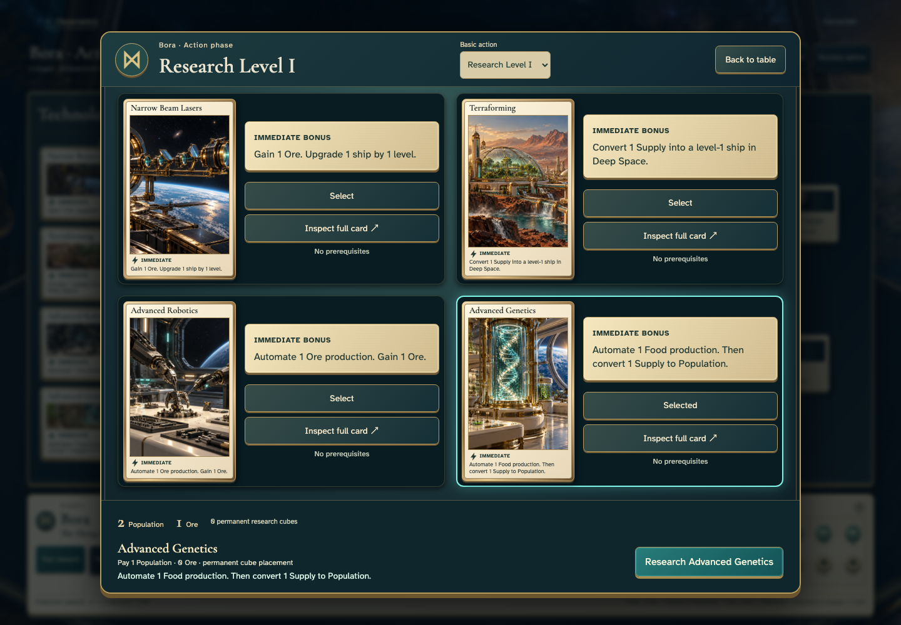](../../screenshots/pay-the-printed-laser-action-and-retain-a-complete-three-point-jump/026-second-card-phone-darwin.png) | [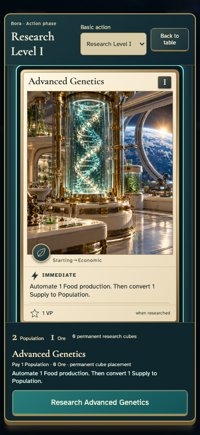](../../screenshots/pay-the-printed-laser-action-and-retain-a-complete-three-point-jump/026-second-card-desktop-darwin.png) |

- [x] Select Advanced Genetics with its printed cost and consequence
- [x] Canonical effects settle before capture.
- [x] Any printed Action plan is ready.
- [x] Public compact topology remains physically separated.
- [x] The gameplay shell fits the actual viewport.

## 28. Pay once and receive Advanced Genetics's immediate bonus

Viewpoint: **Bora · separate guest controller**.

| phone · 1440 × 1000 | desktop · 393 × 852 |
| --- | --- |
| [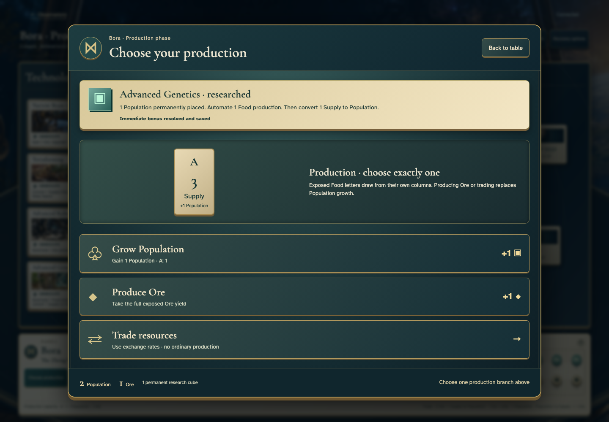](../../screenshots/pay-the-printed-laser-action-and-retain-a-complete-three-point-jump/027-second-researched-phone-darwin.png) | [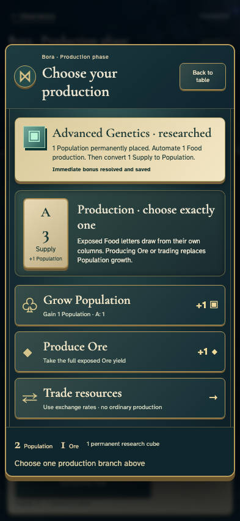](../../screenshots/pay-the-printed-laser-action-and-retain-a-complete-three-point-jump/027-second-researched-desktop-darwin.png) |

- [x] Pay once and receive Advanced Genetics's immediate bonus
- [x] Canonical effects settle before capture.
- [x] Any printed Action plan is ready.
- [x] Public compact topology remains physically separated.
- [x] The gameplay shell fits the actual viewport.

## 29. Bora completes production and hands off to Ada

Viewpoint: **Bora · separate guest controller**.

| phone · 1440 × 1000 | desktop · 393 × 852 |
| --- | --- |
|  | [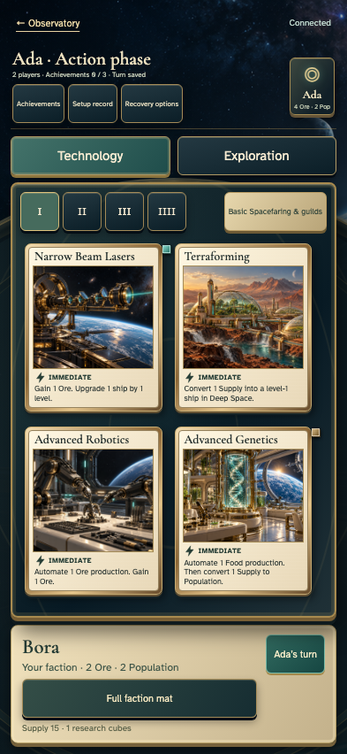](../../screenshots/pay-the-printed-laser-action-and-retain-a-complete-three-point-jump/028-second-handoff-desktop-darwin.png) |

- [x] Bora completes production and hands off to Ada
- [x] Canonical effects settle before capture.
- [x] Any printed Action plan is ready.
- [x] Public compact topology remains physically separated.
- [x] The gameplay shell fits the actual viewport.

## 30. The independent next controller sees the canonical handoff

Viewpoint: **Ada · separate host controller**.

| phone · 393 × 852 | desktop · 1440 × 1000 |
| --- | --- |
|  | [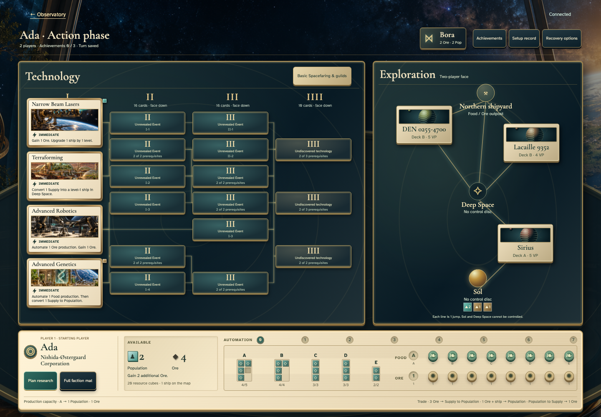](../../screenshots/pay-the-printed-laser-action-and-retain-a-complete-three-point-jump/029-second-next-desktop-darwin.png) |

- [x] The independent next controller sees the canonical handoff
- [x] Canonical effects settle before capture.
- [x] Any printed Action plan is ready.
- [x] Public compact topology remains physically separated.
- [x] The gameplay shell fits the actual viewport.

## 31. Ada opens the actual research and Action instrument

Viewpoint: **Ada · separate host controller**.

| phone · 393 × 852 | desktop · 1440 × 1000 |
| --- | --- |
|  |  |

- [x] Ada opens the actual research and Action instrument
- [x] Canonical effects settle before capture.
- [x] Any printed Action plan is ready.
- [x] Public compact topology remains physically separated.
- [x] The gameplay shell fits the actual viewport.

## 32. Ada selects printed technology Actions

Viewpoint: **Ada · separate host controller**.

| phone · 393 × 852 | desktop · 1440 × 1000 |
| --- | --- |
|  |  |

- [x] Ada selects printed technology Actions
- [x] Canonical effects settle before capture.
- [x] Any printed Action plan is ready.
- [x] Public compact topology remains physically separated.
- [x] The gameplay shell fits the actual viewport.

## 33. Read Narrow Beam Lasers's actual research requirement, payment and exclusive pawn space

Viewpoint: **Ada · separate host controller**.

| phone · 393 × 852 | desktop · 1440 × 1000 |
| --- | --- |
|  |  |

- [x] Read Narrow Beam Lasers's actual research requirement, payment and exclusive pawn space
- [x] Canonical effects settle before capture.
- [x] Any printed Action plan is ready.
- [x] Public compact topology remains physically separated.
- [x] The gameplay shell fits the actual viewport.

## 34. Commit the exact printed cost and save the pending jump decision

Viewpoint: **Ada · separate host controller**.

| phone · 393 × 852 | desktop · 1440 × 1000 |
| --- | --- |
| [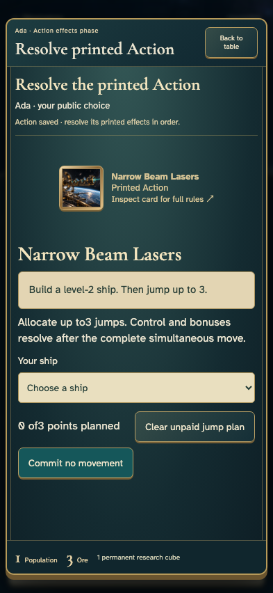](../../screenshots/pay-the-printed-laser-action-and-retain-a-complete-three-point-jump/033-action-paid-phone-darwin.png) |  |

- [x] Commit the exact printed cost and save the pending jump decision
- [x] Canonical effects settle before capture.
- [x] Any printed Action plan is ready.
- [x] Public compact topology remains physically separated.
- [x] The gameplay shell fits the actual viewport.

## 35. Reload retains the paid Action and pending movement without another payment

Viewpoint: **Ada · separate host controller**.

| phone · 393 × 852 | desktop · 1440 × 1000 |
| --- | --- |
| [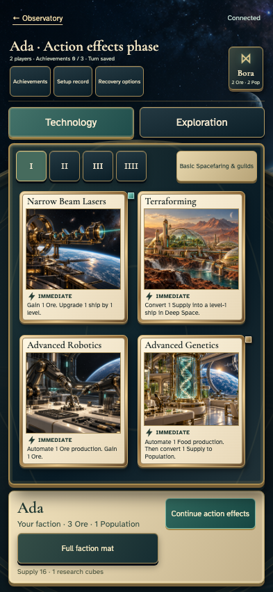](../../screenshots/pay-the-printed-laser-action-and-retain-a-complete-three-point-jump/034-action-restored-phone-darwin.png) | [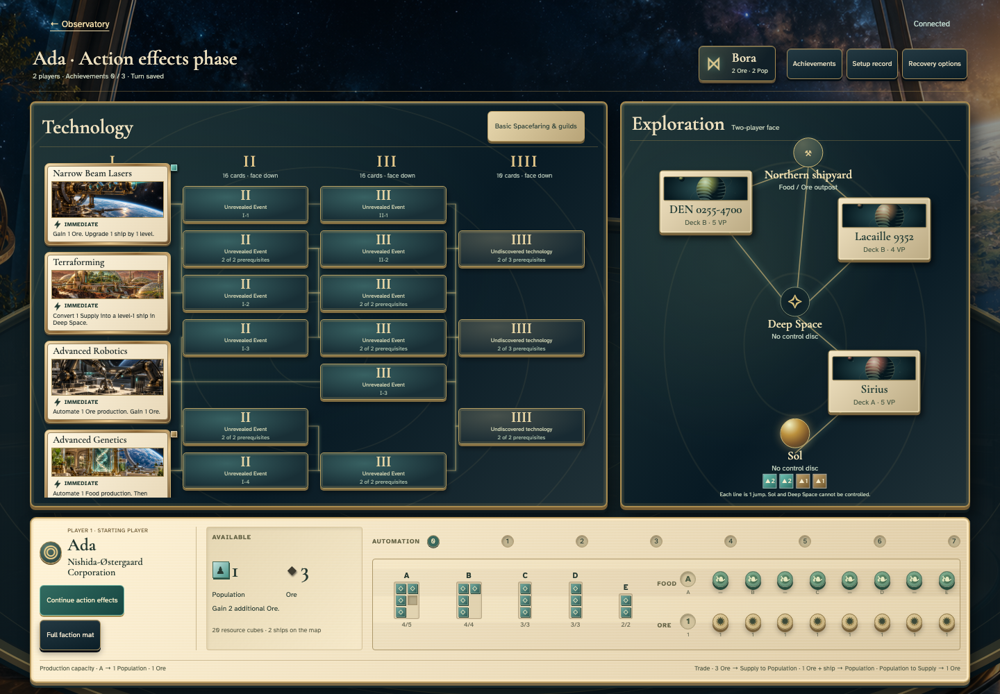](../../screenshots/pay-the-printed-laser-action-and-retain-a-complete-three-point-jump/034-action-restored-desktop-darwin.png) |

- [x] Reload retains the paid Action and pending movement without another payment
- [x] Canonical effects settle before capture.
- [x] Any printed Action plan is ready.
- [x] Public compact topology remains physically separated.
- [x] The gameplay shell fits the actual viewport.

## 36. Resume the same saved Action effects

Viewpoint: **Ada · separate host controller**.

| phone · 393 × 852 | desktop · 1440 × 1000 |
| --- | --- |
|  |  |

- [x] Resume the same saved Action effects
- [x] Canonical effects settle before capture.
- [x] Any printed Action plan is ready.
- [x] Public compact topology remains physically separated.
- [x] The gameplay shell fits the actual viewport.

## 37. Select the actual owned ship whose path will be planned

Viewpoint: **Ada · separate host controller**.

| phone · 393 × 852 | desktop · 1440 × 1000 |
| --- | --- |
| [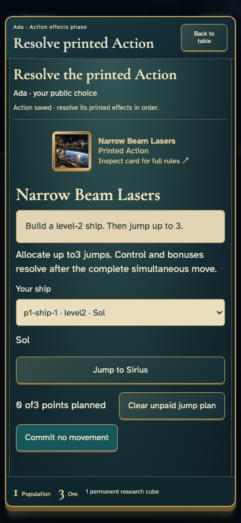](../../screenshots/pay-the-printed-laser-action-and-retain-a-complete-three-point-jump/036-ship-selected-phone-darwin.png) | [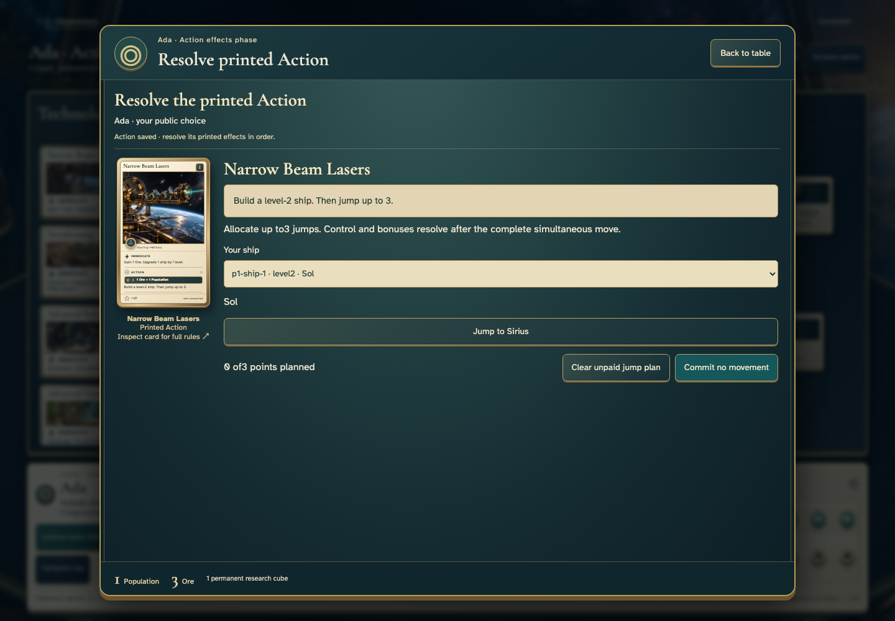](../../screenshots/pay-the-printed-laser-action-and-retain-a-complete-three-point-jump/036-ship-selected-desktop-darwin.png) |

- [x] Select the actual owned ship whose path will be planned
- [x] Canonical effects settle before capture.
- [x] Any printed Action plan is ready.
- [x] Public compact topology remains physically separated.
- [x] The gameplay shell fits the actual viewport.

## 38. Plan leg 1 of the printed 3-point budget without early payment or movement

Viewpoint: **Ada · separate host controller**.

| phone · 393 × 852 | desktop · 1440 × 1000 |
| --- | --- |
| [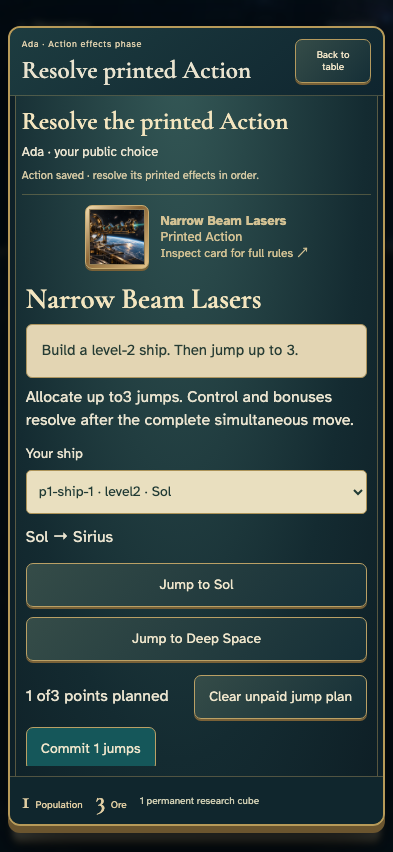](../../screenshots/pay-the-printed-laser-action-and-retain-a-complete-three-point-jump/037-leg-1-phone-darwin.png) | [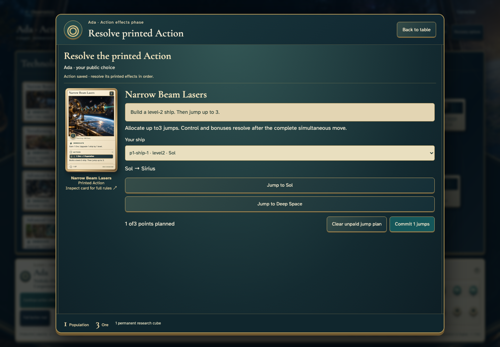](../../screenshots/pay-the-printed-laser-action-and-retain-a-complete-three-point-jump/037-leg-1-desktop-darwin.png) |

- [x] Plan leg 1 of the printed 3-point budget without early payment or movement
- [x] Canonical effects settle before capture.
- [x] Any printed Action plan is ready.
- [x] Public compact topology remains physically separated.
- [x] The gameplay shell fits the actual viewport.

## 39. Plan leg 2 of the printed 3-point budget without early payment or movement

Viewpoint: **Ada · separate host controller**.

| phone · 393 × 852 | desktop · 1440 × 1000 |
| --- | --- |
| [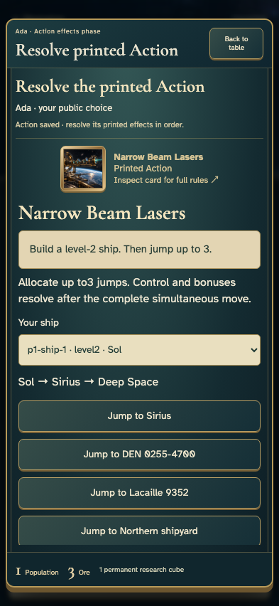](../../screenshots/pay-the-printed-laser-action-and-retain-a-complete-three-point-jump/038-leg-2-phone-darwin.png) | [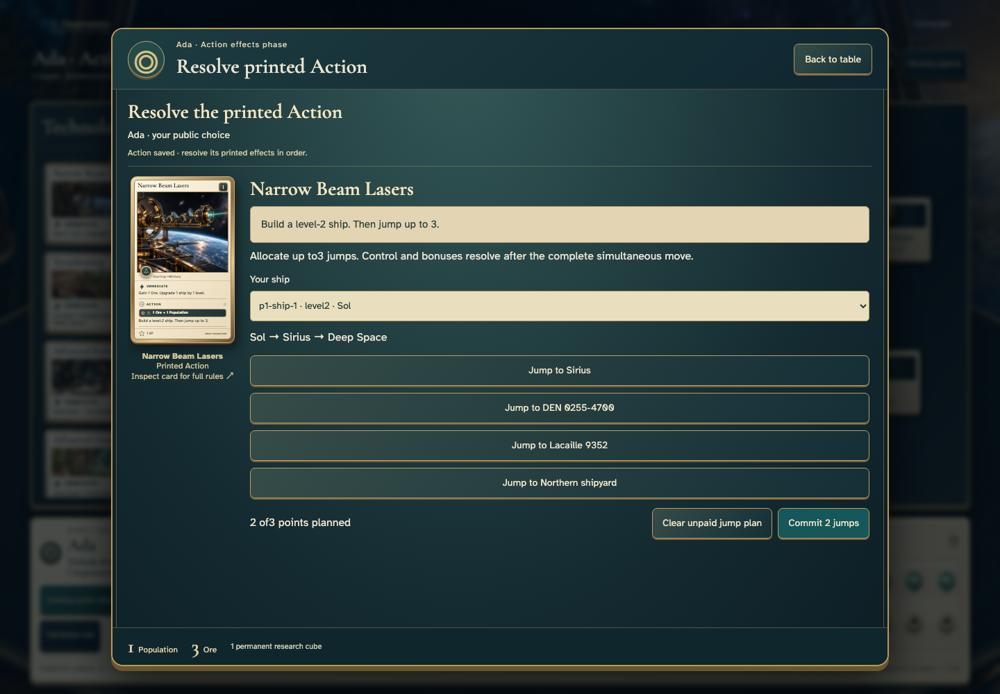](../../screenshots/pay-the-printed-laser-action-and-retain-a-complete-three-point-jump/038-leg-2-desktop-darwin.png) |

- [x] Plan leg 2 of the printed 3-point budget without early payment or movement
- [x] Canonical effects settle before capture.
- [x] Any printed Action plan is ready.
- [x] Public compact topology remains physically separated.
- [x] The gameplay shell fits the actual viewport.

## 40. Plan leg 3 of the printed 3-point budget without early payment or movement

Viewpoint: **Ada · separate host controller**.

| phone · 393 × 852 | desktop · 1440 × 1000 |
| --- | --- |
| [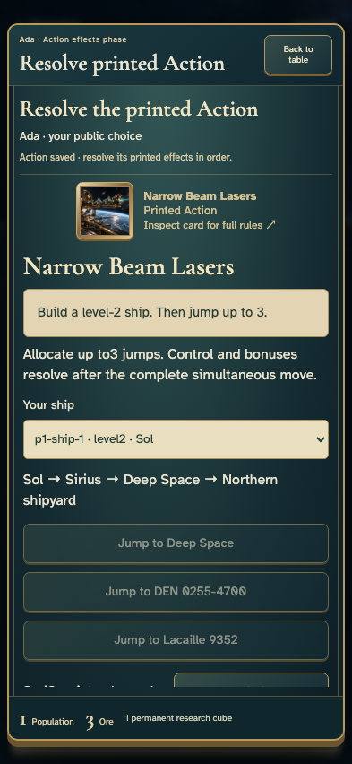](../../screenshots/pay-the-printed-laser-action-and-retain-a-complete-three-point-jump/039-leg-3-phone-darwin.png) | [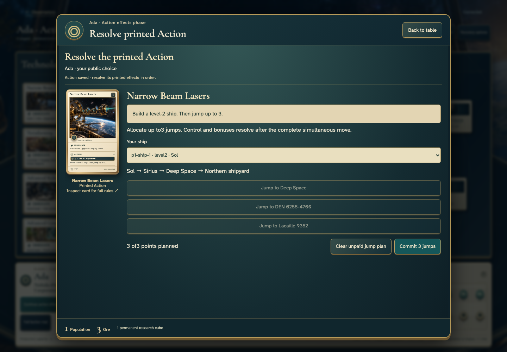](../../screenshots/pay-the-printed-laser-action-and-retain-a-complete-three-point-jump/039-leg-3-desktop-darwin.png) |

- [x] Plan leg 3 of the printed 3-point budget without early payment or movement
- [x] Canonical effects settle before capture.
- [x] Any printed Action plan is ready.
- [x] Public compact topology remains physically separated.
- [x] The gameplay shell fits the actual viewport.

## 41. Commit the complete path atomically before any actual gain-control bonus

Viewpoint: **Ada · separate host controller**.

| phone · 393 × 852 | desktop · 1440 × 1000 |
| --- | --- |
|  |  |

- [x] Commit the complete path atomically before any actual gain-control bonus
- [x] Canonical effects settle before capture.
- [x] Any printed Action plan is ready.
- [x] Public compact topology remains physically separated.
- [x] The gameplay shell fits the actual viewport.

## 42. The actual Northern shipyard Food control disc and printed Ore bonus resolve before Production

Viewpoint: **Ada · separate host controller**.

| phone · 393 × 852 | desktop · 1440 × 1000 |
| --- | --- |
| [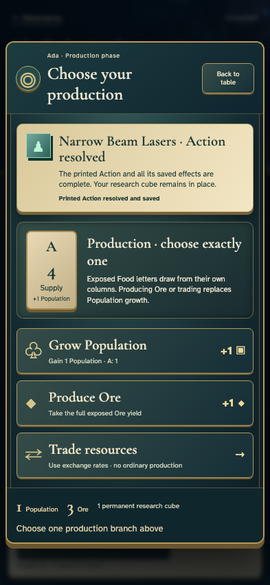](../../screenshots/pay-the-printed-laser-action-and-retain-a-complete-three-point-jump/041-yard-controlled-phone-darwin.png) | [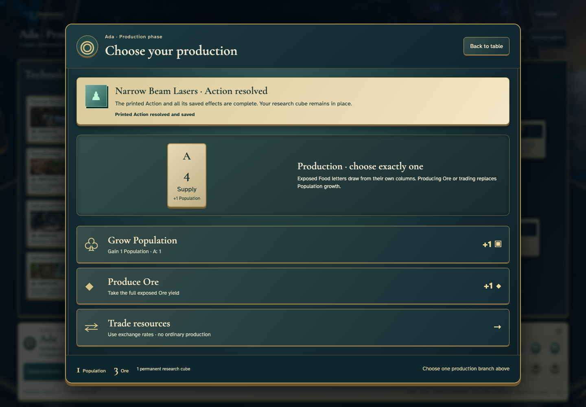](../../screenshots/pay-the-printed-laser-action-and-retain-a-complete-three-point-jump/041-yard-controlled-desktop-darwin.png) |

- [x] The actual Northern shipyard Food control disc and printed Ore bonus resolve before Production
- [x] Canonical effects settle before capture.
- [x] Any printed Action plan is ready.
- [x] Public compact topology remains physically separated.
- [x] The gameplay shell fits the actual viewport.

## 43. Ada completes production and hands off to Bora

Viewpoint: **Ada · separate host controller**.

| phone · 393 × 852 | desktop · 1440 × 1000 |
| --- | --- |
|  | [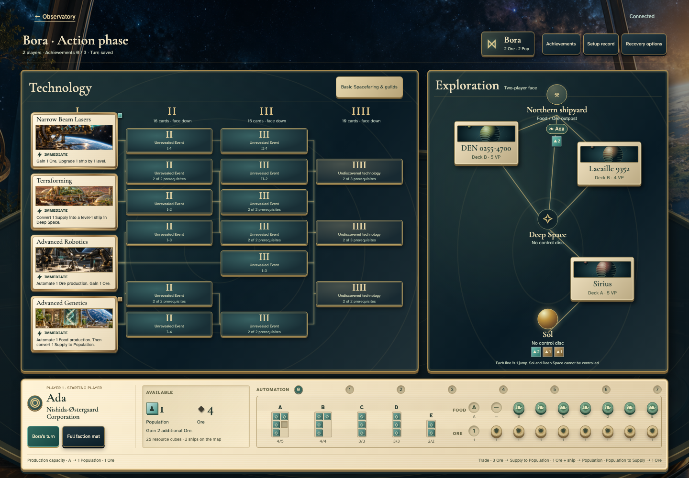](../../screenshots/pay-the-printed-laser-action-and-retain-a-complete-three-point-jump/042-printed-action-handoff-desktop-darwin.png) |

- [x] Ada completes production and hands off to Bora
- [x] Canonical effects settle before capture.
- [x] Any printed Action plan is ready.
- [x] Public compact topology remains physically separated.
- [x] The gameplay shell fits the actual viewport.

## 44. The independent next controller sees the canonical handoff

Viewpoint: **Bora · separate guest controller**.

| phone · 1440 × 1000 | desktop · 393 × 852 |
| --- | --- |
| [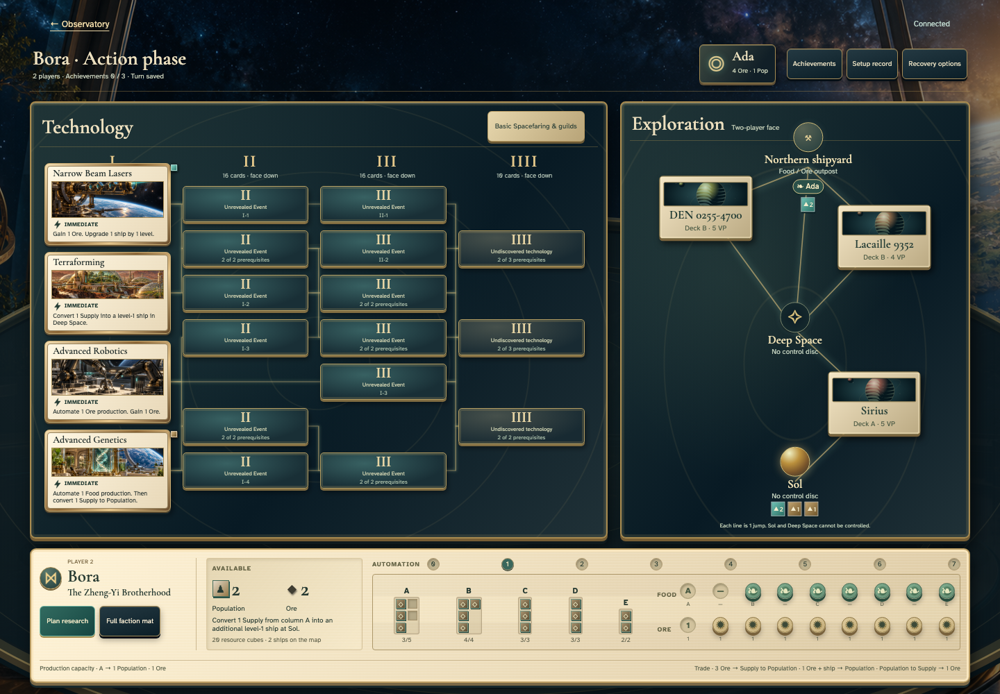](../../screenshots/pay-the-printed-laser-action-and-retain-a-complete-three-point-jump/043-printed-action-next-phone-darwin.png) | [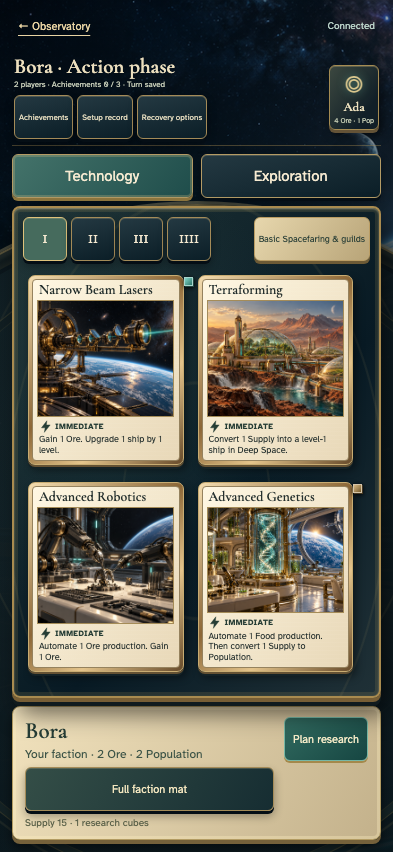](../../screenshots/pay-the-printed-laser-action-and-retain-a-complete-three-point-jump/043-printed-action-next-desktop-darwin.png) |

- [x] The independent next controller sees the canonical handoff
- [x] Canonical effects settle before capture.
- [x] Any printed Action plan is ready.
- [x] Public compact topology remains physically separated.
- [x] The gameplay shell fits the actual viewport.

## 45. The printed Action, final ship location and Bora handoff survive reload

Viewpoint: **Ada · separate host controller**.

| phone · 393 × 852 | desktop · 1440 × 1000 |
| --- | --- |
|  |  |

- [x] The printed Action, final ship location and Bora handoff survive reload
- [x] Canonical effects settle before capture.
- [x] Any printed Action plan is ready.
- [x] Public compact topology remains physically separated.
- [x] The gameplay shell fits the actual viewport.
