# Plan a real four-point Terraforming jump at four corner seats

One shared authenticated controller; direct physical cardinal or corner seating, ordinary UI setup and legal preparatory turns. No remote claims or personal devices. Only initial setup entropy is fixed to66666666-6666-4666-8666-000000000009. No game-state injection or future-deck inspection. Actual printed research access, payment, occupancy, effects and recovery use production components.

## 1. Arrive using the actual production client

Viewpoint: **Ada · South West · one shared controller**.

| desktop · 1440 × 1000 |
| --- |
|  |

tabletop-4k · 3840 × 2160

- [x] Arrive using the actual production client
- [x] Canonical effects settle before capture.
- [x] Any printed Action plan is ready.
- [x] Public compact topology remains physically separated.
- [x] The gameplay shell fits the actual viewport.

## 2. Choose a real production play mode

Viewpoint: **Ada · South West · one shared controller**.

| desktop · 1440 × 1000 |
| --- |
|  |

tabletop-4k · 3840 × 2160

- [x] Choose a real production play mode
- [x] Canonical effects settle before capture.
- [x] Any printed Action plan is ready.
- [x] Public compact topology remains physically separated.
- [x] The gameplay shell fits the actual viewport.

## 3. One controller configures physical seats directly on the table

Viewpoint: **Ada · South West · one shared controller**.

| desktop · 1440 × 1000 |
| --- |
|  |

tabletop-4k · 3840 × 2160

- [x] One controller configures physical seats directly on the table
- [x] Canonical effects settle before capture.
- [x] Any printed Action plan is ready.
- [x] Public compact topology remains physically separated.
- [x] The gameplay shell fits the actual viewport.

## 4. Open the South West seat on the shared surface

Viewpoint: **Ada · South West · one shared controller**.

| desktop · 1440 × 1000 |
| --- |
|  |

tabletop-4k · 3840 × 2160

- [x] Open the South West seat on the shared surface
- [x] Canonical effects settle before capture.
- [x] Any printed Action plan is ready.
- [x] Public compact topology remains physically separated.
- [x] The gameplay shell fits the actual viewport.

## 5. Name the physical player Ada

Viewpoint: **Ada · South West · one shared controller**.

| desktop · 1440 × 1000 |
| --- |
|  |

tabletop-4k · 3840 × 2160

- [x] Name the physical player Ada
- [x] Canonical effects settle before capture.
- [x] Any printed Action plan is ready.
- [x] Public compact topology remains physically separated.
- [x] The gameplay shell fits the actual viewport.

## 6. The local physical seat is retained on this controller

Viewpoint: **Ada · South West · one shared controller**.

| desktop · 1440 × 1000 |
| --- |
| [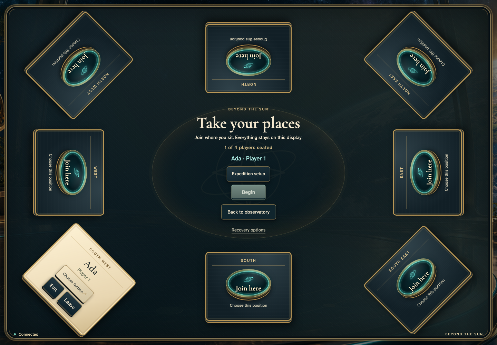](../../screenshots/plan-a-real-four-point-terraforming-jump-at-four-corner-seats/005-seat-0-joined-desktop-darwin.png) |

tabletop-4k · 3840 × 2160

- [x] The local physical seat is retained on this controller
- [x] Canonical effects settle before capture.
- [x] Any printed Action plan is ready.
- [x] Public compact topology remains physically separated.
- [x] The gameplay shell fits the actual viewport.

## 7. Open the North West seat on the shared surface

Viewpoint: **Bora · North West · one shared controller**.

| desktop · 1440 × 1000 |
| --- |
| [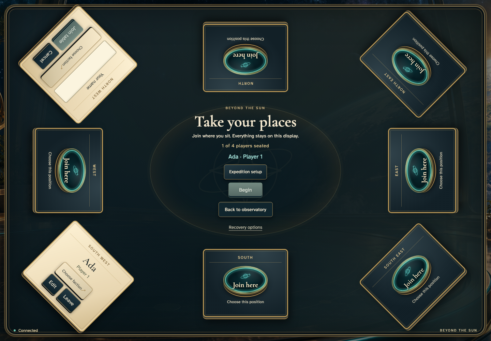](../../screenshots/plan-a-real-four-point-terraforming-jump-at-four-corner-seats/006-seat-1-editor-desktop-darwin.png) |

tabletop-4k · 3840 × 2160

- [x] Open the North West seat on the shared surface
- [x] Canonical effects settle before capture.
- [x] Any printed Action plan is ready.
- [x] Public compact topology remains physically separated.
- [x] The gameplay shell fits the actual viewport.

## 8. Name the physical player Bora

Viewpoint: **Bora · North West · one shared controller**.

| desktop · 1440 × 1000 |
| --- |
|  |

tabletop-4k · 3840 × 2160

- [x] Name the physical player Bora
- [x] Canonical effects settle before capture.
- [x] Any printed Action plan is ready.
- [x] Public compact topology remains physically separated.
- [x] The gameplay shell fits the actual viewport.

## 9. The local physical seat is retained on this controller

Viewpoint: **Bora · North West · one shared controller**.

| desktop · 1440 × 1000 |
| --- |
|  |

tabletop-4k · 3840 × 2160

- [x] The local physical seat is retained on this controller
- [x] Canonical effects settle before capture.
- [x] Any printed Action plan is ready.
- [x] Public compact topology remains physically separated.
- [x] The gameplay shell fits the actual viewport.

## 10. Open the North East seat on the shared surface

Viewpoint: **Cleo · North East · one shared controller**.

| desktop · 1440 × 1000 |
| --- |
|  |

tabletop-4k · 3840 × 2160

- [x] Open the North East seat on the shared surface
- [x] Canonical effects settle before capture.
- [x] Any printed Action plan is ready.
- [x] Public compact topology remains physically separated.
- [x] The gameplay shell fits the actual viewport.

## 11. Name the physical player Cleo

Viewpoint: **Cleo · North East · one shared controller**.

| desktop · 1440 × 1000 |
| --- |
|  |

tabletop-4k · 3840 × 2160

- [x] Name the physical player Cleo
- [x] Canonical effects settle before capture.
- [x] Any printed Action plan is ready.
- [x] Public compact topology remains physically separated.
- [x] The gameplay shell fits the actual viewport.

## 12. The local physical seat is retained on this controller

Viewpoint: **Cleo · North East · one shared controller**.

| desktop · 1440 × 1000 |
| --- |
|  |

tabletop-4k · 3840 × 2160

- [x] The local physical seat is retained on this controller
- [x] Canonical effects settle before capture.
- [x] Any printed Action plan is ready.
- [x] Public compact topology remains physically separated.
- [x] The gameplay shell fits the actual viewport.

## 13. Open the South East seat on the shared surface

Viewpoint: **Dara · South East · one shared controller**.

| desktop · 1440 × 1000 |
| --- |
|  |

tabletop-4k · 3840 × 2160

- [x] Open the South East seat on the shared surface
- [x] Canonical effects settle before capture.
- [x] Any printed Action plan is ready.
- [x] Public compact topology remains physically separated.
- [x] The gameplay shell fits the actual viewport.

## 14. Name the physical player Dara

Viewpoint: **Dara · South East · one shared controller**.

| desktop · 1440 × 1000 |
| --- |
|  |

tabletop-4k · 3840 × 2160

[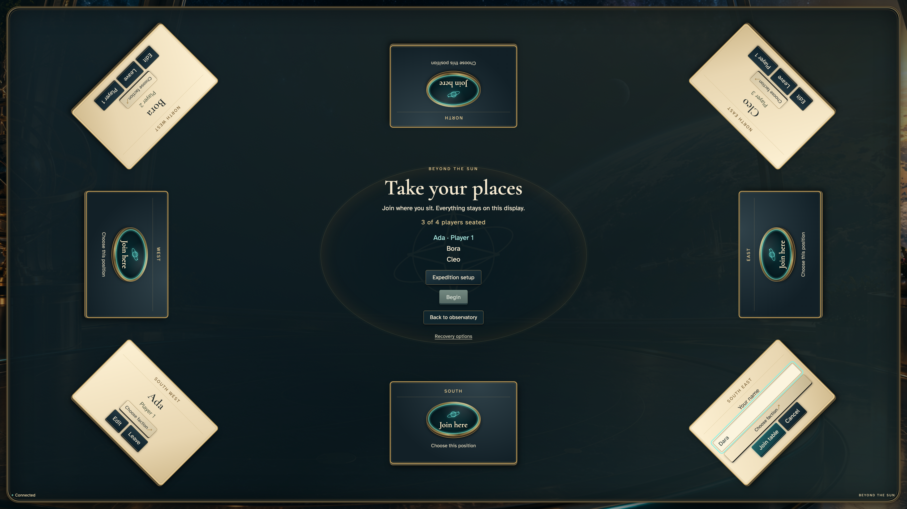](../../screenshots/plan-a-real-four-point-terraforming-jump-at-four-corner-seats/013-seat-3-name-tabletop-4k-darwin.png)

- [x] Name the physical player Dara
- [x] Canonical effects settle before capture.
- [x] Any printed Action plan is ready.
- [x] Public compact topology remains physically separated.
- [x] The gameplay shell fits the actual viewport.

## 15. The local physical seat is retained on this controller

Viewpoint: **Dara · South East · one shared controller**.

| desktop · 1440 × 1000 |
| --- |
| [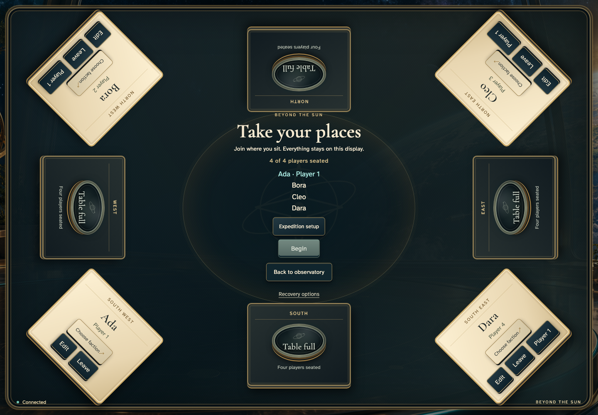](../../screenshots/plan-a-real-four-point-terraforming-jump-at-four-corner-seats/014-seat-3-joined-desktop-darwin.png) |

tabletop-4k · 3840 × 2160

- [x] The local physical seat is retained on this controller
- [x] Canonical effects settle before capture.
- [x] Any printed Action plan is ready.
- [x] Public compact topology remains physically separated.
- [x] The gameplay shell fits the actual viewport.

## 16. Ada chooses a legal unique Basic faction

Viewpoint: **Ada · South West · one shared controller**.

| desktop · 1440 × 1000 |
| --- |
|  |

tabletop-4k · 3840 × 2160

- [x] Ada chooses a legal unique Basic faction
- [x] Canonical effects settle before capture.
- [x] Any printed Action plan is ready.
- [x] Public compact topology remains physically separated.
- [x] The gameplay shell fits the actual viewport.

## 17. Ada retains Nishida-Østergaard Corporation

Viewpoint: **Ada · South West · one shared controller**.

| desktop · 1440 × 1000 |
| --- |
|  |

tabletop-4k · 3840 × 2160

[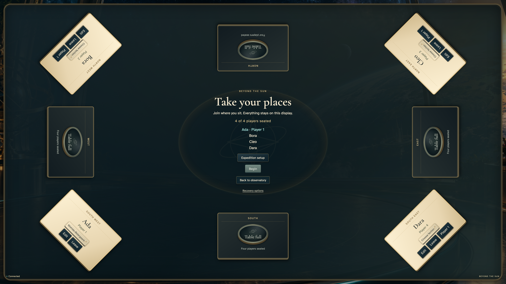](../../screenshots/plan-a-real-four-point-terraforming-jump-at-four-corner-seats/016-faction-0-chosen-tabletop-4k-darwin.png)

- [x] Ada retains Nishida-Østergaard Corporation
- [x] Canonical effects settle before capture.
- [x] Any printed Action plan is ready.
- [x] Public compact topology remains physically separated.
- [x] The gameplay shell fits the actual viewport.

## 18. Bora chooses a legal unique Basic faction

Viewpoint: **Bora · North West · one shared controller**.

| desktop · 1440 × 1000 |
| --- |
|  |

tabletop-4k · 3840 × 2160

- [x] Bora chooses a legal unique Basic faction
- [x] Canonical effects settle before capture.
- [x] Any printed Action plan is ready.
- [x] Public compact topology remains physically separated.
- [x] The gameplay shell fits the actual viewport.

## 19. Bora retains The Zheng-Yi Brotherhood

Viewpoint: **Bora · North West · one shared controller**.

| desktop · 1440 × 1000 |
| --- |
|  |

tabletop-4k · 3840 × 2160

- [x] Bora retains The Zheng-Yi Brotherhood
- [x] Canonical effects settle before capture.
- [x] Any printed Action plan is ready.
- [x] Public compact topology remains physically separated.
- [x] The gameplay shell fits the actual viewport.

## 20. Cleo chooses a legal unique Basic faction

Viewpoint: **Cleo · North East · one shared controller**.

| desktop · 1440 × 1000 |
| --- |
|  |

tabletop-4k · 3840 × 2160

- [x] Cleo chooses a legal unique Basic faction
- [x] Canonical effects settle before capture.
- [x] Any printed Action plan is ready.
- [x] Public compact topology remains physically separated.
- [x] The gameplay shell fits the actual viewport.

## 21. Cleo retains Disciples of the Cosmic Tabernacle

Viewpoint: **Cleo · North East · one shared controller**.

| desktop · 1440 × 1000 |
| --- |
|  |

tabletop-4k · 3840 × 2160

- [x] Cleo retains Disciples of the Cosmic Tabernacle
- [x] Canonical effects settle before capture.
- [x] Any printed Action plan is ready.
- [x] Public compact topology remains physically separated.
- [x] The gameplay shell fits the actual viewport.

## 22. Dara chooses a legal unique Basic faction

Viewpoint: **Dara · South East · one shared controller**.

| desktop · 1440 × 1000 |
| --- |
|  |

tabletop-4k · 3840 × 2160

- [x] Dara chooses a legal unique Basic faction
- [x] Canonical effects settle before capture.
- [x] Any printed Action plan is ready.
- [x] Public compact topology remains physically separated.
- [x] The gameplay shell fits the actual viewport.

## 23. Dara retains United Nations of Sol

Viewpoint: **Dara · South East · one shared controller**.

| desktop · 1440 × 1000 |
| --- |
| [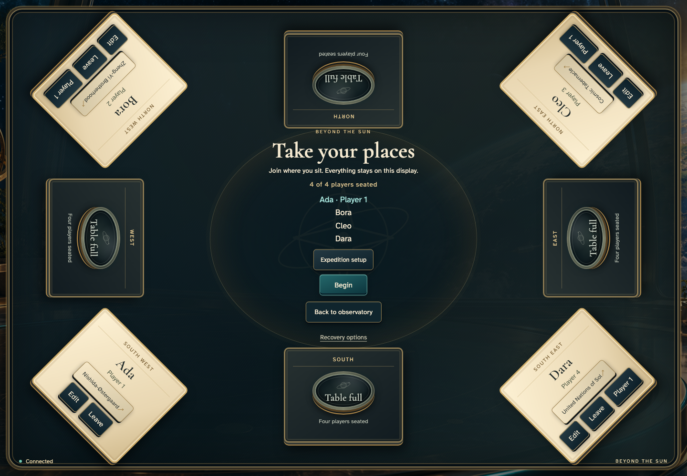](../../screenshots/plan-a-real-four-point-terraforming-jump-at-four-corner-seats/022-faction-3-chosen-desktop-darwin.png) |

tabletop-4k · 3840 × 2160

- [x] Dara retains United Nations of Sol
- [x] Canonical effects settle before capture.
- [x] Any printed Action plan is ready.
- [x] Public compact topology remains physically separated.
- [x] The gameplay shell fits the actual viewport.

## 24. Begin the immutable source-reviewed Basic setup through the ordinary UI

Viewpoint: **Ada · South West · one shared controller**.

| desktop · 1440 × 1000 |
| --- |
|  |

tabletop-4k · 3840 × 2160

- [x] Begin the immutable source-reviewed Basic setup through the ordinary UI
- [x] Canonical effects settle before capture.
- [x] Any printed Action plan is ready.
- [x] Public compact topology remains physically separated.
- [x] The gameplay shell fits the actual viewport.

## 25. Ada opens the actual research and Action instrument

Viewpoint: **Ada · South West · one shared controller**.

| desktop · 1440 × 1000 |
| --- |
|  |

tabletop-4k · 3840 × 2160

- [x] Ada opens the actual research and Action instrument
- [x] Canonical effects settle before capture.
- [x] Any printed Action plan is ready.
- [x] Public compact topology remains physically separated.
- [x] The gameplay shell fits the actual viewport.

## 26. Ada selects the legal printed space 1

Viewpoint: **Ada · South West · one shared controller**.

| desktop · 1440 × 1000 |
| --- |
| [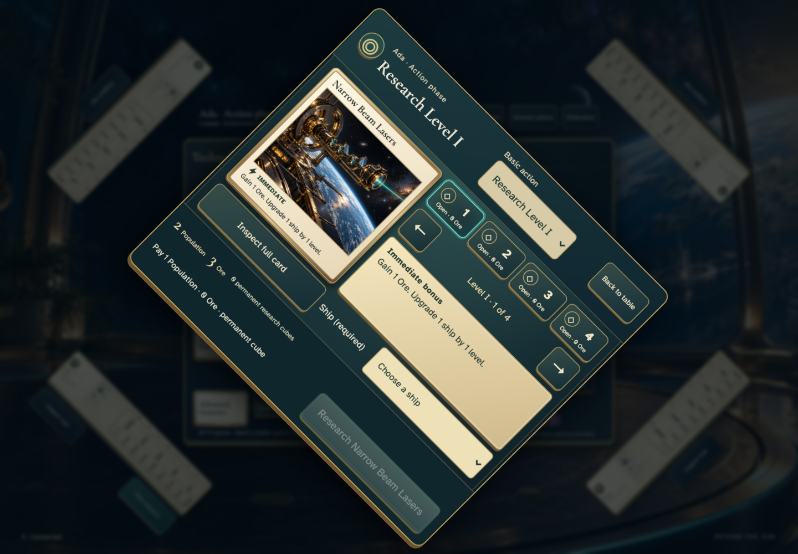](../../screenshots/plan-a-real-four-point-terraforming-jump-at-four-corner-seats/025-first-space-desktop-darwin.png) |

tabletop-4k · 3840 × 2160

[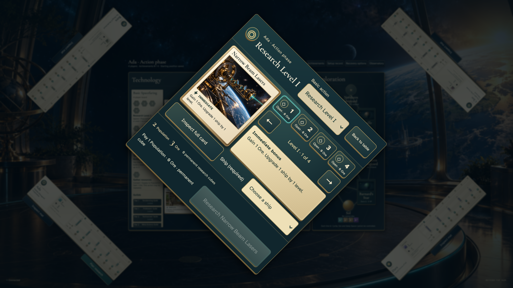](../../screenshots/plan-a-real-four-point-terraforming-jump-at-four-corner-seats/025-first-space-tabletop-4k-darwin.png)

- [x] Ada selects the legal printed space 1
- [x] Canonical effects settle before capture.
- [x] Any printed Action plan is ready.
- [x] Public compact topology remains physically separated.
- [x] The gameplay shell fits the actual viewport.

## 27. Browse the next public Level I face

Viewpoint: **Ada · South West · one shared controller**.

| desktop · 1440 × 1000 |
| --- |
|  |

tabletop-4k · 3840 × 2160

[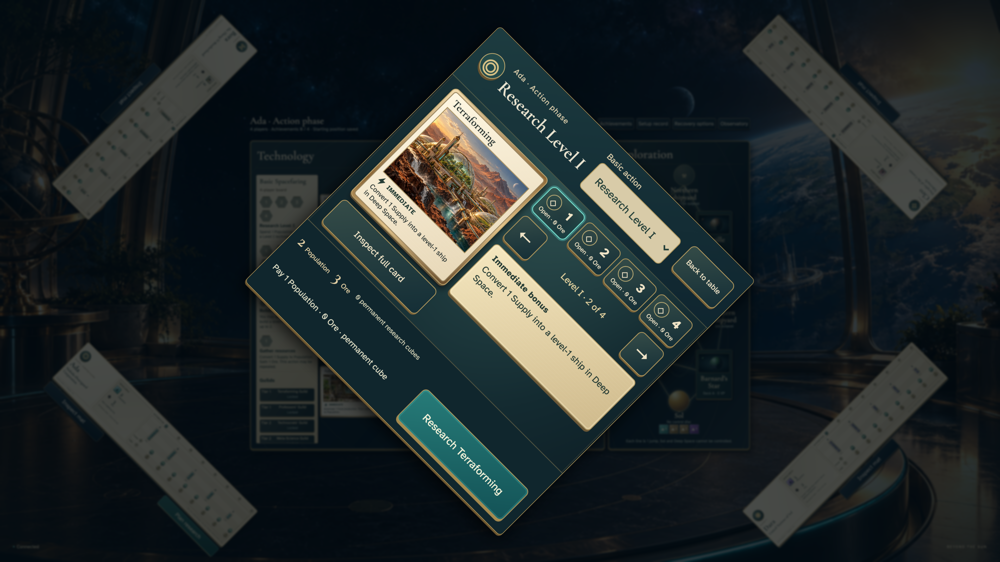](../../screenshots/plan-a-real-four-point-terraforming-jump-at-four-corner-seats/026-first-browse-0-tabletop-4k-darwin.png)

- [x] Browse the next public Level I face
- [x] Canonical effects settle before capture.
- [x] Any printed Action plan is ready.
- [x] Public compact topology remains physically separated.
- [x] The gameplay shell fits the actual viewport.

## 28. Pay once and receive Terraforming's immediate bonus

Viewpoint: **Ada · South West · one shared controller**.

| desktop · 1440 × 1000 |
| --- |
| [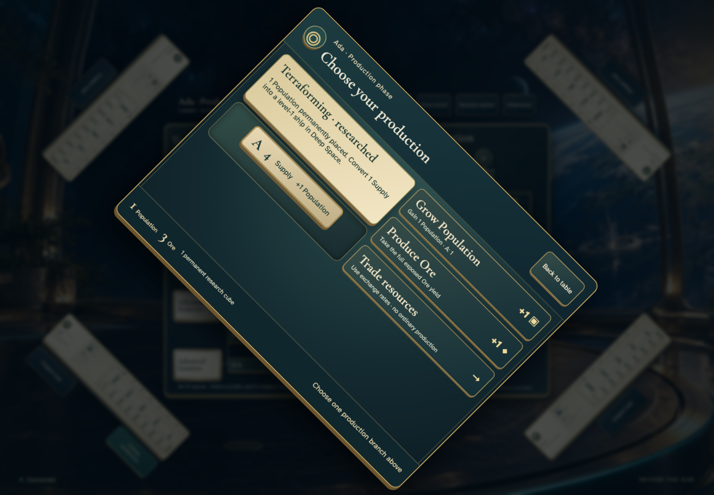](../../screenshots/plan-a-real-four-point-terraforming-jump-at-four-corner-seats/027-first-researched-desktop-darwin.png) |

tabletop-4k · 3840 × 2160

- [x] Pay once and receive Terraforming's immediate bonus
- [x] Canonical effects settle before capture.
- [x] Any printed Action plan is ready.
- [x] Public compact topology remains physically separated.
- [x] The gameplay shell fits the actual viewport.

## 29. Ada completes production and hands off to Bora

Viewpoint: **Ada · South West · one shared controller**.

| desktop · 1440 × 1000 |
| --- |
| [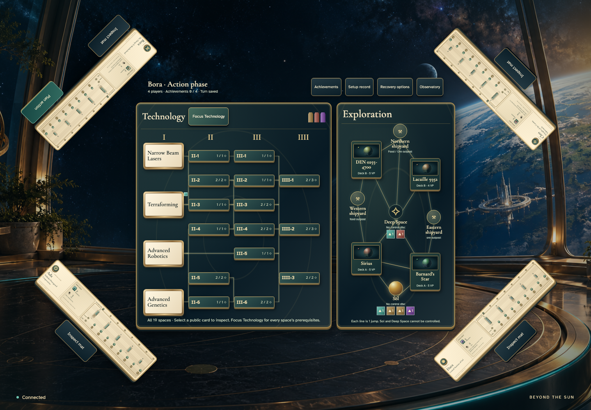](../../screenshots/plan-a-real-four-point-terraforming-jump-at-four-corner-seats/028-first-handoff-desktop-darwin.png) |

tabletop-4k · 3840 × 2160

[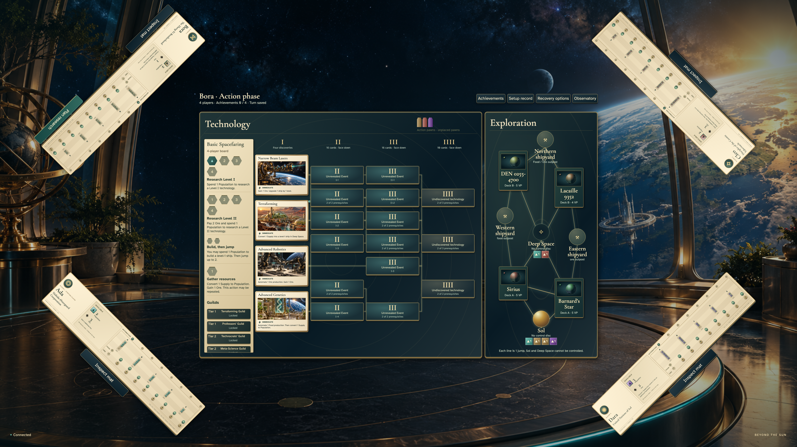](../../screenshots/plan-a-real-four-point-terraforming-jump-at-four-corner-seats/028-first-handoff-tabletop-4k-darwin.png)

- [x] Ada completes production and hands off to Bora
- [x] Canonical effects settle before capture.
- [x] Any printed Action plan is ready.
- [x] Public compact topology remains physically separated.
- [x] The gameplay shell fits the actual viewport.

## 30. Bora opens the actual research and Action instrument

Viewpoint: **Bora · North West · one shared controller**.

| desktop · 1440 × 1000 |
| --- |
|  |

tabletop-4k · 3840 × 2160

[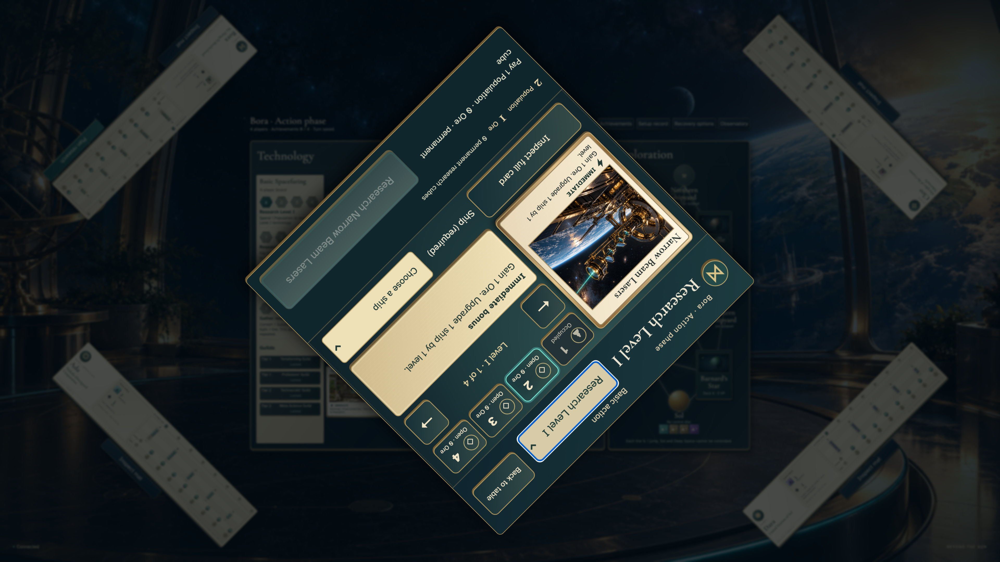](../../screenshots/plan-a-real-four-point-terraforming-jump-at-four-corner-seats/029-second-plan-tabletop-4k-darwin.png)

- [x] Bora opens the actual research and Action instrument
- [x] Canonical effects settle before capture.
- [x] Any printed Action plan is ready.
- [x] Public compact topology remains physically separated.
- [x] The gameplay shell fits the actual viewport.

## 31. Bora selects the legal printed space 2

Viewpoint: **Bora · North West · one shared controller**.

| desktop · 1440 × 1000 |
| --- |
| [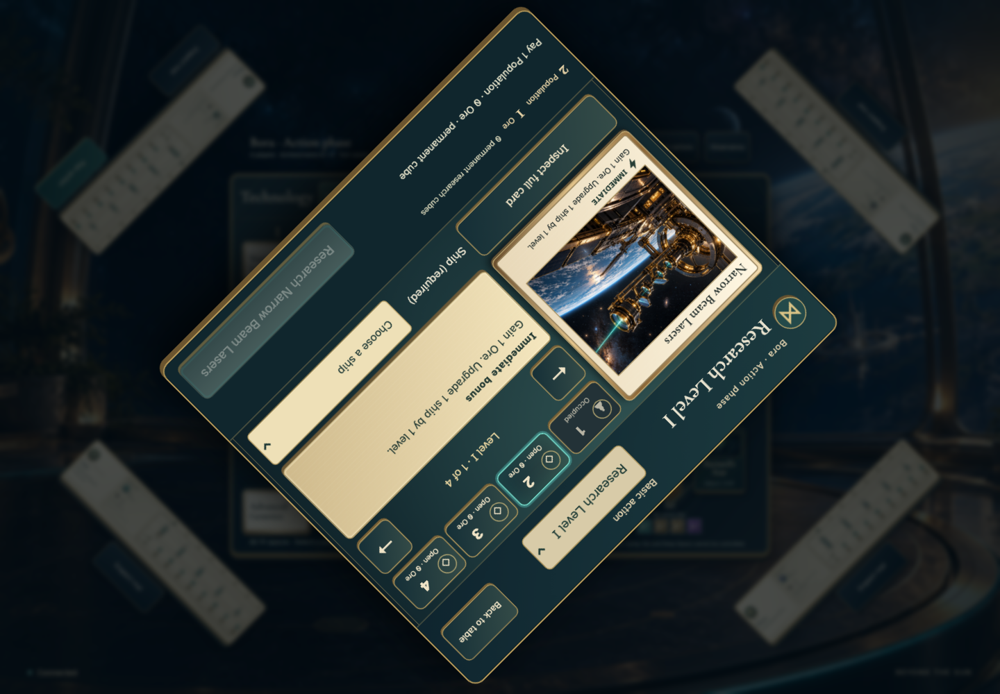](../../screenshots/plan-a-real-four-point-terraforming-jump-at-four-corner-seats/030-second-space-desktop-darwin.png) |

tabletop-4k · 3840 × 2160

[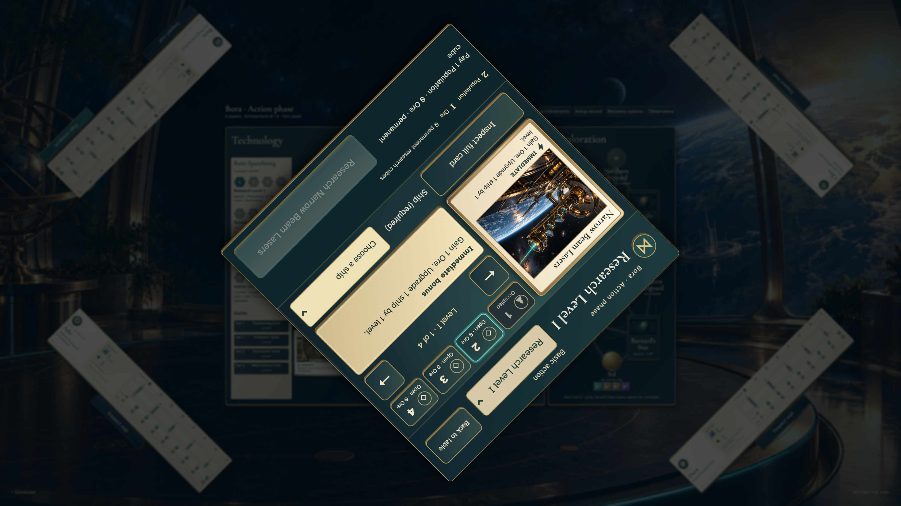](../../screenshots/plan-a-real-four-point-terraforming-jump-at-four-corner-seats/030-second-space-tabletop-4k-darwin.png)

- [x] Bora selects the legal printed space 2
- [x] Canonical effects settle before capture.
- [x] Any printed Action plan is ready.
- [x] Public compact topology remains physically separated.
- [x] The gameplay shell fits the actual viewport.

## 32. Browse the next public Level I face

Viewpoint: **Bora · North West · one shared controller**.

| desktop · 1440 × 1000 |
| --- |
| [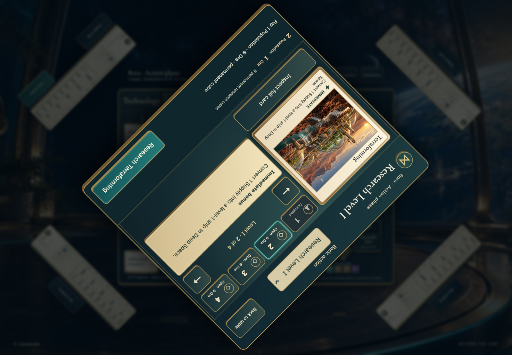](../../screenshots/plan-a-real-four-point-terraforming-jump-at-four-corner-seats/031-second-browse-0-desktop-darwin.png) |

tabletop-4k · 3840 × 2160

[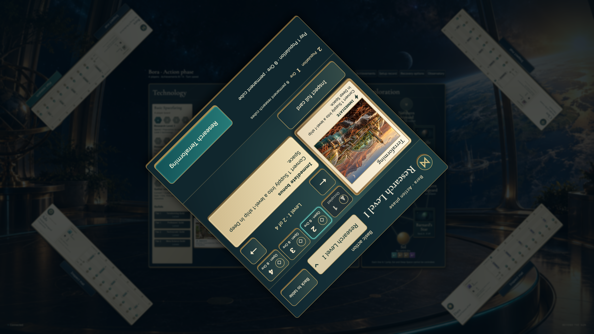](../../screenshots/plan-a-real-four-point-terraforming-jump-at-four-corner-seats/031-second-browse-0-tabletop-4k-darwin.png)

- [x] Browse the next public Level I face
- [x] Canonical effects settle before capture.
- [x] Any printed Action plan is ready.
- [x] Public compact topology remains physically separated.
- [x] The gameplay shell fits the actual viewport.

## 33. Browse the next public Level I face

Viewpoint: **Bora · North West · one shared controller**.

| desktop · 1440 × 1000 |
| --- |
| [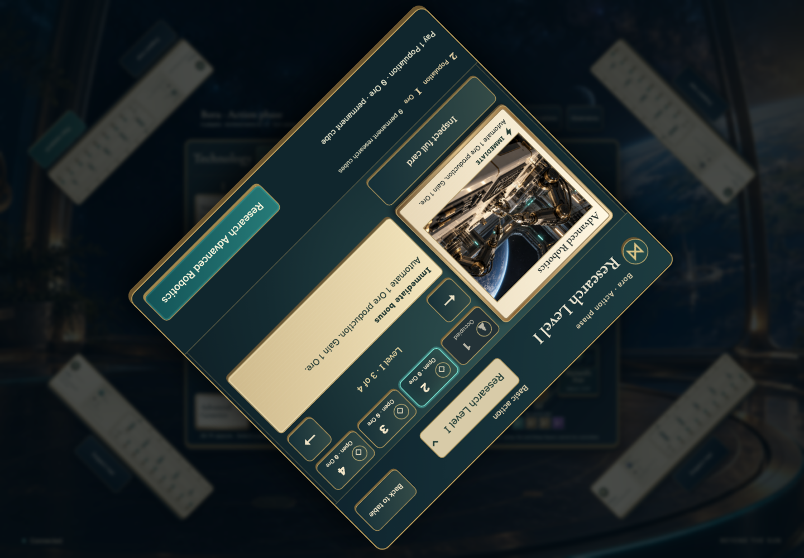](../../screenshots/plan-a-real-four-point-terraforming-jump-at-four-corner-seats/032-second-browse-1-desktop-darwin.png) |

tabletop-4k · 3840 × 2160

[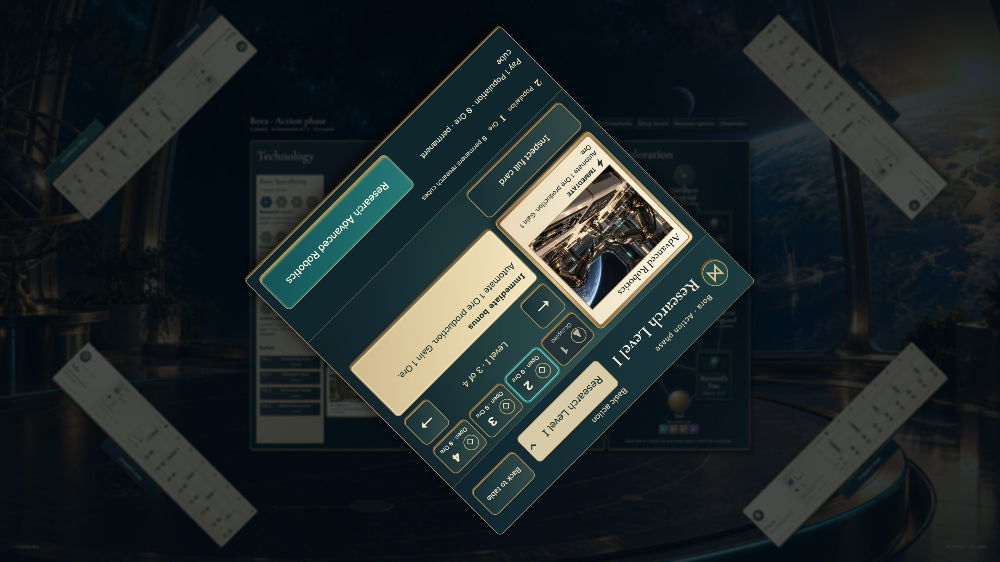](../../screenshots/plan-a-real-four-point-terraforming-jump-at-four-corner-seats/032-second-browse-1-tabletop-4k-darwin.png)

- [x] Browse the next public Level I face
- [x] Canonical effects settle before capture.
- [x] Any printed Action plan is ready.
- [x] Public compact topology remains physically separated.
- [x] The gameplay shell fits the actual viewport.

## 34. Browse the next public Level I face

Viewpoint: **Bora · North West · one shared controller**.

| desktop · 1440 × 1000 |
| --- |
| [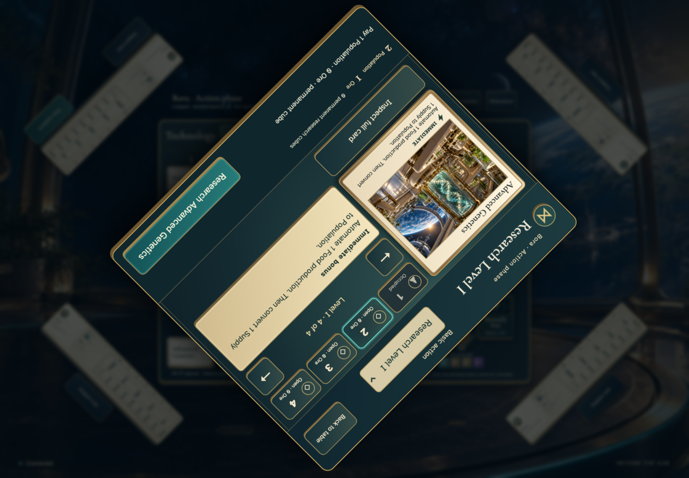](../../screenshots/plan-a-real-four-point-terraforming-jump-at-four-corner-seats/033-second-browse-2-desktop-darwin.png) |

tabletop-4k · 3840 × 2160

[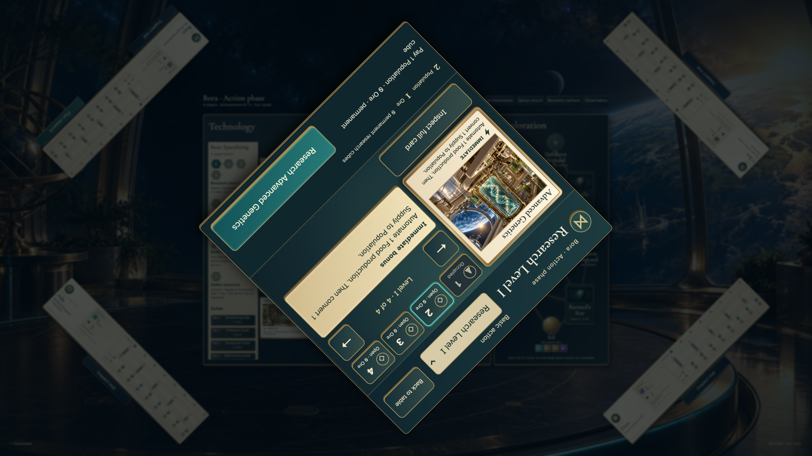](../../screenshots/plan-a-real-four-point-terraforming-jump-at-four-corner-seats/033-second-browse-2-tabletop-4k-darwin.png)

- [x] Browse the next public Level I face
- [x] Canonical effects settle before capture.
- [x] Any printed Action plan is ready.
- [x] Public compact topology remains physically separated.
- [x] The gameplay shell fits the actual viewport.

## 35. Pay once and receive Advanced Genetics's immediate bonus

Viewpoint: **Bora · North West · one shared controller**.

| desktop · 1440 × 1000 |
| --- |
| [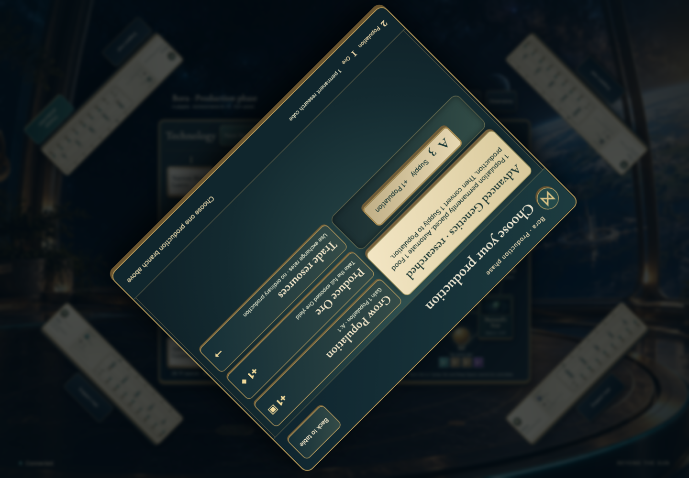](../../screenshots/plan-a-real-four-point-terraforming-jump-at-four-corner-seats/034-second-researched-desktop-darwin.png) |

tabletop-4k · 3840 × 2160

[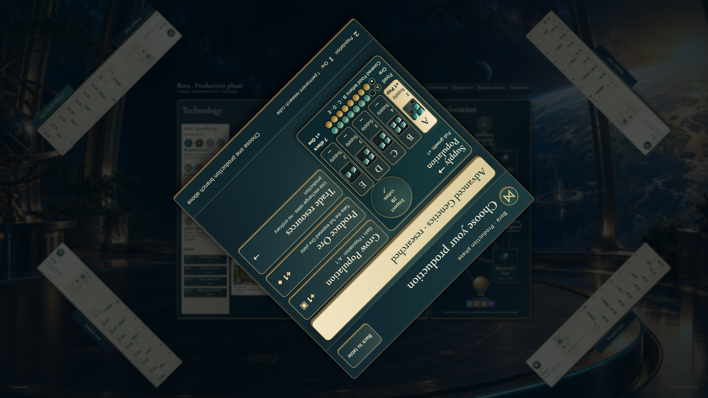](../../screenshots/plan-a-real-four-point-terraforming-jump-at-four-corner-seats/034-second-researched-tabletop-4k-darwin.png)

- [x] Pay once and receive Advanced Genetics's immediate bonus
- [x] Canonical effects settle before capture.
- [x] Any printed Action plan is ready.
- [x] Public compact topology remains physically separated.
- [x] The gameplay shell fits the actual viewport.

## 36. Bora completes production and hands off to Cleo

Viewpoint: **Bora · North West · one shared controller**.

| desktop · 1440 × 1000 |
| --- |
| [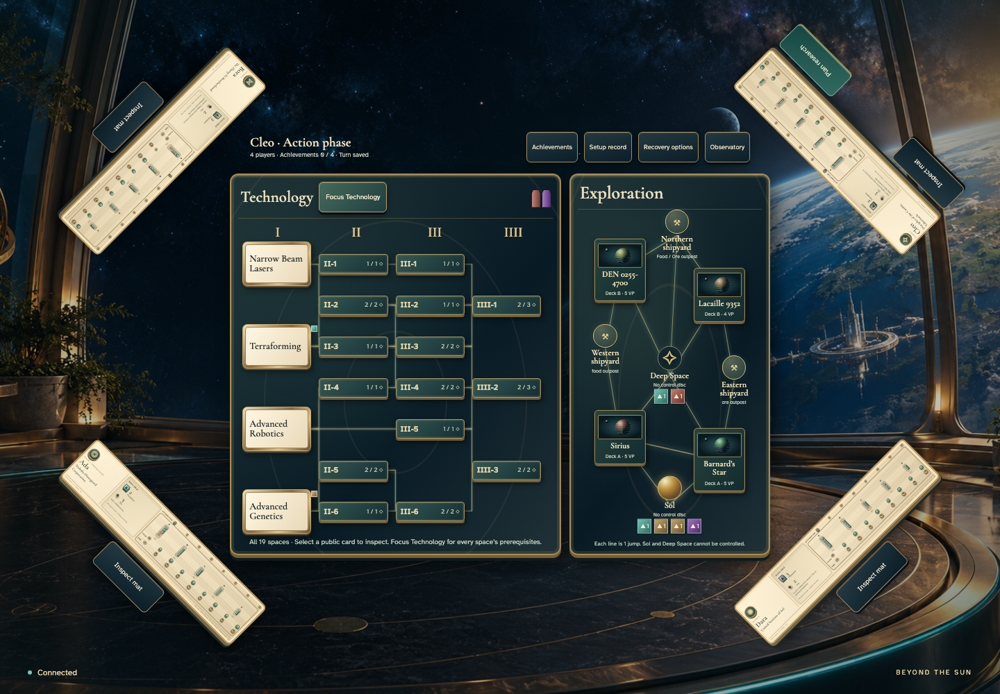](../../screenshots/plan-a-real-four-point-terraforming-jump-at-four-corner-seats/035-second-handoff-desktop-darwin.png) |

tabletop-4k · 3840 × 2160

[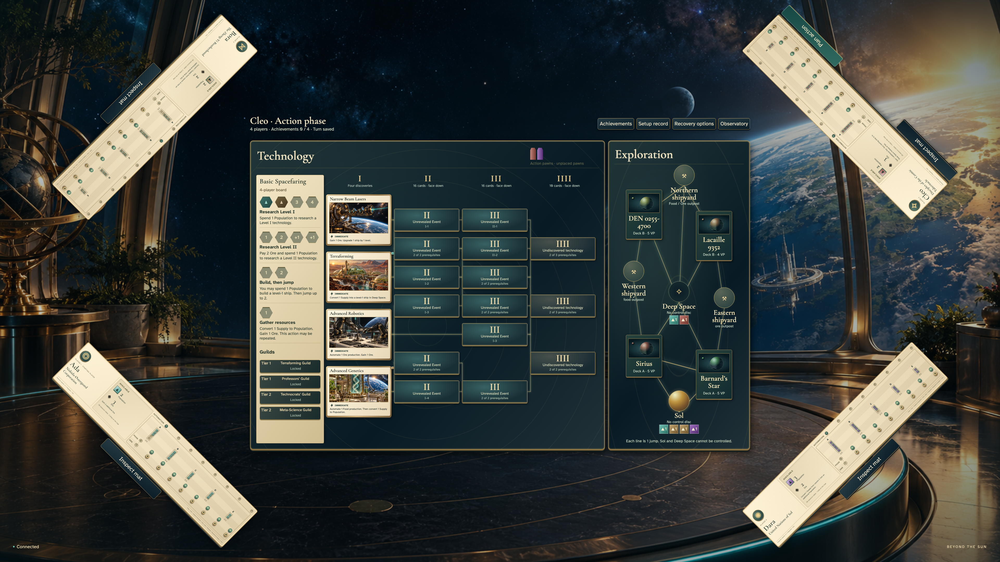](../../screenshots/plan-a-real-four-point-terraforming-jump-at-four-corner-seats/035-second-handoff-tabletop-4k-darwin.png)

- [x] Bora completes production and hands off to Cleo
- [x] Canonical effects settle before capture.
- [x] Any printed Action plan is ready.
- [x] Public compact topology remains physically separated.
- [x] The gameplay shell fits the actual viewport.

## 37. Cleo opens the actual research and Action instrument

Viewpoint: **Cleo · North East · one shared controller**.

| desktop · 1440 × 1000 |
| --- |
| [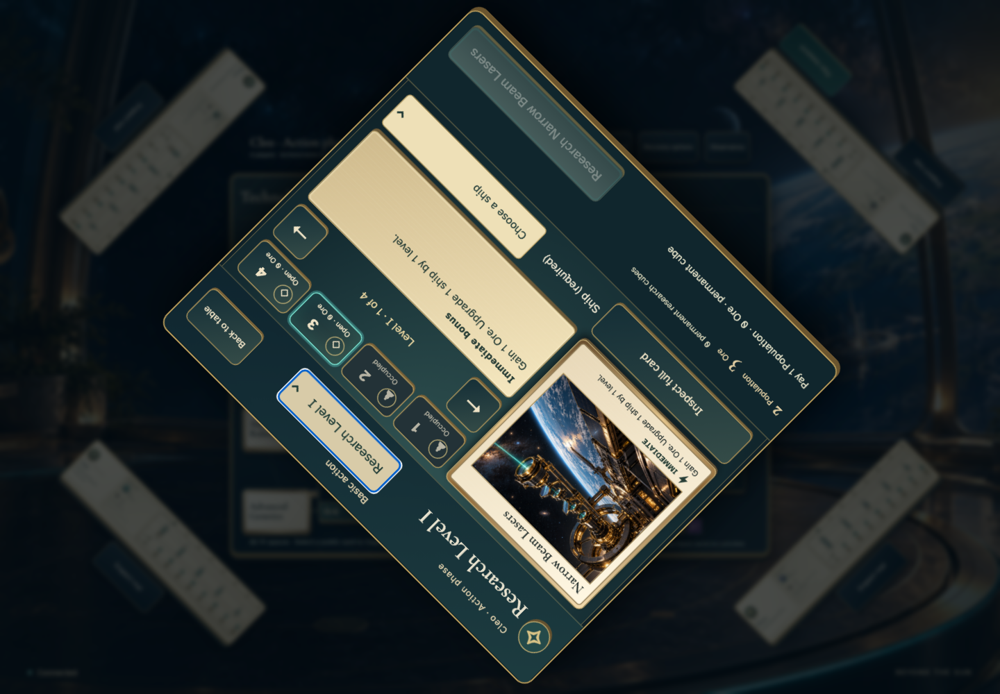](../../screenshots/plan-a-real-four-point-terraforming-jump-at-four-corner-seats/036-third-plan-desktop-darwin.png) |

tabletop-4k · 3840 × 2160

[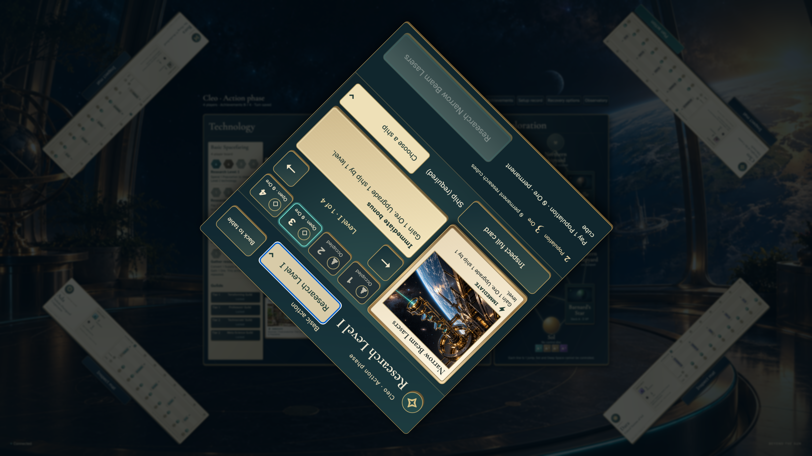](../../screenshots/plan-a-real-four-point-terraforming-jump-at-four-corner-seats/036-third-plan-tabletop-4k-darwin.png)

- [x] Cleo opens the actual research and Action instrument
- [x] Canonical effects settle before capture.
- [x] Any printed Action plan is ready.
- [x] Public compact topology remains physically separated.
- [x] The gameplay shell fits the actual viewport.

## 38. Cleo selects the legal printed space 3

Viewpoint: **Cleo · North East · one shared controller**.

| desktop · 1440 × 1000 |
| --- |
| [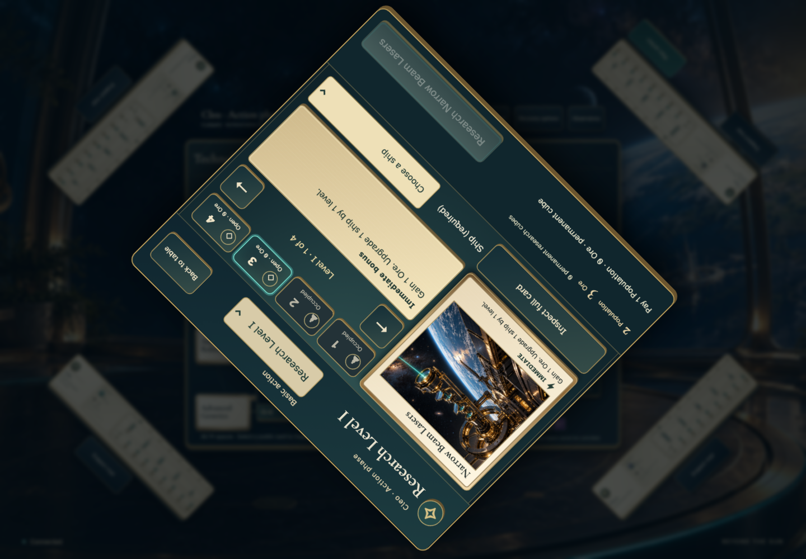](../../screenshots/plan-a-real-four-point-terraforming-jump-at-four-corner-seats/037-third-space-desktop-darwin.png) |

tabletop-4k · 3840 × 2160

[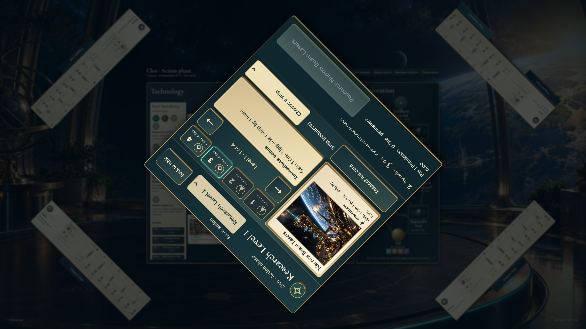](../../screenshots/plan-a-real-four-point-terraforming-jump-at-four-corner-seats/037-third-space-tabletop-4k-darwin.png)

- [x] Cleo selects the legal printed space 3
- [x] Canonical effects settle before capture.
- [x] Any printed Action plan is ready.
- [x] Public compact topology remains physically separated.
- [x] The gameplay shell fits the actual viewport.

## 39. Browse the next public Level I face

Viewpoint: **Cleo · North East · one shared controller**.

| desktop · 1440 × 1000 |
| --- |
| [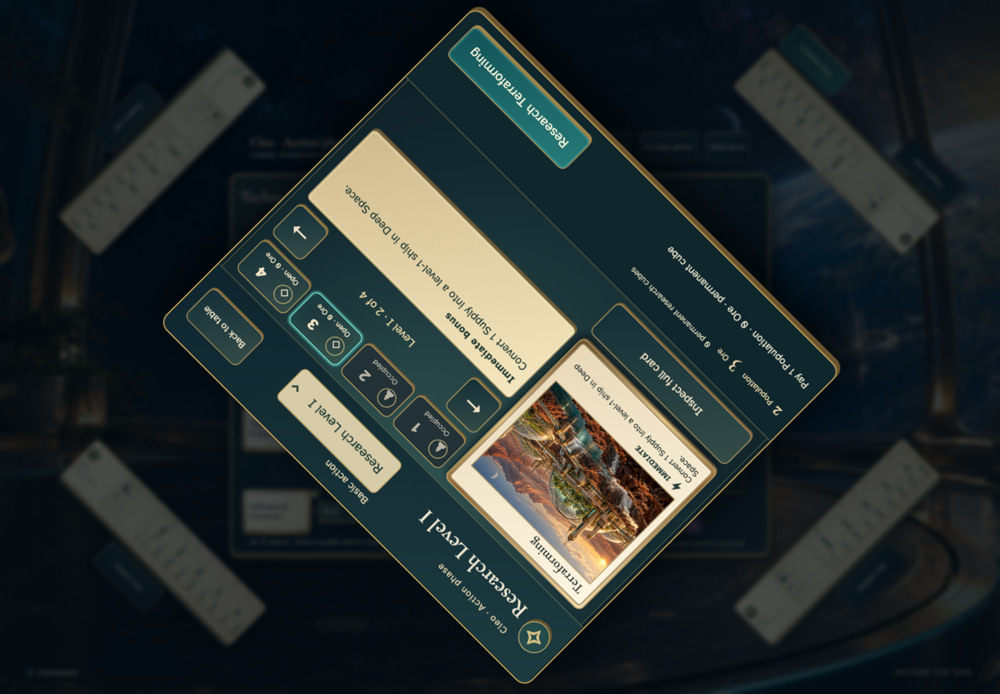](../../screenshots/plan-a-real-four-point-terraforming-jump-at-four-corner-seats/038-third-browse-0-desktop-darwin.png) |

tabletop-4k · 3840 × 2160

[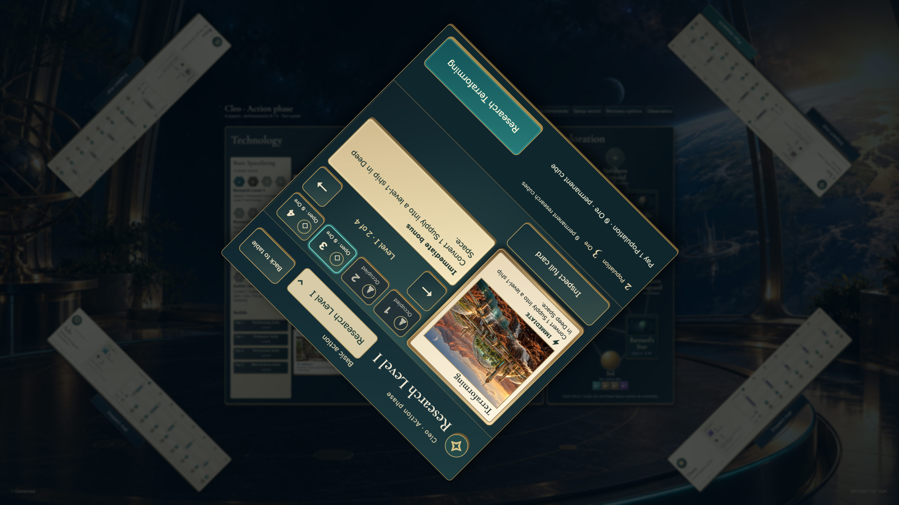](../../screenshots/plan-a-real-four-point-terraforming-jump-at-four-corner-seats/038-third-browse-0-tabletop-4k-darwin.png)

- [x] Browse the next public Level I face
- [x] Canonical effects settle before capture.
- [x] Any printed Action plan is ready.
- [x] Public compact topology remains physically separated.
- [x] The gameplay shell fits the actual viewport.

## 40. Browse the next public Level I face

Viewpoint: **Cleo · North East · one shared controller**.

| desktop · 1440 × 1000 |
| --- |
| [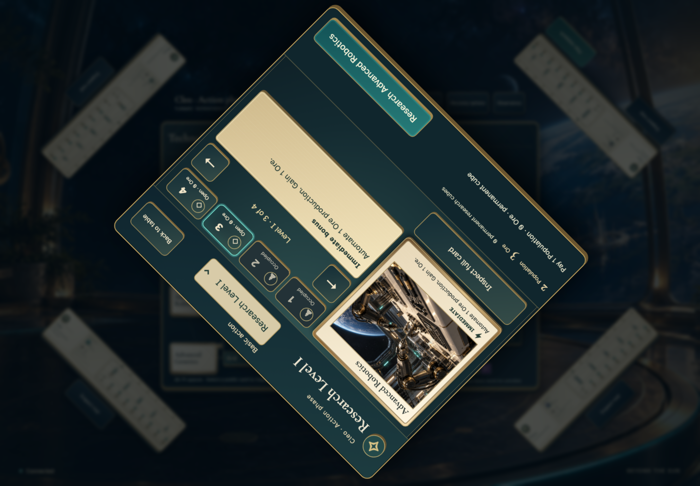](../../screenshots/plan-a-real-four-point-terraforming-jump-at-four-corner-seats/039-third-browse-1-desktop-darwin.png) |

tabletop-4k · 3840 × 2160

[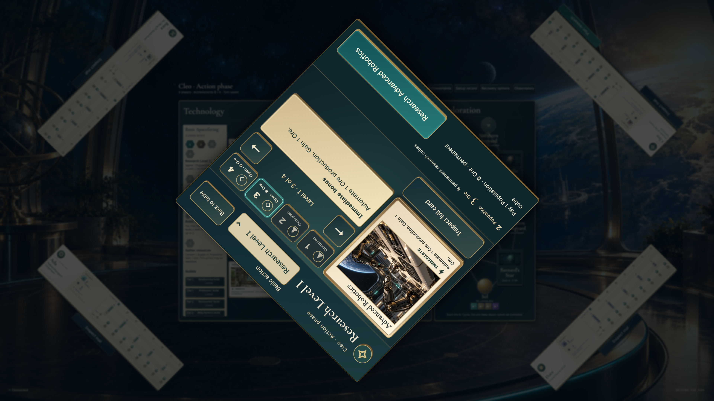](../../screenshots/plan-a-real-four-point-terraforming-jump-at-four-corner-seats/039-third-browse-1-tabletop-4k-darwin.png)

- [x] Browse the next public Level I face
- [x] Canonical effects settle before capture.
- [x] Any printed Action plan is ready.
- [x] Public compact topology remains physically separated.
- [x] The gameplay shell fits the actual viewport.

## 41. Pay once and receive Advanced Robotics's immediate bonus

Viewpoint: **Cleo · North East · one shared controller**.

| desktop · 1440 × 1000 |
| --- |
| [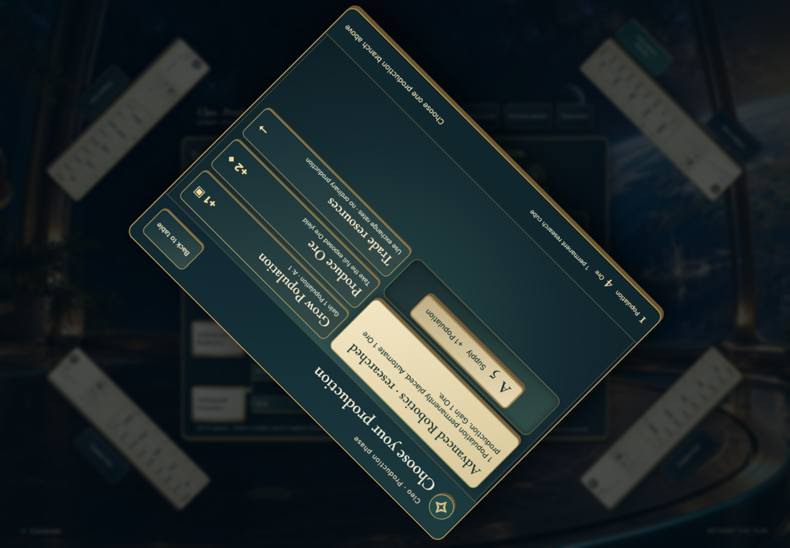](../../screenshots/plan-a-real-four-point-terraforming-jump-at-four-corner-seats/040-third-researched-desktop-darwin.png) |

tabletop-4k · 3840 × 2160

[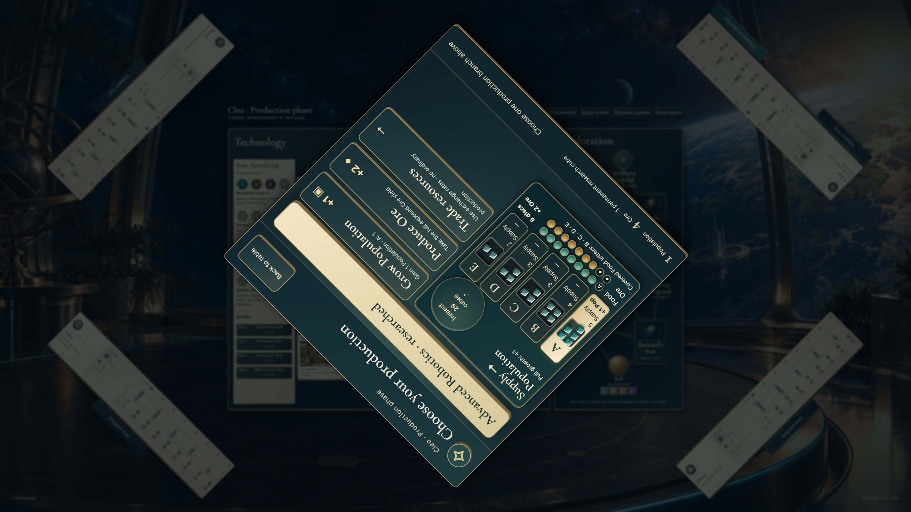](../../screenshots/plan-a-real-four-point-terraforming-jump-at-four-corner-seats/040-third-researched-tabletop-4k-darwin.png)

- [x] Pay once and receive Advanced Robotics's immediate bonus
- [x] Canonical effects settle before capture.
- [x] Any printed Action plan is ready.
- [x] Public compact topology remains physically separated.
- [x] The gameplay shell fits the actual viewport.

## 42. Cleo completes production and hands off to Dara

Viewpoint: **Cleo · North East · one shared controller**.

| desktop · 1440 × 1000 |
| --- |
|  |

tabletop-4k · 3840 × 2160

[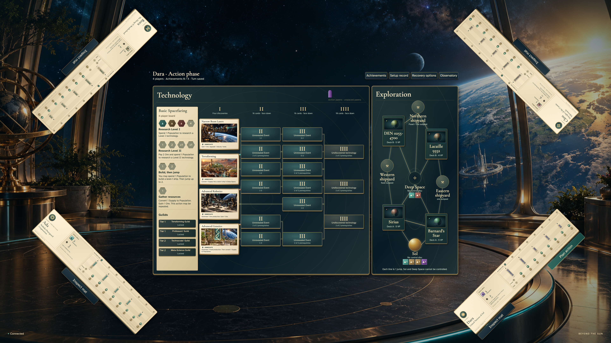](../../screenshots/plan-a-real-four-point-terraforming-jump-at-four-corner-seats/041-third-handoff-tabletop-4k-darwin.png)

- [x] Cleo completes production and hands off to Dara
- [x] Canonical effects settle before capture.
- [x] Any printed Action plan is ready.
- [x] Public compact topology remains physically separated.
- [x] The gameplay shell fits the actual viewport.

## 43. Dara opens the actual research and Action instrument

Viewpoint: **Dara · South East · one shared controller**.

| desktop · 1440 × 1000 |
| --- |
| [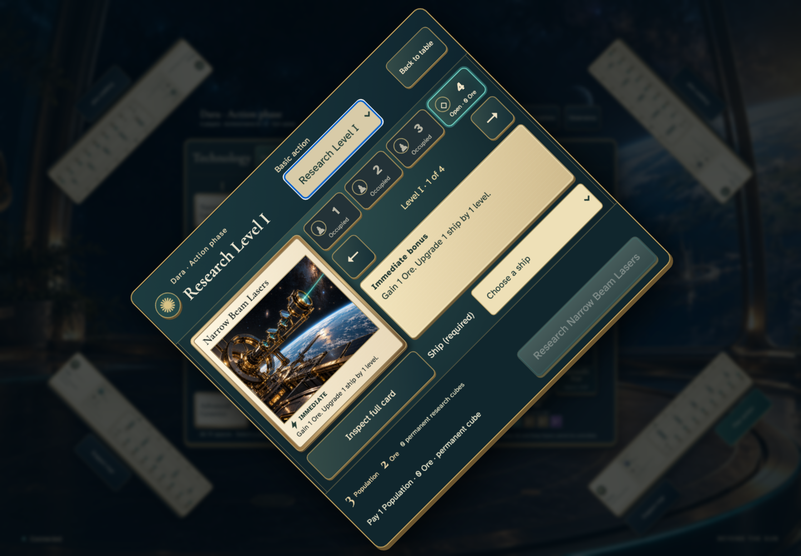](../../screenshots/plan-a-real-four-point-terraforming-jump-at-four-corner-seats/042-fourth-plan-desktop-darwin.png) |

tabletop-4k · 3840 × 2160

[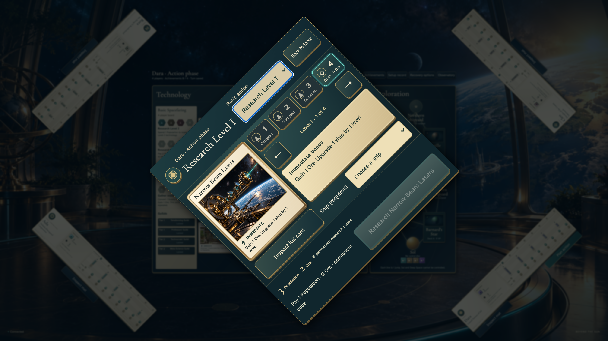](../../screenshots/plan-a-real-four-point-terraforming-jump-at-four-corner-seats/042-fourth-plan-tabletop-4k-darwin.png)

- [x] Dara opens the actual research and Action instrument
- [x] Canonical effects settle before capture.
- [x] Any printed Action plan is ready.
- [x] Public compact topology remains physically separated.
- [x] The gameplay shell fits the actual viewport.

## 44. Dara selects the legal printed space 4

Viewpoint: **Dara · South East · one shared controller**.

| desktop · 1440 × 1000 |
| --- |
|  |

tabletop-4k · 3840 × 2160

[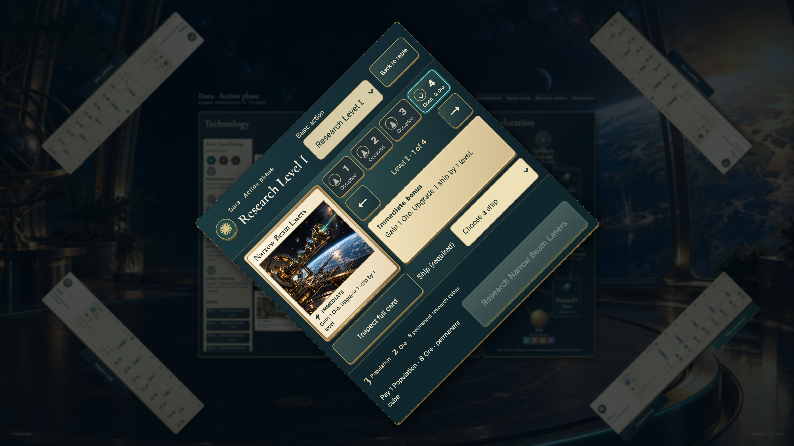](../../screenshots/plan-a-real-four-point-terraforming-jump-at-four-corner-seats/043-fourth-space-tabletop-4k-darwin.png)

- [x] Dara selects the legal printed space 4
- [x] Canonical effects settle before capture.
- [x] Any printed Action plan is ready.
- [x] Public compact topology remains physically separated.
- [x] The gameplay shell fits the actual viewport.

## 45. Browse the next public Level I face

Viewpoint: **Dara · South East · one shared controller**.

| desktop · 1440 × 1000 |
| --- |
| [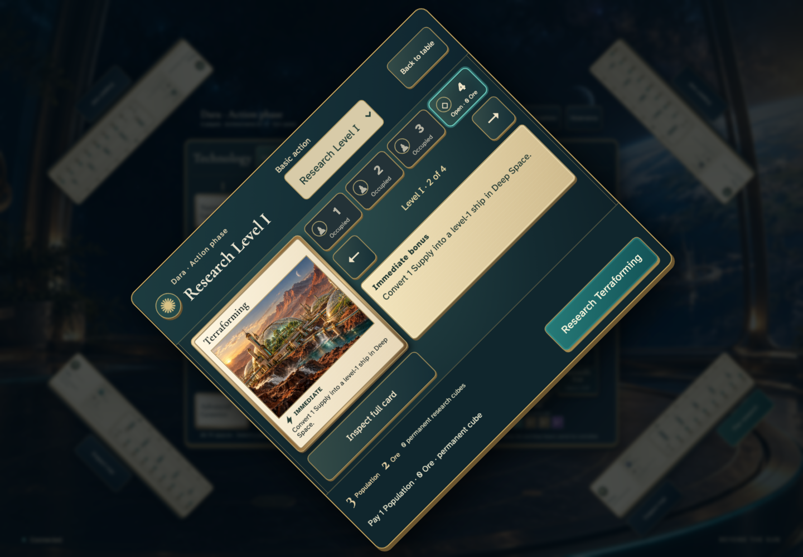](../../screenshots/plan-a-real-four-point-terraforming-jump-at-four-corner-seats/044-fourth-browse-0-desktop-darwin.png) |

tabletop-4k · 3840 × 2160

[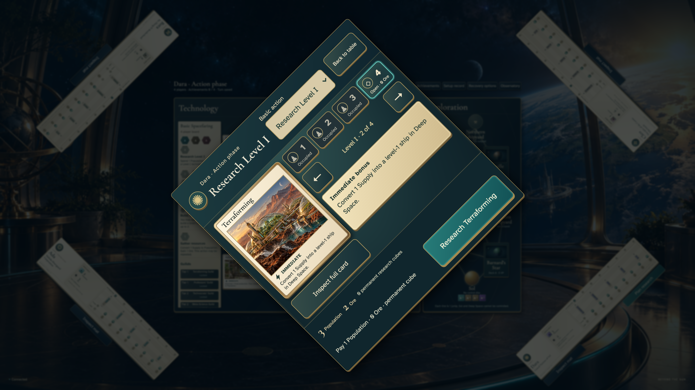](../../screenshots/plan-a-real-four-point-terraforming-jump-at-four-corner-seats/044-fourth-browse-0-tabletop-4k-darwin.png)

- [x] Browse the next public Level I face
- [x] Canonical effects settle before capture.
- [x] Any printed Action plan is ready.
- [x] Public compact topology remains physically separated.
- [x] The gameplay shell fits the actual viewport.

## 46. Browse the next public Level I face

Viewpoint: **Dara · South East · one shared controller**.

| desktop · 1440 × 1000 |
| --- |
| [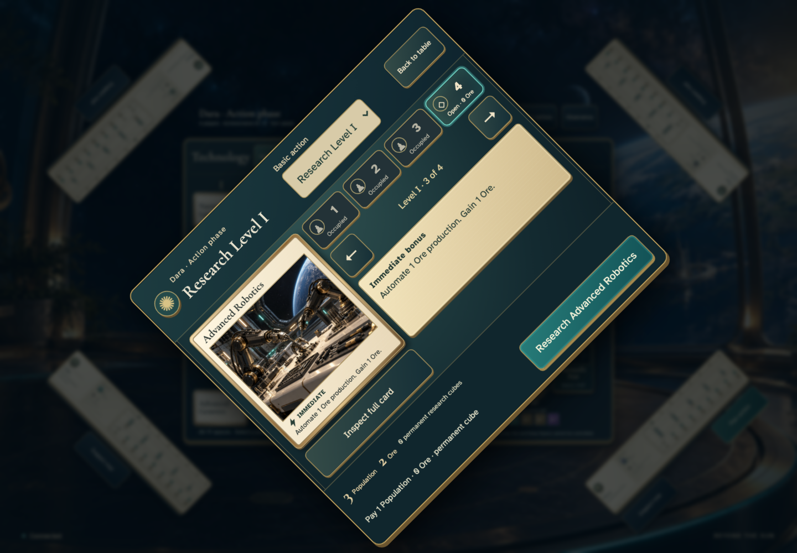](../../screenshots/plan-a-real-four-point-terraforming-jump-at-four-corner-seats/045-fourth-browse-1-desktop-darwin.png) |

tabletop-4k · 3840 × 2160

[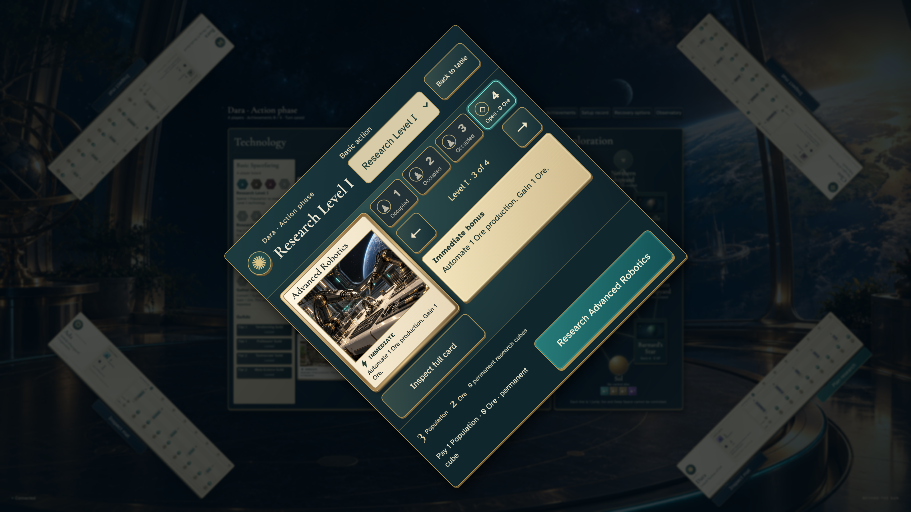](../../screenshots/plan-a-real-four-point-terraforming-jump-at-four-corner-seats/045-fourth-browse-1-tabletop-4k-darwin.png)

- [x] Browse the next public Level I face
- [x] Canonical effects settle before capture.
- [x] Any printed Action plan is ready.
- [x] Public compact topology remains physically separated.
- [x] The gameplay shell fits the actual viewport.

## 47. Pay once and receive Advanced Robotics's immediate bonus

Viewpoint: **Dara · South East · one shared controller**.

| desktop · 1440 × 1000 |
| --- |
| [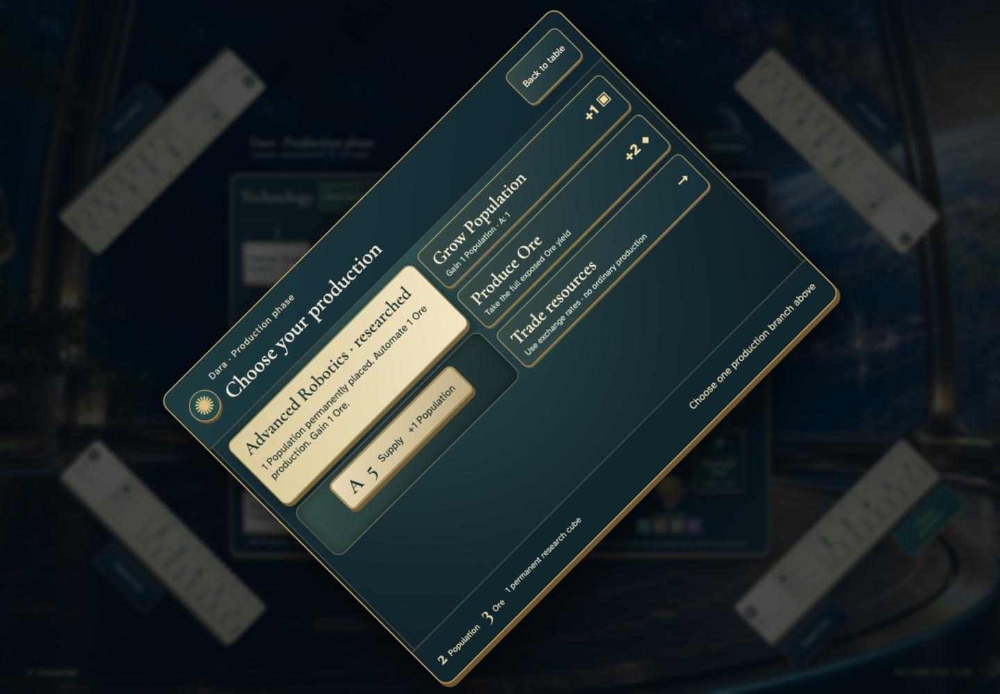](../../screenshots/plan-a-real-four-point-terraforming-jump-at-four-corner-seats/046-fourth-researched-desktop-darwin.png) |

tabletop-4k · 3840 × 2160

[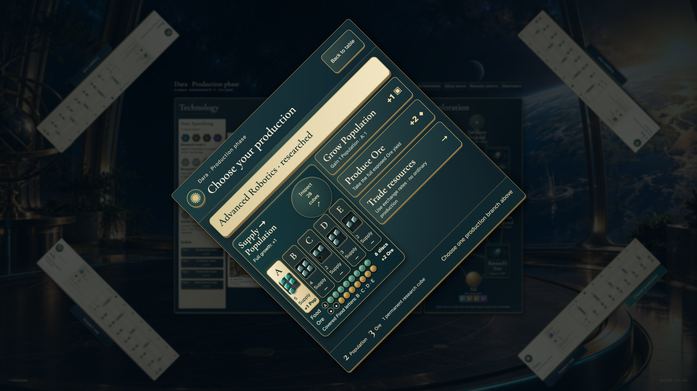](../../screenshots/plan-a-real-four-point-terraforming-jump-at-four-corner-seats/046-fourth-researched-tabletop-4k-darwin.png)

- [x] Pay once and receive Advanced Robotics's immediate bonus
- [x] Canonical effects settle before capture.
- [x] Any printed Action plan is ready.
- [x] Public compact topology remains physically separated.
- [x] The gameplay shell fits the actual viewport.

## 48. Dara completes production and hands off to Ada

Viewpoint: **Dara · South East · one shared controller**.

| desktop · 1440 × 1000 |
| --- |
| [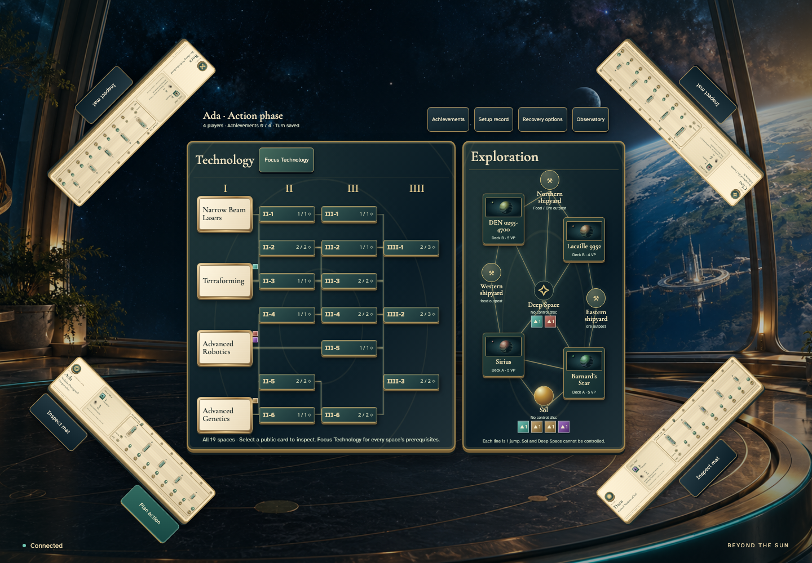](../../screenshots/plan-a-real-four-point-terraforming-jump-at-four-corner-seats/047-fourth-handoff-desktop-darwin.png) |

tabletop-4k · 3840 × 2160

- [x] Dara completes production and hands off to Ada
- [x] Canonical effects settle before capture.
- [x] Any printed Action plan is ready.
- [x] Public compact topology remains physically separated.
- [x] The gameplay shell fits the actual viewport.

## 49. Ada opens the actual research and Action instrument

Viewpoint: **Ada · South West · one shared controller**.

| desktop · 1440 × 1000 |
| --- |
| [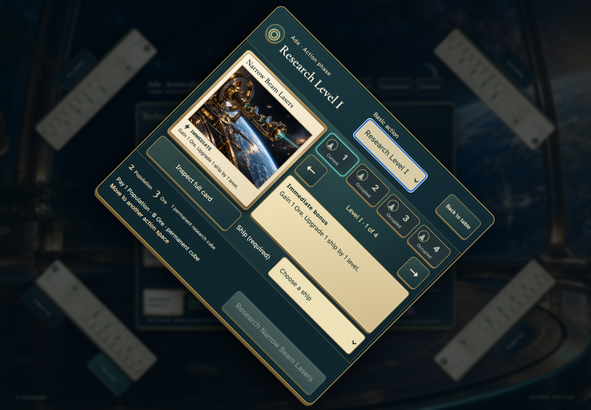](../../screenshots/plan-a-real-four-point-terraforming-jump-at-four-corner-seats/048-printed-plan-desktop-darwin.png) |

tabletop-4k · 3840 × 2160

[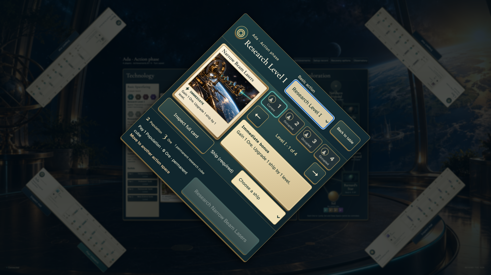](../../screenshots/plan-a-real-four-point-terraforming-jump-at-four-corner-seats/048-printed-plan-tabletop-4k-darwin.png)

- [x] Ada opens the actual research and Action instrument
- [x] Canonical effects settle before capture.
- [x] Any printed Action plan is ready.
- [x] Public compact topology remains physically separated.
- [x] The gameplay shell fits the actual viewport.

## 50. Ada selects printed technology Actions

Viewpoint: **Ada · South West · one shared controller**.

| desktop · 1440 × 1000 |
| --- |
|  |

tabletop-4k · 3840 × 2160

[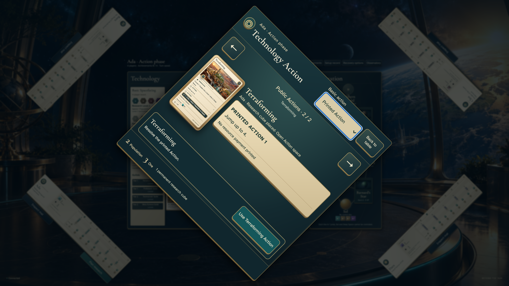](../../screenshots/plan-a-real-four-point-terraforming-jump-at-four-corner-seats/049-printed-kind-tabletop-4k-darwin.png)

- [x] Ada selects printed technology Actions
- [x] Canonical effects settle before capture.
- [x] Any printed Action plan is ready.
- [x] Public compact topology remains physically separated.
- [x] The gameplay shell fits the actual viewport.

## 51. Read Terraforming's actual research requirement, payment and exclusive pawn space

Viewpoint: **Ada · South West · one shared controller**.

| desktop · 1440 × 1000 |
| --- |
| [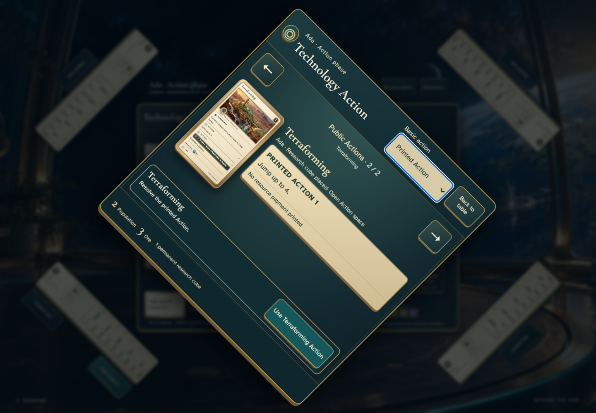](../../screenshots/plan-a-real-four-point-terraforming-jump-at-four-corner-seats/050-printed-face-desktop-darwin.png) |

tabletop-4k · 3840 × 2160

- [x] Read Terraforming's actual research requirement, payment and exclusive pawn space
- [x] Canonical effects settle before capture.
- [x] Any printed Action plan is ready.
- [x] Public compact topology remains physically separated.
- [x] The gameplay shell fits the actual viewport.

## 52. Commit the exact printed cost and save the pending jump decision

Viewpoint: **Ada · South West · one shared controller**.

| desktop · 1440 × 1000 |
| --- |
|  |

tabletop-4k · 3840 × 2160

- [x] Commit the exact printed cost and save the pending jump decision
- [x] Canonical effects settle before capture.
- [x] Any printed Action plan is ready.
- [x] Public compact topology remains physically separated.
- [x] The gameplay shell fits the actual viewport.

## 53. Reload retains the paid Action and pending movement without another payment

Viewpoint: **Ada · South West · one shared controller**.

| desktop · 1440 × 1000 |
| --- |
|  |

tabletop-4k · 3840 × 2160

- [x] Reload retains the paid Action and pending movement without another payment
- [x] Canonical effects settle before capture.
- [x] Any printed Action plan is ready.
- [x] Public compact topology remains physically separated.
- [x] The gameplay shell fits the actual viewport.

## 54. Resume the same saved Action effects

Viewpoint: **Ada · South West · one shared controller**.

| desktop · 1440 × 1000 |
| --- |
|  |

tabletop-4k · 3840 × 2160

- [x] Resume the same saved Action effects
- [x] Canonical effects settle before capture.
- [x] Any printed Action plan is ready.
- [x] Public compact topology remains physically separated.
- [x] The gameplay shell fits the actual viewport.

## 55. Open the actual connected-destination view

Viewpoint: **Ada · South West · one shared controller**.

| desktop · 1440 × 1000 |
| --- |
|  |

tabletop-4k · 3840 × 2160

- [x] Open the actual connected-destination view
- [x] Canonical effects settle before capture.
- [x] Any printed Action plan is ready.
- [x] Public compact topology remains physically separated.
- [x] The gameplay shell fits the actual viewport.

## 56. Select the actual owned ship whose path will be planned

Viewpoint: **Ada · South West · one shared controller**.

| desktop · 1440 × 1000 |
| --- |
|  |

tabletop-4k · 3840 × 2160

- [x] Select the actual owned ship whose path will be planned
- [x] Canonical effects settle before capture.
- [x] Any printed Action plan is ready.
- [x] Public compact topology remains physically separated.
- [x] The gameplay shell fits the actual viewport.

## 57. Plan the first unpaid leg from Deep Space to the Northern shipyard

Viewpoint: **Ada · South West · one shared controller**.

| desktop · 1440 × 1000 |
| --- |
|  |

tabletop-4k · 3840 × 2160

- [x] Plan the first unpaid leg from Deep Space to the Northern shipyard
- [x] Canonical effects settle before capture.
- [x] Any printed Action plan is ready.
- [x] Public compact topology remains physically separated.
- [x] The gameplay shell fits the actual viewport.

## 58. A circuit returning every ship to its origin cannot spend this free Action

Viewpoint: **Ada · South West · one shared controller**.

| desktop · 1440 × 1000 |
| --- |
|  |

tabletop-4k · 3840 × 2160

- [x] A circuit returning every ship to its origin cannot spend this free Action
- [x] Canonical effects settle before capture.
- [x] Any printed Action plan is ready.
- [x] Public compact topology remains physically separated.
- [x] The gameplay shell fits the actual viewport.

## 59. Clear the unpaid circuit without moving a ship

Viewpoint: **Ada · South West · one shared controller**.

| desktop · 1440 × 1000 |
| --- |
|  |

tabletop-4k · 3840 × 2160

- [x] Clear the unpaid circuit without moving a ship
- [x] Canonical effects settle before capture.
- [x] Any printed Action plan is ready.
- [x] Public compact topology remains physically separated.
- [x] The gameplay shell fits the actual viewport.

## 60. Choose the Terraforming ship for a real relocation

Viewpoint: **Ada · South West · one shared controller**.

| desktop · 1440 × 1000 |
| --- |
|  |

tabletop-4k · 3840 × 2160

- [x] Choose the Terraforming ship for a real relocation
- [x] Canonical effects settle before capture.
- [x] Any printed Action plan is ready.
- [x] Public compact topology remains physically separated.
- [x] The gameplay shell fits the actual viewport.

## 61. Plan leg 1 of the printed 4-point budget without early payment or movement

Viewpoint: **Ada · South West · one shared controller**.

| desktop · 1440 × 1000 |
| --- |
|  |

tabletop-4k · 3840 × 2160

- [x] Plan leg 1 of the printed 4-point budget without early payment or movement
- [x] Canonical effects settle before capture.
- [x] Any printed Action plan is ready.
- [x] Public compact topology remains physically separated.
- [x] The gameplay shell fits the actual viewport.

## 62. Plan leg 2 of the printed 4-point budget without early payment or movement

Viewpoint: **Ada · South West · one shared controller**.

| desktop · 1440 × 1000 |
| --- |
|  |

tabletop-4k · 3840 × 2160

- [x] Plan leg 2 of the printed 4-point budget without early payment or movement
- [x] Canonical effects settle before capture.
- [x] Any printed Action plan is ready.
- [x] Public compact topology remains physically separated.
- [x] The gameplay shell fits the actual viewport.

## 63. Plan leg 3 of the printed 4-point budget without early payment or movement

Viewpoint: **Ada · South West · one shared controller**.

| desktop · 1440 × 1000 |
| --- |
|  |

tabletop-4k · 3840 × 2160

- [x] Plan leg 3 of the printed 4-point budget without early payment or movement
- [x] Canonical effects settle before capture.
- [x] Any printed Action plan is ready.
- [x] Public compact topology remains physically separated.
- [x] The gameplay shell fits the actual viewport.

## 64. Plan leg 4 of the printed 4-point budget without early payment or movement

Viewpoint: **Ada · South West · one shared controller**.

| desktop · 1440 × 1000 |
| --- |
|  |

tabletop-4k · 3840 × 2160

- [x] Plan leg 4 of the printed 4-point budget without early payment or movement
- [x] Canonical effects settle before capture.
- [x] Any printed Action plan is ready.
- [x] Public compact topology remains physically separated.
- [x] The gameplay shell fits the actual viewport.

## 65. Commit the complete path atomically before any actual gain-control bonus

Viewpoint: **Ada · South West · one shared controller**.

| desktop · 1440 × 1000 |
| --- |
|  |

tabletop-4k · 3840 × 2160

- [x] Commit the complete path atomically before any actual gain-control bonus
- [x] Canonical effects settle before capture.
- [x] Any printed Action plan is ready.
- [x] Public compact topology remains physically separated.
- [x] The gameplay shell fits the actual viewport.

## 66. Ada completes production and hands off to Bora

Viewpoint: **Ada · South West · one shared controller**.

| desktop · 1440 × 1000 |
| --- |
|  |

tabletop-4k · 3840 × 2160

- [x] Ada completes production and hands off to Bora
- [x] Canonical effects settle before capture.
- [x] Any printed Action plan is ready.
- [x] Public compact topology remains physically separated.
- [x] The gameplay shell fits the actual viewport.

## 67. The printed Action, final ship location and Bora handoff survive reload

Viewpoint: **Ada · South West · one shared controller**.

| desktop · 1440 × 1000 |
| --- |
|  |

tabletop-4k · 3840 × 2160

- [x] The printed Action, final ship location and Bora handoff survive reload
- [x] Canonical effects settle before capture.
- [x] Any printed Action plan is ready.
- [x] Public compact topology remains physically separated.
- [x] The gameplay shell fits the actual viewport.
