# Research a rival discovery once and respect its exclusive printed Action

Two separate authenticated remote controllers; ordinary UI setup and legal preparatory turns. Only initial setup entropy is fixed to66666666-6666-4666-8666-000000000009. No game-state injection or future-deck inspection. Actual printed research access, payment, occupancy, effects and recovery use production components.

## 1. Arrive using the actual production client

Viewpoint: **Ada · separate host controller**.

| phone · 393 × 852 | desktop · 1440 × 1000 |
| --- | --- |
|  |  |

- [x] Arrive using the actual production client
- [x] Canonical effects settle before capture.
- [x] Any printed Action plan is ready.
- [x] Public compact topology remains physically separated.
- [x] The gameplay shell fits the actual viewport.

## 2. Choose a real production play mode

Viewpoint: **Ada · separate host controller**.

| phone · 393 × 852 | desktop · 1440 × 1000 |
| --- | --- |
|  |  |

- [x] Choose a real production play mode
- [x] Canonical effects settle before capture.
- [x] Any printed Action plan is ready.
- [x] Public compact topology remains physically separated.
- [x] The gameplay shell fits the actual viewport.

## 3. Create an independent remote host controller

Viewpoint: **Ada · separate host controller**.

| phone · 393 × 852 | desktop · 1440 × 1000 |
| --- | --- |
| [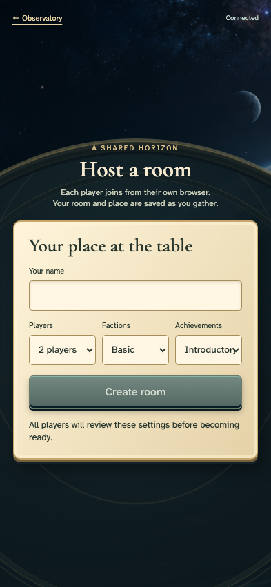](../../screenshots/research-a-rival-discovery-once-and-respect-its-exclusive-printed-action/002-host-form-phone-darwin.png) |  |

- [x] Create an independent remote host controller
- [x] Canonical effects settle before capture.
- [x] Any printed Action plan is ready.
- [x] Public compact topology remains physically separated.
- [x] The gameplay shell fits the actual viewport.

## 4. Name the host Ada

Viewpoint: **Ada · separate host controller**.

| phone · 393 × 852 | desktop · 1440 × 1000 |
| --- | --- |
|  |  |

- [x] Name the host Ada
- [x] Canonical effects settle before capture.
- [x] Any printed Action plan is ready.
- [x] Public compact topology remains physically separated.
- [x] The gameplay shell fits the actual viewport.

## 5. The canonical remote room exposes its actual invitation code

Viewpoint: **Ada · separate host controller**.

| phone · 393 × 852 | desktop · 1440 × 1000 |
| --- | --- |
| [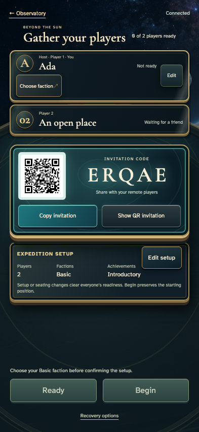](../../screenshots/research-a-rival-discovery-once-and-respect-its-exclusive-printed-action/004-host-room-phone-darwin.png) | [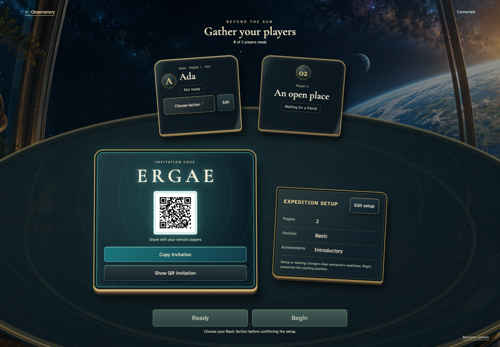](../../screenshots/research-a-rival-discovery-once-and-respect-its-exclusive-printed-action/004-host-room-desktop-darwin.png) |

- [x] The canonical remote room exposes its actual invitation code
- [x] Canonical effects settle before capture.
- [x] Any printed Action plan is ready.
- [x] Public compact topology remains physically separated.
- [x] The gameplay shell fits the actual viewport.

## 6. A different identity previews the public invitation

Viewpoint: **Bora · separate guest controller**.

| phone · 1440 × 1000 | desktop · 393 × 852 |
| --- | --- |
| [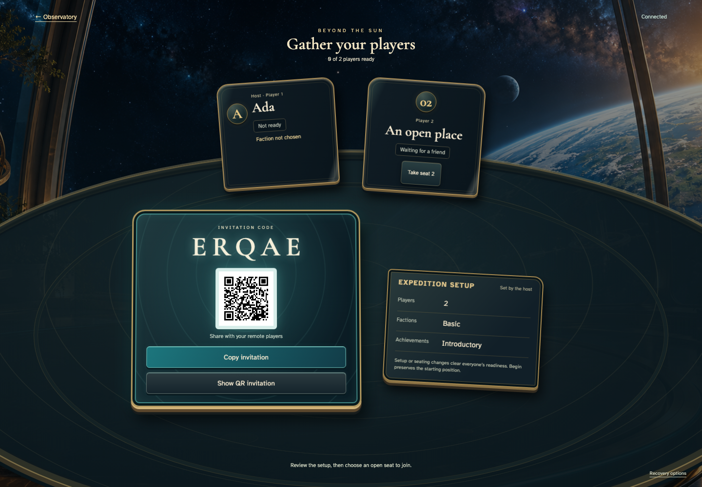](../../screenshots/research-a-rival-discovery-once-and-respect-its-exclusive-printed-action/005-guest-preview-phone-darwin.png) | [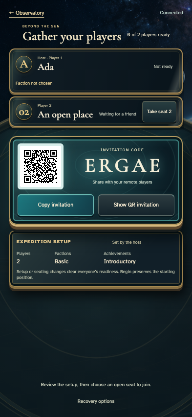](../../screenshots/research-a-rival-discovery-once-and-respect-its-exclusive-printed-action/005-guest-preview-desktop-darwin.png) |

- [x] A different identity previews the public invitation
- [x] Canonical effects settle before capture.
- [x] Any printed Action plan is ready.
- [x] Public compact topology remains physically separated.
- [x] The gameplay shell fits the actual viewport.

## 7. The guest claims only the remote seat

Viewpoint: **Bora · separate guest controller**.

| phone · 1440 × 1000 | desktop · 393 × 852 |
| --- | --- |
| [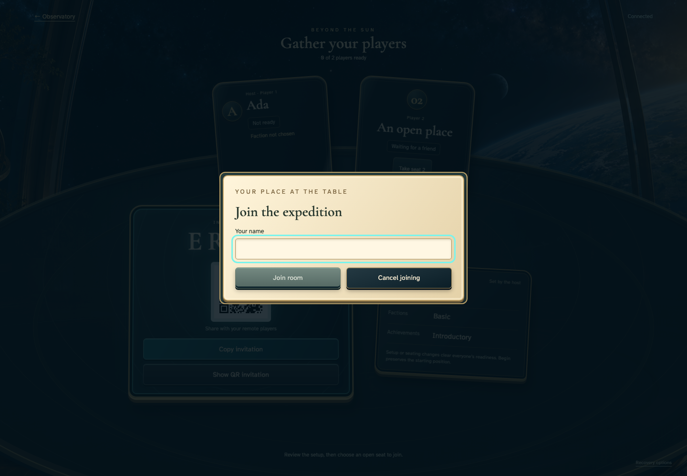](../../screenshots/research-a-rival-discovery-once-and-respect-its-exclusive-printed-action/006-guest-editor-phone-darwin.png) |  |

- [x] The guest claims only the remote seat
- [x] Canonical effects settle before capture.
- [x] Any printed Action plan is ready.
- [x] Public compact topology remains physically separated.
- [x] The gameplay shell fits the actual viewport.

## 8. Name the independent guest Bora

Viewpoint: **Bora · separate guest controller**.

| phone · 1440 × 1000 | desktop · 393 × 852 |
| --- | --- |
| [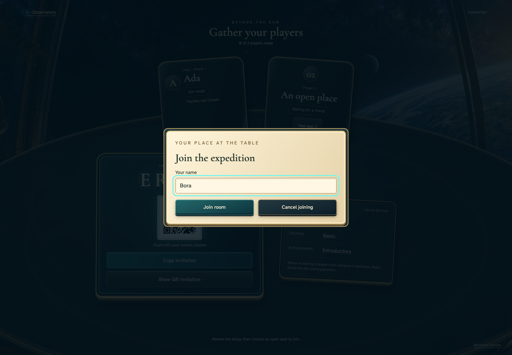](../../screenshots/research-a-rival-discovery-once-and-respect-its-exclusive-printed-action/007-guest-name-phone-darwin.png) |  |

- [x] Name the independent guest Bora
- [x] Canonical effects settle before capture.
- [x] Any printed Action plan is ready.
- [x] Public compact topology remains physically separated.
- [x] The gameplay shell fits the actual viewport.

## 9. Both named remote identities share the same room

Viewpoint: **Bora · separate guest controller**.

| phone · 1440 × 1000 | desktop · 393 × 852 |
| --- | --- |
| [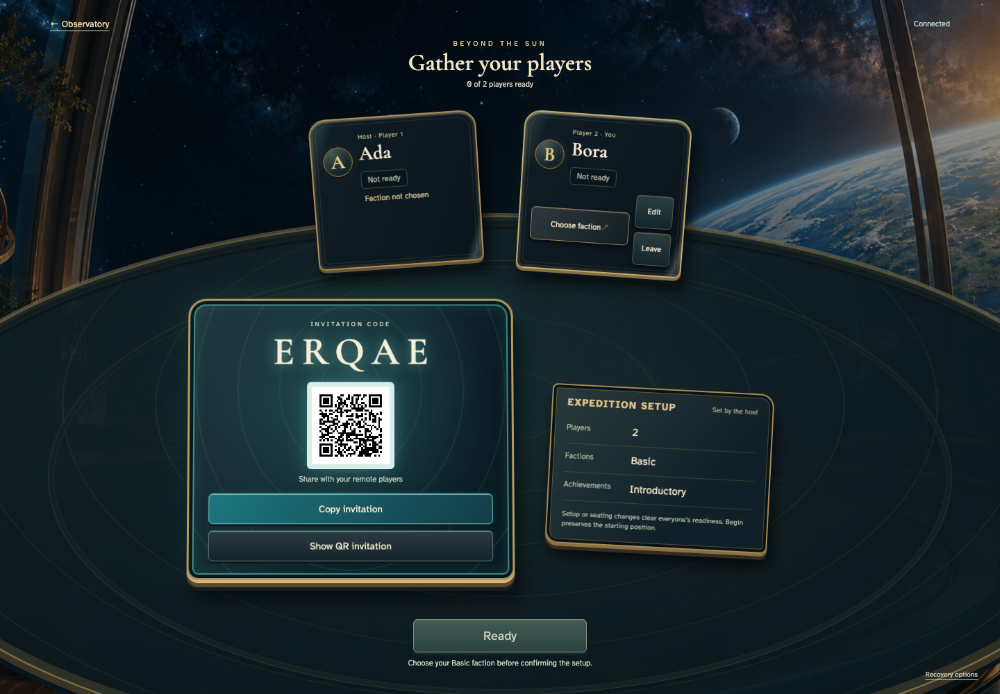](../../screenshots/research-a-rival-discovery-once-and-respect-its-exclusive-printed-action/008-guest-joined-phone-darwin.png) | [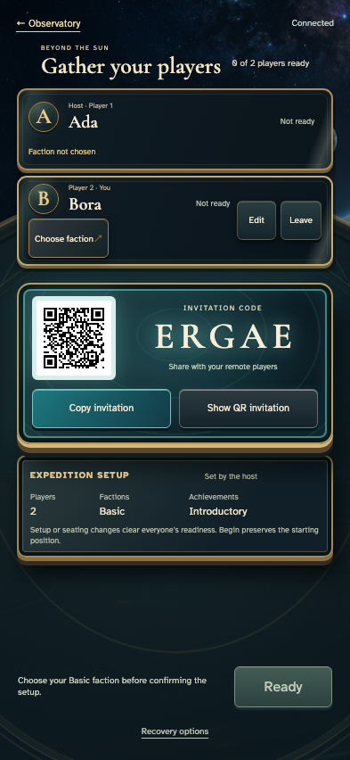](../../screenshots/research-a-rival-discovery-once-and-respect-its-exclusive-printed-action/008-guest-joined-desktop-darwin.png) |

- [x] Both named remote identities share the same room
- [x] Canonical effects settle before capture.
- [x] Any printed Action plan is ready.
- [x] Public compact topology remains physically separated.
- [x] The gameplay shell fits the actual viewport.

## 10. Ada chooses a legal unique Basic faction

Viewpoint: **Ada · separate host controller**.

| phone · 393 × 852 | desktop · 1440 × 1000 |
| --- | --- |
|  |  |

- [x] Ada chooses a legal unique Basic faction
- [x] Canonical effects settle before capture.
- [x] Any printed Action plan is ready.
- [x] Public compact topology remains physically separated.
- [x] The gameplay shell fits the actual viewport.

## 11. Ada retains Nishida-Østergaard Corporation

Viewpoint: **Ada · separate host controller**.

| phone · 393 × 852 | desktop · 1440 × 1000 |
| --- | --- |
| [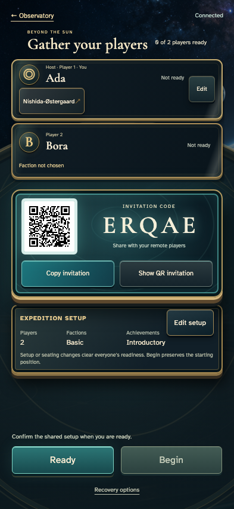](../../screenshots/research-a-rival-discovery-once-and-respect-its-exclusive-printed-action/010-faction-0-chosen-phone-darwin.png) | [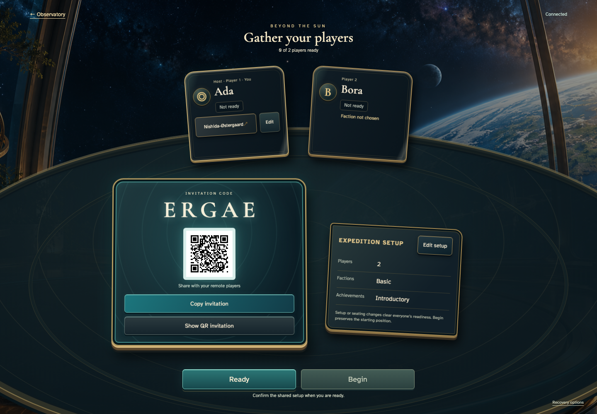](../../screenshots/research-a-rival-discovery-once-and-respect-its-exclusive-printed-action/010-faction-0-chosen-desktop-darwin.png) |

- [x] Ada retains Nishida-Østergaard Corporation
- [x] Canonical effects settle before capture.
- [x] Any printed Action plan is ready.
- [x] Public compact topology remains physically separated.
- [x] The gameplay shell fits the actual viewport.

## 12. Bora chooses a legal unique Basic faction

Viewpoint: **Bora · separate guest controller**.

| phone · 1440 × 1000 | desktop · 393 × 852 |
| --- | --- |
|  |  |

- [x] Bora chooses a legal unique Basic faction
- [x] Canonical effects settle before capture.
- [x] Any printed Action plan is ready.
- [x] Public compact topology remains physically separated.
- [x] The gameplay shell fits the actual viewport.

## 13. Bora retains The Zheng-Yi Brotherhood

Viewpoint: **Bora · separate guest controller**.

| phone · 1440 × 1000 | desktop · 393 × 852 |
| --- | --- |
| [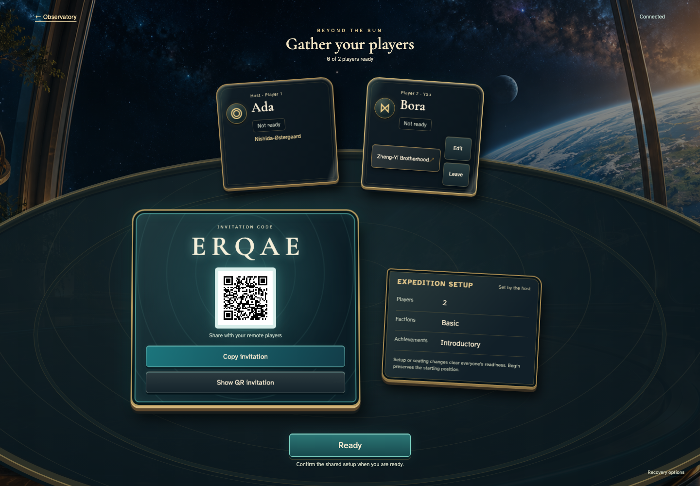](../../screenshots/research-a-rival-discovery-once-and-respect-its-exclusive-printed-action/012-faction-1-chosen-phone-darwin.png) | [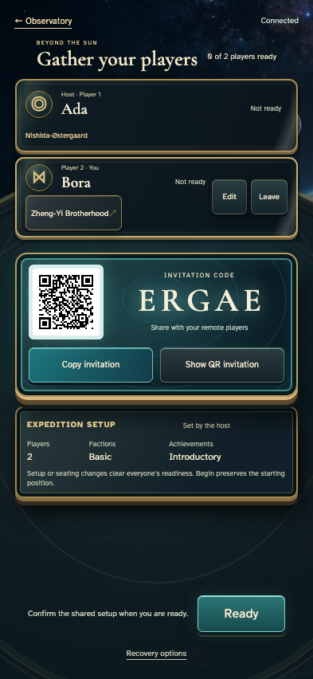](../../screenshots/research-a-rival-discovery-once-and-respect-its-exclusive-printed-action/012-faction-1-chosen-desktop-darwin.png) |

- [x] Bora retains The Zheng-Yi Brotherhood
- [x] Canonical effects settle before capture.
- [x] Any printed Action plan is ready.
- [x] Public compact topology remains physically separated.
- [x] The gameplay shell fits the actual viewport.

## 14. Confirm this identity is ready for the exact saved configuration

Viewpoint: **Bora · separate guest controller**.

| phone · 1440 × 1000 | desktop · 393 × 852 |
| --- | --- |
|  | [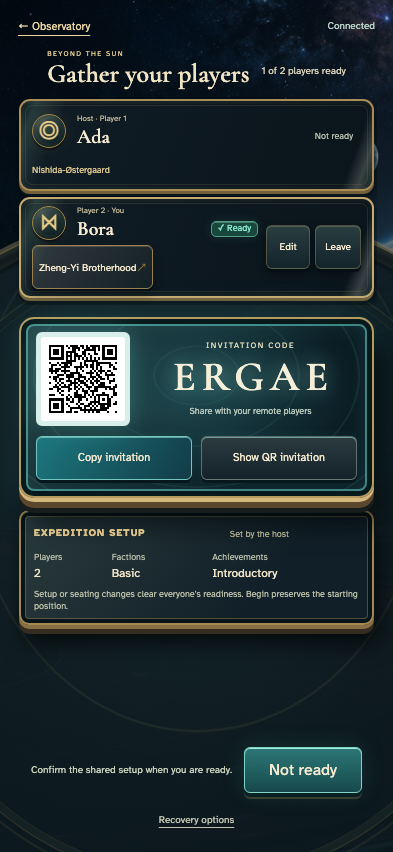](../../screenshots/research-a-rival-discovery-once-and-respect-its-exclusive-printed-action/013-ready-1-desktop-darwin.png) |

- [x] Confirm this identity is ready for the exact saved configuration
- [x] Canonical effects settle before capture.
- [x] Any printed Action plan is ready.
- [x] Public compact topology remains physically separated.
- [x] The gameplay shell fits the actual viewport.

## 15. Confirm this identity is ready for the exact saved configuration

Viewpoint: **Ada · separate host controller**.

| phone · 393 × 852 | desktop · 1440 × 1000 |
| --- | --- |
| [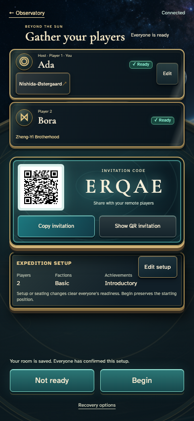](../../screenshots/research-a-rival-discovery-once-and-respect-its-exclusive-printed-action/014-ready-0-phone-darwin.png) |  |

- [x] Confirm this identity is ready for the exact saved configuration
- [x] Canonical effects settle before capture.
- [x] Any printed Action plan is ready.
- [x] Public compact topology remains physically separated.
- [x] The gameplay shell fits the actual viewport.

## 16. Begin the immutable source-reviewed Basic setup through the ordinary UI

Viewpoint: **Ada · separate host controller**.

| phone · 393 × 852 | desktop · 1440 × 1000 |
| --- | --- |
|  |  |

- [x] Begin the immutable source-reviewed Basic setup through the ordinary UI
- [x] Canonical effects settle before capture.
- [x] Any printed Action plan is ready.
- [x] Public compact topology remains physically separated.
- [x] The gameplay shell fits the actual viewport.

## 17. Ada opens the actual research and Action instrument

Viewpoint: **Ada · separate host controller**.

| phone · 393 × 852 | desktop · 1440 × 1000 |
| --- | --- |
|  |  |

- [x] Ada opens the actual research and Action instrument
- [x] Canonical effects settle before capture.
- [x] Any printed Action plan is ready.
- [x] Public compact topology remains physically separated.
- [x] The gameplay shell fits the actual viewport.

## 18. Ada selects the legal printed space 1

Viewpoint: **Ada · separate host controller**.

| phone · 393 × 852 | desktop · 1440 × 1000 |
| --- | --- |
|  |  |

- [x] Ada selects the legal printed space 1
- [x] Canonical effects settle before capture.
- [x] Any printed Action plan is ready.
- [x] Public compact topology remains physically separated.
- [x] The gameplay shell fits the actual viewport.

## 19. Select Terraforming with its printed cost and consequence

Viewpoint: **Ada · separate host controller**.

| phone · 393 × 852 | desktop · 1440 × 1000 |
| --- | --- |
|  |  |

- [x] Select Terraforming with its printed cost and consequence
- [x] Canonical effects settle before capture.
- [x] Any printed Action plan is ready.
- [x] Public compact topology remains physically separated.
- [x] The gameplay shell fits the actual viewport.

## 20. Pay once and receive Terraforming's immediate bonus

Viewpoint: **Ada · separate host controller**.

| phone · 393 × 852 | desktop · 1440 × 1000 |
| --- | --- |
| [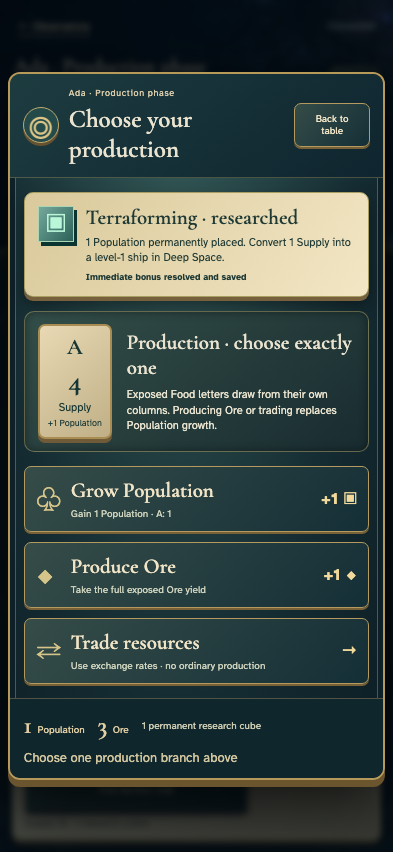](../../screenshots/research-a-rival-discovery-once-and-respect-its-exclusive-printed-action/019-ada-terraform-researched-phone-darwin.png) | [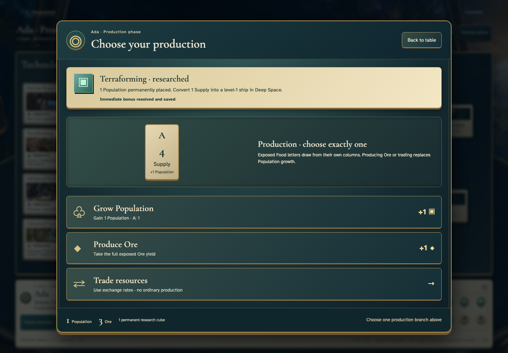](../../screenshots/research-a-rival-discovery-once-and-respect-its-exclusive-printed-action/019-ada-terraform-researched-desktop-darwin.png) |

- [x] Pay once and receive Terraforming's immediate bonus
- [x] Canonical effects settle before capture.
- [x] Any printed Action plan is ready.
- [x] Public compact topology remains physically separated.
- [x] The gameplay shell fits the actual viewport.

## 21. Ada completes production and hands off to Bora

Viewpoint: **Ada · separate host controller**.

| phone · 393 × 852 | desktop · 1440 × 1000 |
| --- | --- |
| [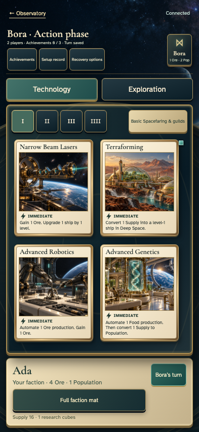](../../screenshots/research-a-rival-discovery-once-and-respect-its-exclusive-printed-action/020-ada-terraform-handoff-phone-darwin.png) | [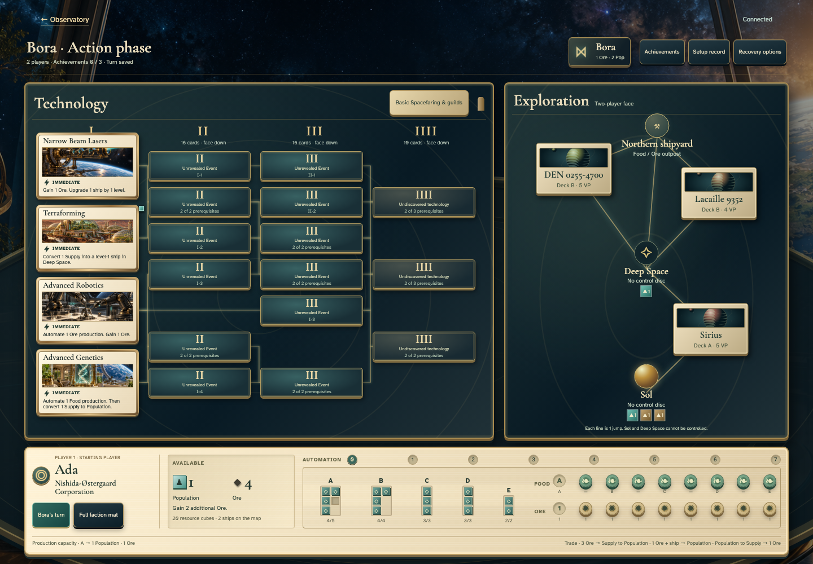](../../screenshots/research-a-rival-discovery-once-and-respect-its-exclusive-printed-action/020-ada-terraform-handoff-desktop-darwin.png) |

- [x] Ada completes production and hands off to Bora
- [x] Canonical effects settle before capture.
- [x] Any printed Action plan is ready.
- [x] Public compact topology remains physically separated.
- [x] The gameplay shell fits the actual viewport.

## 22. The independent next controller sees the canonical handoff

Viewpoint: **Bora · separate guest controller**.

| phone · 1440 × 1000 | desktop · 393 × 852 |
| --- | --- |
| [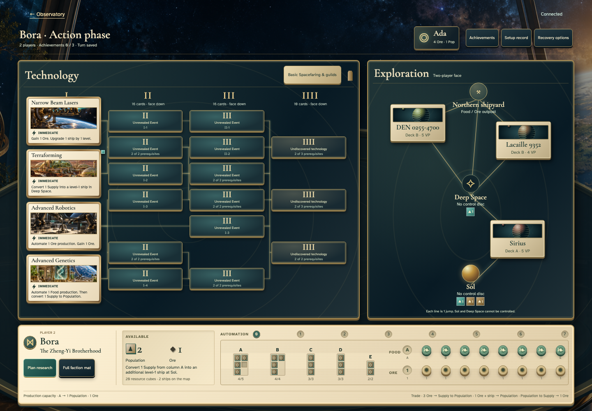](../../screenshots/research-a-rival-discovery-once-and-respect-its-exclusive-printed-action/021-ada-terraform-next-phone-darwin.png) |  |

- [x] The independent next controller sees the canonical handoff
- [x] Canonical effects settle before capture.
- [x] Any printed Action plan is ready.
- [x] Public compact topology remains physically separated.
- [x] The gameplay shell fits the actual viewport.

## 23. Bora opens the actual research and Action instrument

Viewpoint: **Bora · separate guest controller**.

| phone · 1440 × 1000 | desktop · 393 × 852 |
| --- | --- |
|  |  |

- [x] Bora opens the actual research and Action instrument
- [x] Canonical effects settle before capture.
- [x] Any printed Action plan is ready.
- [x] Public compact topology remains physically separated.
- [x] The gameplay shell fits the actual viewport.

## 24. Bora selects the legal printed space 2

Viewpoint: **Bora · separate guest controller**.

| phone · 1440 × 1000 | desktop · 393 × 852 |
| --- | --- |
|  |  |

- [x] Bora selects the legal printed space 2
- [x] Canonical effects settle before capture.
- [x] Any printed Action plan is ready.
- [x] Public compact topology remains physically separated.
- [x] The gameplay shell fits the actual viewport.

## 25. Select Terraforming with its printed cost and consequence

Viewpoint: **Bora · separate guest controller**.

| phone · 1440 × 1000 | desktop · 393 × 852 |
| --- | --- |
| [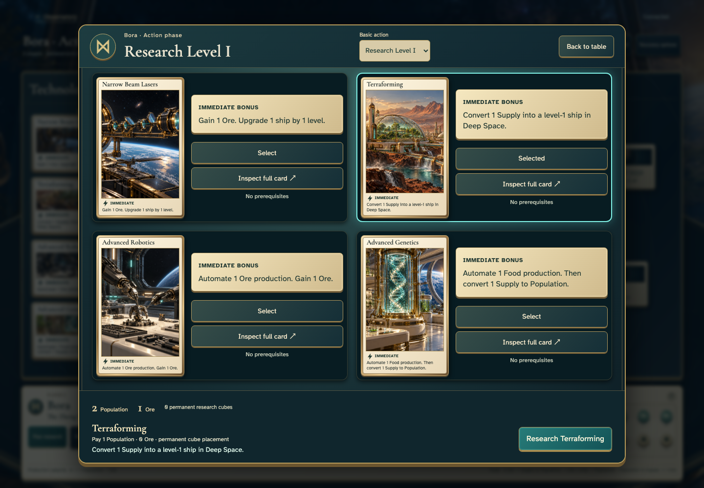](../../screenshots/research-a-rival-discovery-once-and-respect-its-exclusive-printed-action/024-bora-terraform-card-phone-darwin.png) |  |

- [x] Select Terraforming with its printed cost and consequence
- [x] Canonical effects settle before capture.
- [x] Any printed Action plan is ready.
- [x] Public compact topology remains physically separated.
- [x] The gameplay shell fits the actual viewport.

## 26. Pay once and receive Terraforming's immediate bonus

Viewpoint: **Bora · separate guest controller**.

| phone · 1440 × 1000 | desktop · 393 × 852 |
| --- | --- |
| [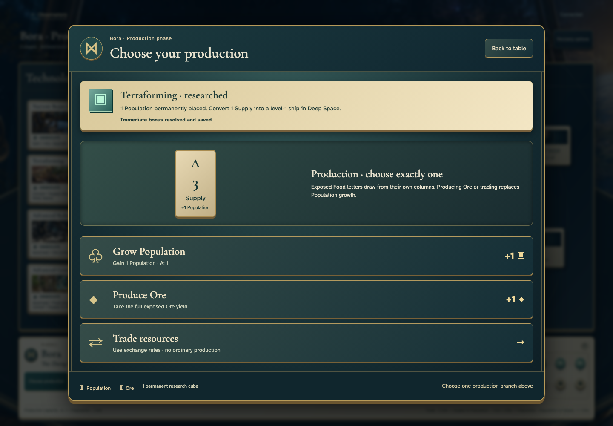](../../screenshots/research-a-rival-discovery-once-and-respect-its-exclusive-printed-action/025-bora-terraform-researched-phone-darwin.png) |  |

- [x] Pay once and receive Terraforming's immediate bonus
- [x] Canonical effects settle before capture.
- [x] Any printed Action plan is ready.
- [x] Public compact topology remains physically separated.
- [x] The gameplay shell fits the actual viewport.

## 27. Bora completes production and hands off to Ada

Viewpoint: **Bora · separate guest controller**.

| phone · 1440 × 1000 | desktop · 393 × 852 |
| --- | --- |
|  |  |

- [x] Bora completes production and hands off to Ada
- [x] Canonical effects settle before capture.
- [x] Any printed Action plan is ready.
- [x] Public compact topology remains physically separated.
- [x] The gameplay shell fits the actual viewport.

## 28. The independent next controller sees the canonical handoff

Viewpoint: **Ada · separate host controller**.

| phone · 393 × 852 | desktop · 1440 × 1000 |
| --- | --- |
|  | [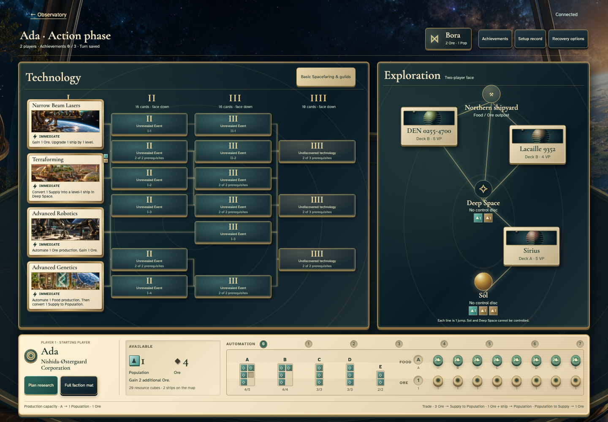](../../screenshots/research-a-rival-discovery-once-and-respect-its-exclusive-printed-action/027-bora-terraform-next-desktop-darwin.png) |

- [x] The independent next controller sees the canonical handoff
- [x] Canonical effects settle before capture.
- [x] Any printed Action plan is ready.
- [x] Public compact topology remains physically separated.
- [x] The gameplay shell fits the actual viewport.

## 29. Ada opens the actual research and Action instrument

Viewpoint: **Ada · separate host controller**.

| phone · 393 × 852 | desktop · 1440 × 1000 |
| --- | --- |
| [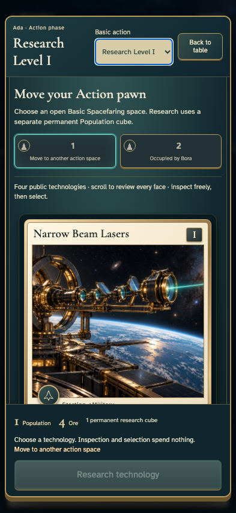](../../screenshots/research-a-rival-discovery-once-and-respect-its-exclusive-printed-action/028-discover-plan-phone-darwin.png) | [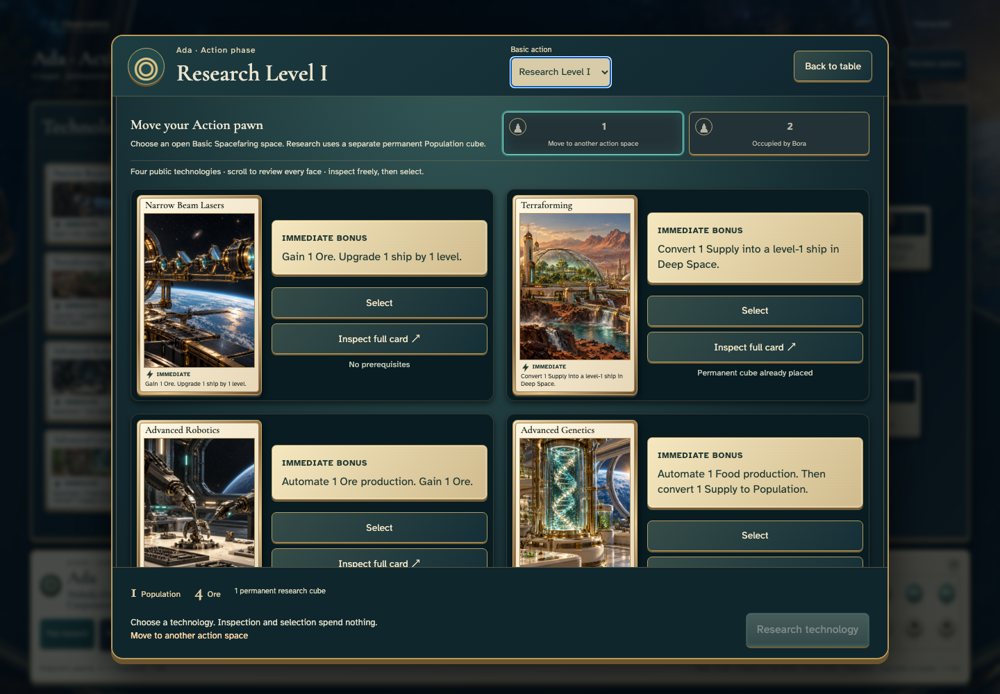](../../screenshots/research-a-rival-discovery-once-and-respect-its-exclusive-printed-action/028-discover-plan-desktop-darwin.png) |

- [x] Ada opens the actual research and Action instrument
- [x] Canonical effects settle before capture.
- [x] Any printed Action plan is ready.
- [x] Public compact topology remains physically separated.
- [x] The gameplay shell fits the actual viewport.

## 30. Ada selects Level II research

Viewpoint: **Ada · separate host controller**.

| phone · 393 × 852 | desktop · 1440 × 1000 |
| --- | --- |
| [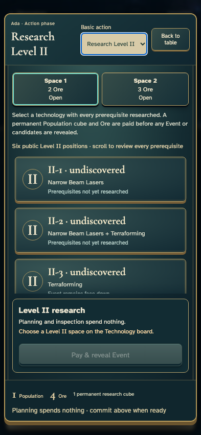](../../screenshots/research-a-rival-discovery-once-and-respect-its-exclusive-printed-action/029-discover-kind-phone-darwin.png) | [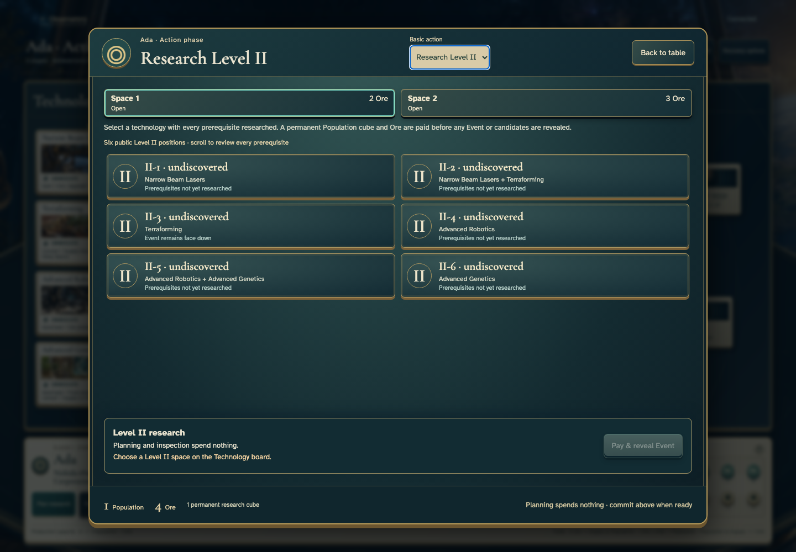](../../screenshots/research-a-rival-discovery-once-and-respect-its-exclusive-printed-action/029-discover-kind-desktop-darwin.png) |

- [x] Ada selects Level II research
- [x] Canonical effects settle before capture.
- [x] Any printed Action plan is ready.
- [x] Public compact topology remains physically separated.
- [x] The gameplay shell fits the actual viewport.

## 31. Choose the actual covered II-3 discovery with the printed prerequisite and payment

Viewpoint: **Ada · separate host controller**.

| phone · 393 × 852 | desktop · 1440 × 1000 |
| --- | --- |
| [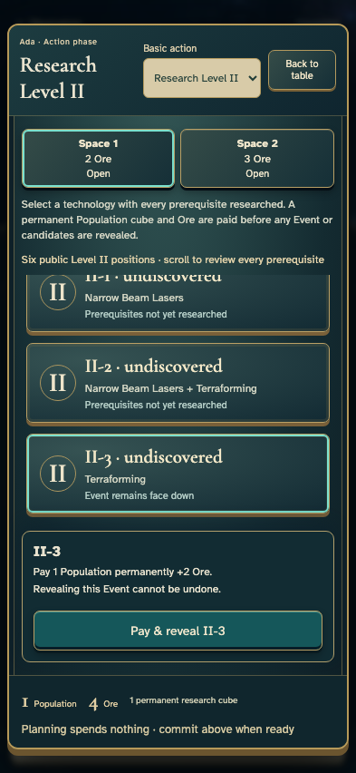](../../screenshots/research-a-rival-discovery-once-and-respect-its-exclusive-printed-action/030-discover-slot-phone-darwin.png) | [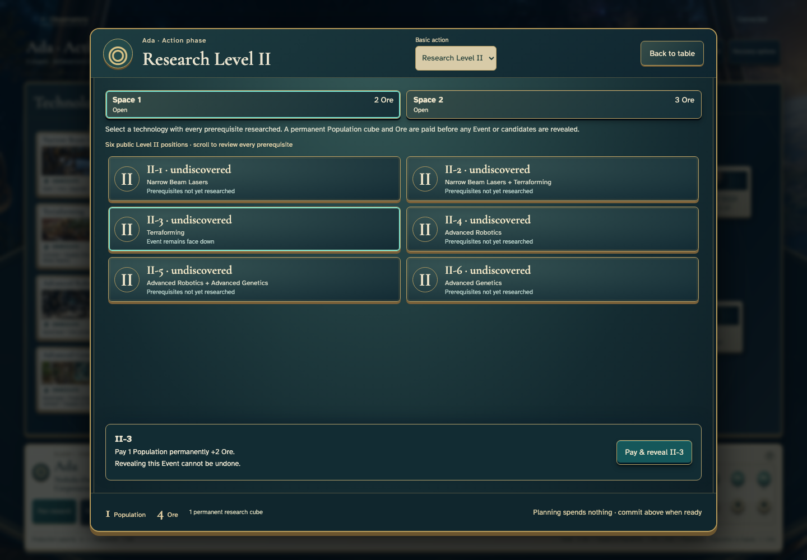](../../screenshots/research-a-rival-discovery-once-and-respect-its-exclusive-printed-action/030-discover-slot-desktop-darwin.png) |

- [x] Choose the actual covered II-3 discovery with the printed prerequisite and payment
- [x] Canonical effects settle before capture.
- [x] Any printed Action plan is ready.
- [x] Public compact topology remains physically separated.
- [x] The gameplay shell fits the actual viewport.

## 32. Pay once and reveal Tyler Lee through the real persisted queue

Viewpoint: **Ada · separate host controller**.

| phone · 393 × 852 | desktop · 1440 × 1000 |
| --- | --- |
| [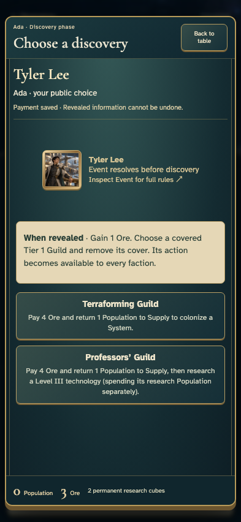](../../screenshots/research-a-rival-discovery-once-and-respect-its-exclusive-printed-action/031-event-revealed-phone-darwin.png) | [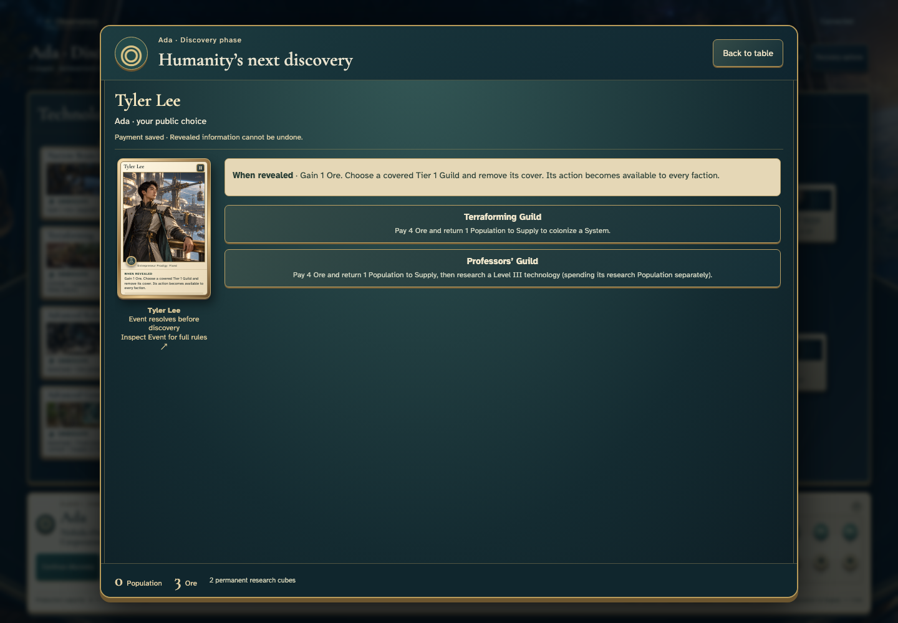](../../screenshots/research-a-rival-discovery-once-and-respect-its-exclusive-printed-action/031-event-revealed-desktop-darwin.png) |

- [x] Pay once and reveal Tyler Lee through the real persisted queue
- [x] Canonical effects settle before capture.
- [x] Any printed Action plan is ready.
- [x] Public compact topology remains physically separated.
- [x] The gameplay shell fits the actual viewport.

## 33. Resolve the actual Tyler Lee guild choice, retaining the revealed candidates

Viewpoint: **Ada · separate host controller**.

| phone · 393 × 852 | desktop · 1440 × 1000 |
| --- | --- |
| [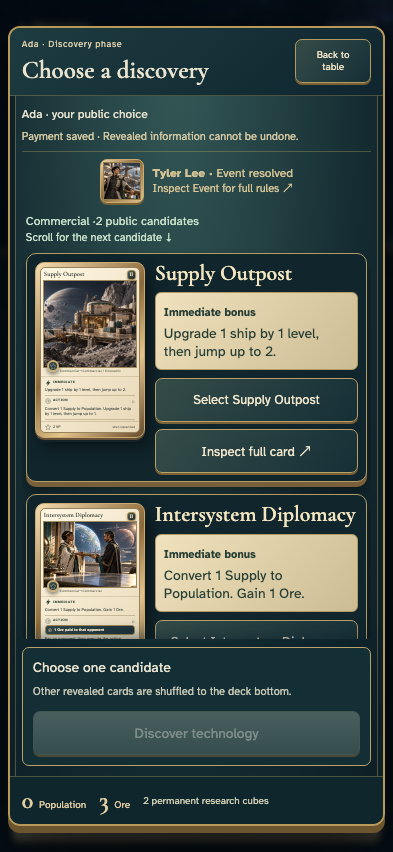](../../screenshots/research-a-rival-discovery-once-and-respect-its-exclusive-printed-action/032-discovery-event-phone-darwin.png) | [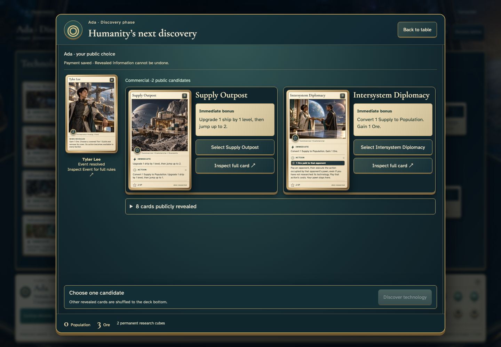](../../screenshots/research-a-rival-discovery-once-and-respect-its-exclusive-printed-action/032-discovery-event-desktop-darwin.png) |

- [x] Resolve the actual Tyler Lee guild choice, retaining the revealed candidates
- [x] Canonical effects settle before capture.
- [x] Any printed Action plan is ready.
- [x] Public compact topology remains physically separated.
- [x] The gameplay shell fits the actual viewport.

## 34. Choose the public Supply Outpost candidate and its exact immediate consequence

Viewpoint: **Ada · separate host controller**.

| phone · 393 × 852 | desktop · 1440 × 1000 |
| --- | --- |
| [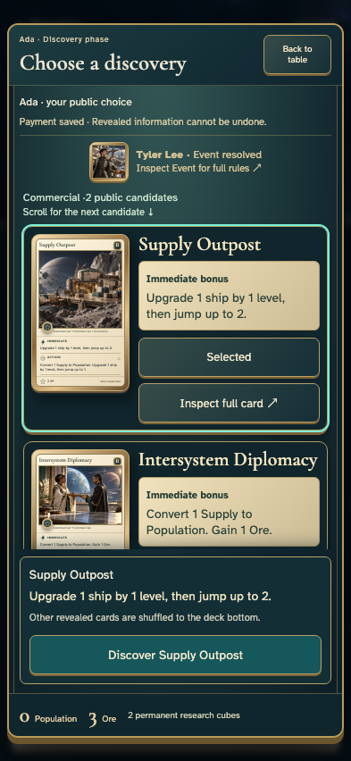](../../screenshots/research-a-rival-discovery-once-and-respect-its-exclusive-printed-action/033-discovery-selected-phone-darwin.png) | [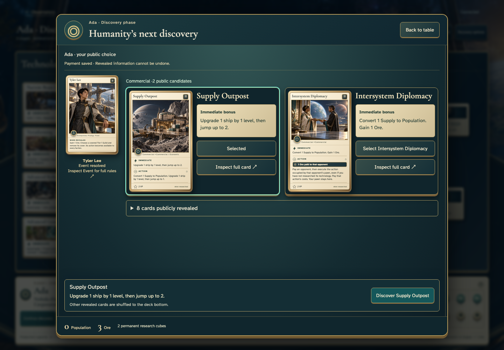](../../screenshots/research-a-rival-discovery-once-and-respect-its-exclusive-printed-action/033-discovery-selected-desktop-darwin.png) |

- [x] Choose the public Supply Outpost candidate and its exact immediate consequence
- [x] Canonical effects settle before capture.
- [x] Any printed Action plan is ready.
- [x] Public compact topology remains physically separated.
- [x] The gameplay shell fits the actual viewport.

## 35. Commit the one public discovery before resolving its mandatory bonus

Viewpoint: **Ada · separate host controller**.

| phone · 393 × 852 | desktop · 1440 × 1000 |
| --- | --- |
| [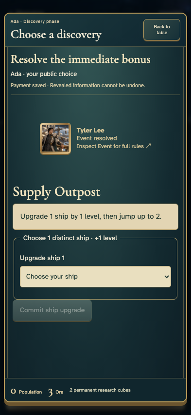](../../screenshots/research-a-rival-discovery-once-and-respect-its-exclusive-printed-action/034-discovery-discovered-phone-darwin.png) | [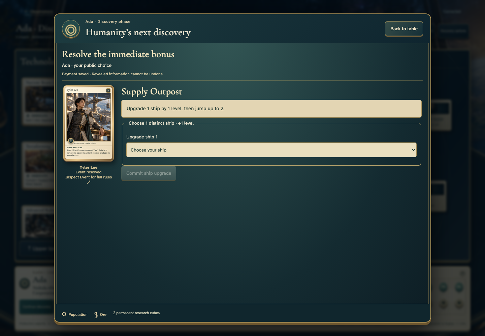](../../screenshots/research-a-rival-discovery-once-and-respect-its-exclusive-printed-action/034-discovery-discovered-desktop-darwin.png) |

- [x] Commit the one public discovery before resolving its mandatory bonus
- [x] Canonical effects settle before capture.
- [x] Any printed Action plan is ready.
- [x] Public compact topology remains physically separated.
- [x] The gameplay shell fits the actual viewport.

## 36. Explicitly choose an owned ship for the mandatory one-level upgrade

Viewpoint: **Ada · separate host controller**.

| phone · 393 × 852 | desktop · 1440 × 1000 |
| --- | --- |
| [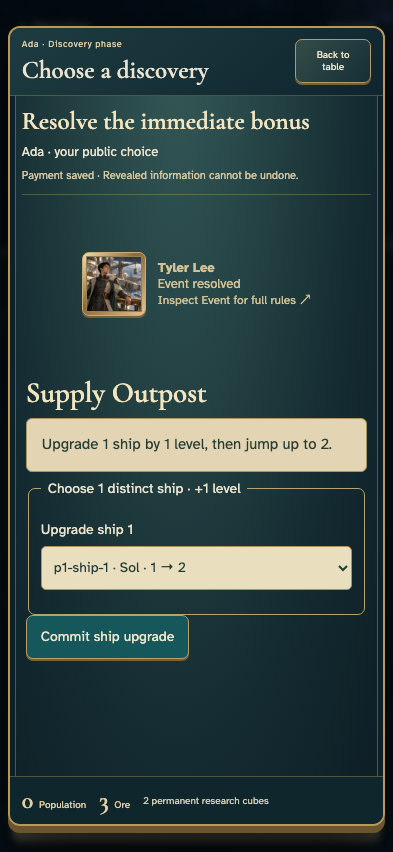](../../screenshots/research-a-rival-discovery-once-and-respect-its-exclusive-printed-action/035-discovery-upgrade-target-phone-darwin.png) | [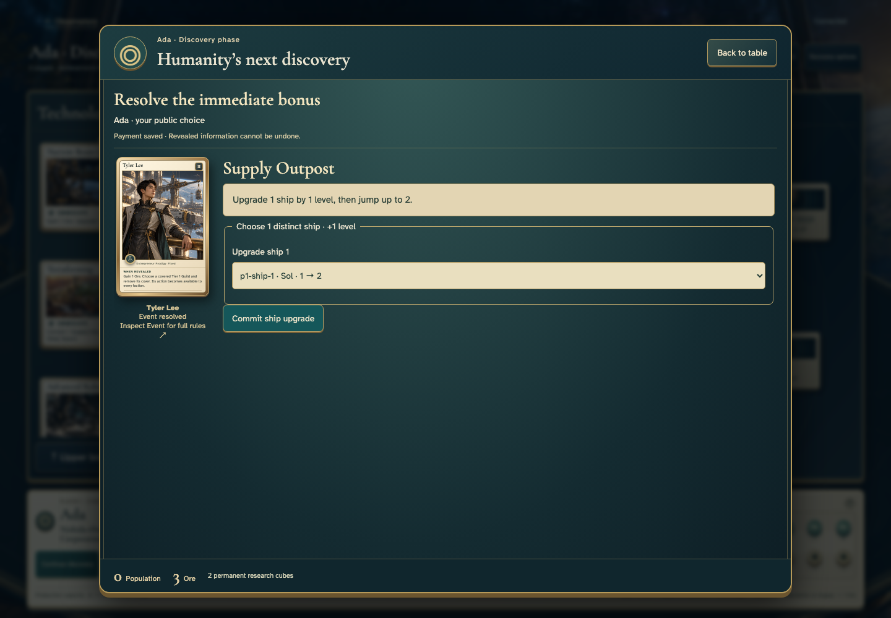](../../screenshots/research-a-rival-discovery-once-and-respect-its-exclusive-printed-action/035-discovery-upgrade-target-desktop-darwin.png) |

- [x] Explicitly choose an owned ship for the mandatory one-level upgrade
- [x] Canonical effects settle before capture.
- [x] Any printed Action plan is ready.
- [x] Public compact topology remains physically separated.
- [x] The gameplay shell fits the actual viewport.

## 37. Save the mandatory upgrade before the separate optional jump

Viewpoint: **Ada · separate host controller**.

| phone · 393 × 852 | desktop · 1440 × 1000 |
| --- | --- |
| [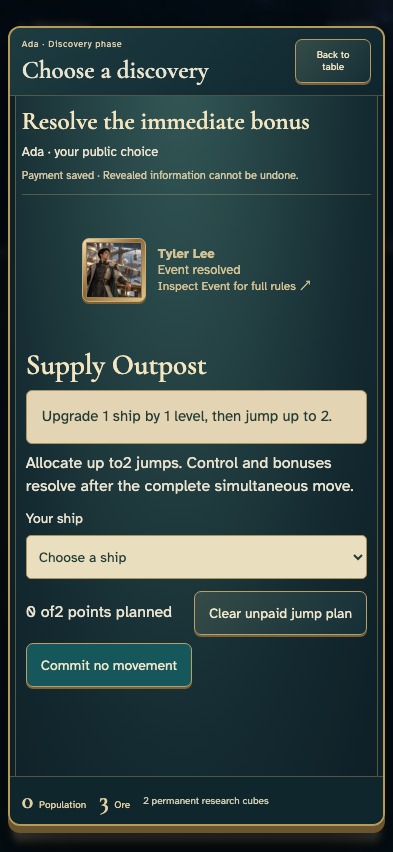](../../screenshots/research-a-rival-discovery-once-and-respect-its-exclusive-printed-action/036-discovery-upgraded-phone-darwin.png) | [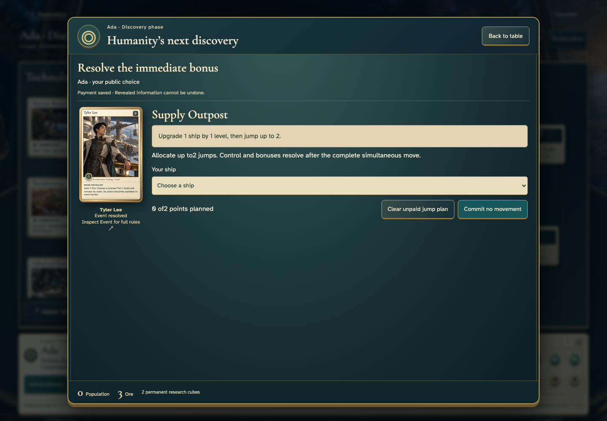](../../screenshots/research-a-rival-discovery-once-and-respect-its-exclusive-printed-action/036-discovery-upgraded-desktop-darwin.png) |

- [x] Save the mandatory upgrade before the separate optional jump
- [x] Canonical effects settle before capture.
- [x] Any printed Action plan is ready.
- [x] Public compact topology remains physically separated.
- [x] The gameplay shell fits the actual viewport.

## 38. Explicitly decline optional movement and resume Production

Viewpoint: **Ada · separate host controller**.

| phone · 393 × 852 | desktop · 1440 × 1000 |
| --- | --- |
| [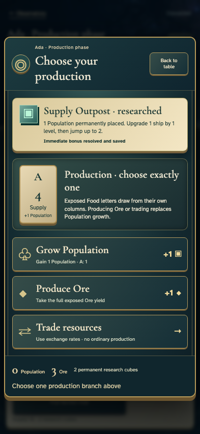](../../screenshots/research-a-rival-discovery-once-and-respect-its-exclusive-printed-action/037-discovery-no-jump-phone-darwin.png) |  |

- [x] Explicitly decline optional movement and resume Production
- [x] Canonical effects settle before capture.
- [x] Any printed Action plan is ready.
- [x] Public compact topology remains physically separated.
- [x] The gameplay shell fits the actual viewport.

## 39. Ada completes production and hands off to Bora

Viewpoint: **Ada · separate host controller**.

| phone · 393 × 852 | desktop · 1440 × 1000 |
| --- | --- |
|  |  |

- [x] Ada completes production and hands off to Bora
- [x] Canonical effects settle before capture.
- [x] Any printed Action plan is ready.
- [x] Public compact topology remains physically separated.
- [x] The gameplay shell fits the actual viewport.

## 40. The independent next controller sees the canonical handoff

Viewpoint: **Bora · separate guest controller**.

| phone · 1440 × 1000 | desktop · 393 × 852 |
| --- | --- |
|  |  |

- [x] The independent next controller sees the canonical handoff
- [x] Canonical effects settle before capture.
- [x] Any printed Action plan is ready.
- [x] Public compact topology remains physically separated.
- [x] The gameplay shell fits the actual viewport.

## 41. Bora opens the actual research and Action instrument

Viewpoint: **Bora · separate guest controller**.

| phone · 1440 × 1000 | desktop · 393 × 852 |
| --- | --- |
|  |  |

- [x] Bora opens the actual research and Action instrument
- [x] Canonical effects settle before capture.
- [x] Any printed Action plan is ready.
- [x] Public compact topology remains physically separated.
- [x] The gameplay shell fits the actual viewport.

## 42. Bora selects printed technology Actions

Viewpoint: **Bora · separate guest controller**.

| phone · 1440 × 1000 | desktop · 393 × 852 |
| --- | --- |
|  | [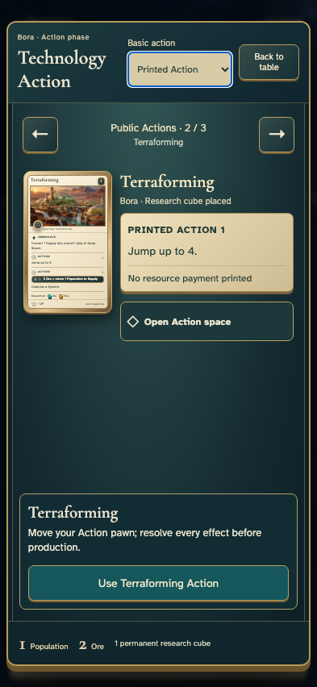](../../screenshots/research-a-rival-discovery-once-and-respect-its-exclusive-printed-action/041-unowned-kind-desktop-darwin.png) |

- [x] Bora selects printed technology Actions
- [x] Canonical effects settle before capture.
- [x] Any printed Action plan is ready.
- [x] Public compact topology remains physically separated.
- [x] The gameplay shell fits the actual viewport.

## 43. Browse the next public printed Action without acquiring research

Viewpoint: **Bora · separate guest controller**.

| phone · 1440 × 1000 | desktop · 393 × 852 |
| --- | --- |
|  | [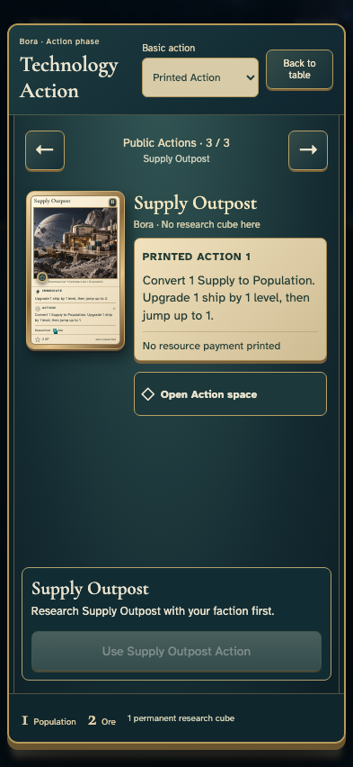](../../screenshots/research-a-rival-discovery-once-and-respect-its-exclusive-printed-action/042-unowned-browse-0-desktop-darwin.png) |

- [x] Browse the next public printed Action without acquiring research
- [x] Canonical effects settle before capture.
- [x] Any printed Action plan is ready.
- [x] Public compact topology remains physically separated.
- [x] The gameplay shell fits the actual viewport.

## 44. Read Supply Outpost's actual research requirement, payment and exclusive pawn space

Viewpoint: **Bora · separate guest controller**.

| phone · 1440 × 1000 | desktop · 393 × 852 |
| --- | --- |
|  |  |

- [x] Read Supply Outpost's actual research requirement, payment and exclusive pawn space
- [x] Canonical effects settle before capture.
- [x] Any printed Action plan is ready.
- [x] Public compact topology remains physically separated.
- [x] The gameplay shell fits the actual viewport.

## 45. A public discovery does not confer personal research access

Viewpoint: **Bora · separate guest controller**.

| phone · 1440 × 1000 | desktop · 393 × 852 |
| --- | --- |
|  |  |

- [x] A public discovery does not confer personal research access
- [x] Canonical effects settle before capture.
- [x] Any printed Action plan is ready.
- [x] Public compact topology remains physically separated.
- [x] The gameplay shell fits the actual viewport.

## 46. Read the full canonical printed face before acquiring its Action

Viewpoint: **Bora · separate guest controller**.

| phone · 1440 × 1000 | desktop · 393 × 852 |
| --- | --- |
| [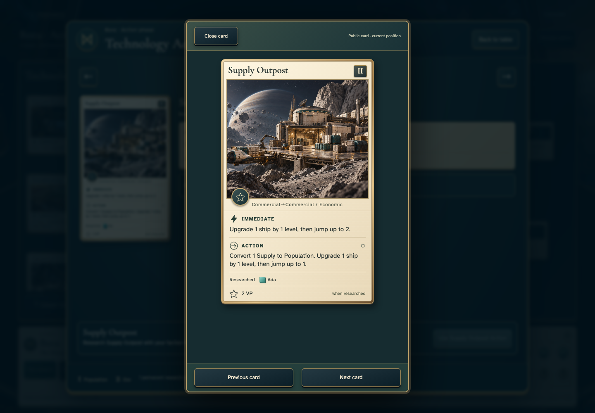](../../screenshots/research-a-rival-discovery-once-and-respect-its-exclusive-printed-action/045-unowned-inspected-phone-darwin.png) | [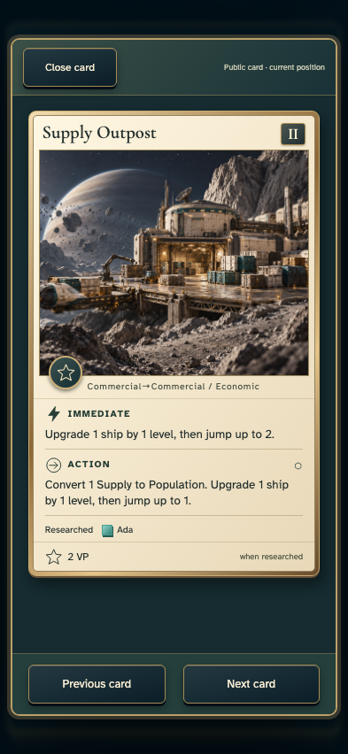](../../screenshots/research-a-rival-discovery-once-and-respect-its-exclusive-printed-action/045-unowned-inspected-desktop-darwin.png) |

- [x] Read the full canonical printed face before acquiring its Action
- [x] Canonical effects settle before capture.
- [x] Any printed Action plan is ready.
- [x] Public compact topology remains physically separated.
- [x] The gameplay shell fits the actual viewport.

## 47. Escape restores focus to the actual unowned public card

Viewpoint: **Bora · separate guest controller**.

| phone · 1440 × 1000 | desktop · 393 × 852 |
| --- | --- |
|  | [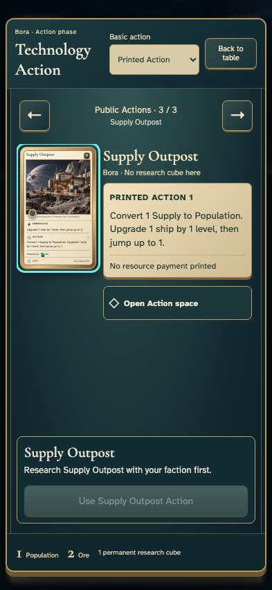](../../screenshots/research-a-rival-discovery-once-and-respect-its-exclusive-printed-action/046-inspector-return-desktop-darwin.png) |

- [x] Escape restores focus to the actual unowned public card
- [x] Canonical effects settle before capture.
- [x] Any printed Action plan is ready.
- [x] Public compact topology remains physically separated.
- [x] The gameplay shell fits the actual viewport.

## 48. Inspection confers no research or turn action

Viewpoint: **Bora · separate guest controller**.

| phone · 1440 × 1000 | desktop · 393 × 852 |
| --- | --- |
|  |  |

- [x] Inspection confers no research or turn action
- [x] Canonical effects settle before capture.
- [x] Any printed Action plan is ready.
- [x] Public compact topology remains physically separated.
- [x] The gameplay shell fits the actual viewport.

## 49. Bora opens the actual research and Action instrument

Viewpoint: **Bora · separate guest controller**.

| phone · 1440 × 1000 | desktop · 393 × 852 |
| --- | --- |
| [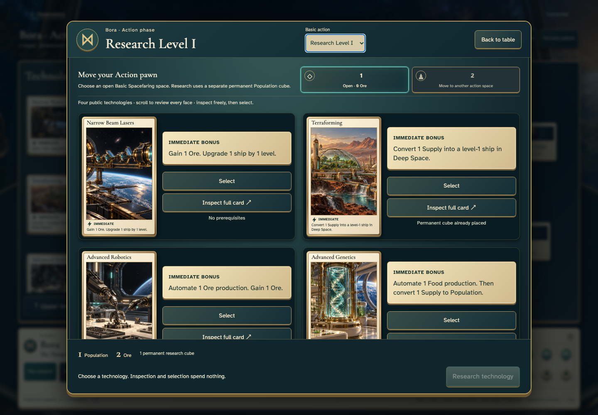](../../screenshots/research-a-rival-discovery-once-and-respect-its-exclusive-printed-action/048-bora-gather-plan-phone-darwin.png) |  |

- [x] Bora opens the actual research and Action instrument
- [x] Canonical effects settle before capture.
- [x] Any printed Action plan is ready.
- [x] Public compact topology remains physically separated.
- [x] The gameplay shell fits the actual viewport.

## 50. Bora selects ordinary gathering

Viewpoint: **Bora · separate guest controller**.

| phone · 1440 × 1000 | desktop · 393 × 852 |
| --- | --- |
|  | [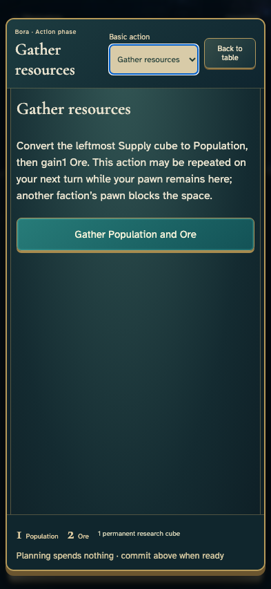](../../screenshots/research-a-rival-discovery-once-and-respect-its-exclusive-printed-action/049-bora-gather-kind-desktop-darwin.png) |

- [x] Bora selects ordinary gathering
- [x] Canonical effects settle before capture.
- [x] Any printed Action plan is ready.
- [x] Public compact topology remains physically separated.
- [x] The gameplay shell fits the actual viewport.

## 51. Receive the printed gather resources before ordinary production

Viewpoint: **Bora · separate guest controller**.

| phone · 1440 × 1000 | desktop · 393 × 852 |
| --- | --- |
|  |  |

- [x] Receive the printed gather resources before ordinary production
- [x] Canonical effects settle before capture.
- [x] Any printed Action plan is ready.
- [x] Public compact topology remains physically separated.
- [x] The gameplay shell fits the actual viewport.

## 52. Bora completes production and hands off to Ada

Viewpoint: **Bora · separate guest controller**.

| phone · 1440 × 1000 | desktop · 393 × 852 |
| --- | --- |
|  |  |

- [x] Bora completes production and hands off to Ada
- [x] Canonical effects settle before capture.
- [x] Any printed Action plan is ready.
- [x] Public compact topology remains physically separated.
- [x] The gameplay shell fits the actual viewport.

## 53. The independent next controller sees the canonical handoff

Viewpoint: **Ada · separate host controller**.

| phone · 393 × 852 | desktop · 1440 × 1000 |
| --- | --- |
|  |  |

- [x] The independent next controller sees the canonical handoff
- [x] Canonical effects settle before capture.
- [x] Any printed Action plan is ready.
- [x] Public compact topology remains physically separated.
- [x] The gameplay shell fits the actual viewport.

## 54. Ada opens the actual research and Action instrument

Viewpoint: **Ada · separate host controller**.

| phone · 393 × 852 | desktop · 1440 × 1000 |
| --- | --- |
|  | [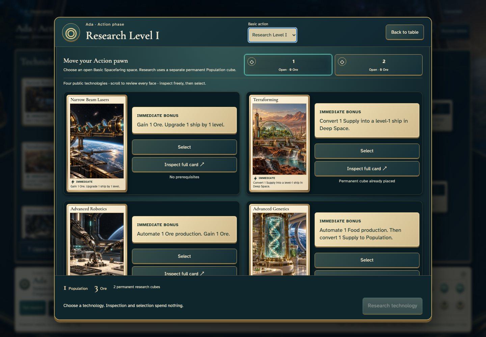](../../screenshots/research-a-rival-discovery-once-and-respect-its-exclusive-printed-action/053-ada-robotics-plan-desktop-darwin.png) |

- [x] Ada opens the actual research and Action instrument
- [x] Canonical effects settle before capture.
- [x] Any printed Action plan is ready.
- [x] Public compact topology remains physically separated.
- [x] The gameplay shell fits the actual viewport.

## 55. Ada selects the legal printed space 1

Viewpoint: **Ada · separate host controller**.

| phone · 393 × 852 | desktop · 1440 × 1000 |
| --- | --- |
|  |  |

- [x] Ada selects the legal printed space 1
- [x] Canonical effects settle before capture.
- [x] Any printed Action plan is ready.
- [x] Public compact topology remains physically separated.
- [x] The gameplay shell fits the actual viewport.

## 56. Select Advanced Robotics with its printed cost and consequence

Viewpoint: **Ada · separate host controller**.

| phone · 393 × 852 | desktop · 1440 × 1000 |
| --- | --- |
|  |  |

- [x] Select Advanced Robotics with its printed cost and consequence
- [x] Canonical effects settle before capture.
- [x] Any printed Action plan is ready.
- [x] Public compact topology remains physically separated.
- [x] The gameplay shell fits the actual viewport.

## 57. Pay once and receive Advanced Robotics's immediate bonus

Viewpoint: **Ada · separate host controller**.

| phone · 393 × 852 | desktop · 1440 × 1000 |
| --- | --- |
|  |  |

- [x] Pay once and receive Advanced Robotics's immediate bonus
- [x] Canonical effects settle before capture.
- [x] Any printed Action plan is ready.
- [x] Public compact topology remains physically separated.
- [x] The gameplay shell fits the actual viewport.

## 58. Ada completes production and hands off to Bora

Viewpoint: **Ada · separate host controller**.

| phone · 393 × 852 | desktop · 1440 × 1000 |
| --- | --- |
|  |  |

- [x] Ada completes production and hands off to Bora
- [x] Canonical effects settle before capture.
- [x] Any printed Action plan is ready.
- [x] Public compact topology remains physically separated.
- [x] The gameplay shell fits the actual viewport.

## 59. The independent next controller sees the canonical handoff

Viewpoint: **Bora · separate guest controller**.

| phone · 1440 × 1000 | desktop · 393 × 852 |
| --- | --- |
|  |  |

- [x] The independent next controller sees the canonical handoff
- [x] Canonical effects settle before capture.
- [x] Any printed Action plan is ready.
- [x] Public compact topology remains physically separated.
- [x] The gameplay shell fits the actual viewport.

## 60. Bora opens the actual research and Action instrument

Viewpoint: **Bora · separate guest controller**.

| phone · 1440 × 1000 | desktop · 393 × 852 |
| --- | --- |
|  |  |

- [x] Bora opens the actual research and Action instrument
- [x] Canonical effects settle before capture.
- [x] Any printed Action plan is ready.
- [x] Public compact topology remains physically separated.
- [x] The gameplay shell fits the actual viewport.

## 61. Bora selects Level II research

Viewpoint: **Bora · separate guest controller**.

| phone · 1440 × 1000 | desktop · 393 × 852 |
| --- | --- |
|  |  |

- [x] Bora selects Level II research
- [x] Canonical effects settle before capture.
- [x] Any printed Action plan is ready.
- [x] Public compact topology remains physically separated.
- [x] The gameplay shell fits the actual viewport.

## 62. Select the existing public identity using the actual unoccupied research space

Viewpoint: **Bora · separate guest controller**.

| phone · 1440 × 1000 | desktop · 393 × 852 |
| --- | --- |
|  |  |

- [x] Select the existing public identity using the actual unoccupied research space
- [x] Canonical effects settle before capture.
- [x] Any printed Action plan is ready.
- [x] Public compact topology remains physically separated.
- [x] The gameplay shell fits the actual viewport.

## 63. Research the same identity and resolve only this faction’s immediate bonus, without Event replay

Viewpoint: **Bora · separate guest controller**.

| phone · 1440 × 1000 | desktop · 393 × 852 |
| --- | --- |
|  |  |

- [x] Research the same identity and resolve only this faction’s immediate bonus, without Event replay
- [x] Canonical effects settle before capture.
- [x] Any printed Action plan is ready.
- [x] Public compact topology remains physically separated.
- [x] The gameplay shell fits the actual viewport.

## 64. Explicitly choose an owned ship for the mandatory one-level upgrade

Viewpoint: **Bora · separate guest controller**.

| phone · 1440 × 1000 | desktop · 393 × 852 |
| --- | --- |
|  |  |

- [x] Explicitly choose an owned ship for the mandatory one-level upgrade
- [x] Canonical effects settle before capture.
- [x] Any printed Action plan is ready.
- [x] Public compact topology remains physically separated.
- [x] The gameplay shell fits the actual viewport.

## 65. Save the mandatory upgrade before the separate optional jump

Viewpoint: **Bora · separate guest controller**.

| phone · 1440 × 1000 | desktop · 393 × 852 |
| --- | --- |
|  |  |

- [x] Save the mandatory upgrade before the separate optional jump
- [x] Canonical effects settle before capture.
- [x] Any printed Action plan is ready.
- [x] Public compact topology remains physically separated.
- [x] The gameplay shell fits the actual viewport.

## 66. Explicitly decline optional movement and resume Production

Viewpoint: **Bora · separate guest controller**.

| phone · 1440 × 1000 | desktop · 393 × 852 |
| --- | --- |
|  |  |

- [x] Explicitly decline optional movement and resume Production
- [x] Canonical effects settle before capture.
- [x] Any printed Action plan is ready.
- [x] Public compact topology remains physically separated.
- [x] The gameplay shell fits the actual viewport.

## 67. Reload retains the paid personal research and once-only bonus

Viewpoint: **Bora · separate guest controller**.

| phone · 1440 × 1000 | desktop · 393 × 852 |
| --- | --- |
|  |  |

- [x] Reload retains the paid personal research and once-only bonus
- [x] Canonical effects settle before capture.
- [x] Any printed Action plan is ready.
- [x] Public compact topology remains physically separated.
- [x] The gameplay shell fits the actual viewport.

## 68. The exact post-bonus resources and research cubes remain unchanged

Viewpoint: **Bora · separate guest controller**.

| phone · 1440 × 1000 | desktop · 393 × 852 |
| --- | --- |
|  |  |

- [x] The exact post-bonus resources and research cubes remain unchanged
- [x] Canonical effects settle before capture.
- [x] Any printed Action plan is ready.
- [x] Public compact topology remains physically separated.
- [x] The gameplay shell fits the actual viewport.

## 69. Bora completes production and hands off to Ada

Viewpoint: **Bora · separate guest controller**.

| phone · 1440 × 1000 | desktop · 393 × 852 |
| --- | --- |
|  |  |

- [x] Bora completes production and hands off to Ada
- [x] Canonical effects settle before capture.
- [x] Any printed Action plan is ready.
- [x] Public compact topology remains physically separated.
- [x] The gameplay shell fits the actual viewport.

## 70. The independent next controller sees the canonical handoff

Viewpoint: **Ada · separate host controller**.

| phone · 393 × 852 | desktop · 1440 × 1000 |
| --- | --- |
|  |  |

- [x] The independent next controller sees the canonical handoff
- [x] Canonical effects settle before capture.
- [x] Any printed Action plan is ready.
- [x] Public compact topology remains physically separated.
- [x] The gameplay shell fits the actual viewport.

## 71. Ada opens the actual research and Action instrument

Viewpoint: **Ada · separate host controller**.

| phone · 393 × 852 | desktop · 1440 × 1000 |
| --- | --- |
|  |  |

- [x] Ada opens the actual research and Action instrument
- [x] Canonical effects settle before capture.
- [x] Any printed Action plan is ready.
- [x] Public compact topology remains physically separated.
- [x] The gameplay shell fits the actual viewport.

## 72. Ada selects printed technology Actions

Viewpoint: **Ada · separate host controller**.

| phone · 393 × 852 | desktop · 1440 × 1000 |
| --- | --- |
|  |  |

- [x] Ada selects printed technology Actions
- [x] Canonical effects settle before capture.
- [x] Any printed Action plan is ready.
- [x] Public compact topology remains physically separated.
- [x] The gameplay shell fits the actual viewport.

## 73. Browse the next public printed Action without acquiring research

Viewpoint: **Ada · separate host controller**.

| phone · 393 × 852 | desktop · 1440 × 1000 |
| --- | --- |
|  |  |

- [x] Browse the next public printed Action without acquiring research
- [x] Canonical effects settle before capture.
- [x] Any printed Action plan is ready.
- [x] Public compact topology remains physically separated.
- [x] The gameplay shell fits the actual viewport.

## 74. Read Supply Outpost's actual research requirement, payment and exclusive pawn space

Viewpoint: **Ada · separate host controller**.

| phone · 393 × 852 | desktop · 1440 × 1000 |
| --- | --- |
|  |  |

- [x] Read Supply Outpost's actual research requirement, payment and exclusive pawn space
- [x] Canonical effects settle before capture.
- [x] Any printed Action plan is ready.
- [x] Public compact topology remains physically separated.
- [x] The gameplay shell fits the actual viewport.

## 75. The discoverer occupies the actual printed Action space and resolves its effects

Viewpoint: **Ada · separate host controller**.

| phone · 393 × 852 | desktop · 1440 × 1000 |
| --- | --- |
|  |  |

- [x] The discoverer occupies the actual printed Action space and resolves its effects
- [x] Canonical effects settle before capture.
- [x] Any printed Action plan is ready.
- [x] Public compact topology remains physically separated.
- [x] The gameplay shell fits the actual viewport.

## 76. Explicitly choose an owned ship for the mandatory one-level upgrade

Viewpoint: **Ada · separate host controller**.

| phone · 393 × 852 | desktop · 1440 × 1000 |
| --- | --- |
|  |  |

- [x] Explicitly choose an owned ship for the mandatory one-level upgrade
- [x] Canonical effects settle before capture.
- [x] Any printed Action plan is ready.
- [x] Public compact topology remains physically separated.
- [x] The gameplay shell fits the actual viewport.

## 77. Save the mandatory upgrade before the separate optional jump

Viewpoint: **Ada · separate host controller**.

| phone · 393 × 852 | desktop · 1440 × 1000 |
| --- | --- |
|  |  |

- [x] Save the mandatory upgrade before the separate optional jump
- [x] Canonical effects settle before capture.
- [x] Any printed Action plan is ready.
- [x] Public compact topology remains physically separated.
- [x] The gameplay shell fits the actual viewport.

## 78. Explicitly decline optional movement and resume Production

Viewpoint: **Ada · separate host controller**.

| phone · 393 × 852 | desktop · 1440 × 1000 |
| --- | --- |
|  |  |

- [x] Explicitly decline optional movement and resume Production
- [x] Canonical effects settle before capture.
- [x] Any printed Action plan is ready.
- [x] Public compact topology remains physically separated.
- [x] The gameplay shell fits the actual viewport.

## 79. Ada completes production and hands off to Bora

Viewpoint: **Ada · separate host controller**.

| phone · 393 × 852 | desktop · 1440 × 1000 |
| --- | --- |
|  |  |

- [x] Ada completes production and hands off to Bora
- [x] Canonical effects settle before capture.
- [x] Any printed Action plan is ready.
- [x] Public compact topology remains physically separated.
- [x] The gameplay shell fits the actual viewport.

## 80. The independent next controller sees the canonical handoff

Viewpoint: **Bora · separate guest controller**.

| phone · 1440 × 1000 | desktop · 393 × 852 |
| --- | --- |
|  |  |

- [x] The independent next controller sees the canonical handoff
- [x] Canonical effects settle before capture.
- [x] Any printed Action plan is ready.
- [x] Public compact topology remains physically separated.
- [x] The gameplay shell fits the actual viewport.

## 81. Bora opens the actual research and Action instrument

Viewpoint: **Bora · separate guest controller**.

| phone · 1440 × 1000 | desktop · 393 × 852 |
| --- | --- |
|  |  |

- [x] Bora opens the actual research and Action instrument
- [x] Canonical effects settle before capture.
- [x] Any printed Action plan is ready.
- [x] Public compact topology remains physically separated.
- [x] The gameplay shell fits the actual viewport.

## 82. Bora selects printed technology Actions

Viewpoint: **Bora · separate guest controller**.

| phone · 1440 × 1000 | desktop · 393 × 852 |
| --- | --- |
|  |  |

- [x] Bora selects printed technology Actions
- [x] Canonical effects settle before capture.
- [x] Any printed Action plan is ready.
- [x] Public compact topology remains physically separated.
- [x] The gameplay shell fits the actual viewport.

## 83. Browse the next public printed Action without acquiring research

Viewpoint: **Bora · separate guest controller**.

| phone · 1440 × 1000 | desktop · 393 × 852 |
| --- | --- |
|  |  |

- [x] Browse the next public printed Action without acquiring research
- [x] Canonical effects settle before capture.
- [x] Any printed Action plan is ready.
- [x] Public compact topology remains physically separated.
- [x] The gameplay shell fits the actual viewport.

## 84. Read Supply Outpost's actual research requirement, payment and exclusive pawn space

Viewpoint: **Bora · separate guest controller**.

| phone · 1440 × 1000 | desktop · 393 × 852 |
| --- | --- |
|  |  |

- [x] Read Supply Outpost's actual research requirement, payment and exclusive pawn space
- [x] Canonical effects settle before capture.
- [x] Any printed Action plan is ready.
- [x] Public compact topology remains physically separated.
- [x] The gameplay shell fits the actual viewport.

## 85. Personal research still cannot enter another player’s occupied Action space

Viewpoint: **Bora · separate guest controller**.

| phone · 1440 × 1000 | desktop · 393 × 852 |
| --- | --- |
|  |  |

- [x] Personal research still cannot enter another player’s occupied Action space
- [x] Canonical effects settle before capture.
- [x] Any printed Action plan is ready.
- [x] Public compact topology remains physically separated.
- [x] The gameplay shell fits the actual viewport.

## 86. Leave the blocked inspection without spending resources

Viewpoint: **Bora · separate guest controller**.

| phone · 1440 × 1000 | desktop · 393 × 852 |
| --- | --- |
|  |  |

- [x] Leave the blocked inspection without spending resources
- [x] Canonical effects settle before capture.
- [x] Any printed Action plan is ready.
- [x] Public compact topology remains physically separated.
- [x] The gameplay shell fits the actual viewport.

## 87. Bora opens the actual research and Action instrument

Viewpoint: **Bora · separate guest controller**.

| phone · 1440 × 1000 | desktop · 393 × 852 |
| --- | --- |
|  |  |

- [x] Bora opens the actual research and Action instrument
- [x] Canonical effects settle before capture.
- [x] Any printed Action plan is ready.
- [x] Public compact topology remains physically separated.
- [x] The gameplay shell fits the actual viewport.

## 88. Bora selects ordinary gathering

Viewpoint: **Bora · separate guest controller**.

| phone · 1440 × 1000 | desktop · 393 × 852 |
| --- | --- |
|  |  |

- [x] Bora selects ordinary gathering
- [x] Canonical effects settle before capture.
- [x] Any printed Action plan is ready.
- [x] Public compact topology remains physically separated.
- [x] The gameplay shell fits the actual viewport.

## 89. Receive the printed gather resources before ordinary production

Viewpoint: **Bora · separate guest controller**.

| phone · 1440 × 1000 | desktop · 393 × 852 |
| --- | --- |
|  |  |

- [x] Receive the printed gather resources before ordinary production
- [x] Canonical effects settle before capture.
- [x] Any printed Action plan is ready.
- [x] Public compact topology remains physically separated.
- [x] The gameplay shell fits the actual viewport.

## 90. Bora completes production and hands off to Ada

Viewpoint: **Bora · separate guest controller**.

| phone · 1440 × 1000 | desktop · 393 × 852 |
| --- | --- |
|  |  |

- [x] Bora completes production and hands off to Ada
- [x] Canonical effects settle before capture.
- [x] Any printed Action plan is ready.
- [x] Public compact topology remains physically separated.
- [x] The gameplay shell fits the actual viewport.

## 91. The independent next controller sees the canonical handoff

Viewpoint: **Ada · separate host controller**.

| phone · 393 × 852 | desktop · 1440 × 1000 |
| --- | --- |
|  |  |

- [x] The independent next controller sees the canonical handoff
- [x] Canonical effects settle before capture.
- [x] Any printed Action plan is ready.
- [x] Public compact topology remains physically separated.
- [x] The gameplay shell fits the actual viewport.

## 92. Ada opens the actual research and Action instrument

Viewpoint: **Ada · separate host controller**.

| phone · 393 × 852 | desktop · 1440 × 1000 |
| --- | --- |
|  |  |

- [x] Ada opens the actual research and Action instrument
- [x] Canonical effects settle before capture.
- [x] Any printed Action plan is ready.
- [x] Public compact topology remains physically separated.
- [x] The gameplay shell fits the actual viewport.

## 93. Ada selects the legal printed space 1

Viewpoint: **Ada · separate host controller**.

| phone · 393 × 852 | desktop · 1440 × 1000 |
| --- | --- |
|  |  |

- [x] Ada selects the legal printed space 1
- [x] Canonical effects settle before capture.
- [x] Any printed Action plan is ready.
- [x] Public compact topology remains physically separated.
- [x] The gameplay shell fits the actual viewport.

## 94. Select Advanced Genetics with its printed cost and consequence

Viewpoint: **Ada · separate host controller**.

| phone · 393 × 852 | desktop · 1440 × 1000 |
| --- | --- |
|  |  |

- [x] Select Advanced Genetics with its printed cost and consequence
- [x] Canonical effects settle before capture.
- [x] Any printed Action plan is ready.
- [x] Public compact topology remains physically separated.
- [x] The gameplay shell fits the actual viewport.

## 95. Pay once and receive Advanced Genetics's immediate bonus

Viewpoint: **Ada · separate host controller**.

| phone · 393 × 852 | desktop · 1440 × 1000 |
| --- | --- |
|  |  |

- [x] Pay once and receive Advanced Genetics's immediate bonus
- [x] Canonical effects settle before capture.
- [x] Any printed Action plan is ready.
- [x] Public compact topology remains physically separated.
- [x] The gameplay shell fits the actual viewport.

## 96. Ada completes production and hands off to Bora

Viewpoint: **Ada · separate host controller**.

| phone · 393 × 852 | desktop · 1440 × 1000 |
| --- | --- |
|  |  |

- [x] Ada completes production and hands off to Bora
- [x] Canonical effects settle before capture.
- [x] Any printed Action plan is ready.
- [x] Public compact topology remains physically separated.
- [x] The gameplay shell fits the actual viewport.

## 97. The independent next controller sees the canonical handoff

Viewpoint: **Bora · separate guest controller**.

| phone · 1440 × 1000 | desktop · 393 × 852 |
| --- | --- |
|  |  |

- [x] The independent next controller sees the canonical handoff
- [x] Canonical effects settle before capture.
- [x] Any printed Action plan is ready.
- [x] Public compact topology remains physically separated.
- [x] The gameplay shell fits the actual viewport.

## 98. Bora opens the actual research and Action instrument

Viewpoint: **Bora · separate guest controller**.

| phone · 1440 × 1000 | desktop · 393 × 852 |
| --- | --- |
|  |  |

- [x] Bora opens the actual research and Action instrument
- [x] Canonical effects settle before capture.
- [x] Any printed Action plan is ready.
- [x] Public compact topology remains physically separated.
- [x] The gameplay shell fits the actual viewport.

## 99. Bora selects printed technology Actions

Viewpoint: **Bora · separate guest controller**.

| phone · 1440 × 1000 | desktop · 393 × 852 |
| --- | --- |
|  |  |

- [x] Bora selects printed technology Actions
- [x] Canonical effects settle before capture.
- [x] Any printed Action plan is ready.
- [x] Public compact topology remains physically separated.
- [x] The gameplay shell fits the actual viewport.

## 100. Browse the next public printed Action without acquiring research

Viewpoint: **Bora · separate guest controller**.

| phone · 1440 × 1000 | desktop · 393 × 852 |
| --- | --- |
|  |  |

- [x] Browse the next public printed Action without acquiring research
- [x] Canonical effects settle before capture.
- [x] Any printed Action plan is ready.
- [x] Public compact topology remains physically separated.
- [x] The gameplay shell fits the actual viewport.

## 101. Read Supply Outpost's actual research requirement, payment and exclusive pawn space

Viewpoint: **Bora · separate guest controller**.

| phone · 1440 × 1000 | desktop · 393 × 852 |
| --- | --- |
|  |  |

- [x] Read Supply Outpost's actual research requirement, payment and exclusive pawn space
- [x] Canonical effects settle before capture.
- [x] Any printed Action plan is ready.
- [x] Public compact topology remains physically separated.
- [x] The gameplay shell fits the actual viewport.

## 102. The researched Action becomes legal only after Ada’s pawn leaves

Viewpoint: **Bora · separate guest controller**.

| phone · 1440 × 1000 | desktop · 393 × 852 |
| --- | --- |
|  |  |

- [x] The researched Action becomes legal only after Ada’s pawn leaves
- [x] Canonical effects settle before capture.
- [x] Any printed Action plan is ready.
- [x] Public compact topology remains physically separated.
- [x] The gameplay shell fits the actual viewport.

## 103. Bora now owns the saved mandatory Action effect

Viewpoint: **Bora · separate guest controller**.

| phone · 1440 × 1000 | desktop · 393 × 852 |
| --- | --- |
|  |  |

- [x] Bora now owns the saved mandatory Action effect
- [x] Canonical effects settle before capture.
- [x] Any printed Action plan is ready.
- [x] Public compact topology remains physically separated.
- [x] The gameplay shell fits the actual viewport.

## 104. The separate host can inspect the public queue without submitting Bora’s choice

Viewpoint: **Ada · separate host controller**.

| phone · 393 × 852 | desktop · 1440 × 1000 |
| --- | --- |
|  |  |

- [x] The separate host can inspect the public queue without submitting Bora’s choice
- [x] Canonical effects settle before capture.
- [x] Any printed Action plan is ready.
- [x] Public compact topology remains physically separated.
- [x] The gameplay shell fits the actual viewport.

## 105. Observation returns to the same public board

Viewpoint: **Ada · separate host controller**.

| phone · 393 × 852 | desktop · 1440 × 1000 |
| --- | --- |
|  |  |

- [x] Observation returns to the same public board
- [x] Canonical effects settle before capture.
- [x] Any printed Action plan is ready.
- [x] Public compact topology remains physically separated.
- [x] The gameplay shell fits the actual viewport.

## 106. Reload preserves the current responder and outstanding mandatory choice

Viewpoint: **Bora · separate guest controller**.

| phone · 1440 × 1000 | desktop · 393 × 852 |
| --- | --- |
|  |  |

- [x] Reload preserves the current responder and outstanding mandatory choice
- [x] Canonical effects settle before capture.
- [x] Any printed Action plan is ready.
- [x] Public compact topology remains physically separated.
- [x] The gameplay shell fits the actual viewport.

## 107. Resume the same upgrade without paying or acquiring another bonus

Viewpoint: **Bora · separate guest controller**.

| phone · 1440 × 1000 | desktop · 393 × 852 |
| --- | --- |
|  |  |

- [x] Resume the same upgrade without paying or acquiring another bonus
- [x] Canonical effects settle before capture.
- [x] Any printed Action plan is ready.
- [x] Public compact topology remains physically separated.
- [x] The gameplay shell fits the actual viewport.

## 108. Explicitly choose an owned ship for the mandatory one-level upgrade

Viewpoint: **Bora · separate guest controller**.

| phone · 1440 × 1000 | desktop · 393 × 852 |
| --- | --- |
|  |  |

- [x] Explicitly choose an owned ship for the mandatory one-level upgrade
- [x] Canonical effects settle before capture.
- [x] Any printed Action plan is ready.
- [x] Public compact topology remains physically separated.
- [x] The gameplay shell fits the actual viewport.

## 109. Save the mandatory upgrade before the separate optional jump

Viewpoint: **Bora · separate guest controller**.

| phone · 1440 × 1000 | desktop · 393 × 852 |
| --- | --- |
|  |  |

- [x] Save the mandatory upgrade before the separate optional jump
- [x] Canonical effects settle before capture.
- [x] Any printed Action plan is ready.
- [x] Public compact topology remains physically separated.
- [x] The gameplay shell fits the actual viewport.

## 110. Explicitly decline optional movement and resume Production

Viewpoint: **Bora · separate guest controller**.

| phone · 1440 × 1000 | desktop · 393 × 852 |
| --- | --- |
|  |  |

- [x] Explicitly decline optional movement and resume Production
- [x] Canonical effects settle before capture.
- [x] Any printed Action plan is ready.
- [x] Public compact topology remains physically separated.
- [x] The gameplay shell fits the actual viewport.

## 111. Bora completes production and hands off to Ada

Viewpoint: **Bora · separate guest controller**.

| phone · 1440 × 1000 | desktop · 393 × 852 |
| --- | --- |
|  |  |

- [x] Bora completes production and hands off to Ada
- [x] Canonical effects settle before capture.
- [x] Any printed Action plan is ready.
- [x] Public compact topology remains physically separated.
- [x] The gameplay shell fits the actual viewport.

## 112. The independent next controller sees the canonical handoff

Viewpoint: **Ada · separate host controller**.

| phone · 393 × 852 | desktop · 1440 × 1000 |
| --- | --- |
|  |  |

- [x] The independent next controller sees the canonical handoff
- [x] Canonical effects settle before capture.
- [x] Any printed Action plan is ready.
- [x] Public compact topology remains physically separated.
- [x] The gameplay shell fits the actual viewport.
