# Share a discovery and its exclusive Action at two cardinal seats

One shared authenticated controller; direct physical cardinal or corner seating, ordinary UI setup and legal preparatory turns. No remote claims or personal devices. Only initial setup entropy is fixed to66666666-6666-4666-8666-000000000009. No game-state injection or future-deck inspection. Actual printed research access, payment, occupancy, effects and recovery use production components.

## 1. Arrive using the actual production client

Viewpoint: **Ada · South · one shared controller**.

| desktop · 1440 × 1000 |
| --- |
|  |

tabletop-4k · 3840 × 2160

- [x] Arrive using the actual production client
- [x] Canonical effects settle before capture.
- [x] Any printed Action plan is ready.
- [x] Public compact topology remains physically separated.
- [x] The gameplay shell fits the actual viewport.

## 2. Choose a real production play mode

Viewpoint: **Ada · South · one shared controller**.

| desktop · 1440 × 1000 |
| --- |
|  |

tabletop-4k · 3840 × 2160

- [x] Choose a real production play mode
- [x] Canonical effects settle before capture.
- [x] Any printed Action plan is ready.
- [x] Public compact topology remains physically separated.
- [x] The gameplay shell fits the actual viewport.

## 3. One controller configures physical seats directly on the table

Viewpoint: **Ada · South · one shared controller**.

| desktop · 1440 × 1000 |
| --- |
|  |

tabletop-4k · 3840 × 2160

- [x] One controller configures physical seats directly on the table
- [x] Canonical effects settle before capture.
- [x] Any printed Action plan is ready.
- [x] Public compact topology remains physically separated.
- [x] The gameplay shell fits the actual viewport.

## 4. Open the South seat on the shared surface

Viewpoint: **Ada · South · one shared controller**.

| desktop · 1440 × 1000 |
| --- |
|  |

tabletop-4k · 3840 × 2160

- [x] Open the South seat on the shared surface
- [x] Canonical effects settle before capture.
- [x] Any printed Action plan is ready.
- [x] Public compact topology remains physically separated.
- [x] The gameplay shell fits the actual viewport.

## 5. Name the physical player Ada

Viewpoint: **Ada · South · one shared controller**.

| desktop · 1440 × 1000 |
| --- |
|  |

tabletop-4k · 3840 × 2160

- [x] Name the physical player Ada
- [x] Canonical effects settle before capture.
- [x] Any printed Action plan is ready.
- [x] Public compact topology remains physically separated.
- [x] The gameplay shell fits the actual viewport.

## 6. The local physical seat is retained on this controller

Viewpoint: **Ada · South · one shared controller**.

| desktop · 1440 × 1000 |
| --- |
|  |

tabletop-4k · 3840 × 2160

- [x] The local physical seat is retained on this controller
- [x] Canonical effects settle before capture.
- [x] Any printed Action plan is ready.
- [x] Public compact topology remains physically separated.
- [x] The gameplay shell fits the actual viewport.

## 7. Open the North seat on the shared surface

Viewpoint: **Bora · North · one shared controller**.

| desktop · 1440 × 1000 |
| --- |
|  |

tabletop-4k · 3840 × 2160

- [x] Open the North seat on the shared surface
- [x] Canonical effects settle before capture.
- [x] Any printed Action plan is ready.
- [x] Public compact topology remains physically separated.
- [x] The gameplay shell fits the actual viewport.

## 8. Name the physical player Bora

Viewpoint: **Bora · North · one shared controller**.

| desktop · 1440 × 1000 |
| --- |
|  |

tabletop-4k · 3840 × 2160

- [x] Name the physical player Bora
- [x] Canonical effects settle before capture.
- [x] Any printed Action plan is ready.
- [x] Public compact topology remains physically separated.
- [x] The gameplay shell fits the actual viewport.

## 9. The local physical seat is retained on this controller

Viewpoint: **Bora · North · one shared controller**.

| desktop · 1440 × 1000 |
| --- |
|  |

tabletop-4k · 3840 × 2160

- [x] The local physical seat is retained on this controller
- [x] Canonical effects settle before capture.
- [x] Any printed Action plan is ready.
- [x] Public compact topology remains physically separated.
- [x] The gameplay shell fits the actual viewport.

## 10. Ada chooses a legal unique Basic faction

Viewpoint: **Ada · South · one shared controller**.

| desktop · 1440 × 1000 |
| --- |
|  |

tabletop-4k · 3840 × 2160

- [x] Ada chooses a legal unique Basic faction
- [x] Canonical effects settle before capture.
- [x] Any printed Action plan is ready.
- [x] Public compact topology remains physically separated.
- [x] The gameplay shell fits the actual viewport.

## 11. Ada retains Nishida-Østergaard Corporation

Viewpoint: **Ada · South · one shared controller**.

| desktop · 1440 × 1000 |
| --- |
|  |

tabletop-4k · 3840 × 2160

- [x] Ada retains Nishida-Østergaard Corporation
- [x] Canonical effects settle before capture.
- [x] Any printed Action plan is ready.
- [x] Public compact topology remains physically separated.
- [x] The gameplay shell fits the actual viewport.

## 12. Bora chooses a legal unique Basic faction

Viewpoint: **Bora · North · one shared controller**.

| desktop · 1440 × 1000 |
| --- |
|  |

tabletop-4k · 3840 × 2160

- [x] Bora chooses a legal unique Basic faction
- [x] Canonical effects settle before capture.
- [x] Any printed Action plan is ready.
- [x] Public compact topology remains physically separated.
- [x] The gameplay shell fits the actual viewport.

## 13. Bora retains The Zheng-Yi Brotherhood

Viewpoint: **Bora · North · one shared controller**.

| desktop · 1440 × 1000 |
| --- |
|  |

tabletop-4k · 3840 × 2160

[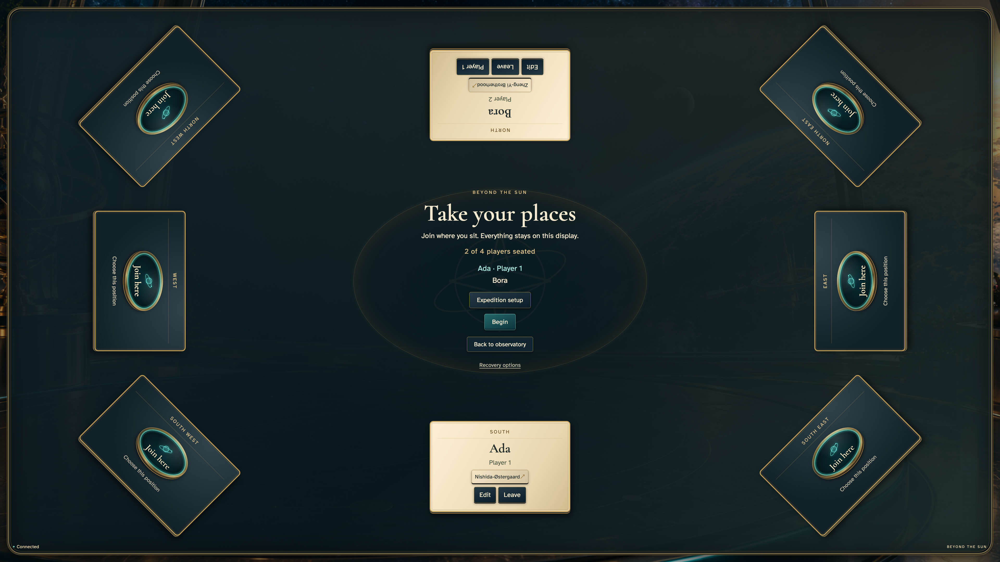](../../screenshots/share-a-discovery-and-its-exclusive-action-at-two-cardinal-seats/012-faction-1-chosen-tabletop-4k-darwin.png)

- [x] Bora retains The Zheng-Yi Brotherhood
- [x] Canonical effects settle before capture.
- [x] Any printed Action plan is ready.
- [x] Public compact topology remains physically separated.
- [x] The gameplay shell fits the actual viewport.

## 14. Begin the immutable source-reviewed Basic setup through the ordinary UI

Viewpoint: **Ada · South · one shared controller**.

| desktop · 1440 × 1000 |
| --- |
|  |

tabletop-4k · 3840 × 2160

[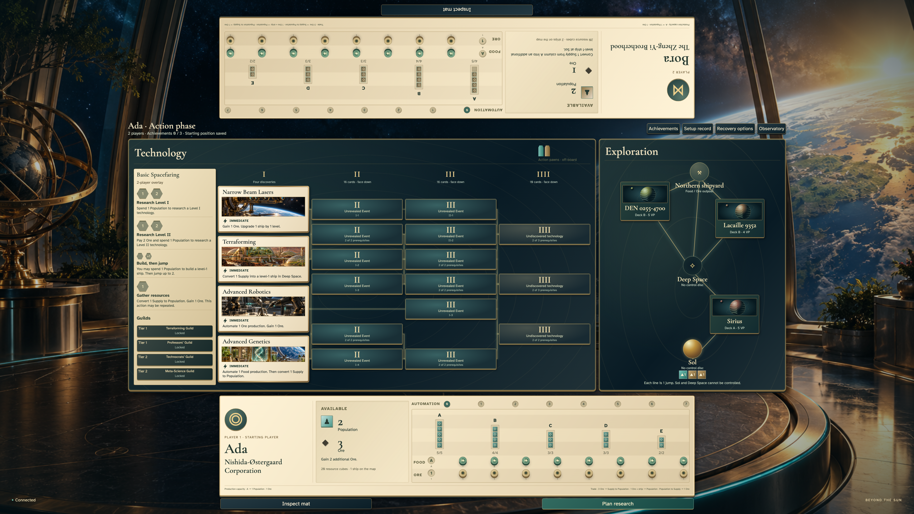](../../screenshots/share-a-discovery-and-its-exclusive-action-at-two-cardinal-seats/013-begun-tabletop-4k-darwin.png)

- [x] Begin the immutable source-reviewed Basic setup through the ordinary UI
- [x] Canonical effects settle before capture.
- [x] Any printed Action plan is ready.
- [x] Public compact topology remains physically separated.
- [x] The gameplay shell fits the actual viewport.

## 15. Ada opens the actual research and Action instrument

Viewpoint: **Ada · South · one shared controller**.

| desktop · 1440 × 1000 |
| --- |
|  |

tabletop-4k · 3840 × 2160

- [x] Ada opens the actual research and Action instrument
- [x] Canonical effects settle before capture.
- [x] Any printed Action plan is ready.
- [x] Public compact topology remains physically separated.
- [x] The gameplay shell fits the actual viewport.

## 16. Ada selects the legal printed space 1

Viewpoint: **Ada · South · one shared controller**.

| desktop · 1440 × 1000 |
| --- |
|  |

tabletop-4k · 3840 × 2160

- [x] Ada selects the legal printed space 1
- [x] Canonical effects settle before capture.
- [x] Any printed Action plan is ready.
- [x] Public compact topology remains physically separated.
- [x] The gameplay shell fits the actual viewport.

## 17. Select Terraforming with its printed cost and consequence

Viewpoint: **Ada · South · one shared controller**.

| desktop · 1440 × 1000 |
| --- |
| [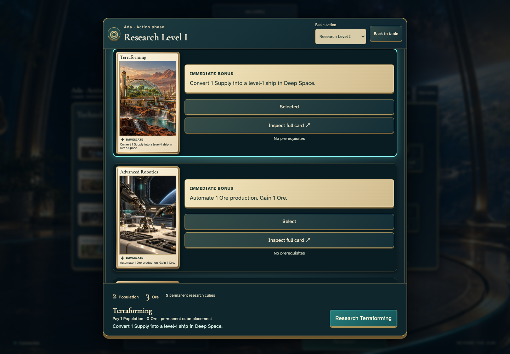](../../screenshots/share-a-discovery-and-its-exclusive-action-at-two-cardinal-seats/016-ada-terraform-card-desktop-darwin.png) |

tabletop-4k · 3840 × 2160

[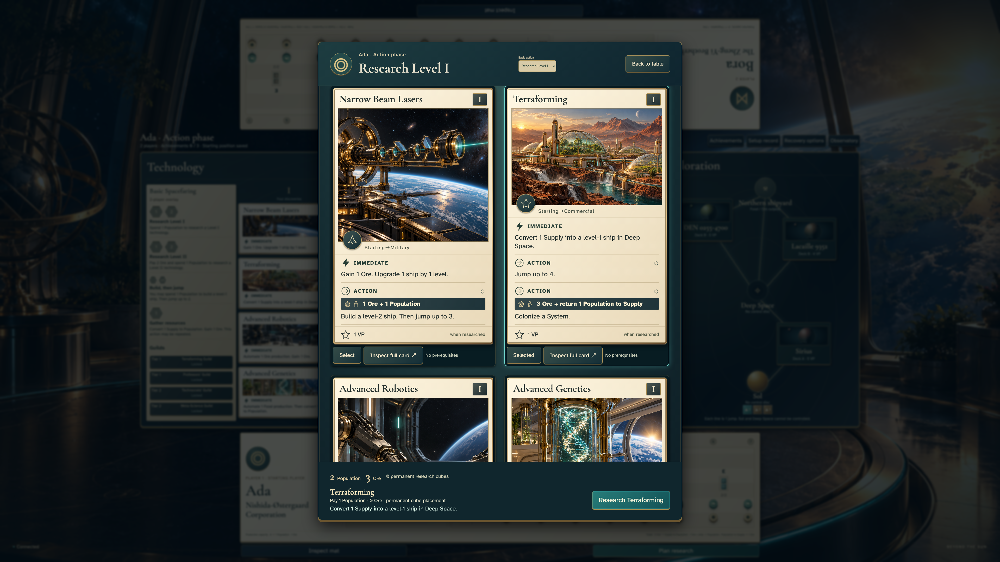](../../screenshots/share-a-discovery-and-its-exclusive-action-at-two-cardinal-seats/016-ada-terraform-card-tabletop-4k-darwin.png)

- [x] Select Terraforming with its printed cost and consequence
- [x] Canonical effects settle before capture.
- [x] Any printed Action plan is ready.
- [x] Public compact topology remains physically separated.
- [x] The gameplay shell fits the actual viewport.

## 18. Pay once and receive Terraforming's immediate bonus

Viewpoint: **Ada · South · one shared controller**.

| desktop · 1440 × 1000 |
| --- |
|  |

tabletop-4k · 3840 × 2160

- [x] Pay once and receive Terraforming's immediate bonus
- [x] Canonical effects settle before capture.
- [x] Any printed Action plan is ready.
- [x] Public compact topology remains physically separated.
- [x] The gameplay shell fits the actual viewport.

## 19. Ada completes production and hands off to Bora

Viewpoint: **Ada · South · one shared controller**.

| desktop · 1440 × 1000 |
| --- |
| [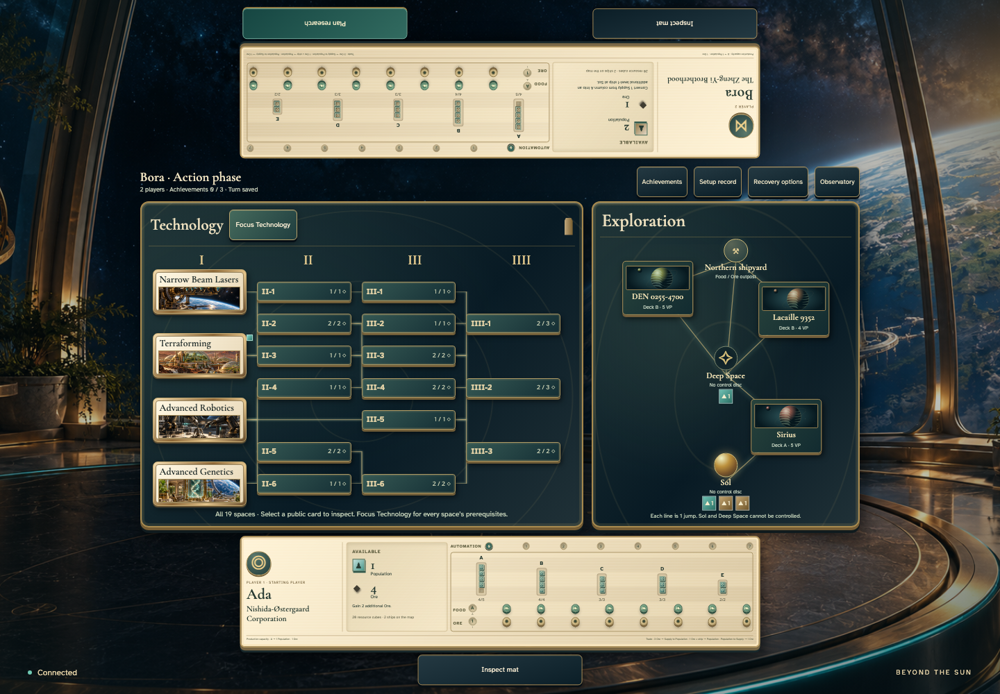](../../screenshots/share-a-discovery-and-its-exclusive-action-at-two-cardinal-seats/018-ada-terraform-handoff-desktop-darwin.png) |

tabletop-4k · 3840 × 2160

[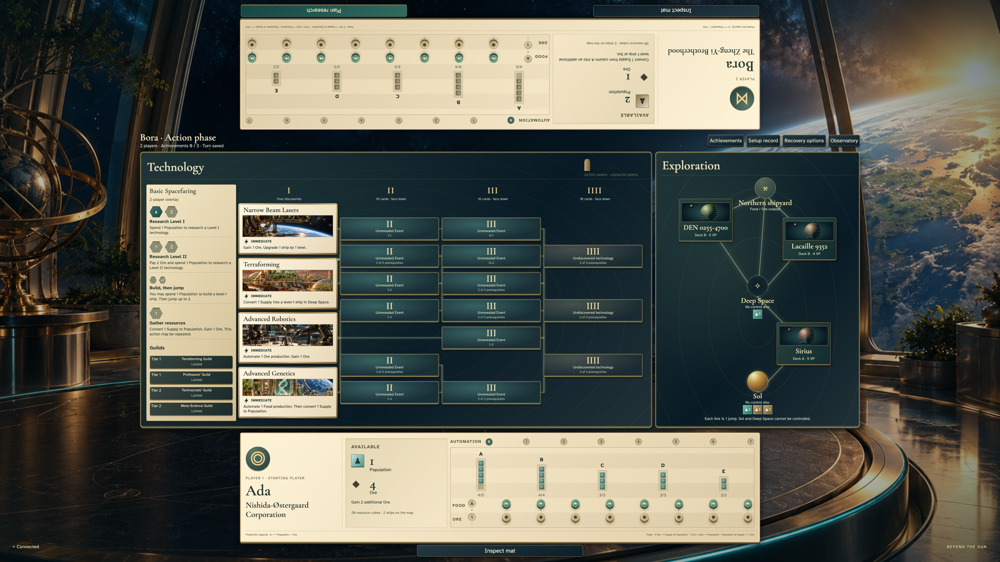](../../screenshots/share-a-discovery-and-its-exclusive-action-at-two-cardinal-seats/018-ada-terraform-handoff-tabletop-4k-darwin.png)

- [x] Ada completes production and hands off to Bora
- [x] Canonical effects settle before capture.
- [x] Any printed Action plan is ready.
- [x] Public compact topology remains physically separated.
- [x] The gameplay shell fits the actual viewport.

## 20. Bora opens the actual research and Action instrument

Viewpoint: **Bora · North · one shared controller**.

| desktop · 1440 × 1000 |
| --- |
|  |

tabletop-4k · 3840 × 2160

[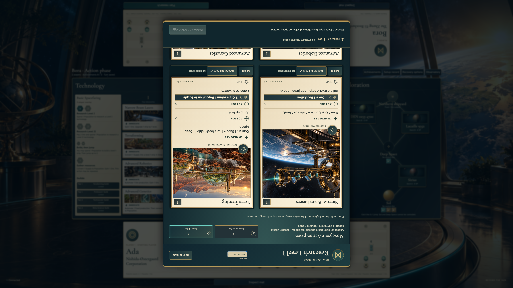](../../screenshots/share-a-discovery-and-its-exclusive-action-at-two-cardinal-seats/019-bora-terraform-plan-tabletop-4k-darwin.png)

- [x] Bora opens the actual research and Action instrument
- [x] Canonical effects settle before capture.
- [x] Any printed Action plan is ready.
- [x] Public compact topology remains physically separated.
- [x] The gameplay shell fits the actual viewport.

## 21. Bora selects the legal printed space 2

Viewpoint: **Bora · North · one shared controller**.

| desktop · 1440 × 1000 |
| --- |
| [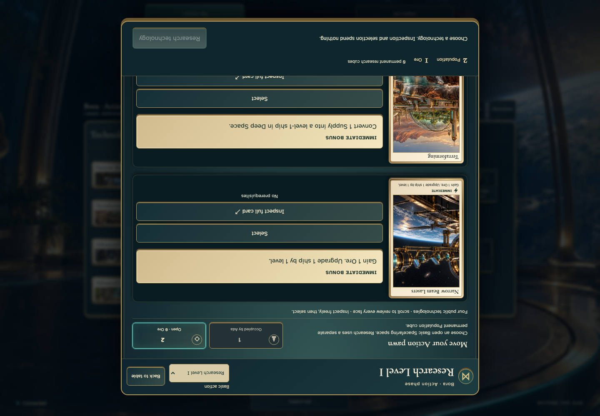](../../screenshots/share-a-discovery-and-its-exclusive-action-at-two-cardinal-seats/020-bora-terraform-space-desktop-darwin.png) |

tabletop-4k · 3840 × 2160

- [x] Bora selects the legal printed space 2
- [x] Canonical effects settle before capture.
- [x] Any printed Action plan is ready.
- [x] Public compact topology remains physically separated.
- [x] The gameplay shell fits the actual viewport.

## 22. Select Terraforming with its printed cost and consequence

Viewpoint: **Bora · North · one shared controller**.

| desktop · 1440 × 1000 |
| --- |
| [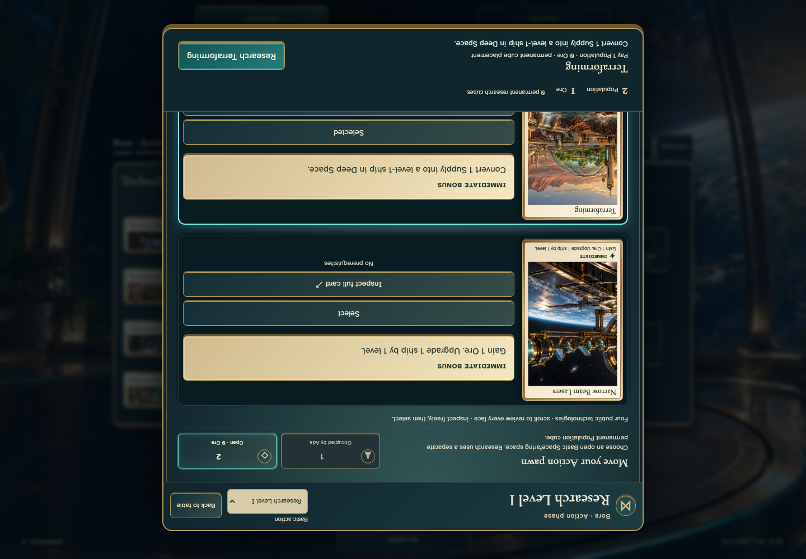](../../screenshots/share-a-discovery-and-its-exclusive-action-at-two-cardinal-seats/021-bora-terraform-card-desktop-darwin.png) |

tabletop-4k · 3840 × 2160

[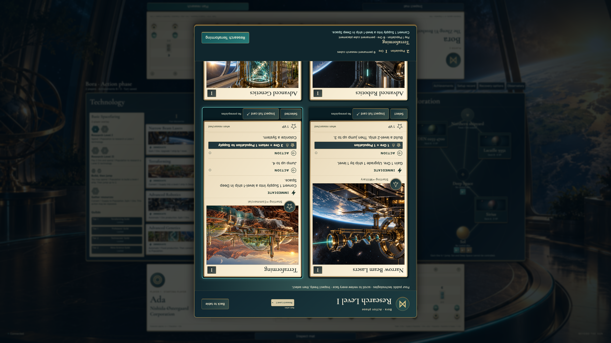](../../screenshots/share-a-discovery-and-its-exclusive-action-at-two-cardinal-seats/021-bora-terraform-card-tabletop-4k-darwin.png)

- [x] Select Terraforming with its printed cost and consequence
- [x] Canonical effects settle before capture.
- [x] Any printed Action plan is ready.
- [x] Public compact topology remains physically separated.
- [x] The gameplay shell fits the actual viewport.

## 23. Pay once and receive Terraforming's immediate bonus

Viewpoint: **Bora · North · one shared controller**.

| desktop · 1440 × 1000 |
| --- |
| [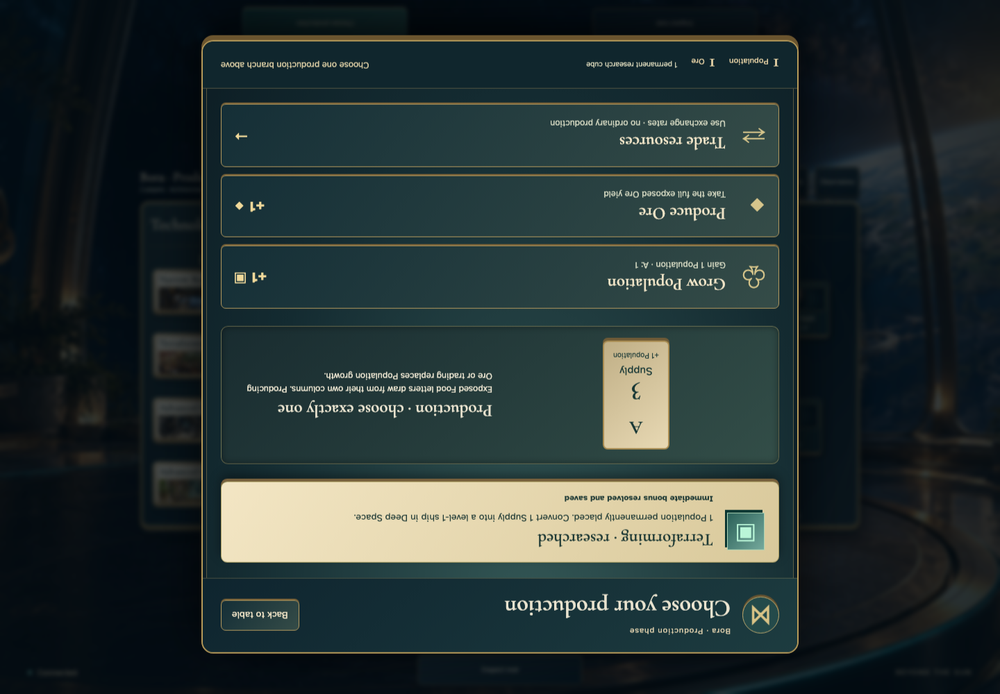](../../screenshots/share-a-discovery-and-its-exclusive-action-at-two-cardinal-seats/022-bora-terraform-researched-desktop-darwin.png) |

tabletop-4k · 3840 × 2160

[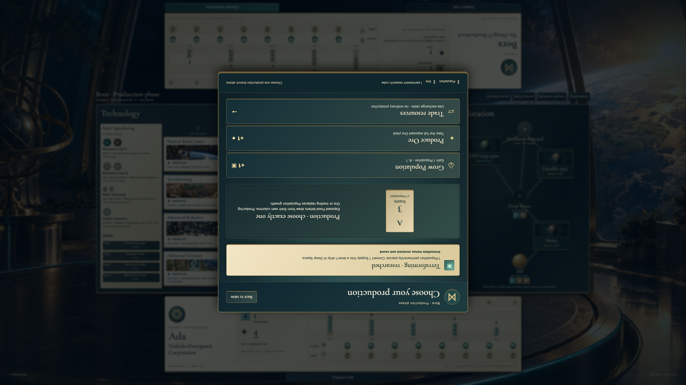](../../screenshots/share-a-discovery-and-its-exclusive-action-at-two-cardinal-seats/022-bora-terraform-researched-tabletop-4k-darwin.png)

- [x] Pay once and receive Terraforming's immediate bonus
- [x] Canonical effects settle before capture.
- [x] Any printed Action plan is ready.
- [x] Public compact topology remains physically separated.
- [x] The gameplay shell fits the actual viewport.

## 24. Bora completes production and hands off to Ada

Viewpoint: **Bora · North · one shared controller**.

| desktop · 1440 × 1000 |
| --- |
| [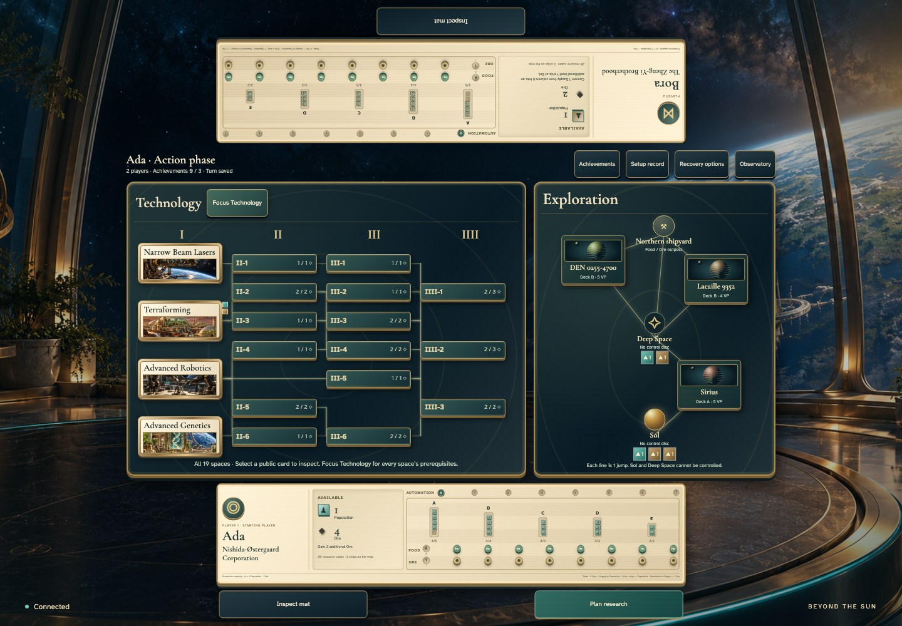](../../screenshots/share-a-discovery-and-its-exclusive-action-at-two-cardinal-seats/023-bora-terraform-handoff-desktop-darwin.png) |

tabletop-4k · 3840 × 2160

[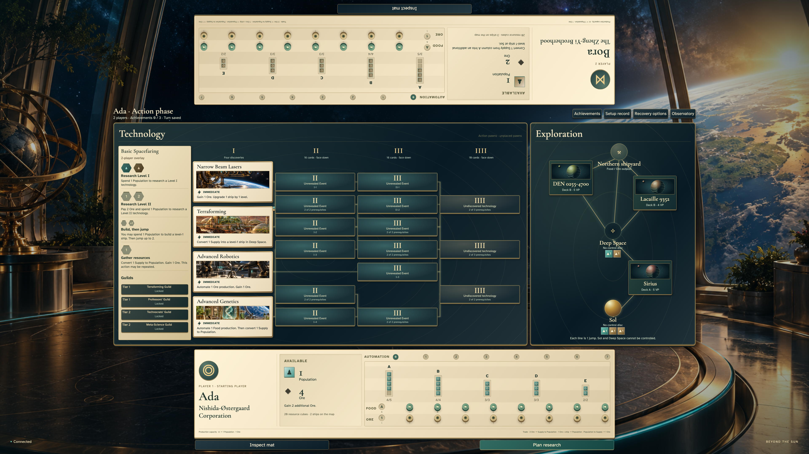](../../screenshots/share-a-discovery-and-its-exclusive-action-at-two-cardinal-seats/023-bora-terraform-handoff-tabletop-4k-darwin.png)

- [x] Bora completes production and hands off to Ada
- [x] Canonical effects settle before capture.
- [x] Any printed Action plan is ready.
- [x] Public compact topology remains physically separated.
- [x] The gameplay shell fits the actual viewport.

## 25. Ada opens the actual research and Action instrument

Viewpoint: **Ada · South · one shared controller**.

| desktop · 1440 × 1000 |
| --- |
| [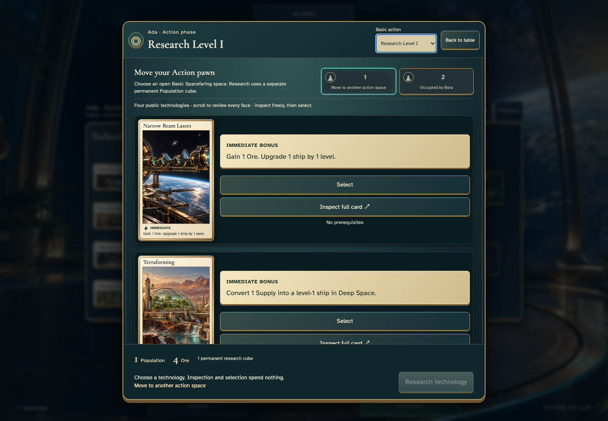](../../screenshots/share-a-discovery-and-its-exclusive-action-at-two-cardinal-seats/024-discover-plan-desktop-darwin.png) |

tabletop-4k · 3840 × 2160

- [x] Ada opens the actual research and Action instrument
- [x] Canonical effects settle before capture.
- [x] Any printed Action plan is ready.
- [x] Public compact topology remains physically separated.
- [x] The gameplay shell fits the actual viewport.

## 26. Ada selects Level II research

Viewpoint: **Ada · South · one shared controller**.

| desktop · 1440 × 1000 |
| --- |
| [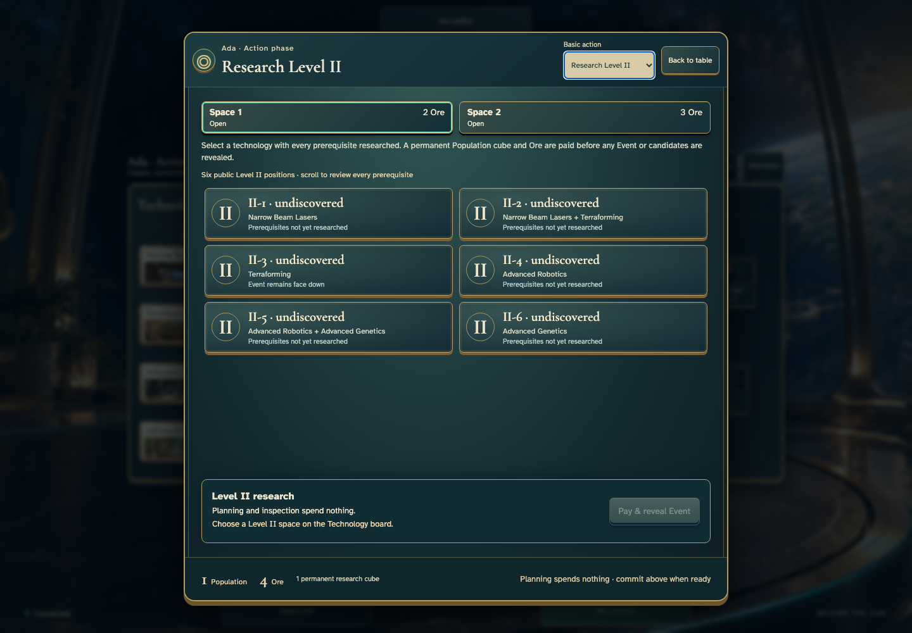](../../screenshots/share-a-discovery-and-its-exclusive-action-at-two-cardinal-seats/025-discover-kind-desktop-darwin.png) |

tabletop-4k · 3840 × 2160

- [x] Ada selects Level II research
- [x] Canonical effects settle before capture.
- [x] Any printed Action plan is ready.
- [x] Public compact topology remains physically separated.
- [x] The gameplay shell fits the actual viewport.

## 27. Choose the actual covered II-3 discovery with the printed prerequisite and payment

Viewpoint: **Ada · South · one shared controller**.

| desktop · 1440 × 1000 |
| --- |
| [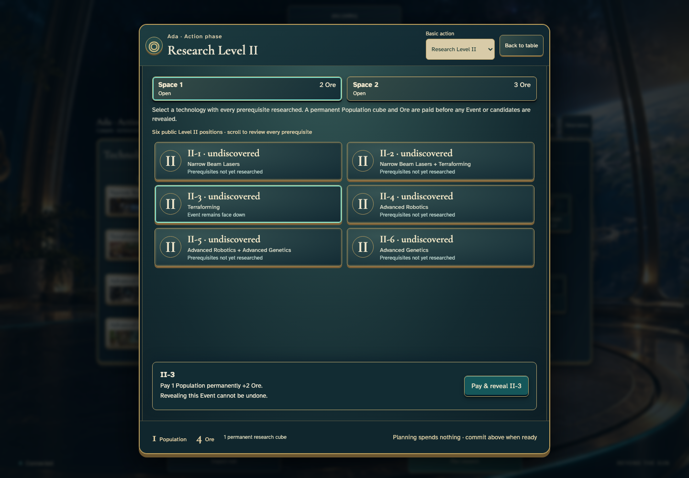](../../screenshots/share-a-discovery-and-its-exclusive-action-at-two-cardinal-seats/026-discover-slot-desktop-darwin.png) |

tabletop-4k · 3840 × 2160

[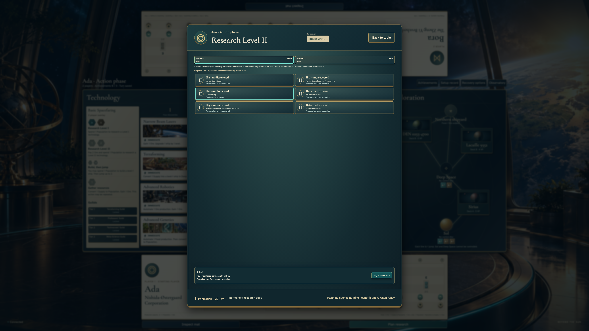](../../screenshots/share-a-discovery-and-its-exclusive-action-at-two-cardinal-seats/026-discover-slot-tabletop-4k-darwin.png)

- [x] Choose the actual covered II-3 discovery with the printed prerequisite and payment
- [x] Canonical effects settle before capture.
- [x] Any printed Action plan is ready.
- [x] Public compact topology remains physically separated.
- [x] The gameplay shell fits the actual viewport.

## 28. Pay once and reveal Tyler Lee through the real persisted queue

Viewpoint: **Ada · South · one shared controller**.

| desktop · 1440 × 1000 |
| --- |
| [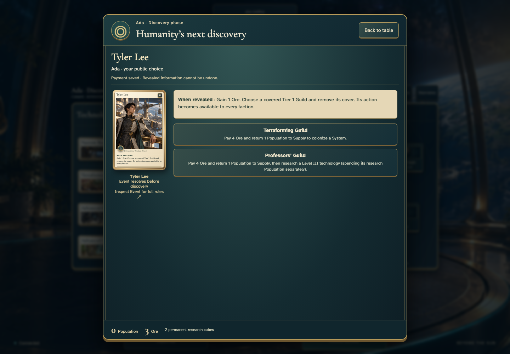](../../screenshots/share-a-discovery-and-its-exclusive-action-at-two-cardinal-seats/027-event-revealed-desktop-darwin.png) |

tabletop-4k · 3840 × 2160

[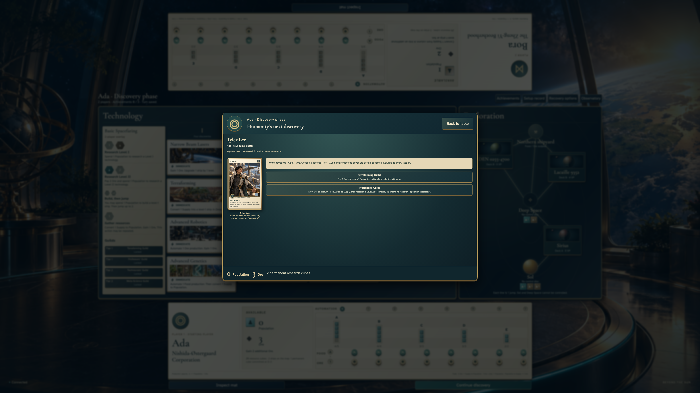](../../screenshots/share-a-discovery-and-its-exclusive-action-at-two-cardinal-seats/027-event-revealed-tabletop-4k-darwin.png)

- [x] Pay once and reveal Tyler Lee through the real persisted queue
- [x] Canonical effects settle before capture.
- [x] Any printed Action plan is ready.
- [x] Public compact topology remains physically separated.
- [x] The gameplay shell fits the actual viewport.

## 29. Resolve the actual Tyler Lee guild choice, retaining the revealed candidates

Viewpoint: **Ada · South · one shared controller**.

| desktop · 1440 × 1000 |
| --- |
| [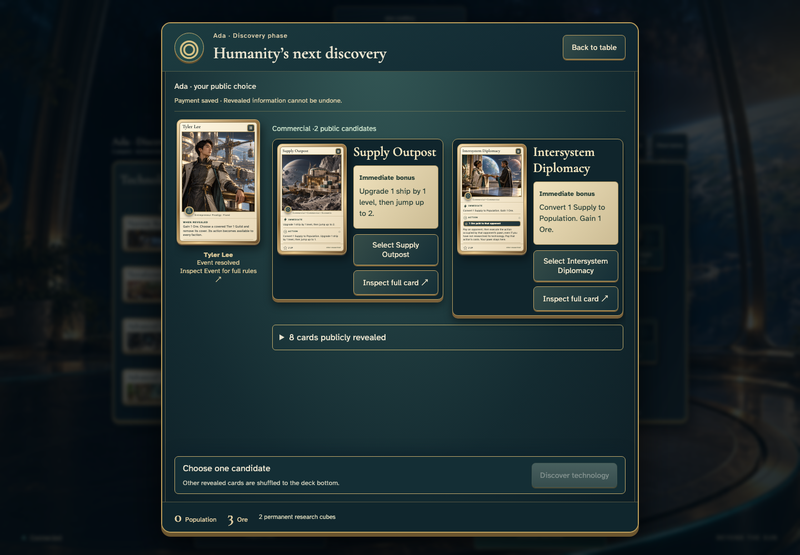](../../screenshots/share-a-discovery-and-its-exclusive-action-at-two-cardinal-seats/028-discovery-event-desktop-darwin.png) |

tabletop-4k · 3840 × 2160

[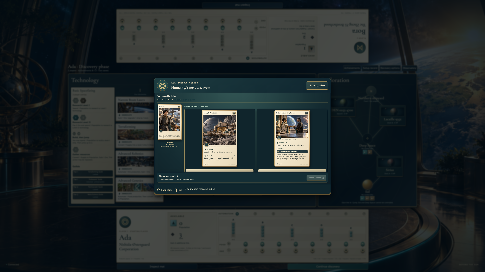](../../screenshots/share-a-discovery-and-its-exclusive-action-at-two-cardinal-seats/028-discovery-event-tabletop-4k-darwin.png)

- [x] Resolve the actual Tyler Lee guild choice, retaining the revealed candidates
- [x] Canonical effects settle before capture.
- [x] Any printed Action plan is ready.
- [x] Public compact topology remains physically separated.
- [x] The gameplay shell fits the actual viewport.

## 30. Choose the public Supply Outpost candidate and its exact immediate consequence

Viewpoint: **Ada · South · one shared controller**.

| desktop · 1440 × 1000 |
| --- |
| [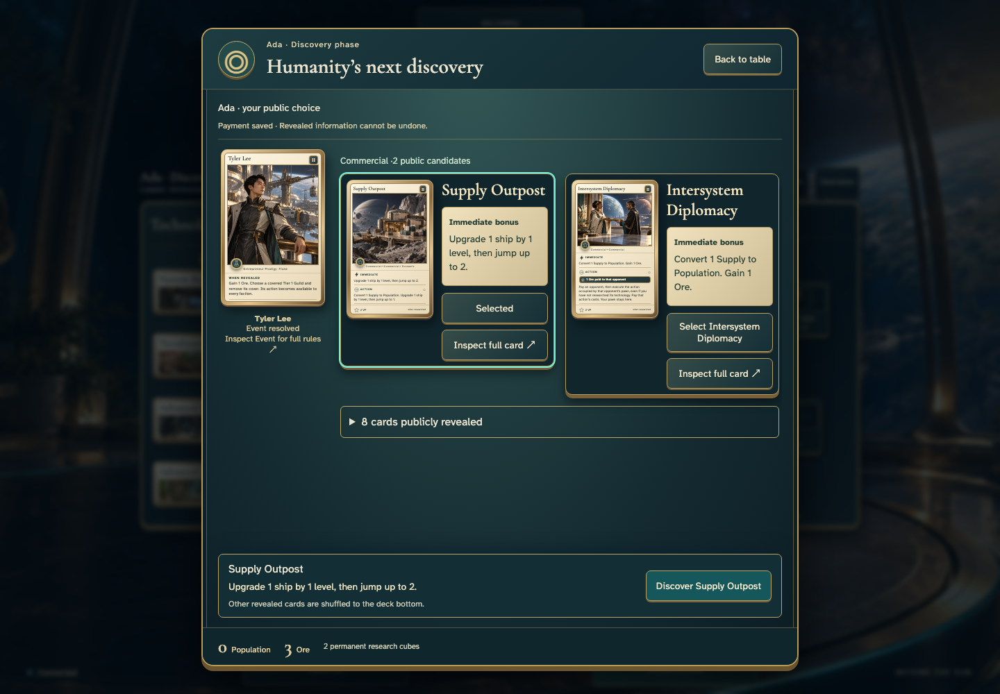](../../screenshots/share-a-discovery-and-its-exclusive-action-at-two-cardinal-seats/029-discovery-selected-desktop-darwin.png) |

tabletop-4k · 3840 × 2160

[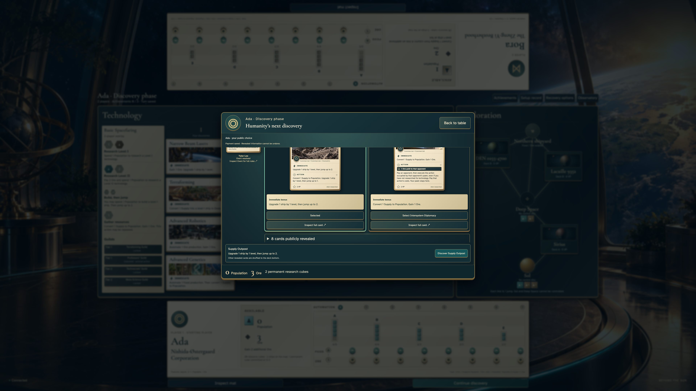](../../screenshots/share-a-discovery-and-its-exclusive-action-at-two-cardinal-seats/029-discovery-selected-tabletop-4k-darwin.png)

- [x] Choose the public Supply Outpost candidate and its exact immediate consequence
- [x] Canonical effects settle before capture.
- [x] Any printed Action plan is ready.
- [x] Public compact topology remains physically separated.
- [x] The gameplay shell fits the actual viewport.

## 31. Commit the one public discovery before resolving its mandatory bonus

Viewpoint: **Ada · South · one shared controller**.

| desktop · 1440 × 1000 |
| --- |
| [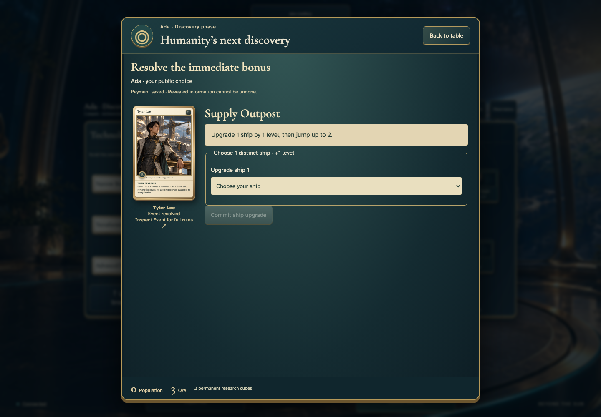](../../screenshots/share-a-discovery-and-its-exclusive-action-at-two-cardinal-seats/030-discovery-discovered-desktop-darwin.png) |

tabletop-4k · 3840 × 2160

[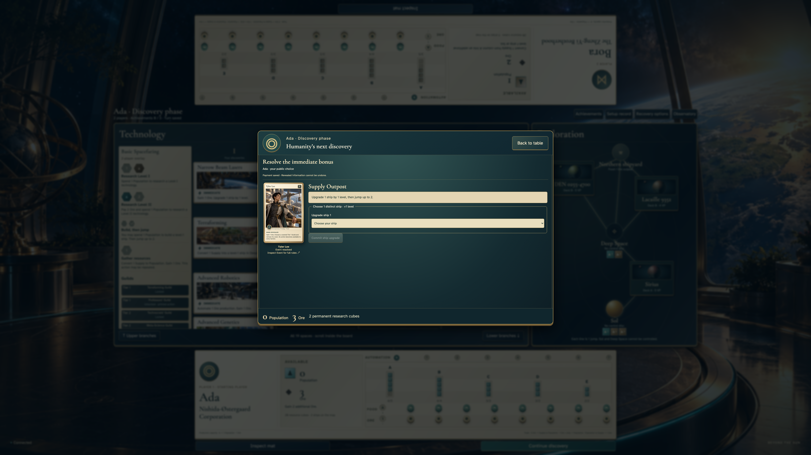](../../screenshots/share-a-discovery-and-its-exclusive-action-at-two-cardinal-seats/030-discovery-discovered-tabletop-4k-darwin.png)

- [x] Commit the one public discovery before resolving its mandatory bonus
- [x] Canonical effects settle before capture.
- [x] Any printed Action plan is ready.
- [x] Public compact topology remains physically separated.
- [x] The gameplay shell fits the actual viewport.

## 32. Explicitly choose an owned ship for the mandatory one-level upgrade

Viewpoint: **Ada · South · one shared controller**.

| desktop · 1440 × 1000 |
| --- |
| [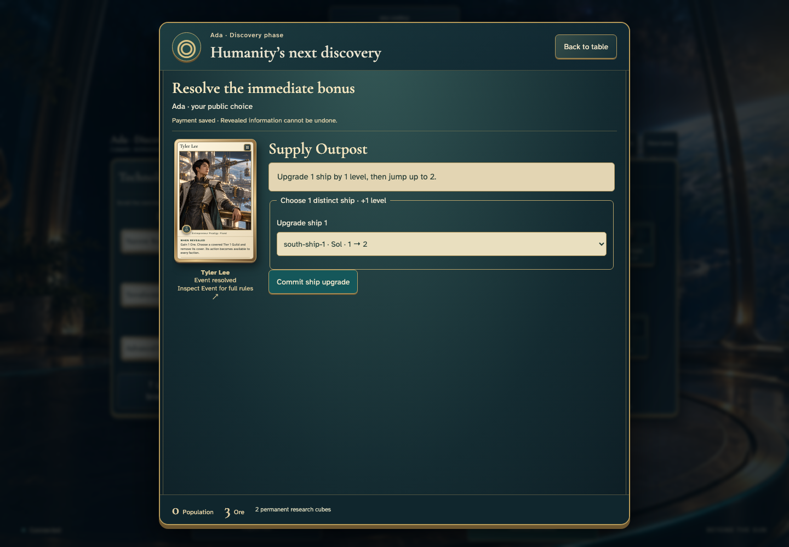](../../screenshots/share-a-discovery-and-its-exclusive-action-at-two-cardinal-seats/031-discovery-upgrade-target-desktop-darwin.png) |

tabletop-4k · 3840 × 2160

[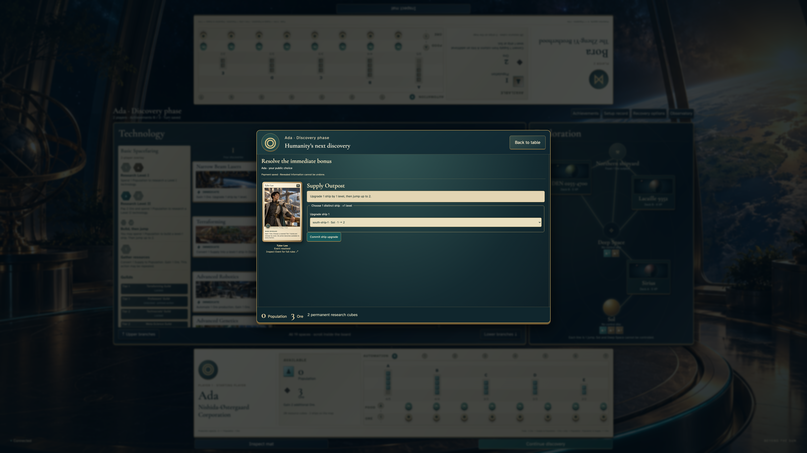](../../screenshots/share-a-discovery-and-its-exclusive-action-at-two-cardinal-seats/031-discovery-upgrade-target-tabletop-4k-darwin.png)

- [x] Explicitly choose an owned ship for the mandatory one-level upgrade
- [x] Canonical effects settle before capture.
- [x] Any printed Action plan is ready.
- [x] Public compact topology remains physically separated.
- [x] The gameplay shell fits the actual viewport.

## 33. Save the mandatory upgrade before the separate optional jump

Viewpoint: **Ada · South · one shared controller**.

| desktop · 1440 × 1000 |
| --- |
| [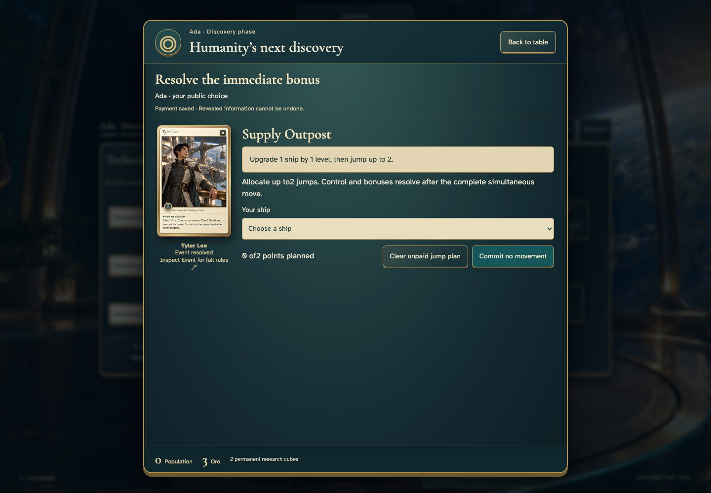](../../screenshots/share-a-discovery-and-its-exclusive-action-at-two-cardinal-seats/032-discovery-upgraded-desktop-darwin.png) |

tabletop-4k · 3840 × 2160

[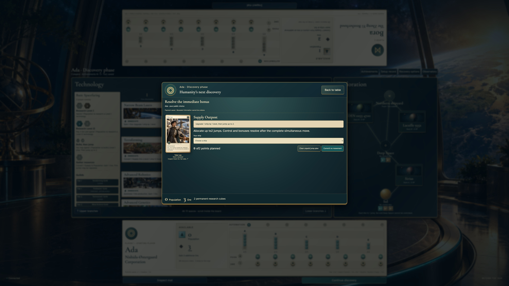](../../screenshots/share-a-discovery-and-its-exclusive-action-at-two-cardinal-seats/032-discovery-upgraded-tabletop-4k-darwin.png)

- [x] Save the mandatory upgrade before the separate optional jump
- [x] Canonical effects settle before capture.
- [x] Any printed Action plan is ready.
- [x] Public compact topology remains physically separated.
- [x] The gameplay shell fits the actual viewport.

## 34. Explicitly decline optional movement and resume Production

Viewpoint: **Ada · South · one shared controller**.

| desktop · 1440 × 1000 |
| --- |
|  |

tabletop-4k · 3840 × 2160

- [x] Explicitly decline optional movement and resume Production
- [x] Canonical effects settle before capture.
- [x] Any printed Action plan is ready.
- [x] Public compact topology remains physically separated.
- [x] The gameplay shell fits the actual viewport.

## 35. Ada completes production and hands off to Bora

Viewpoint: **Ada · South · one shared controller**.

| desktop · 1440 × 1000 |
| --- |
|  |

tabletop-4k · 3840 × 2160

- [x] Ada completes production and hands off to Bora
- [x] Canonical effects settle before capture.
- [x] Any printed Action plan is ready.
- [x] Public compact topology remains physically separated.
- [x] The gameplay shell fits the actual viewport.

## 36. Bora opens the actual research and Action instrument

Viewpoint: **Bora · North · one shared controller**.

| desktop · 1440 × 1000 |
| --- |
|  |

tabletop-4k · 3840 × 2160

- [x] Bora opens the actual research and Action instrument
- [x] Canonical effects settle before capture.
- [x] Any printed Action plan is ready.
- [x] Public compact topology remains physically separated.
- [x] The gameplay shell fits the actual viewport.

## 37. Bora selects printed technology Actions

Viewpoint: **Bora · North · one shared controller**.

| desktop · 1440 × 1000 |
| --- |
| [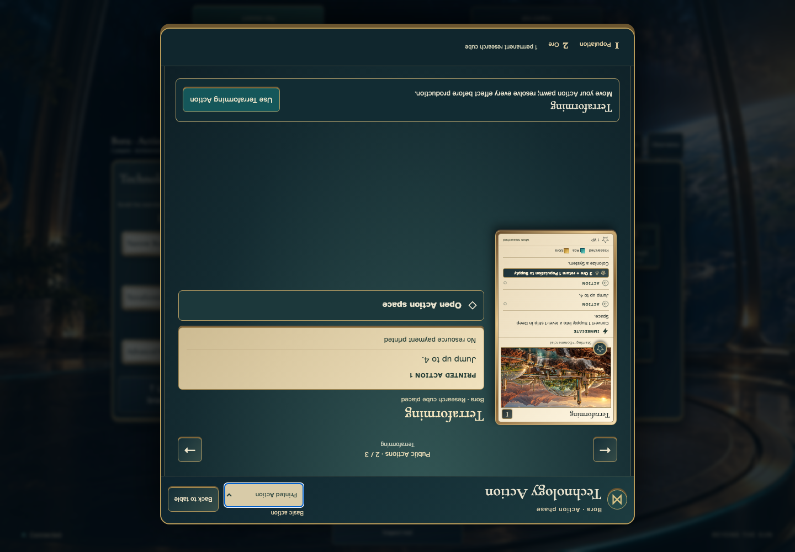](../../screenshots/share-a-discovery-and-its-exclusive-action-at-two-cardinal-seats/036-unowned-kind-desktop-darwin.png) |

tabletop-4k · 3840 × 2160

- [x] Bora selects printed technology Actions
- [x] Canonical effects settle before capture.
- [x] Any printed Action plan is ready.
- [x] Public compact topology remains physically separated.
- [x] The gameplay shell fits the actual viewport.

## 38. Browse the next public printed Action without acquiring research

Viewpoint: **Bora · North · one shared controller**.

| desktop · 1440 × 1000 |
| --- |
|  |

tabletop-4k · 3840 × 2160

- [x] Browse the next public printed Action without acquiring research
- [x] Canonical effects settle before capture.
- [x] Any printed Action plan is ready.
- [x] Public compact topology remains physically separated.
- [x] The gameplay shell fits the actual viewport.

## 39. Read Supply Outpost's actual research requirement, payment and exclusive pawn space

Viewpoint: **Bora · North · one shared controller**.

| desktop · 1440 × 1000 |
| --- |
| [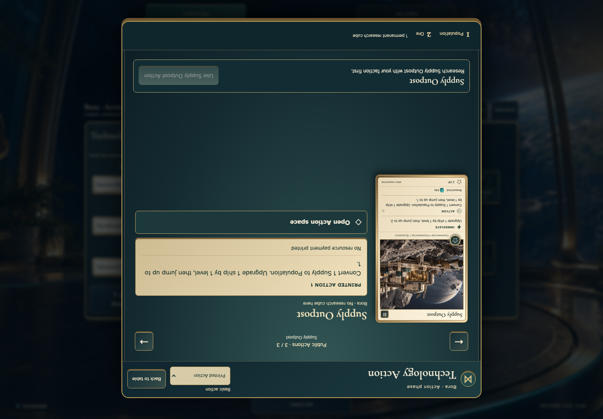](../../screenshots/share-a-discovery-and-its-exclusive-action-at-two-cardinal-seats/038-unowned-face-desktop-darwin.png) |

tabletop-4k · 3840 × 2160

- [x] Read Supply Outpost's actual research requirement, payment and exclusive pawn space
- [x] Canonical effects settle before capture.
- [x] Any printed Action plan is ready.
- [x] Public compact topology remains physically separated.
- [x] The gameplay shell fits the actual viewport.

## 40. A public discovery does not confer personal research access

Viewpoint: **Bora · North · one shared controller**.

| desktop · 1440 × 1000 |
| --- |
|  |

tabletop-4k · 3840 × 2160

- [x] A public discovery does not confer personal research access
- [x] Canonical effects settle before capture.
- [x] Any printed Action plan is ready.
- [x] Public compact topology remains physically separated.
- [x] The gameplay shell fits the actual viewport.

## 41. Read the full canonical printed face before acquiring its Action

Viewpoint: **Bora · North · one shared controller**.

| desktop · 1440 × 1000 |
| --- |
| [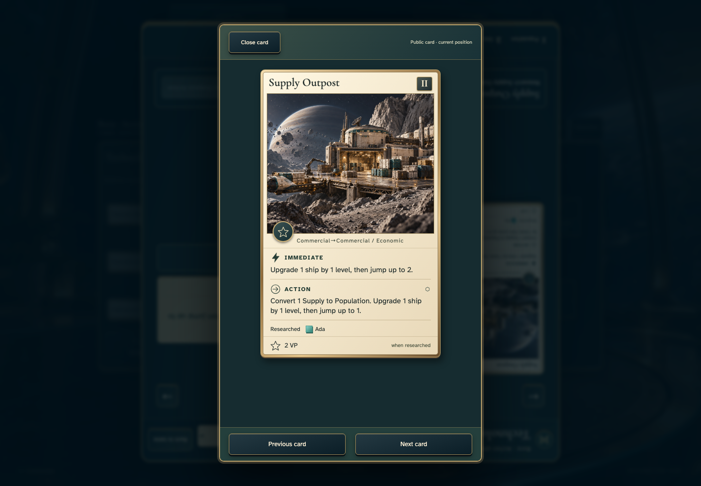](../../screenshots/share-a-discovery-and-its-exclusive-action-at-two-cardinal-seats/040-unowned-inspected-desktop-darwin.png) |

tabletop-4k · 3840 × 2160

[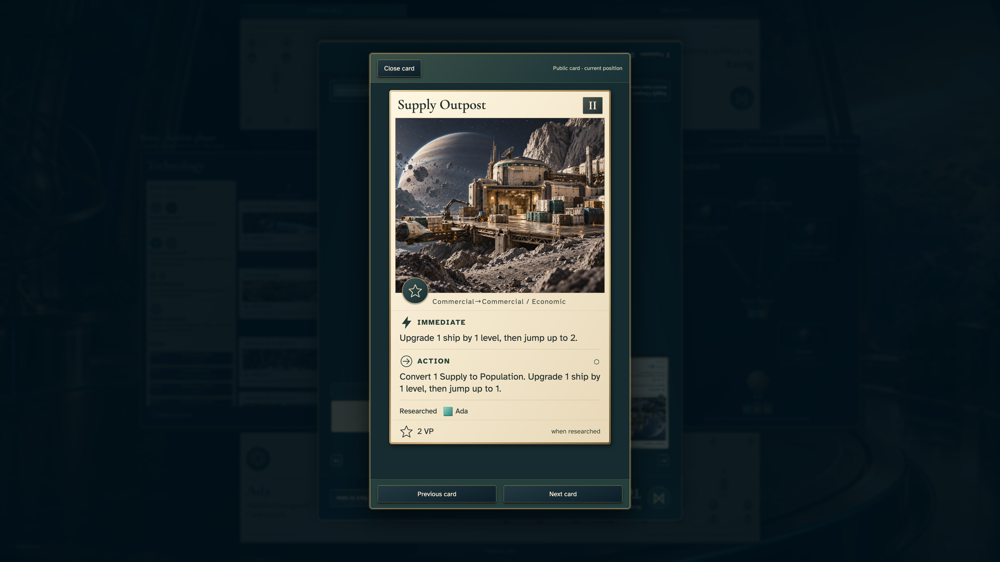](../../screenshots/share-a-discovery-and-its-exclusive-action-at-two-cardinal-seats/040-unowned-inspected-tabletop-4k-darwin.png)

- [x] Read the full canonical printed face before acquiring its Action
- [x] Canonical effects settle before capture.
- [x] Any printed Action plan is ready.
- [x] Public compact topology remains physically separated.
- [x] The gameplay shell fits the actual viewport.

## 42. Escape restores focus to the actual unowned public card

Viewpoint: **Bora · North · one shared controller**.

| desktop · 1440 × 1000 |
| --- |
|  |

tabletop-4k · 3840 × 2160

- [x] Escape restores focus to the actual unowned public card
- [x] Canonical effects settle before capture.
- [x] Any printed Action plan is ready.
- [x] Public compact topology remains physically separated.
- [x] The gameplay shell fits the actual viewport.

## 43. Inspection confers no research or turn action

Viewpoint: **Bora · North · one shared controller**.

| desktop · 1440 × 1000 |
| --- |
|  |

tabletop-4k · 3840 × 2160

- [x] Inspection confers no research or turn action
- [x] Canonical effects settle before capture.
- [x] Any printed Action plan is ready.
- [x] Public compact topology remains physically separated.
- [x] The gameplay shell fits the actual viewport.

## 44. Bora opens the actual research and Action instrument

Viewpoint: **Bora · North · one shared controller**.

| desktop · 1440 × 1000 |
| --- |
| [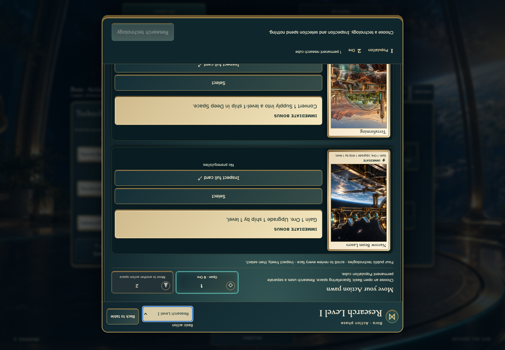](../../screenshots/share-a-discovery-and-its-exclusive-action-at-two-cardinal-seats/043-bora-gather-plan-desktop-darwin.png) |

tabletop-4k · 3840 × 2160

- [x] Bora opens the actual research and Action instrument
- [x] Canonical effects settle before capture.
- [x] Any printed Action plan is ready.
- [x] Public compact topology remains physically separated.
- [x] The gameplay shell fits the actual viewport.

## 45. Bora selects ordinary gathering

Viewpoint: **Bora · North · one shared controller**.

| desktop · 1440 × 1000 |
| --- |
|  |

tabletop-4k · 3840 × 2160

[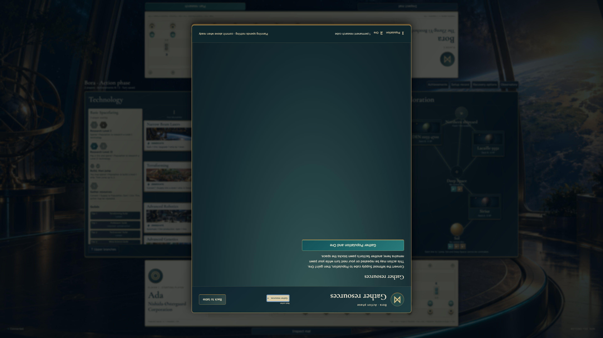](../../screenshots/share-a-discovery-and-its-exclusive-action-at-two-cardinal-seats/044-bora-gather-kind-tabletop-4k-darwin.png)

- [x] Bora selects ordinary gathering
- [x] Canonical effects settle before capture.
- [x] Any printed Action plan is ready.
- [x] Public compact topology remains physically separated.
- [x] The gameplay shell fits the actual viewport.

## 46. Receive the printed gather resources before ordinary production

Viewpoint: **Bora · North · one shared controller**.

| desktop · 1440 × 1000 |
| --- |
|  |

tabletop-4k · 3840 × 2160

[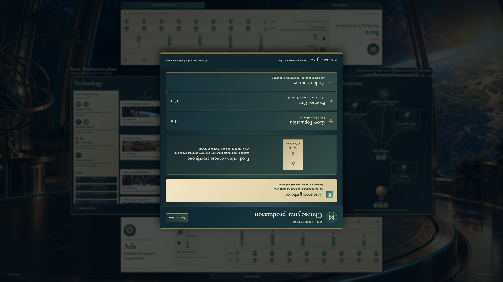](../../screenshots/share-a-discovery-and-its-exclusive-action-at-two-cardinal-seats/045-bora-gather-gathered-tabletop-4k-darwin.png)

- [x] Receive the printed gather resources before ordinary production
- [x] Canonical effects settle before capture.
- [x] Any printed Action plan is ready.
- [x] Public compact topology remains physically separated.
- [x] The gameplay shell fits the actual viewport.

## 47. Bora completes production and hands off to Ada

Viewpoint: **Bora · North · one shared controller**.

| desktop · 1440 × 1000 |
| --- |
|  |

tabletop-4k · 3840 × 2160

- [x] Bora completes production and hands off to Ada
- [x] Canonical effects settle before capture.
- [x] Any printed Action plan is ready.
- [x] Public compact topology remains physically separated.
- [x] The gameplay shell fits the actual viewport.

## 48. Ada opens the actual research and Action instrument

Viewpoint: **Ada · South · one shared controller**.

| desktop · 1440 × 1000 |
| --- |
|  |

tabletop-4k · 3840 × 2160

- [x] Ada opens the actual research and Action instrument
- [x] Canonical effects settle before capture.
- [x] Any printed Action plan is ready.
- [x] Public compact topology remains physically separated.
- [x] The gameplay shell fits the actual viewport.

## 49. Ada selects the legal printed space 1

Viewpoint: **Ada · South · one shared controller**.

| desktop · 1440 × 1000 |
| --- |
| [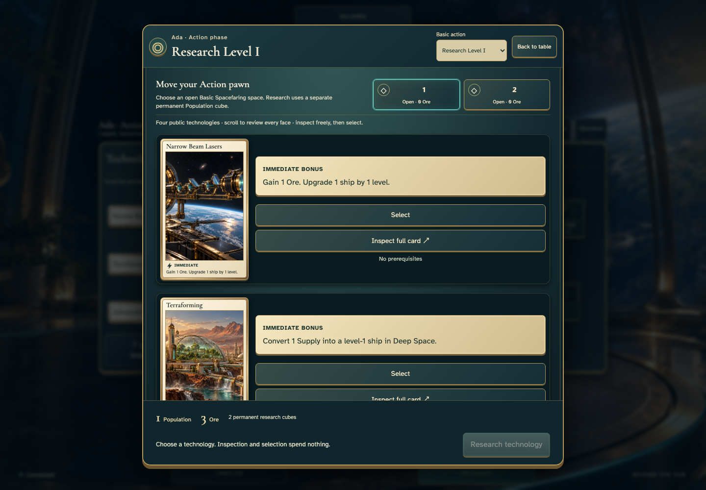](../../screenshots/share-a-discovery-and-its-exclusive-action-at-two-cardinal-seats/048-ada-robotics-space-desktop-darwin.png) |

tabletop-4k · 3840 × 2160

[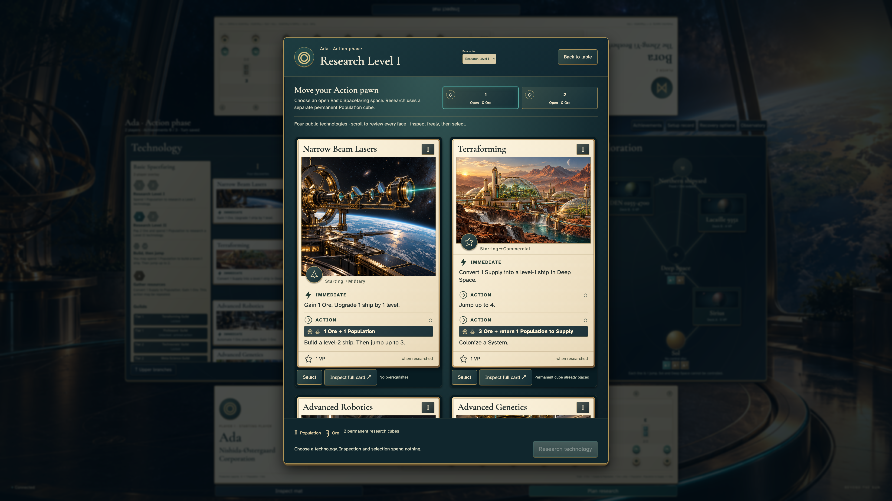](../../screenshots/share-a-discovery-and-its-exclusive-action-at-two-cardinal-seats/048-ada-robotics-space-tabletop-4k-darwin.png)

- [x] Ada selects the legal printed space 1
- [x] Canonical effects settle before capture.
- [x] Any printed Action plan is ready.
- [x] Public compact topology remains physically separated.
- [x] The gameplay shell fits the actual viewport.

## 50. Select Advanced Robotics with its printed cost and consequence

Viewpoint: **Ada · South · one shared controller**.

| desktop · 1440 × 1000 |
| --- |
| [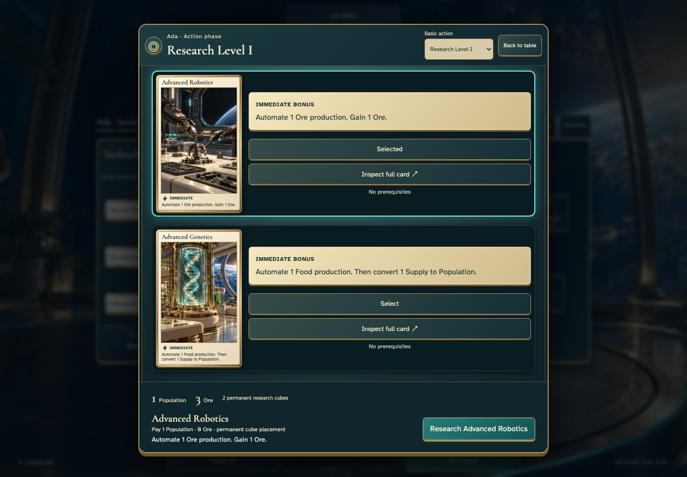](../../screenshots/share-a-discovery-and-its-exclusive-action-at-two-cardinal-seats/049-ada-robotics-card-desktop-darwin.png) |

tabletop-4k · 3840 × 2160

- [x] Select Advanced Robotics with its printed cost and consequence
- [x] Canonical effects settle before capture.
- [x] Any printed Action plan is ready.
- [x] Public compact topology remains physically separated.
- [x] The gameplay shell fits the actual viewport.

## 51. Pay once and receive Advanced Robotics's immediate bonus

Viewpoint: **Ada · South · one shared controller**.

| desktop · 1440 × 1000 |
| --- |
| [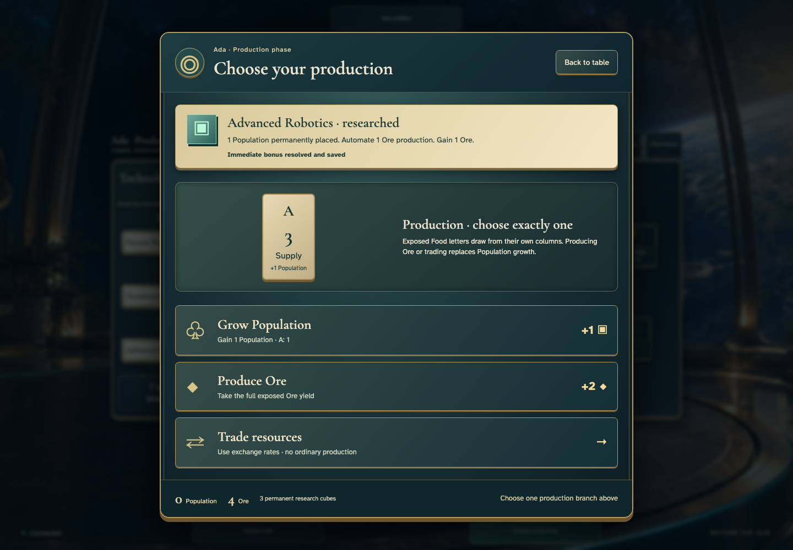](../../screenshots/share-a-discovery-and-its-exclusive-action-at-two-cardinal-seats/050-ada-robotics-researched-desktop-darwin.png) |

tabletop-4k · 3840 × 2160

[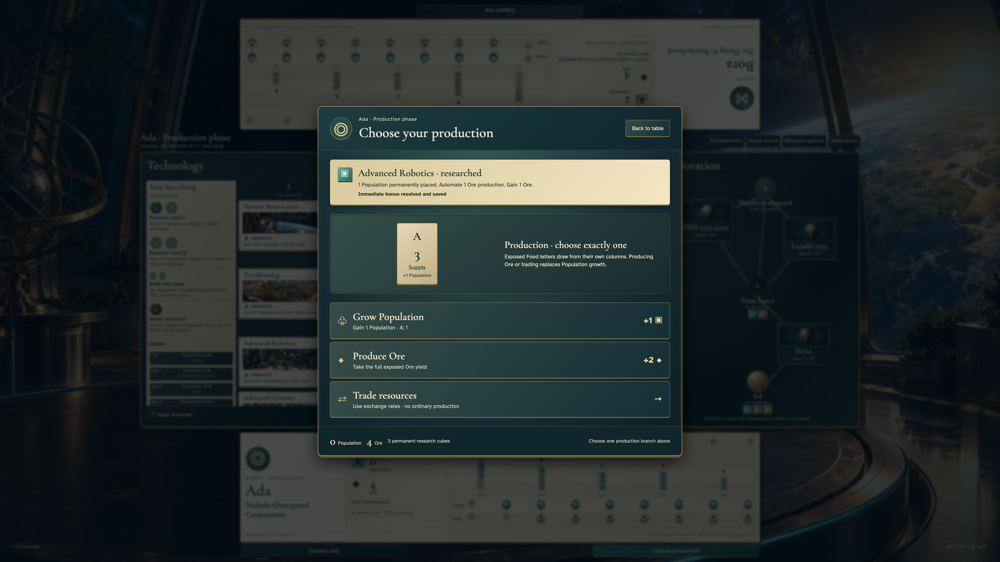](../../screenshots/share-a-discovery-and-its-exclusive-action-at-two-cardinal-seats/050-ada-robotics-researched-tabletop-4k-darwin.png)

- [x] Pay once and receive Advanced Robotics's immediate bonus
- [x] Canonical effects settle before capture.
- [x] Any printed Action plan is ready.
- [x] Public compact topology remains physically separated.
- [x] The gameplay shell fits the actual viewport.

## 52. Ada completes production and hands off to Bora

Viewpoint: **Ada · South · one shared controller**.

| desktop · 1440 × 1000 |
| --- |
| [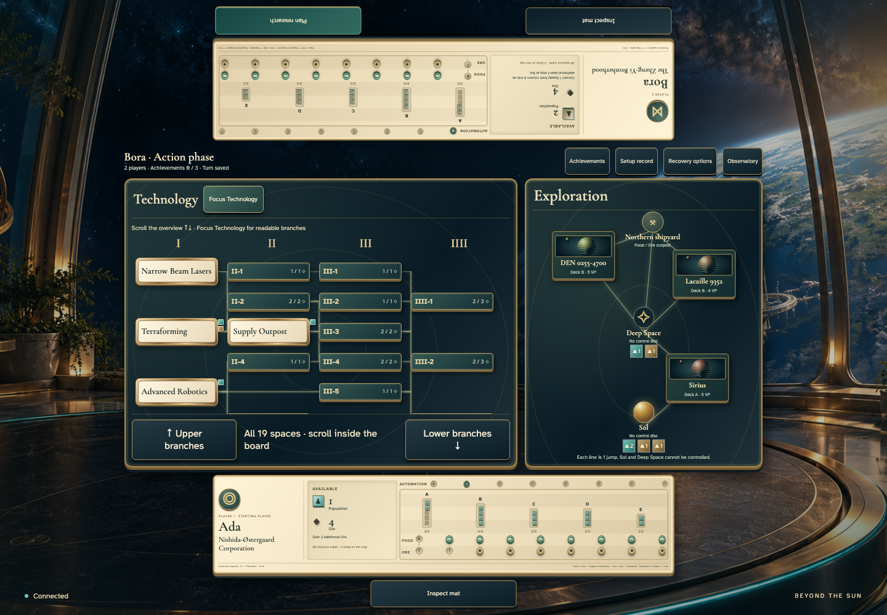](../../screenshots/share-a-discovery-and-its-exclusive-action-at-two-cardinal-seats/051-ada-robotics-handoff-desktop-darwin.png) |

tabletop-4k · 3840 × 2160

- [x] Ada completes production and hands off to Bora
- [x] Canonical effects settle before capture.
- [x] Any printed Action plan is ready.
- [x] Public compact topology remains physically separated.
- [x] The gameplay shell fits the actual viewport.

## 53. Bora opens the actual research and Action instrument

Viewpoint: **Bora · North · one shared controller**.

| desktop · 1440 × 1000 |
| --- |
|  |

tabletop-4k · 3840 × 2160

- [x] Bora opens the actual research and Action instrument
- [x] Canonical effects settle before capture.
- [x] Any printed Action plan is ready.
- [x] Public compact topology remains physically separated.
- [x] The gameplay shell fits the actual viewport.

## 54. Bora selects Level II research

Viewpoint: **Bora · North · one shared controller**.

| desktop · 1440 × 1000 |
| --- |
| [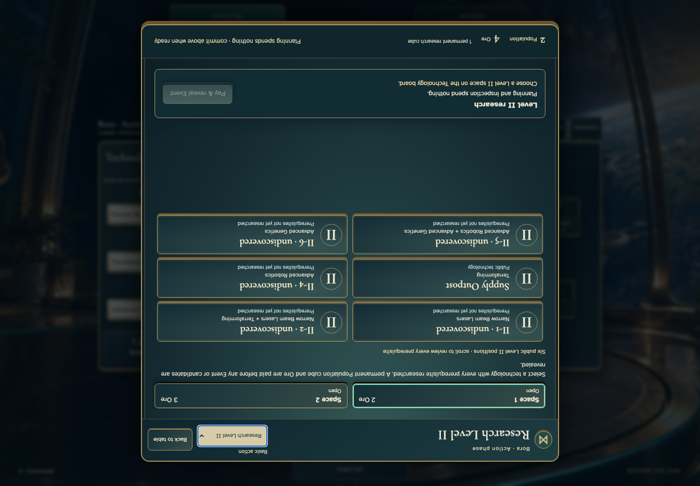](../../screenshots/share-a-discovery-and-its-exclusive-action-at-two-cardinal-seats/053-rival-kind-desktop-darwin.png) |

tabletop-4k · 3840 × 2160

[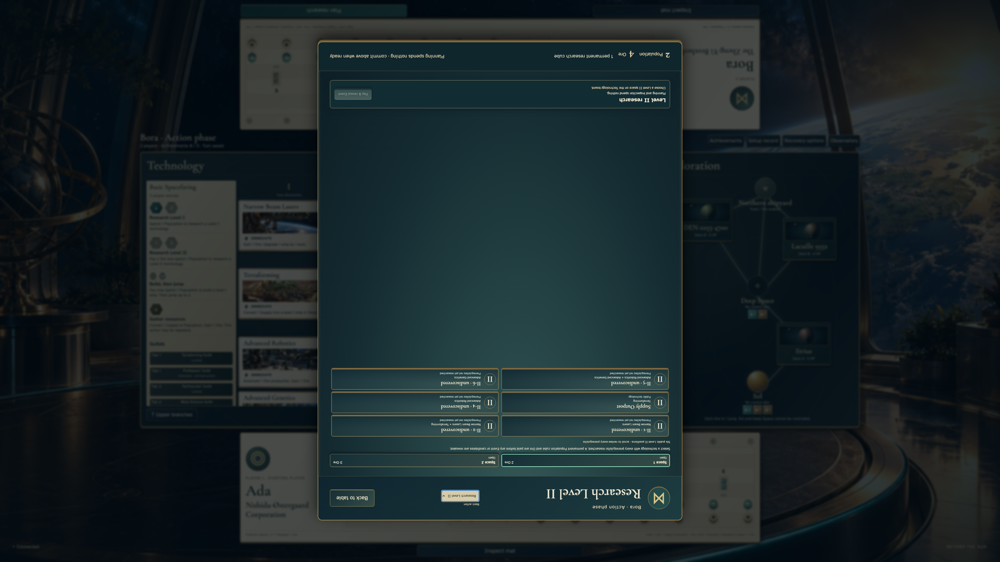](../../screenshots/share-a-discovery-and-its-exclusive-action-at-two-cardinal-seats/053-rival-kind-tabletop-4k-darwin.png)

- [x] Bora selects Level II research
- [x] Canonical effects settle before capture.
- [x] Any printed Action plan is ready.
- [x] Public compact topology remains physically separated.
- [x] The gameplay shell fits the actual viewport.

## 55. Select the existing public identity using the actual unoccupied research space

Viewpoint: **Bora · North · one shared controller**.

| desktop · 1440 × 1000 |
| --- |
| [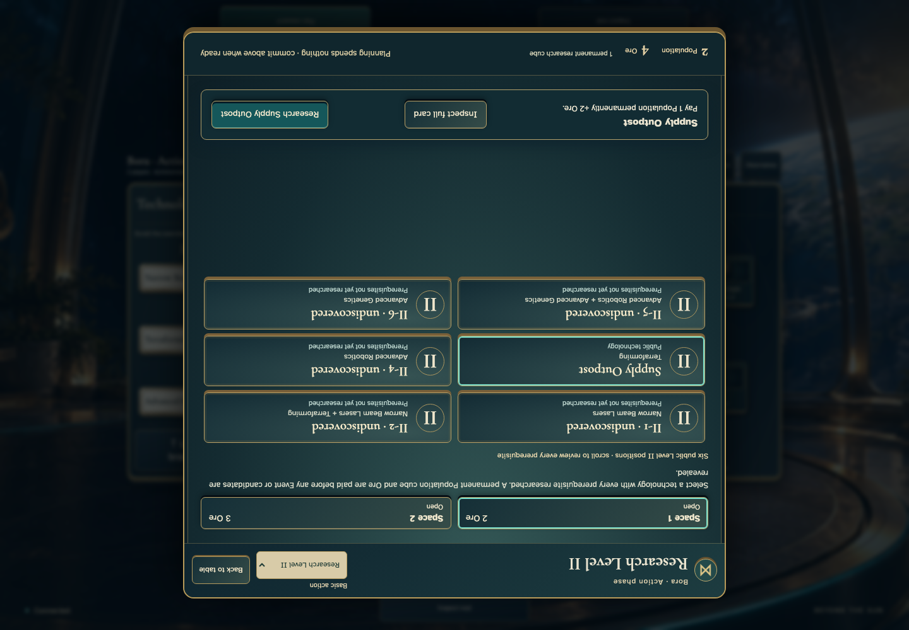](../../screenshots/share-a-discovery-and-its-exclusive-action-at-two-cardinal-seats/054-rival-selected-desktop-darwin.png) |

tabletop-4k · 3840 × 2160

[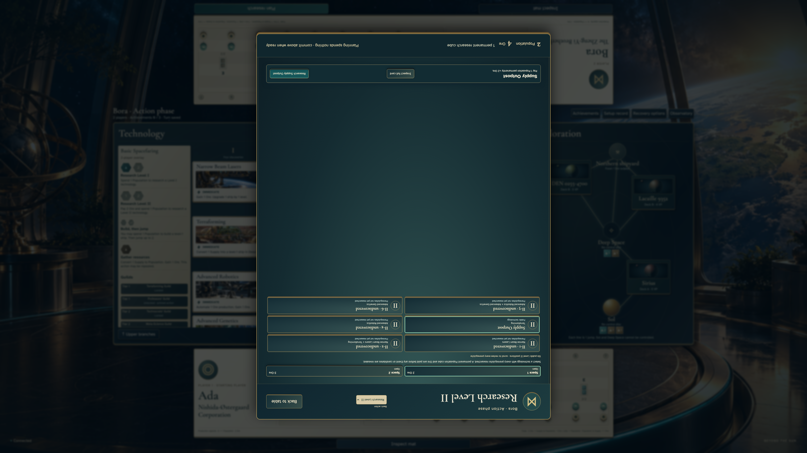](../../screenshots/share-a-discovery-and-its-exclusive-action-at-two-cardinal-seats/054-rival-selected-tabletop-4k-darwin.png)

- [x] Select the existing public identity using the actual unoccupied research space
- [x] Canonical effects settle before capture.
- [x] Any printed Action plan is ready.
- [x] Public compact topology remains physically separated.
- [x] The gameplay shell fits the actual viewport.

## 56. Research the same identity and resolve only this faction’s immediate bonus, without Event replay

Viewpoint: **Bora · North · one shared controller**.

| desktop · 1440 × 1000 |
| --- |
| [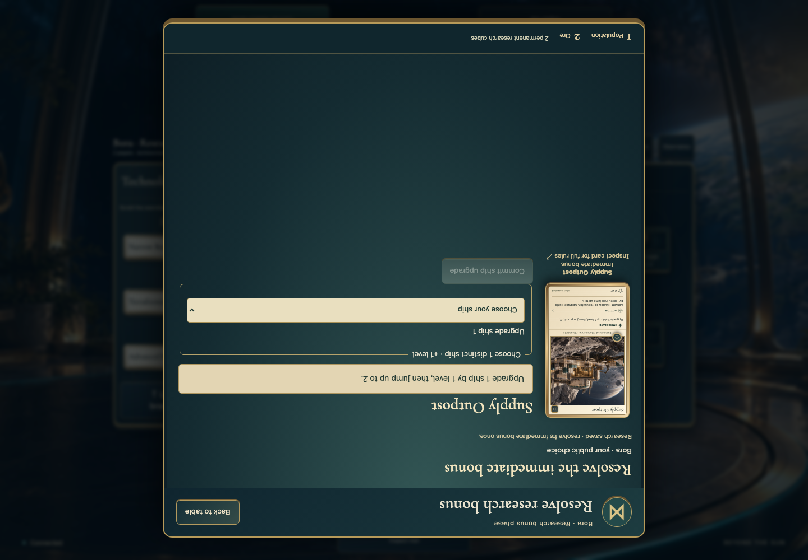](../../screenshots/share-a-discovery-and-its-exclusive-action-at-two-cardinal-seats/055-rival-own-bonus-desktop-darwin.png) |

tabletop-4k · 3840 × 2160

- [x] Research the same identity and resolve only this faction’s immediate bonus, without Event replay
- [x] Canonical effects settle before capture.
- [x] Any printed Action plan is ready.
- [x] Public compact topology remains physically separated.
- [x] The gameplay shell fits the actual viewport.

## 57. Explicitly choose an owned ship for the mandatory one-level upgrade

Viewpoint: **Bora · North · one shared controller**.

| desktop · 1440 × 1000 |
| --- |
| [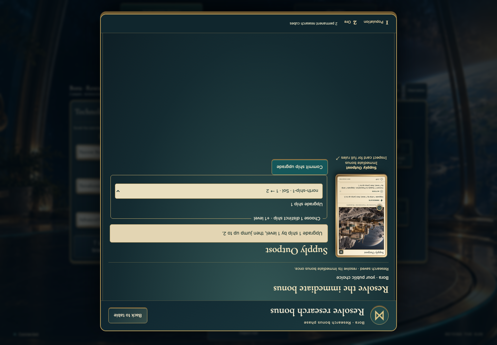](../../screenshots/share-a-discovery-and-its-exclusive-action-at-two-cardinal-seats/056-rival-bonus-upgrade-target-desktop-darwin.png) |

tabletop-4k · 3840 × 2160

[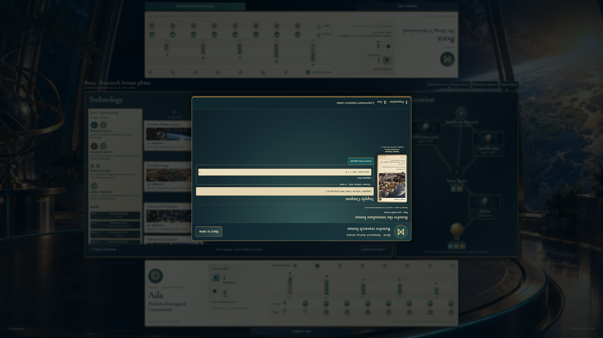](../../screenshots/share-a-discovery-and-its-exclusive-action-at-two-cardinal-seats/056-rival-bonus-upgrade-target-tabletop-4k-darwin.png)

- [x] Explicitly choose an owned ship for the mandatory one-level upgrade
- [x] Canonical effects settle before capture.
- [x] Any printed Action plan is ready.
- [x] Public compact topology remains physically separated.
- [x] The gameplay shell fits the actual viewport.

## 58. Save the mandatory upgrade before the separate optional jump

Viewpoint: **Bora · North · one shared controller**.

| desktop · 1440 × 1000 |
| --- |
|  |

tabletop-4k · 3840 × 2160

- [x] Save the mandatory upgrade before the separate optional jump
- [x] Canonical effects settle before capture.
- [x] Any printed Action plan is ready.
- [x] Public compact topology remains physically separated.
- [x] The gameplay shell fits the actual viewport.

## 59. Explicitly decline optional movement and resume Production

Viewpoint: **Bora · North · one shared controller**.

| desktop · 1440 × 1000 |
| --- |
|  |

tabletop-4k · 3840 × 2160

- [x] Explicitly decline optional movement and resume Production
- [x] Canonical effects settle before capture.
- [x] Any printed Action plan is ready.
- [x] Public compact topology remains physically separated.
- [x] The gameplay shell fits the actual viewport.

## 60. Reload retains the paid personal research and once-only bonus

Viewpoint: **Bora · North · one shared controller**.

| desktop · 1440 × 1000 |
| --- |
|  |

tabletop-4k · 3840 × 2160

- [x] Reload retains the paid personal research and once-only bonus
- [x] Canonical effects settle before capture.
- [x] Any printed Action plan is ready.
- [x] Public compact topology remains physically separated.
- [x] The gameplay shell fits the actual viewport.

## 61. The exact post-bonus resources and research cubes remain unchanged

Viewpoint: **Bora · North · one shared controller**.

| desktop · 1440 × 1000 |
| --- |
|  |

tabletop-4k · 3840 × 2160

- [x] The exact post-bonus resources and research cubes remain unchanged
- [x] Canonical effects settle before capture.
- [x] Any printed Action plan is ready.
- [x] Public compact topology remains physically separated.
- [x] The gameplay shell fits the actual viewport.

## 62. Bora completes production and hands off to Ada

Viewpoint: **Bora · North · one shared controller**.

| desktop · 1440 × 1000 |
| --- |
|  |

tabletop-4k · 3840 × 2160

- [x] Bora completes production and hands off to Ada
- [x] Canonical effects settle before capture.
- [x] Any printed Action plan is ready.
- [x] Public compact topology remains physically separated.
- [x] The gameplay shell fits the actual viewport.

## 63. Ada opens the actual research and Action instrument

Viewpoint: **Ada · South · one shared controller**.

| desktop · 1440 × 1000 |
| --- |
|  |

tabletop-4k · 3840 × 2160

- [x] Ada opens the actual research and Action instrument
- [x] Canonical effects settle before capture.
- [x] Any printed Action plan is ready.
- [x] Public compact topology remains physically separated.
- [x] The gameplay shell fits the actual viewport.

## 64. Ada selects printed technology Actions

Viewpoint: **Ada · South · one shared controller**.

| desktop · 1440 × 1000 |
| --- |
|  |

tabletop-4k · 3840 × 2160

- [x] Ada selects printed technology Actions
- [x] Canonical effects settle before capture.
- [x] Any printed Action plan is ready.
- [x] Public compact topology remains physically separated.
- [x] The gameplay shell fits the actual viewport.

## 65. Browse the next public printed Action without acquiring research

Viewpoint: **Ada · South · one shared controller**.

| desktop · 1440 × 1000 |
| --- |
|  |

tabletop-4k · 3840 × 2160

- [x] Browse the next public printed Action without acquiring research
- [x] Canonical effects settle before capture.
- [x] Any printed Action plan is ready.
- [x] Public compact topology remains physically separated.
- [x] The gameplay shell fits the actual viewport.

## 66. Read Supply Outpost's actual research requirement, payment and exclusive pawn space

Viewpoint: **Ada · South · one shared controller**.

| desktop · 1440 × 1000 |
| --- |
|  |

tabletop-4k · 3840 × 2160

- [x] Read Supply Outpost's actual research requirement, payment and exclusive pawn space
- [x] Canonical effects settle before capture.
- [x] Any printed Action plan is ready.
- [x] Public compact topology remains physically separated.
- [x] The gameplay shell fits the actual viewport.

## 67. The discoverer occupies the actual printed Action space and resolves its effects

Viewpoint: **Ada · South · one shared controller**.

| desktop · 1440 × 1000 |
| --- |
|  |

tabletop-4k · 3840 × 2160

- [x] The discoverer occupies the actual printed Action space and resolves its effects
- [x] Canonical effects settle before capture.
- [x] Any printed Action plan is ready.
- [x] Public compact topology remains physically separated.
- [x] The gameplay shell fits the actual viewport.

## 68. Explicitly choose an owned ship for the mandatory one-level upgrade

Viewpoint: **Ada · South · one shared controller**.

| desktop · 1440 × 1000 |
| --- |
|  |

tabletop-4k · 3840 × 2160

- [x] Explicitly choose an owned ship for the mandatory one-level upgrade
- [x] Canonical effects settle before capture.
- [x] Any printed Action plan is ready.
- [x] Public compact topology remains physically separated.
- [x] The gameplay shell fits the actual viewport.

## 69. Save the mandatory upgrade before the separate optional jump

Viewpoint: **Ada · South · one shared controller**.

| desktop · 1440 × 1000 |
| --- |
|  |

tabletop-4k · 3840 × 2160

- [x] Save the mandatory upgrade before the separate optional jump
- [x] Canonical effects settle before capture.
- [x] Any printed Action plan is ready.
- [x] Public compact topology remains physically separated.
- [x] The gameplay shell fits the actual viewport.

## 70. Explicitly decline optional movement and resume Production

Viewpoint: **Ada · South · one shared controller**.

| desktop · 1440 × 1000 |
| --- |
|  |

tabletop-4k · 3840 × 2160

- [x] Explicitly decline optional movement and resume Production
- [x] Canonical effects settle before capture.
- [x] Any printed Action plan is ready.
- [x] Public compact topology remains physically separated.
- [x] The gameplay shell fits the actual viewport.

## 71. Ada completes production and hands off to Bora

Viewpoint: **Ada · South · one shared controller**.

| desktop · 1440 × 1000 |
| --- |
|  |

tabletop-4k · 3840 × 2160

- [x] Ada completes production and hands off to Bora
- [x] Canonical effects settle before capture.
- [x] Any printed Action plan is ready.
- [x] Public compact topology remains physically separated.
- [x] The gameplay shell fits the actual viewport.

## 72. Bora opens the actual research and Action instrument

Viewpoint: **Bora · North · one shared controller**.

| desktop · 1440 × 1000 |
| --- |
|  |

tabletop-4k · 3840 × 2160

- [x] Bora opens the actual research and Action instrument
- [x] Canonical effects settle before capture.
- [x] Any printed Action plan is ready.
- [x] Public compact topology remains physically separated.
- [x] The gameplay shell fits the actual viewport.

## 73. Bora selects printed technology Actions

Viewpoint: **Bora · North · one shared controller**.

| desktop · 1440 × 1000 |
| --- |
|  |

tabletop-4k · 3840 × 2160

- [x] Bora selects printed technology Actions
- [x] Canonical effects settle before capture.
- [x] Any printed Action plan is ready.
- [x] Public compact topology remains physically separated.
- [x] The gameplay shell fits the actual viewport.

## 74. Browse the next public printed Action without acquiring research

Viewpoint: **Bora · North · one shared controller**.

| desktop · 1440 × 1000 |
| --- |
|  |

tabletop-4k · 3840 × 2160

- [x] Browse the next public printed Action without acquiring research
- [x] Canonical effects settle before capture.
- [x] Any printed Action plan is ready.
- [x] Public compact topology remains physically separated.
- [x] The gameplay shell fits the actual viewport.

## 75. Read Supply Outpost's actual research requirement, payment and exclusive pawn space

Viewpoint: **Bora · North · one shared controller**.

| desktop · 1440 × 1000 |
| --- |
|  |

tabletop-4k · 3840 × 2160

- [x] Read Supply Outpost's actual research requirement, payment and exclusive pawn space
- [x] Canonical effects settle before capture.
- [x] Any printed Action plan is ready.
- [x] Public compact topology remains physically separated.
- [x] The gameplay shell fits the actual viewport.

## 76. Personal research still cannot enter another player’s occupied Action space

Viewpoint: **Bora · North · one shared controller**.

| desktop · 1440 × 1000 |
| --- |
|  |

tabletop-4k · 3840 × 2160

- [x] Personal research still cannot enter another player’s occupied Action space
- [x] Canonical effects settle before capture.
- [x] Any printed Action plan is ready.
- [x] Public compact topology remains physically separated.
- [x] The gameplay shell fits the actual viewport.

## 77. Leave the blocked inspection without spending resources

Viewpoint: **Bora · North · one shared controller**.

| desktop · 1440 × 1000 |
| --- |
|  |

tabletop-4k · 3840 × 2160

- [x] Leave the blocked inspection without spending resources
- [x] Canonical effects settle before capture.
- [x] Any printed Action plan is ready.
- [x] Public compact topology remains physically separated.
- [x] The gameplay shell fits the actual viewport.

## 78. Bora opens the actual research and Action instrument

Viewpoint: **Bora · North · one shared controller**.

| desktop · 1440 × 1000 |
| --- |
|  |

tabletop-4k · 3840 × 2160

- [x] Bora opens the actual research and Action instrument
- [x] Canonical effects settle before capture.
- [x] Any printed Action plan is ready.
- [x] Public compact topology remains physically separated.
- [x] The gameplay shell fits the actual viewport.

## 79. Bora selects ordinary gathering

Viewpoint: **Bora · North · one shared controller**.

| desktop · 1440 × 1000 |
| --- |
|  |

tabletop-4k · 3840 × 2160

- [x] Bora selects ordinary gathering
- [x] Canonical effects settle before capture.
- [x] Any printed Action plan is ready.
- [x] Public compact topology remains physically separated.
- [x] The gameplay shell fits the actual viewport.

## 80. Receive the printed gather resources before ordinary production

Viewpoint: **Bora · North · one shared controller**.

| desktop · 1440 × 1000 |
| --- |
|  |

tabletop-4k · 3840 × 2160

- [x] Receive the printed gather resources before ordinary production
- [x] Canonical effects settle before capture.
- [x] Any printed Action plan is ready.
- [x] Public compact topology remains physically separated.
- [x] The gameplay shell fits the actual viewport.

## 81. Bora completes production and hands off to Ada

Viewpoint: **Bora · North · one shared controller**.

| desktop · 1440 × 1000 |
| --- |
|  |

tabletop-4k · 3840 × 2160

- [x] Bora completes production and hands off to Ada
- [x] Canonical effects settle before capture.
- [x] Any printed Action plan is ready.
- [x] Public compact topology remains physically separated.
- [x] The gameplay shell fits the actual viewport.

## 82. Ada opens the actual research and Action instrument

Viewpoint: **Ada · South · one shared controller**.

| desktop · 1440 × 1000 |
| --- |
|  |

tabletop-4k · 3840 × 2160

- [x] Ada opens the actual research and Action instrument
- [x] Canonical effects settle before capture.
- [x] Any printed Action plan is ready.
- [x] Public compact topology remains physically separated.
- [x] The gameplay shell fits the actual viewport.

## 83. Ada selects the legal printed space 1

Viewpoint: **Ada · South · one shared controller**.

| desktop · 1440 × 1000 |
| --- |
|  |

tabletop-4k · 3840 × 2160

- [x] Ada selects the legal printed space 1
- [x] Canonical effects settle before capture.
- [x] Any printed Action plan is ready.
- [x] Public compact topology remains physically separated.
- [x] The gameplay shell fits the actual viewport.

## 84. Select Advanced Genetics with its printed cost and consequence

Viewpoint: **Ada · South · one shared controller**.

| desktop · 1440 × 1000 |
| --- |
|  |

tabletop-4k · 3840 × 2160

- [x] Select Advanced Genetics with its printed cost and consequence
- [x] Canonical effects settle before capture.
- [x] Any printed Action plan is ready.
- [x] Public compact topology remains physically separated.
- [x] The gameplay shell fits the actual viewport.

## 85. Pay once and receive Advanced Genetics's immediate bonus

Viewpoint: **Ada · South · one shared controller**.

| desktop · 1440 × 1000 |
| --- |
|  |

tabletop-4k · 3840 × 2160

- [x] Pay once and receive Advanced Genetics's immediate bonus
- [x] Canonical effects settle before capture.
- [x] Any printed Action plan is ready.
- [x] Public compact topology remains physically separated.
- [x] The gameplay shell fits the actual viewport.

## 86. Ada completes production and hands off to Bora

Viewpoint: **Ada · South · one shared controller**.

| desktop · 1440 × 1000 |
| --- |
|  |

tabletop-4k · 3840 × 2160

- [x] Ada completes production and hands off to Bora
- [x] Canonical effects settle before capture.
- [x] Any printed Action plan is ready.
- [x] Public compact topology remains physically separated.
- [x] The gameplay shell fits the actual viewport.

## 87. Bora opens the actual research and Action instrument

Viewpoint: **Bora · North · one shared controller**.

| desktop · 1440 × 1000 |
| --- |
|  |

tabletop-4k · 3840 × 2160

- [x] Bora opens the actual research and Action instrument
- [x] Canonical effects settle before capture.
- [x] Any printed Action plan is ready.
- [x] Public compact topology remains physically separated.
- [x] The gameplay shell fits the actual viewport.

## 88. Bora selects printed technology Actions

Viewpoint: **Bora · North · one shared controller**.

| desktop · 1440 × 1000 |
| --- |
|  |

tabletop-4k · 3840 × 2160

- [x] Bora selects printed technology Actions
- [x] Canonical effects settle before capture.
- [x] Any printed Action plan is ready.
- [x] Public compact topology remains physically separated.
- [x] The gameplay shell fits the actual viewport.

## 89. Browse the next public printed Action without acquiring research

Viewpoint: **Bora · North · one shared controller**.

| desktop · 1440 × 1000 |
| --- |
|  |

tabletop-4k · 3840 × 2160

- [x] Browse the next public printed Action without acquiring research
- [x] Canonical effects settle before capture.
- [x] Any printed Action plan is ready.
- [x] Public compact topology remains physically separated.
- [x] The gameplay shell fits the actual viewport.

## 90. Read Supply Outpost's actual research requirement, payment and exclusive pawn space

Viewpoint: **Bora · North · one shared controller**.

| desktop · 1440 × 1000 |
| --- |
|  |

tabletop-4k · 3840 × 2160

- [x] Read Supply Outpost's actual research requirement, payment and exclusive pawn space
- [x] Canonical effects settle before capture.
- [x] Any printed Action plan is ready.
- [x] Public compact topology remains physically separated.
- [x] The gameplay shell fits the actual viewport.

## 91. The researched Action becomes legal only after Ada’s pawn leaves

Viewpoint: **Bora · North · one shared controller**.

| desktop · 1440 × 1000 |
| --- |
|  |

tabletop-4k · 3840 × 2160

- [x] The researched Action becomes legal only after Ada’s pawn leaves
- [x] Canonical effects settle before capture.
- [x] Any printed Action plan is ready.
- [x] Public compact topology remains physically separated.
- [x] The gameplay shell fits the actual viewport.

## 92. Bora now owns the saved mandatory Action effect

Viewpoint: **Bora · North · one shared controller**.

| desktop · 1440 × 1000 |
| --- |
|  |

tabletop-4k · 3840 × 2160

- [x] Bora now owns the saved mandatory Action effect
- [x] Canonical effects settle before capture.
- [x] Any printed Action plan is ready.
- [x] Public compact topology remains physically separated.
- [x] The gameplay shell fits the actual viewport.

## 93. Reload preserves the current responder and outstanding mandatory choice

Viewpoint: **Bora · North · one shared controller**.

| desktop · 1440 × 1000 |
| --- |
|  |

tabletop-4k · 3840 × 2160

- [x] Reload preserves the current responder and outstanding mandatory choice
- [x] Canonical effects settle before capture.
- [x] Any printed Action plan is ready.
- [x] Public compact topology remains physically separated.
- [x] The gameplay shell fits the actual viewport.

## 94. Resume the same upgrade without paying or acquiring another bonus

Viewpoint: **Bora · North · one shared controller**.

| desktop · 1440 × 1000 |
| --- |
|  |

tabletop-4k · 3840 × 2160

- [x] Resume the same upgrade without paying or acquiring another bonus
- [x] Canonical effects settle before capture.
- [x] Any printed Action plan is ready.
- [x] Public compact topology remains physically separated.
- [x] The gameplay shell fits the actual viewport.

## 95. Explicitly choose an owned ship for the mandatory one-level upgrade

Viewpoint: **Bora · North · one shared controller**.

| desktop · 1440 × 1000 |
| --- |
|  |

tabletop-4k · 3840 × 2160

- [x] Explicitly choose an owned ship for the mandatory one-level upgrade
- [x] Canonical effects settle before capture.
- [x] Any printed Action plan is ready.
- [x] Public compact topology remains physically separated.
- [x] The gameplay shell fits the actual viewport.

## 96. Save the mandatory upgrade before the separate optional jump

Viewpoint: **Bora · North · one shared controller**.

| desktop · 1440 × 1000 |
| --- |
|  |

tabletop-4k · 3840 × 2160

- [x] Save the mandatory upgrade before the separate optional jump
- [x] Canonical effects settle before capture.
- [x] Any printed Action plan is ready.
- [x] Public compact topology remains physically separated.
- [x] The gameplay shell fits the actual viewport.

## 97. Explicitly decline optional movement and resume Production

Viewpoint: **Bora · North · one shared controller**.

| desktop · 1440 × 1000 |
| --- |
|  |

tabletop-4k · 3840 × 2160

- [x] Explicitly decline optional movement and resume Production
- [x] Canonical effects settle before capture.
- [x] Any printed Action plan is ready.
- [x] Public compact topology remains physically separated.
- [x] The gameplay shell fits the actual viewport.

## 98. Bora completes production and hands off to Ada

Viewpoint: **Bora · North · one shared controller**.

| desktop · 1440 × 1000 |
| --- |
|  |

tabletop-4k · 3840 × 2160

- [x] Bora completes production and hands off to Ada
- [x] Canonical effects settle before capture.
- [x] Any printed Action plan is ready.
- [x] Public compact topology remains physically separated.
- [x] The gameplay shell fits the actual viewport.
