# Manage matching Supply and full Ore yields at four cardinal seats

One shared authenticated controller; direct physical cardinal or corner seating, ordinary UI setup and legal preparatory turns. No remote claims or personal devices. Only initial setup entropy is fixed to66666666-6666-4666-8666-000000000009. No game-state injection or future-deck inspection. Actual printed research access, payment, occupancy, effects and recovery use production components.

## 1. Arrive using the actual production client

Viewpoint: **Ada · South · one shared controller**.

| desktop · 1440 × 1000 |
| --- |
|  |

tabletop-4k · 3840 × 2160

- [x] Arrive using the actual production client
- [x] Canonical effects settle before capture.
- [x] Any printed Action plan is ready.
- [x] Public compact topology remains physically separated.
- [x] The gameplay shell fits the actual viewport.

## 2. Choose a real production play mode

Viewpoint: **Ada · South · one shared controller**.

| desktop · 1440 × 1000 |
| --- |
|  |

tabletop-4k · 3840 × 2160

- [x] Choose a real production play mode
- [x] Canonical effects settle before capture.
- [x] Any printed Action plan is ready.
- [x] Public compact topology remains physically separated.
- [x] The gameplay shell fits the actual viewport.

## 3. One controller configures physical seats directly on the table

Viewpoint: **Ada · South · one shared controller**.

| desktop · 1440 × 1000 |
| --- |
|  |

tabletop-4k · 3840 × 2160

- [x] One controller configures physical seats directly on the table
- [x] Canonical effects settle before capture.
- [x] Any printed Action plan is ready.
- [x] Public compact topology remains physically separated.
- [x] The gameplay shell fits the actual viewport.

## 4. Open the South seat on the shared surface

Viewpoint: **Ada · South · one shared controller**.

| desktop · 1440 × 1000 |
| --- |
|  |

tabletop-4k · 3840 × 2160

- [x] Open the South seat on the shared surface
- [x] Canonical effects settle before capture.
- [x] Any printed Action plan is ready.
- [x] Public compact topology remains physically separated.
- [x] The gameplay shell fits the actual viewport.

## 5. Name the physical player Ada

Viewpoint: **Ada · South · one shared controller**.

| desktop · 1440 × 1000 |
| --- |
|  |

tabletop-4k · 3840 × 2160

- [x] Name the physical player Ada
- [x] Canonical effects settle before capture.
- [x] Any printed Action plan is ready.
- [x] Public compact topology remains physically separated.
- [x] The gameplay shell fits the actual viewport.

## 6. The local physical seat is retained on this controller

Viewpoint: **Ada · South · one shared controller**.

| desktop · 1440 × 1000 |
| --- |
|  |

tabletop-4k · 3840 × 2160

- [x] The local physical seat is retained on this controller
- [x] Canonical effects settle before capture.
- [x] Any printed Action plan is ready.
- [x] Public compact topology remains physically separated.
- [x] The gameplay shell fits the actual viewport.

## 7. Open the West seat on the shared surface

Viewpoint: **Bora · West · one shared controller**.

| desktop · 1440 × 1000 |
| --- |
| [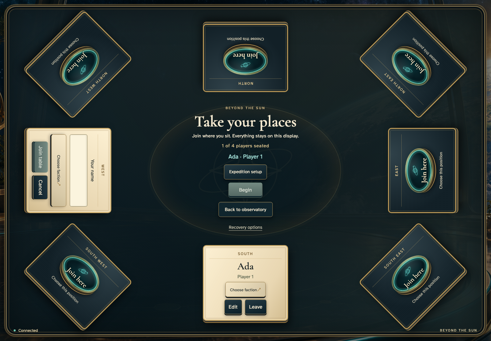](../../screenshots/manage-matching-supply-and-full-ore-yields-at-four-cardinal-seats/006-seat-1-editor-desktop-darwin.png) |

tabletop-4k · 3840 × 2160

[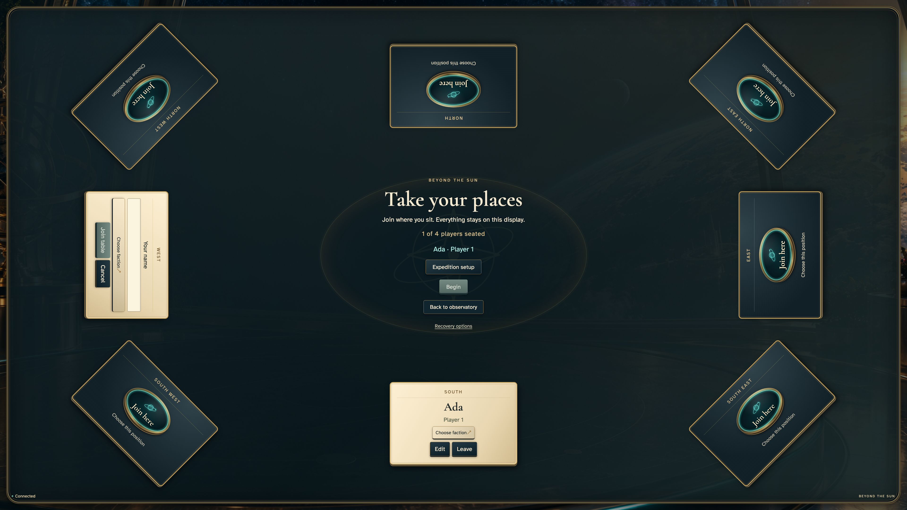](../../screenshots/manage-matching-supply-and-full-ore-yields-at-four-cardinal-seats/006-seat-1-editor-tabletop-4k-darwin.png)

- [x] Open the West seat on the shared surface
- [x] Canonical effects settle before capture.
- [x] Any printed Action plan is ready.
- [x] Public compact topology remains physically separated.
- [x] The gameplay shell fits the actual viewport.

## 8. Name the physical player Bora

Viewpoint: **Bora · West · one shared controller**.

| desktop · 1440 × 1000 |
| --- |
|  |

tabletop-4k · 3840 × 2160

- [x] Name the physical player Bora
- [x] Canonical effects settle before capture.
- [x] Any printed Action plan is ready.
- [x] Public compact topology remains physically separated.
- [x] The gameplay shell fits the actual viewport.

## 9. The local physical seat is retained on this controller

Viewpoint: **Bora · West · one shared controller**.

| desktop · 1440 × 1000 |
| --- |
|  |

tabletop-4k · 3840 × 2160

- [x] The local physical seat is retained on this controller
- [x] Canonical effects settle before capture.
- [x] Any printed Action plan is ready.
- [x] Public compact topology remains physically separated.
- [x] The gameplay shell fits the actual viewport.

## 10. Open the North seat on the shared surface

Viewpoint: **Cleo · North · one shared controller**.

| desktop · 1440 × 1000 |
| --- |
|  |

tabletop-4k · 3840 × 2160

- [x] Open the North seat on the shared surface
- [x] Canonical effects settle before capture.
- [x] Any printed Action plan is ready.
- [x] Public compact topology remains physically separated.
- [x] The gameplay shell fits the actual viewport.

## 11. Name the physical player Cleo

Viewpoint: **Cleo · North · one shared controller**.

| desktop · 1440 × 1000 |
| --- |
|  |

tabletop-4k · 3840 × 2160

- [x] Name the physical player Cleo
- [x] Canonical effects settle before capture.
- [x] Any printed Action plan is ready.
- [x] Public compact topology remains physically separated.
- [x] The gameplay shell fits the actual viewport.

## 12. The local physical seat is retained on this controller

Viewpoint: **Cleo · North · one shared controller**.

| desktop · 1440 × 1000 |
| --- |
|  |

tabletop-4k · 3840 × 2160

- [x] The local physical seat is retained on this controller
- [x] Canonical effects settle before capture.
- [x] Any printed Action plan is ready.
- [x] Public compact topology remains physically separated.
- [x] The gameplay shell fits the actual viewport.

## 13. Open the East seat on the shared surface

Viewpoint: **Dara · East · one shared controller**.

| desktop · 1440 × 1000 |
| --- |
|  |

tabletop-4k · 3840 × 2160

- [x] Open the East seat on the shared surface
- [x] Canonical effects settle before capture.
- [x] Any printed Action plan is ready.
- [x] Public compact topology remains physically separated.
- [x] The gameplay shell fits the actual viewport.

## 14. Name the physical player Dara

Viewpoint: **Dara · East · one shared controller**.

| desktop · 1440 × 1000 |
| --- |
|  |

tabletop-4k · 3840 × 2160

- [x] Name the physical player Dara
- [x] Canonical effects settle before capture.
- [x] Any printed Action plan is ready.
- [x] Public compact topology remains physically separated.
- [x] The gameplay shell fits the actual viewport.

## 15. The local physical seat is retained on this controller

Viewpoint: **Dara · East · one shared controller**.

| desktop · 1440 × 1000 |
| --- |
|  |

tabletop-4k · 3840 × 2160

- [x] The local physical seat is retained on this controller
- [x] Canonical effects settle before capture.
- [x] Any printed Action plan is ready.
- [x] Public compact topology remains physically separated.
- [x] The gameplay shell fits the actual viewport.

## 16. Ada chooses a legal unique Basic faction

Viewpoint: **Ada · South · one shared controller**.

| desktop · 1440 × 1000 |
| --- |
| [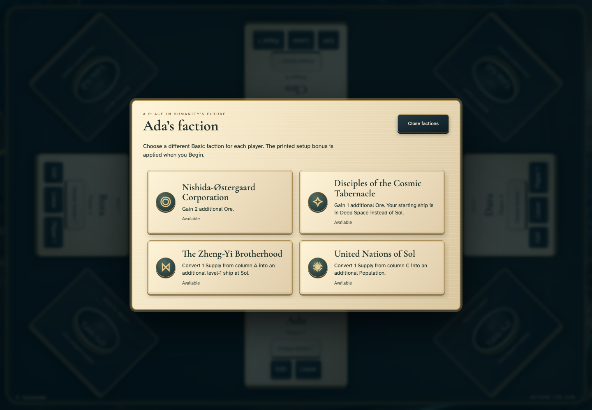](../../screenshots/manage-matching-supply-and-full-ore-yields-at-four-cardinal-seats/015-faction-0-editor-desktop-darwin.png) |

tabletop-4k · 3840 × 2160

[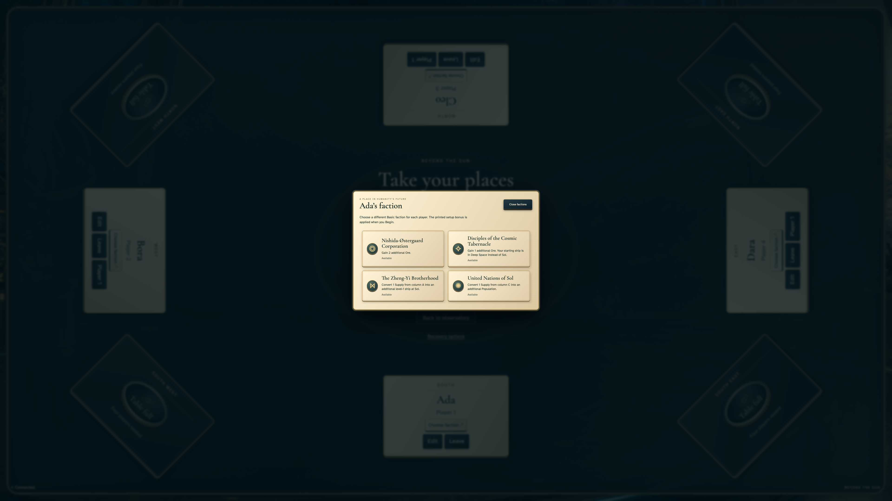](../../screenshots/manage-matching-supply-and-full-ore-yields-at-four-cardinal-seats/015-faction-0-editor-tabletop-4k-darwin.png)

- [x] Ada chooses a legal unique Basic faction
- [x] Canonical effects settle before capture.
- [x] Any printed Action plan is ready.
- [x] Public compact topology remains physically separated.
- [x] The gameplay shell fits the actual viewport.

## 17. Ada retains Nishida-Østergaard Corporation

Viewpoint: **Ada · South · one shared controller**.

| desktop · 1440 × 1000 |
| --- |
|  |

tabletop-4k · 3840 × 2160

[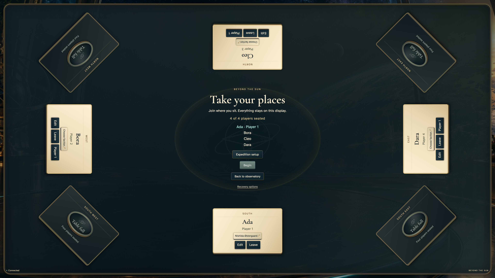](../../screenshots/manage-matching-supply-and-full-ore-yields-at-four-cardinal-seats/016-faction-0-chosen-tabletop-4k-darwin.png)

- [x] Ada retains Nishida-Østergaard Corporation
- [x] Canonical effects settle before capture.
- [x] Any printed Action plan is ready.
- [x] Public compact topology remains physically separated.
- [x] The gameplay shell fits the actual viewport.

## 18. Bora chooses a legal unique Basic faction

Viewpoint: **Bora · West · one shared controller**.

| desktop · 1440 × 1000 |
| --- |
|  |

tabletop-4k · 3840 × 2160

- [x] Bora chooses a legal unique Basic faction
- [x] Canonical effects settle before capture.
- [x] Any printed Action plan is ready.
- [x] Public compact topology remains physically separated.
- [x] The gameplay shell fits the actual viewport.

## 19. Bora retains The Zheng-Yi Brotherhood

Viewpoint: **Bora · West · one shared controller**.

| desktop · 1440 × 1000 |
| --- |
|  |

tabletop-4k · 3840 × 2160

- [x] Bora retains The Zheng-Yi Brotherhood
- [x] Canonical effects settle before capture.
- [x] Any printed Action plan is ready.
- [x] Public compact topology remains physically separated.
- [x] The gameplay shell fits the actual viewport.

## 20. Cleo chooses a legal unique Basic faction

Viewpoint: **Cleo · North · one shared controller**.

| desktop · 1440 × 1000 |
| --- |
|  |

tabletop-4k · 3840 × 2160

- [x] Cleo chooses a legal unique Basic faction
- [x] Canonical effects settle before capture.
- [x] Any printed Action plan is ready.
- [x] Public compact topology remains physically separated.
- [x] The gameplay shell fits the actual viewport.

## 21. Cleo retains Disciples of the Cosmic Tabernacle

Viewpoint: **Cleo · North · one shared controller**.

| desktop · 1440 × 1000 |
| --- |
| [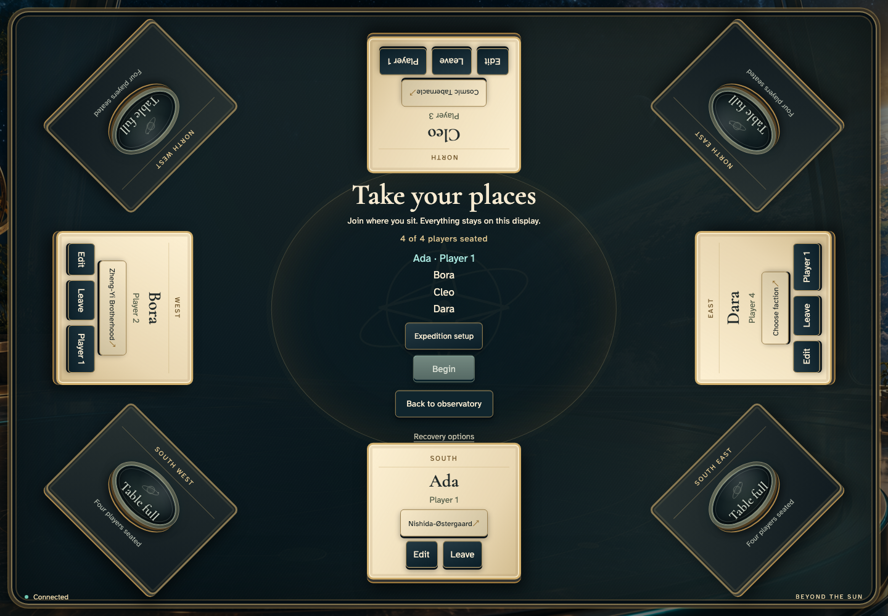](../../screenshots/manage-matching-supply-and-full-ore-yields-at-four-cardinal-seats/020-faction-2-chosen-desktop-darwin.png) |

tabletop-4k · 3840 × 2160

- [x] Cleo retains Disciples of the Cosmic Tabernacle
- [x] Canonical effects settle before capture.
- [x] Any printed Action plan is ready.
- [x] Public compact topology remains physically separated.
- [x] The gameplay shell fits the actual viewport.

## 22. Dara chooses a legal unique Basic faction

Viewpoint: **Dara · East · one shared controller**.

| desktop · 1440 × 1000 |
| --- |
|  |

tabletop-4k · 3840 × 2160

- [x] Dara chooses a legal unique Basic faction
- [x] Canonical effects settle before capture.
- [x] Any printed Action plan is ready.
- [x] Public compact topology remains physically separated.
- [x] The gameplay shell fits the actual viewport.

## 23. Dara retains United Nations of Sol

Viewpoint: **Dara · East · one shared controller**.

| desktop · 1440 × 1000 |
| --- |
|  |

tabletop-4k · 3840 × 2160

- [x] Dara retains United Nations of Sol
- [x] Canonical effects settle before capture.
- [x] Any printed Action plan is ready.
- [x] Public compact topology remains physically separated.
- [x] The gameplay shell fits the actual viewport.

## 24. Begin the immutable source-reviewed Basic setup through the ordinary UI

Viewpoint: **Ada · South · one shared controller**.

| desktop · 1440 × 1000 |
| --- |
|  |

tabletop-4k · 3840 × 2160

- [x] Begin the immutable source-reviewed Basic setup through the ordinary UI
- [x] Canonical effects settle before capture.
- [x] Any printed Action plan is ready.
- [x] Public compact topology remains physically separated.
- [x] The gameplay shell fits the actual viewport.

## 25. Ada opens the actual research and Action instrument

Viewpoint: **Ada · South · one shared controller**.

| desktop · 1440 × 1000 |
| --- |
|  |

tabletop-4k · 3840 × 2160

- [x] Ada opens the actual research and Action instrument
- [x] Canonical effects settle before capture.
- [x] Any printed Action plan is ready.
- [x] Public compact topology remains physically separated.
- [x] The gameplay shell fits the actual viewport.

## 26. Ada selects the legal printed space 1

Viewpoint: **Ada · South · one shared controller**.

| desktop · 1440 × 1000 |
| --- |
| [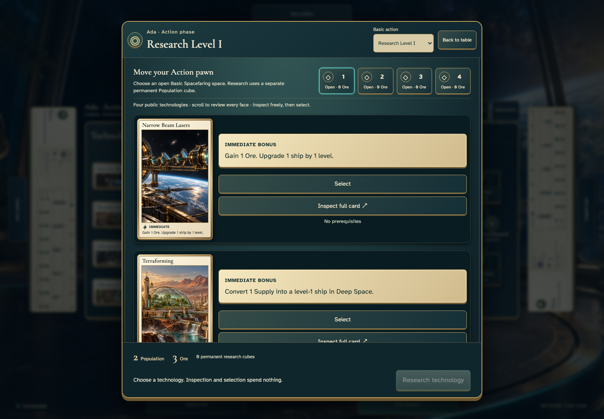](../../screenshots/manage-matching-supply-and-full-ore-yields-at-four-cardinal-seats/025-r0-ada-space-desktop-darwin.png) |

tabletop-4k · 3840 × 2160

- [x] Ada selects the legal printed space 1
- [x] Canonical effects settle before capture.
- [x] Any printed Action plan is ready.
- [x] Public compact topology remains physically separated.
- [x] The gameplay shell fits the actual viewport.

## 27. Select Advanced Genetics with its printed cost and consequence

Viewpoint: **Ada · South · one shared controller**.

| desktop · 1440 × 1000 |
| --- |
|  |

tabletop-4k · 3840 × 2160

- [x] Select Advanced Genetics with its printed cost and consequence
- [x] Canonical effects settle before capture.
- [x] Any printed Action plan is ready.
- [x] Public compact topology remains physically separated.
- [x] The gameplay shell fits the actual viewport.

## 28. Pay once and receive Advanced Genetics's immediate bonus

Viewpoint: **Ada · South · one shared controller**.

| desktop · 1440 × 1000 |
| --- |
|  |

tabletop-4k · 3840 × 2160

- [x] Pay once and receive Advanced Genetics's immediate bonus
- [x] Canonical effects settle before capture.
- [x] Any printed Action plan is ready.
- [x] Public compact topology remains physically separated.
- [x] The gameplay shell fits the actual viewport.

## 29. Ada completes production and hands off to Bora

Viewpoint: **Ada · South · one shared controller**.

| desktop · 1440 × 1000 |
| --- |
|  |

tabletop-4k · 3840 × 2160

- [x] Ada completes production and hands off to Bora
- [x] Canonical effects settle before capture.
- [x] Any printed Action plan is ready.
- [x] Public compact topology remains physically separated.
- [x] The gameplay shell fits the actual viewport.

## 30. Bora opens the actual research and Action instrument

Viewpoint: **Bora · West · one shared controller**.

| desktop · 1440 × 1000 |
| --- |
|  |

tabletop-4k · 3840 × 2160

- [x] Bora opens the actual research and Action instrument
- [x] Canonical effects settle before capture.
- [x] Any printed Action plan is ready.
- [x] Public compact topology remains physically separated.
- [x] The gameplay shell fits the actual viewport.

## 31. Bora selects ordinary gathering

Viewpoint: **Bora · West · one shared controller**.

| desktop · 1440 × 1000 |
| --- |
|  |

tabletop-4k · 3840 × 2160

[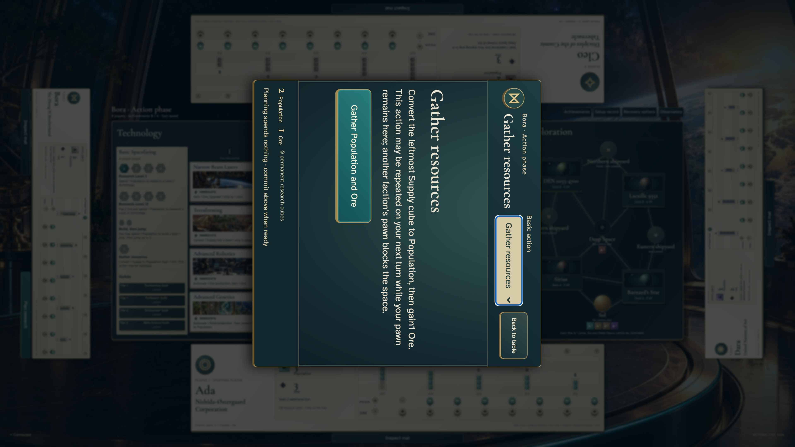](../../screenshots/manage-matching-supply-and-full-ore-yields-at-four-cardinal-seats/030-r0-bora-kind-tabletop-4k-darwin.png)

- [x] Bora selects ordinary gathering
- [x] Canonical effects settle before capture.
- [x] Any printed Action plan is ready.
- [x] Public compact topology remains physically separated.
- [x] The gameplay shell fits the actual viewport.

## 32. Receive the printed gather resources before ordinary production

Viewpoint: **Bora · West · one shared controller**.

| desktop · 1440 × 1000 |
| --- |
| [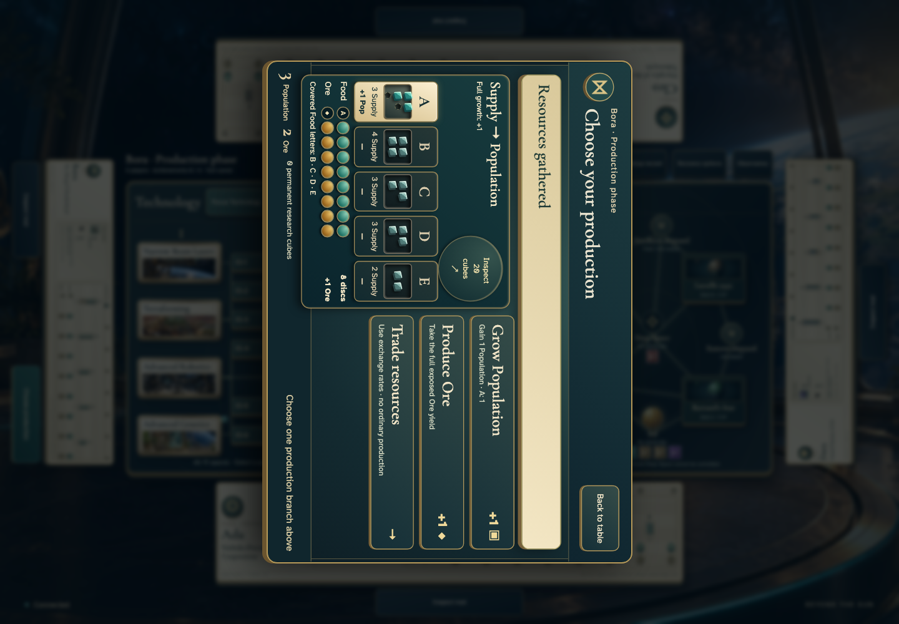](../../screenshots/manage-matching-supply-and-full-ore-yields-at-four-cardinal-seats/031-r0-bora-gathered-desktop-darwin.png) |

tabletop-4k · 3840 × 2160

- [x] Receive the printed gather resources before ordinary production
- [x] Canonical effects settle before capture.
- [x] Any printed Action plan is ready.
- [x] Public compact topology remains physically separated.
- [x] The gameplay shell fits the actual viewport.

## 33. Bora completes production and hands off to Cleo

Viewpoint: **Bora · West · one shared controller**.

| desktop · 1440 × 1000 |
| --- |
| [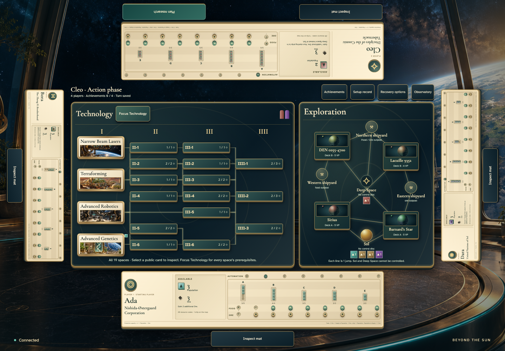](../../screenshots/manage-matching-supply-and-full-ore-yields-at-four-cardinal-seats/032-r0-bora-handoff-desktop-darwin.png) |

tabletop-4k · 3840 × 2160

- [x] Bora completes production and hands off to Cleo
- [x] Canonical effects settle before capture.
- [x] Any printed Action plan is ready.
- [x] Public compact topology remains physically separated.
- [x] The gameplay shell fits the actual viewport.

## 34. Cleo opens the actual research and Action instrument

Viewpoint: **Cleo · North · one shared controller**.

| desktop · 1440 × 1000 |
| --- |
| [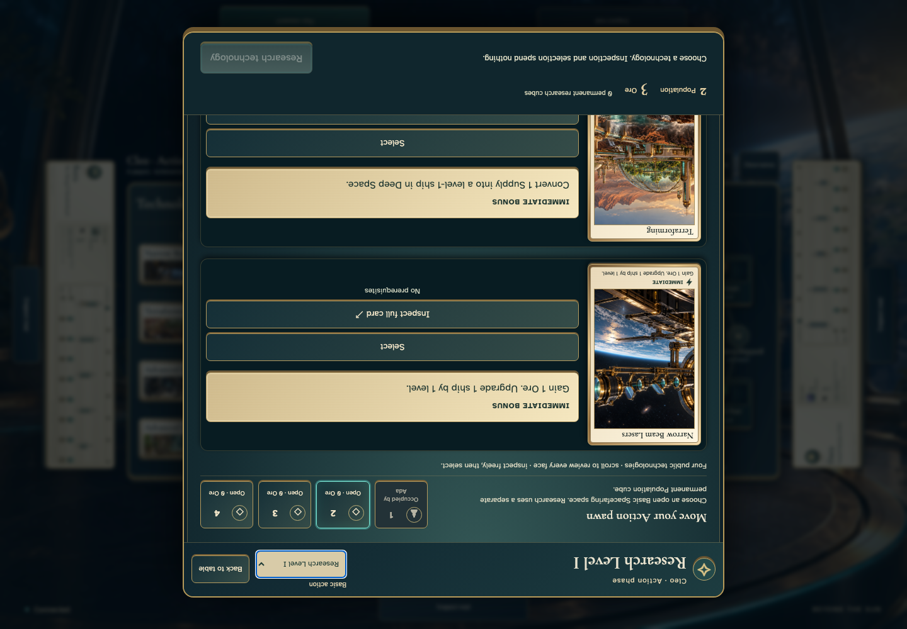](../../screenshots/manage-matching-supply-and-full-ore-yields-at-four-cardinal-seats/033-r0-cleo-plan-desktop-darwin.png) |

tabletop-4k · 3840 × 2160

- [x] Cleo opens the actual research and Action instrument
- [x] Canonical effects settle before capture.
- [x] Any printed Action plan is ready.
- [x] Public compact topology remains physically separated.
- [x] The gameplay shell fits the actual viewport.

## 35. Cleo selects the legal printed space 2

Viewpoint: **Cleo · North · one shared controller**.

| desktop · 1440 × 1000 |
| --- |
| [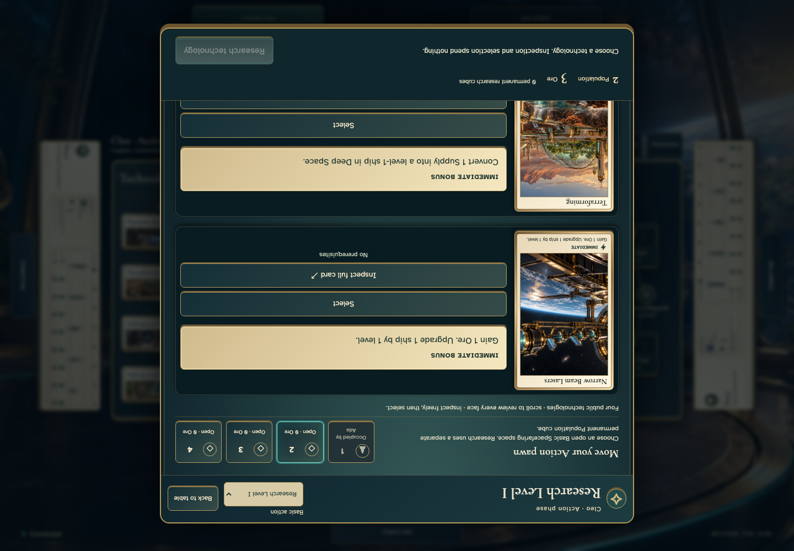](../../screenshots/manage-matching-supply-and-full-ore-yields-at-four-cardinal-seats/034-r0-cleo-space-desktop-darwin.png) |

tabletop-4k · 3840 × 2160

- [x] Cleo selects the legal printed space 2
- [x] Canonical effects settle before capture.
- [x] Any printed Action plan is ready.
- [x] Public compact topology remains physically separated.
- [x] The gameplay shell fits the actual viewport.

## 36. Select Terraforming with its printed cost and consequence

Viewpoint: **Cleo · North · one shared controller**.

| desktop · 1440 × 1000 |
| --- |
| [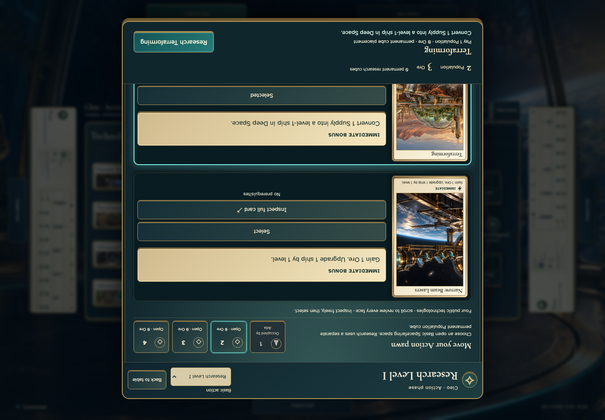](../../screenshots/manage-matching-supply-and-full-ore-yields-at-four-cardinal-seats/035-r0-cleo-card-desktop-darwin.png) |

tabletop-4k · 3840 × 2160

[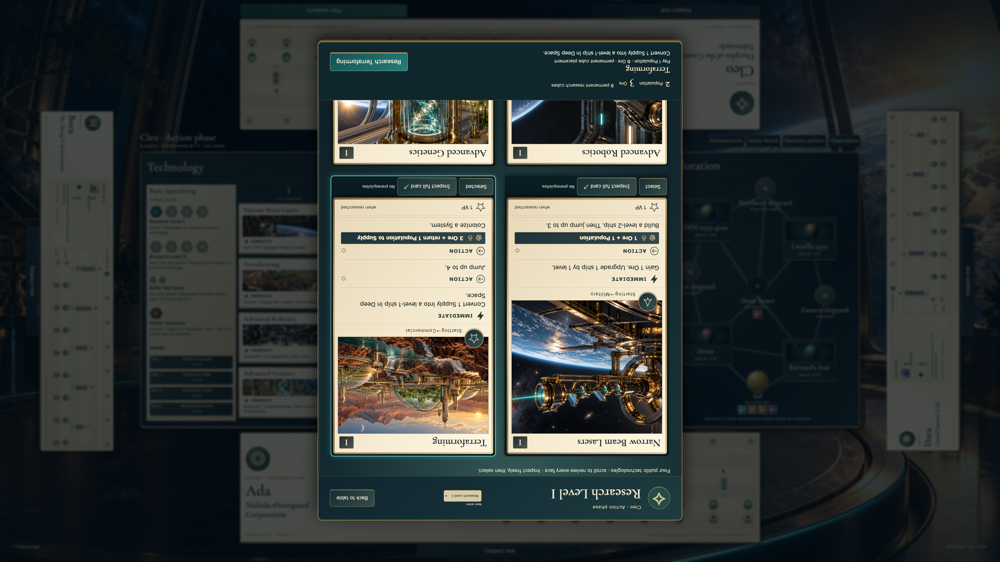](../../screenshots/manage-matching-supply-and-full-ore-yields-at-four-cardinal-seats/035-r0-cleo-card-tabletop-4k-darwin.png)

- [x] Select Terraforming with its printed cost and consequence
- [x] Canonical effects settle before capture.
- [x] Any printed Action plan is ready.
- [x] Public compact topology remains physically separated.
- [x] The gameplay shell fits the actual viewport.

## 37. Pay once and receive Terraforming's immediate bonus

Viewpoint: **Cleo · North · one shared controller**.

| desktop · 1440 × 1000 |
| --- |
| [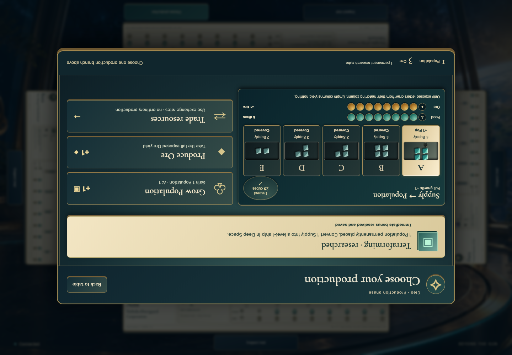](../../screenshots/manage-matching-supply-and-full-ore-yields-at-four-cardinal-seats/036-r0-cleo-researched-desktop-darwin.png) |

tabletop-4k · 3840 × 2160

[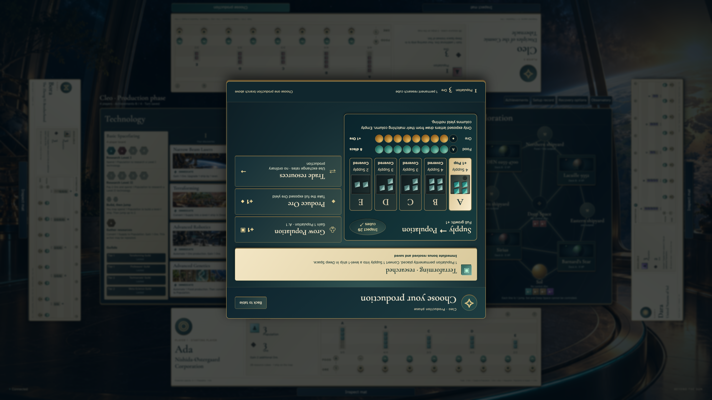](../../screenshots/manage-matching-supply-and-full-ore-yields-at-four-cardinal-seats/036-r0-cleo-researched-tabletop-4k-darwin.png)

- [x] Pay once and receive Terraforming's immediate bonus
- [x] Canonical effects settle before capture.
- [x] Any printed Action plan is ready.
- [x] Public compact topology remains physically separated.
- [x] The gameplay shell fits the actual viewport.

## 38. Cleo completes production and hands off to Dara

Viewpoint: **Cleo · North · one shared controller**.

| desktop · 1440 × 1000 |
| --- |
| [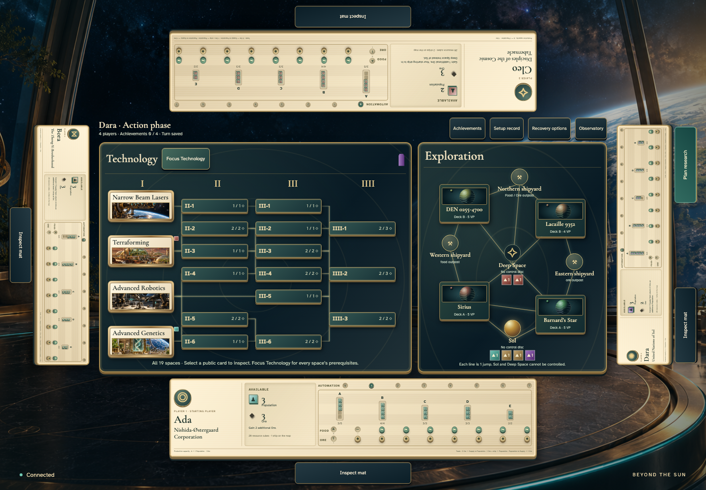](../../screenshots/manage-matching-supply-and-full-ore-yields-at-four-cardinal-seats/037-r0-cleo-handoff-desktop-darwin.png) |

tabletop-4k · 3840 × 2160

[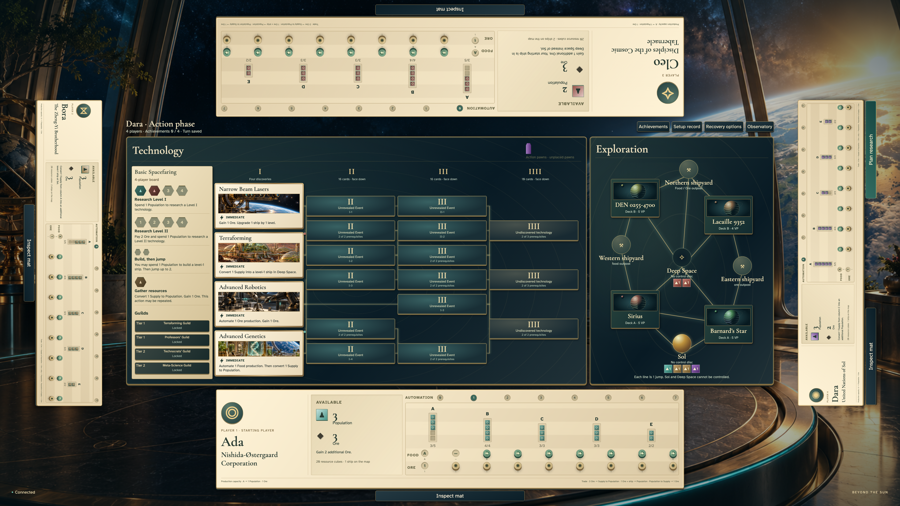](../../screenshots/manage-matching-supply-and-full-ore-yields-at-four-cardinal-seats/037-r0-cleo-handoff-tabletop-4k-darwin.png)

- [x] Cleo completes production and hands off to Dara
- [x] Canonical effects settle before capture.
- [x] Any printed Action plan is ready.
- [x] Public compact topology remains physically separated.
- [x] The gameplay shell fits the actual viewport.

## 39. Dara opens the actual research and Action instrument

Viewpoint: **Dara · East · one shared controller**.

| desktop · 1440 × 1000 |
| --- |
| [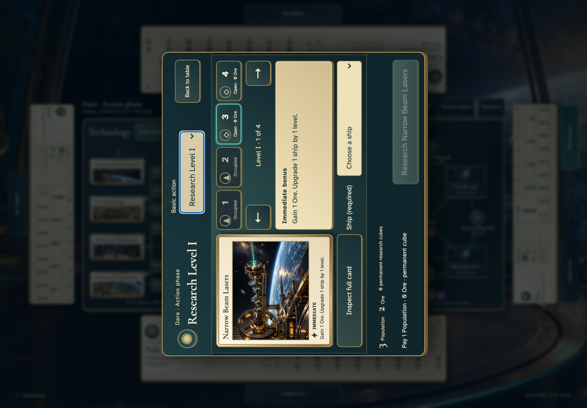](../../screenshots/manage-matching-supply-and-full-ore-yields-at-four-cardinal-seats/038-r0-dara-plan-desktop-darwin.png) |

tabletop-4k · 3840 × 2160

[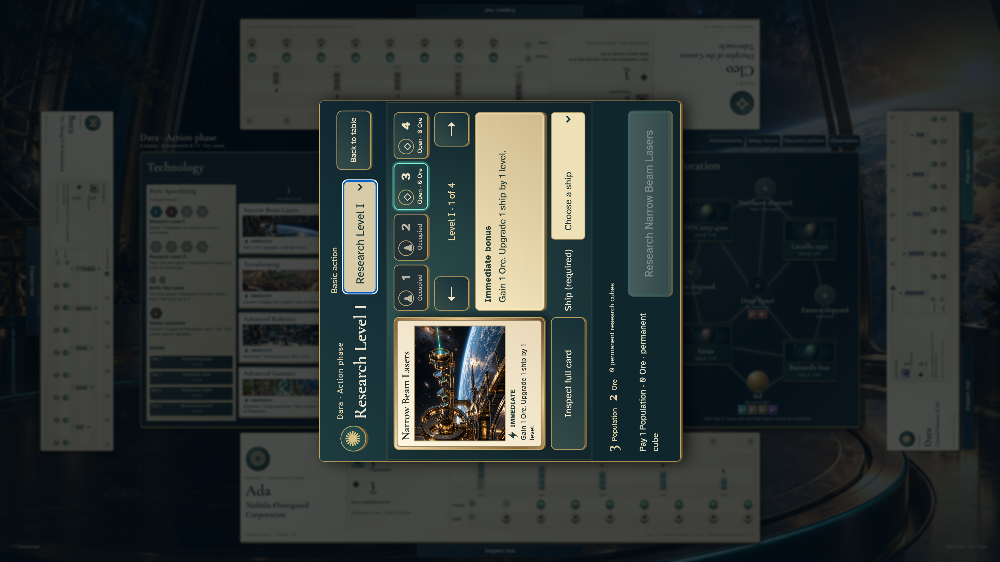](../../screenshots/manage-matching-supply-and-full-ore-yields-at-four-cardinal-seats/038-r0-dara-plan-tabletop-4k-darwin.png)

- [x] Dara opens the actual research and Action instrument
- [x] Canonical effects settle before capture.
- [x] Any printed Action plan is ready.
- [x] Public compact topology remains physically separated.
- [x] The gameplay shell fits the actual viewport.

## 40. Dara selects the legal printed space 3

Viewpoint: **Dara · East · one shared controller**.

| desktop · 1440 × 1000 |
| --- |
| [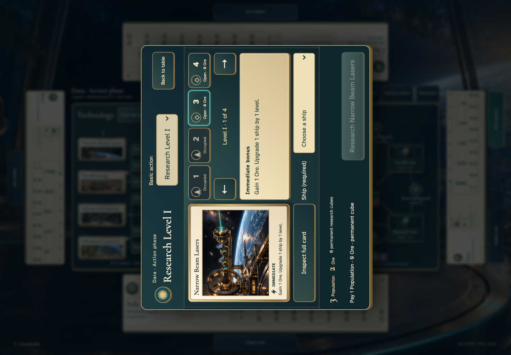](../../screenshots/manage-matching-supply-and-full-ore-yields-at-four-cardinal-seats/039-r0-dara-space-desktop-darwin.png) |

tabletop-4k · 3840 × 2160

[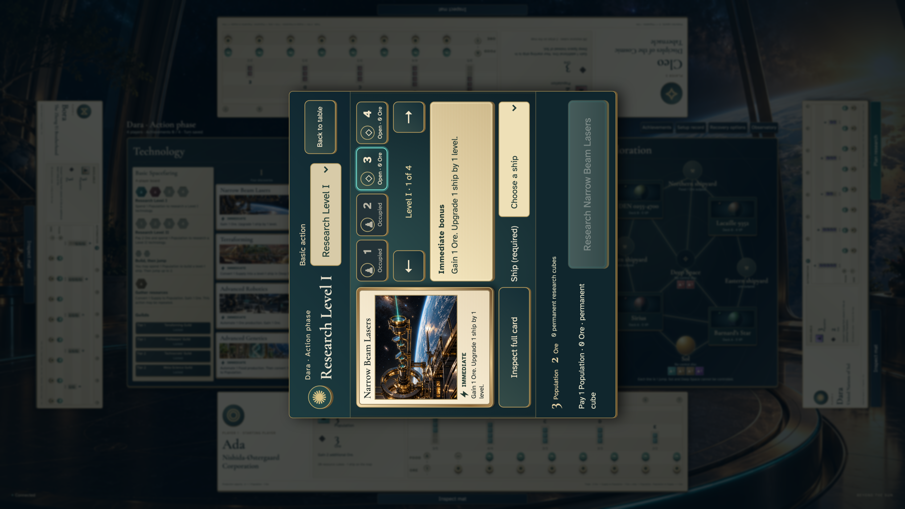](../../screenshots/manage-matching-supply-and-full-ore-yields-at-four-cardinal-seats/039-r0-dara-space-tabletop-4k-darwin.png)

- [x] Dara selects the legal printed space 3
- [x] Canonical effects settle before capture.
- [x] Any printed Action plan is ready.
- [x] Public compact topology remains physically separated.
- [x] The gameplay shell fits the actual viewport.

## 41. Browse the next public Level I face

Viewpoint: **Dara · East · one shared controller**.

| desktop · 1440 × 1000 |
| --- |
|  |

tabletop-4k · 3840 × 2160

- [x] Browse the next public Level I face
- [x] Canonical effects settle before capture.
- [x] Any printed Action plan is ready.
- [x] Public compact topology remains physically separated.
- [x] The gameplay shell fits the actual viewport.

## 42. Browse the next public Level I face

Viewpoint: **Dara · East · one shared controller**.

| desktop · 1440 × 1000 |
| --- |
| [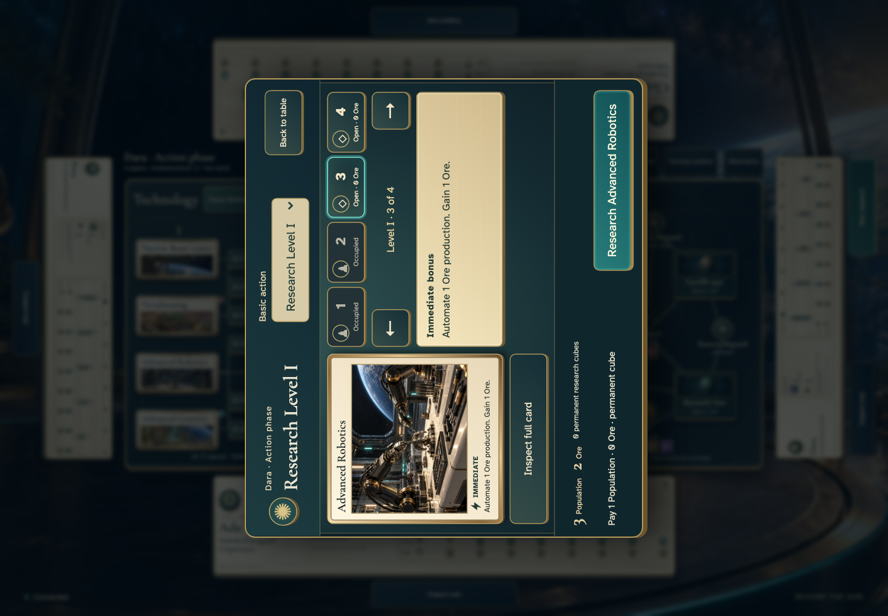](../../screenshots/manage-matching-supply-and-full-ore-yields-at-four-cardinal-seats/041-r0-dara-browse-1-desktop-darwin.png) |

tabletop-4k · 3840 × 2160

- [x] Browse the next public Level I face
- [x] Canonical effects settle before capture.
- [x] Any printed Action plan is ready.
- [x] Public compact topology remains physically separated.
- [x] The gameplay shell fits the actual viewport.

## 43. Browse the next public Level I face

Viewpoint: **Dara · East · one shared controller**.

| desktop · 1440 × 1000 |
| --- |
| [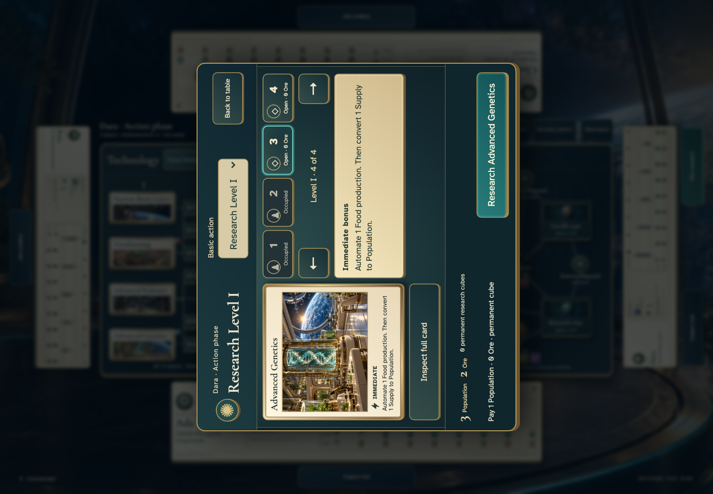](../../screenshots/manage-matching-supply-and-full-ore-yields-at-four-cardinal-seats/042-r0-dara-browse-2-desktop-darwin.png) |

tabletop-4k · 3840 × 2160

[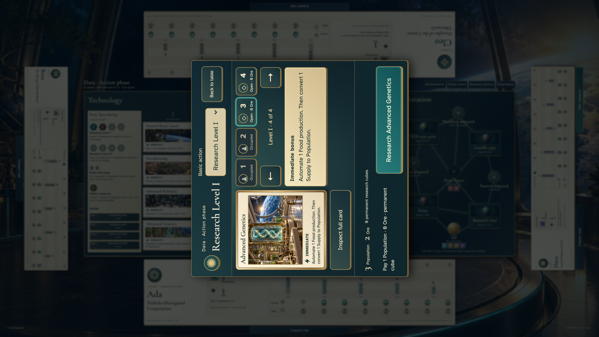](../../screenshots/manage-matching-supply-and-full-ore-yields-at-four-cardinal-seats/042-r0-dara-browse-2-tabletop-4k-darwin.png)

- [x] Browse the next public Level I face
- [x] Canonical effects settle before capture.
- [x] Any printed Action plan is ready.
- [x] Public compact topology remains physically separated.
- [x] The gameplay shell fits the actual viewport.

## 44. Pay once and receive Advanced Genetics's immediate bonus

Viewpoint: **Dara · East · one shared controller**.

| desktop · 1440 × 1000 |
| --- |
| [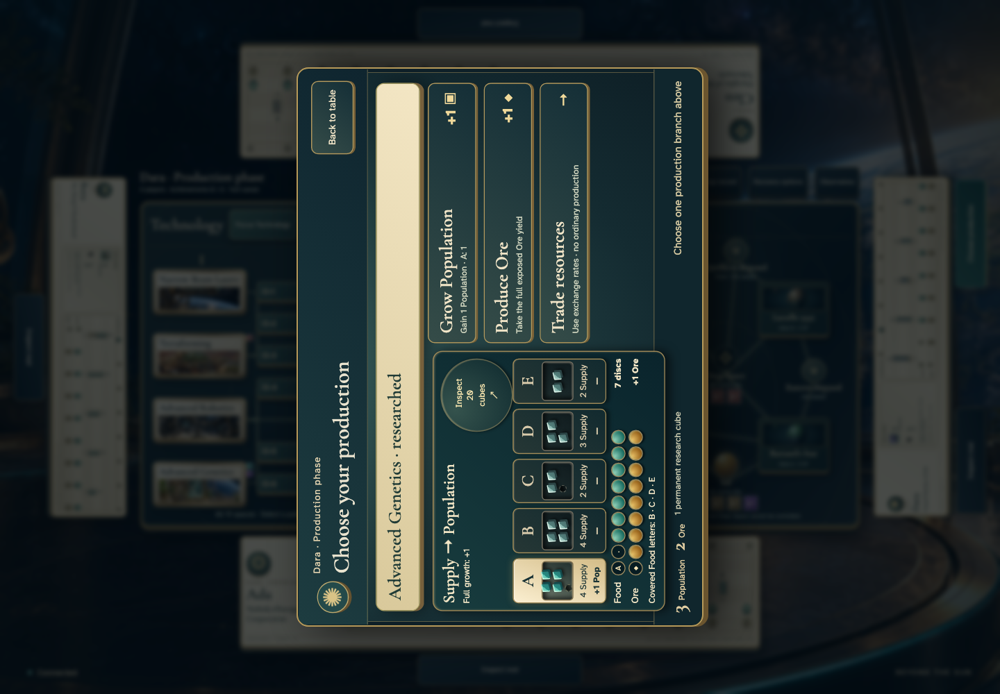](../../screenshots/manage-matching-supply-and-full-ore-yields-at-four-cardinal-seats/043-r0-dara-researched-desktop-darwin.png) |

tabletop-4k · 3840 × 2160

[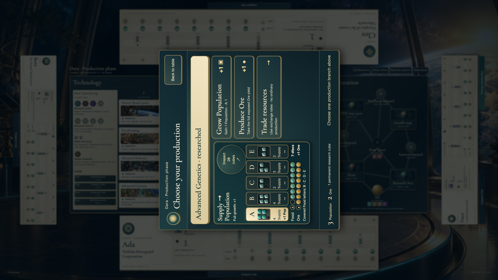](../../screenshots/manage-matching-supply-and-full-ore-yields-at-four-cardinal-seats/043-r0-dara-researched-tabletop-4k-darwin.png)

- [x] Pay once and receive Advanced Genetics's immediate bonus
- [x] Canonical effects settle before capture.
- [x] Any printed Action plan is ready.
- [x] Public compact topology remains physically separated.
- [x] The gameplay shell fits the actual viewport.

## 45. Dara completes production and hands off to Ada

Viewpoint: **Dara · East · one shared controller**.

| desktop · 1440 × 1000 |
| --- |
| [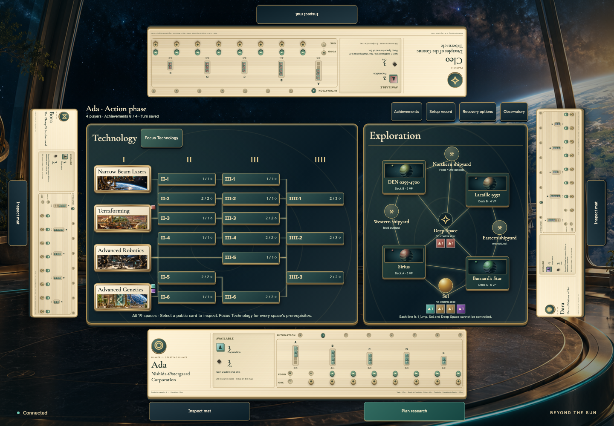](../../screenshots/manage-matching-supply-and-full-ore-yields-at-four-cardinal-seats/044-r0-dara-handoff-desktop-darwin.png) |

tabletop-4k · 3840 × 2160

[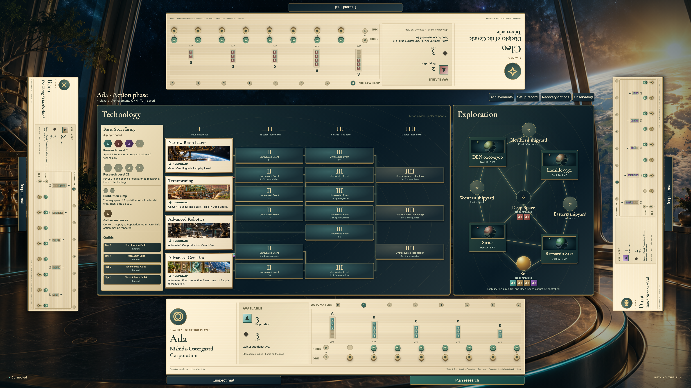](../../screenshots/manage-matching-supply-and-full-ore-yields-at-four-cardinal-seats/044-r0-dara-handoff-tabletop-4k-darwin.png)

- [x] Dara completes production and hands off to Ada
- [x] Canonical effects settle before capture.
- [x] Any printed Action plan is ready.
- [x] Public compact topology remains physically separated.
- [x] The gameplay shell fits the actual viewport.

## 46. Ada opens the actual research and Action instrument

Viewpoint: **Ada · South · one shared controller**.

| desktop · 1440 × 1000 |
| --- |
|  |

tabletop-4k · 3840 × 2160

- [x] Ada opens the actual research and Action instrument
- [x] Canonical effects settle before capture.
- [x] Any printed Action plan is ready.
- [x] Public compact topology remains physically separated.
- [x] The gameplay shell fits the actual viewport.

## 47. Ada selects the legal printed space 4

Viewpoint: **Ada · South · one shared controller**.

| desktop · 1440 × 1000 |
| --- |
|  |

tabletop-4k · 3840 × 2160

- [x] Ada selects the legal printed space 4
- [x] Canonical effects settle before capture.
- [x] Any printed Action plan is ready.
- [x] Public compact topology remains physically separated.
- [x] The gameplay shell fits the actual viewport.

## 48. Select Narrow Beam Lasers with its printed cost and consequence

Viewpoint: **Ada · South · one shared controller**.

| desktop · 1440 × 1000 |
| --- |
| [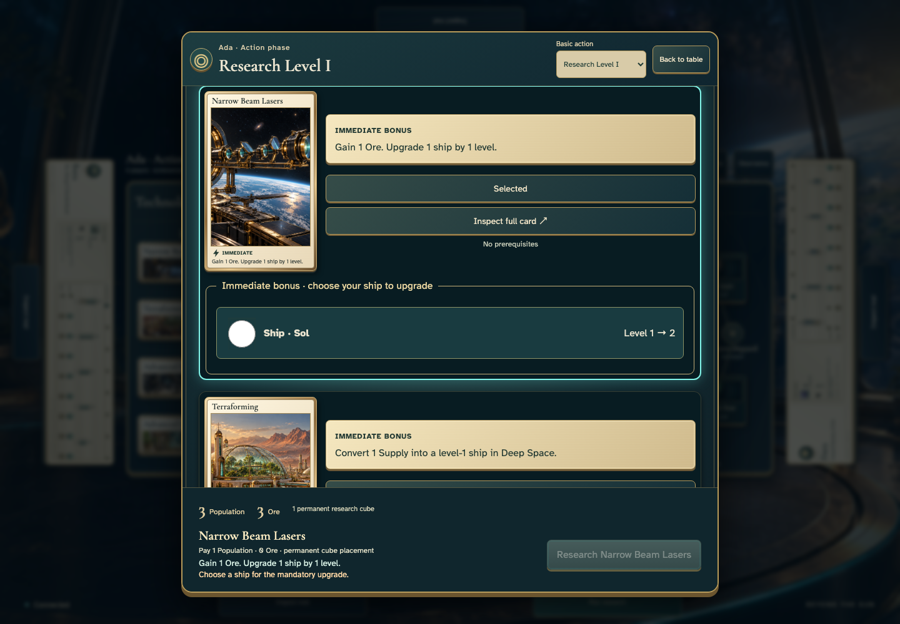](../../screenshots/manage-matching-supply-and-full-ore-yields-at-four-cardinal-seats/047-r1-ada-card-desktop-darwin.png) |

tabletop-4k · 3840 × 2160

[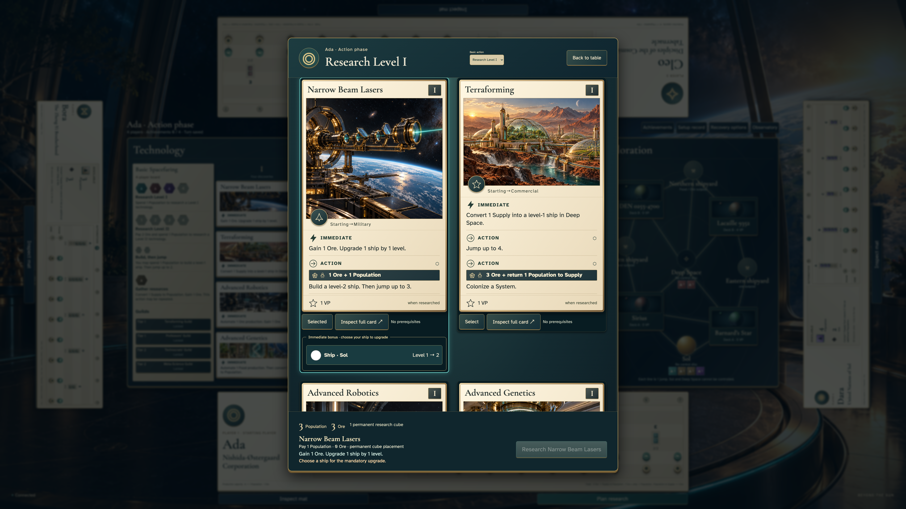](../../screenshots/manage-matching-supply-and-full-ore-yields-at-four-cardinal-seats/047-r1-ada-card-tabletop-4k-darwin.png)

- [x] Select Narrow Beam Lasers with its printed cost and consequence
- [x] Canonical effects settle before capture.
- [x] Any printed Action plan is ready.
- [x] Public compact topology remains physically separated.
- [x] The gameplay shell fits the actual viewport.

## 49. The immediate bonus requires an explicit owned target

Viewpoint: **Ada · South · one shared controller**.

| desktop · 1440 × 1000 |
| --- |
|  |

tabletop-4k · 3840 × 2160

- [x] The immediate bonus requires an explicit owned target
- [x] Canonical effects settle before capture.
- [x] Any printed Action plan is ready.
- [x] Public compact topology remains physically separated.
- [x] The gameplay shell fits the actual viewport.

## 50. Choose the original Sol ship for the one-level upgrade

Viewpoint: **Ada · South · one shared controller**.

| desktop · 1440 × 1000 |
| --- |
| [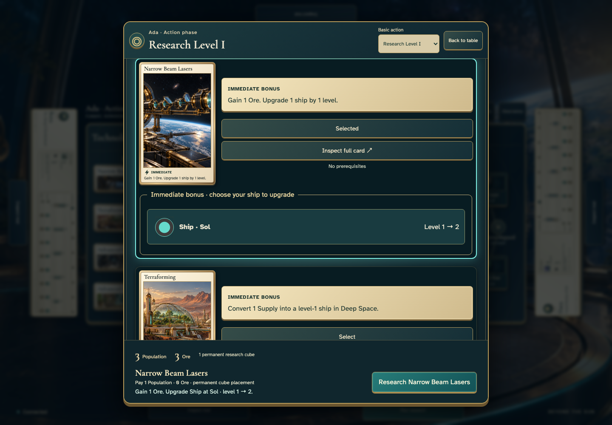](../../screenshots/manage-matching-supply-and-full-ore-yields-at-four-cardinal-seats/049-r1-ada-ship-desktop-darwin.png) |

tabletop-4k · 3840 × 2160

- [x] Choose the original Sol ship for the one-level upgrade
- [x] Canonical effects settle before capture.
- [x] Any printed Action plan is ready.
- [x] Public compact topology remains physically separated.
- [x] The gameplay shell fits the actual viewport.

## 51. Pay once and receive Narrow Beam Lasers's immediate bonus

Viewpoint: **Ada · South · one shared controller**.

| desktop · 1440 × 1000 |
| --- |
|  |

tabletop-4k · 3840 × 2160

[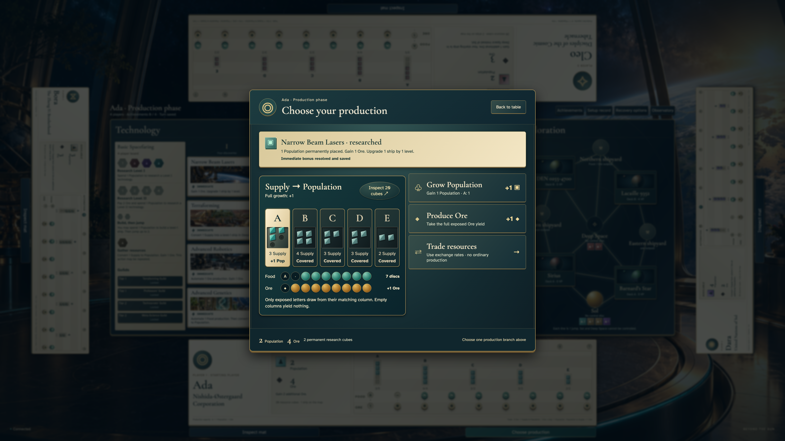](../../screenshots/manage-matching-supply-and-full-ore-yields-at-four-cardinal-seats/050-r1-ada-researched-tabletop-4k-darwin.png)

- [x] Pay once and receive Narrow Beam Lasers's immediate bonus
- [x] Canonical effects settle before capture.
- [x] Any printed Action plan is ready.
- [x] Public compact topology remains physically separated.
- [x] The gameplay shell fits the actual viewport.

## 52. Ada completes production and hands off to Bora

Viewpoint: **Ada · South · one shared controller**.

| desktop · 1440 × 1000 |
| --- |
| [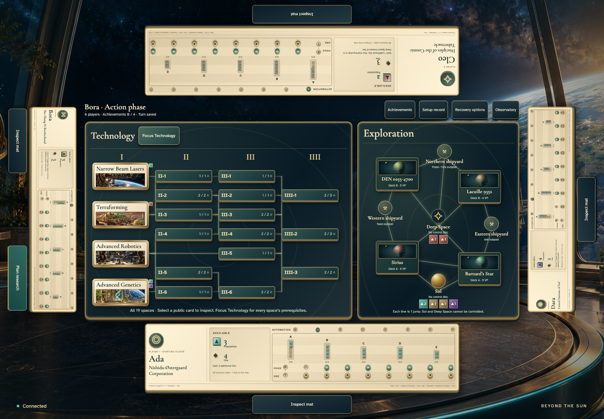](../../screenshots/manage-matching-supply-and-full-ore-yields-at-four-cardinal-seats/051-r1-ada-handoff-desktop-darwin.png) |

tabletop-4k · 3840 × 2160

[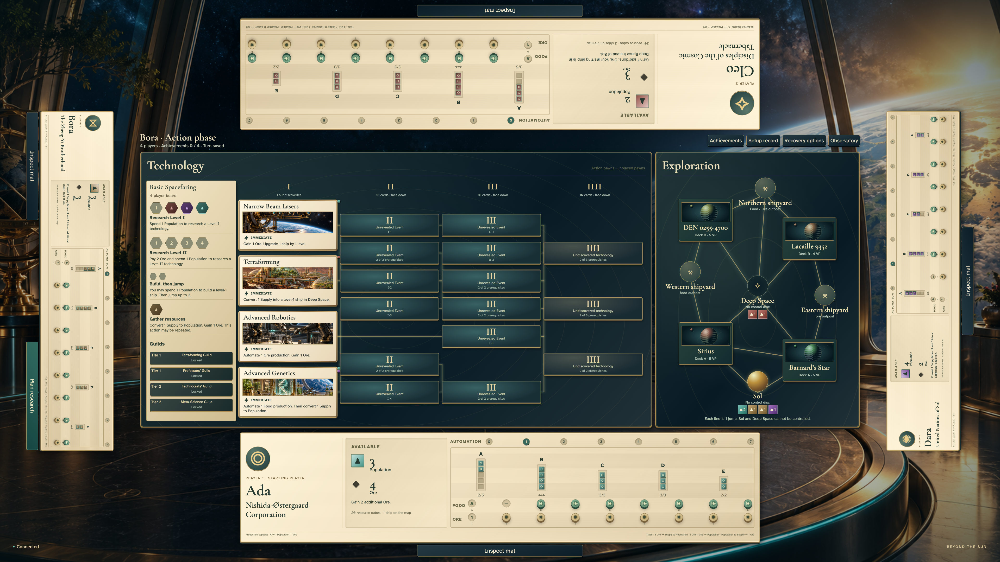](../../screenshots/manage-matching-supply-and-full-ore-yields-at-four-cardinal-seats/051-r1-ada-handoff-tabletop-4k-darwin.png)

- [x] Ada completes production and hands off to Bora
- [x] Canonical effects settle before capture.
- [x] Any printed Action plan is ready.
- [x] Public compact topology remains physically separated.
- [x] The gameplay shell fits the actual viewport.

## 53. Bora opens the actual research and Action instrument

Viewpoint: **Bora · West · one shared controller**.

| desktop · 1440 × 1000 |
| --- |
| [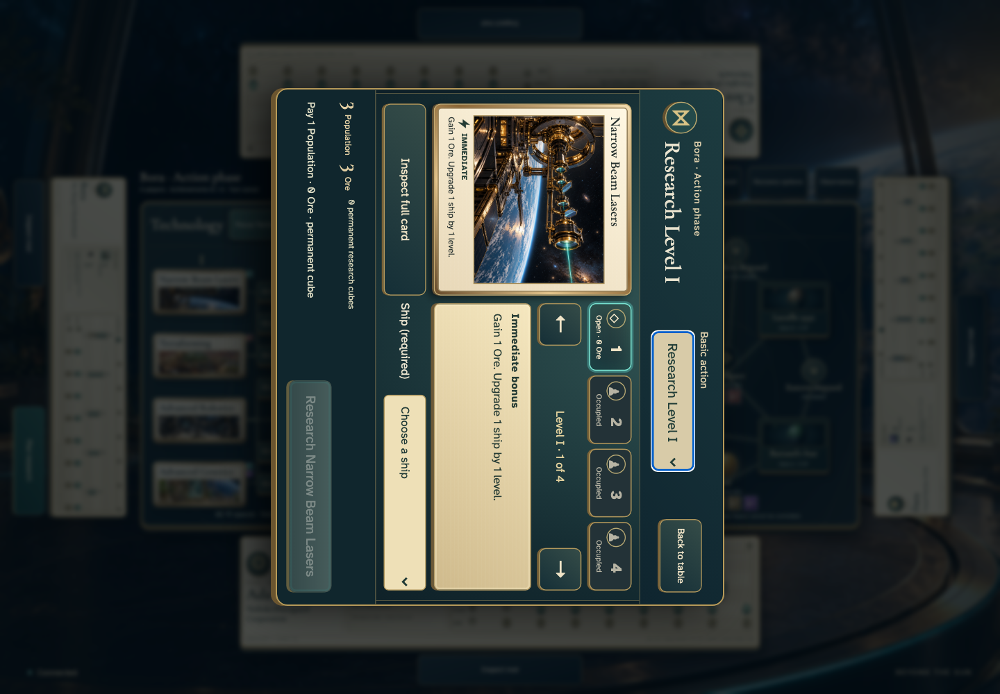](../../screenshots/manage-matching-supply-and-full-ore-yields-at-four-cardinal-seats/052-r1-bora-plan-desktop-darwin.png) |

tabletop-4k · 3840 × 2160

- [x] Bora opens the actual research and Action instrument
- [x] Canonical effects settle before capture.
- [x] Any printed Action plan is ready.
- [x] Public compact topology remains physically separated.
- [x] The gameplay shell fits the actual viewport.

## 54. Bora selects the legal printed space 1

Viewpoint: **Bora · West · one shared controller**.

| desktop · 1440 × 1000 |
| --- |
|  |

tabletop-4k · 3840 × 2160

[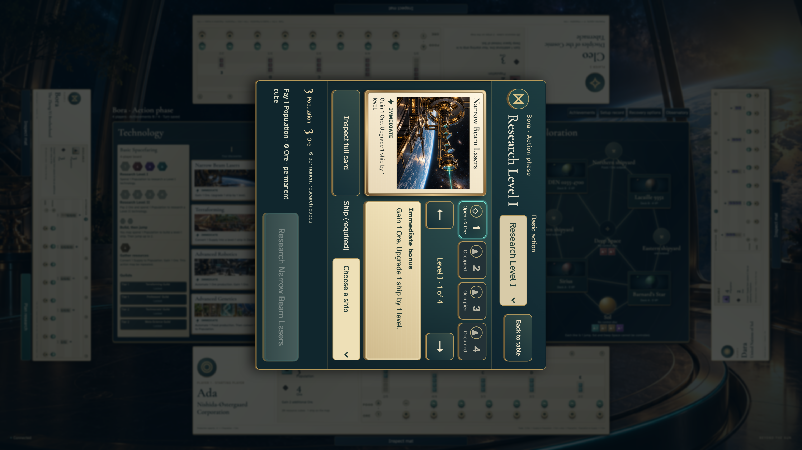](../../screenshots/manage-matching-supply-and-full-ore-yields-at-four-cardinal-seats/053-r1-bora-space-tabletop-4k-darwin.png)

- [x] Bora selects the legal printed space 1
- [x] Canonical effects settle before capture.
- [x] Any printed Action plan is ready.
- [x] Public compact topology remains physically separated.
- [x] The gameplay shell fits the actual viewport.

## 55. Browse the next public Level I face

Viewpoint: **Bora · West · one shared controller**.

| desktop · 1440 × 1000 |
| --- |
| [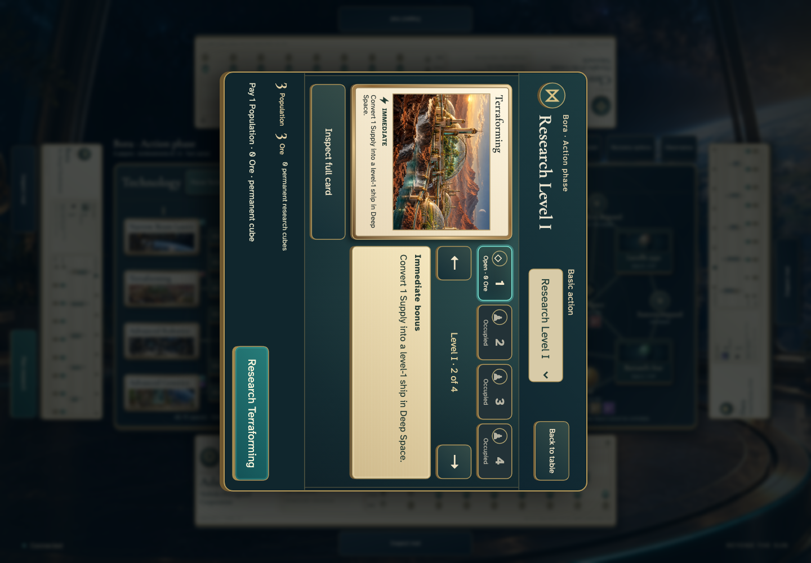](../../screenshots/manage-matching-supply-and-full-ore-yields-at-four-cardinal-seats/054-r1-bora-browse-0-desktop-darwin.png) |

tabletop-4k · 3840 × 2160

[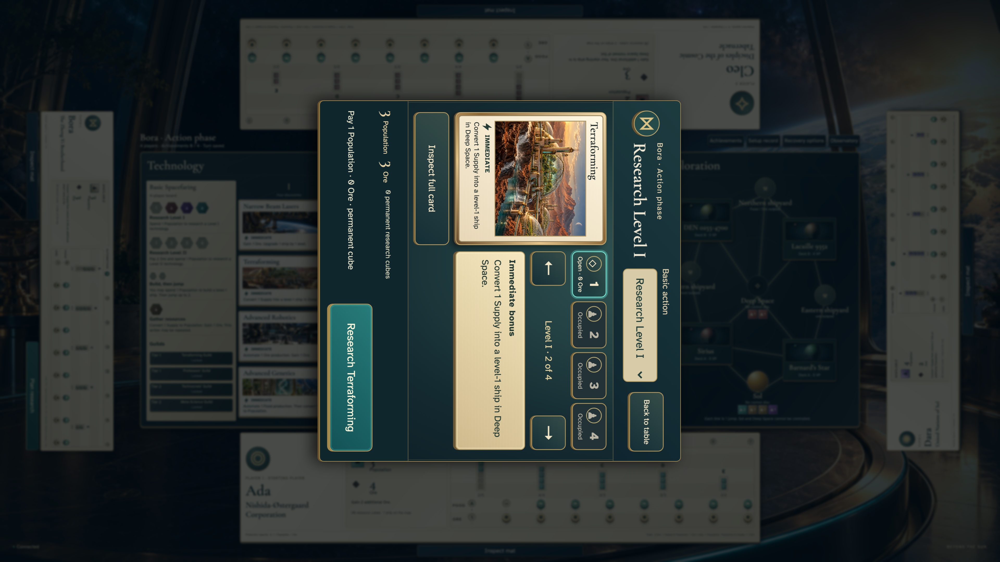](../../screenshots/manage-matching-supply-and-full-ore-yields-at-four-cardinal-seats/054-r1-bora-browse-0-tabletop-4k-darwin.png)

- [x] Browse the next public Level I face
- [x] Canonical effects settle before capture.
- [x] Any printed Action plan is ready.
- [x] Public compact topology remains physically separated.
- [x] The gameplay shell fits the actual viewport.

## 56. Browse the next public Level I face

Viewpoint: **Bora · West · one shared controller**.

| desktop · 1440 × 1000 |
| --- |
| [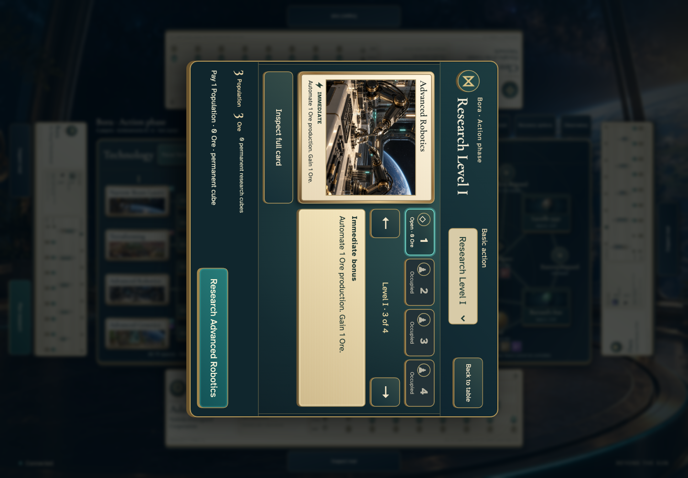](../../screenshots/manage-matching-supply-and-full-ore-yields-at-four-cardinal-seats/055-r1-bora-browse-1-desktop-darwin.png) |

tabletop-4k · 3840 × 2160

[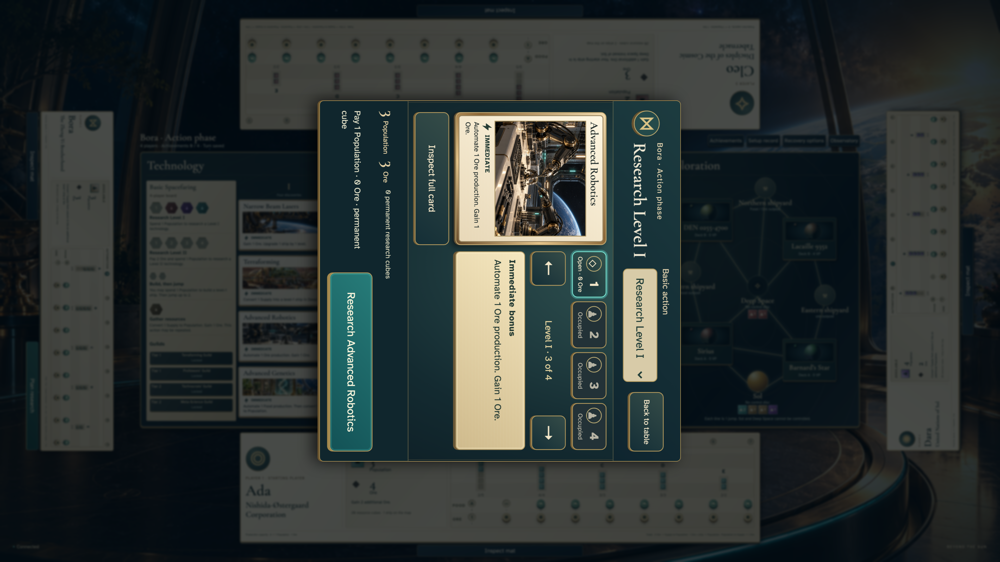](../../screenshots/manage-matching-supply-and-full-ore-yields-at-four-cardinal-seats/055-r1-bora-browse-1-tabletop-4k-darwin.png)

- [x] Browse the next public Level I face
- [x] Canonical effects settle before capture.
- [x] Any printed Action plan is ready.
- [x] Public compact topology remains physically separated.
- [x] The gameplay shell fits the actual viewport.

## 57. Pay once and receive Advanced Robotics's immediate bonus

Viewpoint: **Bora · West · one shared controller**.

| desktop · 1440 × 1000 |
| --- |
|  |

tabletop-4k · 3840 × 2160

[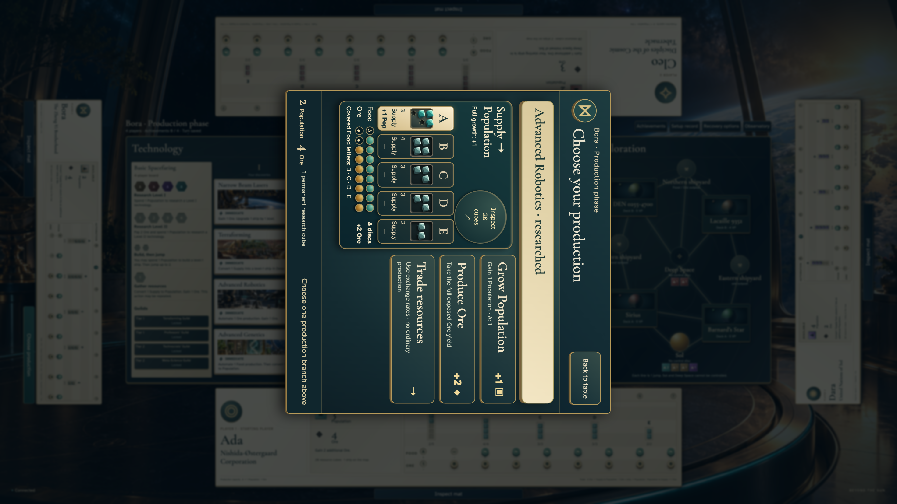](../../screenshots/manage-matching-supply-and-full-ore-yields-at-four-cardinal-seats/056-r1-bora-researched-tabletop-4k-darwin.png)

- [x] Pay once and receive Advanced Robotics's immediate bonus
- [x] Canonical effects settle before capture.
- [x] Any printed Action plan is ready.
- [x] Public compact topology remains physically separated.
- [x] The gameplay shell fits the actual viewport.

## 58. Bora completes production and hands off to Cleo

Viewpoint: **Bora · West · one shared controller**.

| desktop · 1440 × 1000 |
| --- |
|  |

tabletop-4k · 3840 × 2160

- [x] Bora completes production and hands off to Cleo
- [x] Canonical effects settle before capture.
- [x] Any printed Action plan is ready.
- [x] Public compact topology remains physically separated.
- [x] The gameplay shell fits the actual viewport.

## 59. Cleo opens the actual research and Action instrument

Viewpoint: **Cleo · North · one shared controller**.

| desktop · 1440 × 1000 |
| --- |
| [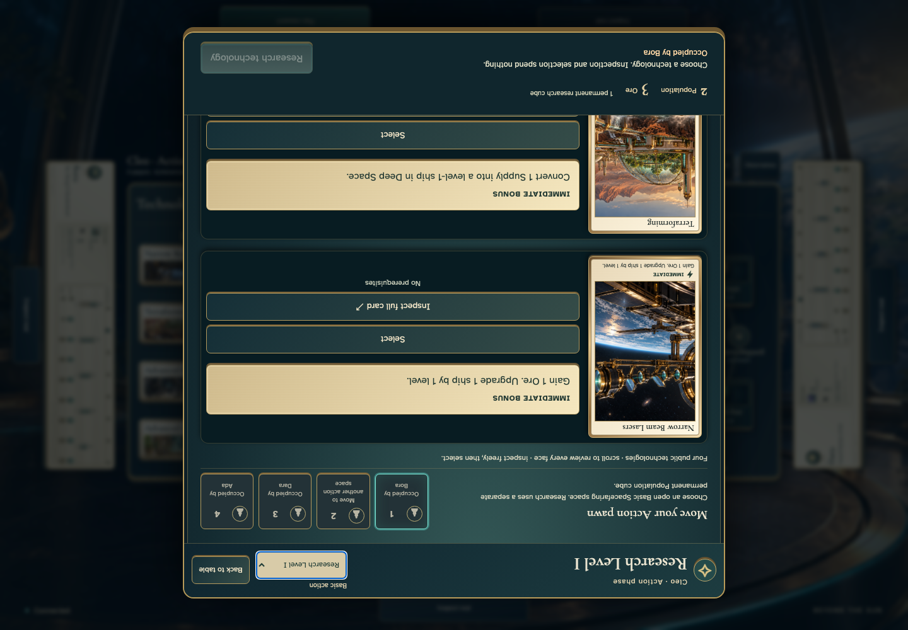](../../screenshots/manage-matching-supply-and-full-ore-yields-at-four-cardinal-seats/058-r1-cleo-plan-desktop-darwin.png) |

tabletop-4k · 3840 × 2160

[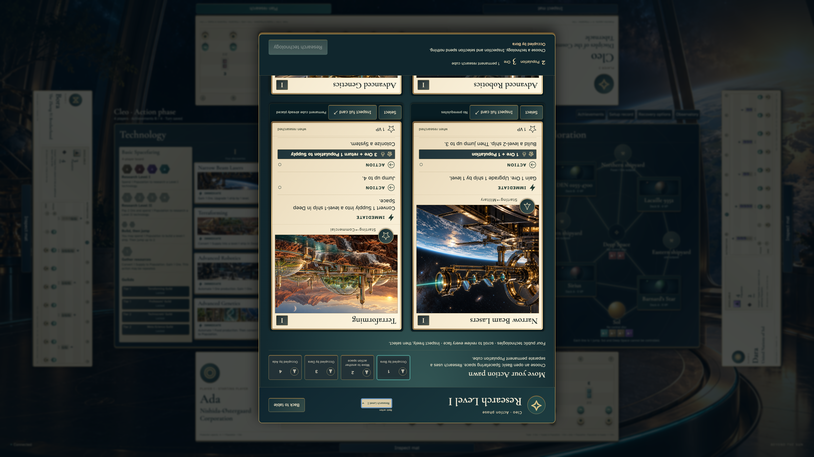](../../screenshots/manage-matching-supply-and-full-ore-yields-at-four-cardinal-seats/058-r1-cleo-plan-tabletop-4k-darwin.png)

- [x] Cleo opens the actual research and Action instrument
- [x] Canonical effects settle before capture.
- [x] Any printed Action plan is ready.
- [x] Public compact topology remains physically separated.
- [x] The gameplay shell fits the actual viewport.

## 60. Cleo selects printed technology Actions

Viewpoint: **Cleo · North · one shared controller**.

| desktop · 1440 × 1000 |
| --- |
|  |

tabletop-4k · 3840 × 2160

[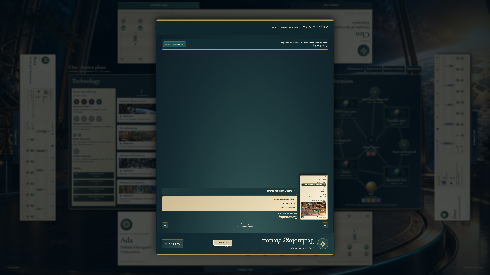](../../screenshots/manage-matching-supply-and-full-ore-yields-at-four-cardinal-seats/059-r1-cleo-kind-tabletop-4k-darwin.png)

- [x] Cleo selects printed technology Actions
- [x] Canonical effects settle before capture.
- [x] Any printed Action plan is ready.
- [x] Public compact topology remains physically separated.
- [x] The gameplay shell fits the actual viewport.

## 61. Read Terraforming's actual research requirement, payment and exclusive pawn space

Viewpoint: **Cleo · North · one shared controller**.

| desktop · 1440 × 1000 |
| --- |
| [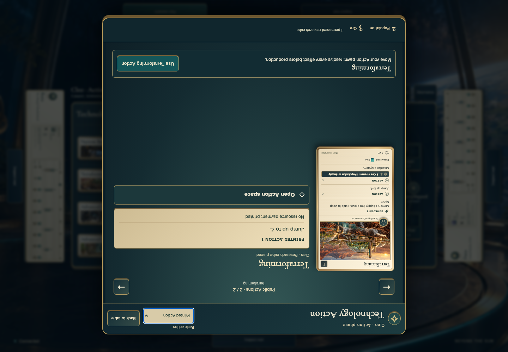](../../screenshots/manage-matching-supply-and-full-ore-yields-at-four-cardinal-seats/060-r1-cleo-face-desktop-darwin.png) |

tabletop-4k · 3840 × 2160

- [x] Read Terraforming's actual research requirement, payment and exclusive pawn space
- [x] Canonical effects settle before capture.
- [x] Any printed Action plan is ready.
- [x] Public compact topology remains physically separated.
- [x] The gameplay shell fits the actual viewport.

## 62. Commit the actual printed Action cost before planning movement

Viewpoint: **Cleo · North · one shared controller**.

| desktop · 1440 × 1000 |
| --- |
| [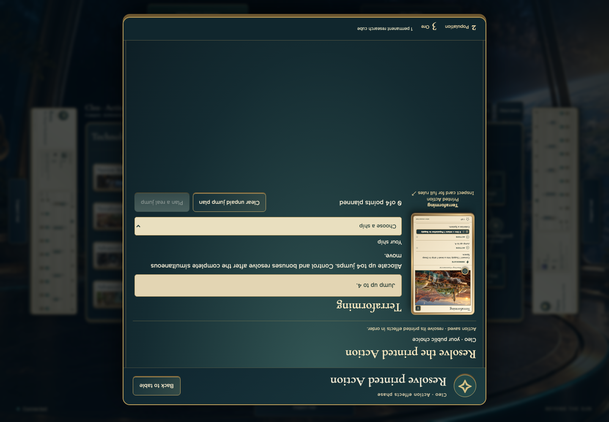](../../screenshots/manage-matching-supply-and-full-ore-yields-at-four-cardinal-seats/061-r1-cleo-paid-desktop-darwin.png) |

tabletop-4k · 3840 × 2160

[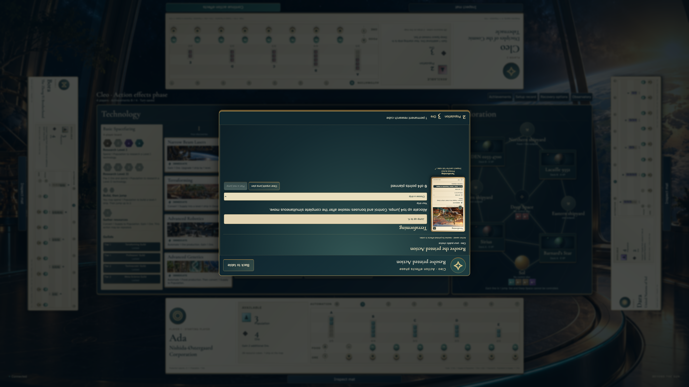](../../screenshots/manage-matching-supply-and-full-ore-yields-at-four-cardinal-seats/061-r1-cleo-paid-tabletop-4k-darwin.png)

- [x] Commit the actual printed Action cost before planning movement
- [x] Canonical effects settle before capture.
- [x] Any printed Action plan is ready.
- [x] Public compact topology remains physically separated.
- [x] The gameplay shell fits the actual viewport.

## 63. Choose a real owned ship for the legal path

Viewpoint: **Cleo · North · one shared controller**.

| desktop · 1440 × 1000 |
| --- |
| [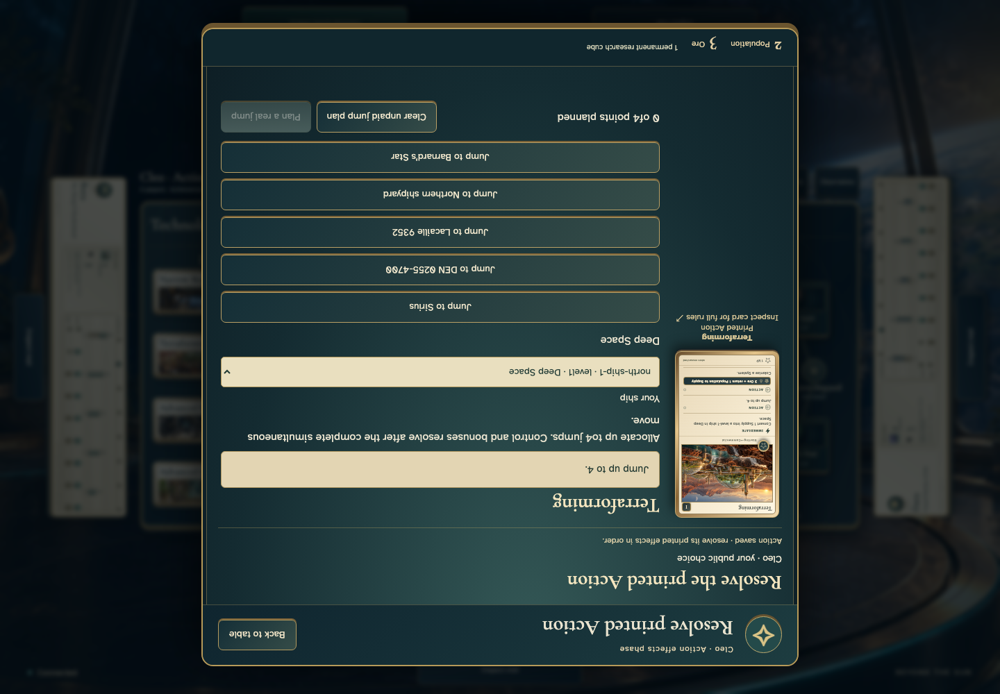](../../screenshots/manage-matching-supply-and-full-ore-yields-at-four-cardinal-seats/062-r1-cleo-ship-desktop-darwin.png) |

tabletop-4k · 3840 × 2160

[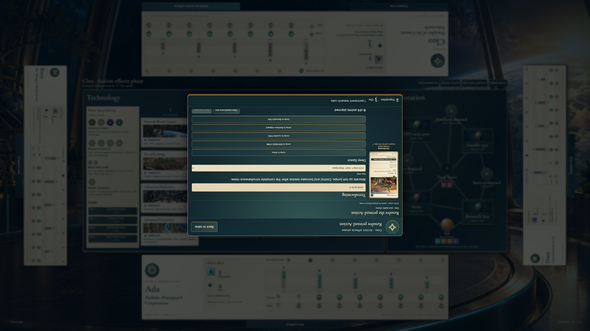](../../screenshots/manage-matching-supply-and-full-ore-yields-at-four-cardinal-seats/062-r1-cleo-ship-tabletop-4k-darwin.png)

- [x] Choose a real owned ship for the legal path
- [x] Canonical effects settle before capture.
- [x] Any printed Action plan is ready.
- [x] Public compact topology remains physically separated.
- [x] The gameplay shell fits the actual viewport.

## 64. Plan the next adjacent system without moving or paying again

Viewpoint: **Cleo · North · one shared controller**.

| desktop · 1440 × 1000 |
| --- |
|  |

tabletop-4k · 3840 × 2160

- [x] Plan the next adjacent system without moving or paying again
- [x] Canonical effects settle before capture.
- [x] Any printed Action plan is ready.
- [x] Public compact topology remains physically separated.
- [x] The gameplay shell fits the actual viewport.

## 65. Plan the next adjacent system without moving or paying again

Viewpoint: **Cleo · North · one shared controller**.

| desktop · 1440 × 1000 |
| --- |
|  |

tabletop-4k · 3840 × 2160

- [x] Plan the next adjacent system without moving or paying again
- [x] Canonical effects settle before capture.
- [x] Any printed Action plan is ready.
- [x] Public compact topology remains physically separated.
- [x] The gameplay shell fits the actual viewport.

## 66. Resolve the complete real path atomically

Viewpoint: **Cleo · North · one shared controller**.

| desktop · 1440 × 1000 |
| --- |
|  |

tabletop-4k · 3840 × 2160

- [x] Resolve the complete real path atomically
- [x] Canonical effects settle before capture.
- [x] Any printed Action plan is ready.
- [x] Public compact topology remains physically separated.
- [x] The gameplay shell fits the actual viewport.

## 67. Cleo completes production and hands off to Dara

Viewpoint: **Cleo · North · one shared controller**.

| desktop · 1440 × 1000 |
| --- |
|  |

tabletop-4k · 3840 × 2160

- [x] Cleo completes production and hands off to Dara
- [x] Canonical effects settle before capture.
- [x] Any printed Action plan is ready.
- [x] Public compact topology remains physically separated.
- [x] The gameplay shell fits the actual viewport.

## 68. Dara opens the actual research and Action instrument

Viewpoint: **Dara · East · one shared controller**.

| desktop · 1440 × 1000 |
| --- |
|  |

tabletop-4k · 3840 × 2160

- [x] Dara opens the actual research and Action instrument
- [x] Canonical effects settle before capture.
- [x] Any printed Action plan is ready.
- [x] Public compact topology remains physically separated.
- [x] The gameplay shell fits the actual viewport.

## 69. Dara selects the legal printed space 2

Viewpoint: **Dara · East · one shared controller**.

| desktop · 1440 × 1000 |
| --- |
|  |

tabletop-4k · 3840 × 2160

- [x] Dara selects the legal printed space 2
- [x] Canonical effects settle before capture.
- [x] Any printed Action plan is ready.
- [x] Public compact topology remains physically separated.
- [x] The gameplay shell fits the actual viewport.

## 70. Browse the next public Level I face

Viewpoint: **Dara · East · one shared controller**.

| desktop · 1440 × 1000 |
| --- |
|  |

tabletop-4k · 3840 × 2160

- [x] Browse the next public Level I face
- [x] Canonical effects settle before capture.
- [x] Any printed Action plan is ready.
- [x] Public compact topology remains physically separated.
- [x] The gameplay shell fits the actual viewport.

## 71. Browse the next public Level I face

Viewpoint: **Dara · East · one shared controller**.

| desktop · 1440 × 1000 |
| --- |
|  |

tabletop-4k · 3840 × 2160

- [x] Browse the next public Level I face
- [x] Canonical effects settle before capture.
- [x] Any printed Action plan is ready.
- [x] Public compact topology remains physically separated.
- [x] The gameplay shell fits the actual viewport.

## 72. Pay once and receive Advanced Robotics's immediate bonus

Viewpoint: **Dara · East · one shared controller**.

| desktop · 1440 × 1000 |
| --- |
|  |

tabletop-4k · 3840 × 2160

- [x] Pay once and receive Advanced Robotics's immediate bonus
- [x] Canonical effects settle before capture.
- [x] Any printed Action plan is ready.
- [x] Public compact topology remains physically separated.
- [x] The gameplay shell fits the actual viewport.

## 73. Dara completes production and hands off to Ada

Viewpoint: **Dara · East · one shared controller**.

| desktop · 1440 × 1000 |
| --- |
|  |

tabletop-4k · 3840 × 2160

- [x] Dara completes production and hands off to Ada
- [x] Canonical effects settle before capture.
- [x] Any printed Action plan is ready.
- [x] Public compact topology remains physically separated.
- [x] The gameplay shell fits the actual viewport.

## 74. Ada opens the actual research and Action instrument

Viewpoint: **Ada · South · one shared controller**.

| desktop · 1440 × 1000 |
| --- |
|  |

tabletop-4k · 3840 × 2160

- [x] Ada opens the actual research and Action instrument
- [x] Canonical effects settle before capture.
- [x] Any printed Action plan is ready.
- [x] Public compact topology remains physically separated.
- [x] The gameplay shell fits the actual viewport.

## 75. Ada selects ordinary gathering

Viewpoint: **Ada · South · one shared controller**.

| desktop · 1440 × 1000 |
| --- |
|  |

tabletop-4k · 3840 × 2160

- [x] Ada selects ordinary gathering
- [x] Canonical effects settle before capture.
- [x] Any printed Action plan is ready.
- [x] Public compact topology remains physically separated.
- [x] The gameplay shell fits the actual viewport.

## 76. Receive the printed gather resources before ordinary production

Viewpoint: **Ada · South · one shared controller**.

| desktop · 1440 × 1000 |
| --- |
|  |

tabletop-4k · 3840 × 2160

- [x] Receive the printed gather resources before ordinary production
- [x] Canonical effects settle before capture.
- [x] Any printed Action plan is ready.
- [x] Public compact topology remains physically separated.
- [x] The gameplay shell fits the actual viewport.

## 77. Ada completes production and hands off to Bora

Viewpoint: **Ada · South · one shared controller**.

| desktop · 1440 × 1000 |
| --- |
|  |

tabletop-4k · 3840 × 2160

- [x] Ada completes production and hands off to Bora
- [x] Canonical effects settle before capture.
- [x] Any printed Action plan is ready.
- [x] Public compact topology remains physically separated.
- [x] The gameplay shell fits the actual viewport.

## 78. Bora opens the actual research and Action instrument

Viewpoint: **Bora · West · one shared controller**.

| desktop · 1440 × 1000 |
| --- |
|  |

tabletop-4k · 3840 × 2160

- [x] Bora opens the actual research and Action instrument
- [x] Canonical effects settle before capture.
- [x] Any printed Action plan is ready.
- [x] Public compact topology remains physically separated.
- [x] The gameplay shell fits the actual viewport.

## 79. Bora selects the legal printed space 3

Viewpoint: **Bora · West · one shared controller**.

| desktop · 1440 × 1000 |
| --- |
|  |

tabletop-4k · 3840 × 2160

- [x] Bora selects the legal printed space 3
- [x] Canonical effects settle before capture.
- [x] Any printed Action plan is ready.
- [x] Public compact topology remains physically separated.
- [x] The gameplay shell fits the actual viewport.

## 80. Browse the next public Level I face

Viewpoint: **Bora · West · one shared controller**.

| desktop · 1440 × 1000 |
| --- |
|  |

tabletop-4k · 3840 × 2160

- [x] Browse the next public Level I face
- [x] Canonical effects settle before capture.
- [x] Any printed Action plan is ready.
- [x] Public compact topology remains physically separated.
- [x] The gameplay shell fits the actual viewport.

## 81. Pay once and receive Terraforming's immediate bonus

Viewpoint: **Bora · West · one shared controller**.

| desktop · 1440 × 1000 |
| --- |
|  |

tabletop-4k · 3840 × 2160

- [x] Pay once and receive Terraforming's immediate bonus
- [x] Canonical effects settle before capture.
- [x] Any printed Action plan is ready.
- [x] Public compact topology remains physically separated.
- [x] The gameplay shell fits the actual viewport.

## 82. Bora completes production and hands off to Cleo

Viewpoint: **Bora · West · one shared controller**.

| desktop · 1440 × 1000 |
| --- |
|  |

tabletop-4k · 3840 × 2160

- [x] Bora completes production and hands off to Cleo
- [x] Canonical effects settle before capture.
- [x] Any printed Action plan is ready.
- [x] Public compact topology remains physically separated.
- [x] The gameplay shell fits the actual viewport.

## 83. Cleo opens the actual research and Action instrument

Viewpoint: **Cleo · North · one shared controller**.

| desktop · 1440 × 1000 |
| --- |
|  |

tabletop-4k · 3840 × 2160

- [x] Cleo opens the actual research and Action instrument
- [x] Canonical effects settle before capture.
- [x] Any printed Action plan is ready.
- [x] Public compact topology remains physically separated.
- [x] The gameplay shell fits the actual viewport.

## 84. Cleo selects the legal printed space 1

Viewpoint: **Cleo · North · one shared controller**.

| desktop · 1440 × 1000 |
| --- |
|  |

tabletop-4k · 3840 × 2160

- [x] Cleo selects the legal printed space 1
- [x] Canonical effects settle before capture.
- [x] Any printed Action plan is ready.
- [x] Public compact topology remains physically separated.
- [x] The gameplay shell fits the actual viewport.

## 85. Select Advanced Genetics with its printed cost and consequence

Viewpoint: **Cleo · North · one shared controller**.

| desktop · 1440 × 1000 |
| --- |
|  |

tabletop-4k · 3840 × 2160

- [x] Select Advanced Genetics with its printed cost and consequence
- [x] Canonical effects settle before capture.
- [x] Any printed Action plan is ready.
- [x] Public compact topology remains physically separated.
- [x] The gameplay shell fits the actual viewport.

## 86. Pay once and receive Advanced Genetics's immediate bonus

Viewpoint: **Cleo · North · one shared controller**.

| desktop · 1440 × 1000 |
| --- |
|  |

tabletop-4k · 3840 × 2160

- [x] Pay once and receive Advanced Genetics's immediate bonus
- [x] Canonical effects settle before capture.
- [x] Any printed Action plan is ready.
- [x] Public compact topology remains physically separated.
- [x] The gameplay shell fits the actual viewport.

## 87. Cleo completes production and hands off to Dara

Viewpoint: **Cleo · North · one shared controller**.

| desktop · 1440 × 1000 |
| --- |
|  |

tabletop-4k · 3840 × 2160

- [x] Cleo completes production and hands off to Dara
- [x] Canonical effects settle before capture.
- [x] Any printed Action plan is ready.
- [x] Public compact topology remains physically separated.
- [x] The gameplay shell fits the actual viewport.

## 88. Dara opens the actual research and Action instrument

Viewpoint: **Dara · East · one shared controller**.

| desktop · 1440 × 1000 |
| --- |
|  |

tabletop-4k · 3840 × 2160

- [x] Dara opens the actual research and Action instrument
- [x] Canonical effects settle before capture.
- [x] Any printed Action plan is ready.
- [x] Public compact topology remains physically separated.
- [x] The gameplay shell fits the actual viewport.

## 89. Dara selects the legal printed space 4

Viewpoint: **Dara · East · one shared controller**.

| desktop · 1440 × 1000 |
| --- |
|  |

tabletop-4k · 3840 × 2160

- [x] Dara selects the legal printed space 4
- [x] Canonical effects settle before capture.
- [x] Any printed Action plan is ready.
- [x] Public compact topology remains physically separated.
- [x] The gameplay shell fits the actual viewport.

## 90. Browse the next public Level I face

Viewpoint: **Dara · East · one shared controller**.

| desktop · 1440 × 1000 |
| --- |
|  |

tabletop-4k · 3840 × 2160

- [x] Browse the next public Level I face
- [x] Canonical effects settle before capture.
- [x] Any printed Action plan is ready.
- [x] Public compact topology remains physically separated.
- [x] The gameplay shell fits the actual viewport.

## 91. Pay once and receive Terraforming's immediate bonus

Viewpoint: **Dara · East · one shared controller**.

| desktop · 1440 × 1000 |
| --- |
|  |

tabletop-4k · 3840 × 2160

- [x] Pay once and receive Terraforming's immediate bonus
- [x] Canonical effects settle before capture.
- [x] Any printed Action plan is ready.
- [x] Public compact topology remains physically separated.
- [x] The gameplay shell fits the actual viewport.

## 92. Dara completes production and hands off to Ada

Viewpoint: **Dara · East · one shared controller**.

| desktop · 1440 × 1000 |
| --- |
|  |

tabletop-4k · 3840 × 2160

- [x] Dara completes production and hands off to Ada
- [x] Canonical effects settle before capture.
- [x] Any printed Action plan is ready.
- [x] Public compact topology remains physically separated.
- [x] The gameplay shell fits the actual viewport.

## 93. Ada opens the actual research and Action instrument

Viewpoint: **Ada · South · one shared controller**.

| desktop · 1440 × 1000 |
| --- |
|  |

tabletop-4k · 3840 × 2160

- [x] Ada opens the actual research and Action instrument
- [x] Canonical effects settle before capture.
- [x] Any printed Action plan is ready.
- [x] Public compact topology remains physically separated.
- [x] The gameplay shell fits the actual viewport.

## 94. Ada selects the legal printed space 2

Viewpoint: **Ada · South · one shared controller**.

| desktop · 1440 × 1000 |
| --- |
|  |

tabletop-4k · 3840 × 2160

- [x] Ada selects the legal printed space 2
- [x] Canonical effects settle before capture.
- [x] Any printed Action plan is ready.
- [x] Public compact topology remains physically separated.
- [x] The gameplay shell fits the actual viewport.

## 95. Select Advanced Robotics with its printed cost and consequence

Viewpoint: **Ada · South · one shared controller**.

| desktop · 1440 × 1000 |
| --- |
|  |

tabletop-4k · 3840 × 2160

- [x] Select Advanced Robotics with its printed cost and consequence
- [x] Canonical effects settle before capture.
- [x] Any printed Action plan is ready.
- [x] Public compact topology remains physically separated.
- [x] The gameplay shell fits the actual viewport.

## 96. Pay once and receive Advanced Robotics's immediate bonus

Viewpoint: **Ada · South · one shared controller**.

| desktop · 1440 × 1000 |
| --- |
|  |

tabletop-4k · 3840 × 2160

- [x] Pay once and receive Advanced Robotics's immediate bonus
- [x] Canonical effects settle before capture.
- [x] Any printed Action plan is ready.
- [x] Public compact topology remains physically separated.
- [x] The gameplay shell fits the actual viewport.

## 97. Robotics exposes two Ore circles and ordinary production takes both

Viewpoint: **Ada · South · one shared controller**.

| desktop · 1440 × 1000 |
| --- |
|  |

tabletop-4k · 3840 × 2160

- [x] Robotics exposes two Ore circles and ordinary production takes both
- [x] Canonical effects settle before capture.
- [x] Any printed Action plan is ready.
- [x] Public compact topology remains physically separated.
- [x] The gameplay shell fits the actual viewport.

## 98. Ada completes production and hands off to Bora

Viewpoint: **Ada · South · one shared controller**.

| desktop · 1440 × 1000 |
| --- |
|  |

tabletop-4k · 3840 × 2160

- [x] Ada completes production and hands off to Bora
- [x] Canonical effects settle before capture.
- [x] Any printed Action plan is ready.
- [x] Public compact topology remains physically separated.
- [x] The gameplay shell fits the actual viewport.

## 99. Bora opens the actual research and Action instrument

Viewpoint: **Bora · West · one shared controller**.

| desktop · 1440 × 1000 |
| --- |
|  |

tabletop-4k · 3840 × 2160

- [x] Bora opens the actual research and Action instrument
- [x] Canonical effects settle before capture.
- [x] Any printed Action plan is ready.
- [x] Public compact topology remains physically separated.
- [x] The gameplay shell fits the actual viewport.

## 100. Bora selects ordinary gathering

Viewpoint: **Bora · West · one shared controller**.

| desktop · 1440 × 1000 |
| --- |
|  |

tabletop-4k · 3840 × 2160

- [x] Bora selects ordinary gathering
- [x] Canonical effects settle before capture.
- [x] Any printed Action plan is ready.
- [x] Public compact topology remains physically separated.
- [x] The gameplay shell fits the actual viewport.

## 101. Receive the printed gather resources before ordinary production

Viewpoint: **Bora · West · one shared controller**.

| desktop · 1440 × 1000 |
| --- |
|  |

tabletop-4k · 3840 × 2160

- [x] Receive the printed gather resources before ordinary production
- [x] Canonical effects settle before capture.
- [x] Any printed Action plan is ready.
- [x] Public compact topology remains physically separated.
- [x] The gameplay shell fits the actual viewport.

## 102. Bora completes production and hands off to Cleo

Viewpoint: **Bora · West · one shared controller**.

| desktop · 1440 × 1000 |
| --- |
|  |

tabletop-4k · 3840 × 2160

- [x] Bora completes production and hands off to Cleo
- [x] Canonical effects settle before capture.
- [x] Any printed Action plan is ready.
- [x] Public compact topology remains physically separated.
- [x] The gameplay shell fits the actual viewport.

## 103. Cleo opens the actual research and Action instrument

Viewpoint: **Cleo · North · one shared controller**.

| desktop · 1440 × 1000 |
| --- |
|  |

tabletop-4k · 3840 × 2160

- [x] Cleo opens the actual research and Action instrument
- [x] Canonical effects settle before capture.
- [x] Any printed Action plan is ready.
- [x] Public compact topology remains physically separated.
- [x] The gameplay shell fits the actual viewport.

## 104. Cleo selects the legal printed space 3

Viewpoint: **Cleo · North · one shared controller**.

| desktop · 1440 × 1000 |
| --- |
|  |

tabletop-4k · 3840 × 2160

- [x] Cleo selects the legal printed space 3
- [x] Canonical effects settle before capture.
- [x] Any printed Action plan is ready.
- [x] Public compact topology remains physically separated.
- [x] The gameplay shell fits the actual viewport.

## 105. Select Advanced Robotics with its printed cost and consequence

Viewpoint: **Cleo · North · one shared controller**.

| desktop · 1440 × 1000 |
| --- |
|  |

tabletop-4k · 3840 × 2160

- [x] Select Advanced Robotics with its printed cost and consequence
- [x] Canonical effects settle before capture.
- [x] Any printed Action plan is ready.
- [x] Public compact topology remains physically separated.
- [x] The gameplay shell fits the actual viewport.

## 106. Pay once and receive Advanced Robotics's immediate bonus

Viewpoint: **Cleo · North · one shared controller**.

| desktop · 1440 × 1000 |
| --- |
|  |

tabletop-4k · 3840 × 2160

- [x] Pay once and receive Advanced Robotics's immediate bonus
- [x] Canonical effects settle before capture.
- [x] Any printed Action plan is ready.
- [x] Public compact topology remains physically separated.
- [x] The gameplay shell fits the actual viewport.

## 107. Cleo completes production and hands off to Dara

Viewpoint: **Cleo · North · one shared controller**.

| desktop · 1440 × 1000 |
| --- |
|  |

tabletop-4k · 3840 × 2160

- [x] Cleo completes production and hands off to Dara
- [x] Canonical effects settle before capture.
- [x] Any printed Action plan is ready.
- [x] Public compact topology remains physically separated.
- [x] The gameplay shell fits the actual viewport.

## 108. Dara opens the actual research and Action instrument

Viewpoint: **Dara · East · one shared controller**.

| desktop · 1440 × 1000 |
| --- |
|  |

tabletop-4k · 3840 × 2160

- [x] Dara opens the actual research and Action instrument
- [x] Canonical effects settle before capture.
- [x] Any printed Action plan is ready.
- [x] Public compact topology remains physically separated.
- [x] The gameplay shell fits the actual viewport.

## 109. Dara selects the legal printed space 1

Viewpoint: **Dara · East · one shared controller**.

| desktop · 1440 × 1000 |
| --- |
|  |

tabletop-4k · 3840 × 2160

- [x] Dara selects the legal printed space 1
- [x] Canonical effects settle before capture.
- [x] Any printed Action plan is ready.
- [x] Public compact topology remains physically separated.
- [x] The gameplay shell fits the actual viewport.

## 110. The immediate bonus requires an explicit owned target

Viewpoint: **Dara · East · one shared controller**.

| desktop · 1440 × 1000 |
| --- |
|  |

tabletop-4k · 3840 × 2160

- [x] The immediate bonus requires an explicit owned target
- [x] Canonical effects settle before capture.
- [x] Any printed Action plan is ready.
- [x] Public compact topology remains physically separated.
- [x] The gameplay shell fits the actual viewport.

## 111. Choose the original Sol ship for the one-level upgrade

Viewpoint: **Dara · East · one shared controller**.

| desktop · 1440 × 1000 |
| --- |
|  |

tabletop-4k · 3840 × 2160

- [x] Choose the original Sol ship for the one-level upgrade
- [x] Canonical effects settle before capture.
- [x] Any printed Action plan is ready.
- [x] Public compact topology remains physically separated.
- [x] The gameplay shell fits the actual viewport.

## 112. Pay once and receive Narrow Beam Lasers's immediate bonus

Viewpoint: **Dara · East · one shared controller**.

| desktop · 1440 × 1000 |
| --- |
|  |

tabletop-4k · 3840 × 2160

- [x] Pay once and receive Narrow Beam Lasers's immediate bonus
- [x] Canonical effects settle before capture.
- [x] Any printed Action plan is ready.
- [x] Public compact topology remains physically separated.
- [x] The gameplay shell fits the actual viewport.

## 113. Dara completes production and hands off to Ada

Viewpoint: **Dara · East · one shared controller**.

| desktop · 1440 × 1000 |
| --- |
|  |

tabletop-4k · 3840 × 2160

- [x] Dara completes production and hands off to Ada
- [x] Canonical effects settle before capture.
- [x] Any printed Action plan is ready.
- [x] Public compact topology remains physically separated.
- [x] The gameplay shell fits the actual viewport.

## 114. Ada opens the actual research and Action instrument

Viewpoint: **Ada · South · one shared controller**.

| desktop · 1440 × 1000 |
| --- |
|  |

tabletop-4k · 3840 × 2160

- [x] Ada opens the actual research and Action instrument
- [x] Canonical effects settle before capture.
- [x] Any printed Action plan is ready.
- [x] Public compact topology remains physically separated.
- [x] The gameplay shell fits the actual viewport.

## 115. Ada selects printed technology Actions

Viewpoint: **Ada · South · one shared controller**.

| desktop · 1440 × 1000 |
| --- |
|  |

tabletop-4k · 3840 × 2160

- [x] Ada selects printed technology Actions
- [x] Canonical effects settle before capture.
- [x] Any printed Action plan is ready.
- [x] Public compact topology remains physically separated.
- [x] The gameplay shell fits the actual viewport.

## 116. Read Narrow Beam Lasers's actual research requirement, payment and exclusive pawn space

Viewpoint: **Ada · South · one shared controller**.

| desktop · 1440 × 1000 |
| --- |
|  |

tabletop-4k · 3840 × 2160

- [x] Read Narrow Beam Lasers's actual research requirement, payment and exclusive pawn space
- [x] Canonical effects settle before capture.
- [x] Any printed Action plan is ready.
- [x] Public compact topology remains physically separated.
- [x] The gameplay shell fits the actual viewport.

## 117. Commit the actual printed Action cost before planning movement

Viewpoint: **Ada · South · one shared controller**.

| desktop · 1440 × 1000 |
| --- |
|  |

tabletop-4k · 3840 × 2160

- [x] Commit the actual printed Action cost before planning movement
- [x] Canonical effects settle before capture.
- [x] Any printed Action plan is ready.
- [x] Public compact topology remains physically separated.
- [x] The gameplay shell fits the actual viewport.

## 118. Choose a real owned ship for the legal path

Viewpoint: **Ada · South · one shared controller**.

| desktop · 1440 × 1000 |
| --- |
|  |

tabletop-4k · 3840 × 2160

- [x] Choose a real owned ship for the legal path
- [x] Canonical effects settle before capture.
- [x] Any printed Action plan is ready.
- [x] Public compact topology remains physically separated.
- [x] The gameplay shell fits the actual viewport.

## 119. Plan the next adjacent system without moving or paying again

Viewpoint: **Ada · South · one shared controller**.

| desktop · 1440 × 1000 |
| --- |
|  |

tabletop-4k · 3840 × 2160

- [x] Plan the next adjacent system without moving or paying again
- [x] Canonical effects settle before capture.
- [x] Any printed Action plan is ready.
- [x] Public compact topology remains physically separated.
- [x] The gameplay shell fits the actual viewport.

## 120. Plan the next adjacent system without moving or paying again

Viewpoint: **Ada · South · one shared controller**.

| desktop · 1440 × 1000 |
| --- |
|  |

tabletop-4k · 3840 × 2160

- [x] Plan the next adjacent system without moving or paying again
- [x] Canonical effects settle before capture.
- [x] Any printed Action plan is ready.
- [x] Public compact topology remains physically separated.
- [x] The gameplay shell fits the actual viewport.

## 121. Plan the next adjacent system without moving or paying again

Viewpoint: **Ada · South · one shared controller**.

| desktop · 1440 × 1000 |
| --- |
|  |

tabletop-4k · 3840 × 2160

- [x] Plan the next adjacent system without moving or paying again
- [x] Canonical effects settle before capture.
- [x] Any printed Action plan is ready.
- [x] Public compact topology remains physically separated.
- [x] The gameplay shell fits the actual viewport.

## 122. Resolve the complete real path atomically

Viewpoint: **Ada · South · one shared controller**.

| desktop · 1440 × 1000 |
| --- |
|  |

tabletop-4k · 3840 × 2160

- [x] Resolve the complete real path atomically
- [x] Canonical effects settle before capture.
- [x] Any printed Action plan is ready.
- [x] Public compact topology remains physically separated.
- [x] The gameplay shell fits the actual viewport.

## 123. Place an actual Food outpost and expose the second matching column

Viewpoint: **Ada · South · one shared controller**.

| desktop · 1440 × 1000 |
| --- |
|  |

tabletop-4k · 3840 × 2160

- [x] Place an actual Food outpost and expose the second matching column
- [x] Canonical effects settle before capture.
- [x] Any printed Action plan is ready.
- [x] Public compact topology remains physically separated.
- [x] The gameplay shell fits the actual viewport.

## 124. Food now exposes A and B, each of which contributes one real matching cube

Viewpoint: **Ada · South · one shared controller**.

| desktop · 1440 × 1000 |
| --- |
|  |

tabletop-4k · 3840 × 2160

- [x] Food now exposes A and B, each of which contributes one real matching cube
- [x] Canonical effects settle before capture.
- [x] Any printed Action plan is ready.
- [x] Public compact topology remains physically separated.
- [x] The gameplay shell fits the actual viewport.

## 125. Ada completes production and hands off to Bora

Viewpoint: **Ada · South · one shared controller**.

| desktop · 1440 × 1000 |
| --- |
|  |

tabletop-4k · 3840 × 2160

- [x] Ada completes production and hands off to Bora
- [x] Canonical effects settle before capture.
- [x] Any printed Action plan is ready.
- [x] Public compact topology remains physically separated.
- [x] The gameplay shell fits the actual viewport.

## 126. Bora opens the actual research and Action instrument

Viewpoint: **Bora · West · one shared controller**.

| desktop · 1440 × 1000 |
| --- |
|  |

tabletop-4k · 3840 × 2160

- [x] Bora opens the actual research and Action instrument
- [x] Canonical effects settle before capture.
- [x] Any printed Action plan is ready.
- [x] Public compact topology remains physically separated.
- [x] The gameplay shell fits the actual viewport.

## 127. Bora selects the legal printed space 2

Viewpoint: **Bora · West · one shared controller**.

| desktop · 1440 × 1000 |
| --- |
|  |

tabletop-4k · 3840 × 2160

- [x] Bora selects the legal printed space 2
- [x] Canonical effects settle before capture.
- [x] Any printed Action plan is ready.
- [x] Public compact topology remains physically separated.
- [x] The gameplay shell fits the actual viewport.

## 128. Browse the next public Level I face

Viewpoint: **Bora · West · one shared controller**.

| desktop · 1440 × 1000 |
| --- |
|  |

tabletop-4k · 3840 × 2160

- [x] Browse the next public Level I face
- [x] Canonical effects settle before capture.
- [x] Any printed Action plan is ready.
- [x] Public compact topology remains physically separated.
- [x] The gameplay shell fits the actual viewport.

## 129. Browse the next public Level I face

Viewpoint: **Bora · West · one shared controller**.

| desktop · 1440 × 1000 |
| --- |
|  |

tabletop-4k · 3840 × 2160

- [x] Browse the next public Level I face
- [x] Canonical effects settle before capture.
- [x] Any printed Action plan is ready.
- [x] Public compact topology remains physically separated.
- [x] The gameplay shell fits the actual viewport.

## 130. Browse the next public Level I face

Viewpoint: **Bora · West · one shared controller**.

| desktop · 1440 × 1000 |
| --- |
|  |

tabletop-4k · 3840 × 2160

- [x] Browse the next public Level I face
- [x] Canonical effects settle before capture.
- [x] Any printed Action plan is ready.
- [x] Public compact topology remains physically separated.
- [x] The gameplay shell fits the actual viewport.

## 131. Pay once and receive Advanced Genetics's immediate bonus

Viewpoint: **Bora · West · one shared controller**.

| desktop · 1440 × 1000 |
| --- |
|  |

tabletop-4k · 3840 × 2160

- [x] Pay once and receive Advanced Genetics's immediate bonus
- [x] Canonical effects settle before capture.
- [x] Any printed Action plan is ready.
- [x] Public compact topology remains physically separated.
- [x] The gameplay shell fits the actual viewport.

## 132. Bora completes production and hands off to Cleo

Viewpoint: **Bora · West · one shared controller**.

| desktop · 1440 × 1000 |
| --- |
|  |

tabletop-4k · 3840 × 2160

- [x] Bora completes production and hands off to Cleo
- [x] Canonical effects settle before capture.
- [x] Any printed Action plan is ready.
- [x] Public compact topology remains physically separated.
- [x] The gameplay shell fits the actual viewport.

## 133. Cleo opens the actual research and Action instrument

Viewpoint: **Cleo · North · one shared controller**.

| desktop · 1440 × 1000 |
| --- |
|  |

tabletop-4k · 3840 × 2160

- [x] Cleo opens the actual research and Action instrument
- [x] Canonical effects settle before capture.
- [x] Any printed Action plan is ready.
- [x] Public compact topology remains physically separated.
- [x] The gameplay shell fits the actual viewport.

## 134. Cleo selects the legal printed space 4

Viewpoint: **Cleo · North · one shared controller**.

| desktop · 1440 × 1000 |
| --- |
|  |

tabletop-4k · 3840 × 2160

- [x] Cleo selects the legal printed space 4
- [x] Canonical effects settle before capture.
- [x] Any printed Action plan is ready.
- [x] Public compact topology remains physically separated.
- [x] The gameplay shell fits the actual viewport.

## 135. Select Narrow Beam Lasers with its printed cost and consequence

Viewpoint: **Cleo · North · one shared controller**.

| desktop · 1440 × 1000 |
| --- |
|  |

tabletop-4k · 3840 × 2160

- [x] Select Narrow Beam Lasers with its printed cost and consequence
- [x] Canonical effects settle before capture.
- [x] Any printed Action plan is ready.
- [x] Public compact topology remains physically separated.
- [x] The gameplay shell fits the actual viewport.

## 136. The immediate bonus requires an explicit owned target

Viewpoint: **Cleo · North · one shared controller**.

| desktop · 1440 × 1000 |
| --- |
|  |

tabletop-4k · 3840 × 2160

- [x] The immediate bonus requires an explicit owned target
- [x] Canonical effects settle before capture.
- [x] Any printed Action plan is ready.
- [x] Public compact topology remains physically separated.
- [x] The gameplay shell fits the actual viewport.

## 137. Choose the original Sol ship for the one-level upgrade

Viewpoint: **Cleo · North · one shared controller**.

| desktop · 1440 × 1000 |
| --- |
|  |

tabletop-4k · 3840 × 2160

- [x] Choose the original Sol ship for the one-level upgrade
- [x] Canonical effects settle before capture.
- [x] Any printed Action plan is ready.
- [x] Public compact topology remains physically separated.
- [x] The gameplay shell fits the actual viewport.

## 138. Pay once and receive Narrow Beam Lasers's immediate bonus

Viewpoint: **Cleo · North · one shared controller**.

| desktop · 1440 × 1000 |
| --- |
|  |

tabletop-4k · 3840 × 2160

- [x] Pay once and receive Narrow Beam Lasers's immediate bonus
- [x] Canonical effects settle before capture.
- [x] Any printed Action plan is ready.
- [x] Public compact topology remains physically separated.
- [x] The gameplay shell fits the actual viewport.

## 139. Cleo completes production and hands off to Dara

Viewpoint: **Cleo · North · one shared controller**.

| desktop · 1440 × 1000 |
| --- |
|  |

tabletop-4k · 3840 × 2160

- [x] Cleo completes production and hands off to Dara
- [x] Canonical effects settle before capture.
- [x] Any printed Action plan is ready.
- [x] Public compact topology remains physically separated.
- [x] The gameplay shell fits the actual viewport.

## 140. Dara opens the actual research and Action instrument

Viewpoint: **Dara · East · one shared controller**.

| desktop · 1440 × 1000 |
| --- |
|  |

tabletop-4k · 3840 × 2160

- [x] Dara opens the actual research and Action instrument
- [x] Canonical effects settle before capture.
- [x] Any printed Action plan is ready.
- [x] Public compact topology remains physically separated.
- [x] The gameplay shell fits the actual viewport.

## 141. Dara selects printed technology Actions

Viewpoint: **Dara · East · one shared controller**.

| desktop · 1440 × 1000 |
| --- |
|  |

tabletop-4k · 3840 × 2160

- [x] Dara selects printed technology Actions
- [x] Canonical effects settle before capture.
- [x] Any printed Action plan is ready.
- [x] Public compact topology remains physically separated.
- [x] The gameplay shell fits the actual viewport.

## 142. Browse the next public printed Action without acquiring research

Viewpoint: **Dara · East · one shared controller**.

| desktop · 1440 × 1000 |
| --- |
|  |

tabletop-4k · 3840 × 2160

- [x] Browse the next public printed Action without acquiring research
- [x] Canonical effects settle before capture.
- [x] Any printed Action plan is ready.
- [x] Public compact topology remains physically separated.
- [x] The gameplay shell fits the actual viewport.

## 143. Read Terraforming's actual research requirement, payment and exclusive pawn space

Viewpoint: **Dara · East · one shared controller**.

| desktop · 1440 × 1000 |
| --- |
|  |

tabletop-4k · 3840 × 2160

- [x] Read Terraforming's actual research requirement, payment and exclusive pawn space
- [x] Canonical effects settle before capture.
- [x] Any printed Action plan is ready.
- [x] Public compact topology remains physically separated.
- [x] The gameplay shell fits the actual viewport.

## 144. Commit the actual printed Action cost before planning movement

Viewpoint: **Dara · East · one shared controller**.

| desktop · 1440 × 1000 |
| --- |
|  |

tabletop-4k · 3840 × 2160

- [x] Commit the actual printed Action cost before planning movement
- [x] Canonical effects settle before capture.
- [x] Any printed Action plan is ready.
- [x] Public compact topology remains physically separated.
- [x] The gameplay shell fits the actual viewport.

## 145. Choose a real owned ship for the legal path

Viewpoint: **Dara · East · one shared controller**.

| desktop · 1440 × 1000 |
| --- |
|  |

tabletop-4k · 3840 × 2160

- [x] Choose a real owned ship for the legal path
- [x] Canonical effects settle before capture.
- [x] Any printed Action plan is ready.
- [x] Public compact topology remains physically separated.
- [x] The gameplay shell fits the actual viewport.

## 146. Plan the next adjacent system without moving or paying again

Viewpoint: **Dara · East · one shared controller**.

| desktop · 1440 × 1000 |
| --- |
|  |

tabletop-4k · 3840 × 2160

- [x] Plan the next adjacent system without moving or paying again
- [x] Canonical effects settle before capture.
- [x] Any printed Action plan is ready.
- [x] Public compact topology remains physically separated.
- [x] The gameplay shell fits the actual viewport.

## 147. Plan the next adjacent system without moving or paying again

Viewpoint: **Dara · East · one shared controller**.

| desktop · 1440 × 1000 |
| --- |
|  |

tabletop-4k · 3840 × 2160

- [x] Plan the next adjacent system without moving or paying again
- [x] Canonical effects settle before capture.
- [x] Any printed Action plan is ready.
- [x] Public compact topology remains physically separated.
- [x] The gameplay shell fits the actual viewport.

## 148. Resolve the complete real path atomically

Viewpoint: **Dara · East · one shared controller**.

| desktop · 1440 × 1000 |
| --- |
|  |

tabletop-4k · 3840 × 2160

- [x] Resolve the complete real path atomically
- [x] Canonical effects settle before capture.
- [x] Any printed Action plan is ready.
- [x] Public compact topology remains physically separated.
- [x] The gameplay shell fits the actual viewport.

## 149. Dara completes production and hands off to Ada

Viewpoint: **Dara · East · one shared controller**.

| desktop · 1440 × 1000 |
| --- |
|  |

tabletop-4k · 3840 × 2160

- [x] Dara completes production and hands off to Ada
- [x] Canonical effects settle before capture.
- [x] Any printed Action plan is ready.
- [x] Public compact topology remains physically separated.
- [x] The gameplay shell fits the actual viewport.

## 150. Ada opens the actual research and Action instrument

Viewpoint: **Ada · South · one shared controller**.

| desktop · 1440 × 1000 |
| --- |
|  |

tabletop-4k · 3840 × 2160

- [x] Ada opens the actual research and Action instrument
- [x] Canonical effects settle before capture.
- [x] Any printed Action plan is ready.
- [x] Public compact topology remains physically separated.
- [x] The gameplay shell fits the actual viewport.

## 151. Ada selects ordinary gathering

Viewpoint: **Ada · South · one shared controller**.

| desktop · 1440 × 1000 |
| --- |
|  |

tabletop-4k · 3840 × 2160

- [x] Ada selects ordinary gathering
- [x] Canonical effects settle before capture.
- [x] Any printed Action plan is ready.
- [x] Public compact topology remains physically separated.
- [x] The gameplay shell fits the actual viewport.

## 152. Receive the printed gather resources before ordinary production

Viewpoint: **Ada · South · one shared controller**.

| desktop · 1440 × 1000 |
| --- |
|  |

tabletop-4k · 3840 × 2160

- [x] Receive the printed gather resources before ordinary production
- [x] Canonical effects settle before capture.
- [x] Any printed Action plan is ready.
- [x] Public compact topology remains physically separated.
- [x] The gameplay shell fits the actual viewport.

## 153. An exposed but empty A column cannot substitute cubes from covered columns

Viewpoint: **Ada · South · one shared controller**.

| desktop · 1440 × 1000 |
| --- |
|  |

tabletop-4k · 3840 × 2160

- [x] An exposed but empty A column cannot substitute cubes from covered columns
- [x] Canonical effects settle before capture.
- [x] Any printed Action plan is ready.
- [x] Public compact topology remains physically separated.
- [x] The gameplay shell fits the actual viewport.

## 154. Inspect all twenty conserved cubes in their actual current locations

Viewpoint: **Ada · South · one shared controller**.

| desktop · 1440 × 1000 |
| --- |
|  |

tabletop-4k · 3840 × 2160

- [x] Inspect all twenty conserved cubes in their actual current locations
- [x] Canonical effects settle before capture.
- [x] Any printed Action plan is ready.
- [x] Public compact topology remains physically separated.
- [x] The gameplay shell fits the actual viewport.

## 155. Tab remains in the modal reader

Viewpoint: **Ada · South · one shared controller**.

| desktop · 1440 × 1000 |
| --- |
|  |

tabletop-4k · 3840 × 2160

- [x] Tab remains in the modal reader
- [x] Canonical effects settle before capture.
- [x] Any printed Action plan is ready.
- [x] Public compact topology remains physically separated.
- [x] The gameplay shell fits the actual viewport.

## 156. Reverse Tab remains in the same accessible reader

Viewpoint: **Ada · South · one shared controller**.

| desktop · 1440 × 1000 |
| --- |
|  |

tabletop-4k · 3840 × 2160

- [x] Reverse Tab remains in the same accessible reader
- [x] Canonical effects settle before capture.
- [x] Any printed Action plan is ready.
- [x] Public compact topology remains physically separated.
- [x] The gameplay shell fits the actual viewport.

## 157. Escape restores the actual opener without choosing production

Viewpoint: **Ada · South · one shared controller**.

| desktop · 1440 × 1000 |
| --- |
|  |

tabletop-4k · 3840 × 2160

- [x] Escape restores the actual opener without choosing production
- [x] Canonical effects settle before capture.
- [x] Any printed Action plan is ready.
- [x] Public compact topology remains physically separated.
- [x] The gameplay shell fits the actual viewport.

## 158. Reload retains the production decision and current controller

Viewpoint: **Ada · South · one shared controller**.

| desktop · 1440 × 1000 |
| --- |
|  |

tabletop-4k · 3840 × 2160

- [x] Reload retains the production decision and current controller
- [x] Canonical effects settle before capture.
- [x] Any printed Action plan is ready.
- [x] Public compact topology remains physically separated.
- [x] The gameplay shell fits the actual viewport.

## 159. Reopened production still has A zero and B two; no bonus replay

Viewpoint: **Ada · South · one shared controller**.

| desktop · 1440 × 1000 |
| --- |
|  |

tabletop-4k · 3840 × 2160

- [x] Reopened production still has A zero and B two; no bonus replay
- [x] Canonical effects settle before capture.
- [x] Any printed Action plan is ready.
- [x] Public compact topology remains physically separated.
- [x] The gameplay shell fits the actual viewport.

## 160. Only B loses one cube; empty A stays empty and Bora receives the turn

Viewpoint: **Ada · South · one shared controller**.

| desktop · 1440 × 1000 |
| --- |
|  |

tabletop-4k · 3840 × 2160

- [x] Only B loses one cube; empty A stays empty and Bora receives the turn
- [x] Canonical effects settle before capture.
- [x] Any printed Action plan is ready.
- [x] Public compact topology remains physically separated.
- [x] The gameplay shell fits the actual viewport.

## 161. The saved public mat proves A remains zero and only B went from two to one

Viewpoint: **Ada · South · one shared controller**.

| desktop · 1440 × 1000 |
| --- |
|  |

tabletop-4k · 3840 × 2160

- [x] The saved public mat proves A remains zero and only B went from two to one
- [x] Canonical effects settle before capture.
- [x] Any printed Action plan is ready.
- [x] Public compact topology remains physically separated.
- [x] The gameplay shell fits the actual viewport.

## 162. Return from the actual faction mat to the handed-off board

Viewpoint: **Ada · South · one shared controller**.

| desktop · 1440 × 1000 |
| --- |
|  |

tabletop-4k · 3840 × 2160

- [x] Return from the actual faction mat to the handed-off board
- [x] Canonical effects settle before capture.
- [x] Any printed Action plan is ready.
- [x] Public compact topology remains physically separated.
- [x] The gameplay shell fits the actual viewport.

## 163. The full growth and handoff remain after reload

Viewpoint: **Ada · South · one shared controller**.

| desktop · 1440 × 1000 |
| --- |
|  |

tabletop-4k · 3840 × 2160

- [x] The full growth and handoff remain after reload
- [x] Canonical effects settle before capture.
- [x] Any printed Action plan is ready.
- [x] Public compact topology remains physically separated.
- [x] The gameplay shell fits the actual viewport.
