# Manage matching Supply and full Ore yields at four corner seats

One shared authenticated controller; direct physical cardinal or corner seating, ordinary UI setup and legal preparatory turns. No remote claims or personal devices. Only initial setup entropy is fixed to66666666-6666-4666-8666-000000000009. No game-state injection or future-deck inspection. Actual printed research access, payment, occupancy, effects and recovery use production components.

## 1. Arrive using the actual production client

Viewpoint: **Ada · South West · one shared controller**.

| desktop · 1440 × 1000 |
| --- |
|  |

tabletop-4k · 3840 × 2160

- [x] Arrive using the actual production client
- [x] Canonical effects settle before capture.
- [x] Any printed Action plan is ready.
- [x] Public compact topology remains physically separated.
- [x] The gameplay shell fits the actual viewport.

## 2. Choose a real production play mode

Viewpoint: **Ada · South West · one shared controller**.

| desktop · 1440 × 1000 |
| --- |
|  |

tabletop-4k · 3840 × 2160

- [x] Choose a real production play mode
- [x] Canonical effects settle before capture.
- [x] Any printed Action plan is ready.
- [x] Public compact topology remains physically separated.
- [x] The gameplay shell fits the actual viewport.

## 3. One controller configures physical seats directly on the table

Viewpoint: **Ada · South West · one shared controller**.

| desktop · 1440 × 1000 |
| --- |
|  |

tabletop-4k · 3840 × 2160

- [x] One controller configures physical seats directly on the table
- [x] Canonical effects settle before capture.
- [x] Any printed Action plan is ready.
- [x] Public compact topology remains physically separated.
- [x] The gameplay shell fits the actual viewport.

## 4. Open the South West seat on the shared surface

Viewpoint: **Ada · South West · one shared controller**.

| desktop · 1440 × 1000 |
| --- |
|  |

tabletop-4k · 3840 × 2160

- [x] Open the South West seat on the shared surface
- [x] Canonical effects settle before capture.
- [x] Any printed Action plan is ready.
- [x] Public compact topology remains physically separated.
- [x] The gameplay shell fits the actual viewport.

## 5. Name the physical player Ada

Viewpoint: **Ada · South West · one shared controller**.

| desktop · 1440 × 1000 |
| --- |
|  |

tabletop-4k · 3840 × 2160

- [x] Name the physical player Ada
- [x] Canonical effects settle before capture.
- [x] Any printed Action plan is ready.
- [x] Public compact topology remains physically separated.
- [x] The gameplay shell fits the actual viewport.

## 6. The local physical seat is retained on this controller

Viewpoint: **Ada · South West · one shared controller**.

| desktop · 1440 × 1000 |
| --- |
|  |

tabletop-4k · 3840 × 2160

- [x] The local physical seat is retained on this controller
- [x] Canonical effects settle before capture.
- [x] Any printed Action plan is ready.
- [x] Public compact topology remains physically separated.
- [x] The gameplay shell fits the actual viewport.

## 7. Open the North West seat on the shared surface

Viewpoint: **Bora · North West · one shared controller**.

| desktop · 1440 × 1000 |
| --- |
|  |

tabletop-4k · 3840 × 2160

- [x] Open the North West seat on the shared surface
- [x] Canonical effects settle before capture.
- [x] Any printed Action plan is ready.
- [x] Public compact topology remains physically separated.
- [x] The gameplay shell fits the actual viewport.

## 8. Name the physical player Bora

Viewpoint: **Bora · North West · one shared controller**.

| desktop · 1440 × 1000 |
| --- |
|  |

tabletop-4k · 3840 × 2160

[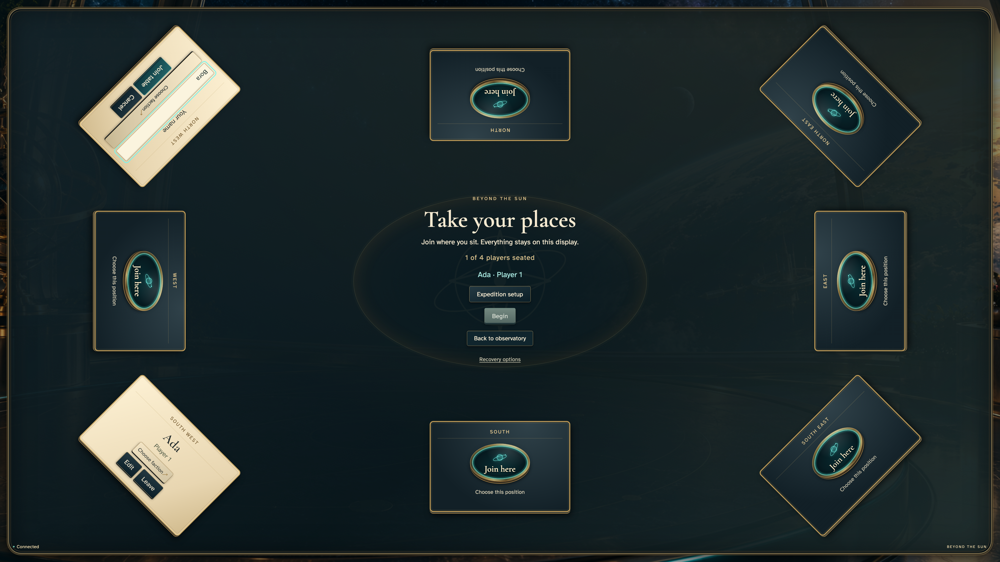](../../screenshots/manage-matching-supply-and-full-ore-yields-at-four-corner-seats/007-seat-1-name-tabletop-4k-darwin.png)

- [x] Name the physical player Bora
- [x] Canonical effects settle before capture.
- [x] Any printed Action plan is ready.
- [x] Public compact topology remains physically separated.
- [x] The gameplay shell fits the actual viewport.

## 9. The local physical seat is retained on this controller

Viewpoint: **Bora · North West · one shared controller**.

| desktop · 1440 × 1000 |
| --- |
|  |

tabletop-4k · 3840 × 2160

- [x] The local physical seat is retained on this controller
- [x] Canonical effects settle before capture.
- [x] Any printed Action plan is ready.
- [x] Public compact topology remains physically separated.
- [x] The gameplay shell fits the actual viewport.

## 10. Open the North East seat on the shared surface

Viewpoint: **Cleo · North East · one shared controller**.

| desktop · 1440 × 1000 |
| --- |
|  |

tabletop-4k · 3840 × 2160

[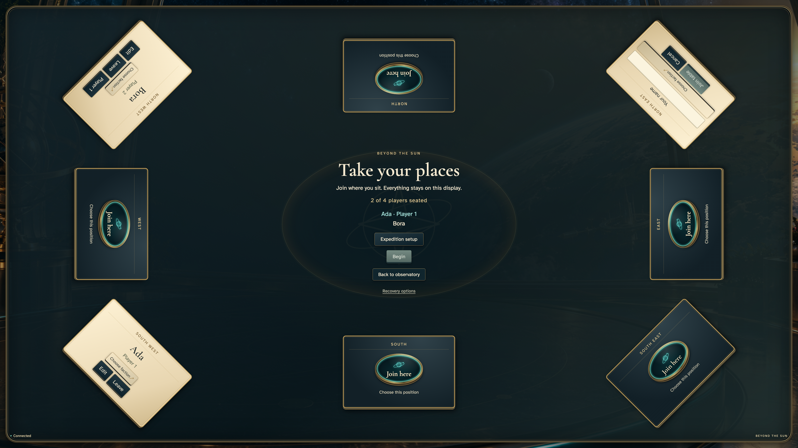](../../screenshots/manage-matching-supply-and-full-ore-yields-at-four-corner-seats/009-seat-2-editor-tabletop-4k-darwin.png)

- [x] Open the North East seat on the shared surface
- [x] Canonical effects settle before capture.
- [x] Any printed Action plan is ready.
- [x] Public compact topology remains physically separated.
- [x] The gameplay shell fits the actual viewport.

## 11. Name the physical player Cleo

Viewpoint: **Cleo · North East · one shared controller**.

| desktop · 1440 × 1000 |
| --- |
|  |

tabletop-4k · 3840 × 2160

- [x] Name the physical player Cleo
- [x] Canonical effects settle before capture.
- [x] Any printed Action plan is ready.
- [x] Public compact topology remains physically separated.
- [x] The gameplay shell fits the actual viewport.

## 12. The local physical seat is retained on this controller

Viewpoint: **Cleo · North East · one shared controller**.

| desktop · 1440 × 1000 |
| --- |
| [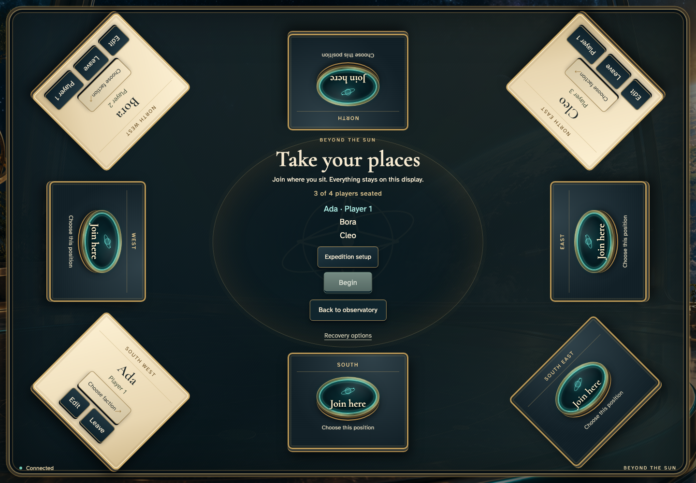](../../screenshots/manage-matching-supply-and-full-ore-yields-at-four-corner-seats/011-seat-2-joined-desktop-darwin.png) |

tabletop-4k · 3840 × 2160

- [x] The local physical seat is retained on this controller
- [x] Canonical effects settle before capture.
- [x] Any printed Action plan is ready.
- [x] Public compact topology remains physically separated.
- [x] The gameplay shell fits the actual viewport.

## 13. Open the South East seat on the shared surface

Viewpoint: **Dara · South East · one shared controller**.

| desktop · 1440 × 1000 |
| --- |
|  |

tabletop-4k · 3840 × 2160

- [x] Open the South East seat on the shared surface
- [x] Canonical effects settle before capture.
- [x] Any printed Action plan is ready.
- [x] Public compact topology remains physically separated.
- [x] The gameplay shell fits the actual viewport.

## 14. Name the physical player Dara

Viewpoint: **Dara · South East · one shared controller**.

| desktop · 1440 × 1000 |
| --- |
|  |

tabletop-4k · 3840 × 2160

- [x] Name the physical player Dara
- [x] Canonical effects settle before capture.
- [x] Any printed Action plan is ready.
- [x] Public compact topology remains physically separated.
- [x] The gameplay shell fits the actual viewport.

## 15. The local physical seat is retained on this controller

Viewpoint: **Dara · South East · one shared controller**.

| desktop · 1440 × 1000 |
| --- |
|  |

tabletop-4k · 3840 × 2160

[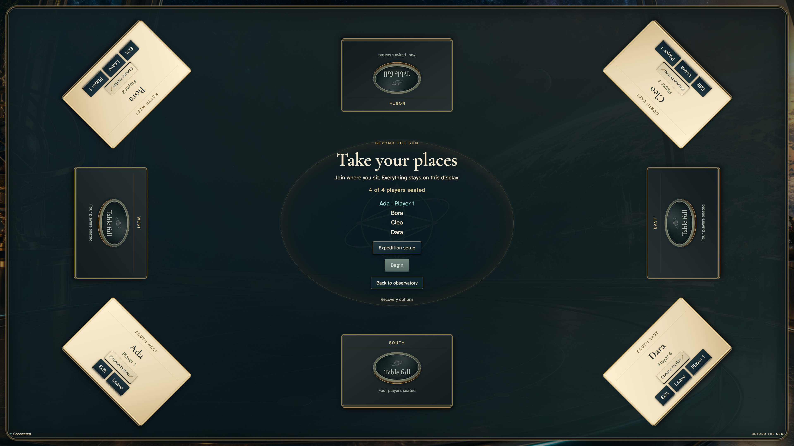](../../screenshots/manage-matching-supply-and-full-ore-yields-at-four-corner-seats/014-seat-3-joined-tabletop-4k-darwin.png)

- [x] The local physical seat is retained on this controller
- [x] Canonical effects settle before capture.
- [x] Any printed Action plan is ready.
- [x] Public compact topology remains physically separated.
- [x] The gameplay shell fits the actual viewport.

## 16. Ada chooses a legal unique Basic faction

Viewpoint: **Ada · South West · one shared controller**.

| desktop · 1440 × 1000 |
| --- |
|  |

tabletop-4k · 3840 × 2160

[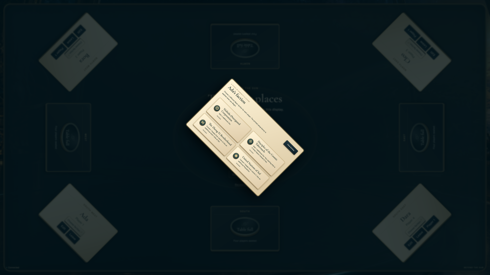](../../screenshots/manage-matching-supply-and-full-ore-yields-at-four-corner-seats/015-faction-0-editor-tabletop-4k-darwin.png)

- [x] Ada chooses a legal unique Basic faction
- [x] Canonical effects settle before capture.
- [x] Any printed Action plan is ready.
- [x] Public compact topology remains physically separated.
- [x] The gameplay shell fits the actual viewport.

## 17. Ada retains Nishida-Østergaard Corporation

Viewpoint: **Ada · South West · one shared controller**.

| desktop · 1440 × 1000 |
| --- |
|  |

tabletop-4k · 3840 × 2160

- [x] Ada retains Nishida-Østergaard Corporation
- [x] Canonical effects settle before capture.
- [x] Any printed Action plan is ready.
- [x] Public compact topology remains physically separated.
- [x] The gameplay shell fits the actual viewport.

## 18. Bora chooses a legal unique Basic faction

Viewpoint: **Bora · North West · one shared controller**.

| desktop · 1440 × 1000 |
| --- |
|  |

tabletop-4k · 3840 × 2160

- [x] Bora chooses a legal unique Basic faction
- [x] Canonical effects settle before capture.
- [x] Any printed Action plan is ready.
- [x] Public compact topology remains physically separated.
- [x] The gameplay shell fits the actual viewport.

## 19. Bora retains The Zheng-Yi Brotherhood

Viewpoint: **Bora · North West · one shared controller**.

| desktop · 1440 × 1000 |
| --- |
| [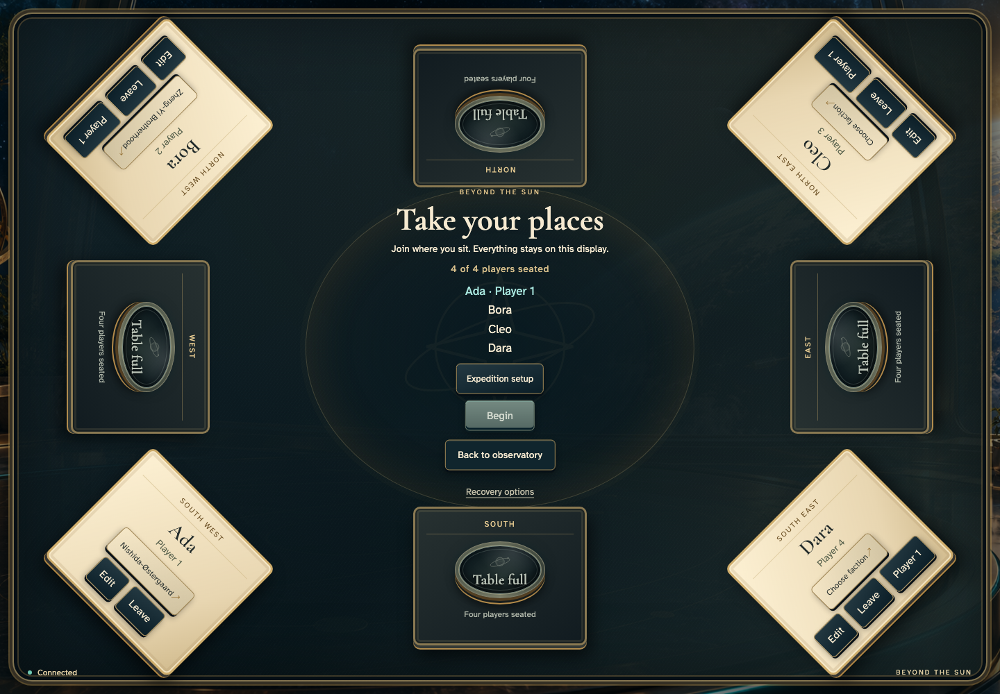](../../screenshots/manage-matching-supply-and-full-ore-yields-at-four-corner-seats/018-faction-1-chosen-desktop-darwin.png) |

tabletop-4k · 3840 × 2160

- [x] Bora retains The Zheng-Yi Brotherhood
- [x] Canonical effects settle before capture.
- [x] Any printed Action plan is ready.
- [x] Public compact topology remains physically separated.
- [x] The gameplay shell fits the actual viewport.

## 20. Cleo chooses a legal unique Basic faction

Viewpoint: **Cleo · North East · one shared controller**.

| desktop · 1440 × 1000 |
| --- |
|  |

tabletop-4k · 3840 × 2160

- [x] Cleo chooses a legal unique Basic faction
- [x] Canonical effects settle before capture.
- [x] Any printed Action plan is ready.
- [x] Public compact topology remains physically separated.
- [x] The gameplay shell fits the actual viewport.

## 21. Cleo retains Disciples of the Cosmic Tabernacle

Viewpoint: **Cleo · North East · one shared controller**.

| desktop · 1440 × 1000 |
| --- |
|  |

tabletop-4k · 3840 × 2160

- [x] Cleo retains Disciples of the Cosmic Tabernacle
- [x] Canonical effects settle before capture.
- [x] Any printed Action plan is ready.
- [x] Public compact topology remains physically separated.
- [x] The gameplay shell fits the actual viewport.

## 22. Dara chooses a legal unique Basic faction

Viewpoint: **Dara · South East · one shared controller**.

| desktop · 1440 × 1000 |
| --- |
|  |

tabletop-4k · 3840 × 2160

- [x] Dara chooses a legal unique Basic faction
- [x] Canonical effects settle before capture.
- [x] Any printed Action plan is ready.
- [x] Public compact topology remains physically separated.
- [x] The gameplay shell fits the actual viewport.

## 23. Dara retains United Nations of Sol

Viewpoint: **Dara · South East · one shared controller**.

| desktop · 1440 × 1000 |
| --- |
|  |

tabletop-4k · 3840 × 2160

- [x] Dara retains United Nations of Sol
- [x] Canonical effects settle before capture.
- [x] Any printed Action plan is ready.
- [x] Public compact topology remains physically separated.
- [x] The gameplay shell fits the actual viewport.

## 24. Begin the immutable source-reviewed Basic setup through the ordinary UI

Viewpoint: **Ada · South West · one shared controller**.

| desktop · 1440 × 1000 |
| --- |
|  |

tabletop-4k · 3840 × 2160

- [x] Begin the immutable source-reviewed Basic setup through the ordinary UI
- [x] Canonical effects settle before capture.
- [x] Any printed Action plan is ready.
- [x] Public compact topology remains physically separated.
- [x] The gameplay shell fits the actual viewport.

## 25. Ada opens the actual research and Action instrument

Viewpoint: **Ada · South West · one shared controller**.

| desktop · 1440 × 1000 |
| --- |
|  |

tabletop-4k · 3840 × 2160

- [x] Ada opens the actual research and Action instrument
- [x] Canonical effects settle before capture.
- [x] Any printed Action plan is ready.
- [x] Public compact topology remains physically separated.
- [x] The gameplay shell fits the actual viewport.

## 26. Ada selects the legal printed space 1

Viewpoint: **Ada · South West · one shared controller**.

| desktop · 1440 × 1000 |
| --- |
|  |

tabletop-4k · 3840 × 2160

- [x] Ada selects the legal printed space 1
- [x] Canonical effects settle before capture.
- [x] Any printed Action plan is ready.
- [x] Public compact topology remains physically separated.
- [x] The gameplay shell fits the actual viewport.

## 27. Browse the next public Level I face

Viewpoint: **Ada · South West · one shared controller**.

| desktop · 1440 × 1000 |
| --- |
|  |

tabletop-4k · 3840 × 2160

- [x] Browse the next public Level I face
- [x] Canonical effects settle before capture.
- [x] Any printed Action plan is ready.
- [x] Public compact topology remains physically separated.
- [x] The gameplay shell fits the actual viewport.

## 28. Browse the next public Level I face

Viewpoint: **Ada · South West · one shared controller**.

| desktop · 1440 × 1000 |
| --- |
|  |

tabletop-4k · 3840 × 2160

[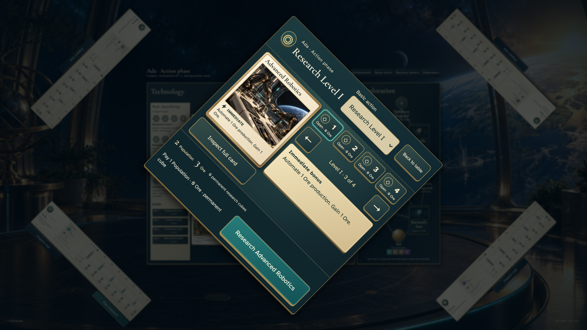](../../screenshots/manage-matching-supply-and-full-ore-yields-at-four-corner-seats/027-r0-ada-browse-1-tabletop-4k-darwin.png)

- [x] Browse the next public Level I face
- [x] Canonical effects settle before capture.
- [x] Any printed Action plan is ready.
- [x] Public compact topology remains physically separated.
- [x] The gameplay shell fits the actual viewport.

## 29. Browse the next public Level I face

Viewpoint: **Ada · South West · one shared controller**.

| desktop · 1440 × 1000 |
| --- |
| [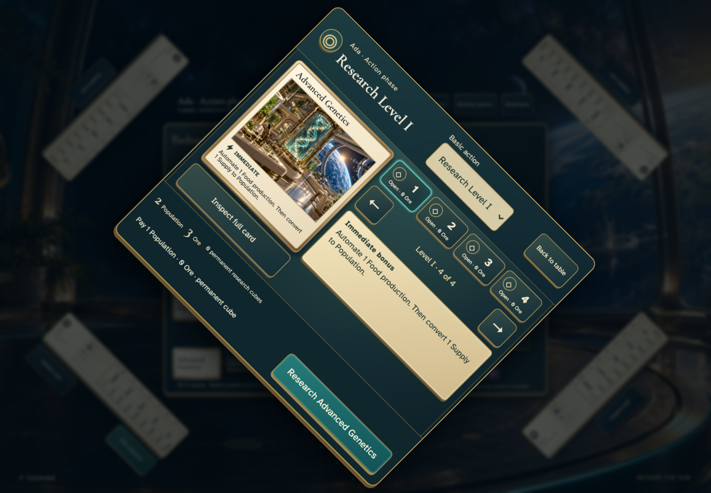](../../screenshots/manage-matching-supply-and-full-ore-yields-at-four-corner-seats/028-r0-ada-browse-2-desktop-darwin.png) |

tabletop-4k · 3840 × 2160

[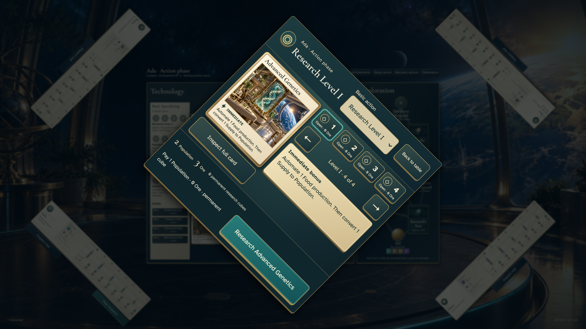](../../screenshots/manage-matching-supply-and-full-ore-yields-at-four-corner-seats/028-r0-ada-browse-2-tabletop-4k-darwin.png)

- [x] Browse the next public Level I face
- [x] Canonical effects settle before capture.
- [x] Any printed Action plan is ready.
- [x] Public compact topology remains physically separated.
- [x] The gameplay shell fits the actual viewport.

## 30. Pay once and receive Advanced Genetics's immediate bonus

Viewpoint: **Ada · South West · one shared controller**.

| desktop · 1440 × 1000 |
| --- |
|  |

tabletop-4k · 3840 × 2160

- [x] Pay once and receive Advanced Genetics's immediate bonus
- [x] Canonical effects settle before capture.
- [x] Any printed Action plan is ready.
- [x] Public compact topology remains physically separated.
- [x] The gameplay shell fits the actual viewport.

## 31. Ada completes production and hands off to Bora

Viewpoint: **Ada · South West · one shared controller**.

| desktop · 1440 × 1000 |
| --- |
|  |

tabletop-4k · 3840 × 2160

- [x] Ada completes production and hands off to Bora
- [x] Canonical effects settle before capture.
- [x] Any printed Action plan is ready.
- [x] Public compact topology remains physically separated.
- [x] The gameplay shell fits the actual viewport.

## 32. Bora opens the actual research and Action instrument

Viewpoint: **Bora · North West · one shared controller**.

| desktop · 1440 × 1000 |
| --- |
|  |

tabletop-4k · 3840 × 2160

- [x] Bora opens the actual research and Action instrument
- [x] Canonical effects settle before capture.
- [x] Any printed Action plan is ready.
- [x] Public compact topology remains physically separated.
- [x] The gameplay shell fits the actual viewport.

## 33. Bora selects ordinary gathering

Viewpoint: **Bora · North West · one shared controller**.

| desktop · 1440 × 1000 |
| --- |
|  |

tabletop-4k · 3840 × 2160

- [x] Bora selects ordinary gathering
- [x] Canonical effects settle before capture.
- [x] Any printed Action plan is ready.
- [x] Public compact topology remains physically separated.
- [x] The gameplay shell fits the actual viewport.

## 34. Receive the printed gather resources before ordinary production

Viewpoint: **Bora · North West · one shared controller**.

| desktop · 1440 × 1000 |
| --- |
|  |

tabletop-4k · 3840 × 2160

[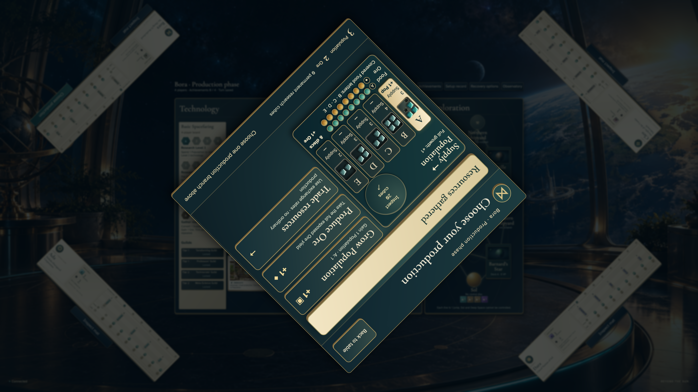](../../screenshots/manage-matching-supply-and-full-ore-yields-at-four-corner-seats/033-r0-bora-gathered-tabletop-4k-darwin.png)

- [x] Receive the printed gather resources before ordinary production
- [x] Canonical effects settle before capture.
- [x] Any printed Action plan is ready.
- [x] Public compact topology remains physically separated.
- [x] The gameplay shell fits the actual viewport.

## 35. Bora completes production and hands off to Cleo

Viewpoint: **Bora · North West · one shared controller**.

| desktop · 1440 × 1000 |
| --- |
|  |

tabletop-4k · 3840 × 2160

[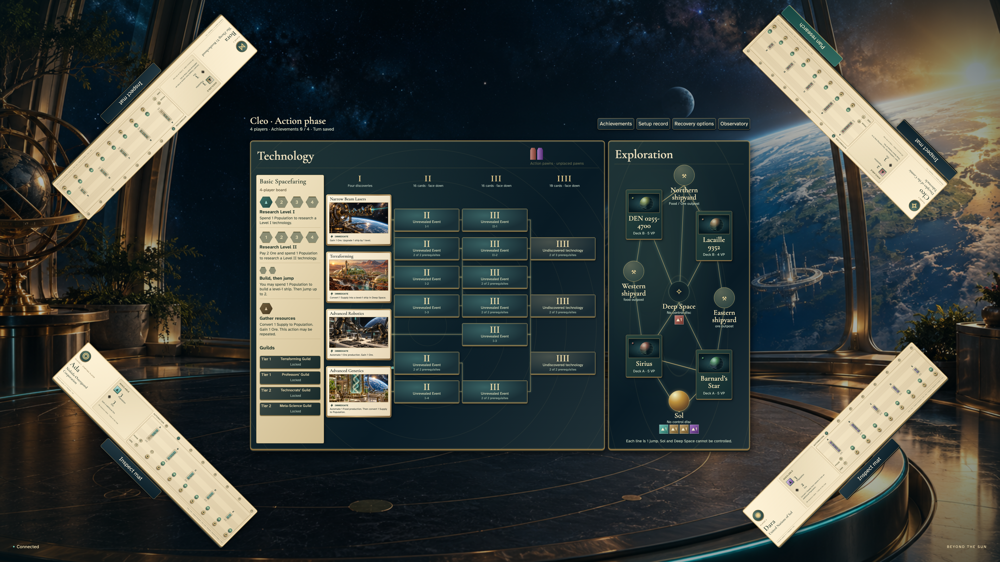](../../screenshots/manage-matching-supply-and-full-ore-yields-at-four-corner-seats/034-r0-bora-handoff-tabletop-4k-darwin.png)

- [x] Bora completes production and hands off to Cleo
- [x] Canonical effects settle before capture.
- [x] Any printed Action plan is ready.
- [x] Public compact topology remains physically separated.
- [x] The gameplay shell fits the actual viewport.

## 36. Cleo opens the actual research and Action instrument

Viewpoint: **Cleo · North East · one shared controller**.

| desktop · 1440 × 1000 |
| --- |
| [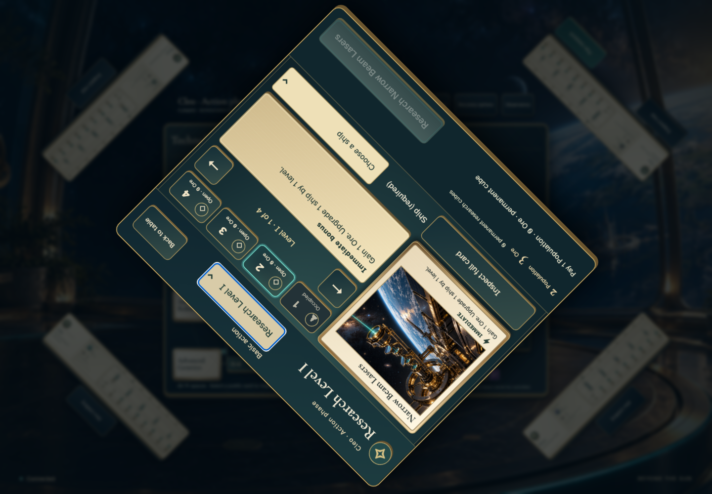](../../screenshots/manage-matching-supply-and-full-ore-yields-at-four-corner-seats/035-r0-cleo-plan-desktop-darwin.png) |

tabletop-4k · 3840 × 2160

- [x] Cleo opens the actual research and Action instrument
- [x] Canonical effects settle before capture.
- [x] Any printed Action plan is ready.
- [x] Public compact topology remains physically separated.
- [x] The gameplay shell fits the actual viewport.

## 37. Cleo selects the legal printed space 2

Viewpoint: **Cleo · North East · one shared controller**.

| desktop · 1440 × 1000 |
| --- |
|  |

tabletop-4k · 3840 × 2160

[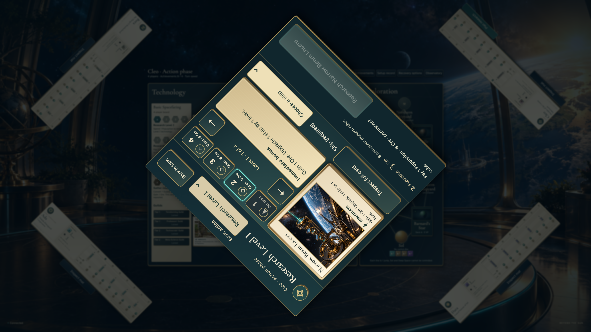](../../screenshots/manage-matching-supply-and-full-ore-yields-at-four-corner-seats/036-r0-cleo-space-tabletop-4k-darwin.png)

- [x] Cleo selects the legal printed space 2
- [x] Canonical effects settle before capture.
- [x] Any printed Action plan is ready.
- [x] Public compact topology remains physically separated.
- [x] The gameplay shell fits the actual viewport.

## 38. Browse the next public Level I face

Viewpoint: **Cleo · North East · one shared controller**.

| desktop · 1440 × 1000 |
| --- |
| [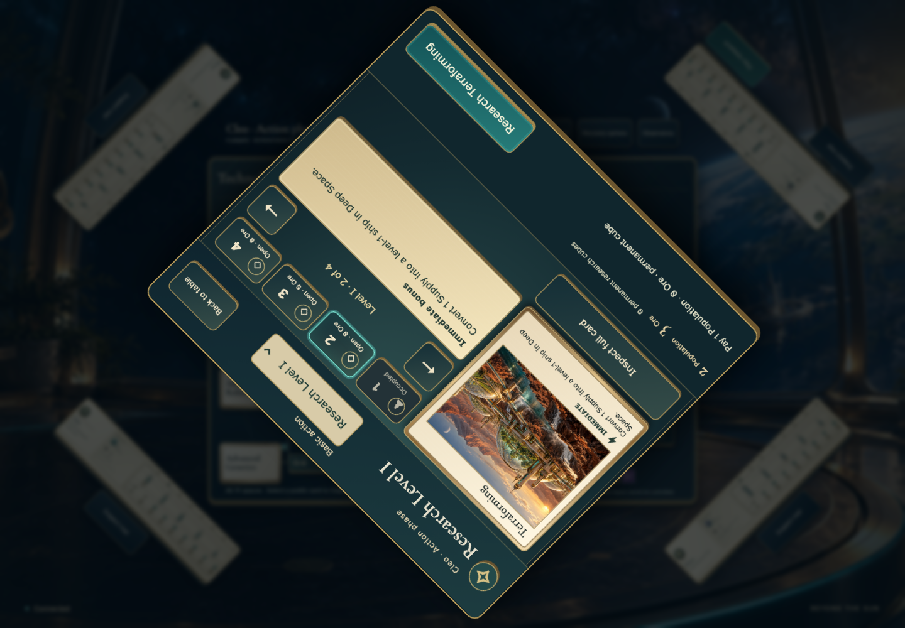](../../screenshots/manage-matching-supply-and-full-ore-yields-at-four-corner-seats/037-r0-cleo-browse-0-desktop-darwin.png) |

tabletop-4k · 3840 × 2160

[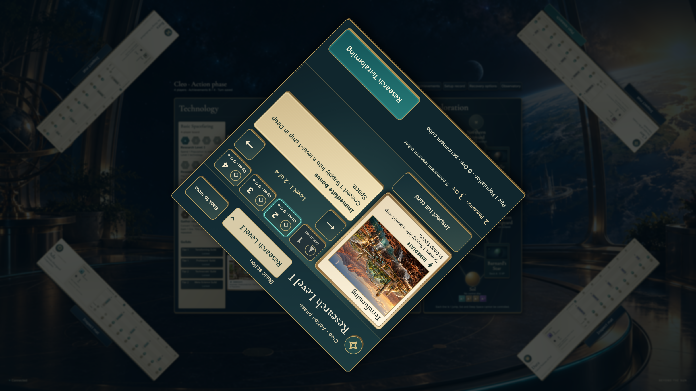](../../screenshots/manage-matching-supply-and-full-ore-yields-at-four-corner-seats/037-r0-cleo-browse-0-tabletop-4k-darwin.png)

- [x] Browse the next public Level I face
- [x] Canonical effects settle before capture.
- [x] Any printed Action plan is ready.
- [x] Public compact topology remains physically separated.
- [x] The gameplay shell fits the actual viewport.

## 39. Pay once and receive Terraforming's immediate bonus

Viewpoint: **Cleo · North East · one shared controller**.

| desktop · 1440 × 1000 |
| --- |
| [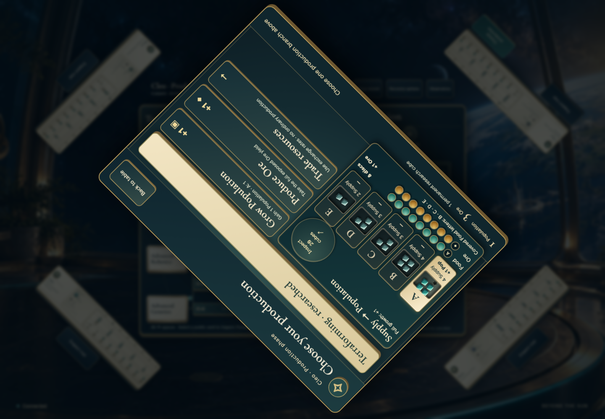](../../screenshots/manage-matching-supply-and-full-ore-yields-at-four-corner-seats/038-r0-cleo-researched-desktop-darwin.png) |

tabletop-4k · 3840 × 2160

- [x] Pay once and receive Terraforming's immediate bonus
- [x] Canonical effects settle before capture.
- [x] Any printed Action plan is ready.
- [x] Public compact topology remains physically separated.
- [x] The gameplay shell fits the actual viewport.

## 40. Cleo completes production and hands off to Dara

Viewpoint: **Cleo · North East · one shared controller**.

| desktop · 1440 × 1000 |
| --- |
| [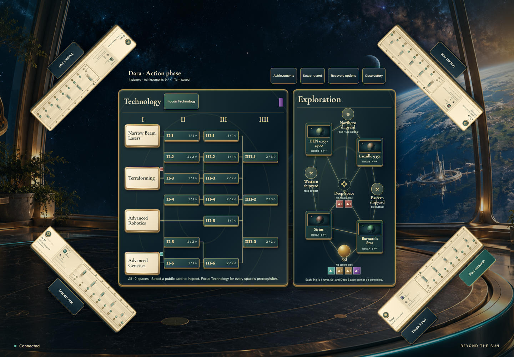](../../screenshots/manage-matching-supply-and-full-ore-yields-at-four-corner-seats/039-r0-cleo-handoff-desktop-darwin.png) |

tabletop-4k · 3840 × 2160

[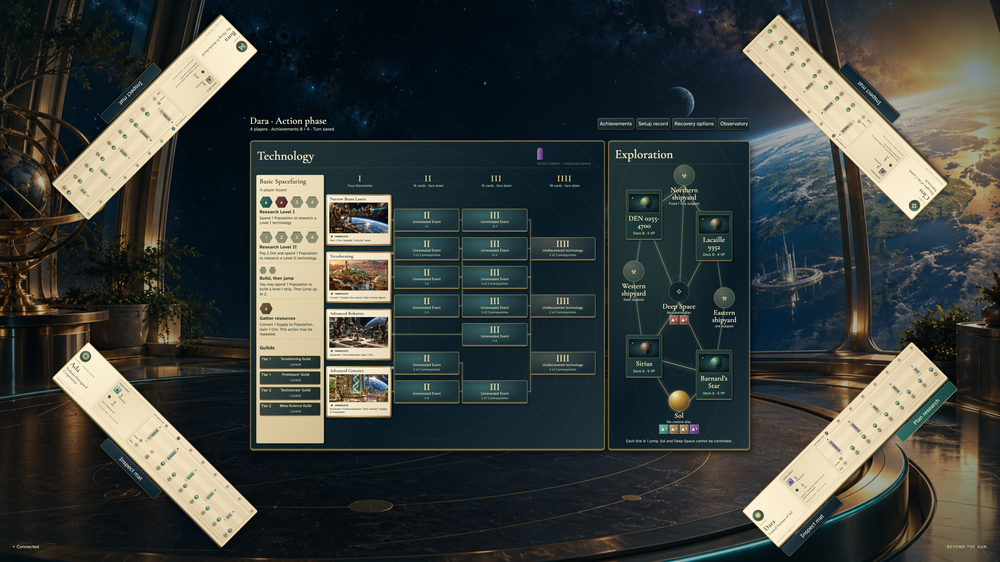](../../screenshots/manage-matching-supply-and-full-ore-yields-at-four-corner-seats/039-r0-cleo-handoff-tabletop-4k-darwin.png)

- [x] Cleo completes production and hands off to Dara
- [x] Canonical effects settle before capture.
- [x] Any printed Action plan is ready.
- [x] Public compact topology remains physically separated.
- [x] The gameplay shell fits the actual viewport.

## 41. Dara opens the actual research and Action instrument

Viewpoint: **Dara · South East · one shared controller**.

| desktop · 1440 × 1000 |
| --- |
| [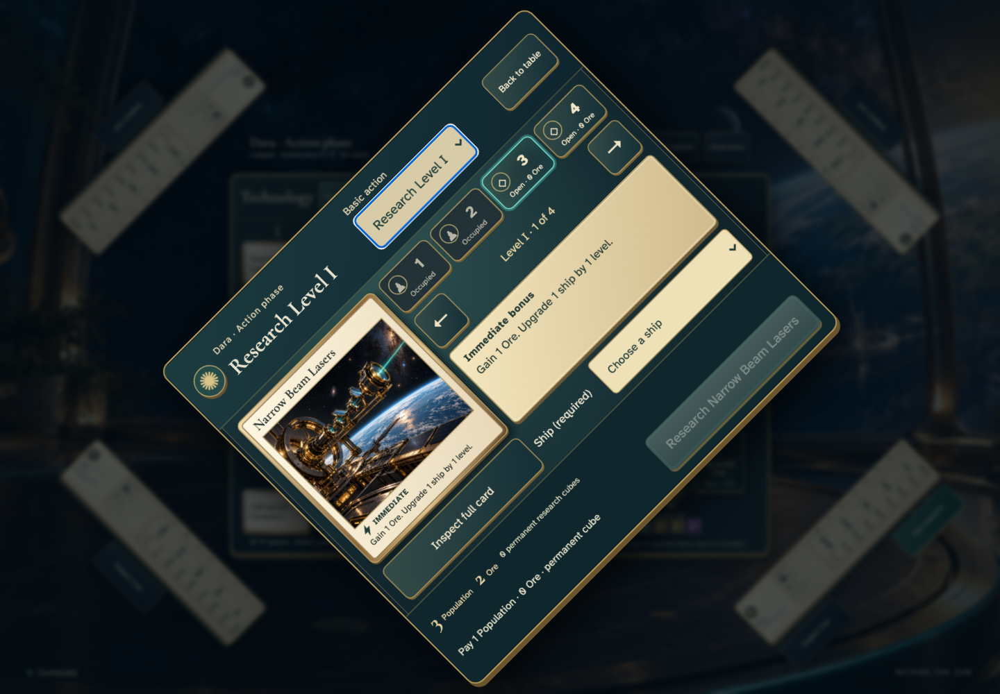](../../screenshots/manage-matching-supply-and-full-ore-yields-at-four-corner-seats/040-r0-dara-plan-desktop-darwin.png) |

tabletop-4k · 3840 × 2160

[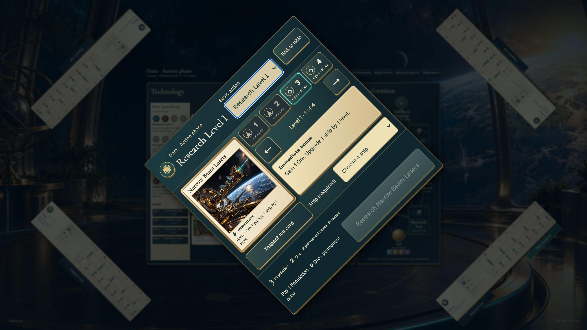](../../screenshots/manage-matching-supply-and-full-ore-yields-at-four-corner-seats/040-r0-dara-plan-tabletop-4k-darwin.png)

- [x] Dara opens the actual research and Action instrument
- [x] Canonical effects settle before capture.
- [x] Any printed Action plan is ready.
- [x] Public compact topology remains physically separated.
- [x] The gameplay shell fits the actual viewport.

## 42. Dara selects the legal printed space 3

Viewpoint: **Dara · South East · one shared controller**.

| desktop · 1440 × 1000 |
| --- |
|  |

tabletop-4k · 3840 × 2160

[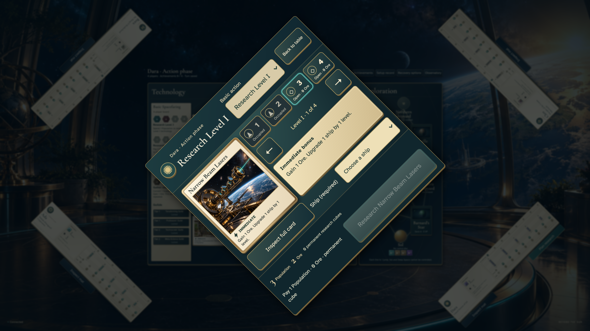](../../screenshots/manage-matching-supply-and-full-ore-yields-at-four-corner-seats/041-r0-dara-space-tabletop-4k-darwin.png)

- [x] Dara selects the legal printed space 3
- [x] Canonical effects settle before capture.
- [x] Any printed Action plan is ready.
- [x] Public compact topology remains physically separated.
- [x] The gameplay shell fits the actual viewport.

## 43. Browse the next public Level I face

Viewpoint: **Dara · South East · one shared controller**.

| desktop · 1440 × 1000 |
| --- |
| [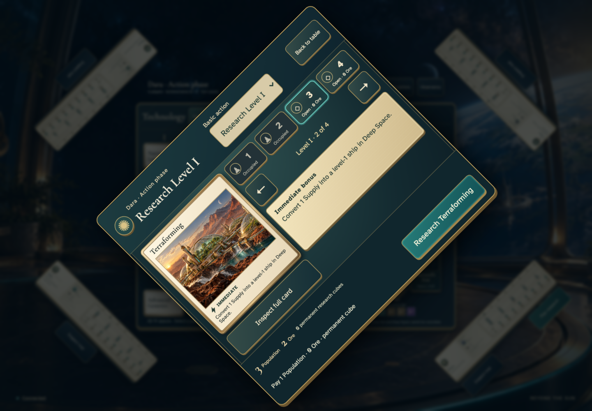](../../screenshots/manage-matching-supply-and-full-ore-yields-at-four-corner-seats/042-r0-dara-browse-0-desktop-darwin.png) |

tabletop-4k · 3840 × 2160

- [x] Browse the next public Level I face
- [x] Canonical effects settle before capture.
- [x] Any printed Action plan is ready.
- [x] Public compact topology remains physically separated.
- [x] The gameplay shell fits the actual viewport.

## 44. Browse the next public Level I face

Viewpoint: **Dara · South East · one shared controller**.

| desktop · 1440 × 1000 |
| --- |
| [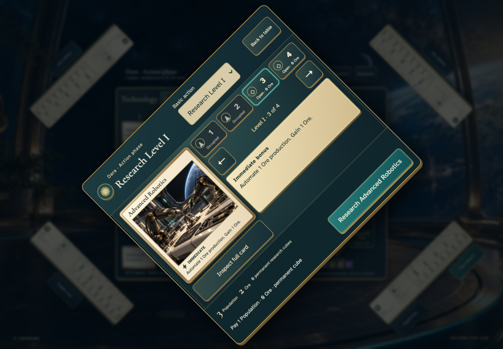](../../screenshots/manage-matching-supply-and-full-ore-yields-at-four-corner-seats/043-r0-dara-browse-1-desktop-darwin.png) |

tabletop-4k · 3840 × 2160

- [x] Browse the next public Level I face
- [x] Canonical effects settle before capture.
- [x] Any printed Action plan is ready.
- [x] Public compact topology remains physically separated.
- [x] The gameplay shell fits the actual viewport.

## 45. Browse the next public Level I face

Viewpoint: **Dara · South East · one shared controller**.

| desktop · 1440 × 1000 |
| --- |
| [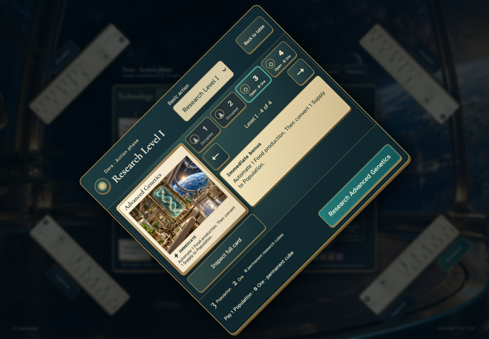](../../screenshots/manage-matching-supply-and-full-ore-yields-at-four-corner-seats/044-r0-dara-browse-2-desktop-darwin.png) |

tabletop-4k · 3840 × 2160

[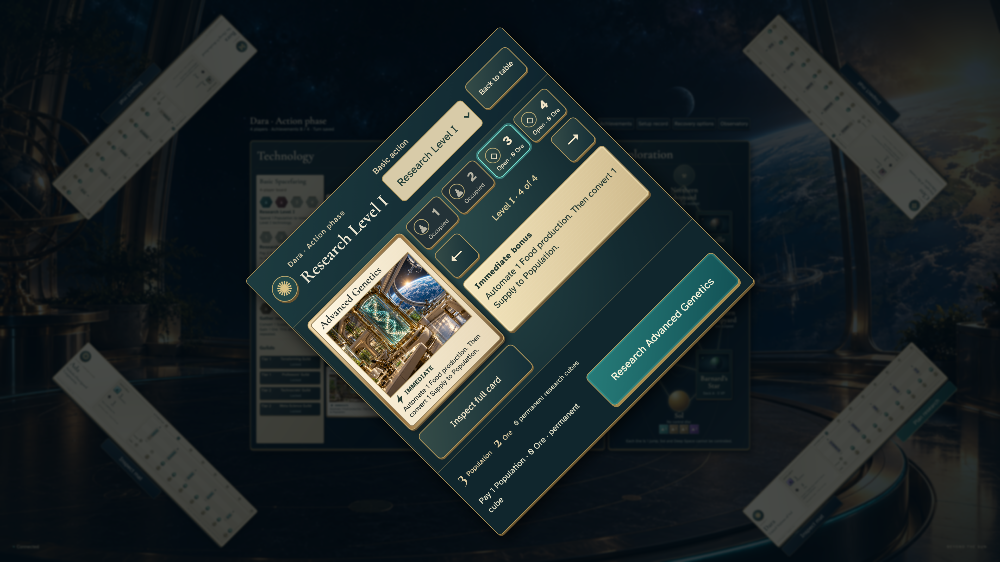](../../screenshots/manage-matching-supply-and-full-ore-yields-at-four-corner-seats/044-r0-dara-browse-2-tabletop-4k-darwin.png)

- [x] Browse the next public Level I face
- [x] Canonical effects settle before capture.
- [x] Any printed Action plan is ready.
- [x] Public compact topology remains physically separated.
- [x] The gameplay shell fits the actual viewport.

## 46. Pay once and receive Advanced Genetics's immediate bonus

Viewpoint: **Dara · South East · one shared controller**.

| desktop · 1440 × 1000 |
| --- |
|  |

tabletop-4k · 3840 × 2160

[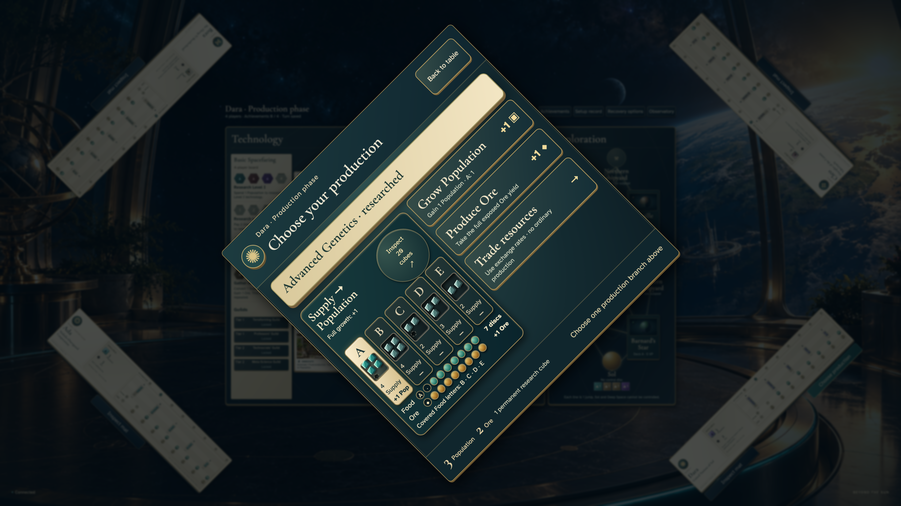](../../screenshots/manage-matching-supply-and-full-ore-yields-at-four-corner-seats/045-r0-dara-researched-tabletop-4k-darwin.png)

- [x] Pay once and receive Advanced Genetics's immediate bonus
- [x] Canonical effects settle before capture.
- [x] Any printed Action plan is ready.
- [x] Public compact topology remains physically separated.
- [x] The gameplay shell fits the actual viewport.

## 47. Dara completes production and hands off to Ada

Viewpoint: **Dara · South East · one shared controller**.

| desktop · 1440 × 1000 |
| --- |
|  |

tabletop-4k · 3840 × 2160

- [x] Dara completes production and hands off to Ada
- [x] Canonical effects settle before capture.
- [x] Any printed Action plan is ready.
- [x] Public compact topology remains physically separated.
- [x] The gameplay shell fits the actual viewport.

## 48. Ada opens the actual research and Action instrument

Viewpoint: **Ada · South West · one shared controller**.

| desktop · 1440 × 1000 |
| --- |
| [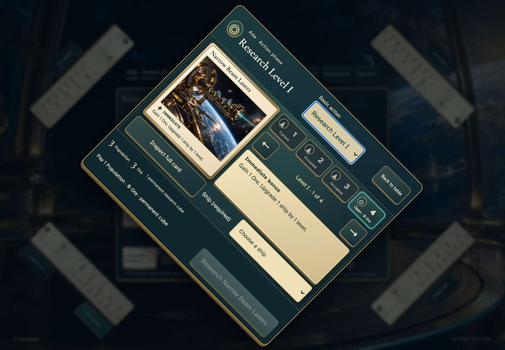](../../screenshots/manage-matching-supply-and-full-ore-yields-at-four-corner-seats/047-r1-ada-plan-desktop-darwin.png) |

tabletop-4k · 3840 × 2160

[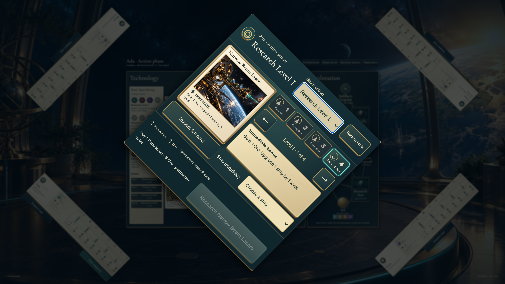](../../screenshots/manage-matching-supply-and-full-ore-yields-at-four-corner-seats/047-r1-ada-plan-tabletop-4k-darwin.png)

- [x] Ada opens the actual research and Action instrument
- [x] Canonical effects settle before capture.
- [x] Any printed Action plan is ready.
- [x] Public compact topology remains physically separated.
- [x] The gameplay shell fits the actual viewport.

## 49. Ada selects the legal printed space 4

Viewpoint: **Ada · South West · one shared controller**.

| desktop · 1440 × 1000 |
| --- |
| [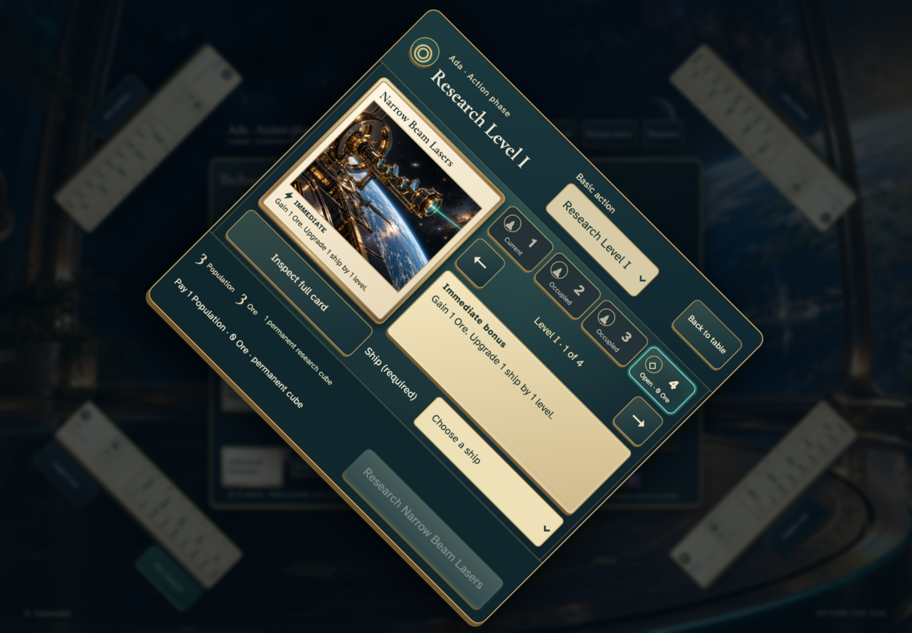](../../screenshots/manage-matching-supply-and-full-ore-yields-at-four-corner-seats/048-r1-ada-space-desktop-darwin.png) |

tabletop-4k · 3840 × 2160

- [x] Ada selects the legal printed space 4
- [x] Canonical effects settle before capture.
- [x] Any printed Action plan is ready.
- [x] Public compact topology remains physically separated.
- [x] The gameplay shell fits the actual viewport.

## 50. The immediate bonus requires an explicit owned target

Viewpoint: **Ada · South West · one shared controller**.

| desktop · 1440 × 1000 |
| --- |
|  |

tabletop-4k · 3840 × 2160

[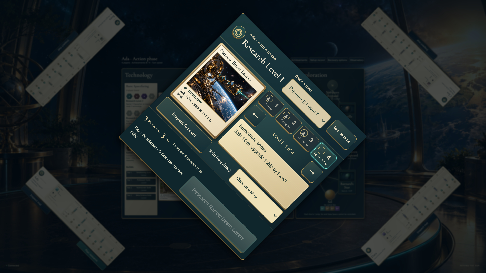](../../screenshots/manage-matching-supply-and-full-ore-yields-at-four-corner-seats/049-r1-ada-requires-ship-tabletop-4k-darwin.png)

- [x] The immediate bonus requires an explicit owned target
- [x] Canonical effects settle before capture.
- [x] Any printed Action plan is ready.
- [x] Public compact topology remains physically separated.
- [x] The gameplay shell fits the actual viewport.

## 51. Choose the original Sol ship for the one-level upgrade

Viewpoint: **Ada · South West · one shared controller**.

| desktop · 1440 × 1000 |
| --- |
| [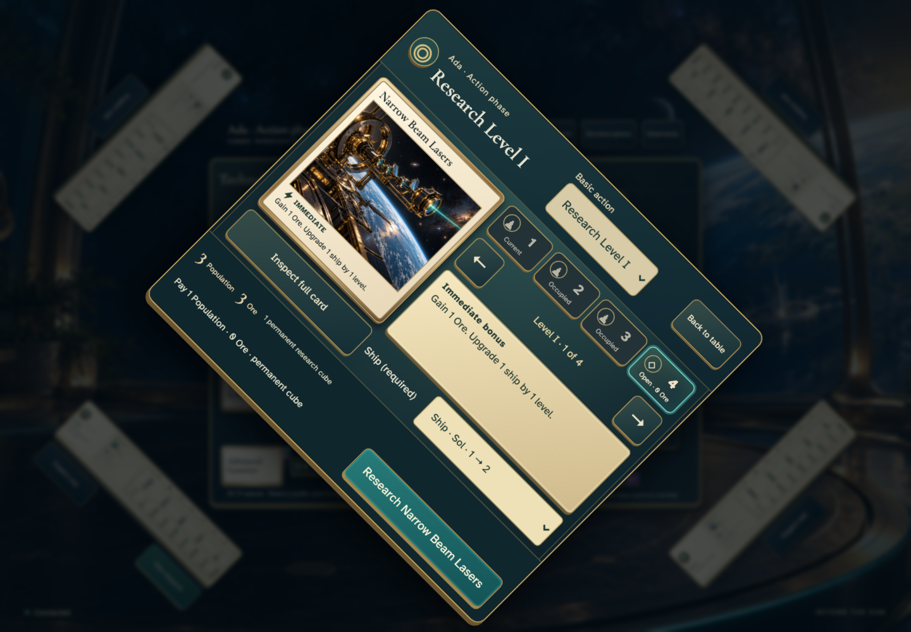](../../screenshots/manage-matching-supply-and-full-ore-yields-at-four-corner-seats/050-r1-ada-ship-desktop-darwin.png) |

tabletop-4k · 3840 × 2160

[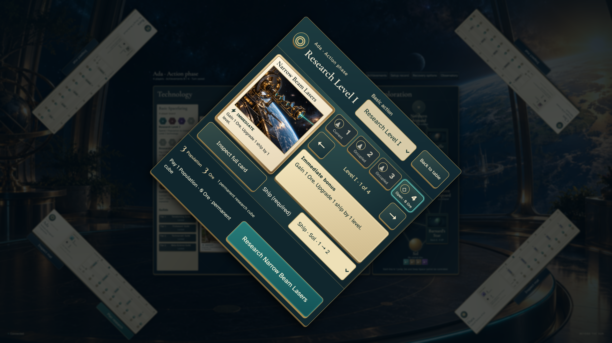](../../screenshots/manage-matching-supply-and-full-ore-yields-at-four-corner-seats/050-r1-ada-ship-tabletop-4k-darwin.png)

- [x] Choose the original Sol ship for the one-level upgrade
- [x] Canonical effects settle before capture.
- [x] Any printed Action plan is ready.
- [x] Public compact topology remains physically separated.
- [x] The gameplay shell fits the actual viewport.

## 52. Pay once and receive Narrow Beam Lasers's immediate bonus

Viewpoint: **Ada · South West · one shared controller**.

| desktop · 1440 × 1000 |
| --- |
| [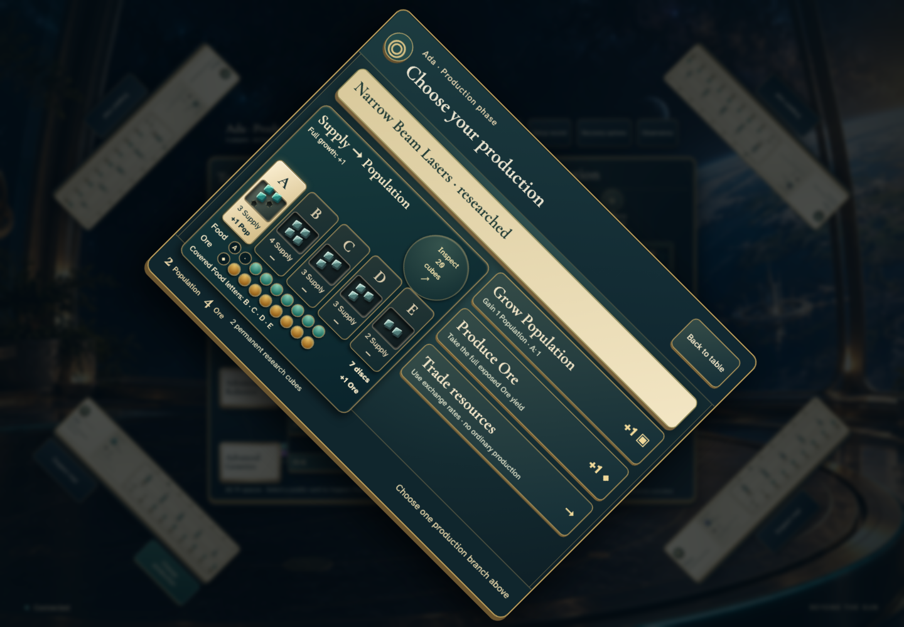](../../screenshots/manage-matching-supply-and-full-ore-yields-at-four-corner-seats/051-r1-ada-researched-desktop-darwin.png) |

tabletop-4k · 3840 × 2160

[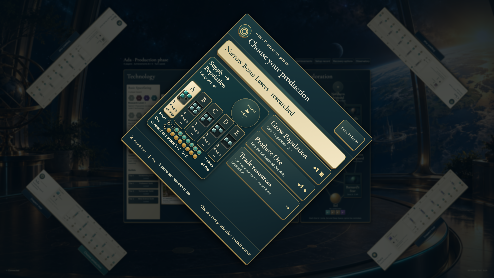](../../screenshots/manage-matching-supply-and-full-ore-yields-at-four-corner-seats/051-r1-ada-researched-tabletop-4k-darwin.png)

- [x] Pay once and receive Narrow Beam Lasers's immediate bonus
- [x] Canonical effects settle before capture.
- [x] Any printed Action plan is ready.
- [x] Public compact topology remains physically separated.
- [x] The gameplay shell fits the actual viewport.

## 53. Ada completes production and hands off to Bora

Viewpoint: **Ada · South West · one shared controller**.

| desktop · 1440 × 1000 |
| --- |
|  |

tabletop-4k · 3840 × 2160

- [x] Ada completes production and hands off to Bora
- [x] Canonical effects settle before capture.
- [x] Any printed Action plan is ready.
- [x] Public compact topology remains physically separated.
- [x] The gameplay shell fits the actual viewport.

## 54. Bora opens the actual research and Action instrument

Viewpoint: **Bora · North West · one shared controller**.

| desktop · 1440 × 1000 |
| --- |
| [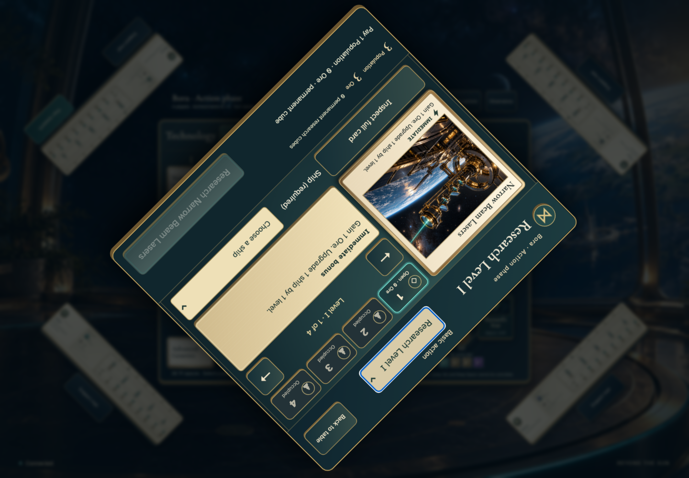](../../screenshots/manage-matching-supply-and-full-ore-yields-at-four-corner-seats/053-r1-bora-plan-desktop-darwin.png) |

tabletop-4k · 3840 × 2160

- [x] Bora opens the actual research and Action instrument
- [x] Canonical effects settle before capture.
- [x] Any printed Action plan is ready.
- [x] Public compact topology remains physically separated.
- [x] The gameplay shell fits the actual viewport.

## 55. Bora selects the legal printed space 1

Viewpoint: **Bora · North West · one shared controller**.

| desktop · 1440 × 1000 |
| --- |
| [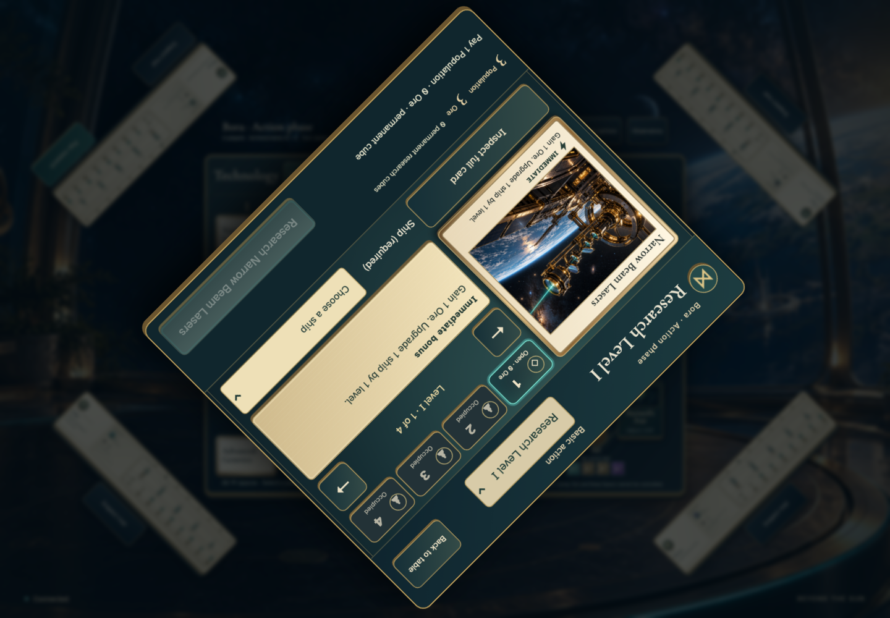](../../screenshots/manage-matching-supply-and-full-ore-yields-at-four-corner-seats/054-r1-bora-space-desktop-darwin.png) |

tabletop-4k · 3840 × 2160

- [x] Bora selects the legal printed space 1
- [x] Canonical effects settle before capture.
- [x] Any printed Action plan is ready.
- [x] Public compact topology remains physically separated.
- [x] The gameplay shell fits the actual viewport.

## 56. Browse the next public Level I face

Viewpoint: **Bora · North West · one shared controller**.

| desktop · 1440 × 1000 |
| --- |
|  |

tabletop-4k · 3840 × 2160

[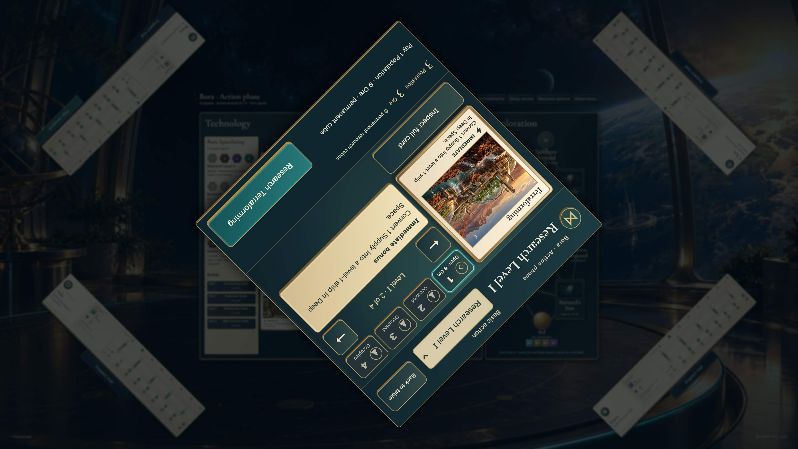](../../screenshots/manage-matching-supply-and-full-ore-yields-at-four-corner-seats/055-r1-bora-browse-0-tabletop-4k-darwin.png)

- [x] Browse the next public Level I face
- [x] Canonical effects settle before capture.
- [x] Any printed Action plan is ready.
- [x] Public compact topology remains physically separated.
- [x] The gameplay shell fits the actual viewport.

## 57. Browse the next public Level I face

Viewpoint: **Bora · North West · one shared controller**.

| desktop · 1440 × 1000 |
| --- |
| [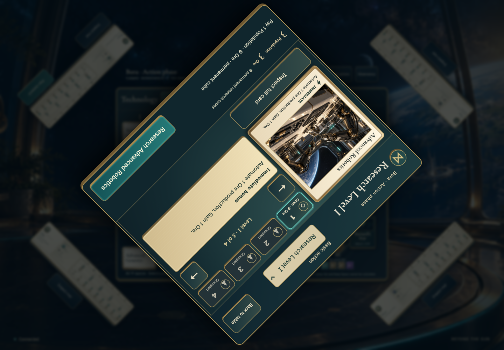](../../screenshots/manage-matching-supply-and-full-ore-yields-at-four-corner-seats/056-r1-bora-browse-1-desktop-darwin.png) |

tabletop-4k · 3840 × 2160

[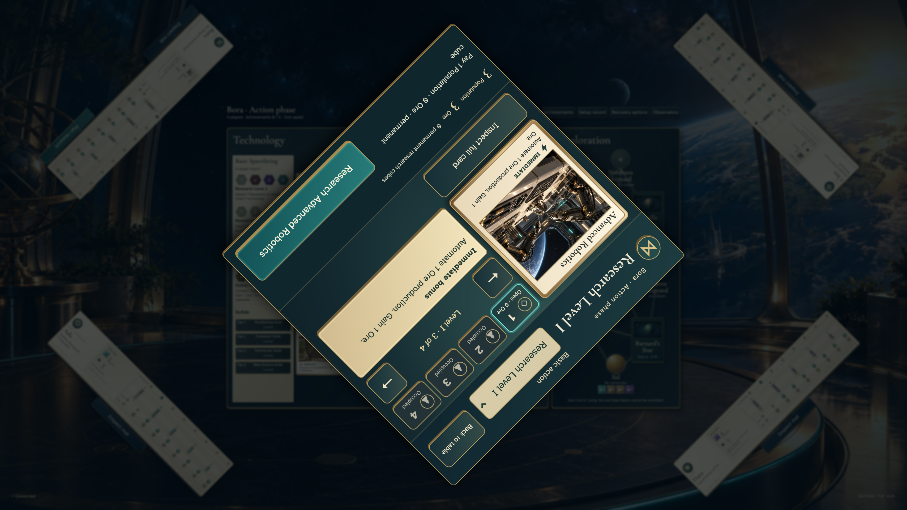](../../screenshots/manage-matching-supply-and-full-ore-yields-at-four-corner-seats/056-r1-bora-browse-1-tabletop-4k-darwin.png)

- [x] Browse the next public Level I face
- [x] Canonical effects settle before capture.
- [x] Any printed Action plan is ready.
- [x] Public compact topology remains physically separated.
- [x] The gameplay shell fits the actual viewport.

## 58. Pay once and receive Advanced Robotics's immediate bonus

Viewpoint: **Bora · North West · one shared controller**.

| desktop · 1440 × 1000 |
| --- |
|  |

tabletop-4k · 3840 × 2160

[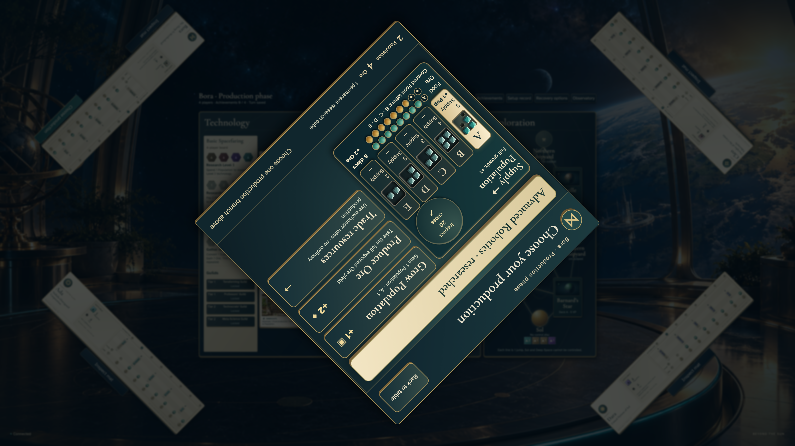](../../screenshots/manage-matching-supply-and-full-ore-yields-at-four-corner-seats/057-r1-bora-researched-tabletop-4k-darwin.png)

- [x] Pay once and receive Advanced Robotics's immediate bonus
- [x] Canonical effects settle before capture.
- [x] Any printed Action plan is ready.
- [x] Public compact topology remains physically separated.
- [x] The gameplay shell fits the actual viewport.

## 59. Bora completes production and hands off to Cleo

Viewpoint: **Bora · North West · one shared controller**.

| desktop · 1440 × 1000 |
| --- |
|  |

tabletop-4k · 3840 × 2160

- [x] Bora completes production and hands off to Cleo
- [x] Canonical effects settle before capture.
- [x] Any printed Action plan is ready.
- [x] Public compact topology remains physically separated.
- [x] The gameplay shell fits the actual viewport.

## 60. Cleo opens the actual research and Action instrument

Viewpoint: **Cleo · North East · one shared controller**.

| desktop · 1440 × 1000 |
| --- |
| [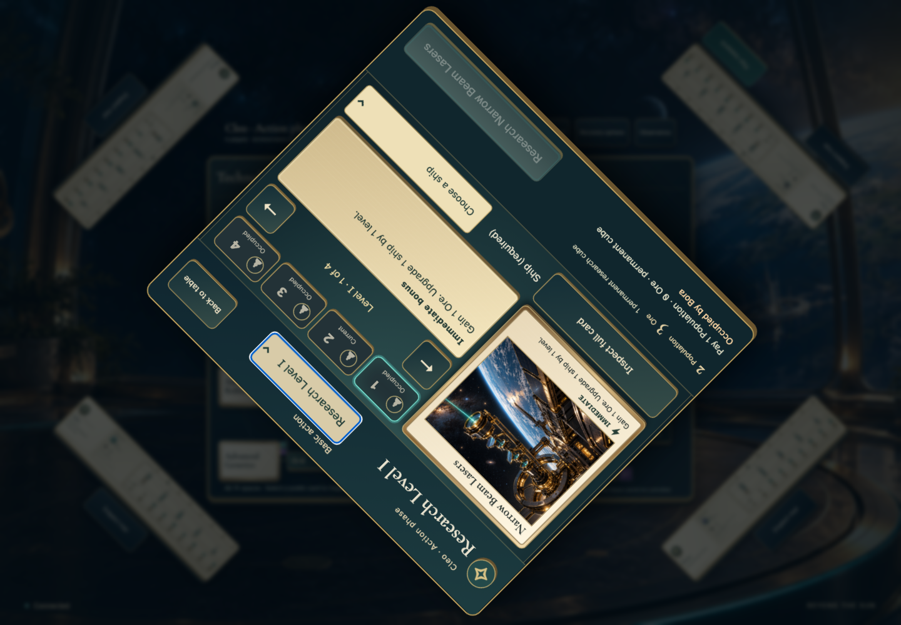](../../screenshots/manage-matching-supply-and-full-ore-yields-at-four-corner-seats/059-r1-cleo-plan-desktop-darwin.png) |

tabletop-4k · 3840 × 2160

[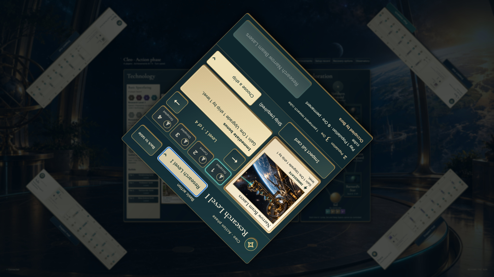](../../screenshots/manage-matching-supply-and-full-ore-yields-at-four-corner-seats/059-r1-cleo-plan-tabletop-4k-darwin.png)

- [x] Cleo opens the actual research and Action instrument
- [x] Canonical effects settle before capture.
- [x] Any printed Action plan is ready.
- [x] Public compact topology remains physically separated.
- [x] The gameplay shell fits the actual viewport.

## 61. Cleo selects printed technology Actions

Viewpoint: **Cleo · North East · one shared controller**.

| desktop · 1440 × 1000 |
| --- |
|  |

tabletop-4k · 3840 × 2160

- [x] Cleo selects printed technology Actions
- [x] Canonical effects settle before capture.
- [x] Any printed Action plan is ready.
- [x] Public compact topology remains physically separated.
- [x] The gameplay shell fits the actual viewport.

## 62. Read Terraforming's actual research requirement, payment and exclusive pawn space

Viewpoint: **Cleo · North East · one shared controller**.

| desktop · 1440 × 1000 |
| --- |
|  |

tabletop-4k · 3840 × 2160

- [x] Read Terraforming's actual research requirement, payment and exclusive pawn space
- [x] Canonical effects settle before capture.
- [x] Any printed Action plan is ready.
- [x] Public compact topology remains physically separated.
- [x] The gameplay shell fits the actual viewport.

## 63. Commit the actual printed Action cost before planning movement

Viewpoint: **Cleo · North East · one shared controller**.

| desktop · 1440 × 1000 |
| --- |
|  |

tabletop-4k · 3840 × 2160

[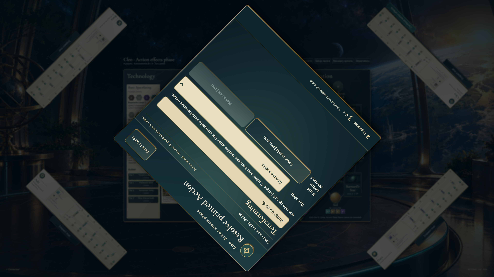](../../screenshots/manage-matching-supply-and-full-ore-yields-at-four-corner-seats/062-r1-cleo-paid-tabletop-4k-darwin.png)

- [x] Commit the actual printed Action cost before planning movement
- [x] Canonical effects settle before capture.
- [x] Any printed Action plan is ready.
- [x] Public compact topology remains physically separated.
- [x] The gameplay shell fits the actual viewport.

## 64. Choose a real owned ship for the legal path

Viewpoint: **Cleo · North East · one shared controller**.

| desktop · 1440 × 1000 |
| --- |
| [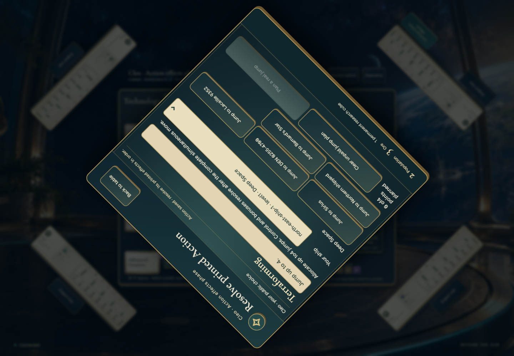](../../screenshots/manage-matching-supply-and-full-ore-yields-at-four-corner-seats/063-r1-cleo-ship-desktop-darwin.png) |

tabletop-4k · 3840 × 2160

[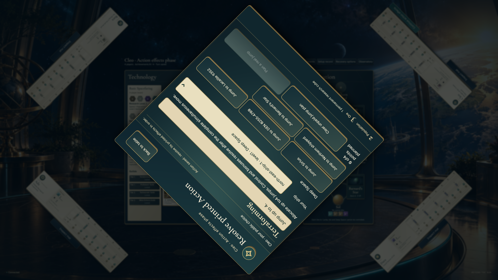](../../screenshots/manage-matching-supply-and-full-ore-yields-at-four-corner-seats/063-r1-cleo-ship-tabletop-4k-darwin.png)

- [x] Choose a real owned ship for the legal path
- [x] Canonical effects settle before capture.
- [x] Any printed Action plan is ready.
- [x] Public compact topology remains physically separated.
- [x] The gameplay shell fits the actual viewport.

## 65. Plan the next adjacent system without moving or paying again

Viewpoint: **Cleo · North East · one shared controller**.

| desktop · 1440 × 1000 |
| --- |
|  |

tabletop-4k · 3840 × 2160

[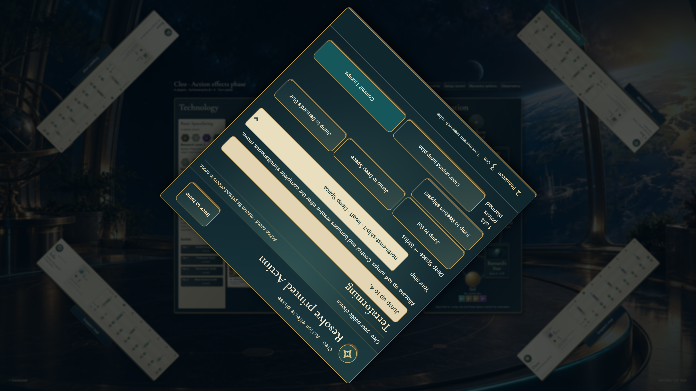](../../screenshots/manage-matching-supply-and-full-ore-yields-at-four-corner-seats/064-r1-cleo-leg-0-tabletop-4k-darwin.png)

- [x] Plan the next adjacent system without moving or paying again
- [x] Canonical effects settle before capture.
- [x] Any printed Action plan is ready.
- [x] Public compact topology remains physically separated.
- [x] The gameplay shell fits the actual viewport.

## 66. Plan the next adjacent system without moving or paying again

Viewpoint: **Cleo · North East · one shared controller**.

| desktop · 1440 × 1000 |
| --- |
| [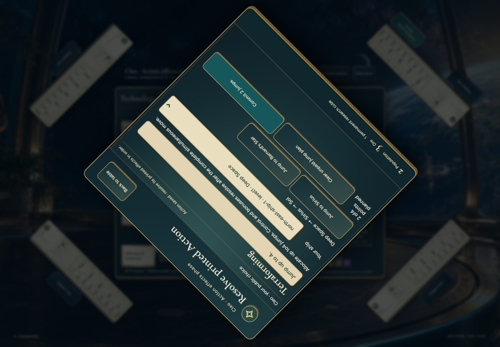](../../screenshots/manage-matching-supply-and-full-ore-yields-at-four-corner-seats/065-r1-cleo-leg-1-desktop-darwin.png) |

tabletop-4k · 3840 × 2160

[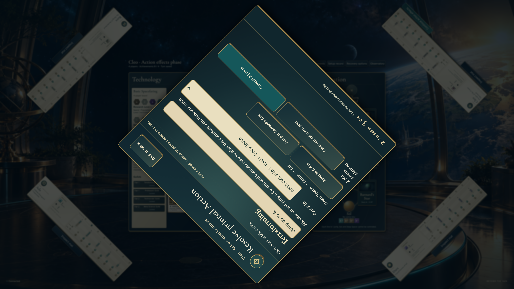](../../screenshots/manage-matching-supply-and-full-ore-yields-at-four-corner-seats/065-r1-cleo-leg-1-tabletop-4k-darwin.png)

- [x] Plan the next adjacent system without moving or paying again
- [x] Canonical effects settle before capture.
- [x] Any printed Action plan is ready.
- [x] Public compact topology remains physically separated.
- [x] The gameplay shell fits the actual viewport.

## 67. Resolve the complete real path atomically

Viewpoint: **Cleo · North East · one shared controller**.

| desktop · 1440 × 1000 |
| --- |
|  |

tabletop-4k · 3840 × 2160

- [x] Resolve the complete real path atomically
- [x] Canonical effects settle before capture.
- [x] Any printed Action plan is ready.
- [x] Public compact topology remains physically separated.
- [x] The gameplay shell fits the actual viewport.

## 68. Cleo completes production and hands off to Dara

Viewpoint: **Cleo · North East · one shared controller**.

| desktop · 1440 × 1000 |
| --- |
|  |

tabletop-4k · 3840 × 2160

- [x] Cleo completes production and hands off to Dara
- [x] Canonical effects settle before capture.
- [x] Any printed Action plan is ready.
- [x] Public compact topology remains physically separated.
- [x] The gameplay shell fits the actual viewport.

## 69. Dara opens the actual research and Action instrument

Viewpoint: **Dara · South East · one shared controller**.

| desktop · 1440 × 1000 |
| --- |
|  |

tabletop-4k · 3840 × 2160

- [x] Dara opens the actual research and Action instrument
- [x] Canonical effects settle before capture.
- [x] Any printed Action plan is ready.
- [x] Public compact topology remains physically separated.
- [x] The gameplay shell fits the actual viewport.

## 70. Dara selects the legal printed space 2

Viewpoint: **Dara · South East · one shared controller**.

| desktop · 1440 × 1000 |
| --- |
| [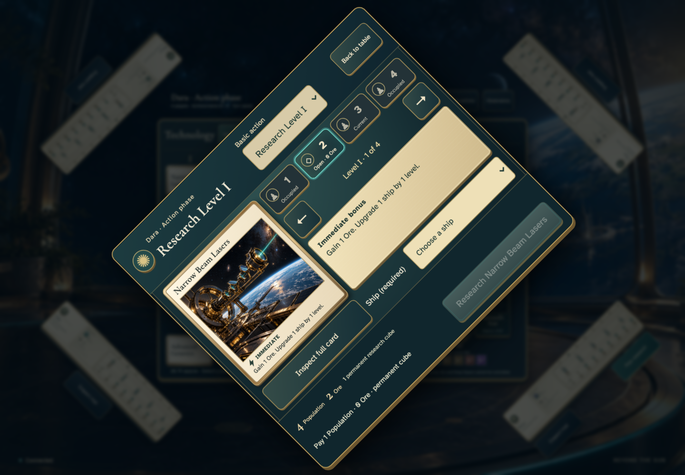](../../screenshots/manage-matching-supply-and-full-ore-yields-at-four-corner-seats/069-r1-dara-space-desktop-darwin.png) |

tabletop-4k · 3840 × 2160

- [x] Dara selects the legal printed space 2
- [x] Canonical effects settle before capture.
- [x] Any printed Action plan is ready.
- [x] Public compact topology remains physically separated.
- [x] The gameplay shell fits the actual viewport.

## 71. Browse the next public Level I face

Viewpoint: **Dara · South East · one shared controller**.

| desktop · 1440 × 1000 |
| --- |
| [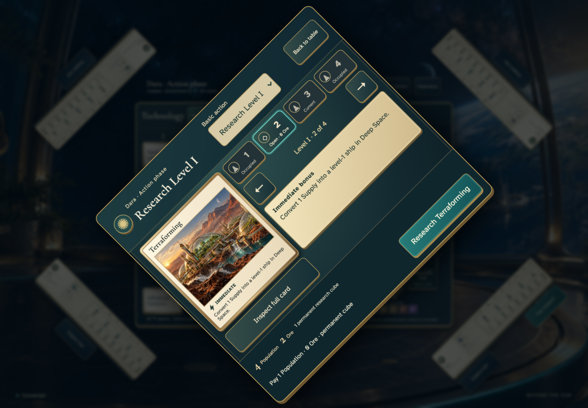](../../screenshots/manage-matching-supply-and-full-ore-yields-at-four-corner-seats/070-r1-dara-browse-0-desktop-darwin.png) |

tabletop-4k · 3840 × 2160

- [x] Browse the next public Level I face
- [x] Canonical effects settle before capture.
- [x] Any printed Action plan is ready.
- [x] Public compact topology remains physically separated.
- [x] The gameplay shell fits the actual viewport.

## 72. Browse the next public Level I face

Viewpoint: **Dara · South East · one shared controller**.

| desktop · 1440 × 1000 |
| --- |
|  |

tabletop-4k · 3840 × 2160

- [x] Browse the next public Level I face
- [x] Canonical effects settle before capture.
- [x] Any printed Action plan is ready.
- [x] Public compact topology remains physically separated.
- [x] The gameplay shell fits the actual viewport.

## 73. Pay once and receive Advanced Robotics's immediate bonus

Viewpoint: **Dara · South East · one shared controller**.

| desktop · 1440 × 1000 |
| --- |
|  |

tabletop-4k · 3840 × 2160

- [x] Pay once and receive Advanced Robotics's immediate bonus
- [x] Canonical effects settle before capture.
- [x] Any printed Action plan is ready.
- [x] Public compact topology remains physically separated.
- [x] The gameplay shell fits the actual viewport.

## 74. Dara completes production and hands off to Ada

Viewpoint: **Dara · South East · one shared controller**.

| desktop · 1440 × 1000 |
| --- |
|  |

tabletop-4k · 3840 × 2160

- [x] Dara completes production and hands off to Ada
- [x] Canonical effects settle before capture.
- [x] Any printed Action plan is ready.
- [x] Public compact topology remains physically separated.
- [x] The gameplay shell fits the actual viewport.

## 75. Ada opens the actual research and Action instrument

Viewpoint: **Ada · South West · one shared controller**.

| desktop · 1440 × 1000 |
| --- |
|  |

tabletop-4k · 3840 × 2160

- [x] Ada opens the actual research and Action instrument
- [x] Canonical effects settle before capture.
- [x] Any printed Action plan is ready.
- [x] Public compact topology remains physically separated.
- [x] The gameplay shell fits the actual viewport.

## 76. Ada selects ordinary gathering

Viewpoint: **Ada · South West · one shared controller**.

| desktop · 1440 × 1000 |
| --- |
|  |

tabletop-4k · 3840 × 2160

- [x] Ada selects ordinary gathering
- [x] Canonical effects settle before capture.
- [x] Any printed Action plan is ready.
- [x] Public compact topology remains physically separated.
- [x] The gameplay shell fits the actual viewport.

## 77. Receive the printed gather resources before ordinary production

Viewpoint: **Ada · South West · one shared controller**.

| desktop · 1440 × 1000 |
| --- |
|  |

tabletop-4k · 3840 × 2160

- [x] Receive the printed gather resources before ordinary production
- [x] Canonical effects settle before capture.
- [x] Any printed Action plan is ready.
- [x] Public compact topology remains physically separated.
- [x] The gameplay shell fits the actual viewport.

## 78. Ada completes production and hands off to Bora

Viewpoint: **Ada · South West · one shared controller**.

| desktop · 1440 × 1000 |
| --- |
|  |

tabletop-4k · 3840 × 2160

- [x] Ada completes production and hands off to Bora
- [x] Canonical effects settle before capture.
- [x] Any printed Action plan is ready.
- [x] Public compact topology remains physically separated.
- [x] The gameplay shell fits the actual viewport.

## 79. Bora opens the actual research and Action instrument

Viewpoint: **Bora · North West · one shared controller**.

| desktop · 1440 × 1000 |
| --- |
|  |

tabletop-4k · 3840 × 2160

- [x] Bora opens the actual research and Action instrument
- [x] Canonical effects settle before capture.
- [x] Any printed Action plan is ready.
- [x] Public compact topology remains physically separated.
- [x] The gameplay shell fits the actual viewport.

## 80. Bora selects the legal printed space 3

Viewpoint: **Bora · North West · one shared controller**.

| desktop · 1440 × 1000 |
| --- |
|  |

tabletop-4k · 3840 × 2160

- [x] Bora selects the legal printed space 3
- [x] Canonical effects settle before capture.
- [x] Any printed Action plan is ready.
- [x] Public compact topology remains physically separated.
- [x] The gameplay shell fits the actual viewport.

## 81. Browse the next public Level I face

Viewpoint: **Bora · North West · one shared controller**.

| desktop · 1440 × 1000 |
| --- |
|  |

tabletop-4k · 3840 × 2160

- [x] Browse the next public Level I face
- [x] Canonical effects settle before capture.
- [x] Any printed Action plan is ready.
- [x] Public compact topology remains physically separated.
- [x] The gameplay shell fits the actual viewport.

## 82. Pay once and receive Terraforming's immediate bonus

Viewpoint: **Bora · North West · one shared controller**.

| desktop · 1440 × 1000 |
| --- |
|  |

tabletop-4k · 3840 × 2160

- [x] Pay once and receive Terraforming's immediate bonus
- [x] Canonical effects settle before capture.
- [x] Any printed Action plan is ready.
- [x] Public compact topology remains physically separated.
- [x] The gameplay shell fits the actual viewport.

## 83. Bora completes production and hands off to Cleo

Viewpoint: **Bora · North West · one shared controller**.

| desktop · 1440 × 1000 |
| --- |
|  |

tabletop-4k · 3840 × 2160

- [x] Bora completes production and hands off to Cleo
- [x] Canonical effects settle before capture.
- [x] Any printed Action plan is ready.
- [x] Public compact topology remains physically separated.
- [x] The gameplay shell fits the actual viewport.

## 84. Cleo opens the actual research and Action instrument

Viewpoint: **Cleo · North East · one shared controller**.

| desktop · 1440 × 1000 |
| --- |
|  |

tabletop-4k · 3840 × 2160

- [x] Cleo opens the actual research and Action instrument
- [x] Canonical effects settle before capture.
- [x] Any printed Action plan is ready.
- [x] Public compact topology remains physically separated.
- [x] The gameplay shell fits the actual viewport.

## 85. Cleo selects the legal printed space 1

Viewpoint: **Cleo · North East · one shared controller**.

| desktop · 1440 × 1000 |
| --- |
|  |

tabletop-4k · 3840 × 2160

- [x] Cleo selects the legal printed space 1
- [x] Canonical effects settle before capture.
- [x] Any printed Action plan is ready.
- [x] Public compact topology remains physically separated.
- [x] The gameplay shell fits the actual viewport.

## 86. Browse the next public Level I face

Viewpoint: **Cleo · North East · one shared controller**.

| desktop · 1440 × 1000 |
| --- |
|  |

tabletop-4k · 3840 × 2160

- [x] Browse the next public Level I face
- [x] Canonical effects settle before capture.
- [x] Any printed Action plan is ready.
- [x] Public compact topology remains physically separated.
- [x] The gameplay shell fits the actual viewport.

## 87. Browse the next public Level I face

Viewpoint: **Cleo · North East · one shared controller**.

| desktop · 1440 × 1000 |
| --- |
|  |

tabletop-4k · 3840 × 2160

- [x] Browse the next public Level I face
- [x] Canonical effects settle before capture.
- [x] Any printed Action plan is ready.
- [x] Public compact topology remains physically separated.
- [x] The gameplay shell fits the actual viewport.

## 88. Browse the next public Level I face

Viewpoint: **Cleo · North East · one shared controller**.

| desktop · 1440 × 1000 |
| --- |
|  |

tabletop-4k · 3840 × 2160

- [x] Browse the next public Level I face
- [x] Canonical effects settle before capture.
- [x] Any printed Action plan is ready.
- [x] Public compact topology remains physically separated.
- [x] The gameplay shell fits the actual viewport.

## 89. Pay once and receive Advanced Genetics's immediate bonus

Viewpoint: **Cleo · North East · one shared controller**.

| desktop · 1440 × 1000 |
| --- |
|  |

tabletop-4k · 3840 × 2160

- [x] Pay once and receive Advanced Genetics's immediate bonus
- [x] Canonical effects settle before capture.
- [x] Any printed Action plan is ready.
- [x] Public compact topology remains physically separated.
- [x] The gameplay shell fits the actual viewport.

## 90. Cleo completes production and hands off to Dara

Viewpoint: **Cleo · North East · one shared controller**.

| desktop · 1440 × 1000 |
| --- |
|  |

tabletop-4k · 3840 × 2160

- [x] Cleo completes production and hands off to Dara
- [x] Canonical effects settle before capture.
- [x] Any printed Action plan is ready.
- [x] Public compact topology remains physically separated.
- [x] The gameplay shell fits the actual viewport.

## 91. Dara opens the actual research and Action instrument

Viewpoint: **Dara · South East · one shared controller**.

| desktop · 1440 × 1000 |
| --- |
|  |

tabletop-4k · 3840 × 2160

- [x] Dara opens the actual research and Action instrument
- [x] Canonical effects settle before capture.
- [x] Any printed Action plan is ready.
- [x] Public compact topology remains physically separated.
- [x] The gameplay shell fits the actual viewport.

## 92. Dara selects the legal printed space 4

Viewpoint: **Dara · South East · one shared controller**.

| desktop · 1440 × 1000 |
| --- |
|  |

tabletop-4k · 3840 × 2160

- [x] Dara selects the legal printed space 4
- [x] Canonical effects settle before capture.
- [x] Any printed Action plan is ready.
- [x] Public compact topology remains physically separated.
- [x] The gameplay shell fits the actual viewport.

## 93. Browse the next public Level I face

Viewpoint: **Dara · South East · one shared controller**.

| desktop · 1440 × 1000 |
| --- |
|  |

tabletop-4k · 3840 × 2160

- [x] Browse the next public Level I face
- [x] Canonical effects settle before capture.
- [x] Any printed Action plan is ready.
- [x] Public compact topology remains physically separated.
- [x] The gameplay shell fits the actual viewport.

## 94. Pay once and receive Terraforming's immediate bonus

Viewpoint: **Dara · South East · one shared controller**.

| desktop · 1440 × 1000 |
| --- |
|  |

tabletop-4k · 3840 × 2160

- [x] Pay once and receive Terraforming's immediate bonus
- [x] Canonical effects settle before capture.
- [x] Any printed Action plan is ready.
- [x] Public compact topology remains physically separated.
- [x] The gameplay shell fits the actual viewport.

## 95. Dara completes production and hands off to Ada

Viewpoint: **Dara · South East · one shared controller**.

| desktop · 1440 × 1000 |
| --- |
|  |

tabletop-4k · 3840 × 2160

- [x] Dara completes production and hands off to Ada
- [x] Canonical effects settle before capture.
- [x] Any printed Action plan is ready.
- [x] Public compact topology remains physically separated.
- [x] The gameplay shell fits the actual viewport.

## 96. Ada opens the actual research and Action instrument

Viewpoint: **Ada · South West · one shared controller**.

| desktop · 1440 × 1000 |
| --- |
|  |

tabletop-4k · 3840 × 2160

- [x] Ada opens the actual research and Action instrument
- [x] Canonical effects settle before capture.
- [x] Any printed Action plan is ready.
- [x] Public compact topology remains physically separated.
- [x] The gameplay shell fits the actual viewport.

## 97. Ada selects the legal printed space 2

Viewpoint: **Ada · South West · one shared controller**.

| desktop · 1440 × 1000 |
| --- |
|  |

tabletop-4k · 3840 × 2160

- [x] Ada selects the legal printed space 2
- [x] Canonical effects settle before capture.
- [x] Any printed Action plan is ready.
- [x] Public compact topology remains physically separated.
- [x] The gameplay shell fits the actual viewport.

## 98. Browse the next public Level I face

Viewpoint: **Ada · South West · one shared controller**.

| desktop · 1440 × 1000 |
| --- |
|  |

tabletop-4k · 3840 × 2160

- [x] Browse the next public Level I face
- [x] Canonical effects settle before capture.
- [x] Any printed Action plan is ready.
- [x] Public compact topology remains physically separated.
- [x] The gameplay shell fits the actual viewport.

## 99. Browse the next public Level I face

Viewpoint: **Ada · South West · one shared controller**.

| desktop · 1440 × 1000 |
| --- |
|  |

tabletop-4k · 3840 × 2160

- [x] Browse the next public Level I face
- [x] Canonical effects settle before capture.
- [x] Any printed Action plan is ready.
- [x] Public compact topology remains physically separated.
- [x] The gameplay shell fits the actual viewport.

## 100. Pay once and receive Advanced Robotics's immediate bonus

Viewpoint: **Ada · South West · one shared controller**.

| desktop · 1440 × 1000 |
| --- |
|  |

tabletop-4k · 3840 × 2160

- [x] Pay once and receive Advanced Robotics's immediate bonus
- [x] Canonical effects settle before capture.
- [x] Any printed Action plan is ready.
- [x] Public compact topology remains physically separated.
- [x] The gameplay shell fits the actual viewport.

## 101. Robotics exposes two Ore circles and ordinary production takes both

Viewpoint: **Ada · South West · one shared controller**.

| desktop · 1440 × 1000 |
| --- |
|  |

tabletop-4k · 3840 × 2160

- [x] Robotics exposes two Ore circles and ordinary production takes both
- [x] Canonical effects settle before capture.
- [x] Any printed Action plan is ready.
- [x] Public compact topology remains physically separated.
- [x] The gameplay shell fits the actual viewport.

## 102. Ada completes production and hands off to Bora

Viewpoint: **Ada · South West · one shared controller**.

| desktop · 1440 × 1000 |
| --- |
|  |

tabletop-4k · 3840 × 2160

- [x] Ada completes production and hands off to Bora
- [x] Canonical effects settle before capture.
- [x] Any printed Action plan is ready.
- [x] Public compact topology remains physically separated.
- [x] The gameplay shell fits the actual viewport.

## 103. Bora opens the actual research and Action instrument

Viewpoint: **Bora · North West · one shared controller**.

| desktop · 1440 × 1000 |
| --- |
|  |

tabletop-4k · 3840 × 2160

- [x] Bora opens the actual research and Action instrument
- [x] Canonical effects settle before capture.
- [x] Any printed Action plan is ready.
- [x] Public compact topology remains physically separated.
- [x] The gameplay shell fits the actual viewport.

## 104. Bora selects ordinary gathering

Viewpoint: **Bora · North West · one shared controller**.

| desktop · 1440 × 1000 |
| --- |
|  |

tabletop-4k · 3840 × 2160

- [x] Bora selects ordinary gathering
- [x] Canonical effects settle before capture.
- [x] Any printed Action plan is ready.
- [x] Public compact topology remains physically separated.
- [x] The gameplay shell fits the actual viewport.

## 105. Receive the printed gather resources before ordinary production

Viewpoint: **Bora · North West · one shared controller**.

| desktop · 1440 × 1000 |
| --- |
|  |

tabletop-4k · 3840 × 2160

- [x] Receive the printed gather resources before ordinary production
- [x] Canonical effects settle before capture.
- [x] Any printed Action plan is ready.
- [x] Public compact topology remains physically separated.
- [x] The gameplay shell fits the actual viewport.

## 106. Bora completes production and hands off to Cleo

Viewpoint: **Bora · North West · one shared controller**.

| desktop · 1440 × 1000 |
| --- |
|  |

tabletop-4k · 3840 × 2160

- [x] Bora completes production and hands off to Cleo
- [x] Canonical effects settle before capture.
- [x] Any printed Action plan is ready.
- [x] Public compact topology remains physically separated.
- [x] The gameplay shell fits the actual viewport.

## 107. Cleo opens the actual research and Action instrument

Viewpoint: **Cleo · North East · one shared controller**.

| desktop · 1440 × 1000 |
| --- |
|  |

tabletop-4k · 3840 × 2160

- [x] Cleo opens the actual research and Action instrument
- [x] Canonical effects settle before capture.
- [x] Any printed Action plan is ready.
- [x] Public compact topology remains physically separated.
- [x] The gameplay shell fits the actual viewport.

## 108. Cleo selects the legal printed space 3

Viewpoint: **Cleo · North East · one shared controller**.

| desktop · 1440 × 1000 |
| --- |
|  |

tabletop-4k · 3840 × 2160

- [x] Cleo selects the legal printed space 3
- [x] Canonical effects settle before capture.
- [x] Any printed Action plan is ready.
- [x] Public compact topology remains physically separated.
- [x] The gameplay shell fits the actual viewport.

## 109. Browse the next public Level I face

Viewpoint: **Cleo · North East · one shared controller**.

| desktop · 1440 × 1000 |
| --- |
|  |

tabletop-4k · 3840 × 2160

- [x] Browse the next public Level I face
- [x] Canonical effects settle before capture.
- [x] Any printed Action plan is ready.
- [x] Public compact topology remains physically separated.
- [x] The gameplay shell fits the actual viewport.

## 110. Browse the next public Level I face

Viewpoint: **Cleo · North East · one shared controller**.

| desktop · 1440 × 1000 |
| --- |
|  |

tabletop-4k · 3840 × 2160

- [x] Browse the next public Level I face
- [x] Canonical effects settle before capture.
- [x] Any printed Action plan is ready.
- [x] Public compact topology remains physically separated.
- [x] The gameplay shell fits the actual viewport.

## 111. Pay once and receive Advanced Robotics's immediate bonus

Viewpoint: **Cleo · North East · one shared controller**.

| desktop · 1440 × 1000 |
| --- |
|  |

tabletop-4k · 3840 × 2160

- [x] Pay once and receive Advanced Robotics's immediate bonus
- [x] Canonical effects settle before capture.
- [x] Any printed Action plan is ready.
- [x] Public compact topology remains physically separated.
- [x] The gameplay shell fits the actual viewport.

## 112. Cleo completes production and hands off to Dara

Viewpoint: **Cleo · North East · one shared controller**.

| desktop · 1440 × 1000 |
| --- |
|  |

tabletop-4k · 3840 × 2160

- [x] Cleo completes production and hands off to Dara
- [x] Canonical effects settle before capture.
- [x] Any printed Action plan is ready.
- [x] Public compact topology remains physically separated.
- [x] The gameplay shell fits the actual viewport.

## 113. Dara opens the actual research and Action instrument

Viewpoint: **Dara · South East · one shared controller**.

| desktop · 1440 × 1000 |
| --- |
|  |

tabletop-4k · 3840 × 2160

- [x] Dara opens the actual research and Action instrument
- [x] Canonical effects settle before capture.
- [x] Any printed Action plan is ready.
- [x] Public compact topology remains physically separated.
- [x] The gameplay shell fits the actual viewport.

## 114. Dara selects the legal printed space 1

Viewpoint: **Dara · South East · one shared controller**.

| desktop · 1440 × 1000 |
| --- |
|  |

tabletop-4k · 3840 × 2160

- [x] Dara selects the legal printed space 1
- [x] Canonical effects settle before capture.
- [x] Any printed Action plan is ready.
- [x] Public compact topology remains physically separated.
- [x] The gameplay shell fits the actual viewport.

## 115. The immediate bonus requires an explicit owned target

Viewpoint: **Dara · South East · one shared controller**.

| desktop · 1440 × 1000 |
| --- |
|  |

tabletop-4k · 3840 × 2160

- [x] The immediate bonus requires an explicit owned target
- [x] Canonical effects settle before capture.
- [x] Any printed Action plan is ready.
- [x] Public compact topology remains physically separated.
- [x] The gameplay shell fits the actual viewport.

## 116. Choose the original Sol ship for the one-level upgrade

Viewpoint: **Dara · South East · one shared controller**.

| desktop · 1440 × 1000 |
| --- |
|  |

tabletop-4k · 3840 × 2160

- [x] Choose the original Sol ship for the one-level upgrade
- [x] Canonical effects settle before capture.
- [x] Any printed Action plan is ready.
- [x] Public compact topology remains physically separated.
- [x] The gameplay shell fits the actual viewport.

## 117. Pay once and receive Narrow Beam Lasers's immediate bonus

Viewpoint: **Dara · South East · one shared controller**.

| desktop · 1440 × 1000 |
| --- |
|  |

tabletop-4k · 3840 × 2160

- [x] Pay once and receive Narrow Beam Lasers's immediate bonus
- [x] Canonical effects settle before capture.
- [x] Any printed Action plan is ready.
- [x] Public compact topology remains physically separated.
- [x] The gameplay shell fits the actual viewport.

## 118. Dara completes production and hands off to Ada

Viewpoint: **Dara · South East · one shared controller**.

| desktop · 1440 × 1000 |
| --- |
|  |

tabletop-4k · 3840 × 2160

- [x] Dara completes production and hands off to Ada
- [x] Canonical effects settle before capture.
- [x] Any printed Action plan is ready.
- [x] Public compact topology remains physically separated.
- [x] The gameplay shell fits the actual viewport.

## 119. Ada opens the actual research and Action instrument

Viewpoint: **Ada · South West · one shared controller**.

| desktop · 1440 × 1000 |
| --- |
|  |

tabletop-4k · 3840 × 2160

- [x] Ada opens the actual research and Action instrument
- [x] Canonical effects settle before capture.
- [x] Any printed Action plan is ready.
- [x] Public compact topology remains physically separated.
- [x] The gameplay shell fits the actual viewport.

## 120. Ada selects printed technology Actions

Viewpoint: **Ada · South West · one shared controller**.

| desktop · 1440 × 1000 |
| --- |
|  |

tabletop-4k · 3840 × 2160

- [x] Ada selects printed technology Actions
- [x] Canonical effects settle before capture.
- [x] Any printed Action plan is ready.
- [x] Public compact topology remains physically separated.
- [x] The gameplay shell fits the actual viewport.

## 121. Read Narrow Beam Lasers's actual research requirement, payment and exclusive pawn space

Viewpoint: **Ada · South West · one shared controller**.

| desktop · 1440 × 1000 |
| --- |
|  |

tabletop-4k · 3840 × 2160

- [x] Read Narrow Beam Lasers's actual research requirement, payment and exclusive pawn space
- [x] Canonical effects settle before capture.
- [x] Any printed Action plan is ready.
- [x] Public compact topology remains physically separated.
- [x] The gameplay shell fits the actual viewport.

## 122. Commit the actual printed Action cost before planning movement

Viewpoint: **Ada · South West · one shared controller**.

| desktop · 1440 × 1000 |
| --- |
|  |

tabletop-4k · 3840 × 2160

- [x] Commit the actual printed Action cost before planning movement
- [x] Canonical effects settle before capture.
- [x] Any printed Action plan is ready.
- [x] Public compact topology remains physically separated.
- [x] The gameplay shell fits the actual viewport.

## 123. Choose a real owned ship for the legal path

Viewpoint: **Ada · South West · one shared controller**.

| desktop · 1440 × 1000 |
| --- |
|  |

tabletop-4k · 3840 × 2160

- [x] Choose a real owned ship for the legal path
- [x] Canonical effects settle before capture.
- [x] Any printed Action plan is ready.
- [x] Public compact topology remains physically separated.
- [x] The gameplay shell fits the actual viewport.

## 124. Plan the next adjacent system without moving or paying again

Viewpoint: **Ada · South West · one shared controller**.

| desktop · 1440 × 1000 |
| --- |
|  |

tabletop-4k · 3840 × 2160

- [x] Plan the next adjacent system without moving or paying again
- [x] Canonical effects settle before capture.
- [x] Any printed Action plan is ready.
- [x] Public compact topology remains physically separated.
- [x] The gameplay shell fits the actual viewport.

## 125. Plan the next adjacent system without moving or paying again

Viewpoint: **Ada · South West · one shared controller**.

| desktop · 1440 × 1000 |
| --- |
|  |

tabletop-4k · 3840 × 2160

- [x] Plan the next adjacent system without moving or paying again
- [x] Canonical effects settle before capture.
- [x] Any printed Action plan is ready.
- [x] Public compact topology remains physically separated.
- [x] The gameplay shell fits the actual viewport.

## 126. Plan the next adjacent system without moving or paying again

Viewpoint: **Ada · South West · one shared controller**.

| desktop · 1440 × 1000 |
| --- |
|  |

tabletop-4k · 3840 × 2160

- [x] Plan the next adjacent system without moving or paying again
- [x] Canonical effects settle before capture.
- [x] Any printed Action plan is ready.
- [x] Public compact topology remains physically separated.
- [x] The gameplay shell fits the actual viewport.

## 127. Resolve the complete real path atomically

Viewpoint: **Ada · South West · one shared controller**.

| desktop · 1440 × 1000 |
| --- |
|  |

tabletop-4k · 3840 × 2160

- [x] Resolve the complete real path atomically
- [x] Canonical effects settle before capture.
- [x] Any printed Action plan is ready.
- [x] Public compact topology remains physically separated.
- [x] The gameplay shell fits the actual viewport.

## 128. Place an actual Food outpost and expose the second matching column

Viewpoint: **Ada · South West · one shared controller**.

| desktop · 1440 × 1000 |
| --- |
|  |

tabletop-4k · 3840 × 2160

- [x] Place an actual Food outpost and expose the second matching column
- [x] Canonical effects settle before capture.
- [x] Any printed Action plan is ready.
- [x] Public compact topology remains physically separated.
- [x] The gameplay shell fits the actual viewport.

## 129. Food now exposes A and B, each of which contributes one real matching cube

Viewpoint: **Ada · South West · one shared controller**.

| desktop · 1440 × 1000 |
| --- |
|  |

tabletop-4k · 3840 × 2160

- [x] Food now exposes A and B, each of which contributes one real matching cube
- [x] Canonical effects settle before capture.
- [x] Any printed Action plan is ready.
- [x] Public compact topology remains physically separated.
- [x] The gameplay shell fits the actual viewport.

## 130. Ada completes production and hands off to Bora

Viewpoint: **Ada · South West · one shared controller**.

| desktop · 1440 × 1000 |
| --- |
|  |

tabletop-4k · 3840 × 2160

- [x] Ada completes production and hands off to Bora
- [x] Canonical effects settle before capture.
- [x] Any printed Action plan is ready.
- [x] Public compact topology remains physically separated.
- [x] The gameplay shell fits the actual viewport.

## 131. Bora opens the actual research and Action instrument

Viewpoint: **Bora · North West · one shared controller**.

| desktop · 1440 × 1000 |
| --- |
|  |

tabletop-4k · 3840 × 2160

- [x] Bora opens the actual research and Action instrument
- [x] Canonical effects settle before capture.
- [x] Any printed Action plan is ready.
- [x] Public compact topology remains physically separated.
- [x] The gameplay shell fits the actual viewport.

## 132. Bora selects the legal printed space 2

Viewpoint: **Bora · North West · one shared controller**.

| desktop · 1440 × 1000 |
| --- |
|  |

tabletop-4k · 3840 × 2160

- [x] Bora selects the legal printed space 2
- [x] Canonical effects settle before capture.
- [x] Any printed Action plan is ready.
- [x] Public compact topology remains physically separated.
- [x] The gameplay shell fits the actual viewport.

## 133. Browse the next public Level I face

Viewpoint: **Bora · North West · one shared controller**.

| desktop · 1440 × 1000 |
| --- |
|  |

tabletop-4k · 3840 × 2160

- [x] Browse the next public Level I face
- [x] Canonical effects settle before capture.
- [x] Any printed Action plan is ready.
- [x] Public compact topology remains physically separated.
- [x] The gameplay shell fits the actual viewport.

## 134. Browse the next public Level I face

Viewpoint: **Bora · North West · one shared controller**.

| desktop · 1440 × 1000 |
| --- |
|  |

tabletop-4k · 3840 × 2160

- [x] Browse the next public Level I face
- [x] Canonical effects settle before capture.
- [x] Any printed Action plan is ready.
- [x] Public compact topology remains physically separated.
- [x] The gameplay shell fits the actual viewport.

## 135. Browse the next public Level I face

Viewpoint: **Bora · North West · one shared controller**.

| desktop · 1440 × 1000 |
| --- |
|  |

tabletop-4k · 3840 × 2160

- [x] Browse the next public Level I face
- [x] Canonical effects settle before capture.
- [x] Any printed Action plan is ready.
- [x] Public compact topology remains physically separated.
- [x] The gameplay shell fits the actual viewport.

## 136. Pay once and receive Advanced Genetics's immediate bonus

Viewpoint: **Bora · North West · one shared controller**.

| desktop · 1440 × 1000 |
| --- |
|  |

tabletop-4k · 3840 × 2160

- [x] Pay once and receive Advanced Genetics's immediate bonus
- [x] Canonical effects settle before capture.
- [x] Any printed Action plan is ready.
- [x] Public compact topology remains physically separated.
- [x] The gameplay shell fits the actual viewport.

## 137. Bora completes production and hands off to Cleo

Viewpoint: **Bora · North West · one shared controller**.

| desktop · 1440 × 1000 |
| --- |
|  |

tabletop-4k · 3840 × 2160

- [x] Bora completes production and hands off to Cleo
- [x] Canonical effects settle before capture.
- [x] Any printed Action plan is ready.
- [x] Public compact topology remains physically separated.
- [x] The gameplay shell fits the actual viewport.

## 138. Cleo opens the actual research and Action instrument

Viewpoint: **Cleo · North East · one shared controller**.

| desktop · 1440 × 1000 |
| --- |
|  |

tabletop-4k · 3840 × 2160

- [x] Cleo opens the actual research and Action instrument
- [x] Canonical effects settle before capture.
- [x] Any printed Action plan is ready.
- [x] Public compact topology remains physically separated.
- [x] The gameplay shell fits the actual viewport.

## 139. Cleo selects the legal printed space 4

Viewpoint: **Cleo · North East · one shared controller**.

| desktop · 1440 × 1000 |
| --- |
|  |

tabletop-4k · 3840 × 2160

- [x] Cleo selects the legal printed space 4
- [x] Canonical effects settle before capture.
- [x] Any printed Action plan is ready.
- [x] Public compact topology remains physically separated.
- [x] The gameplay shell fits the actual viewport.

## 140. The immediate bonus requires an explicit owned target

Viewpoint: **Cleo · North East · one shared controller**.

| desktop · 1440 × 1000 |
| --- |
|  |

tabletop-4k · 3840 × 2160

- [x] The immediate bonus requires an explicit owned target
- [x] Canonical effects settle before capture.
- [x] Any printed Action plan is ready.
- [x] Public compact topology remains physically separated.
- [x] The gameplay shell fits the actual viewport.

## 141. Choose the original Sol ship for the one-level upgrade

Viewpoint: **Cleo · North East · one shared controller**.

| desktop · 1440 × 1000 |
| --- |
|  |

tabletop-4k · 3840 × 2160

- [x] Choose the original Sol ship for the one-level upgrade
- [x] Canonical effects settle before capture.
- [x] Any printed Action plan is ready.
- [x] Public compact topology remains physically separated.
- [x] The gameplay shell fits the actual viewport.

## 142. Pay once and receive Narrow Beam Lasers's immediate bonus

Viewpoint: **Cleo · North East · one shared controller**.

| desktop · 1440 × 1000 |
| --- |
|  |

tabletop-4k · 3840 × 2160

- [x] Pay once and receive Narrow Beam Lasers's immediate bonus
- [x] Canonical effects settle before capture.
- [x] Any printed Action plan is ready.
- [x] Public compact topology remains physically separated.
- [x] The gameplay shell fits the actual viewport.

## 143. Cleo completes production and hands off to Dara

Viewpoint: **Cleo · North East · one shared controller**.

| desktop · 1440 × 1000 |
| --- |
|  |

tabletop-4k · 3840 × 2160

- [x] Cleo completes production and hands off to Dara
- [x] Canonical effects settle before capture.
- [x] Any printed Action plan is ready.
- [x] Public compact topology remains physically separated.
- [x] The gameplay shell fits the actual viewport.

## 144. Dara opens the actual research and Action instrument

Viewpoint: **Dara · South East · one shared controller**.

| desktop · 1440 × 1000 |
| --- |
|  |

tabletop-4k · 3840 × 2160

- [x] Dara opens the actual research and Action instrument
- [x] Canonical effects settle before capture.
- [x] Any printed Action plan is ready.
- [x] Public compact topology remains physically separated.
- [x] The gameplay shell fits the actual viewport.

## 145. Dara selects printed technology Actions

Viewpoint: **Dara · South East · one shared controller**.

| desktop · 1440 × 1000 |
| --- |
|  |

tabletop-4k · 3840 × 2160

- [x] Dara selects printed technology Actions
- [x] Canonical effects settle before capture.
- [x] Any printed Action plan is ready.
- [x] Public compact topology remains physically separated.
- [x] The gameplay shell fits the actual viewport.

## 146. Browse the next public printed Action without acquiring research

Viewpoint: **Dara · South East · one shared controller**.

| desktop · 1440 × 1000 |
| --- |
|  |

tabletop-4k · 3840 × 2160

- [x] Browse the next public printed Action without acquiring research
- [x] Canonical effects settle before capture.
- [x] Any printed Action plan is ready.
- [x] Public compact topology remains physically separated.
- [x] The gameplay shell fits the actual viewport.

## 147. Read Terraforming's actual research requirement, payment and exclusive pawn space

Viewpoint: **Dara · South East · one shared controller**.

| desktop · 1440 × 1000 |
| --- |
|  |

tabletop-4k · 3840 × 2160

- [x] Read Terraforming's actual research requirement, payment and exclusive pawn space
- [x] Canonical effects settle before capture.
- [x] Any printed Action plan is ready.
- [x] Public compact topology remains physically separated.
- [x] The gameplay shell fits the actual viewport.

## 148. Commit the actual printed Action cost before planning movement

Viewpoint: **Dara · South East · one shared controller**.

| desktop · 1440 × 1000 |
| --- |
|  |

tabletop-4k · 3840 × 2160

- [x] Commit the actual printed Action cost before planning movement
- [x] Canonical effects settle before capture.
- [x] Any printed Action plan is ready.
- [x] Public compact topology remains physically separated.
- [x] The gameplay shell fits the actual viewport.

## 149. Choose a real owned ship for the legal path

Viewpoint: **Dara · South East · one shared controller**.

| desktop · 1440 × 1000 |
| --- |
|  |

tabletop-4k · 3840 × 2160

- [x] Choose a real owned ship for the legal path
- [x] Canonical effects settle before capture.
- [x] Any printed Action plan is ready.
- [x] Public compact topology remains physically separated.
- [x] The gameplay shell fits the actual viewport.

## 150. Plan the next adjacent system without moving or paying again

Viewpoint: **Dara · South East · one shared controller**.

| desktop · 1440 × 1000 |
| --- |
|  |

tabletop-4k · 3840 × 2160

- [x] Plan the next adjacent system without moving or paying again
- [x] Canonical effects settle before capture.
- [x] Any printed Action plan is ready.
- [x] Public compact topology remains physically separated.
- [x] The gameplay shell fits the actual viewport.

## 151. Plan the next adjacent system without moving or paying again

Viewpoint: **Dara · South East · one shared controller**.

| desktop · 1440 × 1000 |
| --- |
|  |

tabletop-4k · 3840 × 2160

- [x] Plan the next adjacent system without moving or paying again
- [x] Canonical effects settle before capture.
- [x] Any printed Action plan is ready.
- [x] Public compact topology remains physically separated.
- [x] The gameplay shell fits the actual viewport.

## 152. Resolve the complete real path atomically

Viewpoint: **Dara · South East · one shared controller**.

| desktop · 1440 × 1000 |
| --- |
|  |

tabletop-4k · 3840 × 2160

- [x] Resolve the complete real path atomically
- [x] Canonical effects settle before capture.
- [x] Any printed Action plan is ready.
- [x] Public compact topology remains physically separated.
- [x] The gameplay shell fits the actual viewport.

## 153. Dara completes production and hands off to Ada

Viewpoint: **Dara · South East · one shared controller**.

| desktop · 1440 × 1000 |
| --- |
|  |

tabletop-4k · 3840 × 2160

- [x] Dara completes production and hands off to Ada
- [x] Canonical effects settle before capture.
- [x] Any printed Action plan is ready.
- [x] Public compact topology remains physically separated.
- [x] The gameplay shell fits the actual viewport.

## 154. Ada opens the actual research and Action instrument

Viewpoint: **Ada · South West · one shared controller**.

| desktop · 1440 × 1000 |
| --- |
|  |

tabletop-4k · 3840 × 2160

- [x] Ada opens the actual research and Action instrument
- [x] Canonical effects settle before capture.
- [x] Any printed Action plan is ready.
- [x] Public compact topology remains physically separated.
- [x] The gameplay shell fits the actual viewport.

## 155. Ada selects ordinary gathering

Viewpoint: **Ada · South West · one shared controller**.

| desktop · 1440 × 1000 |
| --- |
|  |

tabletop-4k · 3840 × 2160

- [x] Ada selects ordinary gathering
- [x] Canonical effects settle before capture.
- [x] Any printed Action plan is ready.
- [x] Public compact topology remains physically separated.
- [x] The gameplay shell fits the actual viewport.

## 156. Receive the printed gather resources before ordinary production

Viewpoint: **Ada · South West · one shared controller**.

| desktop · 1440 × 1000 |
| --- |
|  |

tabletop-4k · 3840 × 2160

- [x] Receive the printed gather resources before ordinary production
- [x] Canonical effects settle before capture.
- [x] Any printed Action plan is ready.
- [x] Public compact topology remains physically separated.
- [x] The gameplay shell fits the actual viewport.

## 157. An exposed but empty A column cannot substitute cubes from covered columns

Viewpoint: **Ada · South West · one shared controller**.

| desktop · 1440 × 1000 |
| --- |
|  |

tabletop-4k · 3840 × 2160

- [x] An exposed but empty A column cannot substitute cubes from covered columns
- [x] Canonical effects settle before capture.
- [x] Any printed Action plan is ready.
- [x] Public compact topology remains physically separated.
- [x] The gameplay shell fits the actual viewport.

## 158. Inspect all twenty conserved cubes in their actual current locations

Viewpoint: **Ada · South West · one shared controller**.

| desktop · 1440 × 1000 |
| --- |
|  |

tabletop-4k · 3840 × 2160

- [x] Inspect all twenty conserved cubes in their actual current locations
- [x] Canonical effects settle before capture.
- [x] Any printed Action plan is ready.
- [x] Public compact topology remains physically separated.
- [x] The gameplay shell fits the actual viewport.

## 159. Tab remains in the modal reader

Viewpoint: **Ada · South West · one shared controller**.

| desktop · 1440 × 1000 |
| --- |
|  |

tabletop-4k · 3840 × 2160

- [x] Tab remains in the modal reader
- [x] Canonical effects settle before capture.
- [x] Any printed Action plan is ready.
- [x] Public compact topology remains physically separated.
- [x] The gameplay shell fits the actual viewport.

## 160. Reverse Tab remains in the same accessible reader

Viewpoint: **Ada · South West · one shared controller**.

| desktop · 1440 × 1000 |
| --- |
|  |

tabletop-4k · 3840 × 2160

- [x] Reverse Tab remains in the same accessible reader
- [x] Canonical effects settle before capture.
- [x] Any printed Action plan is ready.
- [x] Public compact topology remains physically separated.
- [x] The gameplay shell fits the actual viewport.

## 161. Escape restores the actual opener without choosing production

Viewpoint: **Ada · South West · one shared controller**.

| desktop · 1440 × 1000 |
| --- |
|  |

tabletop-4k · 3840 × 2160

- [x] Escape restores the actual opener without choosing production
- [x] Canonical effects settle before capture.
- [x] Any printed Action plan is ready.
- [x] Public compact topology remains physically separated.
- [x] The gameplay shell fits the actual viewport.

## 162. Reload retains the production decision and current controller

Viewpoint: **Ada · South West · one shared controller**.

| desktop · 1440 × 1000 |
| --- |
|  |

tabletop-4k · 3840 × 2160

- [x] Reload retains the production decision and current controller
- [x] Canonical effects settle before capture.
- [x] Any printed Action plan is ready.
- [x] Public compact topology remains physically separated.
- [x] The gameplay shell fits the actual viewport.

## 163. Reopened production still has A zero and B two; no bonus replay

Viewpoint: **Ada · South West · one shared controller**.

| desktop · 1440 × 1000 |
| --- |
|  |

tabletop-4k · 3840 × 2160

- [x] Reopened production still has A zero and B two; no bonus replay
- [x] Canonical effects settle before capture.
- [x] Any printed Action plan is ready.
- [x] Public compact topology remains physically separated.
- [x] The gameplay shell fits the actual viewport.

## 164. Only B loses one cube; empty A stays empty and Bora receives the turn

Viewpoint: **Ada · South West · one shared controller**.

| desktop · 1440 × 1000 |
| --- |
|  |

tabletop-4k · 3840 × 2160

- [x] Only B loses one cube; empty A stays empty and Bora receives the turn
- [x] Canonical effects settle before capture.
- [x] Any printed Action plan is ready.
- [x] Public compact topology remains physically separated.
- [x] The gameplay shell fits the actual viewport.

## 165. The saved public mat proves A remains zero and only B went from two to one

Viewpoint: **Ada · South West · one shared controller**.

| desktop · 1440 × 1000 |
| --- |
|  |

tabletop-4k · 3840 × 2160

- [x] The saved public mat proves A remains zero and only B went from two to one
- [x] Canonical effects settle before capture.
- [x] Any printed Action plan is ready.
- [x] Public compact topology remains physically separated.
- [x] The gameplay shell fits the actual viewport.

## 166. Return from the actual faction mat to the handed-off board

Viewpoint: **Ada · South West · one shared controller**.

| desktop · 1440 × 1000 |
| --- |
|  |

tabletop-4k · 3840 × 2160

- [x] Return from the actual faction mat to the handed-off board
- [x] Canonical effects settle before capture.
- [x] Any printed Action plan is ready.
- [x] Public compact topology remains physically separated.
- [x] The gameplay shell fits the actual viewport.

## 167. The full growth and handoff remain after reload

Viewpoint: **Ada · South West · one shared controller**.

| desktop · 1440 × 1000 |
| --- |
|  |

tabletop-4k · 3840 × 2160

- [x] The full growth and handoff remain after reload
- [x] Canonical effects settle before capture.
- [x] Any printed Action plan is ready.
- [x] Public compact topology remains physically separated.
- [x] The gameplay shell fits the actual viewport.
