# Manage matching Supply and full Ore yields at two cardinal seats

One shared authenticated controller; direct physical cardinal or corner seating, ordinary UI setup and legal preparatory turns. No remote claims or personal devices. Only initial setup entropy is fixed to66666666-6666-4666-8666-000000000009. No game-state injection or future-deck inspection. Actual printed research access, payment, occupancy, effects and recovery use production components.

## 1. Arrive using the actual production client

Viewpoint: **Ada · South · one shared controller**.

| desktop · 1440 × 1000 |
| --- |
|  |

tabletop-4k · 3840 × 2160

- [x] Arrive using the actual production client
- [x] Canonical effects settle before capture.
- [x] Any printed Action plan is ready.
- [x] Public compact topology remains physically separated.
- [x] The gameplay shell fits the actual viewport.

## 2. Choose a real production play mode

Viewpoint: **Ada · South · one shared controller**.

| desktop · 1440 × 1000 |
| --- |
|  |

tabletop-4k · 3840 × 2160

- [x] Choose a real production play mode
- [x] Canonical effects settle before capture.
- [x] Any printed Action plan is ready.
- [x] Public compact topology remains physically separated.
- [x] The gameplay shell fits the actual viewport.

## 3. One controller configures physical seats directly on the table

Viewpoint: **Ada · South · one shared controller**.

| desktop · 1440 × 1000 |
| --- |
|  |

tabletop-4k · 3840 × 2160

- [x] One controller configures physical seats directly on the table
- [x] Canonical effects settle before capture.
- [x] Any printed Action plan is ready.
- [x] Public compact topology remains physically separated.
- [x] The gameplay shell fits the actual viewport.

## 4. Open the South seat on the shared surface

Viewpoint: **Ada · South · one shared controller**.

| desktop · 1440 × 1000 |
| --- |
|  |

tabletop-4k · 3840 × 2160

- [x] Open the South seat on the shared surface
- [x] Canonical effects settle before capture.
- [x] Any printed Action plan is ready.
- [x] Public compact topology remains physically separated.
- [x] The gameplay shell fits the actual viewport.

## 5. Name the physical player Ada

Viewpoint: **Ada · South · one shared controller**.

| desktop · 1440 × 1000 |
| --- |
|  |

tabletop-4k · 3840 × 2160

- [x] Name the physical player Ada
- [x] Canonical effects settle before capture.
- [x] Any printed Action plan is ready.
- [x] Public compact topology remains physically separated.
- [x] The gameplay shell fits the actual viewport.

## 6. The local physical seat is retained on this controller

Viewpoint: **Ada · South · one shared controller**.

| desktop · 1440 × 1000 |
| --- |
|  |

tabletop-4k · 3840 × 2160

- [x] The local physical seat is retained on this controller
- [x] Canonical effects settle before capture.
- [x] Any printed Action plan is ready.
- [x] Public compact topology remains physically separated.
- [x] The gameplay shell fits the actual viewport.

## 7. Open the North seat on the shared surface

Viewpoint: **Bora · North · one shared controller**.

| desktop · 1440 × 1000 |
| --- |
|  |

tabletop-4k · 3840 × 2160

- [x] Open the North seat on the shared surface
- [x] Canonical effects settle before capture.
- [x] Any printed Action plan is ready.
- [x] Public compact topology remains physically separated.
- [x] The gameplay shell fits the actual viewport.

## 8. Name the physical player Bora

Viewpoint: **Bora · North · one shared controller**.

| desktop · 1440 × 1000 |
| --- |
|  |

tabletop-4k · 3840 × 2160

[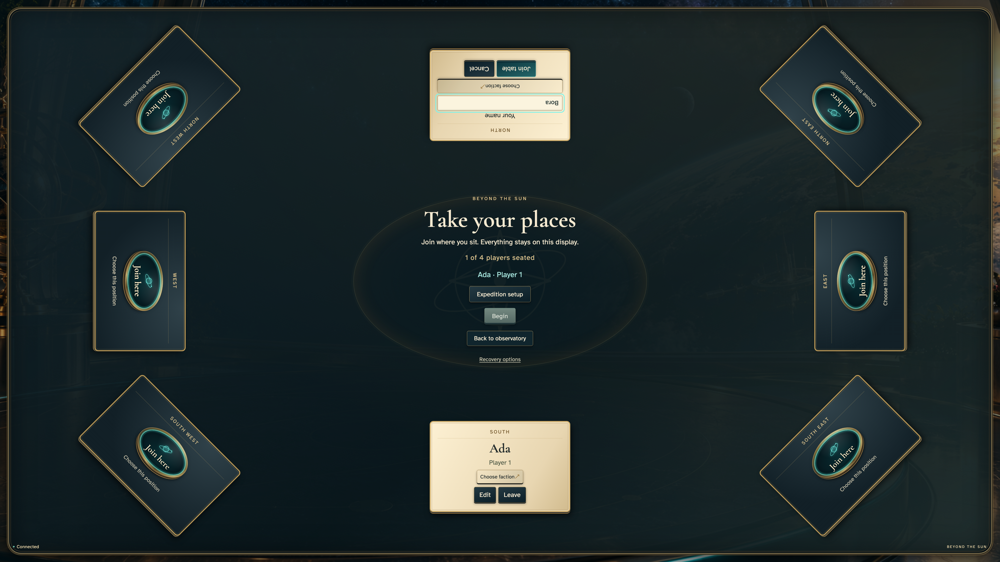](../../screenshots/manage-matching-supply-and-full-ore-yields-at-two-cardinal-seats/007-seat-1-name-tabletop-4k-darwin.png)

- [x] Name the physical player Bora
- [x] Canonical effects settle before capture.
- [x] Any printed Action plan is ready.
- [x] Public compact topology remains physically separated.
- [x] The gameplay shell fits the actual viewport.

## 9. The local physical seat is retained on this controller

Viewpoint: **Bora · North · one shared controller**.

| desktop · 1440 × 1000 |
| --- |
|  |

tabletop-4k · 3840 × 2160

- [x] The local physical seat is retained on this controller
- [x] Canonical effects settle before capture.
- [x] Any printed Action plan is ready.
- [x] Public compact topology remains physically separated.
- [x] The gameplay shell fits the actual viewport.

## 10. Ada chooses a legal unique Basic faction

Viewpoint: **Ada · South · one shared controller**.

| desktop · 1440 × 1000 |
| --- |
|  |

tabletop-4k · 3840 × 2160

- [x] Ada chooses a legal unique Basic faction
- [x] Canonical effects settle before capture.
- [x] Any printed Action plan is ready.
- [x] Public compact topology remains physically separated.
- [x] The gameplay shell fits the actual viewport.

## 11. Ada retains Nishida-Østergaard Corporation

Viewpoint: **Ada · South · one shared controller**.

| desktop · 1440 × 1000 |
| --- |
|  |

tabletop-4k · 3840 × 2160

- [x] Ada retains Nishida-Østergaard Corporation
- [x] Canonical effects settle before capture.
- [x] Any printed Action plan is ready.
- [x] Public compact topology remains physically separated.
- [x] The gameplay shell fits the actual viewport.

## 12. Bora chooses a legal unique Basic faction

Viewpoint: **Bora · North · one shared controller**.

| desktop · 1440 × 1000 |
| --- |
|  |

tabletop-4k · 3840 × 2160

[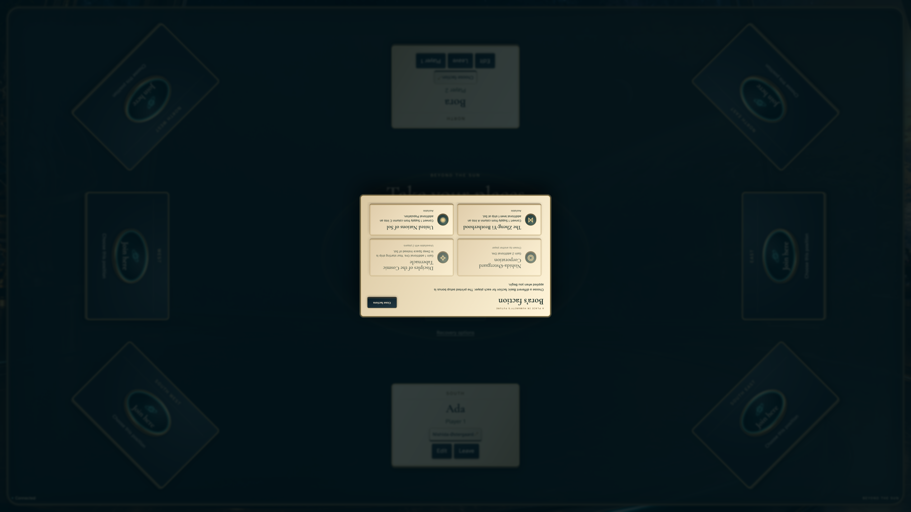](../../screenshots/manage-matching-supply-and-full-ore-yields-at-two-cardinal-seats/011-faction-1-editor-tabletop-4k-darwin.png)

- [x] Bora chooses a legal unique Basic faction
- [x] Canonical effects settle before capture.
- [x] Any printed Action plan is ready.
- [x] Public compact topology remains physically separated.
- [x] The gameplay shell fits the actual viewport.

## 13. Bora retains The Zheng-Yi Brotherhood

Viewpoint: **Bora · North · one shared controller**.

| desktop · 1440 × 1000 |
| --- |
| [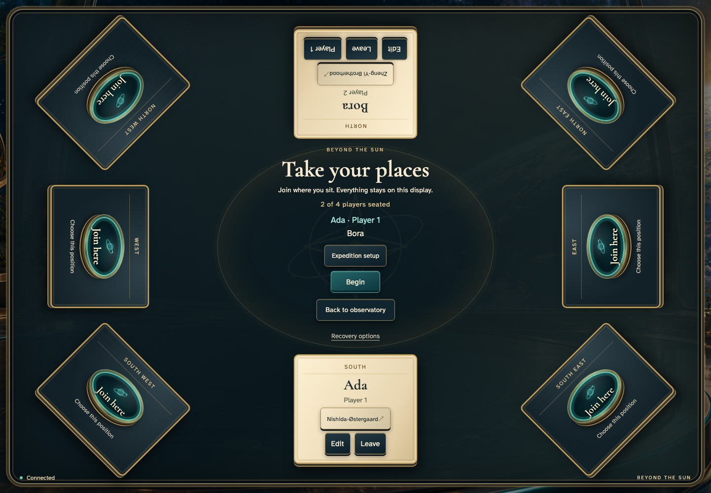](../../screenshots/manage-matching-supply-and-full-ore-yields-at-two-cardinal-seats/012-faction-1-chosen-desktop-darwin.png) |

tabletop-4k · 3840 × 2160

- [x] Bora retains The Zheng-Yi Brotherhood
- [x] Canonical effects settle before capture.
- [x] Any printed Action plan is ready.
- [x] Public compact topology remains physically separated.
- [x] The gameplay shell fits the actual viewport.

## 14. Begin the immutable source-reviewed Basic setup through the ordinary UI

Viewpoint: **Ada · South · one shared controller**.

| desktop · 1440 × 1000 |
| --- |
|  |

tabletop-4k · 3840 × 2160

- [x] Begin the immutable source-reviewed Basic setup through the ordinary UI
- [x] Canonical effects settle before capture.
- [x] Any printed Action plan is ready.
- [x] Public compact topology remains physically separated.
- [x] The gameplay shell fits the actual viewport.

## 15. Ada opens the actual research and Action instrument

Viewpoint: **Ada · South · one shared controller**.

| desktop · 1440 × 1000 |
| --- |
|  |

tabletop-4k · 3840 × 2160

- [x] Ada opens the actual research and Action instrument
- [x] Canonical effects settle before capture.
- [x] Any printed Action plan is ready.
- [x] Public compact topology remains physically separated.
- [x] The gameplay shell fits the actual viewport.

## 16. Ada selects the legal printed space 1

Viewpoint: **Ada · South · one shared controller**.

| desktop · 1440 × 1000 |
| --- |
|  |

tabletop-4k · 3840 × 2160

[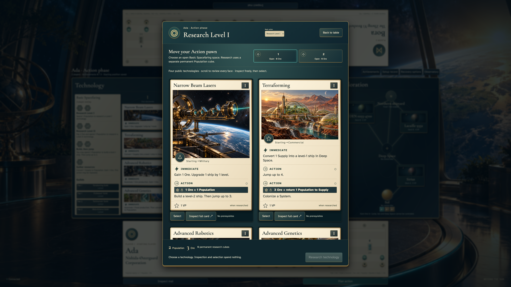](../../screenshots/manage-matching-supply-and-full-ore-yields-at-two-cardinal-seats/015-r0-ada-space-tabletop-4k-darwin.png)

- [x] Ada selects the legal printed space 1
- [x] Canonical effects settle before capture.
- [x] Any printed Action plan is ready.
- [x] Public compact topology remains physically separated.
- [x] The gameplay shell fits the actual viewport.

## 17. Select Advanced Genetics with its printed cost and consequence

Viewpoint: **Ada · South · one shared controller**.

| desktop · 1440 × 1000 |
| --- |
| [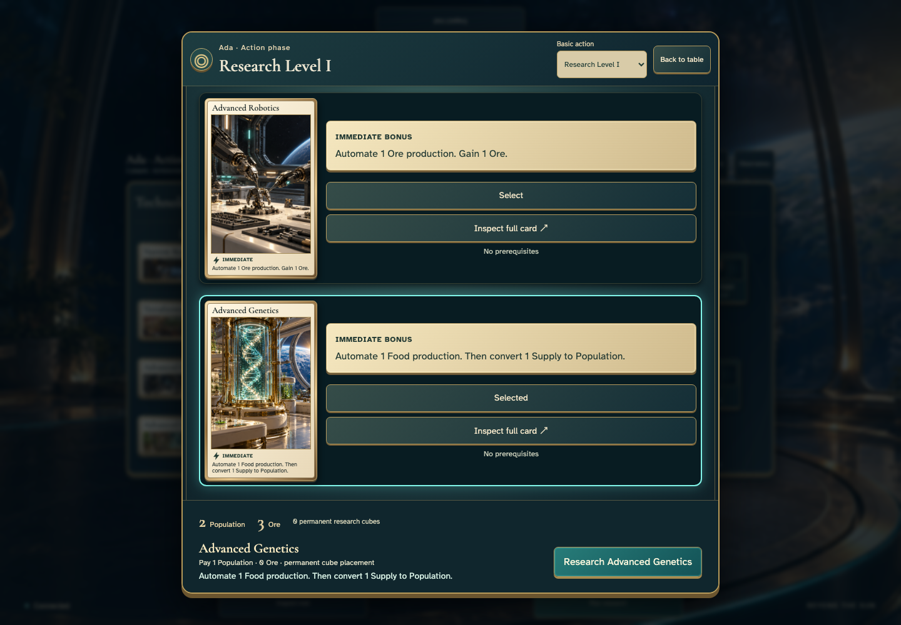](../../screenshots/manage-matching-supply-and-full-ore-yields-at-two-cardinal-seats/016-r0-ada-card-desktop-darwin.png) |

tabletop-4k · 3840 × 2160

[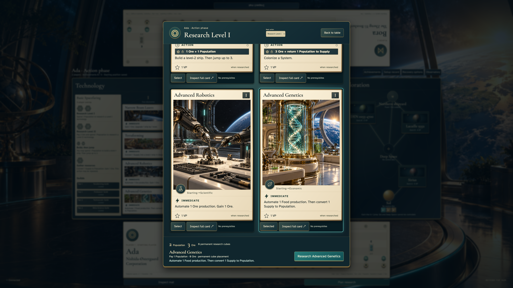](../../screenshots/manage-matching-supply-and-full-ore-yields-at-two-cardinal-seats/016-r0-ada-card-tabletop-4k-darwin.png)

- [x] Select Advanced Genetics with its printed cost and consequence
- [x] Canonical effects settle before capture.
- [x] Any printed Action plan is ready.
- [x] Public compact topology remains physically separated.
- [x] The gameplay shell fits the actual viewport.

## 18. Pay once and receive Advanced Genetics's immediate bonus

Viewpoint: **Ada · South · one shared controller**.

| desktop · 1440 × 1000 |
| --- |
|  |

tabletop-4k · 3840 × 2160

[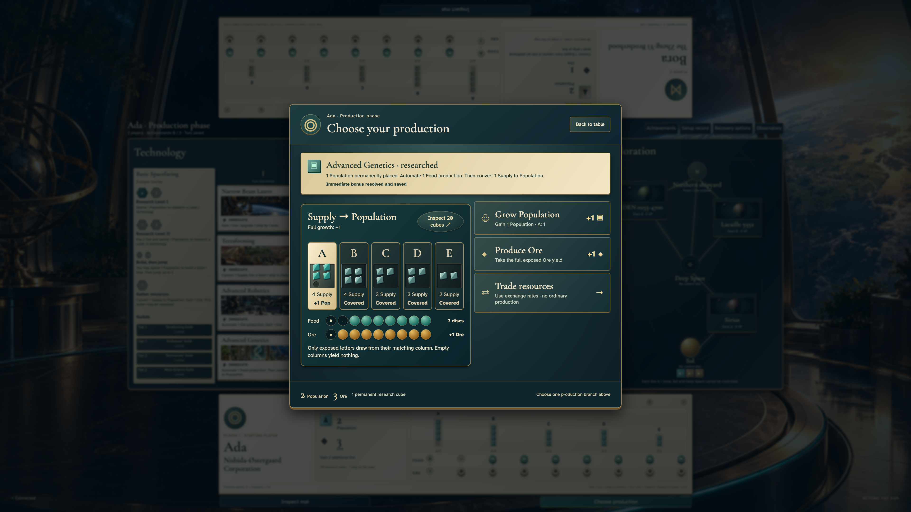](../../screenshots/manage-matching-supply-and-full-ore-yields-at-two-cardinal-seats/017-r0-ada-researched-tabletop-4k-darwin.png)

- [x] Pay once and receive Advanced Genetics's immediate bonus
- [x] Canonical effects settle before capture.
- [x] Any printed Action plan is ready.
- [x] Public compact topology remains physically separated.
- [x] The gameplay shell fits the actual viewport.

## 19. Ada completes production and hands off to Bora

Viewpoint: **Ada · South · one shared controller**.

| desktop · 1440 × 1000 |
| --- |
|  |

tabletop-4k · 3840 × 2160

- [x] Ada completes production and hands off to Bora
- [x] Canonical effects settle before capture.
- [x] Any printed Action plan is ready.
- [x] Public compact topology remains physically separated.
- [x] The gameplay shell fits the actual viewport.

## 20. Bora opens the actual research and Action instrument

Viewpoint: **Bora · North · one shared controller**.

| desktop · 1440 × 1000 |
| --- |
|  |

tabletop-4k · 3840 × 2160

- [x] Bora opens the actual research and Action instrument
- [x] Canonical effects settle before capture.
- [x] Any printed Action plan is ready.
- [x] Public compact topology remains physically separated.
- [x] The gameplay shell fits the actual viewport.

## 21. Bora selects ordinary gathering

Viewpoint: **Bora · North · one shared controller**.

| desktop · 1440 × 1000 |
| --- |
| [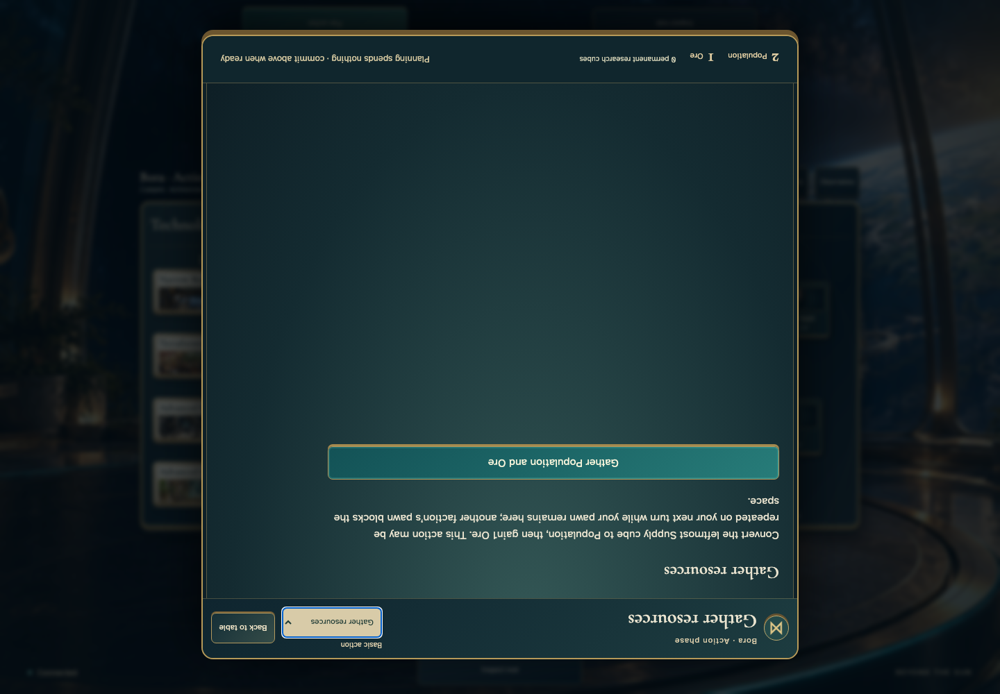](../../screenshots/manage-matching-supply-and-full-ore-yields-at-two-cardinal-seats/020-r0-bora-kind-desktop-darwin.png) |

tabletop-4k · 3840 × 2160

[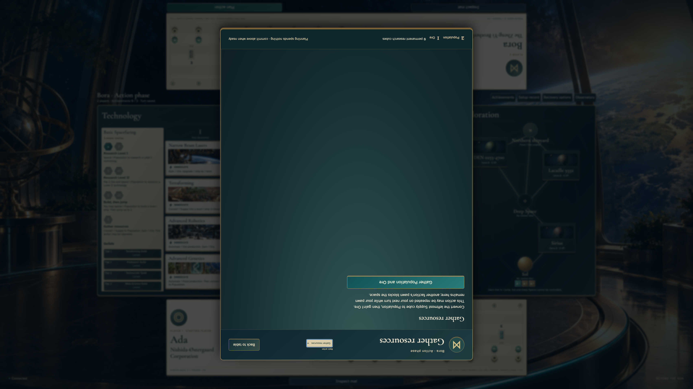](../../screenshots/manage-matching-supply-and-full-ore-yields-at-two-cardinal-seats/020-r0-bora-kind-tabletop-4k-darwin.png)

- [x] Bora selects ordinary gathering
- [x] Canonical effects settle before capture.
- [x] Any printed Action plan is ready.
- [x] Public compact topology remains physically separated.
- [x] The gameplay shell fits the actual viewport.

## 22. Receive the printed gather resources before ordinary production

Viewpoint: **Bora · North · one shared controller**.

| desktop · 1440 × 1000 |
| --- |
| [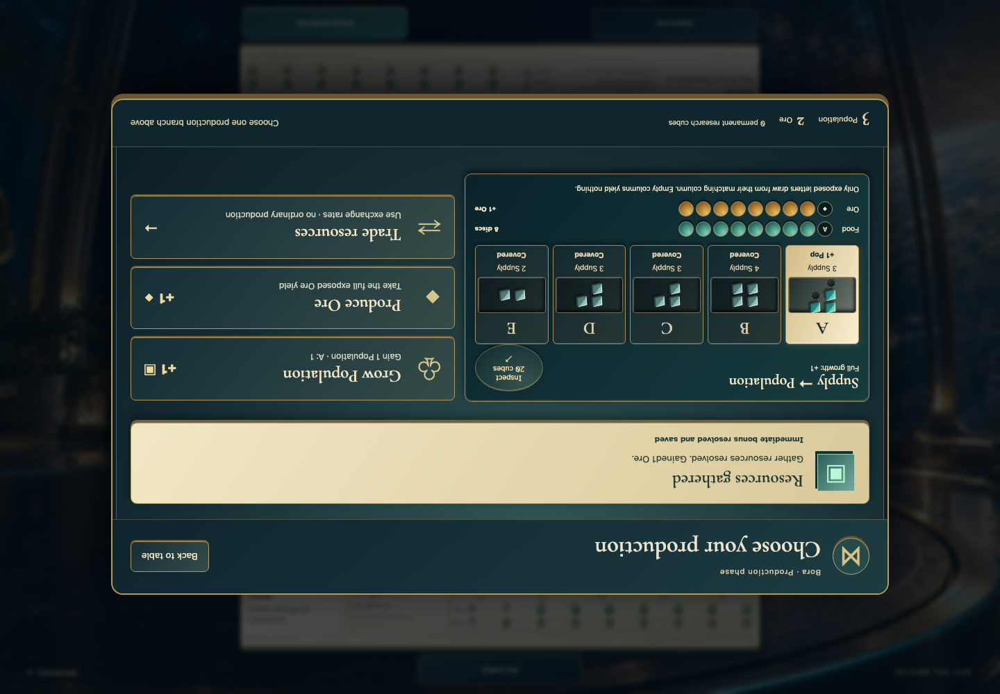](../../screenshots/manage-matching-supply-and-full-ore-yields-at-two-cardinal-seats/021-r0-bora-gathered-desktop-darwin.png) |

tabletop-4k · 3840 × 2160

- [x] Receive the printed gather resources before ordinary production
- [x] Canonical effects settle before capture.
- [x] Any printed Action plan is ready.
- [x] Public compact topology remains physically separated.
- [x] The gameplay shell fits the actual viewport.

## 23. Bora completes production and hands off to Ada

Viewpoint: **Bora · North · one shared controller**.

| desktop · 1440 × 1000 |
| --- |
|  |

tabletop-4k · 3840 × 2160

[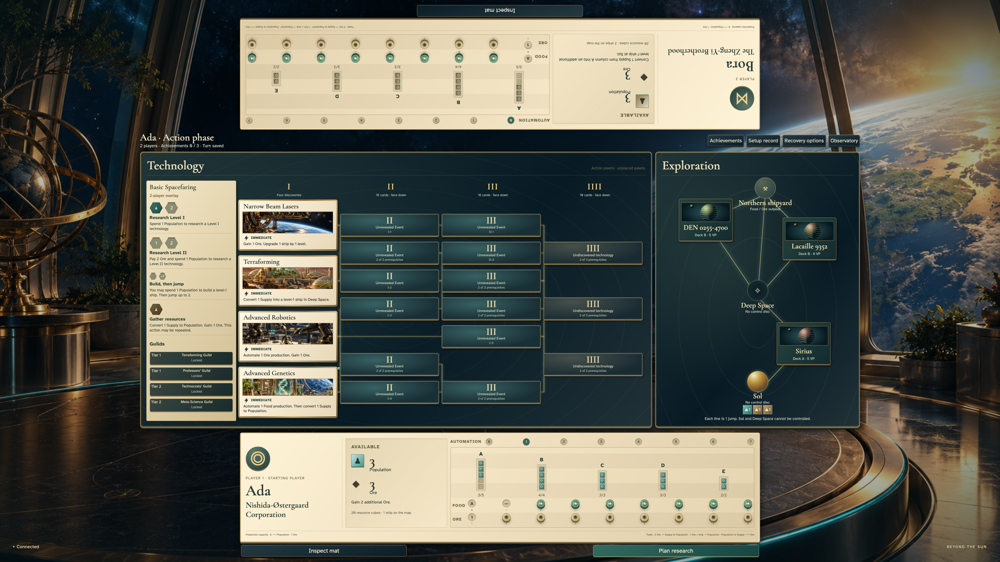](../../screenshots/manage-matching-supply-and-full-ore-yields-at-two-cardinal-seats/022-r0-bora-handoff-tabletop-4k-darwin.png)

- [x] Bora completes production and hands off to Ada
- [x] Canonical effects settle before capture.
- [x] Any printed Action plan is ready.
- [x] Public compact topology remains physically separated.
- [x] The gameplay shell fits the actual viewport.

## 24. Ada opens the actual research and Action instrument

Viewpoint: **Ada · South · one shared controller**.

| desktop · 1440 × 1000 |
| --- |
|  |

tabletop-4k · 3840 × 2160

- [x] Ada opens the actual research and Action instrument
- [x] Canonical effects settle before capture.
- [x] Any printed Action plan is ready.
- [x] Public compact topology remains physically separated.
- [x] The gameplay shell fits the actual viewport.

## 25. Ada selects the legal printed space 2

Viewpoint: **Ada · South · one shared controller**.

| desktop · 1440 × 1000 |
| --- |
| [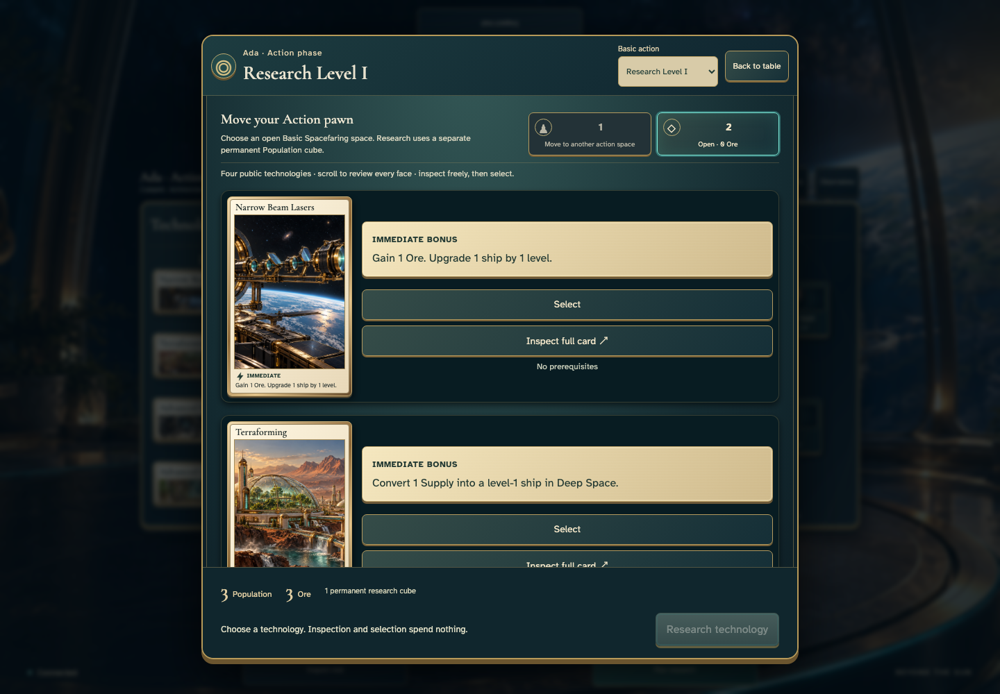](../../screenshots/manage-matching-supply-and-full-ore-yields-at-two-cardinal-seats/024-r1-ada-space-desktop-darwin.png) |

tabletop-4k · 3840 × 2160

- [x] Ada selects the legal printed space 2
- [x] Canonical effects settle before capture.
- [x] Any printed Action plan is ready.
- [x] Public compact topology remains physically separated.
- [x] The gameplay shell fits the actual viewport.

## 26. Select Narrow Beam Lasers with its printed cost and consequence

Viewpoint: **Ada · South · one shared controller**.

| desktop · 1440 × 1000 |
| --- |
| [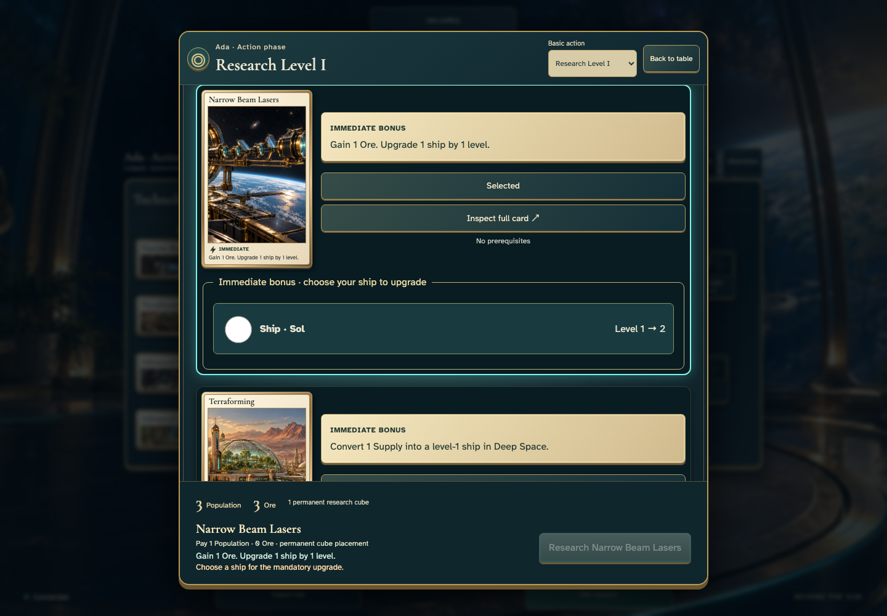](../../screenshots/manage-matching-supply-and-full-ore-yields-at-two-cardinal-seats/025-r1-ada-card-desktop-darwin.png) |

tabletop-4k · 3840 × 2160

[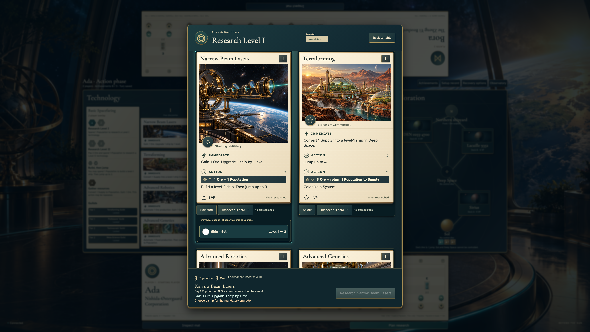](../../screenshots/manage-matching-supply-and-full-ore-yields-at-two-cardinal-seats/025-r1-ada-card-tabletop-4k-darwin.png)

- [x] Select Narrow Beam Lasers with its printed cost and consequence
- [x] Canonical effects settle before capture.
- [x] Any printed Action plan is ready.
- [x] Public compact topology remains physically separated.
- [x] The gameplay shell fits the actual viewport.

## 27. The immediate bonus requires an explicit owned target

Viewpoint: **Ada · South · one shared controller**.

| desktop · 1440 × 1000 |
| --- |
|  |

tabletop-4k · 3840 × 2160

- [x] The immediate bonus requires an explicit owned target
- [x] Canonical effects settle before capture.
- [x] Any printed Action plan is ready.
- [x] Public compact topology remains physically separated.
- [x] The gameplay shell fits the actual viewport.

## 28. Choose the original Sol ship for the one-level upgrade

Viewpoint: **Ada · South · one shared controller**.

| desktop · 1440 × 1000 |
| --- |
| [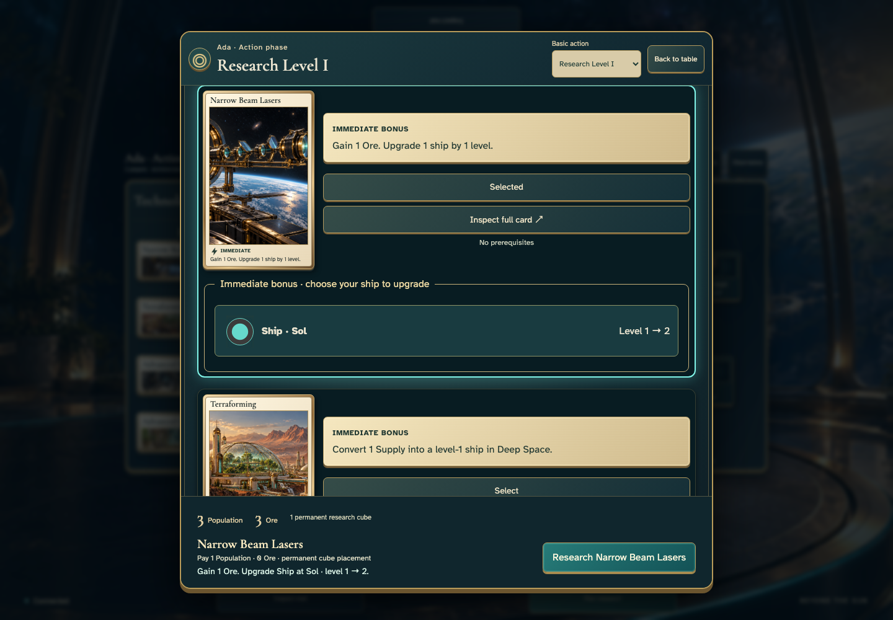](../../screenshots/manage-matching-supply-and-full-ore-yields-at-two-cardinal-seats/027-r1-ada-ship-desktop-darwin.png) |

tabletop-4k · 3840 × 2160

[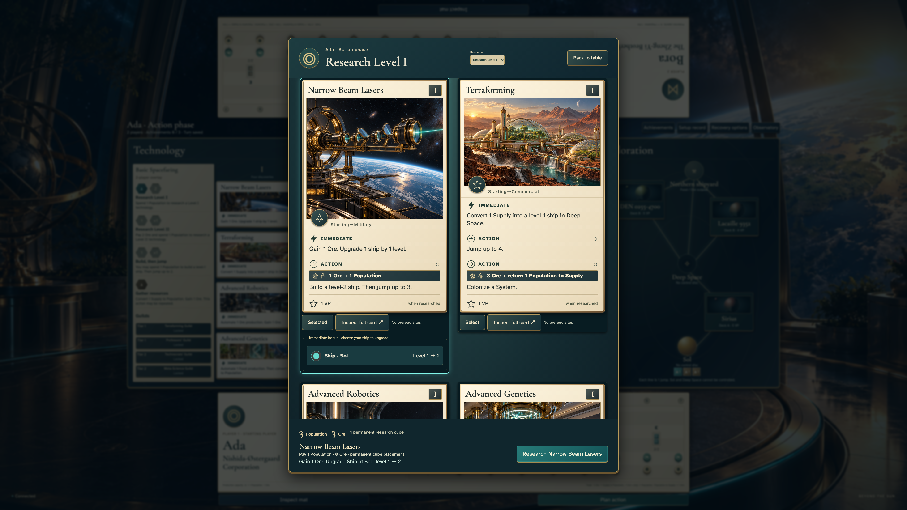](../../screenshots/manage-matching-supply-and-full-ore-yields-at-two-cardinal-seats/027-r1-ada-ship-tabletop-4k-darwin.png)

- [x] Choose the original Sol ship for the one-level upgrade
- [x] Canonical effects settle before capture.
- [x] Any printed Action plan is ready.
- [x] Public compact topology remains physically separated.
- [x] The gameplay shell fits the actual viewport.

## 29. Pay once and receive Narrow Beam Lasers's immediate bonus

Viewpoint: **Ada · South · one shared controller**.

| desktop · 1440 × 1000 |
| --- |
|  |

tabletop-4k · 3840 × 2160

- [x] Pay once and receive Narrow Beam Lasers's immediate bonus
- [x] Canonical effects settle before capture.
- [x] Any printed Action plan is ready.
- [x] Public compact topology remains physically separated.
- [x] The gameplay shell fits the actual viewport.

## 30. Ada completes production and hands off to Bora

Viewpoint: **Ada · South · one shared controller**.

| desktop · 1440 × 1000 |
| --- |
|  |

tabletop-4k · 3840 × 2160

[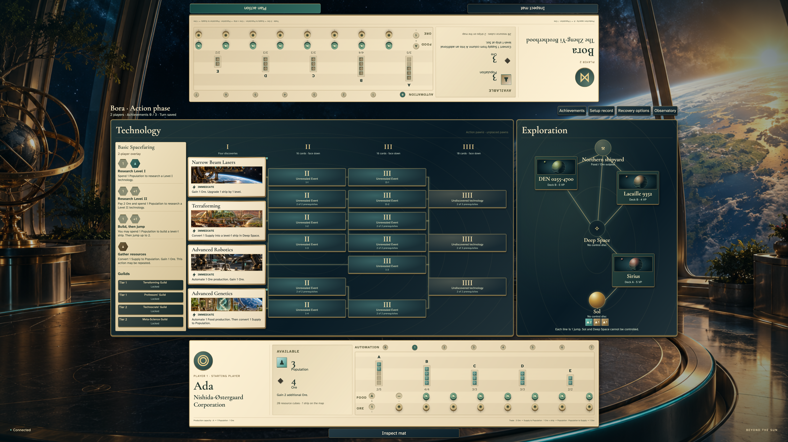](../../screenshots/manage-matching-supply-and-full-ore-yields-at-two-cardinal-seats/029-r1-ada-handoff-tabletop-4k-darwin.png)

- [x] Ada completes production and hands off to Bora
- [x] Canonical effects settle before capture.
- [x] Any printed Action plan is ready.
- [x] Public compact topology remains physically separated.
- [x] The gameplay shell fits the actual viewport.

## 31. Bora opens the actual research and Action instrument

Viewpoint: **Bora · North · one shared controller**.

| desktop · 1440 × 1000 |
| --- |
| [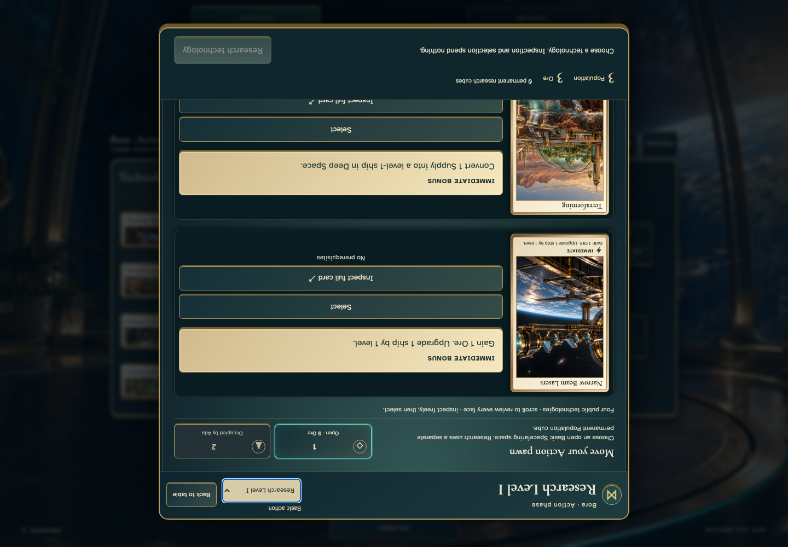](../../screenshots/manage-matching-supply-and-full-ore-yields-at-two-cardinal-seats/030-r1-bora-plan-desktop-darwin.png) |

tabletop-4k · 3840 × 2160

- [x] Bora opens the actual research and Action instrument
- [x] Canonical effects settle before capture.
- [x] Any printed Action plan is ready.
- [x] Public compact topology remains physically separated.
- [x] The gameplay shell fits the actual viewport.

## 32. Bora selects the legal printed space 1

Viewpoint: **Bora · North · one shared controller**.

| desktop · 1440 × 1000 |
| --- |
| [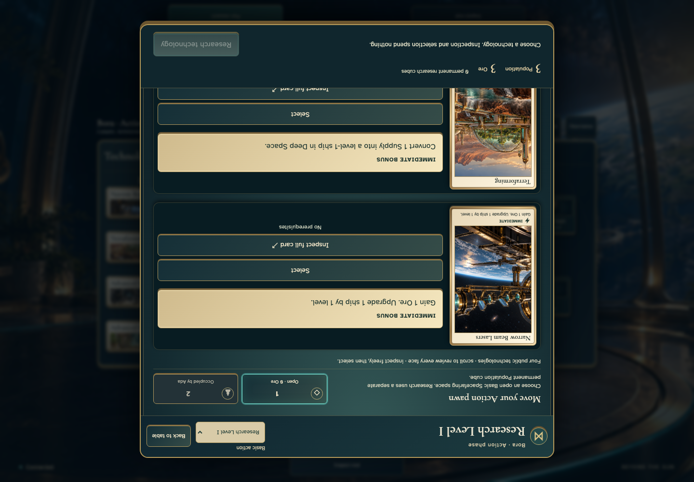](../../screenshots/manage-matching-supply-and-full-ore-yields-at-two-cardinal-seats/031-r1-bora-space-desktop-darwin.png) |

tabletop-4k · 3840 × 2160

- [x] Bora selects the legal printed space 1
- [x] Canonical effects settle before capture.
- [x] Any printed Action plan is ready.
- [x] Public compact topology remains physically separated.
- [x] The gameplay shell fits the actual viewport.

## 33. Select Advanced Robotics with its printed cost and consequence

Viewpoint: **Bora · North · one shared controller**.

| desktop · 1440 × 1000 |
| --- |
| [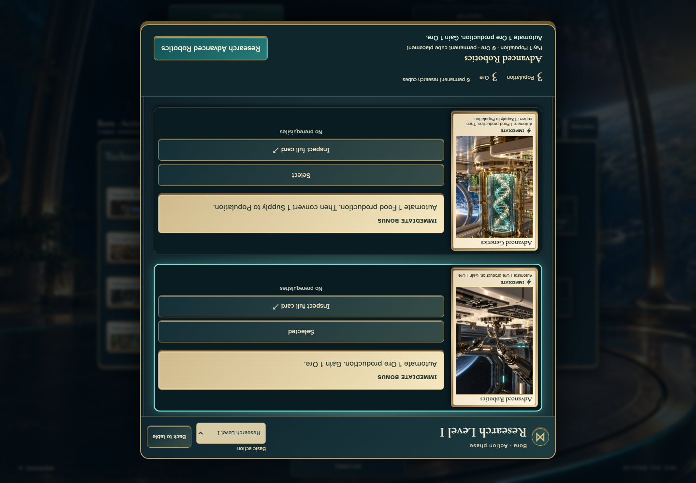](../../screenshots/manage-matching-supply-and-full-ore-yields-at-two-cardinal-seats/032-r1-bora-card-desktop-darwin.png) |

tabletop-4k · 3840 × 2160

[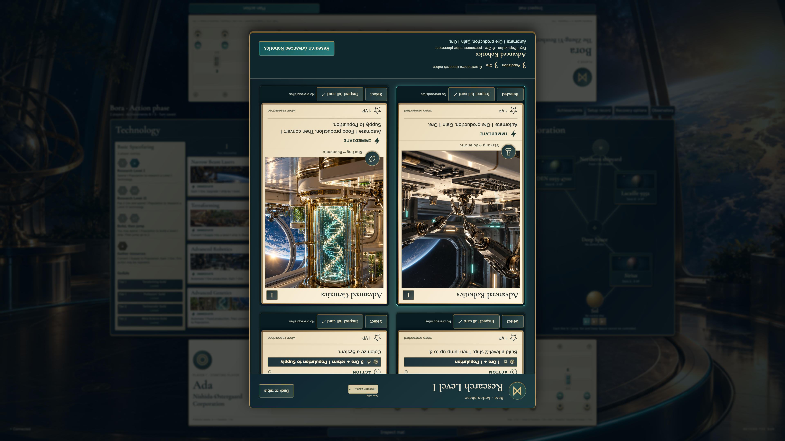](../../screenshots/manage-matching-supply-and-full-ore-yields-at-two-cardinal-seats/032-r1-bora-card-tabletop-4k-darwin.png)

- [x] Select Advanced Robotics with its printed cost and consequence
- [x] Canonical effects settle before capture.
- [x] Any printed Action plan is ready.
- [x] Public compact topology remains physically separated.
- [x] The gameplay shell fits the actual viewport.

## 34. Pay once and receive Advanced Robotics's immediate bonus

Viewpoint: **Bora · North · one shared controller**.

| desktop · 1440 × 1000 |
| --- |
|  |

tabletop-4k · 3840 × 2160

[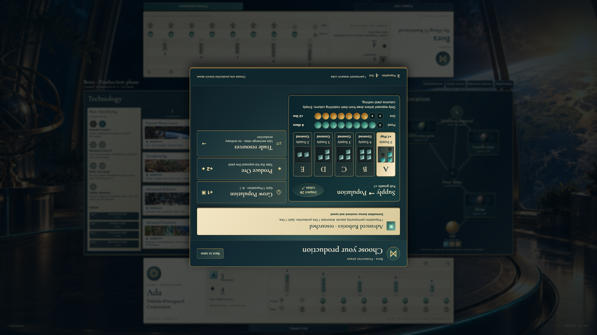](../../screenshots/manage-matching-supply-and-full-ore-yields-at-two-cardinal-seats/033-r1-bora-researched-tabletop-4k-darwin.png)

- [x] Pay once and receive Advanced Robotics's immediate bonus
- [x] Canonical effects settle before capture.
- [x] Any printed Action plan is ready.
- [x] Public compact topology remains physically separated.
- [x] The gameplay shell fits the actual viewport.

## 35. Bora completes production and hands off to Ada

Viewpoint: **Bora · North · one shared controller**.

| desktop · 1440 × 1000 |
| --- |
| [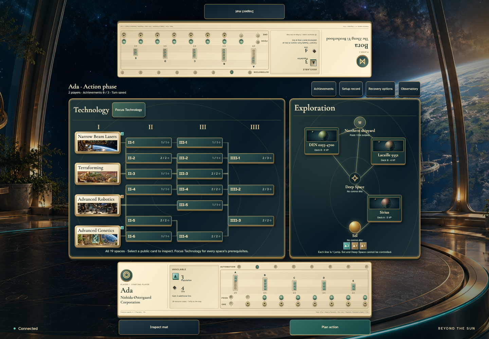](../../screenshots/manage-matching-supply-and-full-ore-yields-at-two-cardinal-seats/034-r1-bora-handoff-desktop-darwin.png) |

tabletop-4k · 3840 × 2160

- [x] Bora completes production and hands off to Ada
- [x] Canonical effects settle before capture.
- [x] Any printed Action plan is ready.
- [x] Public compact topology remains physically separated.
- [x] The gameplay shell fits the actual viewport.

## 36. Ada opens the actual research and Action instrument

Viewpoint: **Ada · South · one shared controller**.

| desktop · 1440 × 1000 |
| --- |
|  |

tabletop-4k · 3840 × 2160

- [x] Ada opens the actual research and Action instrument
- [x] Canonical effects settle before capture.
- [x] Any printed Action plan is ready.
- [x] Public compact topology remains physically separated.
- [x] The gameplay shell fits the actual viewport.

## 37. Ada selects ordinary gathering

Viewpoint: **Ada · South · one shared controller**.

| desktop · 1440 × 1000 |
| --- |
|  |

tabletop-4k · 3840 × 2160

- [x] Ada selects ordinary gathering
- [x] Canonical effects settle before capture.
- [x] Any printed Action plan is ready.
- [x] Public compact topology remains physically separated.
- [x] The gameplay shell fits the actual viewport.

## 38. Receive the printed gather resources before ordinary production

Viewpoint: **Ada · South · one shared controller**.

| desktop · 1440 × 1000 |
| --- |
| [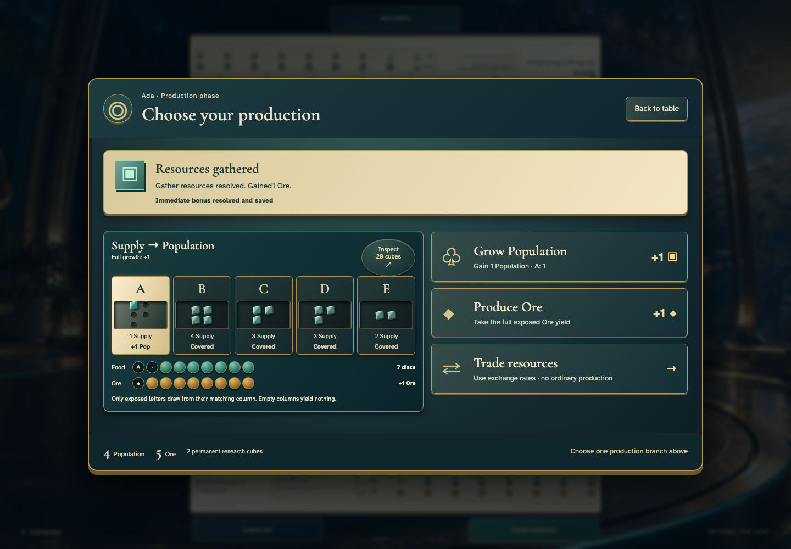](../../screenshots/manage-matching-supply-and-full-ore-yields-at-two-cardinal-seats/037-r2-ada-gathered-desktop-darwin.png) |

tabletop-4k · 3840 × 2160

[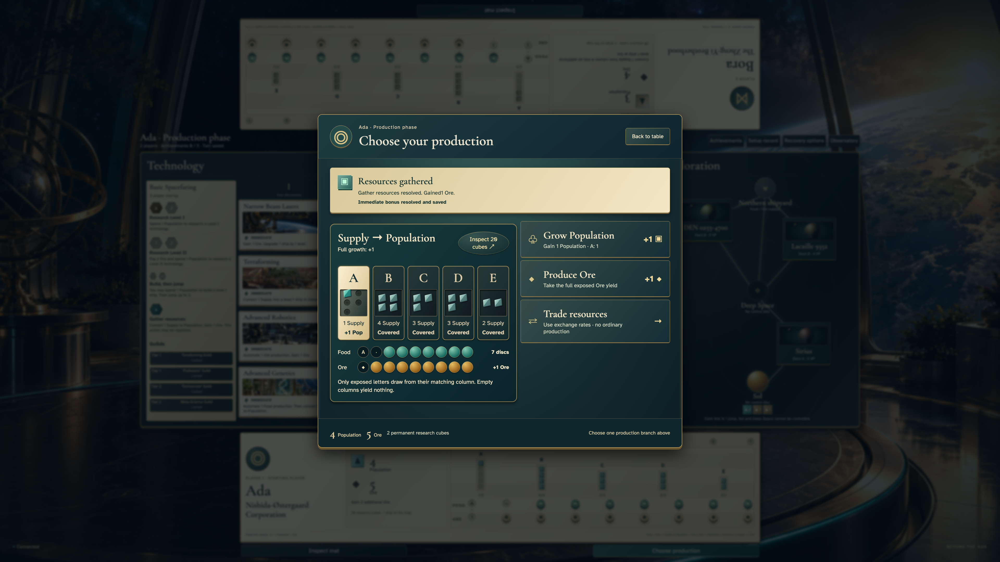](../../screenshots/manage-matching-supply-and-full-ore-yields-at-two-cardinal-seats/037-r2-ada-gathered-tabletop-4k-darwin.png)

- [x] Receive the printed gather resources before ordinary production
- [x] Canonical effects settle before capture.
- [x] Any printed Action plan is ready.
- [x] Public compact topology remains physically separated.
- [x] The gameplay shell fits the actual viewport.

## 39. Ada completes production and hands off to Bora

Viewpoint: **Ada · South · one shared controller**.

| desktop · 1440 × 1000 |
| --- |
| [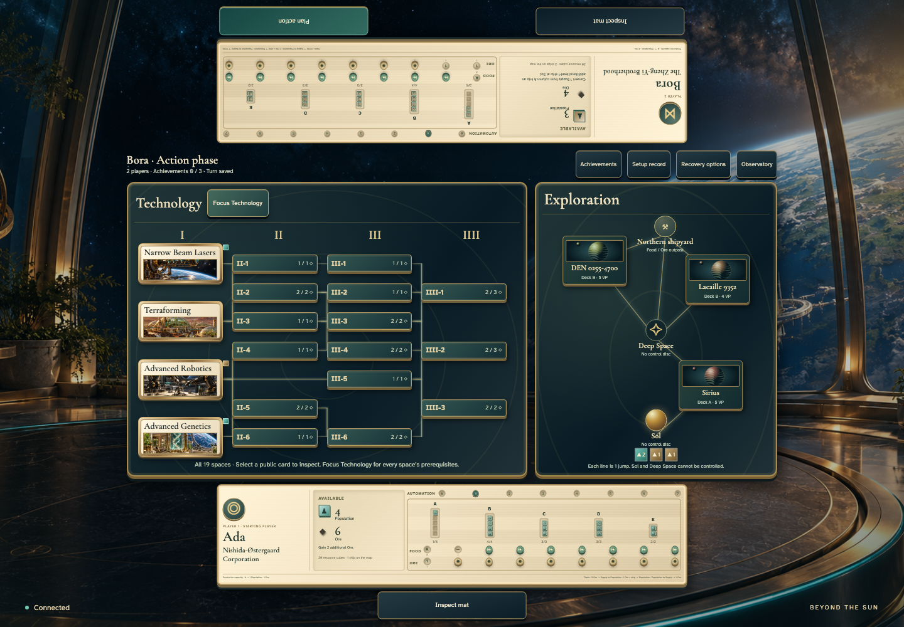](../../screenshots/manage-matching-supply-and-full-ore-yields-at-two-cardinal-seats/038-r2-ada-handoff-desktop-darwin.png) |

tabletop-4k · 3840 × 2160

- [x] Ada completes production and hands off to Bora
- [x] Canonical effects settle before capture.
- [x] Any printed Action plan is ready.
- [x] Public compact topology remains physically separated.
- [x] The gameplay shell fits the actual viewport.

## 40. Bora opens the actual research and Action instrument

Viewpoint: **Bora · North · one shared controller**.

| desktop · 1440 × 1000 |
| --- |
|  |

tabletop-4k · 3840 × 2160

- [x] Bora opens the actual research and Action instrument
- [x] Canonical effects settle before capture.
- [x] Any printed Action plan is ready.
- [x] Public compact topology remains physically separated.
- [x] The gameplay shell fits the actual viewport.

## 41. Bora selects the legal printed space 2

Viewpoint: **Bora · North · one shared controller**.

| desktop · 1440 × 1000 |
| --- |
|  |

tabletop-4k · 3840 × 2160

- [x] Bora selects the legal printed space 2
- [x] Canonical effects settle before capture.
- [x] Any printed Action plan is ready.
- [x] Public compact topology remains physically separated.
- [x] The gameplay shell fits the actual viewport.

## 42. Select Terraforming with its printed cost and consequence

Viewpoint: **Bora · North · one shared controller**.

| desktop · 1440 × 1000 |
| --- |
| [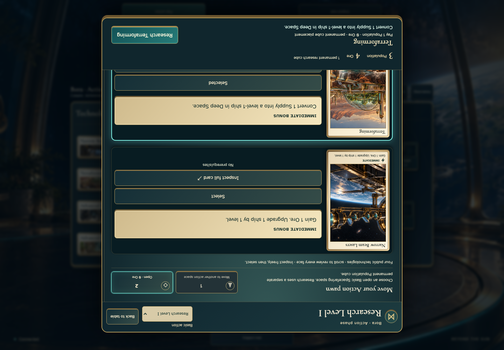](../../screenshots/manage-matching-supply-and-full-ore-yields-at-two-cardinal-seats/041-r2-bora-card-desktop-darwin.png) |

tabletop-4k · 3840 × 2160

[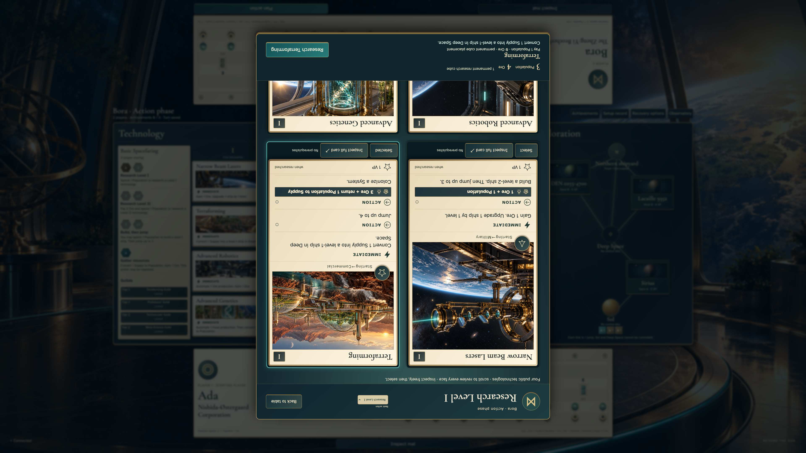](../../screenshots/manage-matching-supply-and-full-ore-yields-at-two-cardinal-seats/041-r2-bora-card-tabletop-4k-darwin.png)

- [x] Select Terraforming with its printed cost and consequence
- [x] Canonical effects settle before capture.
- [x] Any printed Action plan is ready.
- [x] Public compact topology remains physically separated.
- [x] The gameplay shell fits the actual viewport.

## 43. Pay once and receive Terraforming's immediate bonus

Viewpoint: **Bora · North · one shared controller**.

| desktop · 1440 × 1000 |
| --- |
|  |

tabletop-4k · 3840 × 2160

[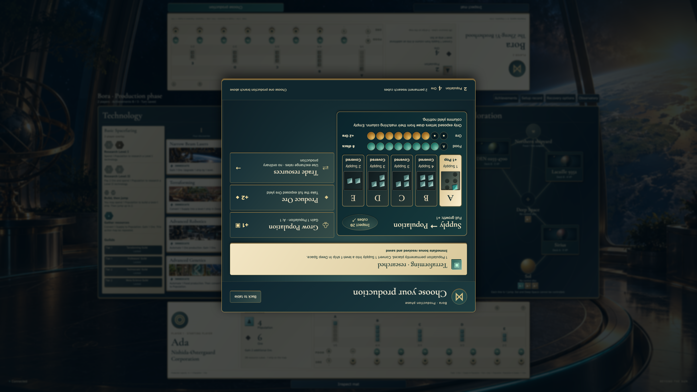](../../screenshots/manage-matching-supply-and-full-ore-yields-at-two-cardinal-seats/042-r2-bora-researched-tabletop-4k-darwin.png)

- [x] Pay once and receive Terraforming's immediate bonus
- [x] Canonical effects settle before capture.
- [x] Any printed Action plan is ready.
- [x] Public compact topology remains physically separated.
- [x] The gameplay shell fits the actual viewport.

## 44. Bora completes production and hands off to Ada

Viewpoint: **Bora · North · one shared controller**.

| desktop · 1440 × 1000 |
| --- |
| [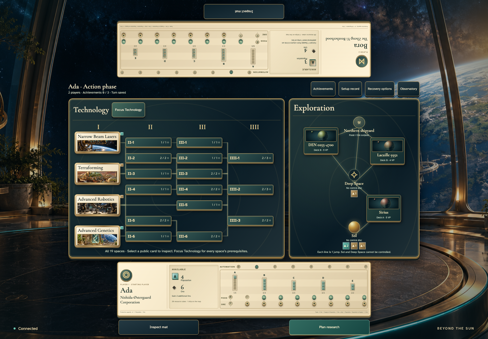](../../screenshots/manage-matching-supply-and-full-ore-yields-at-two-cardinal-seats/043-r2-bora-handoff-desktop-darwin.png) |

tabletop-4k · 3840 × 2160

[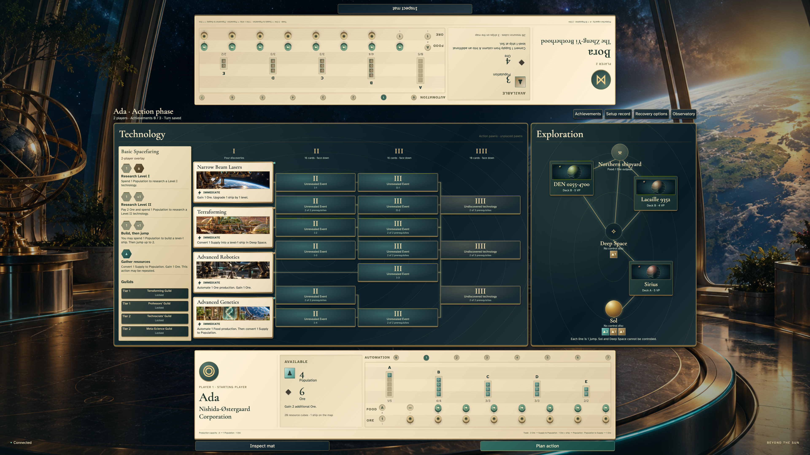](../../screenshots/manage-matching-supply-and-full-ore-yields-at-two-cardinal-seats/043-r2-bora-handoff-tabletop-4k-darwin.png)

- [x] Bora completes production and hands off to Ada
- [x] Canonical effects settle before capture.
- [x] Any printed Action plan is ready.
- [x] Public compact topology remains physically separated.
- [x] The gameplay shell fits the actual viewport.

## 45. Ada opens the actual research and Action instrument

Viewpoint: **Ada · South · one shared controller**.

| desktop · 1440 × 1000 |
| --- |
| [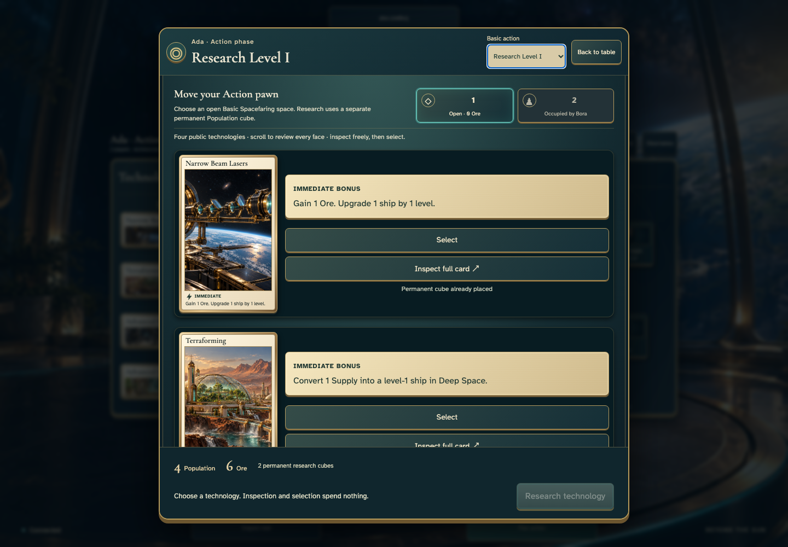](../../screenshots/manage-matching-supply-and-full-ore-yields-at-two-cardinal-seats/044-r3-ada-plan-desktop-darwin.png) |

tabletop-4k · 3840 × 2160

- [x] Ada opens the actual research and Action instrument
- [x] Canonical effects settle before capture.
- [x] Any printed Action plan is ready.
- [x] Public compact topology remains physically separated.
- [x] The gameplay shell fits the actual viewport.

## 46. Ada selects the legal printed space 1

Viewpoint: **Ada · South · one shared controller**.

| desktop · 1440 × 1000 |
| --- |
| [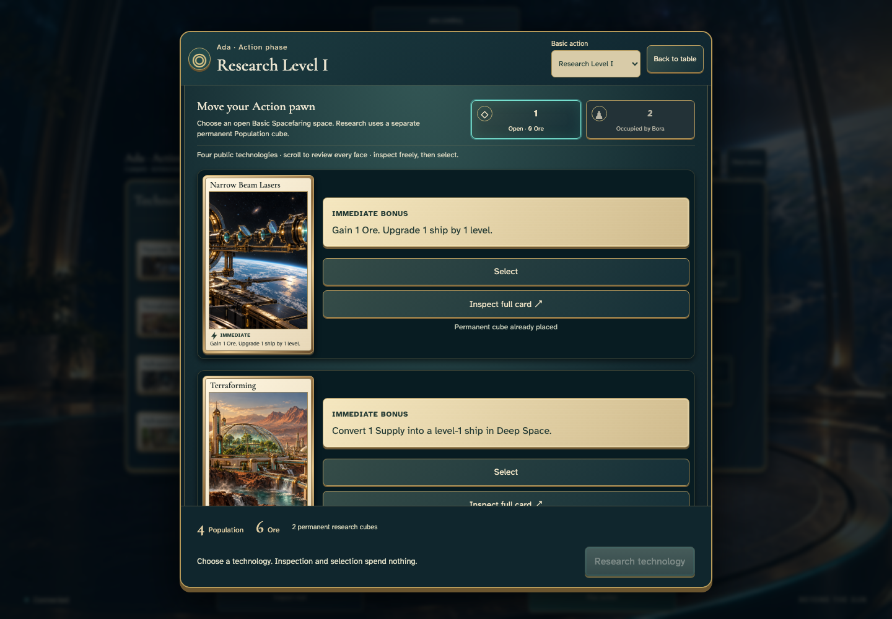](../../screenshots/manage-matching-supply-and-full-ore-yields-at-two-cardinal-seats/045-r3-ada-space-desktop-darwin.png) |

tabletop-4k · 3840 × 2160

- [x] Ada selects the legal printed space 1
- [x] Canonical effects settle before capture.
- [x] Any printed Action plan is ready.
- [x] Public compact topology remains physically separated.
- [x] The gameplay shell fits the actual viewport.

## 47. Select Advanced Robotics with its printed cost and consequence

Viewpoint: **Ada · South · one shared controller**.

| desktop · 1440 × 1000 |
| --- |
| [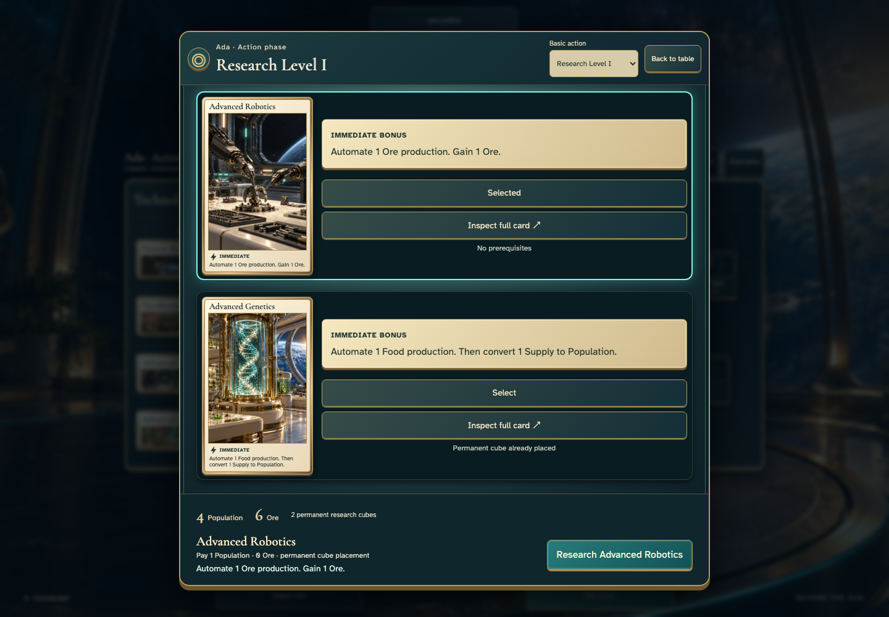](../../screenshots/manage-matching-supply-and-full-ore-yields-at-two-cardinal-seats/046-r3-ada-card-desktop-darwin.png) |

tabletop-4k · 3840 × 2160

[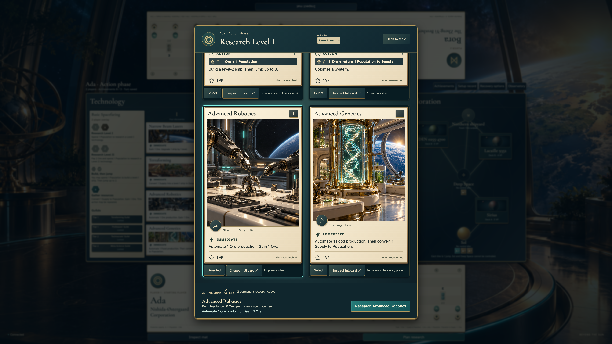](../../screenshots/manage-matching-supply-and-full-ore-yields-at-two-cardinal-seats/046-r3-ada-card-tabletop-4k-darwin.png)

- [x] Select Advanced Robotics with its printed cost and consequence
- [x] Canonical effects settle before capture.
- [x] Any printed Action plan is ready.
- [x] Public compact topology remains physically separated.
- [x] The gameplay shell fits the actual viewport.

## 48. Pay once and receive Advanced Robotics's immediate bonus

Viewpoint: **Ada · South · one shared controller**.

| desktop · 1440 × 1000 |
| --- |
| [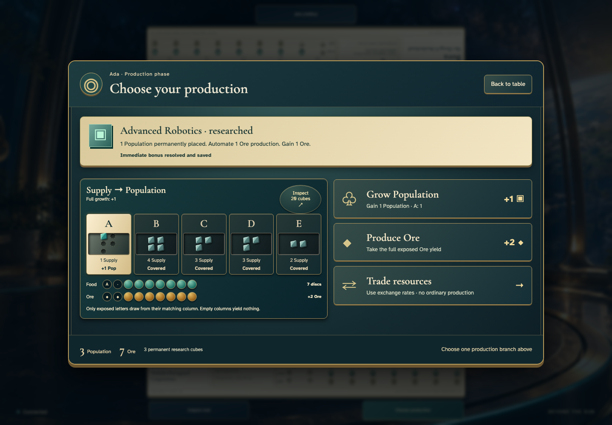](../../screenshots/manage-matching-supply-and-full-ore-yields-at-two-cardinal-seats/047-r3-ada-researched-desktop-darwin.png) |

tabletop-4k · 3840 × 2160

[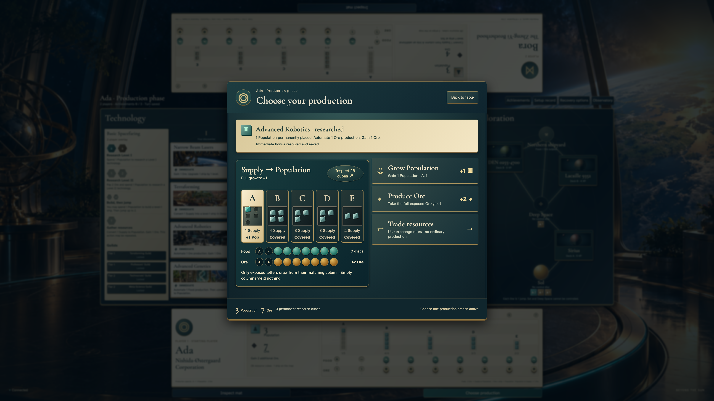](../../screenshots/manage-matching-supply-and-full-ore-yields-at-two-cardinal-seats/047-r3-ada-researched-tabletop-4k-darwin.png)

- [x] Pay once and receive Advanced Robotics's immediate bonus
- [x] Canonical effects settle before capture.
- [x] Any printed Action plan is ready.
- [x] Public compact topology remains physically separated.
- [x] The gameplay shell fits the actual viewport.

## 49. Robotics exposes two Ore circles and ordinary production takes both

Viewpoint: **Ada · South · one shared controller**.

| desktop · 1440 × 1000 |
| --- |
|  |

tabletop-4k · 3840 × 2160

- [x] Robotics exposes two Ore circles and ordinary production takes both
- [x] Canonical effects settle before capture.
- [x] Any printed Action plan is ready.
- [x] Public compact topology remains physically separated.
- [x] The gameplay shell fits the actual viewport.

## 50. Ada completes production and hands off to Bora

Viewpoint: **Ada · South · one shared controller**.

| desktop · 1440 × 1000 |
| --- |
| [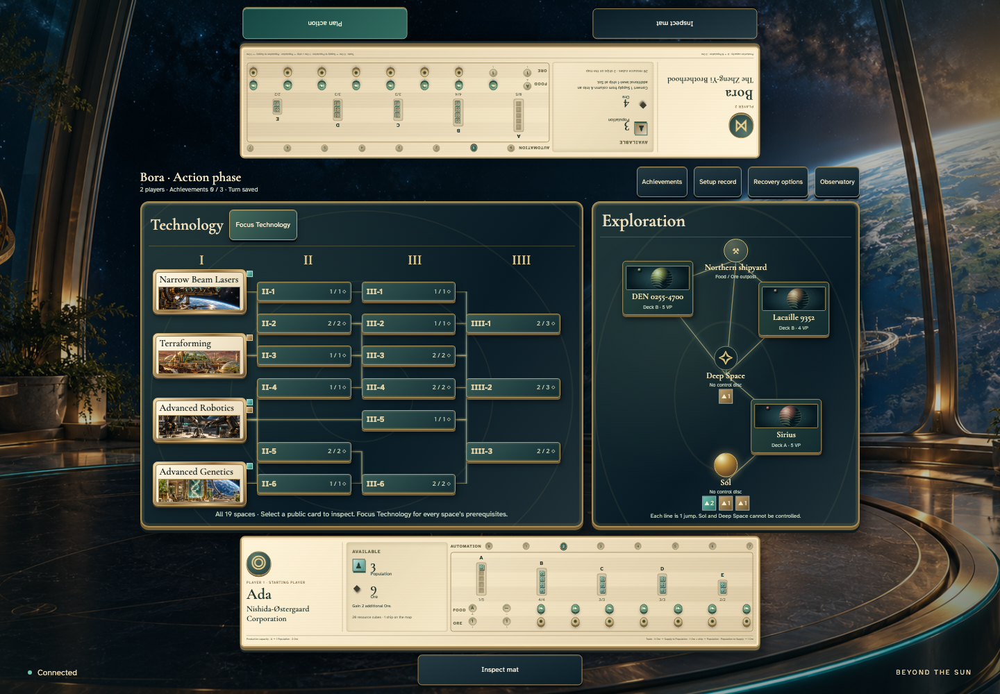](../../screenshots/manage-matching-supply-and-full-ore-yields-at-two-cardinal-seats/049-r3-ada-handoff-desktop-darwin.png) |

tabletop-4k · 3840 × 2160

[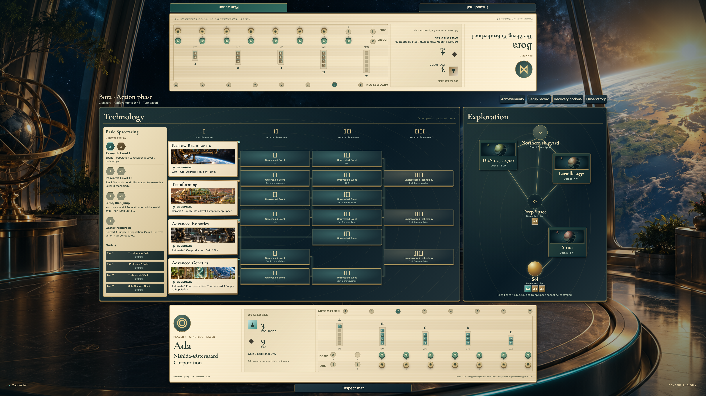](../../screenshots/manage-matching-supply-and-full-ore-yields-at-two-cardinal-seats/049-r3-ada-handoff-tabletop-4k-darwin.png)

- [x] Ada completes production and hands off to Bora
- [x] Canonical effects settle before capture.
- [x] Any printed Action plan is ready.
- [x] Public compact topology remains physically separated.
- [x] The gameplay shell fits the actual viewport.

## 51. Bora opens the actual research and Action instrument

Viewpoint: **Bora · North · one shared controller**.

| desktop · 1440 × 1000 |
| --- |
|  |

tabletop-4k · 3840 × 2160

- [x] Bora opens the actual research and Action instrument
- [x] Canonical effects settle before capture.
- [x] Any printed Action plan is ready.
- [x] Public compact topology remains physically separated.
- [x] The gameplay shell fits the actual viewport.

## 52. Bora selects ordinary gathering

Viewpoint: **Bora · North · one shared controller**.

| desktop · 1440 × 1000 |
| --- |
|  |

tabletop-4k · 3840 × 2160

- [x] Bora selects ordinary gathering
- [x] Canonical effects settle before capture.
- [x] Any printed Action plan is ready.
- [x] Public compact topology remains physically separated.
- [x] The gameplay shell fits the actual viewport.

## 53. Receive the printed gather resources before ordinary production

Viewpoint: **Bora · North · one shared controller**.

| desktop · 1440 × 1000 |
| --- |
|  |

tabletop-4k · 3840 × 2160

[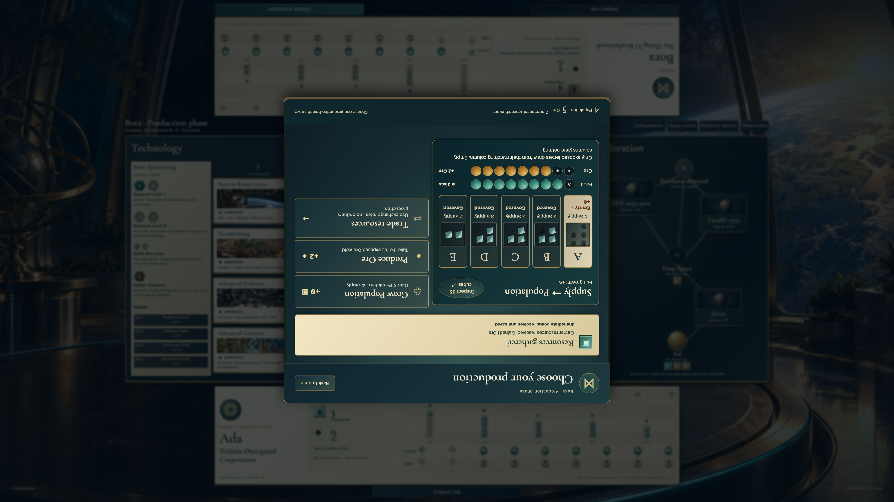](../../screenshots/manage-matching-supply-and-full-ore-yields-at-two-cardinal-seats/052-r3-bora-gathered-tabletop-4k-darwin.png)

- [x] Receive the printed gather resources before ordinary production
- [x] Canonical effects settle before capture.
- [x] Any printed Action plan is ready.
- [x] Public compact topology remains physically separated.
- [x] The gameplay shell fits the actual viewport.

## 54. Bora completes production and hands off to Ada

Viewpoint: **Bora · North · one shared controller**.

| desktop · 1440 × 1000 |
| --- |
|  |

tabletop-4k · 3840 × 2160

- [x] Bora completes production and hands off to Ada
- [x] Canonical effects settle before capture.
- [x] Any printed Action plan is ready.
- [x] Public compact topology remains physically separated.
- [x] The gameplay shell fits the actual viewport.

## 55. Ada opens the actual research and Action instrument

Viewpoint: **Ada · South · one shared controller**.

| desktop · 1440 × 1000 |
| --- |
|  |

tabletop-4k · 3840 × 2160

- [x] Ada opens the actual research and Action instrument
- [x] Canonical effects settle before capture.
- [x] Any printed Action plan is ready.
- [x] Public compact topology remains physically separated.
- [x] The gameplay shell fits the actual viewport.

## 56. Ada selects printed technology Actions

Viewpoint: **Ada · South · one shared controller**.

| desktop · 1440 × 1000 |
| --- |
|  |

tabletop-4k · 3840 × 2160

- [x] Ada selects printed technology Actions
- [x] Canonical effects settle before capture.
- [x] Any printed Action plan is ready.
- [x] Public compact topology remains physically separated.
- [x] The gameplay shell fits the actual viewport.

## 57. Read Narrow Beam Lasers's actual research requirement, payment and exclusive pawn space

Viewpoint: **Ada · South · one shared controller**.

| desktop · 1440 × 1000 |
| --- |
| [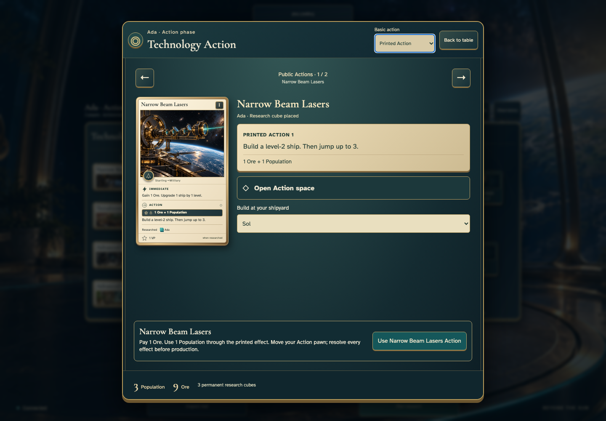](../../screenshots/manage-matching-supply-and-full-ore-yields-at-two-cardinal-seats/056-r4-ada-face-desktop-darwin.png) |

tabletop-4k · 3840 × 2160

[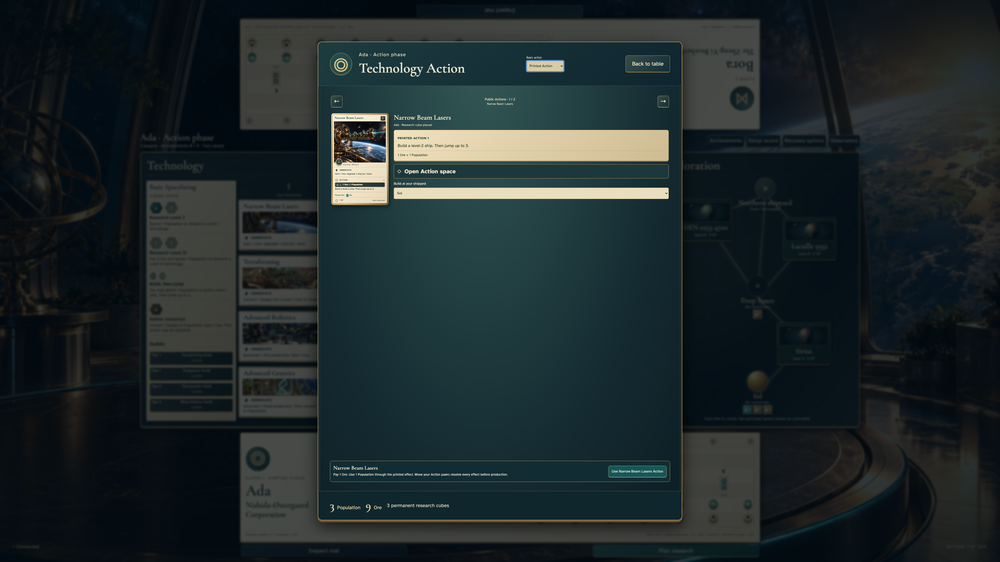](../../screenshots/manage-matching-supply-and-full-ore-yields-at-two-cardinal-seats/056-r4-ada-face-tabletop-4k-darwin.png)

- [x] Read Narrow Beam Lasers's actual research requirement, payment and exclusive pawn space
- [x] Canonical effects settle before capture.
- [x] Any printed Action plan is ready.
- [x] Public compact topology remains physically separated.
- [x] The gameplay shell fits the actual viewport.

## 58. Commit the actual printed Action cost before planning movement

Viewpoint: **Ada · South · one shared controller**.

| desktop · 1440 × 1000 |
| --- |
| [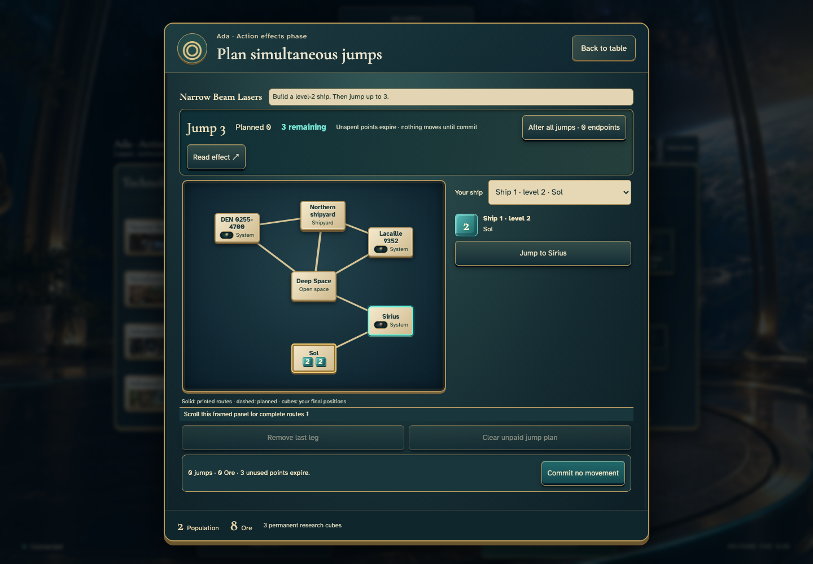](../../screenshots/manage-matching-supply-and-full-ore-yields-at-two-cardinal-seats/057-r4-ada-paid-desktop-darwin.png) |

tabletop-4k · 3840 × 2160

[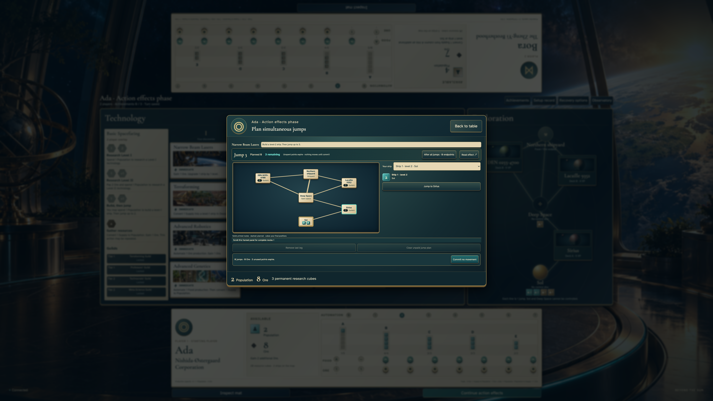](../../screenshots/manage-matching-supply-and-full-ore-yields-at-two-cardinal-seats/057-r4-ada-paid-tabletop-4k-darwin.png)

- [x] Commit the actual printed Action cost before planning movement
- [x] Canonical effects settle before capture.
- [x] Any printed Action plan is ready.
- [x] Public compact topology remains physically separated.
- [x] The gameplay shell fits the actual viewport.

## 59. Choose a real owned ship for the legal path

Viewpoint: **Ada · South · one shared controller**.

| desktop · 1440 × 1000 |
| --- |
| [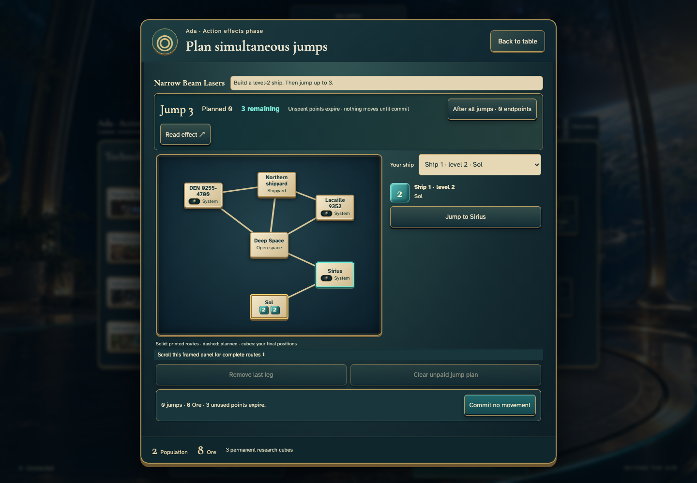](../../screenshots/manage-matching-supply-and-full-ore-yields-at-two-cardinal-seats/058-r4-ada-ship-desktop-darwin.png) |

tabletop-4k · 3840 × 2160

[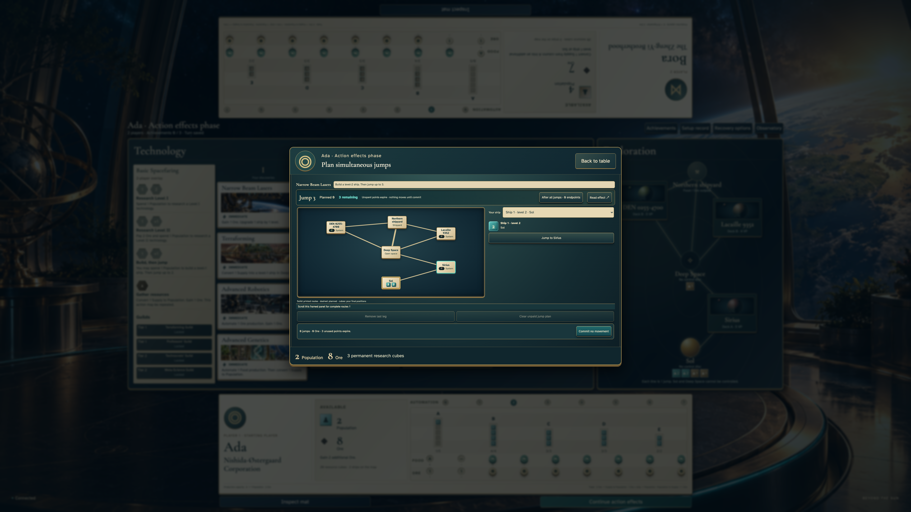](../../screenshots/manage-matching-supply-and-full-ore-yields-at-two-cardinal-seats/058-r4-ada-ship-tabletop-4k-darwin.png)

- [x] Choose a real owned ship for the legal path
- [x] Canonical effects settle before capture.
- [x] Any printed Action plan is ready.
- [x] Public compact topology remains physically separated.
- [x] The gameplay shell fits the actual viewport.

## 60. Open the actual connected-destination view

Viewpoint: **Ada · South · one shared controller**.

| desktop · 1440 × 1000 |
| --- |
| [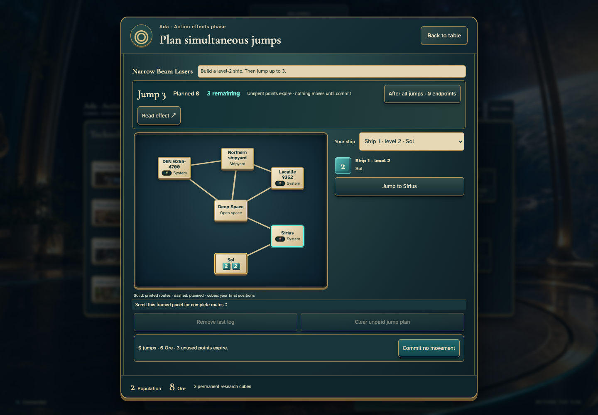](../../screenshots/manage-matching-supply-and-full-ore-yields-at-two-cardinal-seats/059-r4-ada-route-editor-desktop-darwin.png) |

tabletop-4k · 3840 × 2160

[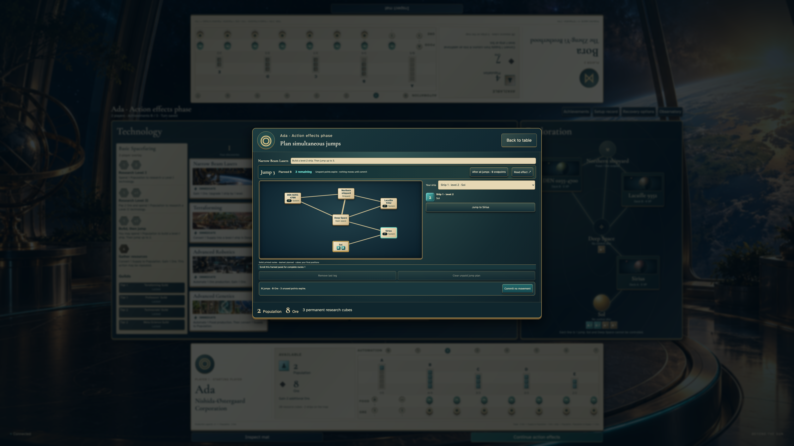](../../screenshots/manage-matching-supply-and-full-ore-yields-at-two-cardinal-seats/059-r4-ada-route-editor-tabletop-4k-darwin.png)

- [x] Open the actual connected-destination view
- [x] Canonical effects settle before capture.
- [x] Any printed Action plan is ready.
- [x] Public compact topology remains physically separated.
- [x] The gameplay shell fits the actual viewport.

## 61. Plan the next adjacent system without moving or paying again

Viewpoint: **Ada · South · one shared controller**.

| desktop · 1440 × 1000 |
| --- |
| [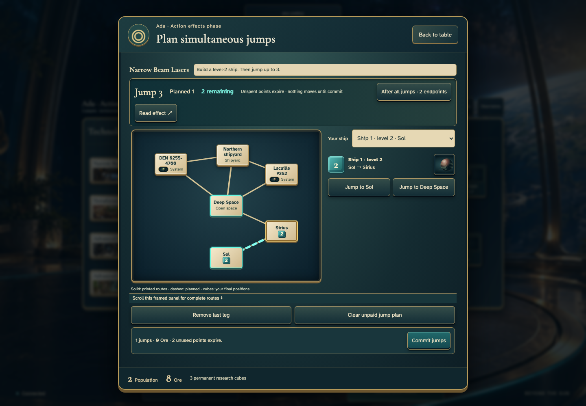](../../screenshots/manage-matching-supply-and-full-ore-yields-at-two-cardinal-seats/060-r4-ada-leg-0-desktop-darwin.png) |

tabletop-4k · 3840 × 2160

[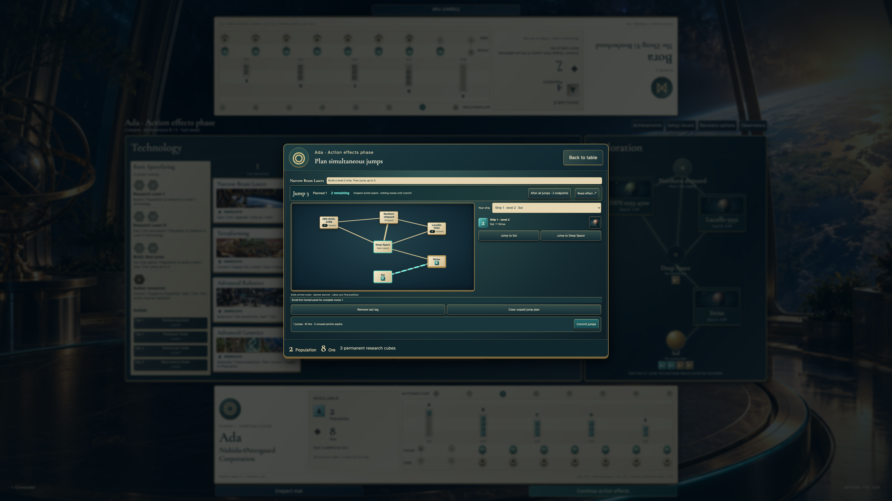](../../screenshots/manage-matching-supply-and-full-ore-yields-at-two-cardinal-seats/060-r4-ada-leg-0-tabletop-4k-darwin.png)

- [x] Plan the next adjacent system without moving or paying again
- [x] Canonical effects settle before capture.
- [x] Any printed Action plan is ready.
- [x] Public compact topology remains physically separated.
- [x] The gameplay shell fits the actual viewport.

## 62. Plan the next adjacent system without moving or paying again

Viewpoint: **Ada · South · one shared controller**.

| desktop · 1440 × 1000 |
| --- |
|  |

tabletop-4k · 3840 × 2160

- [x] Plan the next adjacent system without moving or paying again
- [x] Canonical effects settle before capture.
- [x] Any printed Action plan is ready.
- [x] Public compact topology remains physically separated.
- [x] The gameplay shell fits the actual viewport.

## 63. Plan the next adjacent system without moving or paying again

Viewpoint: **Ada · South · one shared controller**.

| desktop · 1440 × 1000 |
| --- |
|  |

tabletop-4k · 3840 × 2160

- [x] Plan the next adjacent system without moving or paying again
- [x] Canonical effects settle before capture.
- [x] Any printed Action plan is ready.
- [x] Public compact topology remains physically separated.
- [x] The gameplay shell fits the actual viewport.

## 64. Resolve the complete real path atomically

Viewpoint: **Ada · South · one shared controller**.

| desktop · 1440 × 1000 |
| --- |
|  |

tabletop-4k · 3840 × 2160

- [x] Resolve the complete real path atomically
- [x] Canonical effects settle before capture.
- [x] Any printed Action plan is ready.
- [x] Public compact topology remains physically separated.
- [x] The gameplay shell fits the actual viewport.

## 65. Place an actual Food outpost and expose the second matching column

Viewpoint: **Ada · South · one shared controller**.

| desktop · 1440 × 1000 |
| --- |
|  |

tabletop-4k · 3840 × 2160

- [x] Place an actual Food outpost and expose the second matching column
- [x] Canonical effects settle before capture.
- [x] Any printed Action plan is ready.
- [x] Public compact topology remains physically separated.
- [x] The gameplay shell fits the actual viewport.

## 66. Food now exposes A and B, each of which contributes one real matching cube

Viewpoint: **Ada · South · one shared controller**.

| desktop · 1440 × 1000 |
| --- |
|  |

tabletop-4k · 3840 × 2160

- [x] Food now exposes A and B, each of which contributes one real matching cube
- [x] Canonical effects settle before capture.
- [x] Any printed Action plan is ready.
- [x] Public compact topology remains physically separated.
- [x] The gameplay shell fits the actual viewport.

## 67. Ada completes production and hands off to Bora

Viewpoint: **Ada · South · one shared controller**.

| desktop · 1440 × 1000 |
| --- |
|  |

tabletop-4k · 3840 × 2160

- [x] Ada completes production and hands off to Bora
- [x] Canonical effects settle before capture.
- [x] Any printed Action plan is ready.
- [x] Public compact topology remains physically separated.
- [x] The gameplay shell fits the actual viewport.

## 68. Bora opens the actual research and Action instrument

Viewpoint: **Bora · North · one shared controller**.

| desktop · 1440 × 1000 |
| --- |
|  |

tabletop-4k · 3840 × 2160

- [x] Bora opens the actual research and Action instrument
- [x] Canonical effects settle before capture.
- [x] Any printed Action plan is ready.
- [x] Public compact topology remains physically separated.
- [x] The gameplay shell fits the actual viewport.

## 69. Bora selects the legal printed space 1

Viewpoint: **Bora · North · one shared controller**.

| desktop · 1440 × 1000 |
| --- |
|  |

tabletop-4k · 3840 × 2160

- [x] Bora selects the legal printed space 1
- [x] Canonical effects settle before capture.
- [x] Any printed Action plan is ready.
- [x] Public compact topology remains physically separated.
- [x] The gameplay shell fits the actual viewport.

## 70. Select Advanced Genetics with its printed cost and consequence

Viewpoint: **Bora · North · one shared controller**.

| desktop · 1440 × 1000 |
| --- |
|  |

tabletop-4k · 3840 × 2160

- [x] Select Advanced Genetics with its printed cost and consequence
- [x] Canonical effects settle before capture.
- [x] Any printed Action plan is ready.
- [x] Public compact topology remains physically separated.
- [x] The gameplay shell fits the actual viewport.

## 71. Pay once and receive Advanced Genetics's immediate bonus

Viewpoint: **Bora · North · one shared controller**.

| desktop · 1440 × 1000 |
| --- |
|  |

tabletop-4k · 3840 × 2160

- [x] Pay once and receive Advanced Genetics's immediate bonus
- [x] Canonical effects settle before capture.
- [x] Any printed Action plan is ready.
- [x] Public compact topology remains physically separated.
- [x] The gameplay shell fits the actual viewport.

## 72. Bora completes production and hands off to Ada

Viewpoint: **Bora · North · one shared controller**.

| desktop · 1440 × 1000 |
| --- |
|  |

tabletop-4k · 3840 × 2160

- [x] Bora completes production and hands off to Ada
- [x] Canonical effects settle before capture.
- [x] Any printed Action plan is ready.
- [x] Public compact topology remains physically separated.
- [x] The gameplay shell fits the actual viewport.

## 73. Ada opens the actual research and Action instrument

Viewpoint: **Ada · South · one shared controller**.

| desktop · 1440 × 1000 |
| --- |
|  |

tabletop-4k · 3840 × 2160

- [x] Ada opens the actual research and Action instrument
- [x] Canonical effects settle before capture.
- [x] Any printed Action plan is ready.
- [x] Public compact topology remains physically separated.
- [x] The gameplay shell fits the actual viewport.

## 74. Ada selects ordinary gathering

Viewpoint: **Ada · South · one shared controller**.

| desktop · 1440 × 1000 |
| --- |
|  |

tabletop-4k · 3840 × 2160

- [x] Ada selects ordinary gathering
- [x] Canonical effects settle before capture.
- [x] Any printed Action plan is ready.
- [x] Public compact topology remains physically separated.
- [x] The gameplay shell fits the actual viewport.

## 75. Receive the printed gather resources before ordinary production

Viewpoint: **Ada · South · one shared controller**.

| desktop · 1440 × 1000 |
| --- |
|  |

tabletop-4k · 3840 × 2160

- [x] Receive the printed gather resources before ordinary production
- [x] Canonical effects settle before capture.
- [x] Any printed Action plan is ready.
- [x] Public compact topology remains physically separated.
- [x] The gameplay shell fits the actual viewport.

## 76. An exposed but empty A column cannot substitute cubes from covered columns

Viewpoint: **Ada · South · one shared controller**.

| desktop · 1280 × 640 |
| --- |
|  |

tabletop-4k · 3840 × 2160

- [x] An exposed but empty A column cannot substitute cubes from covered columns
- [x] Canonical effects settle before capture.
- [x] Any printed Action plan is ready.
- [x] Public compact topology remains physically separated.
- [x] The gameplay shell fits the actual viewport.

## 77. Inspect all twenty conserved cubes in their actual current locations

Viewpoint: **Ada · South · one shared controller**.

| desktop · 1280 × 640 |
| --- |
|  |

tabletop-4k · 3840 × 2160

- [x] Inspect all twenty conserved cubes in their actual current locations
- [x] Canonical effects settle before capture.
- [x] Any printed Action plan is ready.
- [x] Public compact topology remains physically separated.
- [x] The gameplay shell fits the actual viewport.

## 78. Tab remains in the modal reader

Viewpoint: **Ada · South · one shared controller**.

| desktop · 1280 × 640 |
| --- |
|  |

tabletop-4k · 3840 × 2160

- [x] Tab remains in the modal reader
- [x] Canonical effects settle before capture.
- [x] Any printed Action plan is ready.
- [x] Public compact topology remains physically separated.
- [x] The gameplay shell fits the actual viewport.

## 79. Reverse Tab remains in the same accessible reader

Viewpoint: **Ada · South · one shared controller**.

| desktop · 1280 × 640 |
| --- |
|  |

tabletop-4k · 3840 × 2160

- [x] Reverse Tab remains in the same accessible reader
- [x] Canonical effects settle before capture.
- [x] Any printed Action plan is ready.
- [x] Public compact topology remains physically separated.
- [x] The gameplay shell fits the actual viewport.

## 80. Escape restores the actual opener without choosing production

Viewpoint: **Ada · South · one shared controller**.

| desktop · 1280 × 640 |
| --- |
|  |

tabletop-4k · 3840 × 2160

- [x] Escape restores the actual opener without choosing production
- [x] Canonical effects settle before capture.
- [x] Any printed Action plan is ready.
- [x] Public compact topology remains physically separated.
- [x] The gameplay shell fits the actual viewport.

## 81. Reload retains the production decision and current controller

Viewpoint: **Ada · South · one shared controller**.

| desktop · 1280 × 640 |
| --- |
|  |

tabletop-4k · 3840 × 2160

- [x] Reload retains the production decision and current controller
- [x] Canonical effects settle before capture.
- [x] Any printed Action plan is ready.
- [x] Public compact topology remains physically separated.
- [x] The gameplay shell fits the actual viewport.

## 82. Reopened production still has A zero and B two; no bonus replay

Viewpoint: **Ada · South · one shared controller**.

| desktop · 1280 × 640 |
| --- |
|  |

tabletop-4k · 3840 × 2160

- [x] Reopened production still has A zero and B two; no bonus replay
- [x] Canonical effects settle before capture.
- [x] Any printed Action plan is ready.
- [x] Public compact topology remains physically separated.
- [x] The gameplay shell fits the actual viewport.

## 83. The same real production remains complete in the current table viewport

Viewpoint: **Ada · South · one shared controller**.

| desktop · 1280 × 720 |
| --- |
|  |

tabletop-4k · 3840 × 2160

- [x] The same real production remains complete in the current table viewport
- [x] Canonical effects settle before capture.
- [x] Any printed Action plan is ready.
- [x] Public compact topology remains physically separated.
- [x] The gameplay shell fits the actual viewport.

## 84. Only B loses one cube; empty A stays empty and Bora receives the turn

Viewpoint: **Ada · South · one shared controller**.

| desktop · 1280 × 720 |
| --- |
|  |

tabletop-4k · 3840 × 2160

- [x] Only B loses one cube; empty A stays empty and Bora receives the turn
- [x] Canonical effects settle before capture.
- [x] Any printed Action plan is ready.
- [x] Public compact topology remains physically separated.
- [x] The gameplay shell fits the actual viewport.

## 85. The saved public mat proves A remains zero and only B went from two to one

Viewpoint: **Ada · South · one shared controller**.

| desktop · 1280 × 720 |
| --- |
|  |

tabletop-4k · 3840 × 2160

- [x] The saved public mat proves A remains zero and only B went from two to one
- [x] Canonical effects settle before capture.
- [x] Any printed Action plan is ready.
- [x] Public compact topology remains physically separated.
- [x] The gameplay shell fits the actual viewport.

## 86. Return from the actual faction mat to the handed-off board

Viewpoint: **Ada · South · one shared controller**.

| desktop · 1280 × 720 |
| --- |
|  |

tabletop-4k · 3840 × 2160

- [x] Return from the actual faction mat to the handed-off board
- [x] Canonical effects settle before capture.
- [x] Any printed Action plan is ready.
- [x] Public compact topology remains physically separated.
- [x] The gameplay shell fits the actual viewport.

## 87. The full growth and handoff remain after reload

Viewpoint: **Ada · South · one shared controller**.

| desktop · 1280 × 720 |
| --- |
|  |

tabletop-4k · 3840 × 2160

- [x] The full growth and handoff remain after reload
- [x] Canonical effects settle before capture.
- [x] Any printed Action plan is ready.
- [x] Public compact topology remains physically separated.
- [x] The gameplay shell fits the actual viewport.
