# Manage matching Supply and full Ore yields with separate controllers

Two separate authenticated remote controllers; ordinary UI setup and legal preparatory turns. Only initial setup entropy is fixed to66666666-6666-4666-8666-000000000009. No game-state injection or future-deck inspection. Actual printed research access, payment, occupancy, effects and recovery use production components.

## 1. Arrive using the actual production client

Viewpoint: **Ada · separate host controller**.

| phone · 393 × 852 | desktop · 1440 × 1000 |
| --- | --- |
|  |  |

- [x] Arrive using the actual production client
- [x] Canonical effects settle before capture.
- [x] Any printed Action plan is ready.
- [x] Public compact topology remains physically separated.
- [x] The gameplay shell fits the actual viewport.

## 2. Choose a real production play mode

Viewpoint: **Ada · separate host controller**.

| phone · 393 × 852 | desktop · 1440 × 1000 |
| --- | --- |
|  |  |

- [x] Choose a real production play mode
- [x] Canonical effects settle before capture.
- [x] Any printed Action plan is ready.
- [x] Public compact topology remains physically separated.
- [x] The gameplay shell fits the actual viewport.

## 3. Create an independent remote host controller

Viewpoint: **Ada · separate host controller**.

| phone · 393 × 852 | desktop · 1440 × 1000 |
| --- | --- |
|  |  |

- [x] Create an independent remote host controller
- [x] Canonical effects settle before capture.
- [x] Any printed Action plan is ready.
- [x] Public compact topology remains physically separated.
- [x] The gameplay shell fits the actual viewport.

## 4. Name the host Ada

Viewpoint: **Ada · separate host controller**.

| phone · 393 × 852 | desktop · 1440 × 1000 |
| --- | --- |
|  |  |

- [x] Name the host Ada
- [x] Canonical effects settle before capture.
- [x] Any printed Action plan is ready.
- [x] Public compact topology remains physically separated.
- [x] The gameplay shell fits the actual viewport.

## 5. The canonical remote room exposes its actual invitation code

Viewpoint: **Ada · separate host controller**.

| phone · 393 × 852 | desktop · 1440 × 1000 |
| --- | --- |
| [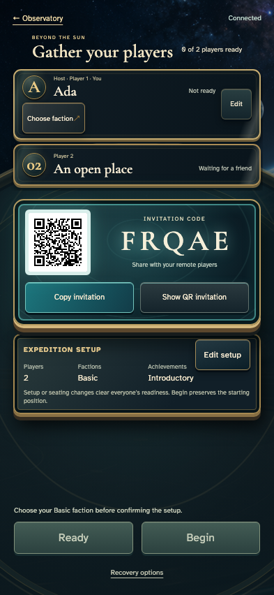](../../screenshots/manage-matching-supply-and-full-ore-yields-with-separate-controllers/004-host-room-phone-darwin.png) | [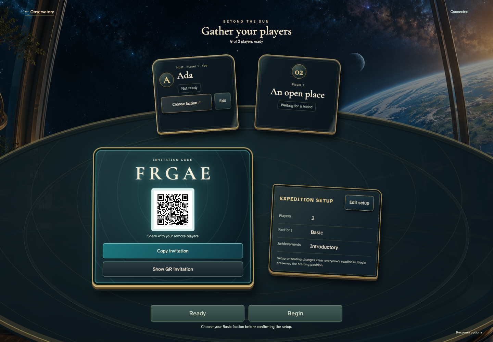](../../screenshots/manage-matching-supply-and-full-ore-yields-with-separate-controllers/004-host-room-desktop-darwin.png) |

- [x] The canonical remote room exposes its actual invitation code
- [x] Canonical effects settle before capture.
- [x] Any printed Action plan is ready.
- [x] Public compact topology remains physically separated.
- [x] The gameplay shell fits the actual viewport.

## 6. A different identity previews the public invitation

Viewpoint: **Bora · separate guest controller**.

| phone · 1440 × 1000 | desktop · 393 × 852 |
| --- | --- |
| [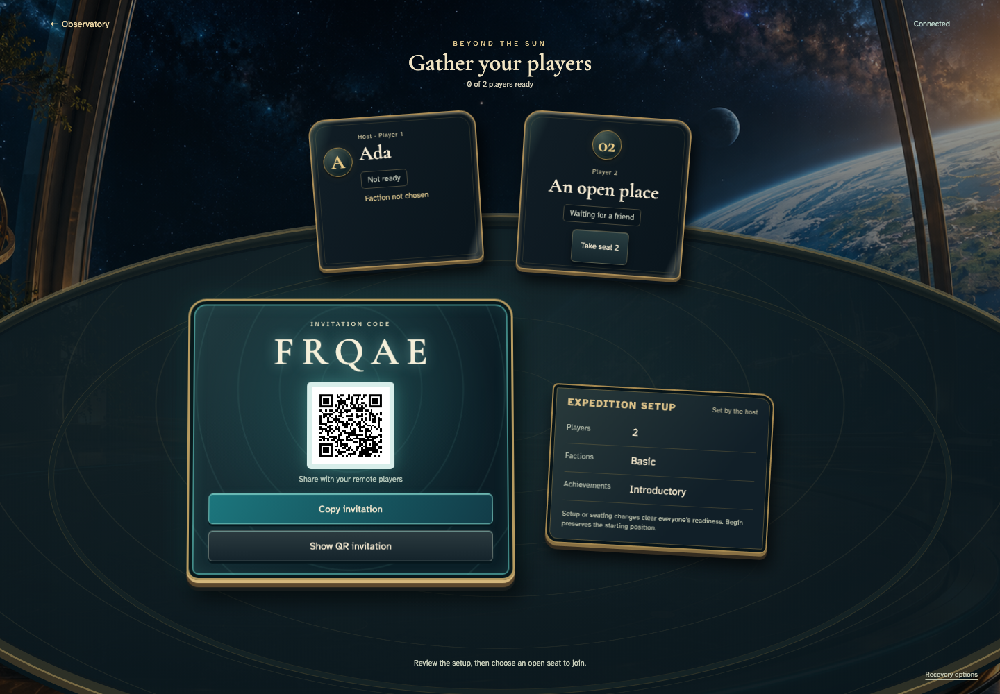](../../screenshots/manage-matching-supply-and-full-ore-yields-with-separate-controllers/005-guest-preview-phone-darwin.png) | [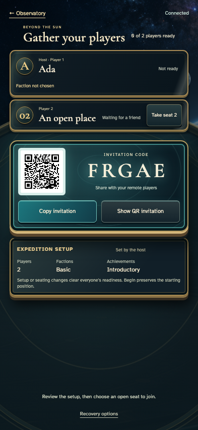](../../screenshots/manage-matching-supply-and-full-ore-yields-with-separate-controllers/005-guest-preview-desktop-darwin.png) |

- [x] A different identity previews the public invitation
- [x] Canonical effects settle before capture.
- [x] Any printed Action plan is ready.
- [x] Public compact topology remains physically separated.
- [x] The gameplay shell fits the actual viewport.

## 7. The guest claims only the remote seat

Viewpoint: **Bora · separate guest controller**.

| phone · 1440 × 1000 | desktop · 393 × 852 |
| --- | --- |
| [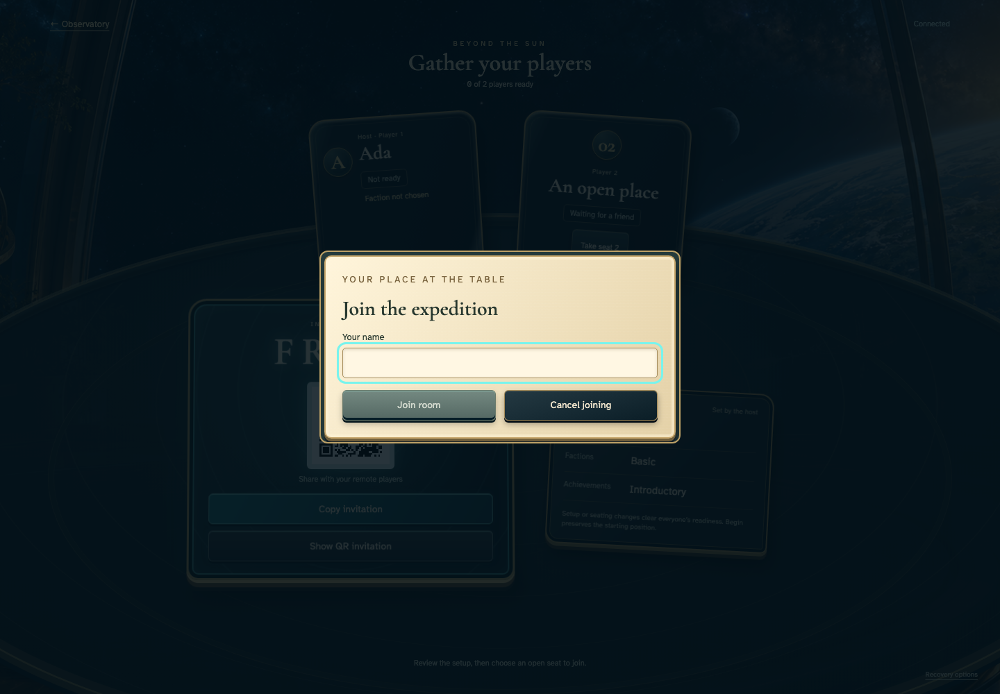](../../screenshots/manage-matching-supply-and-full-ore-yields-with-separate-controllers/006-guest-editor-phone-darwin.png) |  |

- [x] The guest claims only the remote seat
- [x] Canonical effects settle before capture.
- [x] Any printed Action plan is ready.
- [x] Public compact topology remains physically separated.
- [x] The gameplay shell fits the actual viewport.

## 8. Name the independent guest Bora

Viewpoint: **Bora · separate guest controller**.

| phone · 1440 × 1000 | desktop · 393 × 852 |
| --- | --- |
| [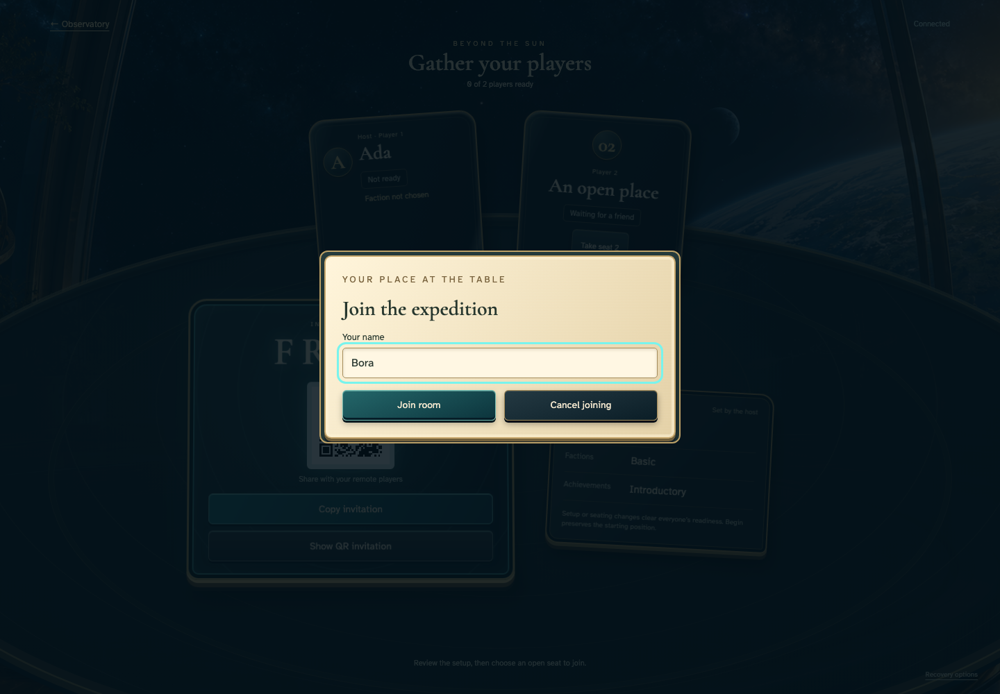](../../screenshots/manage-matching-supply-and-full-ore-yields-with-separate-controllers/007-guest-name-phone-darwin.png) |  |

- [x] Name the independent guest Bora
- [x] Canonical effects settle before capture.
- [x] Any printed Action plan is ready.
- [x] Public compact topology remains physically separated.
- [x] The gameplay shell fits the actual viewport.

## 9. Both named remote identities share the same room

Viewpoint: **Bora · separate guest controller**.

| phone · 1440 × 1000 | desktop · 393 × 852 |
| --- | --- |
| [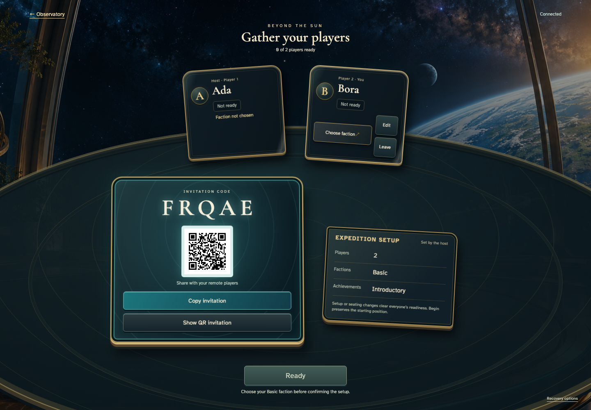](../../screenshots/manage-matching-supply-and-full-ore-yields-with-separate-controllers/008-guest-joined-phone-darwin.png) | [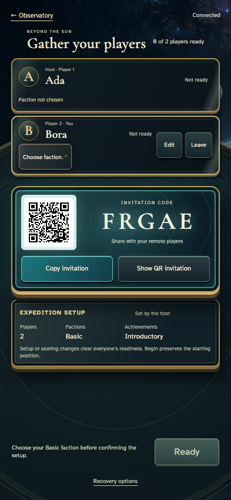](../../screenshots/manage-matching-supply-and-full-ore-yields-with-separate-controllers/008-guest-joined-desktop-darwin.png) |

- [x] Both named remote identities share the same room
- [x] Canonical effects settle before capture.
- [x] Any printed Action plan is ready.
- [x] Public compact topology remains physically separated.
- [x] The gameplay shell fits the actual viewport.

## 10. Ada chooses a legal unique Basic faction

Viewpoint: **Ada · separate host controller**.

| phone · 393 × 852 | desktop · 1440 × 1000 |
| --- | --- |
|  |  |

- [x] Ada chooses a legal unique Basic faction
- [x] Canonical effects settle before capture.
- [x] Any printed Action plan is ready.
- [x] Public compact topology remains physically separated.
- [x] The gameplay shell fits the actual viewport.

## 11. Ada retains Nishida-Østergaard Corporation

Viewpoint: **Ada · separate host controller**.

| phone · 393 × 852 | desktop · 1440 × 1000 |
| --- | --- |
| [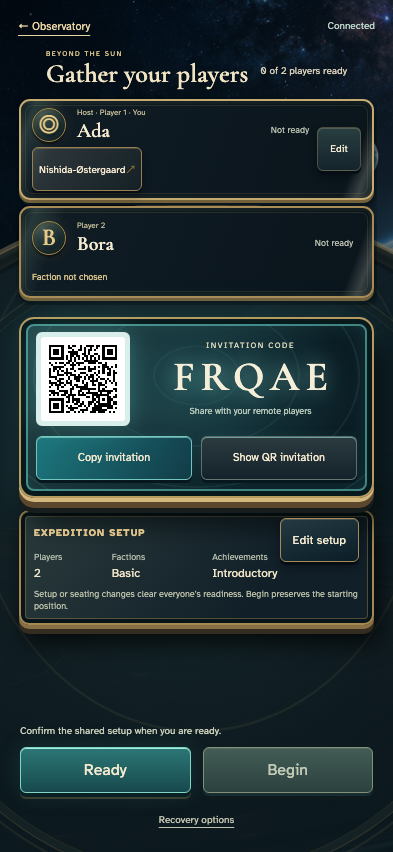](../../screenshots/manage-matching-supply-and-full-ore-yields-with-separate-controllers/010-faction-0-chosen-phone-darwin.png) |  |

- [x] Ada retains Nishida-Østergaard Corporation
- [x] Canonical effects settle before capture.
- [x] Any printed Action plan is ready.
- [x] Public compact topology remains physically separated.
- [x] The gameplay shell fits the actual viewport.

## 12. Bora chooses a legal unique Basic faction

Viewpoint: **Bora · separate guest controller**.

| phone · 1440 × 1000 | desktop · 393 × 852 |
| --- | --- |
|  |  |

- [x] Bora chooses a legal unique Basic faction
- [x] Canonical effects settle before capture.
- [x] Any printed Action plan is ready.
- [x] Public compact topology remains physically separated.
- [x] The gameplay shell fits the actual viewport.

## 13. Bora retains The Zheng-Yi Brotherhood

Viewpoint: **Bora · separate guest controller**.

| phone · 1440 × 1000 | desktop · 393 × 852 |
| --- | --- |
| [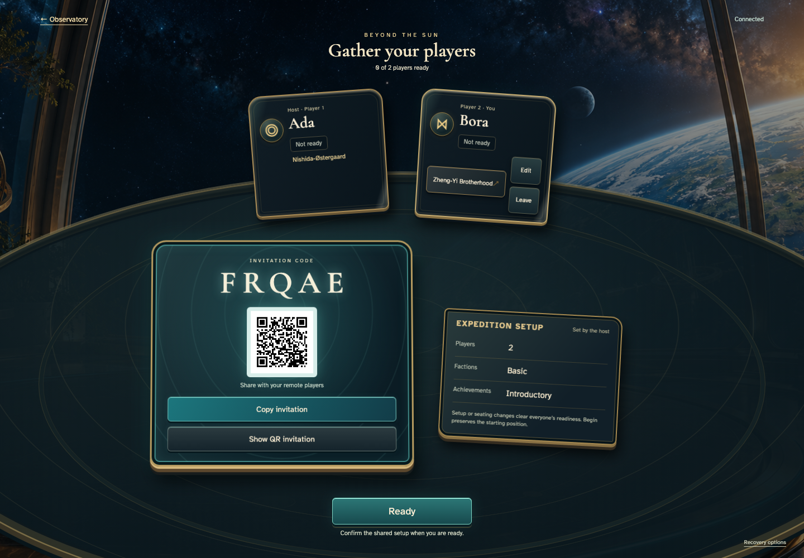](../../screenshots/manage-matching-supply-and-full-ore-yields-with-separate-controllers/012-faction-1-chosen-phone-darwin.png) | [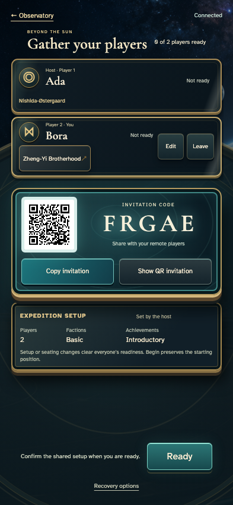](../../screenshots/manage-matching-supply-and-full-ore-yields-with-separate-controllers/012-faction-1-chosen-desktop-darwin.png) |

- [x] Bora retains The Zheng-Yi Brotherhood
- [x] Canonical effects settle before capture.
- [x] Any printed Action plan is ready.
- [x] Public compact topology remains physically separated.
- [x] The gameplay shell fits the actual viewport.

## 14. Confirm this identity is ready for the exact saved configuration

Viewpoint: **Bora · separate guest controller**.

| phone · 1440 × 1000 | desktop · 393 × 852 |
| --- | --- |
| [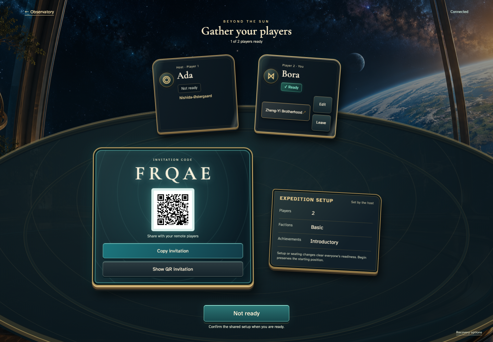](../../screenshots/manage-matching-supply-and-full-ore-yields-with-separate-controllers/013-ready-1-phone-darwin.png) | [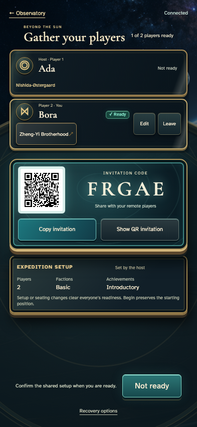](../../screenshots/manage-matching-supply-and-full-ore-yields-with-separate-controllers/013-ready-1-desktop-darwin.png) |

- [x] Confirm this identity is ready for the exact saved configuration
- [x] Canonical effects settle before capture.
- [x] Any printed Action plan is ready.
- [x] Public compact topology remains physically separated.
- [x] The gameplay shell fits the actual viewport.

## 15. Confirm this identity is ready for the exact saved configuration

Viewpoint: **Ada · separate host controller**.

| phone · 393 × 852 | desktop · 1440 × 1000 |
| --- | --- |
| [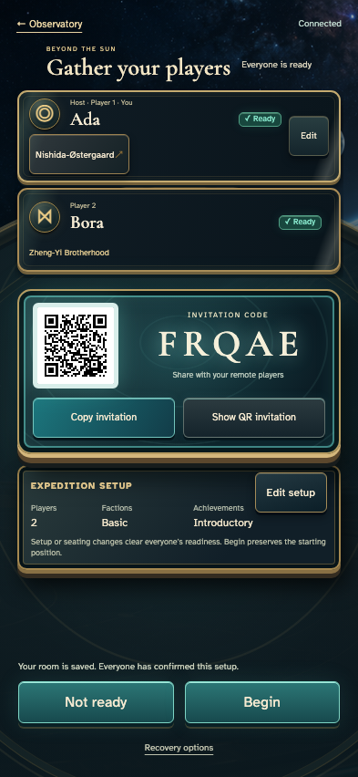](../../screenshots/manage-matching-supply-and-full-ore-yields-with-separate-controllers/014-ready-0-phone-darwin.png) | [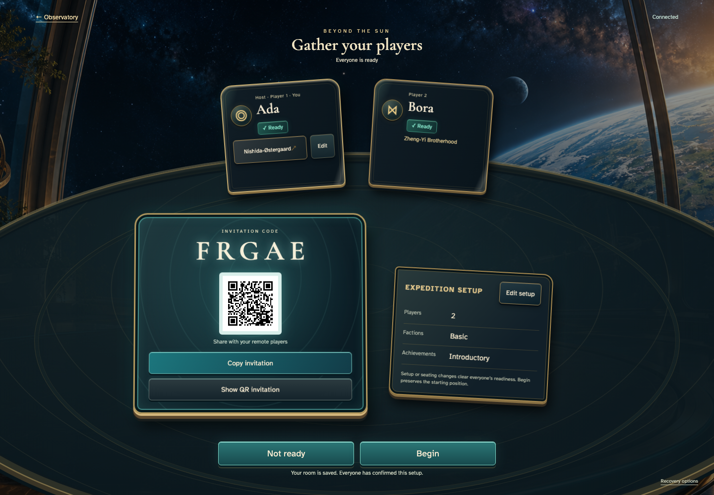](../../screenshots/manage-matching-supply-and-full-ore-yields-with-separate-controllers/014-ready-0-desktop-darwin.png) |

- [x] Confirm this identity is ready for the exact saved configuration
- [x] Canonical effects settle before capture.
- [x] Any printed Action plan is ready.
- [x] Public compact topology remains physically separated.
- [x] The gameplay shell fits the actual viewport.

## 16. Begin the immutable source-reviewed Basic setup through the ordinary UI

Viewpoint: **Ada · separate host controller**.

| phone · 393 × 852 | desktop · 1440 × 1000 |
| --- | --- |
|  |  |

- [x] Begin the immutable source-reviewed Basic setup through the ordinary UI
- [x] Canonical effects settle before capture.
- [x] Any printed Action plan is ready.
- [x] Public compact topology remains physically separated.
- [x] The gameplay shell fits the actual viewport.

## 17. Ada opens the actual research and Action instrument

Viewpoint: **Ada · separate host controller**.

| phone · 393 × 852 | desktop · 1440 × 1000 |
| --- | --- |
|  |  |

- [x] Ada opens the actual research and Action instrument
- [x] Canonical effects settle before capture.
- [x] Any printed Action plan is ready.
- [x] Public compact topology remains physically separated.
- [x] The gameplay shell fits the actual viewport.

## 18. Ada selects the legal printed space 1

Viewpoint: **Ada · separate host controller**.

| phone · 393 × 852 | desktop · 1440 × 1000 |
| --- | --- |
|  |  |

- [x] Ada selects the legal printed space 1
- [x] Canonical effects settle before capture.
- [x] Any printed Action plan is ready.
- [x] Public compact topology remains physically separated.
- [x] The gameplay shell fits the actual viewport.

## 19. Select Advanced Genetics with its printed cost and consequence

Viewpoint: **Ada · separate host controller**.

| phone · 393 × 852 | desktop · 1440 × 1000 |
| --- | --- |
|  |  |

- [x] Select Advanced Genetics with its printed cost and consequence
- [x] Canonical effects settle before capture.
- [x] Any printed Action plan is ready.
- [x] Public compact topology remains physically separated.
- [x] The gameplay shell fits the actual viewport.

## 20. Pay once and receive Advanced Genetics's immediate bonus

Viewpoint: **Ada · separate host controller**.

| phone · 393 × 852 | desktop · 1440 × 1000 |
| --- | --- |
|  |  |

- [x] Pay once and receive Advanced Genetics's immediate bonus
- [x] Canonical effects settle before capture.
- [x] Any printed Action plan is ready.
- [x] Public compact topology remains physically separated.
- [x] The gameplay shell fits the actual viewport.

## 21. Ada completes production and hands off to Bora

Viewpoint: **Ada · separate host controller**.

| phone · 393 × 852 | desktop · 1440 × 1000 |
| --- | --- |
|  |  |

- [x] Ada completes production and hands off to Bora
- [x] Canonical effects settle before capture.
- [x] Any printed Action plan is ready.
- [x] Public compact topology remains physically separated.
- [x] The gameplay shell fits the actual viewport.

## 22. The independent next controller sees the canonical handoff

Viewpoint: **Bora · separate guest controller**.

| phone · 1440 × 1000 | desktop · 393 × 852 |
| --- | --- |
|  |  |

- [x] The independent next controller sees the canonical handoff
- [x] Canonical effects settle before capture.
- [x] Any printed Action plan is ready.
- [x] Public compact topology remains physically separated.
- [x] The gameplay shell fits the actual viewport.

## 23. Bora opens the actual research and Action instrument

Viewpoint: **Bora · separate guest controller**.

| phone · 1440 × 1000 | desktop · 393 × 852 |
| --- | --- |
|  |  |

- [x] Bora opens the actual research and Action instrument
- [x] Canonical effects settle before capture.
- [x] Any printed Action plan is ready.
- [x] Public compact topology remains physically separated.
- [x] The gameplay shell fits the actual viewport.

## 24. Bora selects ordinary gathering

Viewpoint: **Bora · separate guest controller**.

| phone · 1440 × 1000 | desktop · 393 × 852 |
| --- | --- |
| [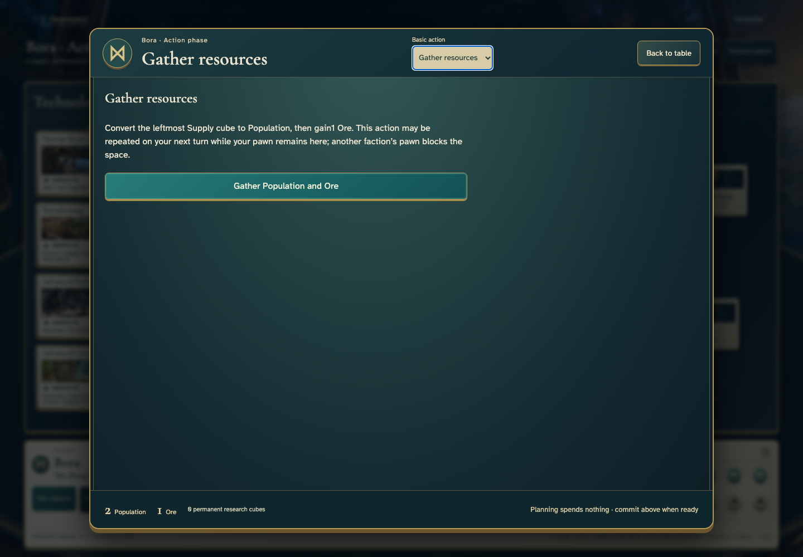](../../screenshots/manage-matching-supply-and-full-ore-yields-with-separate-controllers/023-r0-bora-kind-phone-darwin.png) |  |

- [x] Bora selects ordinary gathering
- [x] Canonical effects settle before capture.
- [x] Any printed Action plan is ready.
- [x] Public compact topology remains physically separated.
- [x] The gameplay shell fits the actual viewport.

## 25. Receive the printed gather resources before ordinary production

Viewpoint: **Bora · separate guest controller**.

| phone · 1440 × 1000 | desktop · 393 × 852 |
| --- | --- |
|  |  |

- [x] Receive the printed gather resources before ordinary production
- [x] Canonical effects settle before capture.
- [x] Any printed Action plan is ready.
- [x] Public compact topology remains physically separated.
- [x] The gameplay shell fits the actual viewport.

## 26. Bora completes production and hands off to Ada

Viewpoint: **Bora · separate guest controller**.

| phone · 1440 × 1000 | desktop · 393 × 852 |
| --- | --- |
|  |  |

- [x] Bora completes production and hands off to Ada
- [x] Canonical effects settle before capture.
- [x] Any printed Action plan is ready.
- [x] Public compact topology remains physically separated.
- [x] The gameplay shell fits the actual viewport.

## 27. The independent next controller sees the canonical handoff

Viewpoint: **Ada · separate host controller**.

| phone · 393 × 852 | desktop · 1440 × 1000 |
| --- | --- |
|  |  |

- [x] The independent next controller sees the canonical handoff
- [x] Canonical effects settle before capture.
- [x] Any printed Action plan is ready.
- [x] Public compact topology remains physically separated.
- [x] The gameplay shell fits the actual viewport.

## 28. Ada opens the actual research and Action instrument

Viewpoint: **Ada · separate host controller**.

| phone · 393 × 852 | desktop · 1440 × 1000 |
| --- | --- |
| [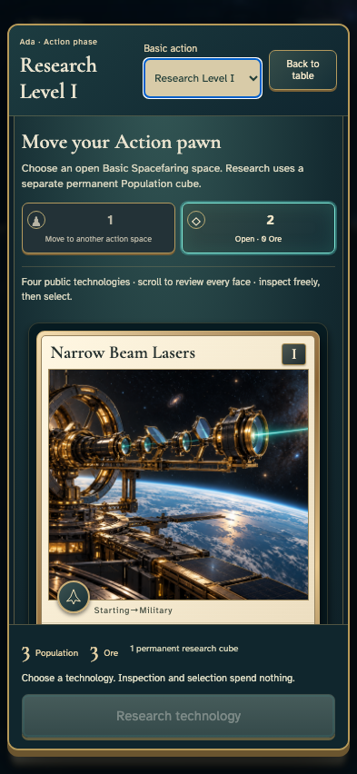](../../screenshots/manage-matching-supply-and-full-ore-yields-with-separate-controllers/027-r1-ada-plan-phone-darwin.png) |  |

- [x] Ada opens the actual research and Action instrument
- [x] Canonical effects settle before capture.
- [x] Any printed Action plan is ready.
- [x] Public compact topology remains physically separated.
- [x] The gameplay shell fits the actual viewport.

## 29. Ada selects the legal printed space 2

Viewpoint: **Ada · separate host controller**.

| phone · 393 × 852 | desktop · 1440 × 1000 |
| --- | --- |
|  | [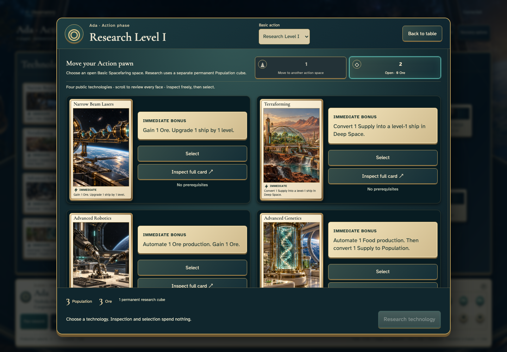](../../screenshots/manage-matching-supply-and-full-ore-yields-with-separate-controllers/028-r1-ada-space-desktop-darwin.png) |

- [x] Ada selects the legal printed space 2
- [x] Canonical effects settle before capture.
- [x] Any printed Action plan is ready.
- [x] Public compact topology remains physically separated.
- [x] The gameplay shell fits the actual viewport.

## 30. Select Narrow Beam Lasers with its printed cost and consequence

Viewpoint: **Ada · separate host controller**.

| phone · 393 × 852 | desktop · 1440 × 1000 |
| --- | --- |
|  | [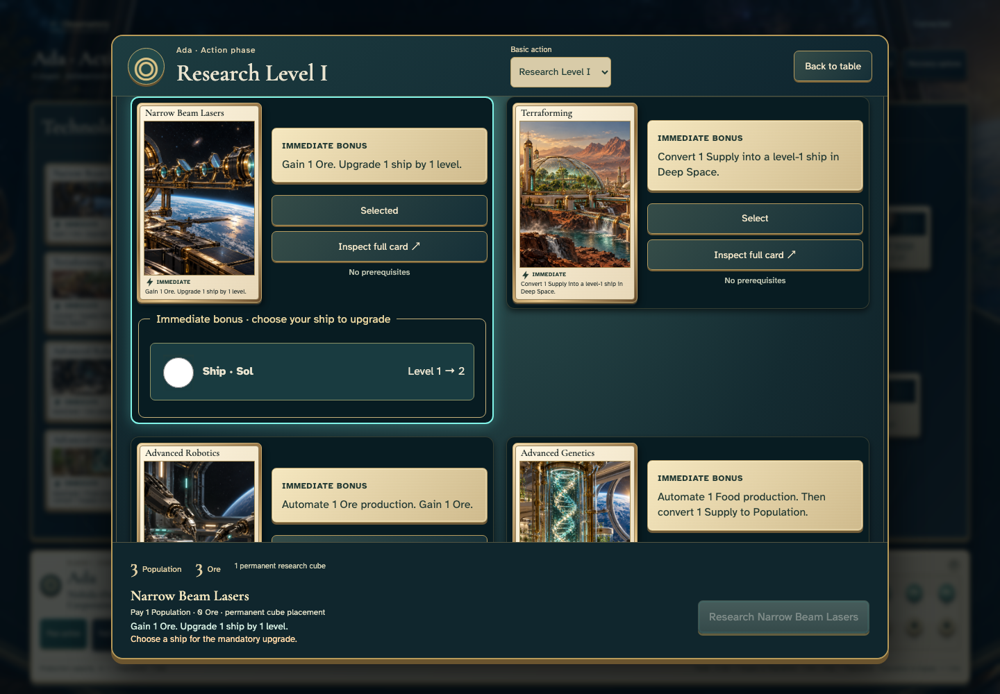](../../screenshots/manage-matching-supply-and-full-ore-yields-with-separate-controllers/029-r1-ada-card-desktop-darwin.png) |

- [x] Select Narrow Beam Lasers with its printed cost and consequence
- [x] Canonical effects settle before capture.
- [x] Any printed Action plan is ready.
- [x] Public compact topology remains physically separated.
- [x] The gameplay shell fits the actual viewport.

## 31. The immediate bonus requires an explicit owned target

Viewpoint: **Ada · separate host controller**.

| phone · 393 × 852 | desktop · 1440 × 1000 |
| --- | --- |
| [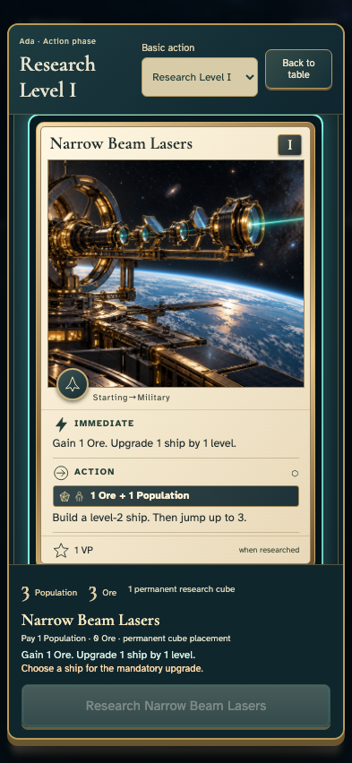](../../screenshots/manage-matching-supply-and-full-ore-yields-with-separate-controllers/030-r1-ada-requires-ship-phone-darwin.png) |  |

- [x] The immediate bonus requires an explicit owned target
- [x] Canonical effects settle before capture.
- [x] Any printed Action plan is ready.
- [x] Public compact topology remains physically separated.
- [x] The gameplay shell fits the actual viewport.

## 32. Choose the original Sol ship for the one-level upgrade

Viewpoint: **Ada · separate host controller**.

| phone · 393 × 852 | desktop · 1440 × 1000 |
| --- | --- |
| [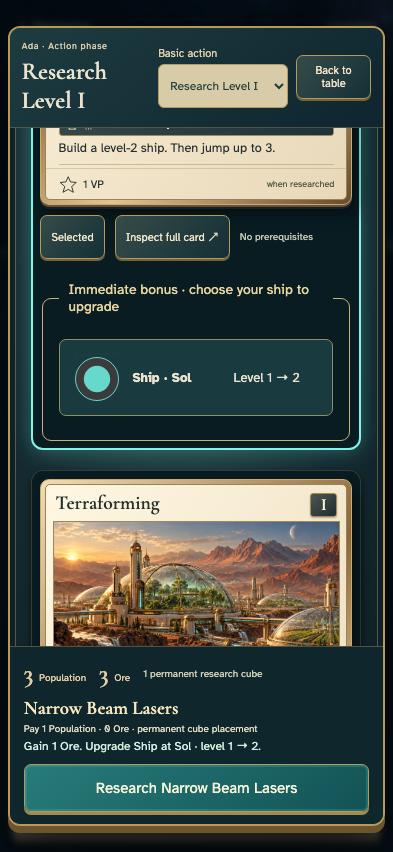](../../screenshots/manage-matching-supply-and-full-ore-yields-with-separate-controllers/031-r1-ada-ship-phone-darwin.png) | [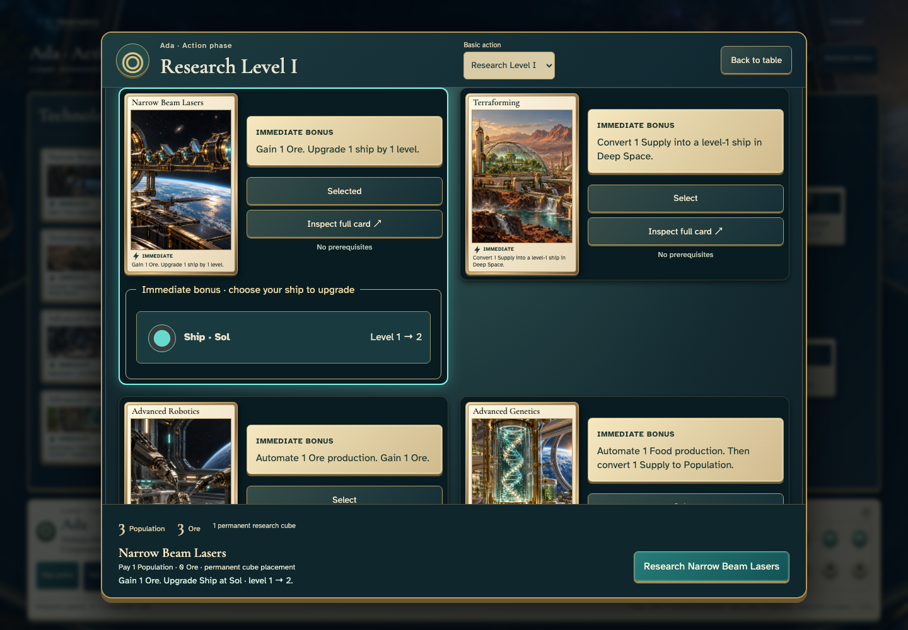](../../screenshots/manage-matching-supply-and-full-ore-yields-with-separate-controllers/031-r1-ada-ship-desktop-darwin.png) |

- [x] Choose the original Sol ship for the one-level upgrade
- [x] Canonical effects settle before capture.
- [x] Any printed Action plan is ready.
- [x] Public compact topology remains physically separated.
- [x] The gameplay shell fits the actual viewport.

## 33. Pay once and receive Narrow Beam Lasers's immediate bonus

Viewpoint: **Ada · separate host controller**.

| phone · 393 × 852 | desktop · 1440 × 1000 |
| --- | --- |
| [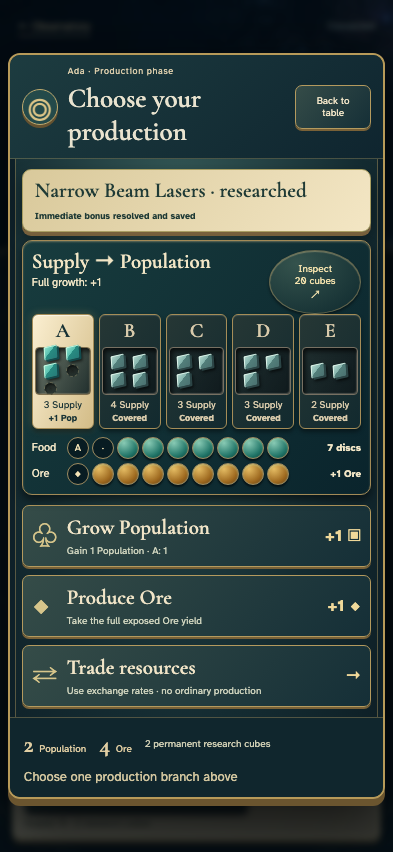](../../screenshots/manage-matching-supply-and-full-ore-yields-with-separate-controllers/032-r1-ada-researched-phone-darwin.png) |  |

- [x] Pay once and receive Narrow Beam Lasers's immediate bonus
- [x] Canonical effects settle before capture.
- [x] Any printed Action plan is ready.
- [x] Public compact topology remains physically separated.
- [x] The gameplay shell fits the actual viewport.

## 34. Ada completes production and hands off to Bora

Viewpoint: **Ada · separate host controller**.

| phone · 393 × 852 | desktop · 1440 × 1000 |
| --- | --- |
|  |  |

- [x] Ada completes production and hands off to Bora
- [x] Canonical effects settle before capture.
- [x] Any printed Action plan is ready.
- [x] Public compact topology remains physically separated.
- [x] The gameplay shell fits the actual viewport.

## 35. The independent next controller sees the canonical handoff

Viewpoint: **Bora · separate guest controller**.

| phone · 1440 × 1000 | desktop · 393 × 852 |
| --- | --- |
| [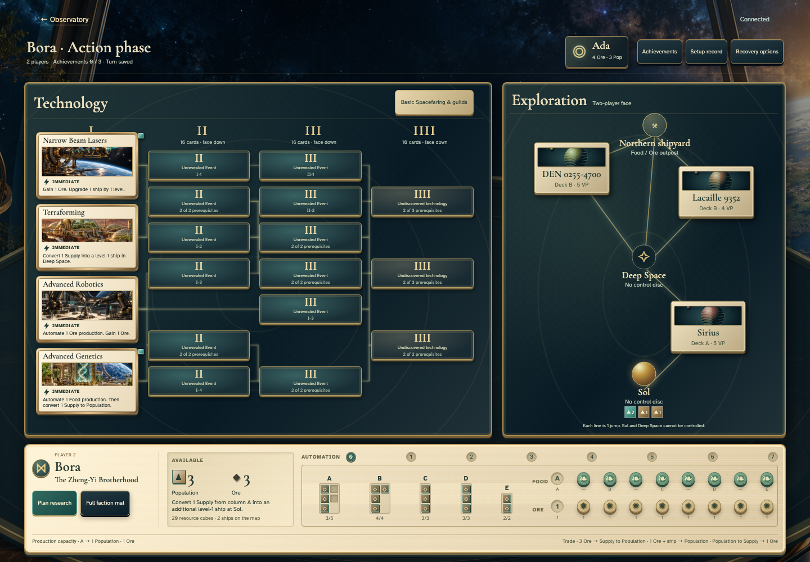](../../screenshots/manage-matching-supply-and-full-ore-yields-with-separate-controllers/034-r1-ada-next-phone-darwin.png) |  |

- [x] The independent next controller sees the canonical handoff
- [x] Canonical effects settle before capture.
- [x] Any printed Action plan is ready.
- [x] Public compact topology remains physically separated.
- [x] The gameplay shell fits the actual viewport.

## 36. Bora opens the actual research and Action instrument

Viewpoint: **Bora · separate guest controller**.

| phone · 1440 × 1000 | desktop · 393 × 852 |
| --- | --- |
| [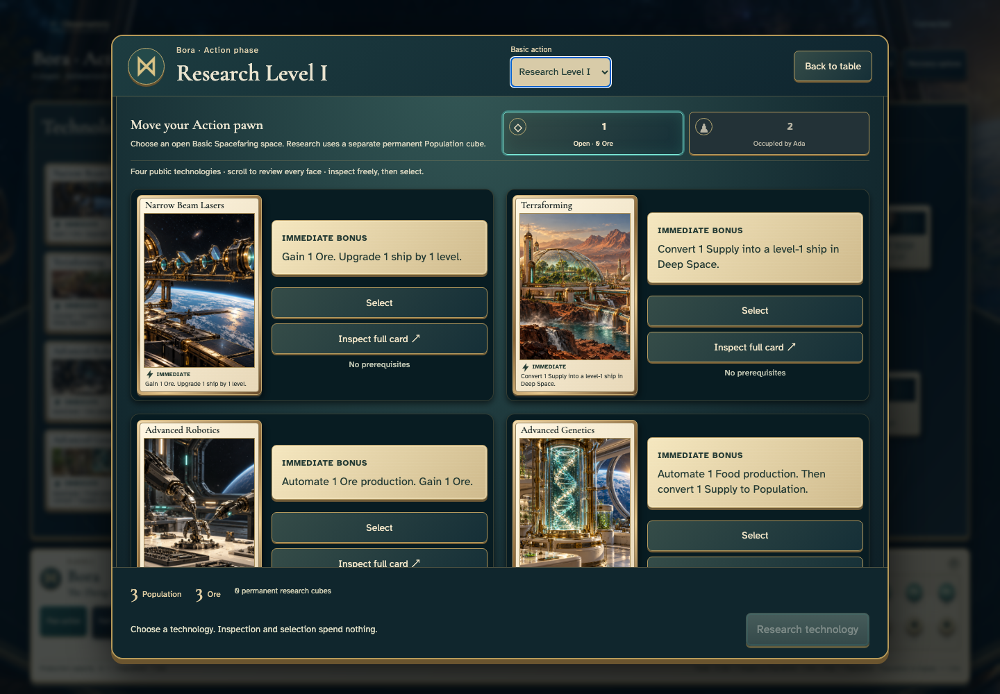](../../screenshots/manage-matching-supply-and-full-ore-yields-with-separate-controllers/035-r1-bora-plan-phone-darwin.png) |  |

- [x] Bora opens the actual research and Action instrument
- [x] Canonical effects settle before capture.
- [x] Any printed Action plan is ready.
- [x] Public compact topology remains physically separated.
- [x] The gameplay shell fits the actual viewport.

## 37. Bora selects the legal printed space 1

Viewpoint: **Bora · separate guest controller**.

| phone · 1440 × 1000 | desktop · 393 × 852 |
| --- | --- |
| [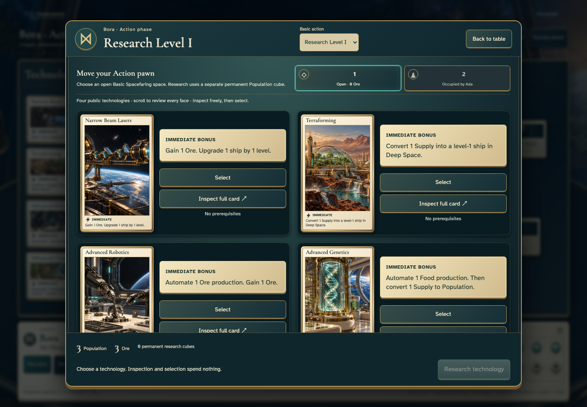](../../screenshots/manage-matching-supply-and-full-ore-yields-with-separate-controllers/036-r1-bora-space-phone-darwin.png) |  |

- [x] Bora selects the legal printed space 1
- [x] Canonical effects settle before capture.
- [x] Any printed Action plan is ready.
- [x] Public compact topology remains physically separated.
- [x] The gameplay shell fits the actual viewport.

## 38. Select Advanced Robotics with its printed cost and consequence

Viewpoint: **Bora · separate guest controller**.

| phone · 1440 × 1000 | desktop · 393 × 852 |
| --- | --- |
| [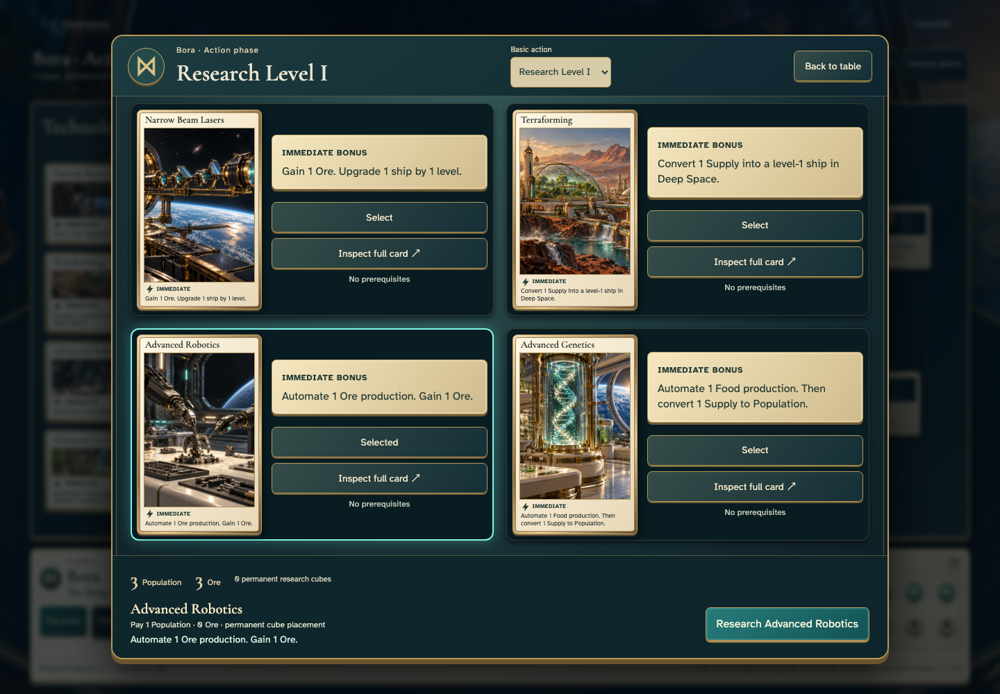](../../screenshots/manage-matching-supply-and-full-ore-yields-with-separate-controllers/037-r1-bora-card-phone-darwin.png) |  |

- [x] Select Advanced Robotics with its printed cost and consequence
- [x] Canonical effects settle before capture.
- [x] Any printed Action plan is ready.
- [x] Public compact topology remains physically separated.
- [x] The gameplay shell fits the actual viewport.

## 39. Pay once and receive Advanced Robotics's immediate bonus

Viewpoint: **Bora · separate guest controller**.

| phone · 1440 × 1000 | desktop · 393 × 852 |
| --- | --- |
|  |  |

- [x] Pay once and receive Advanced Robotics's immediate bonus
- [x] Canonical effects settle before capture.
- [x] Any printed Action plan is ready.
- [x] Public compact topology remains physically separated.
- [x] The gameplay shell fits the actual viewport.

## 40. Bora completes production and hands off to Ada

Viewpoint: **Bora · separate guest controller**.

| phone · 1440 × 1000 | desktop · 393 × 852 |
| --- | --- |
|  | [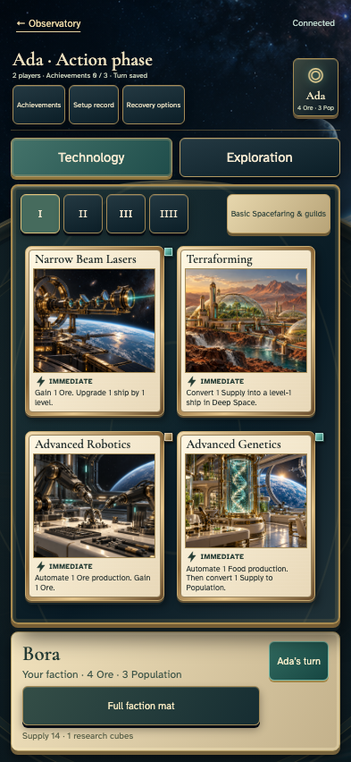](../../screenshots/manage-matching-supply-and-full-ore-yields-with-separate-controllers/039-r1-bora-handoff-desktop-darwin.png) |

- [x] Bora completes production and hands off to Ada
- [x] Canonical effects settle before capture.
- [x] Any printed Action plan is ready.
- [x] Public compact topology remains physically separated.
- [x] The gameplay shell fits the actual viewport.

## 41. The independent next controller sees the canonical handoff

Viewpoint: **Ada · separate host controller**.

| phone · 393 × 852 | desktop · 1440 × 1000 |
| --- | --- |
|  |  |

- [x] The independent next controller sees the canonical handoff
- [x] Canonical effects settle before capture.
- [x] Any printed Action plan is ready.
- [x] Public compact topology remains physically separated.
- [x] The gameplay shell fits the actual viewport.

## 42. Ada opens the actual research and Action instrument

Viewpoint: **Ada · separate host controller**.

| phone · 393 × 852 | desktop · 1440 × 1000 |
| --- | --- |
|  |  |

- [x] Ada opens the actual research and Action instrument
- [x] Canonical effects settle before capture.
- [x] Any printed Action plan is ready.
- [x] Public compact topology remains physically separated.
- [x] The gameplay shell fits the actual viewport.

## 43. Ada selects ordinary gathering

Viewpoint: **Ada · separate host controller**.

| phone · 393 × 852 | desktop · 1440 × 1000 |
| --- | --- |
| [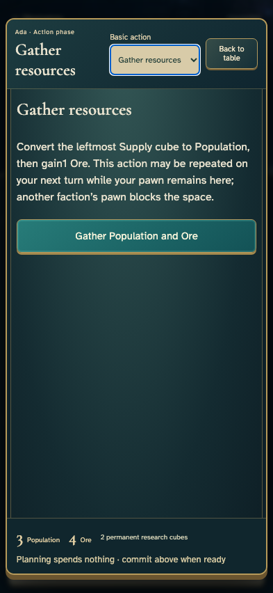](../../screenshots/manage-matching-supply-and-full-ore-yields-with-separate-controllers/042-r2-ada-kind-phone-darwin.png) | [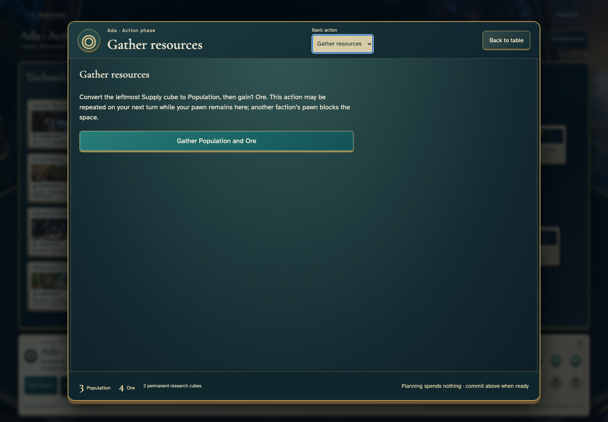](../../screenshots/manage-matching-supply-and-full-ore-yields-with-separate-controllers/042-r2-ada-kind-desktop-darwin.png) |

- [x] Ada selects ordinary gathering
- [x] Canonical effects settle before capture.
- [x] Any printed Action plan is ready.
- [x] Public compact topology remains physically separated.
- [x] The gameplay shell fits the actual viewport.

## 44. Receive the printed gather resources before ordinary production

Viewpoint: **Ada · separate host controller**.

| phone · 393 × 852 | desktop · 1440 × 1000 |
| --- | --- |
| [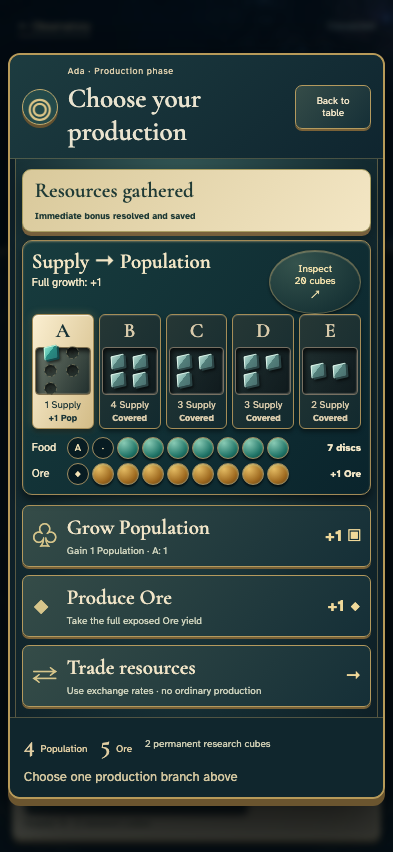](../../screenshots/manage-matching-supply-and-full-ore-yields-with-separate-controllers/043-r2-ada-gathered-phone-darwin.png) | [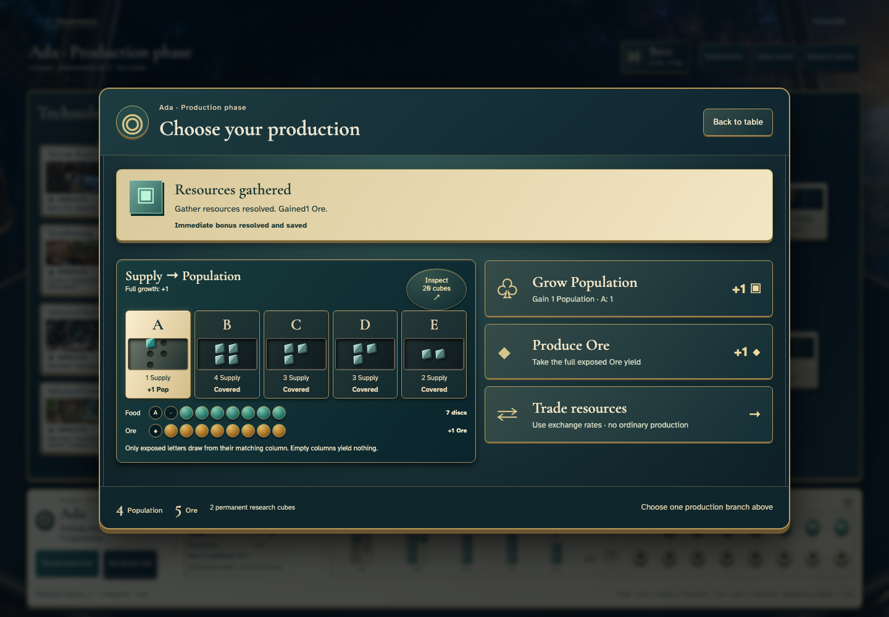](../../screenshots/manage-matching-supply-and-full-ore-yields-with-separate-controllers/043-r2-ada-gathered-desktop-darwin.png) |

- [x] Receive the printed gather resources before ordinary production
- [x] Canonical effects settle before capture.
- [x] Any printed Action plan is ready.
- [x] Public compact topology remains physically separated.
- [x] The gameplay shell fits the actual viewport.

## 45. Ada completes production and hands off to Bora

Viewpoint: **Ada · separate host controller**.

| phone · 393 × 852 | desktop · 1440 × 1000 |
| --- | --- |
|  |  |

- [x] Ada completes production and hands off to Bora
- [x] Canonical effects settle before capture.
- [x] Any printed Action plan is ready.
- [x] Public compact topology remains physically separated.
- [x] The gameplay shell fits the actual viewport.

## 46. The independent next controller sees the canonical handoff

Viewpoint: **Bora · separate guest controller**.

| phone · 1440 × 1000 | desktop · 393 × 852 |
| --- | --- |
|  |  |

- [x] The independent next controller sees the canonical handoff
- [x] Canonical effects settle before capture.
- [x] Any printed Action plan is ready.
- [x] Public compact topology remains physically separated.
- [x] The gameplay shell fits the actual viewport.

## 47. Bora opens the actual research and Action instrument

Viewpoint: **Bora · separate guest controller**.

| phone · 1440 × 1000 | desktop · 393 × 852 |
| --- | --- |
| [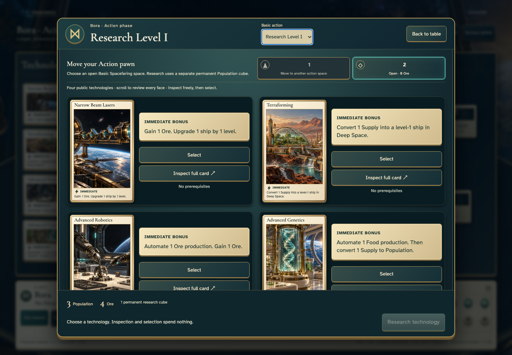](../../screenshots/manage-matching-supply-and-full-ore-yields-with-separate-controllers/046-r2-bora-plan-phone-darwin.png) |  |

- [x] Bora opens the actual research and Action instrument
- [x] Canonical effects settle before capture.
- [x] Any printed Action plan is ready.
- [x] Public compact topology remains physically separated.
- [x] The gameplay shell fits the actual viewport.

## 48. Bora selects the legal printed space 2

Viewpoint: **Bora · separate guest controller**.

| phone · 1440 × 1000 | desktop · 393 × 852 |
| --- | --- |
| [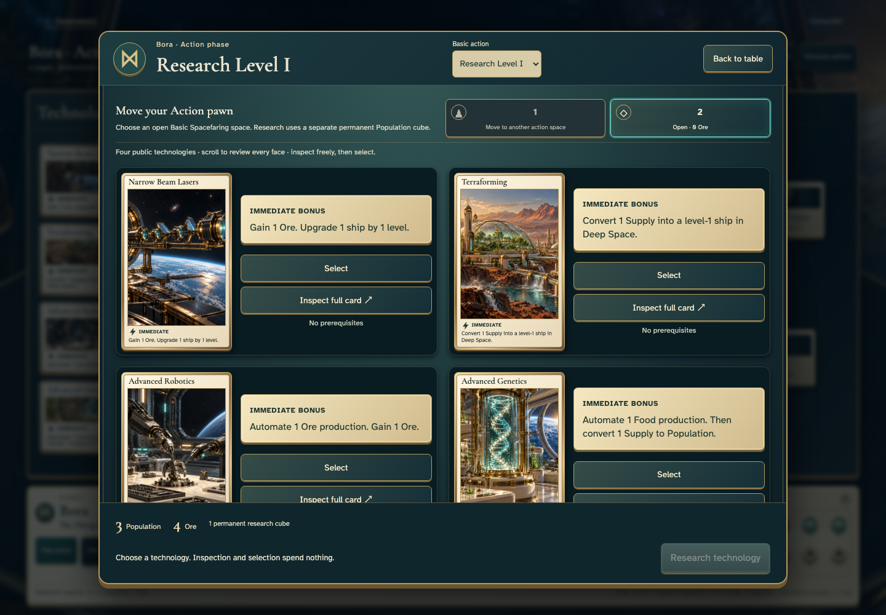](../../screenshots/manage-matching-supply-and-full-ore-yields-with-separate-controllers/047-r2-bora-space-phone-darwin.png) | [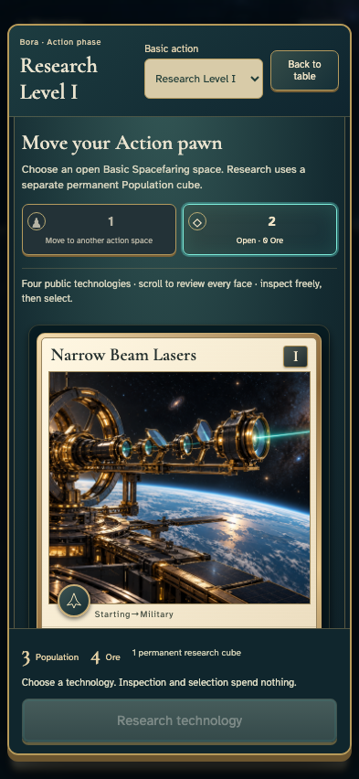](../../screenshots/manage-matching-supply-and-full-ore-yields-with-separate-controllers/047-r2-bora-space-desktop-darwin.png) |

- [x] Bora selects the legal printed space 2
- [x] Canonical effects settle before capture.
- [x] Any printed Action plan is ready.
- [x] Public compact topology remains physically separated.
- [x] The gameplay shell fits the actual viewport.

## 49. Select Terraforming with its printed cost and consequence

Viewpoint: **Bora · separate guest controller**.

| phone · 1440 × 1000 | desktop · 393 × 852 |
| --- | --- |
| [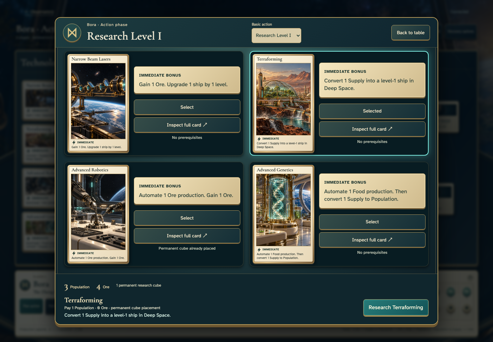](../../screenshots/manage-matching-supply-and-full-ore-yields-with-separate-controllers/048-r2-bora-card-phone-darwin.png) | [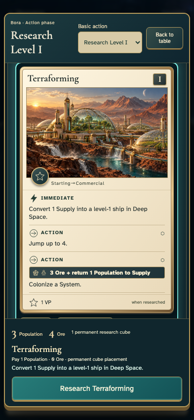](../../screenshots/manage-matching-supply-and-full-ore-yields-with-separate-controllers/048-r2-bora-card-desktop-darwin.png) |

- [x] Select Terraforming with its printed cost and consequence
- [x] Canonical effects settle before capture.
- [x] Any printed Action plan is ready.
- [x] Public compact topology remains physically separated.
- [x] The gameplay shell fits the actual viewport.

## 50. Pay once and receive Terraforming's immediate bonus

Viewpoint: **Bora · separate guest controller**.

| phone · 1440 × 1000 | desktop · 393 × 852 |
| --- | --- |
|  | [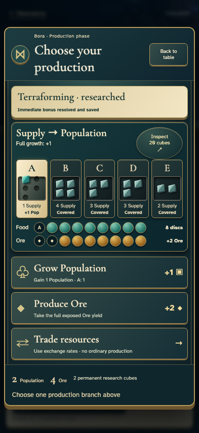](../../screenshots/manage-matching-supply-and-full-ore-yields-with-separate-controllers/049-r2-bora-researched-desktop-darwin.png) |

- [x] Pay once and receive Terraforming's immediate bonus
- [x] Canonical effects settle before capture.
- [x] Any printed Action plan is ready.
- [x] Public compact topology remains physically separated.
- [x] The gameplay shell fits the actual viewport.

## 51. Bora completes production and hands off to Ada

Viewpoint: **Bora · separate guest controller**.

| phone · 1440 × 1000 | desktop · 393 × 852 |
| --- | --- |
|  |  |

- [x] Bora completes production and hands off to Ada
- [x] Canonical effects settle before capture.
- [x] Any printed Action plan is ready.
- [x] Public compact topology remains physically separated.
- [x] The gameplay shell fits the actual viewport.

## 52. The independent next controller sees the canonical handoff

Viewpoint: **Ada · separate host controller**.

| phone · 393 × 852 | desktop · 1440 × 1000 |
| --- | --- |
| [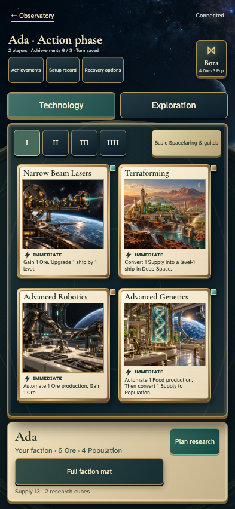](../../screenshots/manage-matching-supply-and-full-ore-yields-with-separate-controllers/051-r2-bora-next-phone-darwin.png) |  |

- [x] The independent next controller sees the canonical handoff
- [x] Canonical effects settle before capture.
- [x] Any printed Action plan is ready.
- [x] Public compact topology remains physically separated.
- [x] The gameplay shell fits the actual viewport.

## 53. Ada opens the actual research and Action instrument

Viewpoint: **Ada · separate host controller**.

| phone · 393 × 852 | desktop · 1440 × 1000 |
| --- | --- |
|  | [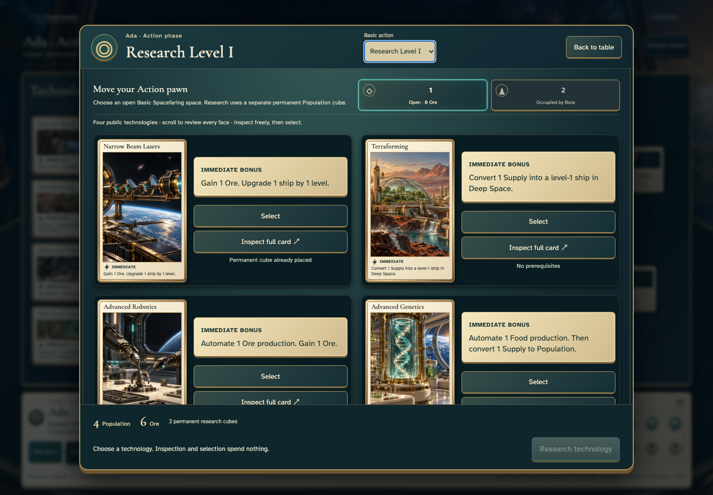](../../screenshots/manage-matching-supply-and-full-ore-yields-with-separate-controllers/052-r3-ada-plan-desktop-darwin.png) |

- [x] Ada opens the actual research and Action instrument
- [x] Canonical effects settle before capture.
- [x] Any printed Action plan is ready.
- [x] Public compact topology remains physically separated.
- [x] The gameplay shell fits the actual viewport.

## 54. Ada selects the legal printed space 1

Viewpoint: **Ada · separate host controller**.

| phone · 393 × 852 | desktop · 1440 × 1000 |
| --- | --- |
| [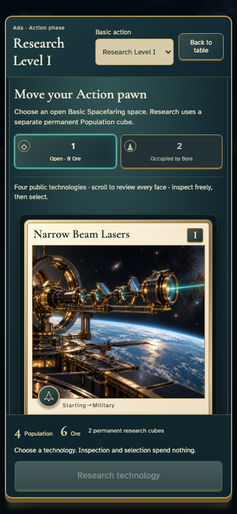](../../screenshots/manage-matching-supply-and-full-ore-yields-with-separate-controllers/053-r3-ada-space-phone-darwin.png) |  |

- [x] Ada selects the legal printed space 1
- [x] Canonical effects settle before capture.
- [x] Any printed Action plan is ready.
- [x] Public compact topology remains physically separated.
- [x] The gameplay shell fits the actual viewport.

## 55. Select Advanced Robotics with its printed cost and consequence

Viewpoint: **Ada · separate host controller**.

| phone · 393 × 852 | desktop · 1440 × 1000 |
| --- | --- |
| [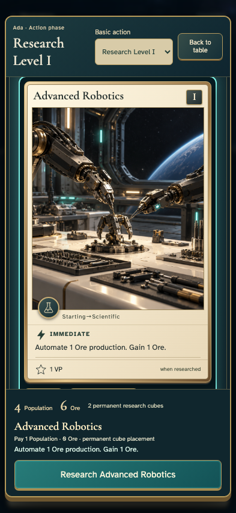](../../screenshots/manage-matching-supply-and-full-ore-yields-with-separate-controllers/054-r3-ada-card-phone-darwin.png) |  |

- [x] Select Advanced Robotics with its printed cost and consequence
- [x] Canonical effects settle before capture.
- [x] Any printed Action plan is ready.
- [x] Public compact topology remains physically separated.
- [x] The gameplay shell fits the actual viewport.

## 56. Pay once and receive Advanced Robotics's immediate bonus

Viewpoint: **Ada · separate host controller**.

| phone · 393 × 852 | desktop · 1440 × 1000 |
| --- | --- |
|  | [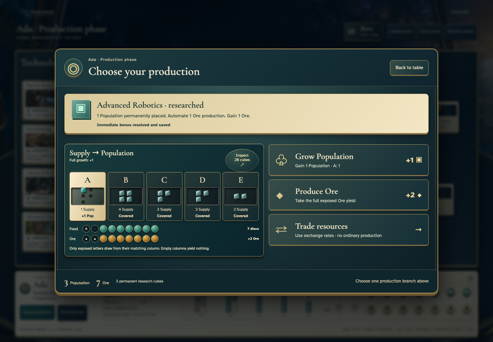](../../screenshots/manage-matching-supply-and-full-ore-yields-with-separate-controllers/055-r3-ada-researched-desktop-darwin.png) |

- [x] Pay once and receive Advanced Robotics's immediate bonus
- [x] Canonical effects settle before capture.
- [x] Any printed Action plan is ready.
- [x] Public compact topology remains physically separated.
- [x] The gameplay shell fits the actual viewport.

## 57. Robotics exposes two Ore circles and ordinary production takes both

Viewpoint: **Ada · separate host controller**.

| phone · 393 × 852 | desktop · 1440 × 1000 |
| --- | --- |
|  |  |

- [x] Robotics exposes two Ore circles and ordinary production takes both
- [x] Canonical effects settle before capture.
- [x] Any printed Action plan is ready.
- [x] Public compact topology remains physically separated.
- [x] The gameplay shell fits the actual viewport.

## 58. Ada completes production and hands off to Bora

Viewpoint: **Ada · separate host controller**.

| phone · 393 × 852 | desktop · 1440 × 1000 |
| --- | --- |
|  | [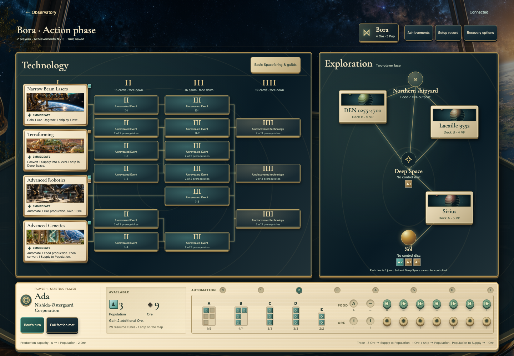](../../screenshots/manage-matching-supply-and-full-ore-yields-with-separate-controllers/057-r3-ada-handoff-desktop-darwin.png) |

- [x] Ada completes production and hands off to Bora
- [x] Canonical effects settle before capture.
- [x] Any printed Action plan is ready.
- [x] Public compact topology remains physically separated.
- [x] The gameplay shell fits the actual viewport.

## 59. The independent next controller sees the canonical handoff

Viewpoint: **Bora · separate guest controller**.

| phone · 1440 × 1000 | desktop · 393 × 852 |
| --- | --- |
|  | [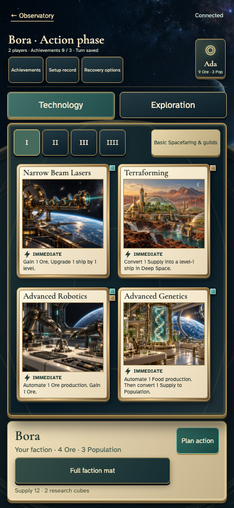](../../screenshots/manage-matching-supply-and-full-ore-yields-with-separate-controllers/058-r3-ada-next-desktop-darwin.png) |

- [x] The independent next controller sees the canonical handoff
- [x] Canonical effects settle before capture.
- [x] Any printed Action plan is ready.
- [x] Public compact topology remains physically separated.
- [x] The gameplay shell fits the actual viewport.

## 60. Bora opens the actual research and Action instrument

Viewpoint: **Bora · separate guest controller**.

| phone · 1440 × 1000 | desktop · 393 × 852 |
| --- | --- |
| [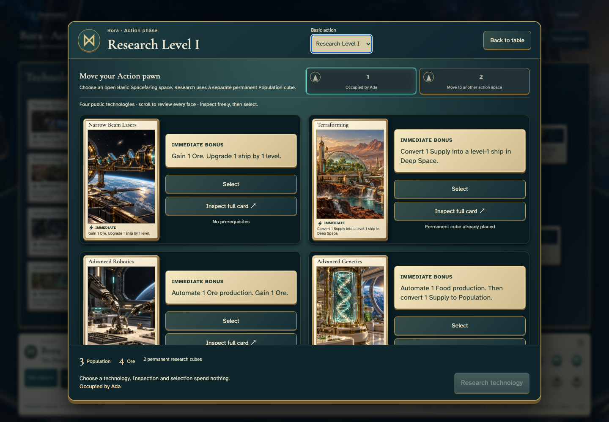](../../screenshots/manage-matching-supply-and-full-ore-yields-with-separate-controllers/059-r3-bora-plan-phone-darwin.png) | [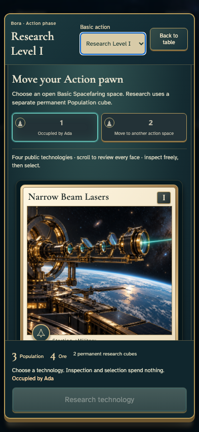](../../screenshots/manage-matching-supply-and-full-ore-yields-with-separate-controllers/059-r3-bora-plan-desktop-darwin.png) |

- [x] Bora opens the actual research and Action instrument
- [x] Canonical effects settle before capture.
- [x] Any printed Action plan is ready.
- [x] Public compact topology remains physically separated.
- [x] The gameplay shell fits the actual viewport.

## 61. Bora selects ordinary gathering

Viewpoint: **Bora · separate guest controller**.

| phone · 1440 × 1000 | desktop · 393 × 852 |
| --- | --- |
|  |  |

- [x] Bora selects ordinary gathering
- [x] Canonical effects settle before capture.
- [x] Any printed Action plan is ready.
- [x] Public compact topology remains physically separated.
- [x] The gameplay shell fits the actual viewport.

## 62. Receive the printed gather resources before ordinary production

Viewpoint: **Bora · separate guest controller**.

| phone · 1440 × 1000 | desktop · 393 × 852 |
| --- | --- |
| [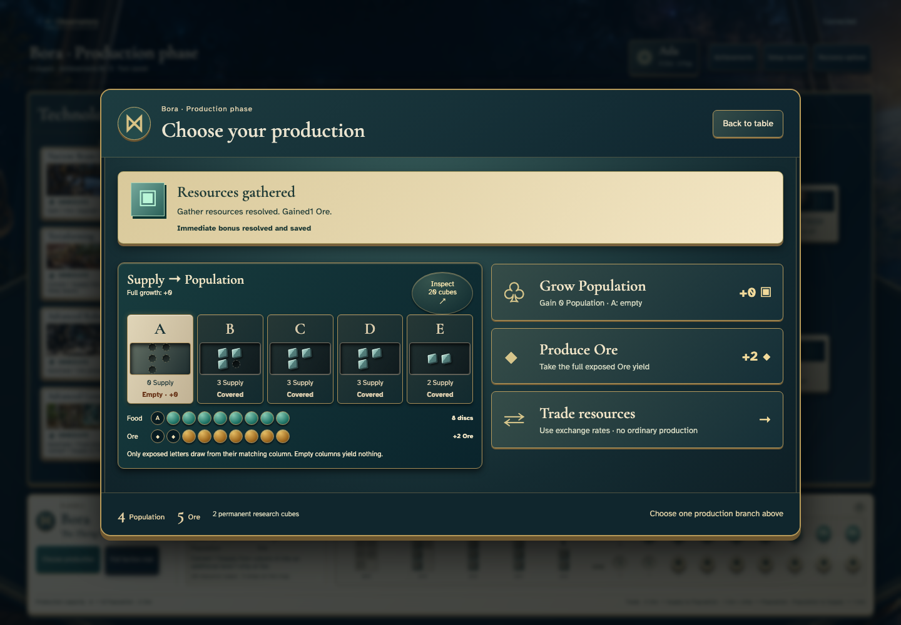](../../screenshots/manage-matching-supply-and-full-ore-yields-with-separate-controllers/061-r3-bora-gathered-phone-darwin.png) |  |

- [x] Receive the printed gather resources before ordinary production
- [x] Canonical effects settle before capture.
- [x] Any printed Action plan is ready.
- [x] Public compact topology remains physically separated.
- [x] The gameplay shell fits the actual viewport.

## 63. Bora completes production and hands off to Ada

Viewpoint: **Bora · separate guest controller**.

| phone · 1440 × 1000 | desktop · 393 × 852 |
| --- | --- |
|  |  |

- [x] Bora completes production and hands off to Ada
- [x] Canonical effects settle before capture.
- [x] Any printed Action plan is ready.
- [x] Public compact topology remains physically separated.
- [x] The gameplay shell fits the actual viewport.

## 64. The independent next controller sees the canonical handoff

Viewpoint: **Ada · separate host controller**.

| phone · 393 × 852 | desktop · 1440 × 1000 |
| --- | --- |
| [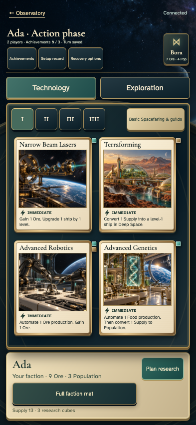](../../screenshots/manage-matching-supply-and-full-ore-yields-with-separate-controllers/063-r3-bora-next-phone-darwin.png) |  |

- [x] The independent next controller sees the canonical handoff
- [x] Canonical effects settle before capture.
- [x] Any printed Action plan is ready.
- [x] Public compact topology remains physically separated.
- [x] The gameplay shell fits the actual viewport.

## 65. Ada opens the actual research and Action instrument

Viewpoint: **Ada · separate host controller**.

| phone · 393 × 852 | desktop · 1440 × 1000 |
| --- | --- |
|  |  |

- [x] Ada opens the actual research and Action instrument
- [x] Canonical effects settle before capture.
- [x] Any printed Action plan is ready.
- [x] Public compact topology remains physically separated.
- [x] The gameplay shell fits the actual viewport.

## 66. Ada selects printed technology Actions

Viewpoint: **Ada · separate host controller**.

| phone · 393 × 852 | desktop · 1440 × 1000 |
| --- | --- |
| [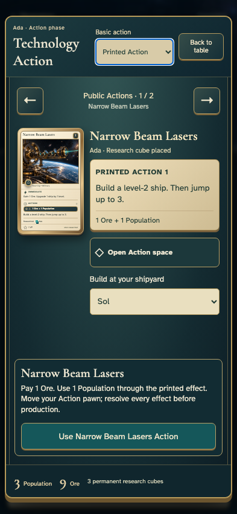](../../screenshots/manage-matching-supply-and-full-ore-yields-with-separate-controllers/065-r4-ada-kind-phone-darwin.png) |  |

- [x] Ada selects printed technology Actions
- [x] Canonical effects settle before capture.
- [x] Any printed Action plan is ready.
- [x] Public compact topology remains physically separated.
- [x] The gameplay shell fits the actual viewport.

## 67. Read Narrow Beam Lasers's actual research requirement, payment and exclusive pawn space

Viewpoint: **Ada · separate host controller**.

| phone · 393 × 852 | desktop · 1440 × 1000 |
| --- | --- |
|  |  |

- [x] Read Narrow Beam Lasers's actual research requirement, payment and exclusive pawn space
- [x] Canonical effects settle before capture.
- [x] Any printed Action plan is ready.
- [x] Public compact topology remains physically separated.
- [x] The gameplay shell fits the actual viewport.

## 68. Commit the actual printed Action cost before planning movement

Viewpoint: **Ada · separate host controller**.

| phone · 393 × 852 | desktop · 1440 × 1000 |
| --- | --- |
|  |  |

- [x] Commit the actual printed Action cost before planning movement
- [x] Canonical effects settle before capture.
- [x] Any printed Action plan is ready.
- [x] Public compact topology remains physically separated.
- [x] The gameplay shell fits the actual viewport.

## 69. Choose a real owned ship for the legal path

Viewpoint: **Ada · separate host controller**.

| phone · 393 × 852 | desktop · 1440 × 1000 |
| --- | --- |
|  |  |

- [x] Choose a real owned ship for the legal path
- [x] Canonical effects settle before capture.
- [x] Any printed Action plan is ready.
- [x] Public compact topology remains physically separated.
- [x] The gameplay shell fits the actual viewport.

## 70. Open the actual connected-destination view

Viewpoint: **Ada · separate host controller**.

| phone · 393 × 852 | desktop · 1440 × 1000 |
| --- | --- |
|  |  |

- [x] Open the actual connected-destination view
- [x] Canonical effects settle before capture.
- [x] Any printed Action plan is ready.
- [x] Public compact topology remains physically separated.
- [x] The gameplay shell fits the actual viewport.

## 71. Plan the next adjacent system without moving or paying again

Viewpoint: **Ada · separate host controller**.

| phone · 393 × 852 | desktop · 1440 × 1000 |
| --- | --- |
|  |  |

- [x] Plan the next adjacent system without moving or paying again
- [x] Canonical effects settle before capture.
- [x] Any printed Action plan is ready.
- [x] Public compact topology remains physically separated.
- [x] The gameplay shell fits the actual viewport.

## 72. Plan the next adjacent system without moving or paying again

Viewpoint: **Ada · separate host controller**.

| phone · 393 × 852 | desktop · 1440 × 1000 |
| --- | --- |
|  |  |

- [x] Plan the next adjacent system without moving or paying again
- [x] Canonical effects settle before capture.
- [x] Any printed Action plan is ready.
- [x] Public compact topology remains physically separated.
- [x] The gameplay shell fits the actual viewport.

## 73. Plan the next adjacent system without moving or paying again

Viewpoint: **Ada · separate host controller**.

| phone · 393 × 852 | desktop · 1440 × 1000 |
| --- | --- |
|  |  |

- [x] Plan the next adjacent system without moving or paying again
- [x] Canonical effects settle before capture.
- [x] Any printed Action plan is ready.
- [x] Public compact topology remains physically separated.
- [x] The gameplay shell fits the actual viewport.

## 74. Resolve the complete real path atomically

Viewpoint: **Ada · separate host controller**.

| phone · 393 × 852 | desktop · 1440 × 1000 |
| --- | --- |
|  |  |

- [x] Resolve the complete real path atomically
- [x] Canonical effects settle before capture.
- [x] Any printed Action plan is ready.
- [x] Public compact topology remains physically separated.
- [x] The gameplay shell fits the actual viewport.

## 75. Place an actual Food outpost and expose the second matching column

Viewpoint: **Ada · separate host controller**.

| phone · 393 × 852 | desktop · 1440 × 1000 |
| --- | --- |
|  |  |

- [x] Place an actual Food outpost and expose the second matching column
- [x] Canonical effects settle before capture.
- [x] Any printed Action plan is ready.
- [x] Public compact topology remains physically separated.
- [x] The gameplay shell fits the actual viewport.

## 76. Food now exposes A and B, each of which contributes one real matching cube

Viewpoint: **Ada · separate host controller**.

| phone · 393 × 852 | desktop · 1440 × 1000 |
| --- | --- |
|  |  |

- [x] Food now exposes A and B, each of which contributes one real matching cube
- [x] Canonical effects settle before capture.
- [x] Any printed Action plan is ready.
- [x] Public compact topology remains physically separated.
- [x] The gameplay shell fits the actual viewport.

## 77. Ada completes production and hands off to Bora

Viewpoint: **Ada · separate host controller**.

| phone · 393 × 852 | desktop · 1440 × 1000 |
| --- | --- |
|  |  |

- [x] Ada completes production and hands off to Bora
- [x] Canonical effects settle before capture.
- [x] Any printed Action plan is ready.
- [x] Public compact topology remains physically separated.
- [x] The gameplay shell fits the actual viewport.

## 78. The independent next controller sees the canonical handoff

Viewpoint: **Bora · separate guest controller**.

| phone · 1440 × 1000 | desktop · 393 × 852 |
| --- | --- |
|  |  |

- [x] The independent next controller sees the canonical handoff
- [x] Canonical effects settle before capture.
- [x] Any printed Action plan is ready.
- [x] Public compact topology remains physically separated.
- [x] The gameplay shell fits the actual viewport.

## 79. Bora opens the actual research and Action instrument

Viewpoint: **Bora · separate guest controller**.

| phone · 1440 × 1000 | desktop · 393 × 852 |
| --- | --- |
|  |  |

- [x] Bora opens the actual research and Action instrument
- [x] Canonical effects settle before capture.
- [x] Any printed Action plan is ready.
- [x] Public compact topology remains physically separated.
- [x] The gameplay shell fits the actual viewport.

## 80. Bora selects the legal printed space 1

Viewpoint: **Bora · separate guest controller**.

| phone · 1440 × 1000 | desktop · 393 × 852 |
| --- | --- |
|  |  |

- [x] Bora selects the legal printed space 1
- [x] Canonical effects settle before capture.
- [x] Any printed Action plan is ready.
- [x] Public compact topology remains physically separated.
- [x] The gameplay shell fits the actual viewport.

## 81. Select Advanced Genetics with its printed cost and consequence

Viewpoint: **Bora · separate guest controller**.

| phone · 1440 × 1000 | desktop · 393 × 852 |
| --- | --- |
|  |  |

- [x] Select Advanced Genetics with its printed cost and consequence
- [x] Canonical effects settle before capture.
- [x] Any printed Action plan is ready.
- [x] Public compact topology remains physically separated.
- [x] The gameplay shell fits the actual viewport.

## 82. Pay once and receive Advanced Genetics's immediate bonus

Viewpoint: **Bora · separate guest controller**.

| phone · 1440 × 1000 | desktop · 393 × 852 |
| --- | --- |
|  |  |

- [x] Pay once and receive Advanced Genetics's immediate bonus
- [x] Canonical effects settle before capture.
- [x] Any printed Action plan is ready.
- [x] Public compact topology remains physically separated.
- [x] The gameplay shell fits the actual viewport.

## 83. Bora completes production and hands off to Ada

Viewpoint: **Bora · separate guest controller**.

| phone · 1440 × 1000 | desktop · 393 × 852 |
| --- | --- |
|  |  |

- [x] Bora completes production and hands off to Ada
- [x] Canonical effects settle before capture.
- [x] Any printed Action plan is ready.
- [x] Public compact topology remains physically separated.
- [x] The gameplay shell fits the actual viewport.

## 84. The independent next controller sees the canonical handoff

Viewpoint: **Ada · separate host controller**.

| phone · 393 × 852 | desktop · 1440 × 1000 |
| --- | --- |
|  |  |

- [x] The independent next controller sees the canonical handoff
- [x] Canonical effects settle before capture.
- [x] Any printed Action plan is ready.
- [x] Public compact topology remains physically separated.
- [x] The gameplay shell fits the actual viewport.

## 85. Ada opens the actual research and Action instrument

Viewpoint: **Ada · separate host controller**.

| phone · 393 × 852 | desktop · 1440 × 1000 |
| --- | --- |
|  |  |

- [x] Ada opens the actual research and Action instrument
- [x] Canonical effects settle before capture.
- [x] Any printed Action plan is ready.
- [x] Public compact topology remains physically separated.
- [x] The gameplay shell fits the actual viewport.

## 86. Ada selects ordinary gathering

Viewpoint: **Ada · separate host controller**.

| phone · 393 × 852 | desktop · 1440 × 1000 |
| --- | --- |
|  |  |

- [x] Ada selects ordinary gathering
- [x] Canonical effects settle before capture.
- [x] Any printed Action plan is ready.
- [x] Public compact topology remains physically separated.
- [x] The gameplay shell fits the actual viewport.

## 87. Receive the printed gather resources before ordinary production

Viewpoint: **Ada · separate host controller**.

| phone · 393 × 852 | desktop · 1440 × 1000 |
| --- | --- |
|  |  |

- [x] Receive the printed gather resources before ordinary production
- [x] Canonical effects settle before capture.
- [x] Any printed Action plan is ready.
- [x] Public compact topology remains physically separated.
- [x] The gameplay shell fits the actual viewport.

## 88. An exposed but empty A column cannot substitute cubes from covered columns

Viewpoint: **Ada · separate host controller**.

| phone · 393 × 852 | desktop · 1440 × 1000 |
| --- | --- |
|  |  |

- [x] An exposed but empty A column cannot substitute cubes from covered columns
- [x] Canonical effects settle before capture.
- [x] Any printed Action plan is ready.
- [x] Public compact topology remains physically separated.
- [x] The gameplay shell fits the actual viewport.

## 89. Inspect all twenty conserved cubes in their actual current locations

Viewpoint: **Ada · separate host controller**.

| phone · 393 × 852 | desktop · 1440 × 1000 |
| --- | --- |
|  |  |

- [x] Inspect all twenty conserved cubes in their actual current locations
- [x] Canonical effects settle before capture.
- [x] Any printed Action plan is ready.
- [x] Public compact topology remains physically separated.
- [x] The gameplay shell fits the actual viewport.

## 90. Tab remains in the modal reader

Viewpoint: **Ada · separate host controller**.

| phone · 393 × 852 | desktop · 1440 × 1000 |
| --- | --- |
|  |  |

- [x] Tab remains in the modal reader
- [x] Canonical effects settle before capture.
- [x] Any printed Action plan is ready.
- [x] Public compact topology remains physically separated.
- [x] The gameplay shell fits the actual viewport.

## 91. Reverse Tab remains in the same accessible reader

Viewpoint: **Ada · separate host controller**.

| phone · 393 × 852 | desktop · 1440 × 1000 |
| --- | --- |
|  |  |

- [x] Reverse Tab remains in the same accessible reader
- [x] Canonical effects settle before capture.
- [x] Any printed Action plan is ready.
- [x] Public compact topology remains physically separated.
- [x] The gameplay shell fits the actual viewport.

## 92. Escape restores the actual opener without choosing production

Viewpoint: **Ada · separate host controller**.

| phone · 393 × 852 | desktop · 1440 × 1000 |
| --- | --- |
|  |  |

- [x] Escape restores the actual opener without choosing production
- [x] Canonical effects settle before capture.
- [x] Any printed Action plan is ready.
- [x] Public compact topology remains physically separated.
- [x] The gameplay shell fits the actual viewport.

## 93. Reload retains the production decision and current controller

Viewpoint: **Ada · separate host controller**.

| phone · 393 × 852 | desktop · 1440 × 1000 |
| --- | --- |
|  |  |

- [x] Reload retains the production decision and current controller
- [x] Canonical effects settle before capture.
- [x] Any printed Action plan is ready.
- [x] Public compact topology remains physically separated.
- [x] The gameplay shell fits the actual viewport.

## 94. Reopened production still has A zero and B two; no bonus replay

Viewpoint: **Ada · separate host controller**.

| phone · 393 × 852 | desktop · 1440 × 1000 |
| --- | --- |
|  |  |

- [x] Reopened production still has A zero and B two; no bonus replay
- [x] Canonical effects settle before capture.
- [x] Any printed Action plan is ready.
- [x] Public compact topology remains physically separated.
- [x] The gameplay shell fits the actual viewport.

## 95. The other controller observes public pending production and cannot submit a choice

Viewpoint: **Bora · separate guest controller**.

| phone · 1440 × 1000 | desktop · 393 × 852 |
| --- | --- |
|  |  |

- [x] The other controller observes public pending production and cannot submit a choice
- [x] Canonical effects settle before capture.
- [x] Any printed Action plan is ready.
- [x] Public compact topology remains physically separated.
- [x] The gameplay shell fits the actual viewport.

## 96. Only B loses one cube; empty A stays empty and Bora receives the turn

Viewpoint: **Ada · separate host controller**.

| phone · 393 × 852 | desktop · 1440 × 1000 |
| --- | --- |
|  |  |

- [x] Only B loses one cube; empty A stays empty and Bora receives the turn
- [x] Canonical effects settle before capture.
- [x] Any printed Action plan is ready.
- [x] Public compact topology remains physically separated.
- [x] The gameplay shell fits the actual viewport.

## 97. The saved public mat proves A remains zero and only B went from two to one

Viewpoint: **Ada · separate host controller**.

| phone · 393 × 852 | desktop · 1440 × 1000 |
| --- | --- |
|  |  |

- [x] The saved public mat proves A remains zero and only B went from two to one
- [x] Canonical effects settle before capture.
- [x] Any printed Action plan is ready.
- [x] Public compact topology remains physically separated.
- [x] The gameplay shell fits the actual viewport.

## 98. Return from the actual faction mat to the handed-off board

Viewpoint: **Ada · separate host controller**.

| phone · 393 × 852 | desktop · 1440 × 1000 |
| --- | --- |
|  |  |

- [x] Return from the actual faction mat to the handed-off board
- [x] Canonical effects settle before capture.
- [x] Any printed Action plan is ready.
- [x] Public compact topology remains physically separated.
- [x] The gameplay shell fits the actual viewport.

## 99. The full growth and handoff remain after reload

Viewpoint: **Ada · separate host controller**.

| phone · 393 × 852 | desktop · 1440 × 1000 |
| --- | --- |
|  |  |

- [x] The full growth and handoff remain after reload
- [x] Canonical effects settle before capture.
- [x] Any printed Action plan is ready.
- [x] Public compact topology remains physically separated.
- [x] The gameplay shell fits the actual viewport.
