# Decommission a controlling ship and resolve the actual rival outpost at physical shared seats

One shared authenticated controller; direct physical cardinal or corner seating, ordinary UI setup and legal preparatory turns. No remote claims or personal devices. Only initial setup entropy is fixed to66666666-6666-4666-8666-000000000009. No game-state injection or future-deck inspection. Three exact trade rates, repeated exchanges, rightmost returns/A overflow, covered-column leftmost draws, control-changing decommission and keyboard/reload use production components. No ordinary production is added.

## 1. Arrive using the actual production client

Viewpoint: **Ada · South West · one shared controller**.

| desktop · 1440 × 1000 |
| --- |
| [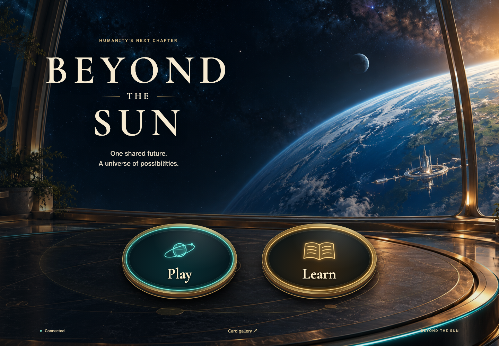](../../screenshots/decommission-a-controlling-ship-and-resolve-the-actual-rival-outpost-at-physical-shared-seats/000-arrival-desktop-darwin.png) |

tabletop-4k · 3840 × 2160

- [x] Arrive using the actual production client
- [x] Canonical effects settle before capture.
- [x] Any printed Action plan is ready.
- [x] The rotated trade explanation stays above the opaque footer.
- [x] Public compact topology remains physically separated.
- [x] The gameplay shell fits the actual viewport.

## 2. Choose a real production play mode

Viewpoint: **Ada · South West · one shared controller**.

| desktop · 1440 × 1000 |
| --- |
|  |

tabletop-4k · 3840 × 2160

- [x] Choose a real production play mode
- [x] Canonical effects settle before capture.
- [x] Any printed Action plan is ready.
- [x] The rotated trade explanation stays above the opaque footer.
- [x] Public compact topology remains physically separated.
- [x] The gameplay shell fits the actual viewport.

## 3. One controller configures physical seats directly on the table

Viewpoint: **Ada · South West · one shared controller**.

| desktop · 1440 × 1000 |
| --- |
|  |

tabletop-4k · 3840 × 2160

- [x] One controller configures physical seats directly on the table
- [x] Canonical effects settle before capture.
- [x] Any printed Action plan is ready.
- [x] The rotated trade explanation stays above the opaque footer.
- [x] Public compact topology remains physically separated.
- [x] The gameplay shell fits the actual viewport.

## 4. Open the South West seat on the shared surface

Viewpoint: **Ada · South West · one shared controller**.

| desktop · 1440 × 1000 |
| --- |
|  |

tabletop-4k · 3840 × 2160

- [x] Open the South West seat on the shared surface
- [x] Canonical effects settle before capture.
- [x] Any printed Action plan is ready.
- [x] The rotated trade explanation stays above the opaque footer.
- [x] Public compact topology remains physically separated.
- [x] The gameplay shell fits the actual viewport.

## 5. Name the physical player Ada

Viewpoint: **Ada · South West · one shared controller**.

| desktop · 1440 × 1000 |
| --- |
|  |

tabletop-4k · 3840 × 2160

- [x] Name the physical player Ada
- [x] Canonical effects settle before capture.
- [x] Any printed Action plan is ready.
- [x] The rotated trade explanation stays above the opaque footer.
- [x] Public compact topology remains physically separated.
- [x] The gameplay shell fits the actual viewport.

## 6. The local physical seat is retained on this controller

Viewpoint: **Ada · South West · one shared controller**.

| desktop · 1440 × 1000 |
| --- |
|  |

tabletop-4k · 3840 × 2160

- [x] The local physical seat is retained on this controller
- [x] Canonical effects settle before capture.
- [x] Any printed Action plan is ready.
- [x] The rotated trade explanation stays above the opaque footer.
- [x] Public compact topology remains physically separated.
- [x] The gameplay shell fits the actual viewport.

## 7. Open the North East seat on the shared surface

Viewpoint: **Bora · North East · one shared controller**.

| desktop · 1440 × 1000 |
| --- |
|  |

tabletop-4k · 3840 × 2160

[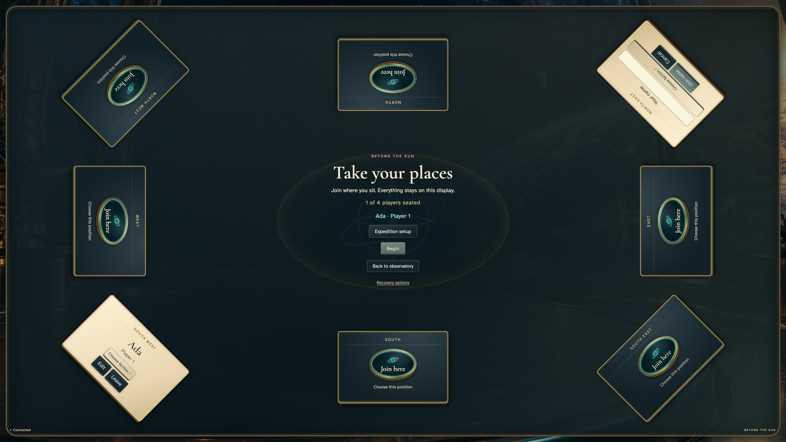](../../screenshots/decommission-a-controlling-ship-and-resolve-the-actual-rival-outpost-at-physical-shared-seats/006-seat-1-editor-tabletop-4k-darwin.png)

- [x] Open the North East seat on the shared surface
- [x] Canonical effects settle before capture.
- [x] Any printed Action plan is ready.
- [x] The rotated trade explanation stays above the opaque footer.
- [x] Public compact topology remains physically separated.
- [x] The gameplay shell fits the actual viewport.

## 8. Name the physical player Bora

Viewpoint: **Bora · North East · one shared controller**.

| desktop · 1440 × 1000 |
| --- |
|  |

tabletop-4k · 3840 × 2160

- [x] Name the physical player Bora
- [x] Canonical effects settle before capture.
- [x] Any printed Action plan is ready.
- [x] The rotated trade explanation stays above the opaque footer.
- [x] Public compact topology remains physically separated.
- [x] The gameplay shell fits the actual viewport.

## 9. The local physical seat is retained on this controller

Viewpoint: **Bora · North East · one shared controller**.

| desktop · 1440 × 1000 |
| --- |
|  |

tabletop-4k · 3840 × 2160

- [x] The local physical seat is retained on this controller
- [x] Canonical effects settle before capture.
- [x] Any printed Action plan is ready.
- [x] The rotated trade explanation stays above the opaque footer.
- [x] Public compact topology remains physically separated.
- [x] The gameplay shell fits the actual viewport.

## 10. Ada chooses a legal unique Basic faction

Viewpoint: **Ada · South West · one shared controller**.

| desktop · 1440 × 1000 |
| --- |
| [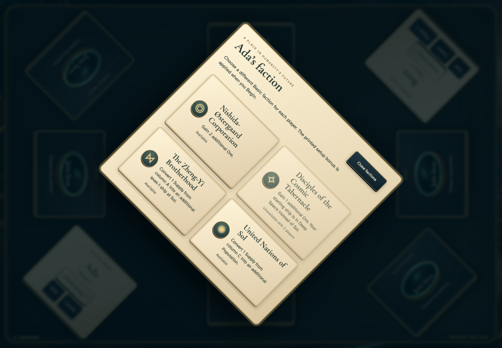](../../screenshots/decommission-a-controlling-ship-and-resolve-the-actual-rival-outpost-at-physical-shared-seats/009-faction-0-editor-desktop-darwin.png) |

tabletop-4k · 3840 × 2160

- [x] Ada chooses a legal unique Basic faction
- [x] Canonical effects settle before capture.
- [x] Any printed Action plan is ready.
- [x] The rotated trade explanation stays above the opaque footer.
- [x] Public compact topology remains physically separated.
- [x] The gameplay shell fits the actual viewport.

## 11. Ada retains Nishida-Østergaard Corporation

Viewpoint: **Ada · South West · one shared controller**.

| desktop · 1440 × 1000 |
| --- |
|  |

tabletop-4k · 3840 × 2160

- [x] Ada retains Nishida-Østergaard Corporation
- [x] Canonical effects settle before capture.
- [x] Any printed Action plan is ready.
- [x] The rotated trade explanation stays above the opaque footer.
- [x] Public compact topology remains physically separated.
- [x] The gameplay shell fits the actual viewport.

## 12. Bora chooses a legal unique Basic faction

Viewpoint: **Bora · North East · one shared controller**.

| desktop · 1440 × 1000 |
| --- |
|  |

tabletop-4k · 3840 × 2160

- [x] Bora chooses a legal unique Basic faction
- [x] Canonical effects settle before capture.
- [x] Any printed Action plan is ready.
- [x] The rotated trade explanation stays above the opaque footer.
- [x] Public compact topology remains physically separated.
- [x] The gameplay shell fits the actual viewport.

## 13. Bora retains The Zheng-Yi Brotherhood

Viewpoint: **Bora · North East · one shared controller**.

| desktop · 1440 × 1000 |
| --- |
|  |

tabletop-4k · 3840 × 2160

- [x] Bora retains The Zheng-Yi Brotherhood
- [x] Canonical effects settle before capture.
- [x] Any printed Action plan is ready.
- [x] The rotated trade explanation stays above the opaque footer.
- [x] Public compact topology remains physically separated.
- [x] The gameplay shell fits the actual viewport.

## 14. Begin the immutable source-reviewed Basic setup through the ordinary UI

Viewpoint: **Ada · South West · one shared controller**.

| desktop · 1440 × 1000 |
| --- |
|  |

tabletop-4k · 3840 × 2160

- [x] Begin the immutable source-reviewed Basic setup through the ordinary UI
- [x] Canonical effects settle before capture.
- [x] Any printed Action plan is ready.
- [x] The rotated trade explanation stays above the opaque footer.
- [x] Public compact topology remains physically separated.
- [x] The gameplay shell fits the actual viewport.

## 15. Ada opens the actual research and Action instrument

Viewpoint: **Ada · South West · one shared controller**.

| desktop · 1440 × 1000 |
| --- |
|  |

tabletop-4k · 3840 × 2160

- [x] Ada opens the actual research and Action instrument
- [x] Canonical effects settle before capture.
- [x] Any printed Action plan is ready.
- [x] The rotated trade explanation stays above the opaque footer.
- [x] Public compact topology remains physically separated.
- [x] The gameplay shell fits the actual viewport.

## 16. Ada selects the legal printed space 1

Viewpoint: **Ada · South West · one shared controller**.

| desktop · 1440 × 1000 |
| --- |
|  |

tabletop-4k · 3840 × 2160

[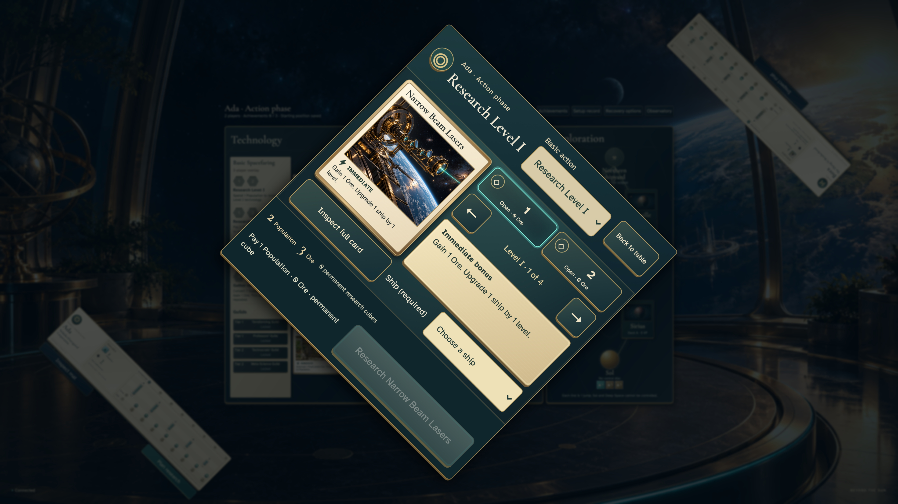](../../screenshots/decommission-a-controlling-ship-and-resolve-the-actual-rival-outpost-at-physical-shared-seats/015-ada-lasers-space-tabletop-4k-darwin.png)

- [x] Ada selects the legal printed space 1
- [x] Canonical effects settle before capture.
- [x] Any printed Action plan is ready.
- [x] The rotated trade explanation stays above the opaque footer.
- [x] Public compact topology remains physically separated.
- [x] The gameplay shell fits the actual viewport.

## 17. The immediate bonus requires an explicit owned target

Viewpoint: **Ada · South West · one shared controller**.

| desktop · 1440 × 1000 |
| --- |
|  |

tabletop-4k · 3840 × 2160

- [x] The immediate bonus requires an explicit owned target
- [x] Canonical effects settle before capture.
- [x] Any printed Action plan is ready.
- [x] The rotated trade explanation stays above the opaque footer.
- [x] Public compact topology remains physically separated.
- [x] The gameplay shell fits the actual viewport.

## 18. Choose the original Sol ship for the one-level upgrade

Viewpoint: **Ada · South West · one shared controller**.

| desktop · 1440 × 1000 |
| --- |
| [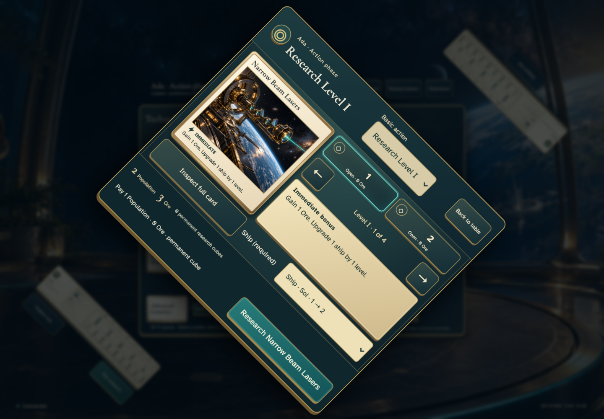](../../screenshots/decommission-a-controlling-ship-and-resolve-the-actual-rival-outpost-at-physical-shared-seats/017-ada-lasers-ship-desktop-darwin.png) |

tabletop-4k · 3840 × 2160

[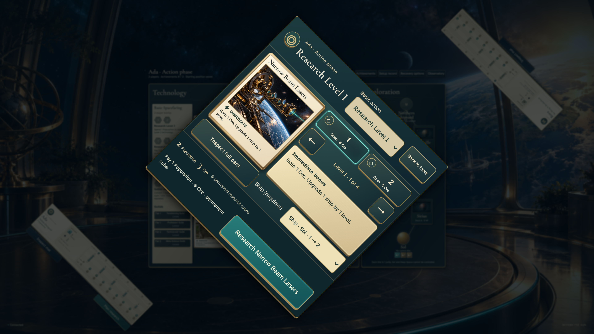](../../screenshots/decommission-a-controlling-ship-and-resolve-the-actual-rival-outpost-at-physical-shared-seats/017-ada-lasers-ship-tabletop-4k-darwin.png)

- [x] Choose the original Sol ship for the one-level upgrade
- [x] Canonical effects settle before capture.
- [x] Any printed Action plan is ready.
- [x] The rotated trade explanation stays above the opaque footer.
- [x] Public compact topology remains physically separated.
- [x] The gameplay shell fits the actual viewport.

## 19. Pay once and receive Narrow Beam Lasers's immediate bonus

Viewpoint: **Ada · South West · one shared controller**.

| desktop · 1440 × 1000 |
| --- |
| [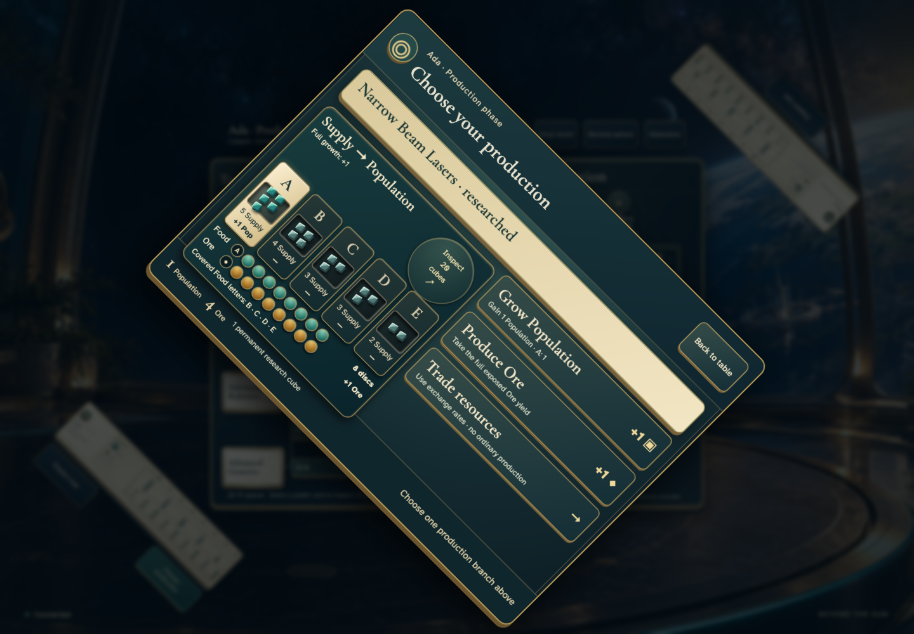](../../screenshots/decommission-a-controlling-ship-and-resolve-the-actual-rival-outpost-at-physical-shared-seats/018-ada-lasers-researched-desktop-darwin.png) |

tabletop-4k · 3840 × 2160

[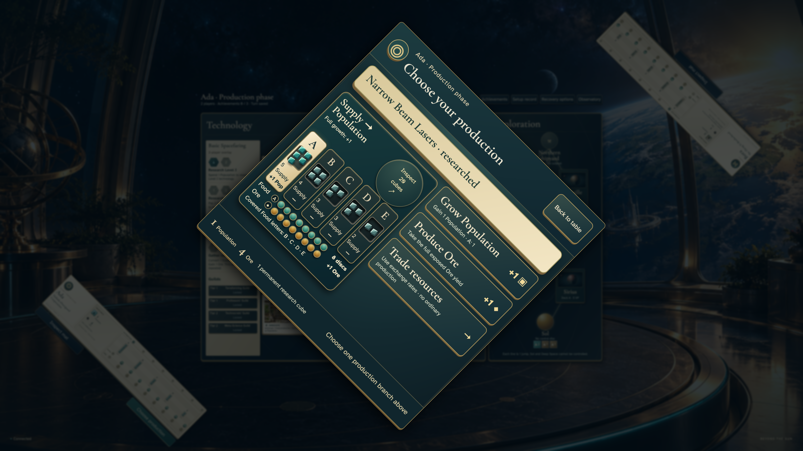](../../screenshots/decommission-a-controlling-ship-and-resolve-the-actual-rival-outpost-at-physical-shared-seats/018-ada-lasers-researched-tabletop-4k-darwin.png)

- [x] Pay once and receive Narrow Beam Lasers's immediate bonus
- [x] Canonical effects settle before capture.
- [x] Any printed Action plan is ready.
- [x] The rotated trade explanation stays above the opaque footer.
- [x] Public compact topology remains physically separated.
- [x] The gameplay shell fits the actual viewport.

## 20. Ada completes production and hands off to Bora

Viewpoint: **Ada · South West · one shared controller**.

| desktop · 1440 × 1000 |
| --- |
|  |

tabletop-4k · 3840 × 2160

- [x] Ada completes production and hands off to Bora
- [x] Canonical effects settle before capture.
- [x] Any printed Action plan is ready.
- [x] The rotated trade explanation stays above the opaque footer.
- [x] Public compact topology remains physically separated.
- [x] The gameplay shell fits the actual viewport.

## 21. Bora opens the actual research and Action instrument

Viewpoint: **Bora · North East · one shared controller**.

| desktop · 1440 × 1000 |
| --- |
| [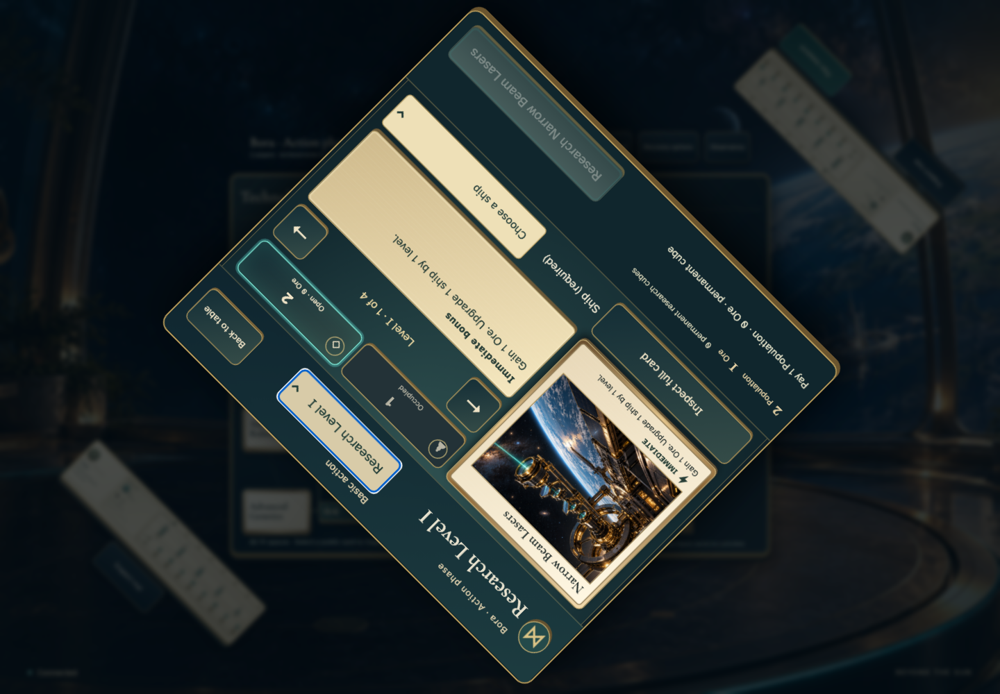](../../screenshots/decommission-a-controlling-ship-and-resolve-the-actual-rival-outpost-at-physical-shared-seats/020-bora-terraforming-plan-desktop-darwin.png) |

tabletop-4k · 3840 × 2160

[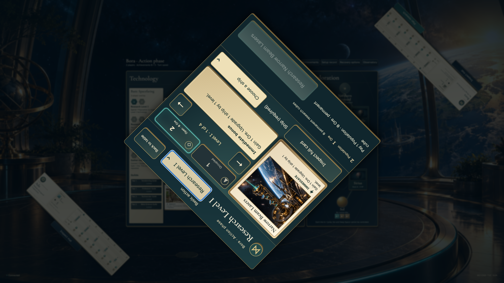](../../screenshots/decommission-a-controlling-ship-and-resolve-the-actual-rival-outpost-at-physical-shared-seats/020-bora-terraforming-plan-tabletop-4k-darwin.png)

- [x] Bora opens the actual research and Action instrument
- [x] Canonical effects settle before capture.
- [x] Any printed Action plan is ready.
- [x] The rotated trade explanation stays above the opaque footer.
- [x] Public compact topology remains physically separated.
- [x] The gameplay shell fits the actual viewport.

## 22. Bora selects the legal printed space 2

Viewpoint: **Bora · North East · one shared controller**.

| desktop · 1440 × 1000 |
| --- |
| [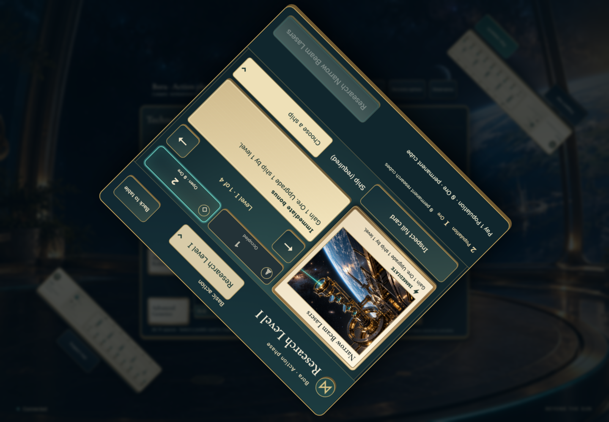](../../screenshots/decommission-a-controlling-ship-and-resolve-the-actual-rival-outpost-at-physical-shared-seats/021-bora-terraforming-space-desktop-darwin.png) |

tabletop-4k · 3840 × 2160

[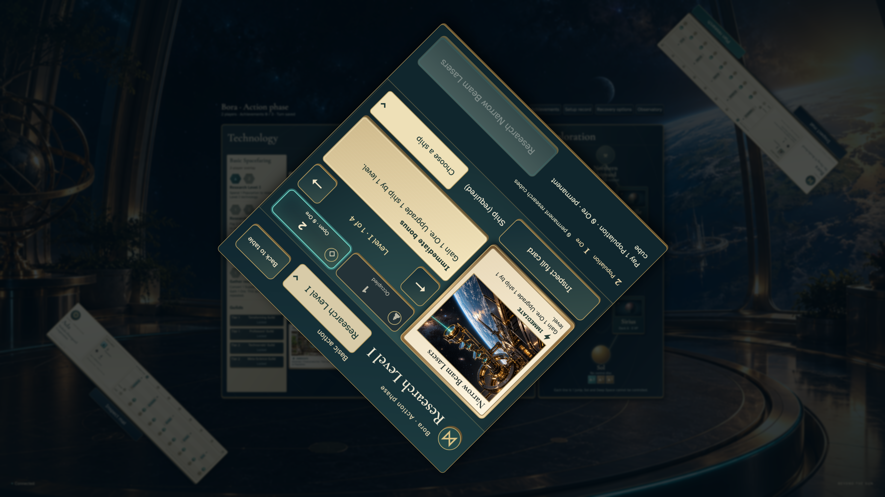](../../screenshots/decommission-a-controlling-ship-and-resolve-the-actual-rival-outpost-at-physical-shared-seats/021-bora-terraforming-space-tabletop-4k-darwin.png)

- [x] Bora selects the legal printed space 2
- [x] Canonical effects settle before capture.
- [x] Any printed Action plan is ready.
- [x] The rotated trade explanation stays above the opaque footer.
- [x] Public compact topology remains physically separated.
- [x] The gameplay shell fits the actual viewport.

## 23. Browse the next public Level I face

Viewpoint: **Bora · North East · one shared controller**.

| desktop · 1440 × 1000 |
| --- |
| [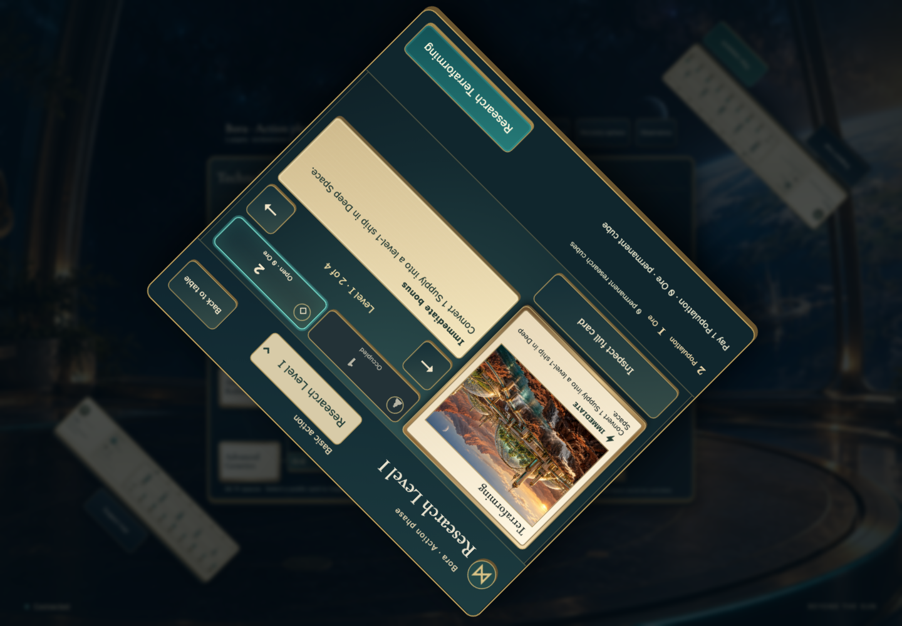](../../screenshots/decommission-a-controlling-ship-and-resolve-the-actual-rival-outpost-at-physical-shared-seats/022-bora-terraforming-browse-0-desktop-darwin.png) |

tabletop-4k · 3840 × 2160

[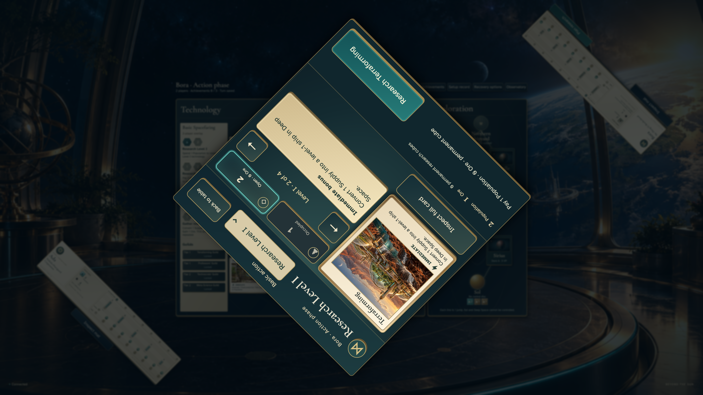](../../screenshots/decommission-a-controlling-ship-and-resolve-the-actual-rival-outpost-at-physical-shared-seats/022-bora-terraforming-browse-0-tabletop-4k-darwin.png)

- [x] Browse the next public Level I face
- [x] Canonical effects settle before capture.
- [x] Any printed Action plan is ready.
- [x] The rotated trade explanation stays above the opaque footer.
- [x] Public compact topology remains physically separated.
- [x] The gameplay shell fits the actual viewport.

## 24. Pay once and receive Terraforming's immediate bonus

Viewpoint: **Bora · North East · one shared controller**.

| desktop · 1440 × 1000 |
| --- |
|  |

tabletop-4k · 3840 × 2160

- [x] Pay once and receive Terraforming's immediate bonus
- [x] Canonical effects settle before capture.
- [x] Any printed Action plan is ready.
- [x] The rotated trade explanation stays above the opaque footer.
- [x] Public compact topology remains physically separated.
- [x] The gameplay shell fits the actual viewport.

## 25. Bora completes production and hands off to Ada

Viewpoint: **Bora · North East · one shared controller**.

| desktop · 1440 × 1000 |
| --- |
| [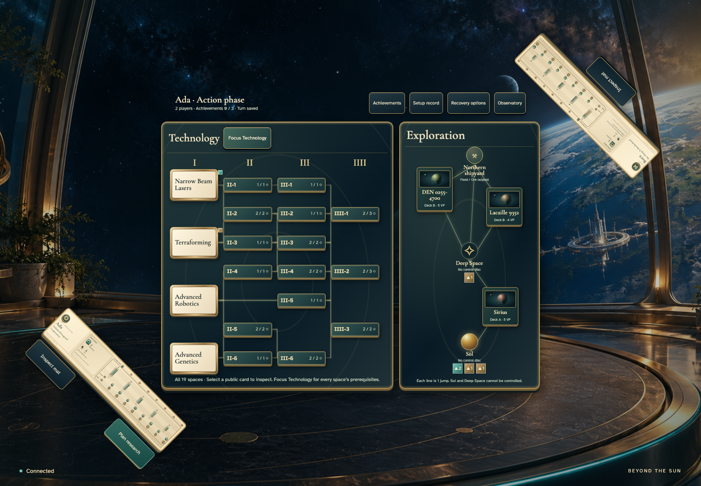](../../screenshots/decommission-a-controlling-ship-and-resolve-the-actual-rival-outpost-at-physical-shared-seats/024-bora-terraforming-handoff-desktop-darwin.png) |

tabletop-4k · 3840 × 2160

- [x] Bora completes production and hands off to Ada
- [x] Canonical effects settle before capture.
- [x] Any printed Action plan is ready.
- [x] The rotated trade explanation stays above the opaque footer.
- [x] Public compact topology remains physically separated.
- [x] The gameplay shell fits the actual viewport.

## 26. Ada opens the actual research and Action instrument

Viewpoint: **Ada · South West · one shared controller**.

| desktop · 1440 × 1000 |
| --- |
|  |

tabletop-4k · 3840 × 2160

[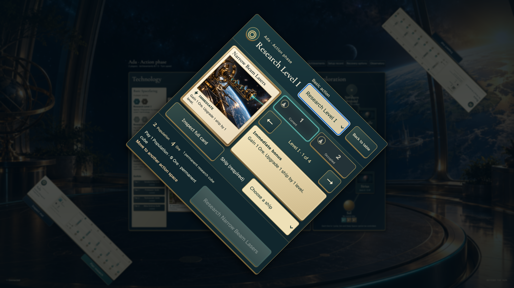](../../screenshots/decommission-a-controlling-ship-and-resolve-the-actual-rival-outpost-at-physical-shared-seats/025-ada-action-plan-tabletop-4k-darwin.png)

- [x] Ada opens the actual research and Action instrument
- [x] Canonical effects settle before capture.
- [x] Any printed Action plan is ready.
- [x] The rotated trade explanation stays above the opaque footer.
- [x] Public compact topology remains physically separated.
- [x] The gameplay shell fits the actual viewport.

## 27. Ada selects printed technology Actions

Viewpoint: **Ada · South West · one shared controller**.

| desktop · 1440 × 1000 |
| --- |
|  |

tabletop-4k · 3840 × 2160

- [x] Ada selects printed technology Actions
- [x] Canonical effects settle before capture.
- [x] Any printed Action plan is ready.
- [x] The rotated trade explanation stays above the opaque footer.
- [x] Public compact topology remains physically separated.
- [x] The gameplay shell fits the actual viewport.

## 28. Read Narrow Beam Lasers's actual research requirement, payment and exclusive pawn space

Viewpoint: **Ada · South West · one shared controller**.

| desktop · 1440 × 1000 |
| --- |
| [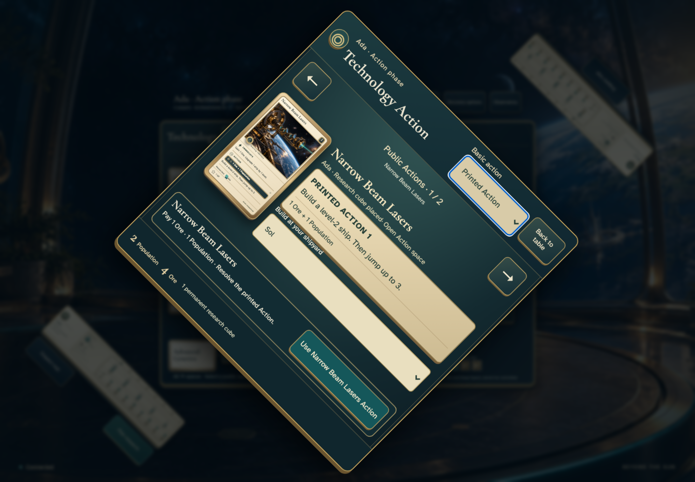](../../screenshots/decommission-a-controlling-ship-and-resolve-the-actual-rival-outpost-at-physical-shared-seats/027-ada-action-face-desktop-darwin.png) |

tabletop-4k · 3840 × 2160

[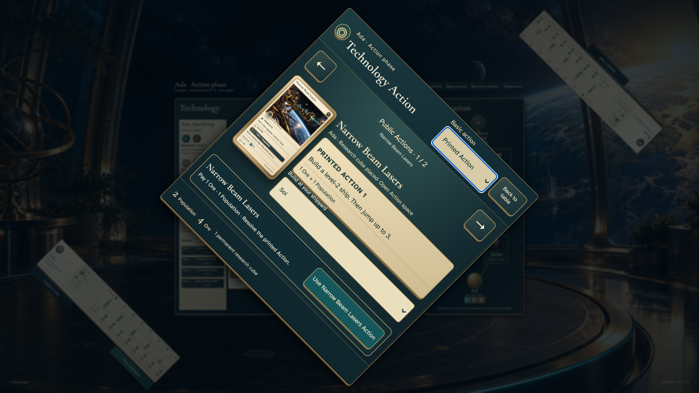](../../screenshots/decommission-a-controlling-ship-and-resolve-the-actual-rival-outpost-at-physical-shared-seats/027-ada-action-face-tabletop-4k-darwin.png)

- [x] Read Narrow Beam Lasers's actual research requirement, payment and exclusive pawn space
- [x] Canonical effects settle before capture.
- [x] Any printed Action plan is ready.
- [x] The rotated trade explanation stays above the opaque footer.
- [x] Public compact topology remains physically separated.
- [x] The gameplay shell fits the actual viewport.

## 29. Pay the printed Action cost before choosing the new ship path

Viewpoint: **Ada · South West · one shared controller**.

| desktop · 1440 × 1000 |
| --- |
| [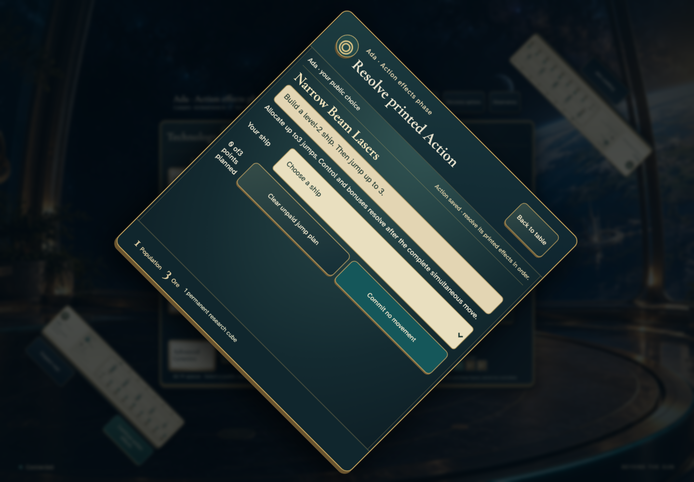](../../screenshots/decommission-a-controlling-ship-and-resolve-the-actual-rival-outpost-at-physical-shared-seats/028-laser-payment-desktop-darwin.png) |

tabletop-4k · 3840 × 2160

[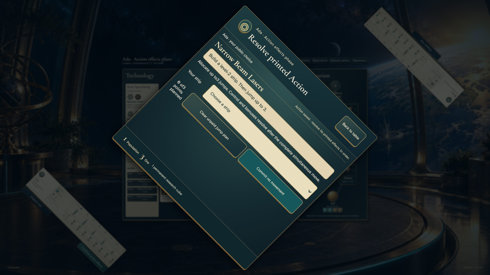](../../screenshots/decommission-a-controlling-ship-and-resolve-the-actual-rival-outpost-at-physical-shared-seats/028-laser-payment-tabletop-4k-darwin.png)

- [x] Pay the printed Action cost before choosing the new ship path
- [x] Canonical effects settle before capture.
- [x] Any printed Action plan is ready.
- [x] The rotated trade explanation stays above the opaque footer.
- [x] Public compact topology remains physically separated.
- [x] The gameplay shell fits the actual viewport.

## 30. Choose the newly built level2 ship at Sol

Viewpoint: **Ada · South West · one shared controller**.

| desktop · 1440 × 1000 |
| --- |
|  |

tabletop-4k · 3840 × 2160

[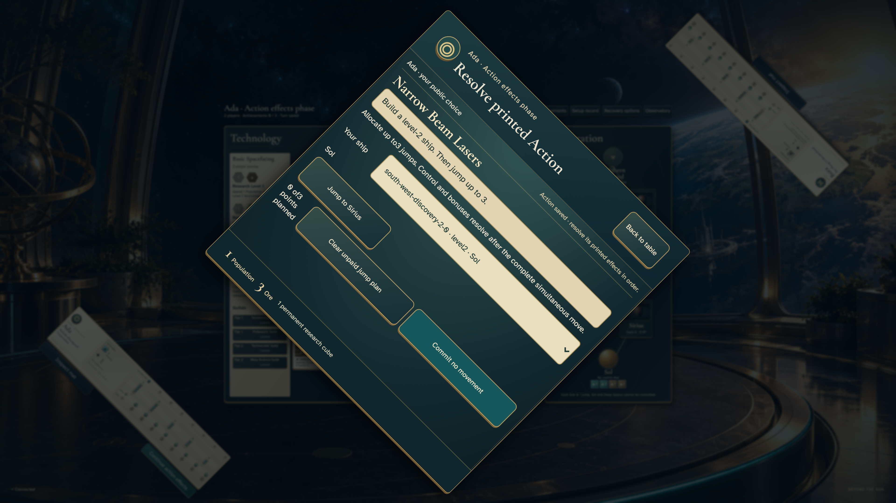](../../screenshots/decommission-a-controlling-ship-and-resolve-the-actual-rival-outpost-at-physical-shared-seats/029-laser-ship-tabletop-4k-darwin.png)

- [x] Choose the newly built level2 ship at Sol
- [x] Canonical effects settle before capture.
- [x] Any printed Action plan is ready.
- [x] The rotated trade explanation stays above the opaque footer.
- [x] Public compact topology remains physically separated.
- [x] The gameplay shell fits the actual viewport.

## 31. Plan an actual adjacent jump without premature movement or control

Viewpoint: **Ada · South West · one shared controller**.

| desktop · 1440 × 1000 |
| --- |
|  |

tabletop-4k · 3840 × 2160

[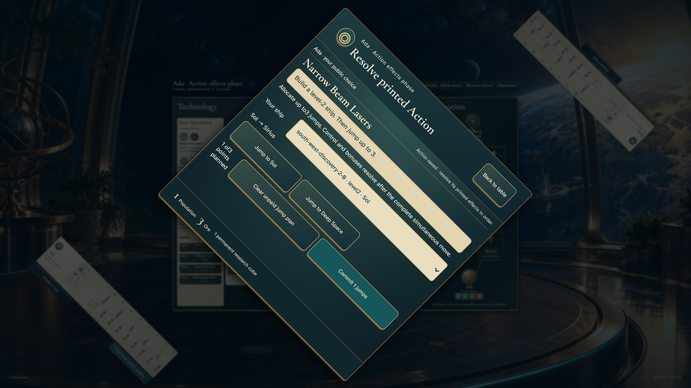](../../screenshots/decommission-a-controlling-ship-and-resolve-the-actual-rival-outpost-at-physical-shared-seats/030-laser-leg-0-tabletop-4k-darwin.png)

- [x] Plan an actual adjacent jump without premature movement or control
- [x] Canonical effects settle before capture.
- [x] Any printed Action plan is ready.
- [x] The rotated trade explanation stays above the opaque footer.
- [x] Public compact topology remains physically separated.
- [x] The gameplay shell fits the actual viewport.

## 32. Plan an actual adjacent jump without premature movement or control

Viewpoint: **Ada · South West · one shared controller**.

| desktop · 1440 × 1000 |
| --- |
| [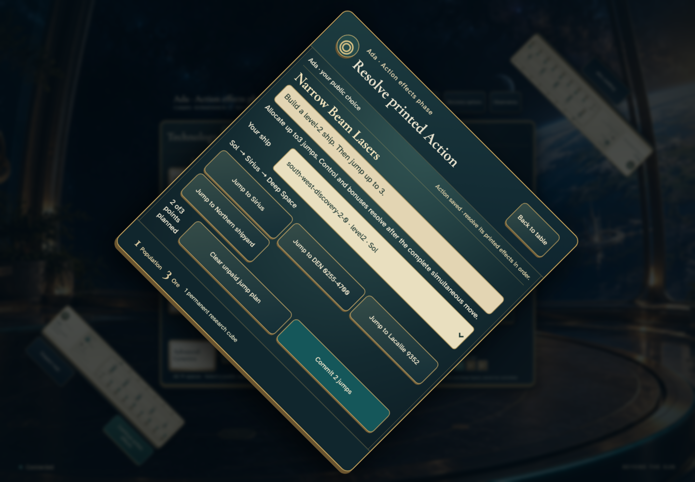](../../screenshots/decommission-a-controlling-ship-and-resolve-the-actual-rival-outpost-at-physical-shared-seats/031-laser-leg-1-desktop-darwin.png) |

tabletop-4k · 3840 × 2160

[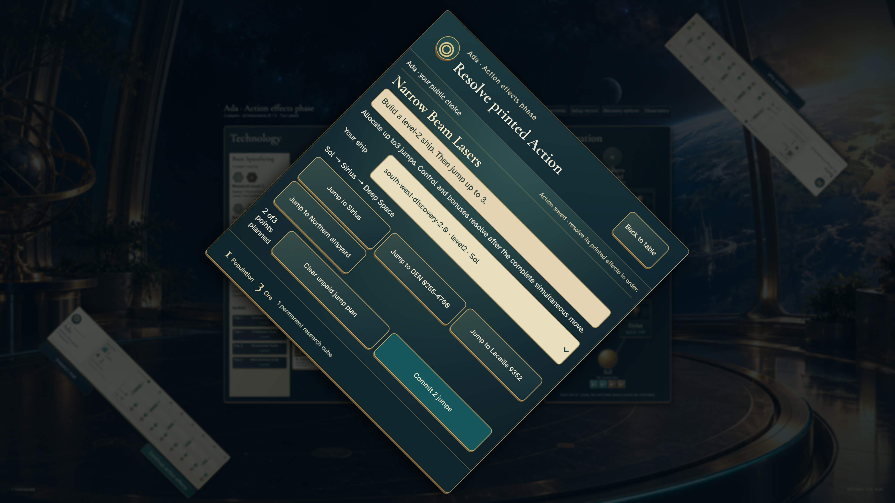](../../screenshots/decommission-a-controlling-ship-and-resolve-the-actual-rival-outpost-at-physical-shared-seats/031-laser-leg-1-tabletop-4k-darwin.png)

- [x] Plan an actual adjacent jump without premature movement or control
- [x] Canonical effects settle before capture.
- [x] Any printed Action plan is ready.
- [x] The rotated trade explanation stays above the opaque footer.
- [x] Public compact topology remains physically separated.
- [x] The gameplay shell fits the actual viewport.

## 33. Plan an actual adjacent jump without premature movement or control

Viewpoint: **Ada · South West · one shared controller**.

| desktop · 1440 × 1000 |
| --- |
| [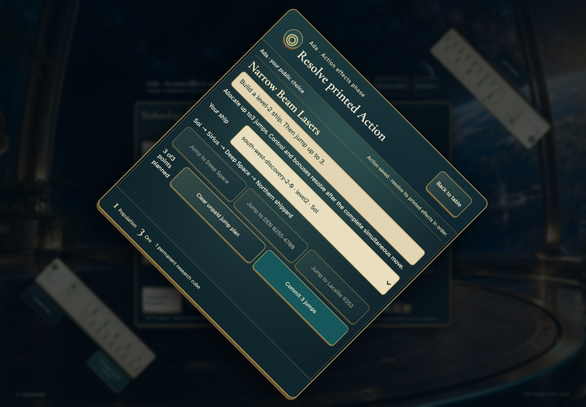](../../screenshots/decommission-a-controlling-ship-and-resolve-the-actual-rival-outpost-at-physical-shared-seats/032-laser-leg-2-desktop-darwin.png) |

tabletop-4k · 3840 × 2160

[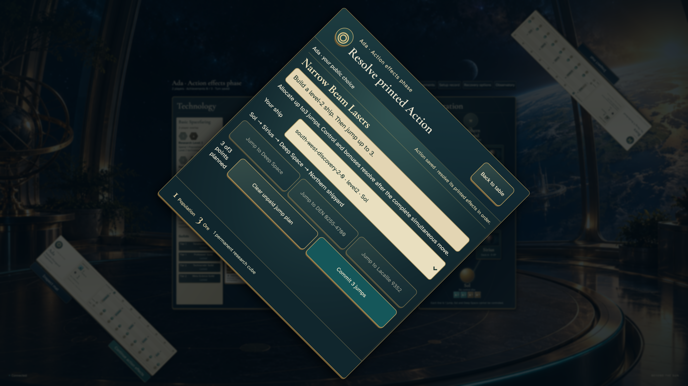](../../screenshots/decommission-a-controlling-ship-and-resolve-the-actual-rival-outpost-at-physical-shared-seats/032-laser-leg-2-tabletop-4k-darwin.png)

- [x] Plan an actual adjacent jump without premature movement or control
- [x] Canonical effects settle before capture.
- [x] Any printed Action plan is ready.
- [x] The rotated trade explanation stays above the opaque footer.
- [x] Public compact topology remains physically separated.
- [x] The gameplay shell fits the actual viewport.

## 34. The complete jump reaches Northern shipyard and offers its real outpost tracks

Viewpoint: **Ada · South West · one shared controller**.

| desktop · 1440 × 1000 |
| --- |
| [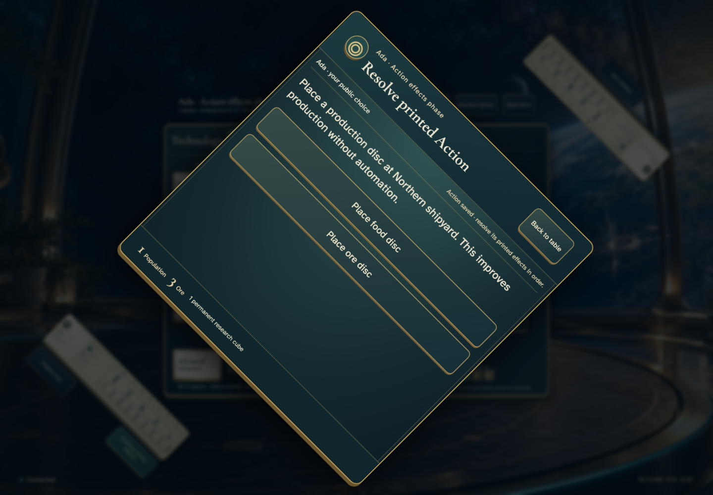](../../screenshots/decommission-a-controlling-ship-and-resolve-the-actual-rival-outpost-at-physical-shared-seats/033-ada-control-choice-desktop-darwin.png) |

tabletop-4k · 3840 × 2160

[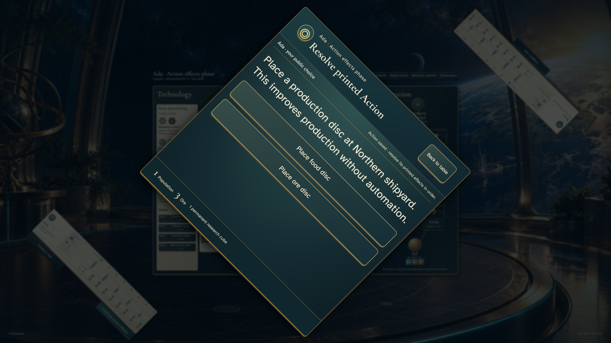](../../screenshots/decommission-a-controlling-ship-and-resolve-the-actual-rival-outpost-at-physical-shared-seats/033-ada-control-choice-tabletop-4k-darwin.png)

- [x] The complete jump reaches Northern shipyard and offers its real outpost tracks
- [x] Canonical effects settle before capture.
- [x] Any printed Action plan is ready.
- [x] The rotated trade explanation stays above the opaque footer.
- [x] Public compact topology remains physically separated.
- [x] The gameplay shell fits the actual viewport.

## 35. Ada controls Northern shipyard with an actual Food disc

Viewpoint: **Ada · South West · one shared controller**.

| desktop · 1440 × 1000 |
| --- |
|  |

tabletop-4k · 3840 × 2160

[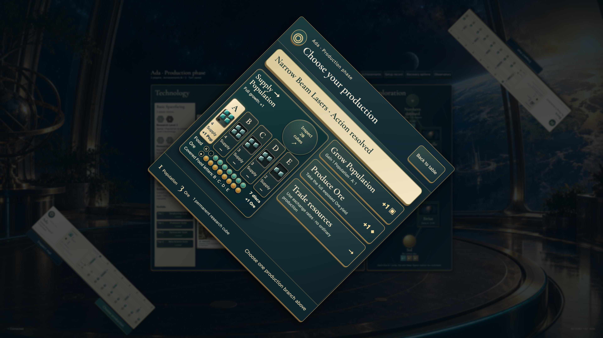](../../screenshots/decommission-a-controlling-ship-and-resolve-the-actual-rival-outpost-at-physical-shared-seats/034-ada-control-tabletop-4k-darwin.png)

- [x] Ada controls Northern shipyard with an actual Food disc
- [x] Canonical effects settle before capture.
- [x] Any printed Action plan is ready.
- [x] The rotated trade explanation stays above the opaque footer.
- [x] Public compact topology remains physically separated.
- [x] The gameplay shell fits the actual viewport.

## 36. Ada completes production and hands off to Bora

Viewpoint: **Ada · South West · one shared controller**.

| desktop · 1440 × 1000 |
| --- |
|  |

tabletop-4k · 3840 × 2160

- [x] Ada completes production and hands off to Bora
- [x] Canonical effects settle before capture.
- [x] Any printed Action plan is ready.
- [x] The rotated trade explanation stays above the opaque footer.
- [x] Public compact topology remains physically separated.
- [x] The gameplay shell fits the actual viewport.

## 37. Bora opens the actual research and Action instrument

Viewpoint: **Bora · North East · one shared controller**.

| desktop · 1440 × 1000 |
| --- |
| [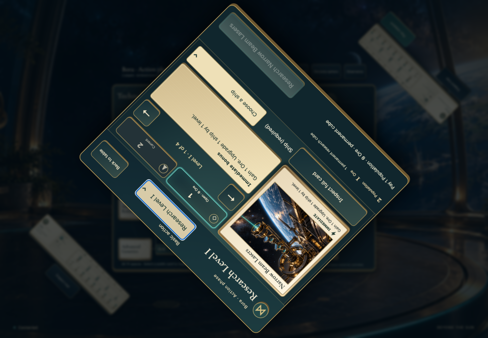](../../screenshots/decommission-a-controlling-ship-and-resolve-the-actual-rival-outpost-at-physical-shared-seats/036-bora-action-plan-desktop-darwin.png) |

tabletop-4k · 3840 × 2160

[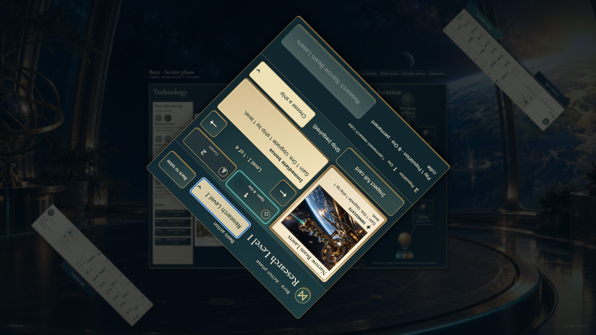](../../screenshots/decommission-a-controlling-ship-and-resolve-the-actual-rival-outpost-at-physical-shared-seats/036-bora-action-plan-tabletop-4k-darwin.png)

- [x] Bora opens the actual research and Action instrument
- [x] Canonical effects settle before capture.
- [x] Any printed Action plan is ready.
- [x] The rotated trade explanation stays above the opaque footer.
- [x] Public compact topology remains physically separated.
- [x] The gameplay shell fits the actual viewport.

## 38. Bora selects printed technology Actions

Viewpoint: **Bora · North East · one shared controller**.

| desktop · 1440 × 1000 |
| --- |
|  |

tabletop-4k · 3840 × 2160

- [x] Bora selects printed technology Actions
- [x] Canonical effects settle before capture.
- [x] Any printed Action plan is ready.
- [x] The rotated trade explanation stays above the opaque footer.
- [x] Public compact topology remains physically separated.
- [x] The gameplay shell fits the actual viewport.

## 39. Read Terraforming's actual research requirement, payment and exclusive pawn space

Viewpoint: **Bora · North East · one shared controller**.

| desktop · 1440 × 1000 |
| --- |
| [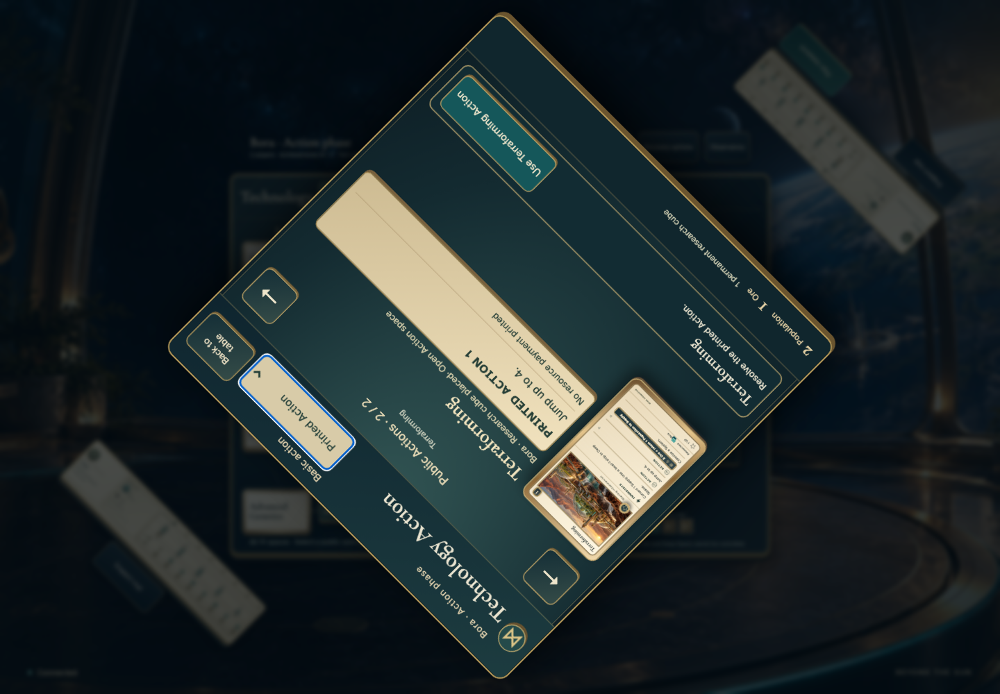](../../screenshots/decommission-a-controlling-ship-and-resolve-the-actual-rival-outpost-at-physical-shared-seats/038-bora-action-face-desktop-darwin.png) |

tabletop-4k · 3840 × 2160

[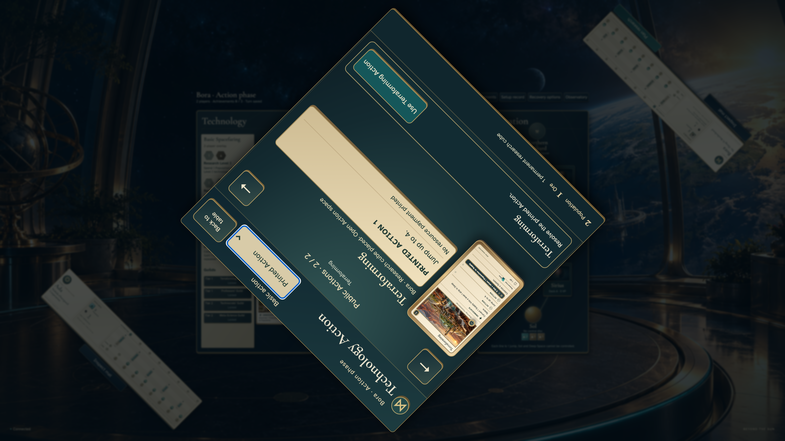](../../screenshots/decommission-a-controlling-ship-and-resolve-the-actual-rival-outpost-at-physical-shared-seats/038-bora-action-face-tabletop-4k-darwin.png)

- [x] Read Terraforming's actual research requirement, payment and exclusive pawn space
- [x] Canonical effects settle before capture.
- [x] Any printed Action plan is ready.
- [x] The rotated trade explanation stays above the opaque footer.
- [x] Public compact topology remains physically separated.
- [x] The gameplay shell fits the actual viewport.

## 40. The free printed Terraforming Action permits exactly four jumps shared by owned ships

Viewpoint: **Bora · North East · one shared controller**.

| desktop · 1440 × 1000 |
| --- |
| [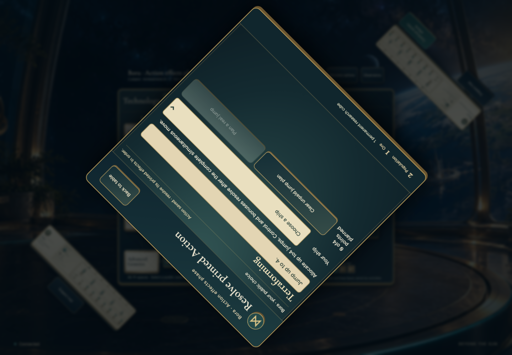](../../screenshots/decommission-a-controlling-ship-and-resolve-the-actual-rival-outpost-at-physical-shared-seats/039-bora-four-jump-desktop-darwin.png) |

tabletop-4k · 3840 × 2160

[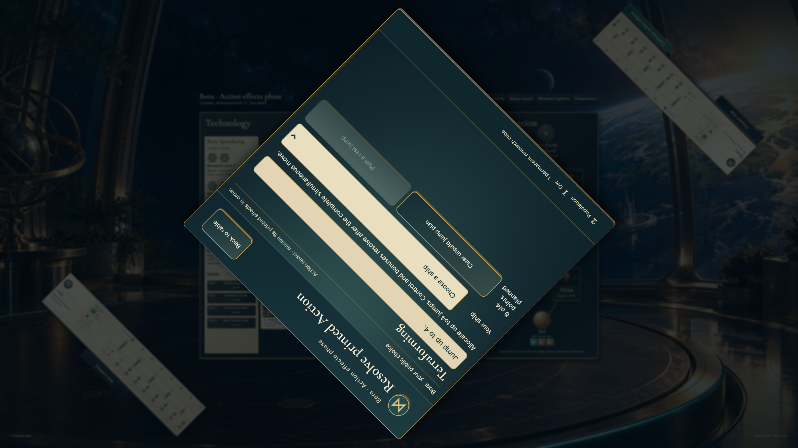](../../screenshots/decommission-a-controlling-ship-and-resolve-the-actual-rival-outpost-at-physical-shared-seats/039-bora-four-jump-tabletop-4k-darwin.png)

- [x] The free printed Terraforming Action permits exactly four jumps shared by owned ships
- [x] Canonical effects settle before capture.
- [x] Any printed Action plan is ready.
- [x] The rotated trade explanation stays above the opaque footer.
- [x] Public compact topology remains physically separated.
- [x] The gameplay shell fits the actual viewport.

## 41. Choose the second original level1 Sol ship

Viewpoint: **Bora · North East · one shared controller**.

| desktop · 1440 × 1000 |
| --- |
| [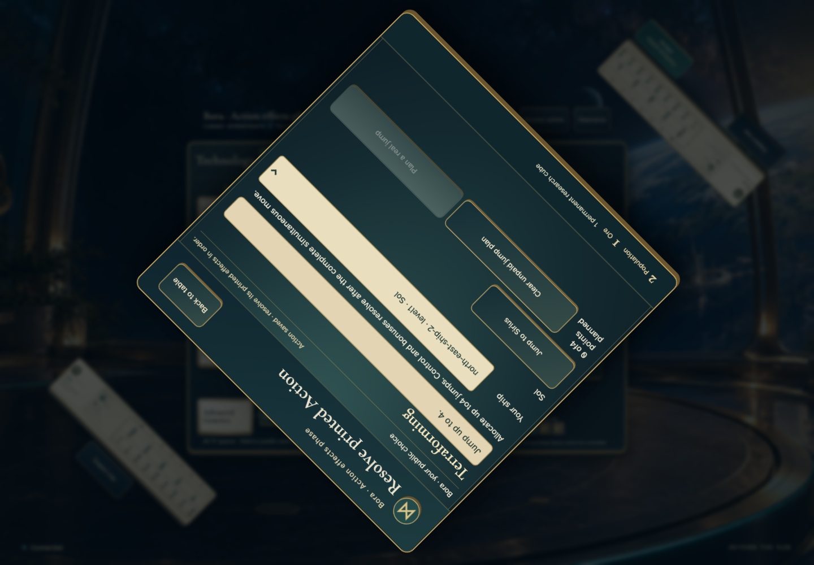](../../screenshots/decommission-a-controlling-ship-and-resolve-the-actual-rival-outpost-at-physical-shared-seats/040-bora-sol-ship-desktop-darwin.png) |

tabletop-4k · 3840 × 2160

- [x] Choose the second original level1 Sol ship
- [x] Canonical effects settle before capture.
- [x] Any printed Action plan is ready.
- [x] The rotated trade explanation stays above the opaque footer.
- [x] Public compact topology remains physically separated.
- [x] The gameplay shell fits the actual viewport.

## 42. Plan the first ship path while control remains unchanged

Viewpoint: **Bora · North East · one shared controller**.

| desktop · 1440 × 1000 |
| --- |
| [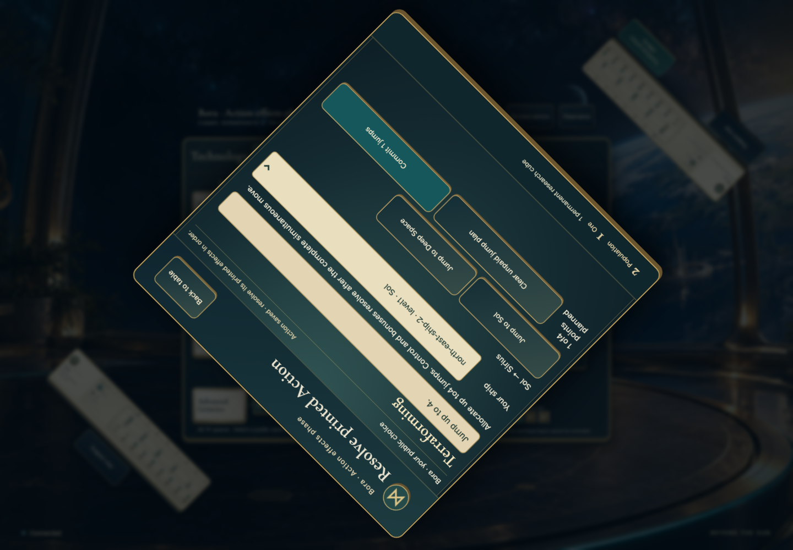](../../screenshots/decommission-a-controlling-ship-and-resolve-the-actual-rival-outpost-at-physical-shared-seats/041-bora-leg-0-desktop-darwin.png) |

tabletop-4k · 3840 × 2160

[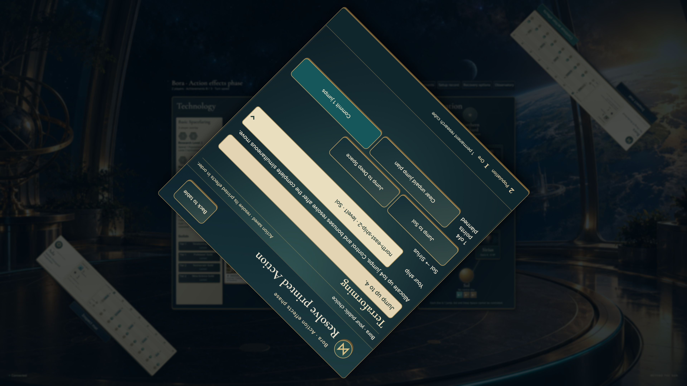](../../screenshots/decommission-a-controlling-ship-and-resolve-the-actual-rival-outpost-at-physical-shared-seats/041-bora-leg-0-tabletop-4k-darwin.png)

- [x] Plan the first ship path while control remains unchanged
- [x] Canonical effects settle before capture.
- [x] Any printed Action plan is ready.
- [x] The rotated trade explanation stays above the opaque footer.
- [x] Public compact topology remains physically separated.
- [x] The gameplay shell fits the actual viewport.

## 43. Plan the first ship path while control remains unchanged

Viewpoint: **Bora · North East · one shared controller**.

| desktop · 1440 × 1000 |
| --- |
| [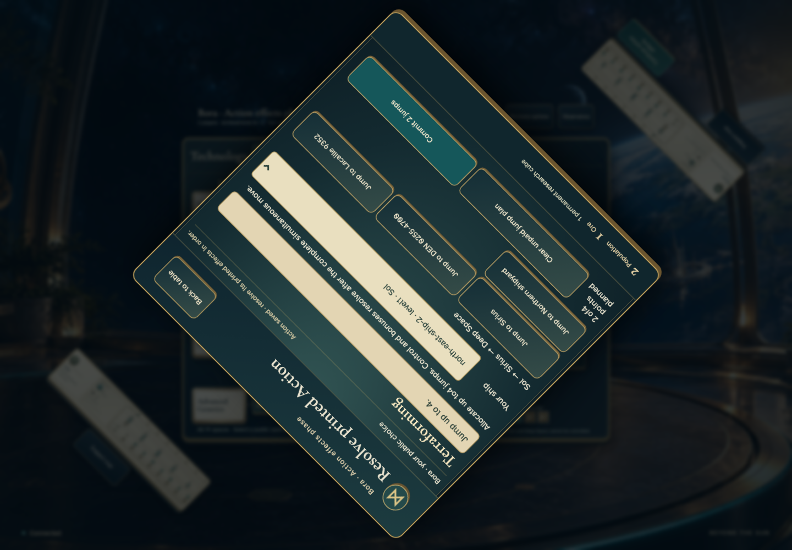](../../screenshots/decommission-a-controlling-ship-and-resolve-the-actual-rival-outpost-at-physical-shared-seats/042-bora-leg-1-desktop-darwin.png) |

tabletop-4k · 3840 × 2160

- [x] Plan the first ship path while control remains unchanged
- [x] Canonical effects settle before capture.
- [x] Any printed Action plan is ready.
- [x] The rotated trade explanation stays above the opaque footer.
- [x] Public compact topology remains physically separated.
- [x] The gameplay shell fits the actual viewport.

## 44. Plan the first ship path while control remains unchanged

Viewpoint: **Bora · North East · one shared controller**.

| desktop · 1440 × 1000 |
| --- |
| [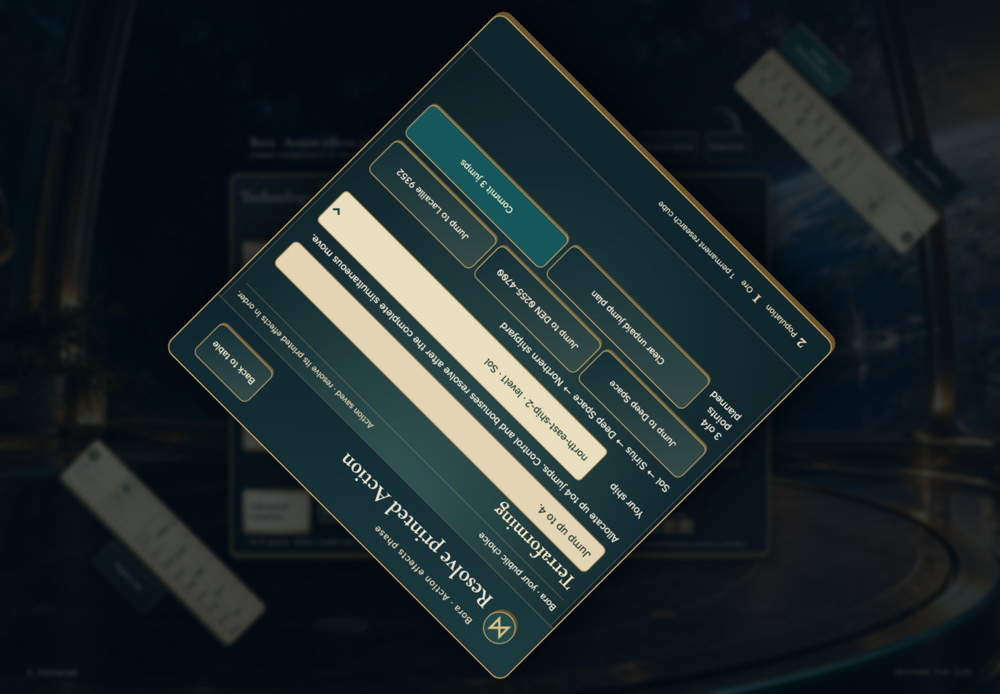](../../screenshots/decommission-a-controlling-ship-and-resolve-the-actual-rival-outpost-at-physical-shared-seats/043-bora-leg-2-desktop-darwin.png) |

tabletop-4k · 3840 × 2160

[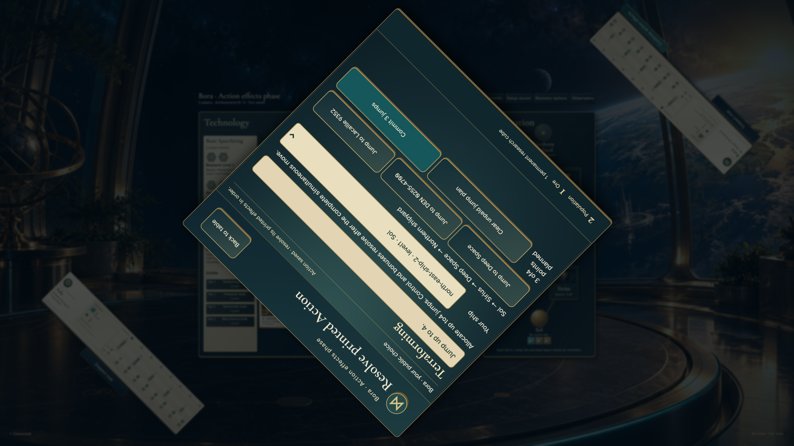](../../screenshots/decommission-a-controlling-ship-and-resolve-the-actual-rival-outpost-at-physical-shared-seats/043-bora-leg-2-tabletop-4k-darwin.png)

- [x] Plan the first ship path while control remains unchanged
- [x] Canonical effects settle before capture.
- [x] Any printed Action plan is ready.
- [x] The rotated trade explanation stays above the opaque footer.
- [x] Public compact topology remains physically separated.
- [x] The gameplay shell fits the actual viewport.

## 45. Allocate the remaining jump to the distinct Terraforming ship in Deep Space

Viewpoint: **Bora · North East · one shared controller**.

| desktop · 1440 × 1000 |
| --- |
|  |

tabletop-4k · 3840 × 2160

- [x] Allocate the remaining jump to the distinct Terraforming ship in Deep Space
- [x] Canonical effects settle before capture.
- [x] Any printed Action plan is ready.
- [x] The rotated trade explanation stays above the opaque footer.
- [x] Public compact topology remains physically separated.
- [x] The gameplay shell fits the actual viewport.

## 46. Both level1 ships will finish at the same actual shipyard

Viewpoint: **Bora · North East · one shared controller**.

| desktop · 1440 × 1000 |
| --- |
| [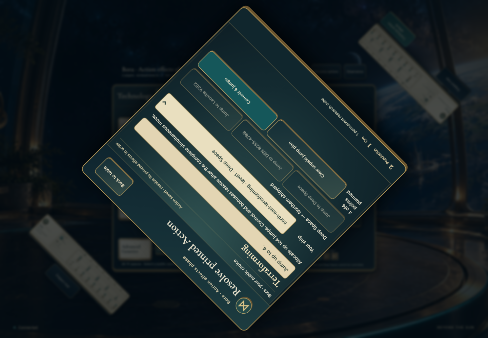](../../screenshots/decommission-a-controlling-ship-and-resolve-the-actual-rival-outpost-at-physical-shared-seats/045-bora-final-leg-desktop-darwin.png) |

tabletop-4k · 3840 × 2160

- [x] Both level1 ships will finish at the same actual shipyard
- [x] Canonical effects settle before capture.
- [x] Any printed Action plan is ready.
- [x] The rotated trade explanation stays above the opaque footer.
- [x] Public compact topology remains physically separated.
- [x] The gameplay shell fits the actual viewport.

## 47. Equal2 power preserves Ada as the existing owner before decommission

Viewpoint: **Bora · North East · one shared controller**.

| desktop · 1440 × 1000 |
| --- |
| [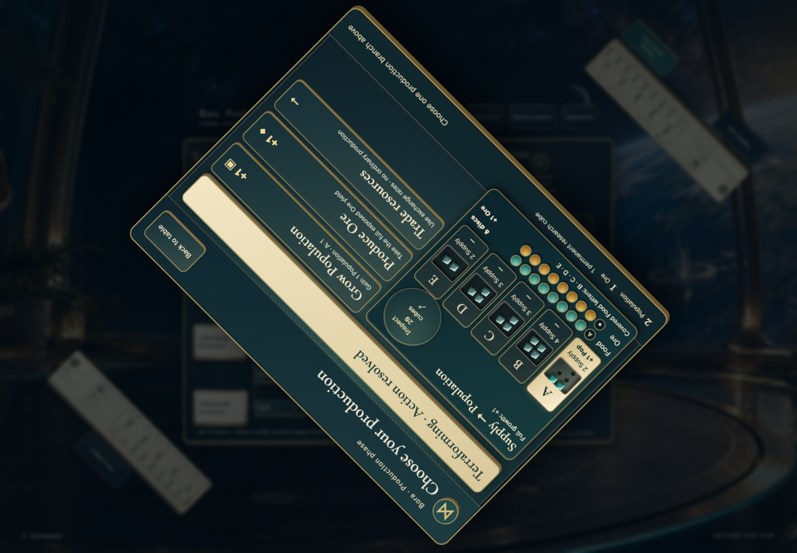](../../screenshots/decommission-a-controlling-ship-and-resolve-the-actual-rival-outpost-at-physical-shared-seats/046-tie-preserves-owner-desktop-darwin.png) |

tabletop-4k · 3840 × 2160

[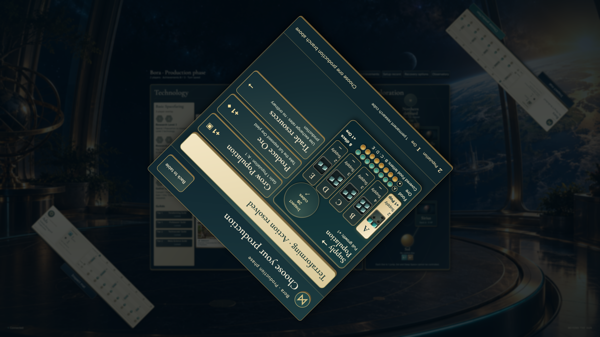](../../screenshots/decommission-a-controlling-ship-and-resolve-the-actual-rival-outpost-at-physical-shared-seats/046-tie-preserves-owner-tabletop-4k-darwin.png)

- [x] Equal2 power preserves Ada as the existing owner before decommission
- [x] Canonical effects settle before capture.
- [x] Any printed Action plan is ready.
- [x] The rotated trade explanation stays above the opaque footer.
- [x] Public compact topology remains physically separated.
- [x] The gameplay shell fits the actual viewport.

## 48. Bora completes production and hands off to Ada

Viewpoint: **Bora · North East · one shared controller**.

| desktop · 1440 × 1000 |
| --- |
| [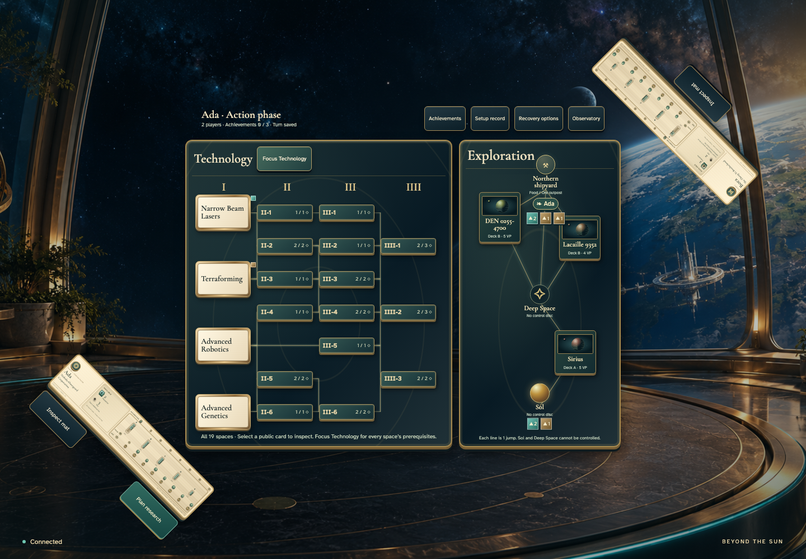](../../screenshots/decommission-a-controlling-ship-and-resolve-the-actual-rival-outpost-at-physical-shared-seats/047-bora-yard-handoff-desktop-darwin.png) |

tabletop-4k · 3840 × 2160

- [x] Bora completes production and hands off to Ada
- [x] Canonical effects settle before capture.
- [x] Any printed Action plan is ready.
- [x] The rotated trade explanation stays above the opaque footer.
- [x] Public compact topology remains physically separated.
- [x] The gameplay shell fits the actual viewport.

## 49. Ada opens the actual research and Action instrument

Viewpoint: **Ada · South West · one shared controller**.

| desktop · 1440 × 1000 |
| --- |
| [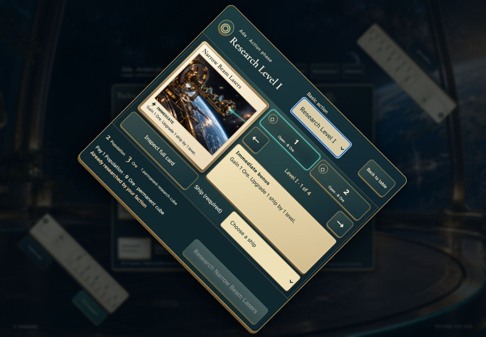](../../screenshots/decommission-a-controlling-ship-and-resolve-the-actual-rival-outpost-at-physical-shared-seats/048-ada-next-plan-desktop-darwin.png) |

tabletop-4k · 3840 × 2160

[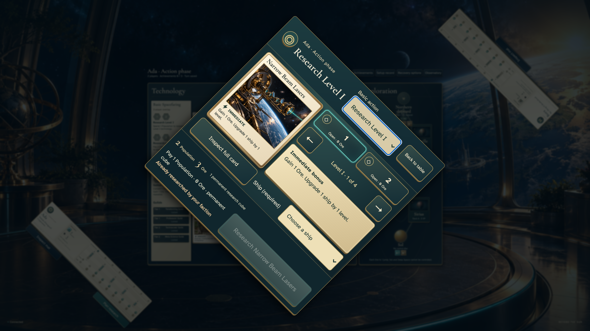](../../screenshots/decommission-a-controlling-ship-and-resolve-the-actual-rival-outpost-at-physical-shared-seats/048-ada-next-plan-tabletop-4k-darwin.png)

- [x] Ada opens the actual research and Action instrument
- [x] Canonical effects settle before capture.
- [x] Any printed Action plan is ready.
- [x] The rotated trade explanation stays above the opaque footer.
- [x] Public compact topology remains physically separated.
- [x] The gameplay shell fits the actual viewport.

## 50. Ada selects ordinary gathering

Viewpoint: **Ada · South West · one shared controller**.

| desktop · 1440 × 1000 |
| --- |
| [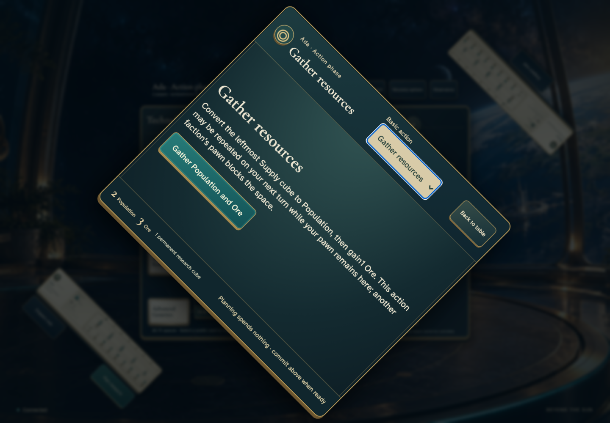](../../screenshots/decommission-a-controlling-ship-and-resolve-the-actual-rival-outpost-at-physical-shared-seats/049-ada-next-kind-desktop-darwin.png) |

tabletop-4k · 3840 × 2160

[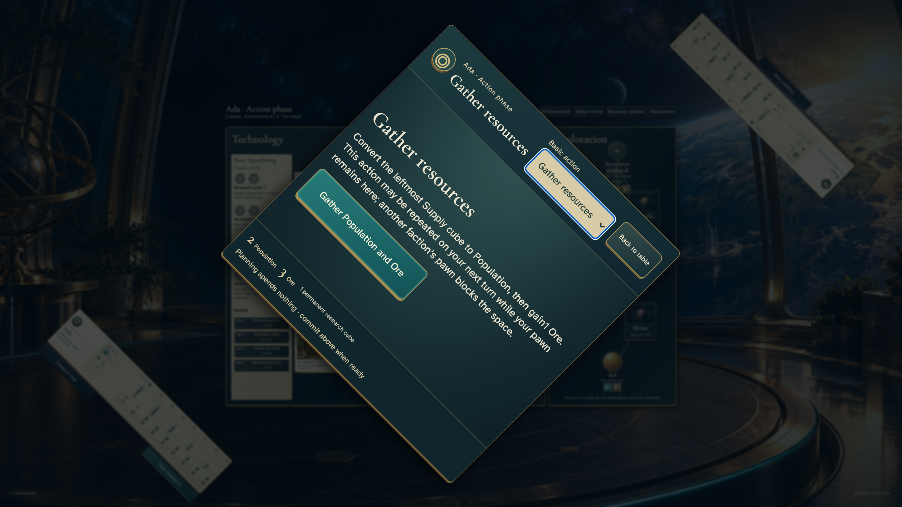](../../screenshots/decommission-a-controlling-ship-and-resolve-the-actual-rival-outpost-at-physical-shared-seats/049-ada-next-kind-tabletop-4k-darwin.png)

- [x] Ada selects ordinary gathering
- [x] Canonical effects settle before capture.
- [x] Any printed Action plan is ready.
- [x] The rotated trade explanation stays above the opaque footer.
- [x] Public compact topology remains physically separated.
- [x] The gameplay shell fits the actual viewport.

## 51. Receive the printed gather resources before ordinary production

Viewpoint: **Ada · South West · one shared controller**.

| desktop · 1440 × 1000 |
| --- |
| [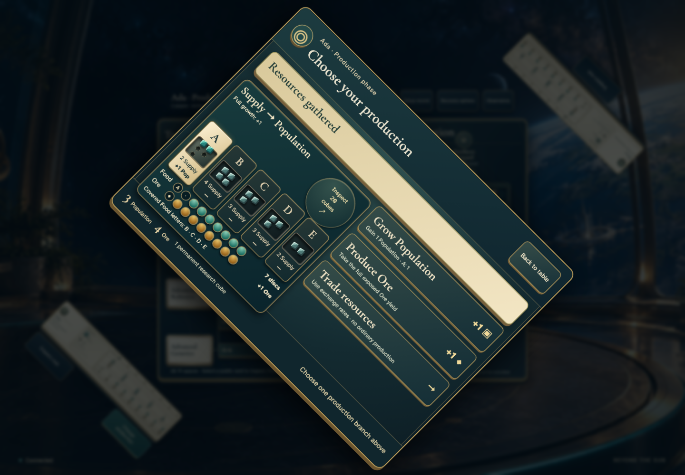](../../screenshots/decommission-a-controlling-ship-and-resolve-the-actual-rival-outpost-at-physical-shared-seats/050-ada-next-gathered-desktop-darwin.png) |

tabletop-4k · 3840 × 2160

- [x] Receive the printed gather resources before ordinary production
- [x] Canonical effects settle before capture.
- [x] Any printed Action plan is ready.
- [x] The rotated trade explanation stays above the opaque footer.
- [x] Public compact topology remains physically separated.
- [x] The gameplay shell fits the actual viewport.

## 52. Trade replaces ordinary growth and Ore production without changing the balance

Viewpoint: **Ada · South West · one shared controller**.

| desktop · 1440 × 1000 |
| --- |
|  |

tabletop-4k · 3840 × 2160

- [x] Trade replaces ordinary growth and Ore production without changing the balance
- [x] Canonical effects settle before capture.
- [x] Any printed Action plan is ready.
- [x] The rotated trade explanation stays above the opaque footer.
- [x] Public compact topology remains physically separated.
- [x] The gameplay shell fits the actual viewport.

## 53. Inspect the named exchange without committing a resource

Viewpoint: **Ada · South West · one shared controller**.

| desktop · 1440 × 1000 |
| --- |
|  |

tabletop-4k · 3840 × 2160

- [x] Inspect the named exchange without committing a resource
- [x] Canonical effects settle before capture.
- [x] Any printed Action plan is ready.
- [x] The rotated trade explanation stays above the opaque footer.
- [x] Public compact topology remains physically separated.
- [x] The gameplay shell fits the actual viewport.

## 54. Inspect the exact ship, payment and public power/control change without committing

Viewpoint: **Ada · South West · one shared controller**.

| desktop · 1440 × 1000 |
| --- |
|  |

tabletop-4k · 3840 × 2160

- [x] Inspect the exact ship, payment and public power/control change without committing
- [x] Canonical effects settle before capture.
- [x] Any printed Action plan is ready.
- [x] The rotated trade explanation stays above the opaque footer.
- [x] Public compact topology remains physically separated.
- [x] The gameplay shell fits the actual viewport.

## 55. Decommission is saved once; the resulting outpost choice belongs to Bora

Viewpoint: **Ada · South West · one shared controller**.

| desktop · 1440 × 1000 |
| --- |
|  |

tabletop-4k · 3840 × 2160

- [x] Decommission is saved once; the resulting outpost choice belongs to Bora
- [x] Canonical effects settle before capture.
- [x] Any printed Action plan is ready.
- [x] The rotated trade explanation stays above the opaque footer.
- [x] Public compact topology remains physically separated.
- [x] The gameplay shell fits the actual viewport.

## 56. The actual responder chooses a real outpost without any discovery or reveal claim

Viewpoint: **Bora · North East · one shared controller**.

| desktop · 1440 × 1000 |
| --- |
|  |

tabletop-4k · 3840 × 2160

- [x] The actual responder chooses a real outpost without any discovery or reveal claim
- [x] Canonical effects settle before capture.
- [x] Any printed Action plan is ready.
- [x] The rotated trade explanation stays above the opaque footer.
- [x] Public compact topology remains physically separated.
- [x] The gameplay shell fits the actual viewport.

## 57. Reload retains the outpost responder and never replays the decommission

Viewpoint: **Bora · North East · one shared controller**.

| desktop · 1440 × 1000 |
| --- |
|  |

tabletop-4k · 3840 × 2160

- [x] Reload retains the outpost responder and never replays the decommission
- [x] Canonical effects settle before capture.
- [x] Any printed Action plan is ready.
- [x] The rotated trade explanation stays above the opaque footer.
- [x] Public compact topology remains physically separated.
- [x] The gameplay shell fits the actual viewport.

## 58. Reopen the same saved control-transfer decision

Viewpoint: **Bora · North East · one shared controller**.

| desktop · 1440 × 1000 |
| --- |
|  |

tabletop-4k · 3840 × 2160

- [x] Reopen the same saved control-transfer decision
- [x] Canonical effects settle before capture.
- [x] Any printed Action plan is ready.
- [x] The rotated trade explanation stays above the opaque footer.
- [x] Public compact topology remains physically separated.
- [x] The gameplay shell fits the actual viewport.

## 59. The outpost choice settles and returns the original actor to trading

Viewpoint: **Bora · North East · one shared controller**.

| desktop · 1440 × 1000 |
| --- |
|  |

tabletop-4k · 3840 × 2160

- [x] The outpost choice settles and returns the original actor to trading
- [x] Canonical effects settle before capture.
- [x] Any printed Action plan is ready.
- [x] The rotated trade explanation stays above the opaque footer.
- [x] Public compact topology remains physically separated.
- [x] The gameplay shell fits the actual viewport.

## 60. Reload retains the current identity, accepted exchanges and pending trading phase

Viewpoint: **Ada · South West · one shared controller**.

| desktop · 1440 × 1000 |
| --- |
|  |

tabletop-4k · 3840 × 2160

- [x] Reload retains the current identity, accepted exchanges and pending trading phase
- [x] Canonical effects settle before capture.
- [x] Any printed Action plan is ready.
- [x] The rotated trade explanation stays above the opaque footer.
- [x] Public compact topology remains physically separated.
- [x] The gameplay shell fits the actual viewport.

## 61. Open the same retained trade without duplicating a payment

Viewpoint: **Ada · South West · one shared controller**.

| desktop · 1440 × 1000 |
| --- |
|  |

tabletop-4k · 3840 × 2160

- [x] Open the same retained trade without duplicating a payment
- [x] Canonical effects settle before capture.
- [x] Any printed Action plan is ready.
- [x] The rotated trade explanation stays above the opaque footer.
- [x] Public compact topology remains physically separated.
- [x] The gameplay shell fits the actual viewport.

## 62. The original actor gains exactly one Population and pays exactly one Ore

Viewpoint: **Ada · South West · one shared controller**.

| desktop · 1440 × 1000 |
| --- |
|  |

tabletop-4k · 3840 × 2160

- [x] The original actor gains exactly one Population and pays exactly one Ore
- [x] Canonical effects settle before capture.
- [x] Any printed Action plan is ready.
- [x] The rotated trade explanation stays above the opaque footer.
- [x] Public compact topology remains physically separated.
- [x] The gameplay shell fits the actual viewport.

## 63. Inspect all twenty cubes in their current public locations

Viewpoint: **Ada · South West · one shared controller**.

| desktop · 1440 × 1000 |
| --- |
|  |

tabletop-4k · 3840 × 2160

- [x] Inspect all twenty cubes in their current public locations
- [x] Canonical effects settle before capture.
- [x] Any printed Action plan is ready.
- [x] The rotated trade explanation stays above the opaque footer.
- [x] Public compact topology remains physically separated.
- [x] The gameplay shell fits the actual viewport.

## 64. Forward Tab stays inside the native cube reader

Viewpoint: **Ada · South West · one shared controller**.

| desktop · 1440 × 1000 |
| --- |
|  |

tabletop-4k · 3840 × 2160

- [x] Forward Tab stays inside the native cube reader
- [x] Canonical effects settle before capture.
- [x] Any printed Action plan is ready.
- [x] The rotated trade explanation stays above the opaque footer.
- [x] Public compact topology remains physically separated.
- [x] The gameplay shell fits the actual viewport.

## 65. Reverse Tab also stays inside the native reader

Viewpoint: **Ada · South West · one shared controller**.

| desktop · 1440 × 1000 |
| --- |
|  |

tabletop-4k · 3840 × 2160

- [x] Reverse Tab also stays inside the native reader
- [x] Canonical effects settle before capture.
- [x] Any printed Action plan is ready.
- [x] The rotated trade explanation stays above the opaque footer.
- [x] Public compact topology remains physically separated.
- [x] The gameplay shell fits the actual viewport.

## 66. Escape restores the exact inspector opener without committing a trade

Viewpoint: **Ada · South West · one shared controller**.

| desktop · 1440 × 1000 |
| --- |
|  |

tabletop-4k · 3840 × 2160

- [x] Escape restores the exact inspector opener without committing a trade
- [x] Canonical effects settle before capture.
- [x] Any printed Action plan is ready.
- [x] The rotated trade explanation stays above the opaque footer.
- [x] Public compact topology remains physically separated.
- [x] The gameplay shell fits the actual viewport.

## 67. Finish trading passes to the next player without adding growth or Ore production

Viewpoint: **Ada · South West · one shared controller**.

| desktop · 1440 × 1000 |
| --- |
|  |

tabletop-4k · 3840 × 2160

- [x] Finish trading passes to the next player without adding growth or Ore production
- [x] Canonical effects settle before capture.
- [x] Any printed Action plan is ready.
- [x] The rotated trade explanation stays above the opaque footer.
- [x] Public compact topology remains physically separated.
- [x] The gameplay shell fits the actual viewport.

## 68. The public faction mat retains the final exact trade balance after handoff

Viewpoint: **Ada · South West · one shared controller**.

| desktop · 1440 × 1000 |
| --- |
|  |

tabletop-4k · 3840 × 2160

- [x] The public faction mat retains the final exact trade balance after handoff
- [x] Canonical effects settle before capture.
- [x] Any printed Action plan is ready.
- [x] The rotated trade explanation stays above the opaque footer.
- [x] Public compact topology remains physically separated.
- [x] The gameplay shell fits the actual viewport.

## 69. Escape returns from the actual mat to the handed-off board

Viewpoint: **Ada · South West · one shared controller**.

| desktop · 1440 × 1000 |
| --- |
|  |

tabletop-4k · 3840 × 2160

- [x] Escape returns from the actual mat to the handed-off board
- [x] Canonical effects settle before capture.
- [x] Any printed Action plan is ready.
- [x] The rotated trade explanation stays above the opaque footer.
- [x] Public compact topology remains physically separated.
- [x] The gameplay shell fits the actual viewport.

## 70. Reload retains the finished trading turn and leaves no orphaned inspector

Viewpoint: **Ada · South West · one shared controller**.

| desktop · 1440 × 1000 |
| --- |
|  |

tabletop-4k · 3840 × 2160

- [x] Reload retains the finished trading turn and leaves no orphaned inspector
- [x] Canonical effects settle before capture.
- [x] Any printed Action plan is ready.
- [x] The rotated trade explanation stays above the opaque footer.
- [x] Public compact topology remains physically separated.
- [x] The gameplay shell fits the actual viewport.
