# Decommission a controlling ship and resolve the actual rival outpost with separate controllers

Two separate authenticated remote controllers; ordinary UI setup and legal preparatory turns. Only initial setup entropy is fixed to66666666-6666-4666-8666-000000000009. No game-state injection or future-deck inspection. Three exact trade rates, repeated exchanges, rightmost returns/A overflow, covered-column leftmost draws, control-changing decommission and keyboard/reload use production components. No ordinary production is added.

## 1. Arrive using the actual production client

Viewpoint: **Ada · separate host controller**.

| phone · 393 × 852 | desktop · 1440 × 1000 |
| --- | --- |
|  |  |

- [x] Arrive using the actual production client
- [x] Canonical effects settle before capture.
- [x] Any printed Action plan is ready.
- [x] The rotated trade explanation stays above the opaque footer.
- [x] Public compact topology remains physically separated.
- [x] The gameplay shell fits the actual viewport.

## 2. Choose a real production play mode

Viewpoint: **Ada · separate host controller**.

| phone · 393 × 852 | desktop · 1440 × 1000 |
| --- | --- |
|  |  |

- [x] Choose a real production play mode
- [x] Canonical effects settle before capture.
- [x] Any printed Action plan is ready.
- [x] The rotated trade explanation stays above the opaque footer.
- [x] Public compact topology remains physically separated.
- [x] The gameplay shell fits the actual viewport.

## 3. Create an independent remote host controller

Viewpoint: **Ada · separate host controller**.

| phone · 393 × 852 | desktop · 1440 × 1000 |
| --- | --- |
|  |  |

- [x] Create an independent remote host controller
- [x] Canonical effects settle before capture.
- [x] Any printed Action plan is ready.
- [x] The rotated trade explanation stays above the opaque footer.
- [x] Public compact topology remains physically separated.
- [x] The gameplay shell fits the actual viewport.

## 4. Name the host Ada

Viewpoint: **Ada · separate host controller**.

| phone · 393 × 852 | desktop · 1440 × 1000 |
| --- | --- |
|  |  |

- [x] Name the host Ada
- [x] Canonical effects settle before capture.
- [x] Any printed Action plan is ready.
- [x] The rotated trade explanation stays above the opaque footer.
- [x] Public compact topology remains physically separated.
- [x] The gameplay shell fits the actual viewport.

## 5. The canonical remote room exposes its actual invitation code

Viewpoint: **Ada · separate host controller**.

| phone · 393 × 852 | desktop · 1440 × 1000 |
| --- | --- |
| [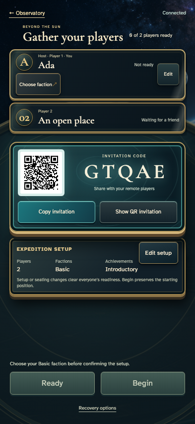](../../screenshots/decommission-a-controlling-ship-and-resolve-the-actual-rival-outpost-with-separate-controllers/004-host-room-phone-darwin.png) | [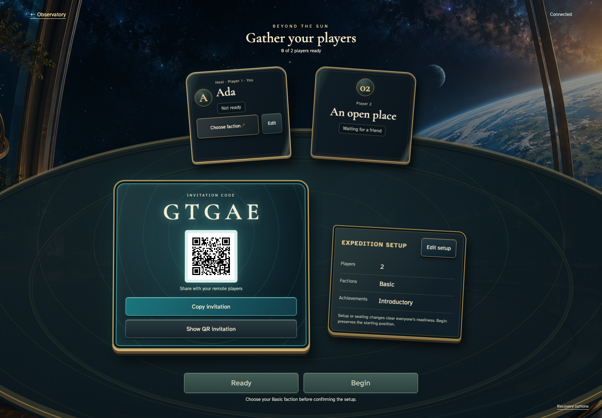](../../screenshots/decommission-a-controlling-ship-and-resolve-the-actual-rival-outpost-with-separate-controllers/004-host-room-desktop-darwin.png) |

- [x] The canonical remote room exposes its actual invitation code
- [x] Canonical effects settle before capture.
- [x] Any printed Action plan is ready.
- [x] The rotated trade explanation stays above the opaque footer.
- [x] Public compact topology remains physically separated.
- [x] The gameplay shell fits the actual viewport.

## 6. A different identity previews the public invitation

Viewpoint: **Bora · separate guest controller**.

| phone · 1440 × 1000 | desktop · 393 × 852 |
| --- | --- |
| [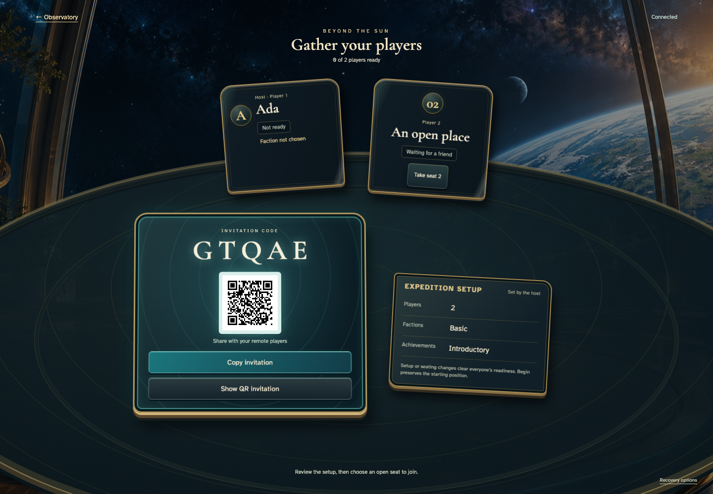](../../screenshots/decommission-a-controlling-ship-and-resolve-the-actual-rival-outpost-with-separate-controllers/005-guest-preview-phone-darwin.png) | [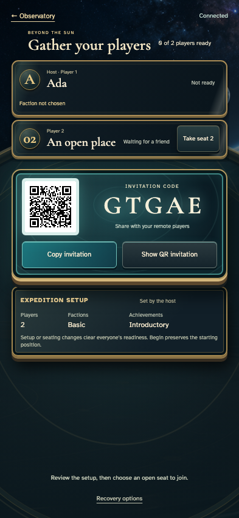](../../screenshots/decommission-a-controlling-ship-and-resolve-the-actual-rival-outpost-with-separate-controllers/005-guest-preview-desktop-darwin.png) |

- [x] A different identity previews the public invitation
- [x] Canonical effects settle before capture.
- [x] Any printed Action plan is ready.
- [x] The rotated trade explanation stays above the opaque footer.
- [x] Public compact topology remains physically separated.
- [x] The gameplay shell fits the actual viewport.

## 7. The guest claims only the remote seat

Viewpoint: **Bora · separate guest controller**.

| phone · 1440 × 1000 | desktop · 393 × 852 |
| --- | --- |
| [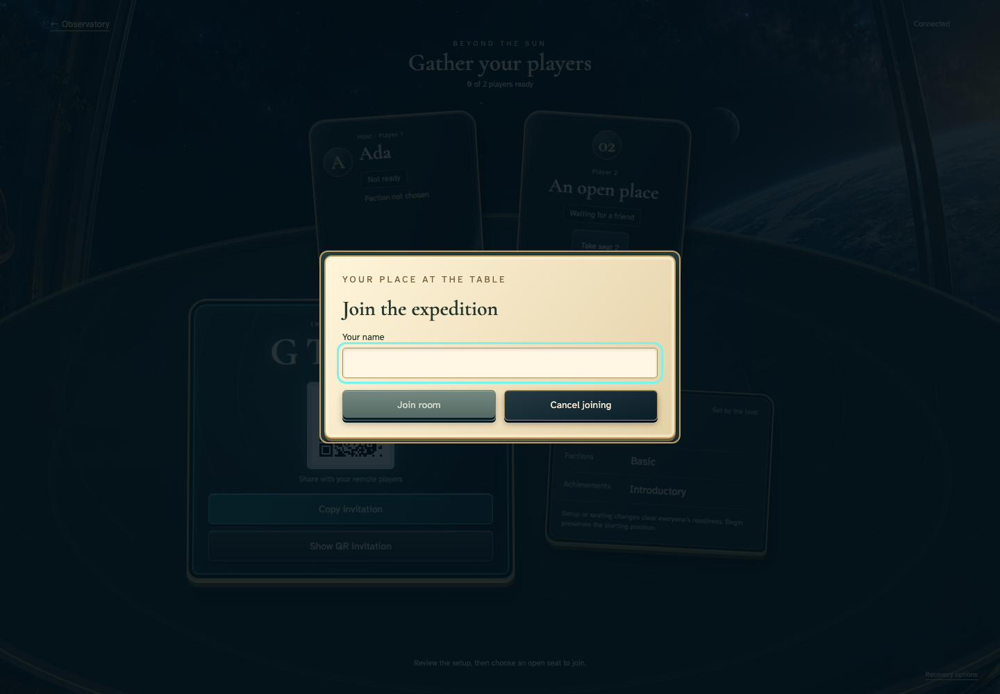](../../screenshots/decommission-a-controlling-ship-and-resolve-the-actual-rival-outpost-with-separate-controllers/006-guest-editor-phone-darwin.png) |  |

- [x] The guest claims only the remote seat
- [x] Canonical effects settle before capture.
- [x] Any printed Action plan is ready.
- [x] The rotated trade explanation stays above the opaque footer.
- [x] Public compact topology remains physically separated.
- [x] The gameplay shell fits the actual viewport.

## 8. Name the independent guest Bora

Viewpoint: **Bora · separate guest controller**.

| phone · 1440 × 1000 | desktop · 393 × 852 |
| --- | --- |
| [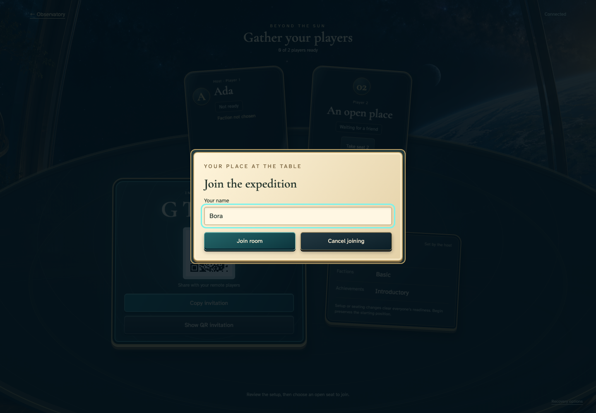](../../screenshots/decommission-a-controlling-ship-and-resolve-the-actual-rival-outpost-with-separate-controllers/007-guest-name-phone-darwin.png) |  |

- [x] Name the independent guest Bora
- [x] Canonical effects settle before capture.
- [x] Any printed Action plan is ready.
- [x] The rotated trade explanation stays above the opaque footer.
- [x] Public compact topology remains physically separated.
- [x] The gameplay shell fits the actual viewport.

## 9. Both named remote identities share the same room

Viewpoint: **Bora · separate guest controller**.

| phone · 1440 × 1000 | desktop · 393 × 852 |
| --- | --- |
|  | [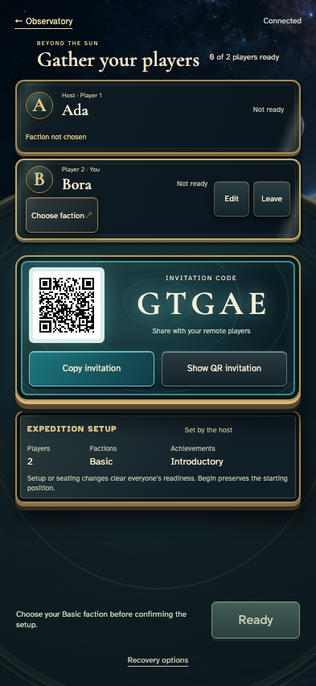](../../screenshots/decommission-a-controlling-ship-and-resolve-the-actual-rival-outpost-with-separate-controllers/008-guest-joined-desktop-darwin.png) |

- [x] Both named remote identities share the same room
- [x] Canonical effects settle before capture.
- [x] Any printed Action plan is ready.
- [x] The rotated trade explanation stays above the opaque footer.
- [x] Public compact topology remains physically separated.
- [x] The gameplay shell fits the actual viewport.

## 10. Ada chooses a legal unique Basic faction

Viewpoint: **Ada · separate host controller**.

| phone · 393 × 852 | desktop · 1440 × 1000 |
| --- | --- |
|  |  |

- [x] Ada chooses a legal unique Basic faction
- [x] Canonical effects settle before capture.
- [x] Any printed Action plan is ready.
- [x] The rotated trade explanation stays above the opaque footer.
- [x] Public compact topology remains physically separated.
- [x] The gameplay shell fits the actual viewport.

## 11. Ada retains Nishida-Østergaard Corporation

Viewpoint: **Ada · separate host controller**.

| phone · 393 × 852 | desktop · 1440 × 1000 |
| --- | --- |
| [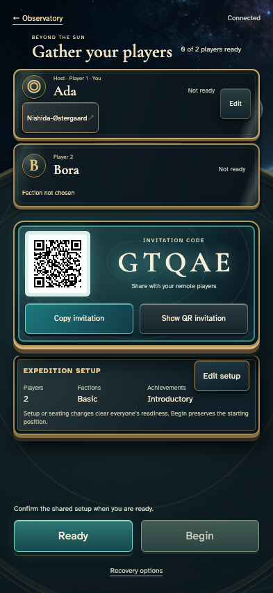](../../screenshots/decommission-a-controlling-ship-and-resolve-the-actual-rival-outpost-with-separate-controllers/010-faction-0-chosen-phone-darwin.png) | [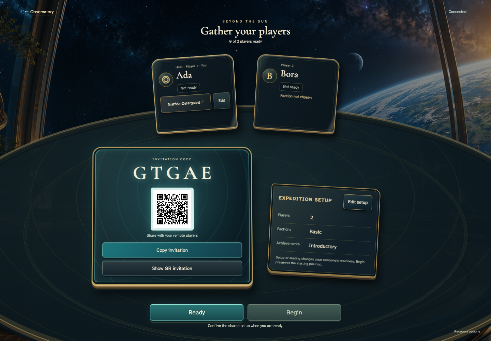](../../screenshots/decommission-a-controlling-ship-and-resolve-the-actual-rival-outpost-with-separate-controllers/010-faction-0-chosen-desktop-darwin.png) |

- [x] Ada retains Nishida-Østergaard Corporation
- [x] Canonical effects settle before capture.
- [x] Any printed Action plan is ready.
- [x] The rotated trade explanation stays above the opaque footer.
- [x] Public compact topology remains physically separated.
- [x] The gameplay shell fits the actual viewport.

## 12. Bora chooses a legal unique Basic faction

Viewpoint: **Bora · separate guest controller**.

| phone · 1440 × 1000 | desktop · 393 × 852 |
| --- | --- |
|  |  |

- [x] Bora chooses a legal unique Basic faction
- [x] Canonical effects settle before capture.
- [x] Any printed Action plan is ready.
- [x] The rotated trade explanation stays above the opaque footer.
- [x] Public compact topology remains physically separated.
- [x] The gameplay shell fits the actual viewport.

## 13. Bora retains The Zheng-Yi Brotherhood

Viewpoint: **Bora · separate guest controller**.

| phone · 1440 × 1000 | desktop · 393 × 852 |
| --- | --- |
|  | [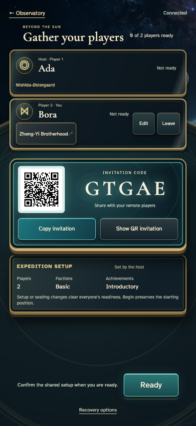](../../screenshots/decommission-a-controlling-ship-and-resolve-the-actual-rival-outpost-with-separate-controllers/012-faction-1-chosen-desktop-darwin.png) |

- [x] Bora retains The Zheng-Yi Brotherhood
- [x] Canonical effects settle before capture.
- [x] Any printed Action plan is ready.
- [x] The rotated trade explanation stays above the opaque footer.
- [x] Public compact topology remains physically separated.
- [x] The gameplay shell fits the actual viewport.

## 14. Confirm this identity is ready for the exact saved configuration

Viewpoint: **Bora · separate guest controller**.

| phone · 1440 × 1000 | desktop · 393 × 852 |
| --- | --- |
| [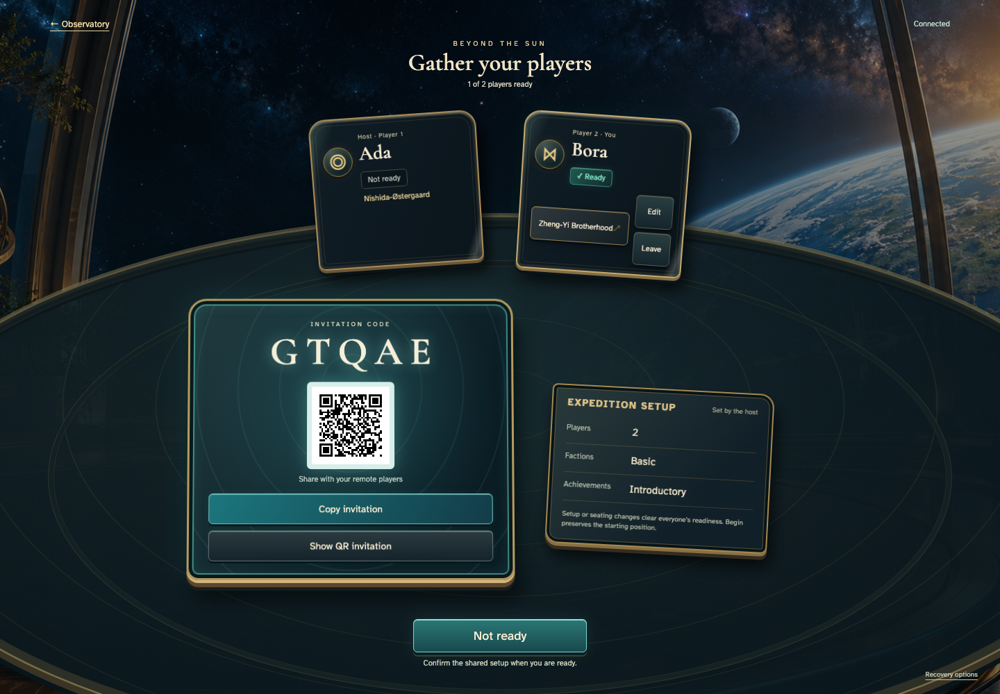](../../screenshots/decommission-a-controlling-ship-and-resolve-the-actual-rival-outpost-with-separate-controllers/013-ready-1-phone-darwin.png) | [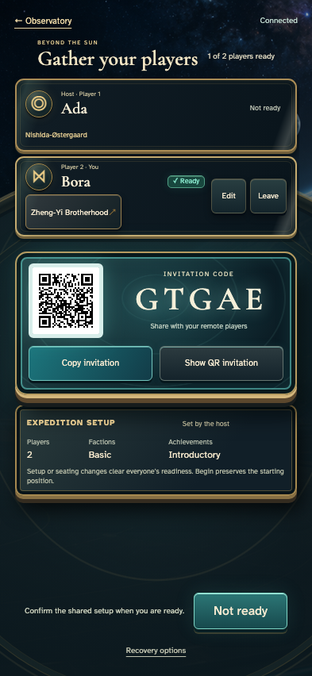](../../screenshots/decommission-a-controlling-ship-and-resolve-the-actual-rival-outpost-with-separate-controllers/013-ready-1-desktop-darwin.png) |

- [x] Confirm this identity is ready for the exact saved configuration
- [x] Canonical effects settle before capture.
- [x] Any printed Action plan is ready.
- [x] The rotated trade explanation stays above the opaque footer.
- [x] Public compact topology remains physically separated.
- [x] The gameplay shell fits the actual viewport.

## 15. Confirm this identity is ready for the exact saved configuration

Viewpoint: **Ada · separate host controller**.

| phone · 393 × 852 | desktop · 1440 × 1000 |
| --- | --- |
| [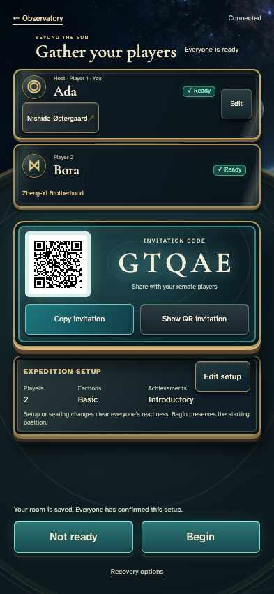](../../screenshots/decommission-a-controlling-ship-and-resolve-the-actual-rival-outpost-with-separate-controllers/014-ready-0-phone-darwin.png) |  |

- [x] Confirm this identity is ready for the exact saved configuration
- [x] Canonical effects settle before capture.
- [x] Any printed Action plan is ready.
- [x] The rotated trade explanation stays above the opaque footer.
- [x] Public compact topology remains physically separated.
- [x] The gameplay shell fits the actual viewport.

## 16. Begin the immutable source-reviewed Basic setup through the ordinary UI

Viewpoint: **Ada · separate host controller**.

| phone · 393 × 852 | desktop · 1440 × 1000 |
| --- | --- |
| [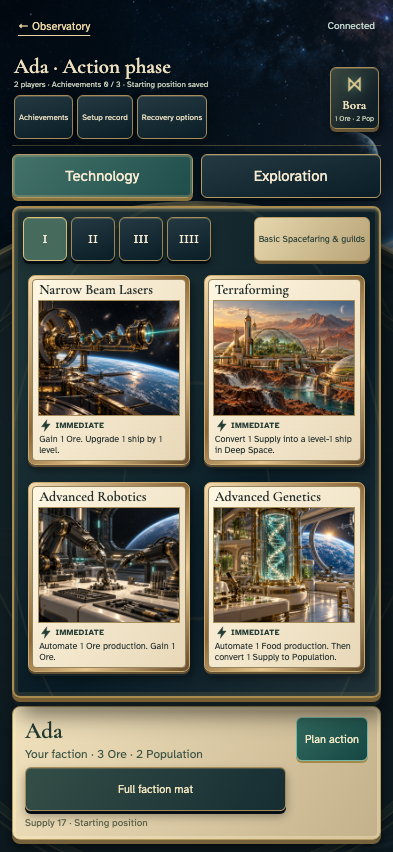](../../screenshots/decommission-a-controlling-ship-and-resolve-the-actual-rival-outpost-with-separate-controllers/015-begun-phone-darwin.png) |  |

- [x] Begin the immutable source-reviewed Basic setup through the ordinary UI
- [x] Canonical effects settle before capture.
- [x] Any printed Action plan is ready.
- [x] The rotated trade explanation stays above the opaque footer.
- [x] Public compact topology remains physically separated.
- [x] The gameplay shell fits the actual viewport.

## 17. Ada opens the actual research and Action instrument

Viewpoint: **Ada · separate host controller**.

| phone · 393 × 852 | desktop · 1440 × 1000 |
| --- | --- |
|  | [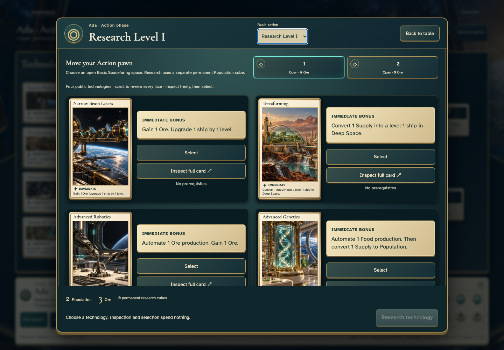](../../screenshots/decommission-a-controlling-ship-and-resolve-the-actual-rival-outpost-with-separate-controllers/016-ada-lasers-plan-desktop-darwin.png) |

- [x] Ada opens the actual research and Action instrument
- [x] Canonical effects settle before capture.
- [x] Any printed Action plan is ready.
- [x] The rotated trade explanation stays above the opaque footer.
- [x] Public compact topology remains physically separated.
- [x] The gameplay shell fits the actual viewport.

## 18. Ada selects the legal printed space 1

Viewpoint: **Ada · separate host controller**.

| phone · 393 × 852 | desktop · 1440 × 1000 |
| --- | --- |
|  |  |

- [x] Ada selects the legal printed space 1
- [x] Canonical effects settle before capture.
- [x] Any printed Action plan is ready.
- [x] The rotated trade explanation stays above the opaque footer.
- [x] Public compact topology remains physically separated.
- [x] The gameplay shell fits the actual viewport.

## 19. Select Narrow Beam Lasers with its printed cost and consequence

Viewpoint: **Ada · separate host controller**.

| phone · 393 × 852 | desktop · 1440 × 1000 |
| --- | --- |
| [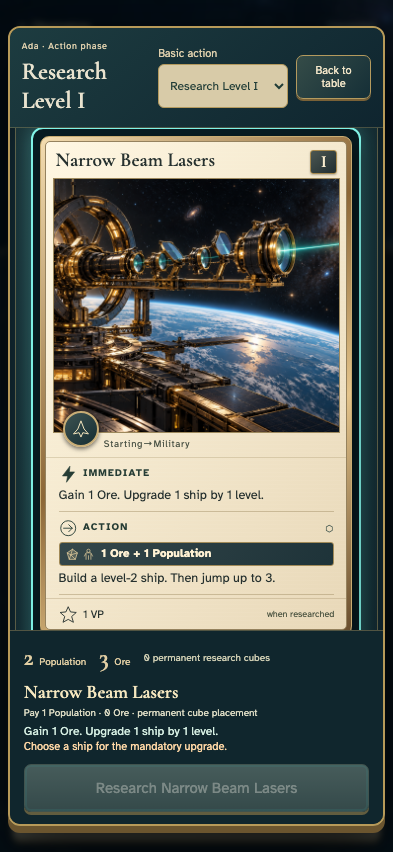](../../screenshots/decommission-a-controlling-ship-and-resolve-the-actual-rival-outpost-with-separate-controllers/018-ada-lasers-card-phone-darwin.png) |  |

- [x] Select Narrow Beam Lasers with its printed cost and consequence
- [x] Canonical effects settle before capture.
- [x] Any printed Action plan is ready.
- [x] The rotated trade explanation stays above the opaque footer.
- [x] Public compact topology remains physically separated.
- [x] The gameplay shell fits the actual viewport.

## 20. The immediate bonus requires an explicit owned target

Viewpoint: **Ada · separate host controller**.

| phone · 393 × 852 | desktop · 1440 × 1000 |
| --- | --- |
|  | [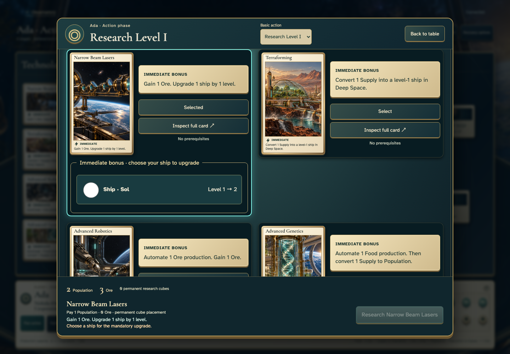](../../screenshots/decommission-a-controlling-ship-and-resolve-the-actual-rival-outpost-with-separate-controllers/019-ada-lasers-requires-ship-desktop-darwin.png) |

- [x] The immediate bonus requires an explicit owned target
- [x] Canonical effects settle before capture.
- [x] Any printed Action plan is ready.
- [x] The rotated trade explanation stays above the opaque footer.
- [x] Public compact topology remains physically separated.
- [x] The gameplay shell fits the actual viewport.

## 21. Choose the original Sol ship for the one-level upgrade

Viewpoint: **Ada · separate host controller**.

| phone · 393 × 852 | desktop · 1440 × 1000 |
| --- | --- |
|  |  |

- [x] Choose the original Sol ship for the one-level upgrade
- [x] Canonical effects settle before capture.
- [x] Any printed Action plan is ready.
- [x] The rotated trade explanation stays above the opaque footer.
- [x] Public compact topology remains physically separated.
- [x] The gameplay shell fits the actual viewport.

## 22. Pay once and receive Narrow Beam Lasers's immediate bonus

Viewpoint: **Ada · separate host controller**.

| phone · 393 × 852 | desktop · 1440 × 1000 |
| --- | --- |
| [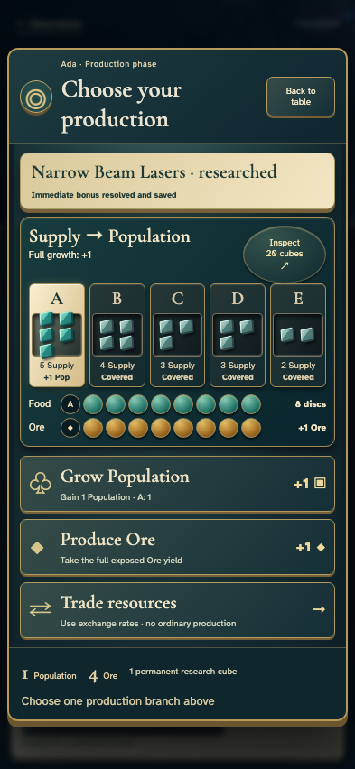](../../screenshots/decommission-a-controlling-ship-and-resolve-the-actual-rival-outpost-with-separate-controllers/021-ada-lasers-researched-phone-darwin.png) |  |

- [x] Pay once and receive Narrow Beam Lasers's immediate bonus
- [x] Canonical effects settle before capture.
- [x] Any printed Action plan is ready.
- [x] The rotated trade explanation stays above the opaque footer.
- [x] Public compact topology remains physically separated.
- [x] The gameplay shell fits the actual viewport.

## 23. Ada completes production and hands off to Bora

Viewpoint: **Ada · separate host controller**.

| phone · 393 × 852 | desktop · 1440 × 1000 |
| --- | --- |
|  | [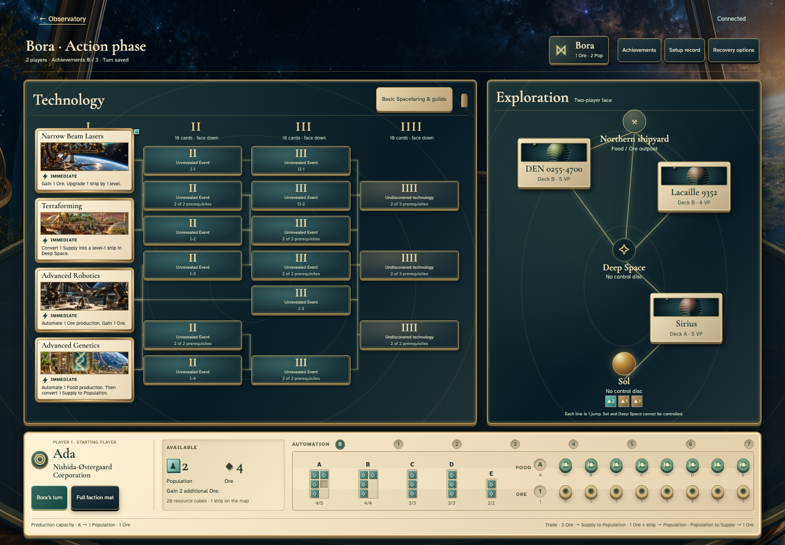](../../screenshots/decommission-a-controlling-ship-and-resolve-the-actual-rival-outpost-with-separate-controllers/022-ada-lasers-handoff-desktop-darwin.png) |

- [x] Ada completes production and hands off to Bora
- [x] Canonical effects settle before capture.
- [x] Any printed Action plan is ready.
- [x] The rotated trade explanation stays above the opaque footer.
- [x] Public compact topology remains physically separated.
- [x] The gameplay shell fits the actual viewport.

## 24. The independent next controller sees the canonical handoff

Viewpoint: **Bora · separate guest controller**.

| phone · 1440 × 1000 | desktop · 393 × 852 |
| --- | --- |
|  |  |

- [x] The independent next controller sees the canonical handoff
- [x] Canonical effects settle before capture.
- [x] Any printed Action plan is ready.
- [x] The rotated trade explanation stays above the opaque footer.
- [x] Public compact topology remains physically separated.
- [x] The gameplay shell fits the actual viewport.

## 25. Bora opens the actual research and Action instrument

Viewpoint: **Bora · separate guest controller**.

| phone · 1440 × 1000 | desktop · 393 × 852 |
| --- | --- |
|  |  |

- [x] Bora opens the actual research and Action instrument
- [x] Canonical effects settle before capture.
- [x] Any printed Action plan is ready.
- [x] The rotated trade explanation stays above the opaque footer.
- [x] Public compact topology remains physically separated.
- [x] The gameplay shell fits the actual viewport.

## 26. Bora selects the legal printed space 2

Viewpoint: **Bora · separate guest controller**.

| phone · 1440 × 1000 | desktop · 393 × 852 |
| --- | --- |
|  |  |

- [x] Bora selects the legal printed space 2
- [x] Canonical effects settle before capture.
- [x] Any printed Action plan is ready.
- [x] The rotated trade explanation stays above the opaque footer.
- [x] Public compact topology remains physically separated.
- [x] The gameplay shell fits the actual viewport.

## 27. Select Terraforming with its printed cost and consequence

Viewpoint: **Bora · separate guest controller**.

| phone · 1440 × 1000 | desktop · 393 × 852 |
| --- | --- |
|  | [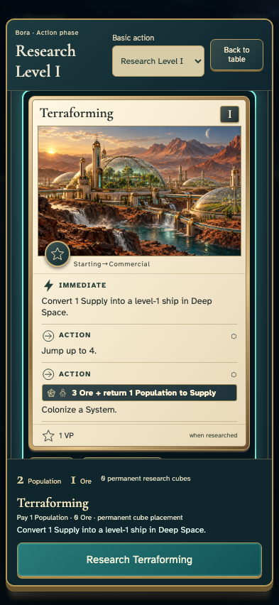](../../screenshots/decommission-a-controlling-ship-and-resolve-the-actual-rival-outpost-with-separate-controllers/026-bora-terraforming-card-desktop-darwin.png) |

- [x] Select Terraforming with its printed cost and consequence
- [x] Canonical effects settle before capture.
- [x] Any printed Action plan is ready.
- [x] The rotated trade explanation stays above the opaque footer.
- [x] Public compact topology remains physically separated.
- [x] The gameplay shell fits the actual viewport.

## 28. Pay once and receive Terraforming's immediate bonus

Viewpoint: **Bora · separate guest controller**.

| phone · 1440 × 1000 | desktop · 393 × 852 |
| --- | --- |
|  | [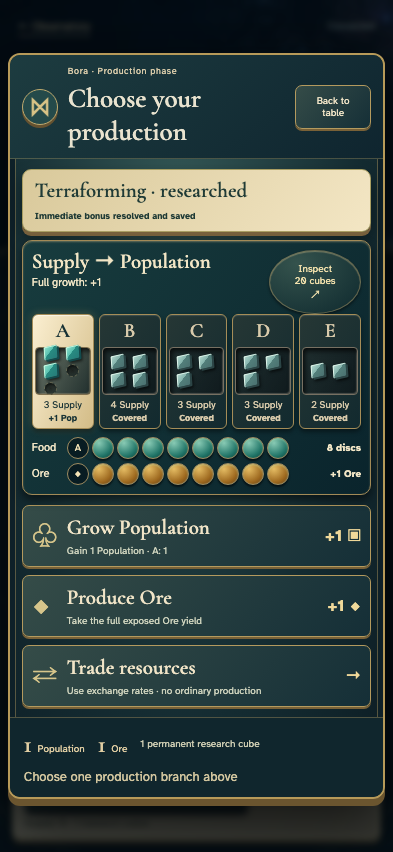](../../screenshots/decommission-a-controlling-ship-and-resolve-the-actual-rival-outpost-with-separate-controllers/027-bora-terraforming-researched-desktop-darwin.png) |

- [x] Pay once and receive Terraforming's immediate bonus
- [x] Canonical effects settle before capture.
- [x] Any printed Action plan is ready.
- [x] The rotated trade explanation stays above the opaque footer.
- [x] Public compact topology remains physically separated.
- [x] The gameplay shell fits the actual viewport.

## 29. Bora completes production and hands off to Ada

Viewpoint: **Bora · separate guest controller**.

| phone · 1440 × 1000 | desktop · 393 × 852 |
| --- | --- |
| [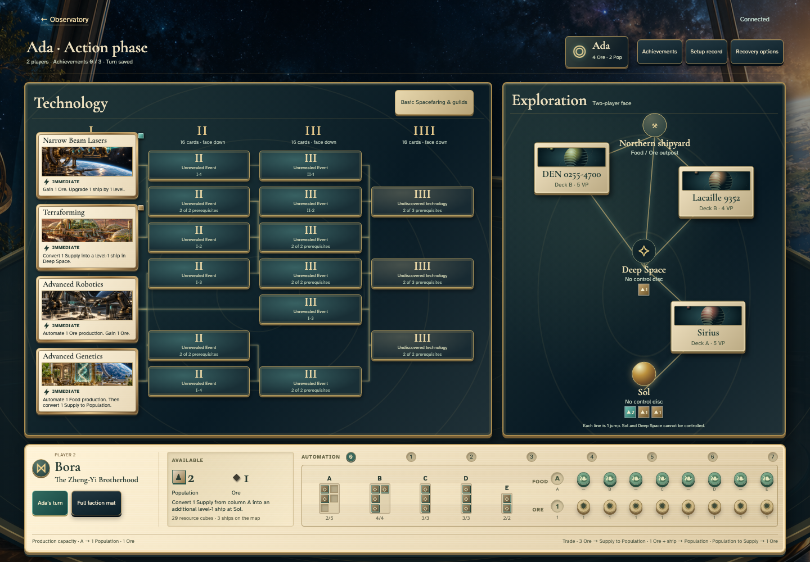](../../screenshots/decommission-a-controlling-ship-and-resolve-the-actual-rival-outpost-with-separate-controllers/028-bora-terraforming-handoff-phone-darwin.png) |  |

- [x] Bora completes production and hands off to Ada
- [x] Canonical effects settle before capture.
- [x] Any printed Action plan is ready.
- [x] The rotated trade explanation stays above the opaque footer.
- [x] Public compact topology remains physically separated.
- [x] The gameplay shell fits the actual viewport.

## 30. The independent next controller sees the canonical handoff

Viewpoint: **Ada · separate host controller**.

| phone · 393 × 852 | desktop · 1440 × 1000 |
| --- | --- |
| [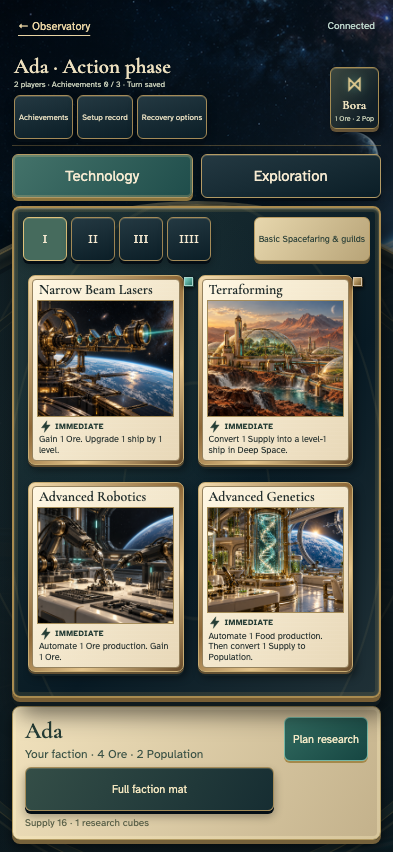](../../screenshots/decommission-a-controlling-ship-and-resolve-the-actual-rival-outpost-with-separate-controllers/029-bora-terraforming-next-phone-darwin.png) |  |

- [x] The independent next controller sees the canonical handoff
- [x] Canonical effects settle before capture.
- [x] Any printed Action plan is ready.
- [x] The rotated trade explanation stays above the opaque footer.
- [x] Public compact topology remains physically separated.
- [x] The gameplay shell fits the actual viewport.

## 31. Ada opens the actual research and Action instrument

Viewpoint: **Ada · separate host controller**.

| phone · 393 × 852 | desktop · 1440 × 1000 |
| --- | --- |
| [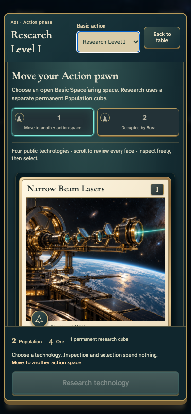](../../screenshots/decommission-a-controlling-ship-and-resolve-the-actual-rival-outpost-with-separate-controllers/030-ada-action-plan-phone-darwin.png) | [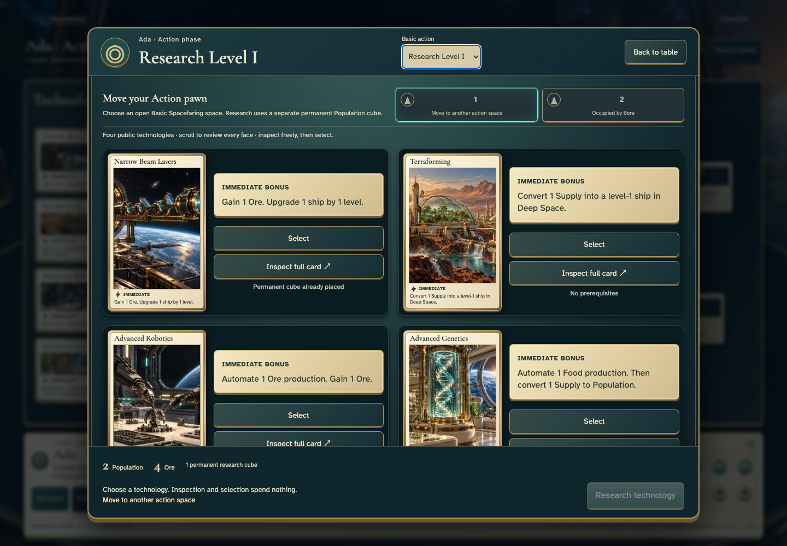](../../screenshots/decommission-a-controlling-ship-and-resolve-the-actual-rival-outpost-with-separate-controllers/030-ada-action-plan-desktop-darwin.png) |

- [x] Ada opens the actual research and Action instrument
- [x] Canonical effects settle before capture.
- [x] Any printed Action plan is ready.
- [x] The rotated trade explanation stays above the opaque footer.
- [x] Public compact topology remains physically separated.
- [x] The gameplay shell fits the actual viewport.

## 32. Ada selects printed technology Actions

Viewpoint: **Ada · separate host controller**.

| phone · 393 × 852 | desktop · 1440 × 1000 |
| --- | --- |
| [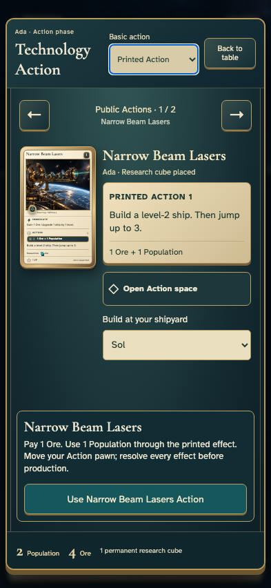](../../screenshots/decommission-a-controlling-ship-and-resolve-the-actual-rival-outpost-with-separate-controllers/031-ada-action-kind-phone-darwin.png) |  |

- [x] Ada selects printed technology Actions
- [x] Canonical effects settle before capture.
- [x] Any printed Action plan is ready.
- [x] The rotated trade explanation stays above the opaque footer.
- [x] Public compact topology remains physically separated.
- [x] The gameplay shell fits the actual viewport.

## 33. Read Narrow Beam Lasers's actual research requirement, payment and exclusive pawn space

Viewpoint: **Ada · separate host controller**.

| phone · 393 × 852 | desktop · 1440 × 1000 |
| --- | --- |
|  | [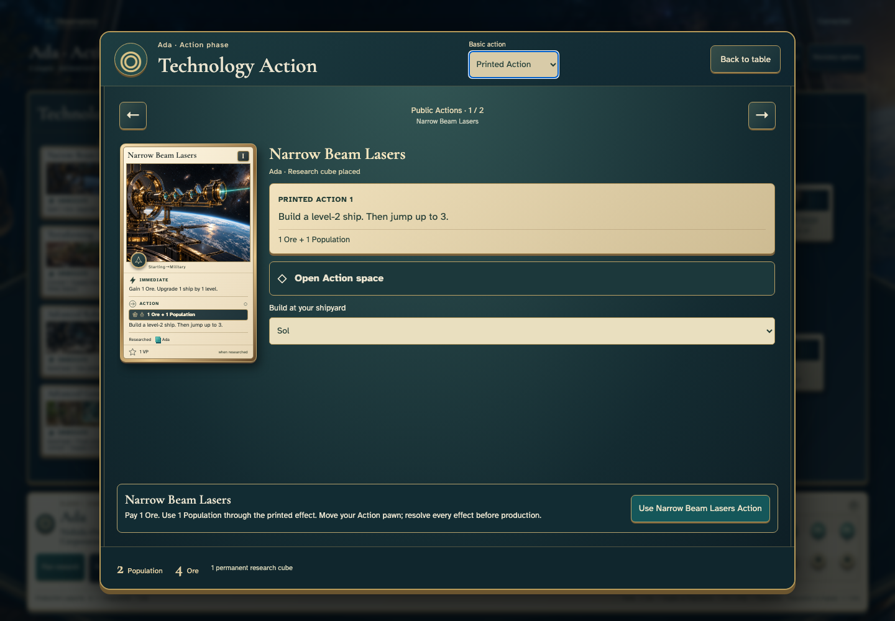](../../screenshots/decommission-a-controlling-ship-and-resolve-the-actual-rival-outpost-with-separate-controllers/032-ada-action-face-desktop-darwin.png) |

- [x] Read Narrow Beam Lasers's actual research requirement, payment and exclusive pawn space
- [x] Canonical effects settle before capture.
- [x] Any printed Action plan is ready.
- [x] The rotated trade explanation stays above the opaque footer.
- [x] Public compact topology remains physically separated.
- [x] The gameplay shell fits the actual viewport.

## 34. Pay the printed Action cost before choosing the new ship path

Viewpoint: **Ada · separate host controller**.

| phone · 393 × 852 | desktop · 1440 × 1000 |
| --- | --- |
|  | [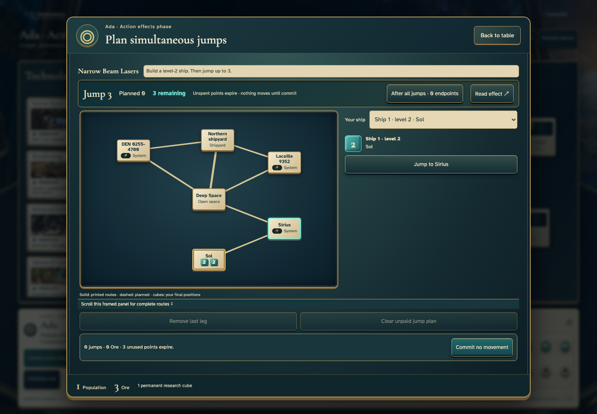](../../screenshots/decommission-a-controlling-ship-and-resolve-the-actual-rival-outpost-with-separate-controllers/033-laser-payment-desktop-darwin.png) |

- [x] Pay the printed Action cost before choosing the new ship path
- [x] Canonical effects settle before capture.
- [x] Any printed Action plan is ready.
- [x] The rotated trade explanation stays above the opaque footer.
- [x] Public compact topology remains physically separated.
- [x] The gameplay shell fits the actual viewport.

## 35. Choose the newly built level2 ship at Sol

Viewpoint: **Ada · separate host controller**.

| phone · 393 × 852 | desktop · 1440 × 1000 |
| --- | --- |
| [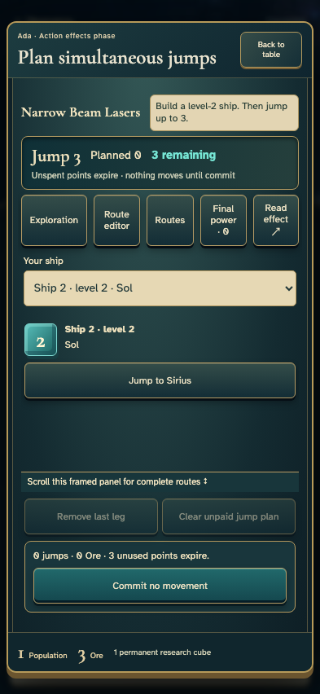](../../screenshots/decommission-a-controlling-ship-and-resolve-the-actual-rival-outpost-with-separate-controllers/034-laser-ship-phone-darwin.png) | [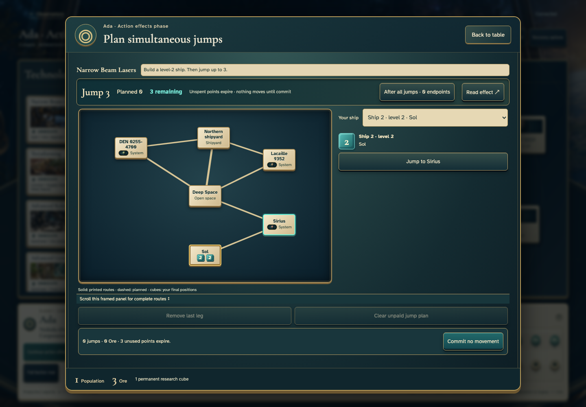](../../screenshots/decommission-a-controlling-ship-and-resolve-the-actual-rival-outpost-with-separate-controllers/034-laser-ship-desktop-darwin.png) |

- [x] Choose the newly built level2 ship at Sol
- [x] Canonical effects settle before capture.
- [x] Any printed Action plan is ready.
- [x] The rotated trade explanation stays above the opaque footer.
- [x] Public compact topology remains physically separated.
- [x] The gameplay shell fits the actual viewport.

## 36. Open the actual connected-destination view

Viewpoint: **Ada · separate host controller**.

| phone · 393 × 852 | desktop · 1440 × 1000 |
| --- | --- |
|  | [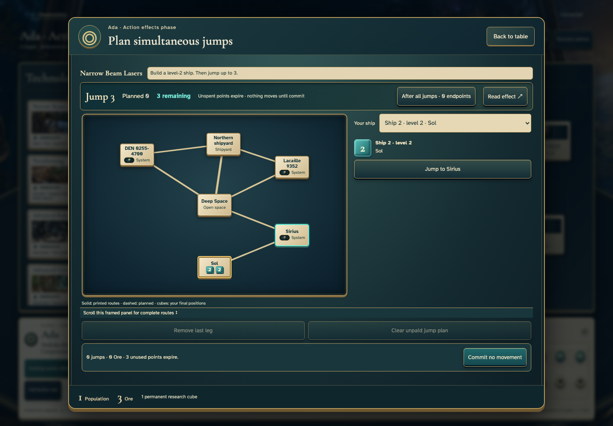](../../screenshots/decommission-a-controlling-ship-and-resolve-the-actual-rival-outpost-with-separate-controllers/035-laser-route-editor-desktop-darwin.png) |

- [x] Open the actual connected-destination view
- [x] Canonical effects settle before capture.
- [x] Any printed Action plan is ready.
- [x] The rotated trade explanation stays above the opaque footer.
- [x] Public compact topology remains physically separated.
- [x] The gameplay shell fits the actual viewport.

## 37. Plan an actual adjacent jump without premature movement or control

Viewpoint: **Ada · separate host controller**.

| phone · 393 × 852 | desktop · 1440 × 1000 |
| --- | --- |
| [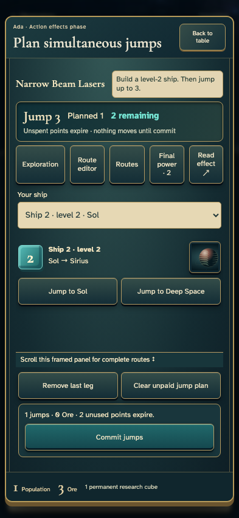](../../screenshots/decommission-a-controlling-ship-and-resolve-the-actual-rival-outpost-with-separate-controllers/036-laser-leg-0-phone-darwin.png) | [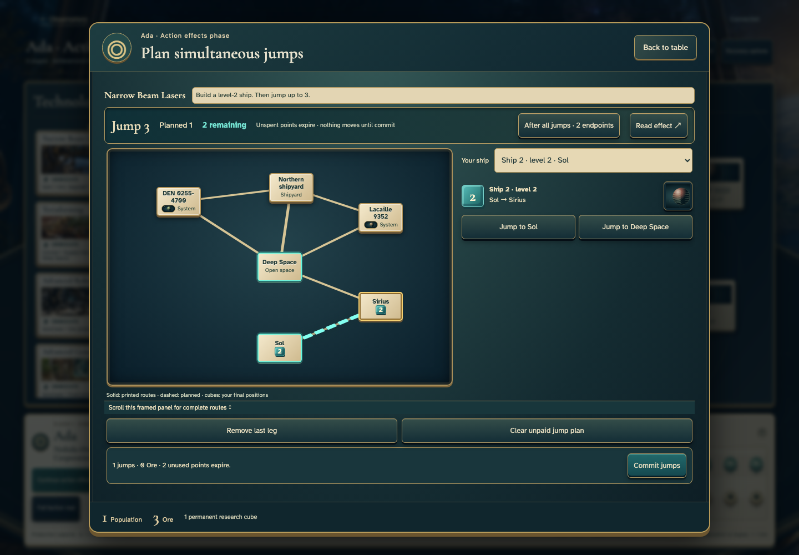](../../screenshots/decommission-a-controlling-ship-and-resolve-the-actual-rival-outpost-with-separate-controllers/036-laser-leg-0-desktop-darwin.png) |

- [x] Plan an actual adjacent jump without premature movement or control
- [x] Canonical effects settle before capture.
- [x] Any printed Action plan is ready.
- [x] The rotated trade explanation stays above the opaque footer.
- [x] Public compact topology remains physically separated.
- [x] The gameplay shell fits the actual viewport.

## 38. Plan an actual adjacent jump without premature movement or control

Viewpoint: **Ada · separate host controller**.

| phone · 393 × 852 | desktop · 1440 × 1000 |
| --- | --- |
| [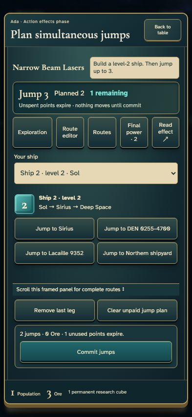](../../screenshots/decommission-a-controlling-ship-and-resolve-the-actual-rival-outpost-with-separate-controllers/037-laser-leg-1-phone-darwin.png) | [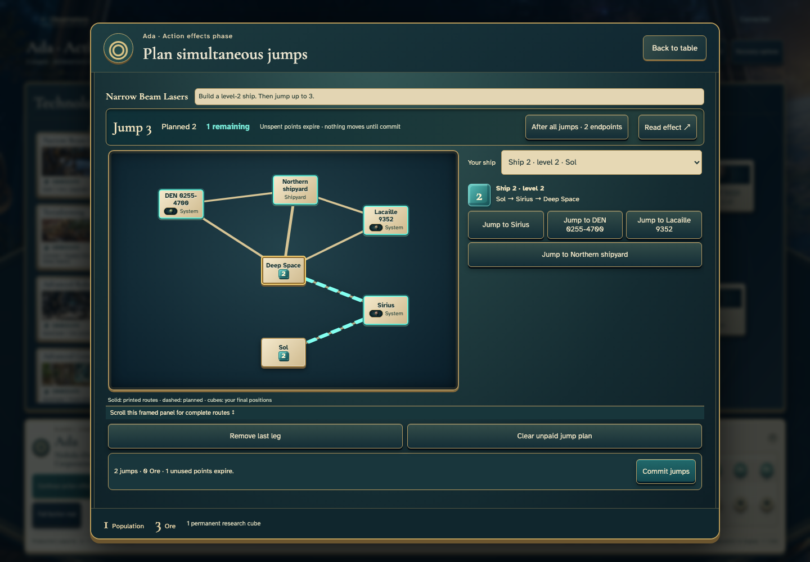](../../screenshots/decommission-a-controlling-ship-and-resolve-the-actual-rival-outpost-with-separate-controllers/037-laser-leg-1-desktop-darwin.png) |

- [x] Plan an actual adjacent jump without premature movement or control
- [x] Canonical effects settle before capture.
- [x] Any printed Action plan is ready.
- [x] The rotated trade explanation stays above the opaque footer.
- [x] Public compact topology remains physically separated.
- [x] The gameplay shell fits the actual viewport.

## 39. Plan an actual adjacent jump without premature movement or control

Viewpoint: **Ada · separate host controller**.

| phone · 393 × 852 | desktop · 1440 × 1000 |
| --- | --- |
| [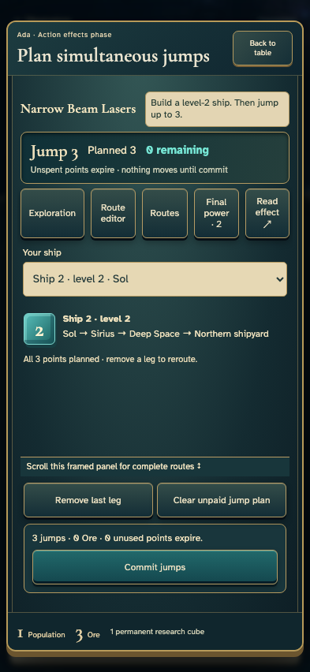](../../screenshots/decommission-a-controlling-ship-and-resolve-the-actual-rival-outpost-with-separate-controllers/038-laser-leg-2-phone-darwin.png) | [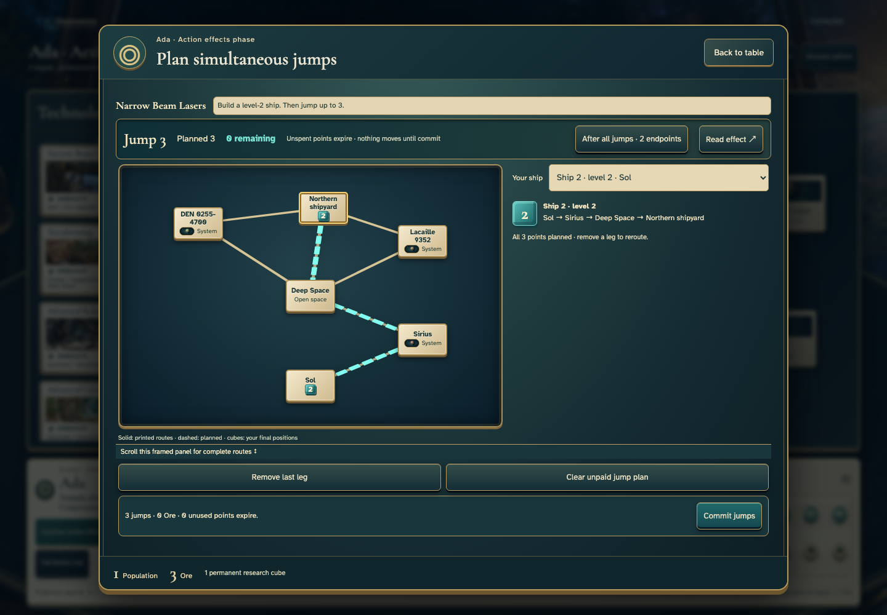](../../screenshots/decommission-a-controlling-ship-and-resolve-the-actual-rival-outpost-with-separate-controllers/038-laser-leg-2-desktop-darwin.png) |

- [x] Plan an actual adjacent jump without premature movement or control
- [x] Canonical effects settle before capture.
- [x] Any printed Action plan is ready.
- [x] The rotated trade explanation stays above the opaque footer.
- [x] Public compact topology remains physically separated.
- [x] The gameplay shell fits the actual viewport.

## 40. The complete jump reaches Northern shipyard and offers its real outpost tracks

Viewpoint: **Ada · separate host controller**.

| phone · 393 × 852 | desktop · 1440 × 1000 |
| --- | --- |
| [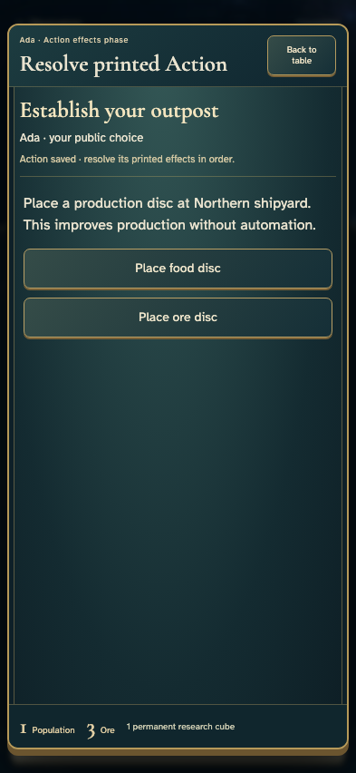](../../screenshots/decommission-a-controlling-ship-and-resolve-the-actual-rival-outpost-with-separate-controllers/039-ada-control-choice-phone-darwin.png) | [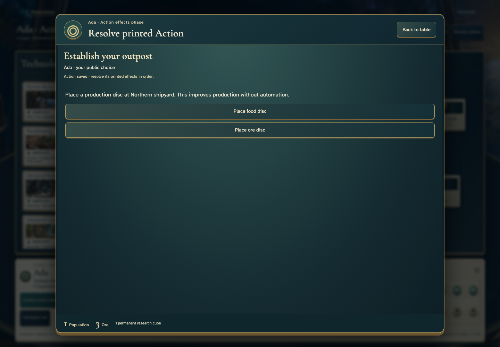](../../screenshots/decommission-a-controlling-ship-and-resolve-the-actual-rival-outpost-with-separate-controllers/039-ada-control-choice-desktop-darwin.png) |

- [x] The complete jump reaches Northern shipyard and offers its real outpost tracks
- [x] Canonical effects settle before capture.
- [x] Any printed Action plan is ready.
- [x] The rotated trade explanation stays above the opaque footer.
- [x] Public compact topology remains physically separated.
- [x] The gameplay shell fits the actual viewport.

## 41. Ada controls Northern shipyard with an actual Food disc

Viewpoint: **Ada · separate host controller**.

| phone · 393 × 852 | desktop · 1440 × 1000 |
| --- | --- |
|  | [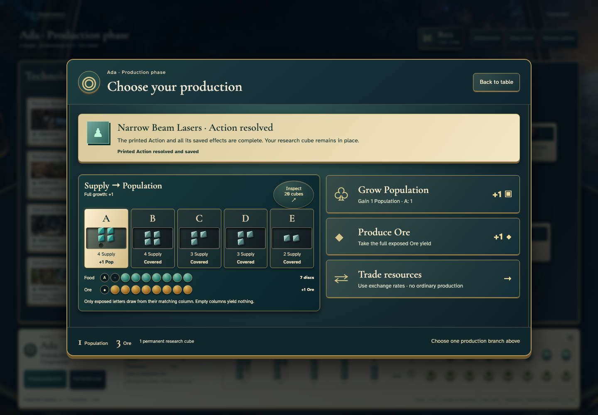](../../screenshots/decommission-a-controlling-ship-and-resolve-the-actual-rival-outpost-with-separate-controllers/040-ada-control-desktop-darwin.png) |

- [x] Ada controls Northern shipyard with an actual Food disc
- [x] Canonical effects settle before capture.
- [x] Any printed Action plan is ready.
- [x] The rotated trade explanation stays above the opaque footer.
- [x] Public compact topology remains physically separated.
- [x] The gameplay shell fits the actual viewport.

## 42. Ada completes production and hands off to Bora

Viewpoint: **Ada · separate host controller**.

| phone · 393 × 852 | desktop · 1440 × 1000 |
| --- | --- |
|  |  |

- [x] Ada completes production and hands off to Bora
- [x] Canonical effects settle before capture.
- [x] Any printed Action plan is ready.
- [x] The rotated trade explanation stays above the opaque footer.
- [x] Public compact topology remains physically separated.
- [x] The gameplay shell fits the actual viewport.

## 43. The independent next controller sees the canonical handoff

Viewpoint: **Bora · separate guest controller**.

| phone · 1440 × 1000 | desktop · 393 × 852 |
| --- | --- |
|  |  |

- [x] The independent next controller sees the canonical handoff
- [x] Canonical effects settle before capture.
- [x] Any printed Action plan is ready.
- [x] The rotated trade explanation stays above the opaque footer.
- [x] Public compact topology remains physically separated.
- [x] The gameplay shell fits the actual viewport.

## 44. Bora opens the actual research and Action instrument

Viewpoint: **Bora · separate guest controller**.

| phone · 1440 × 1000 | desktop · 393 × 852 |
| --- | --- |
| [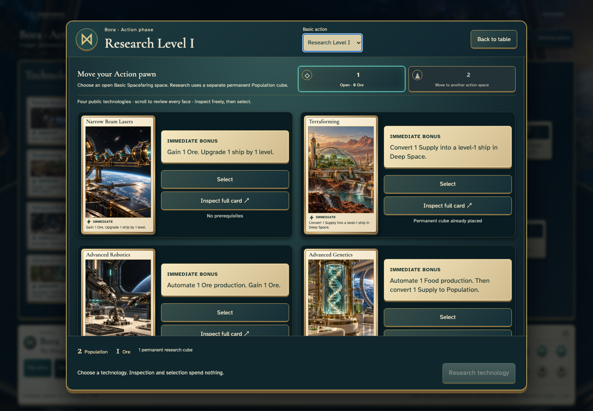](../../screenshots/decommission-a-controlling-ship-and-resolve-the-actual-rival-outpost-with-separate-controllers/043-bora-action-plan-phone-darwin.png) | [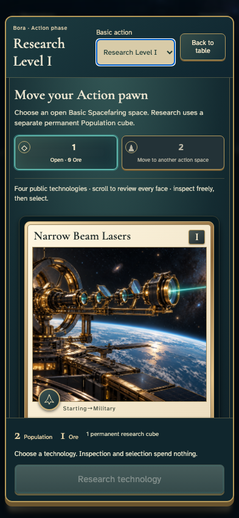](../../screenshots/decommission-a-controlling-ship-and-resolve-the-actual-rival-outpost-with-separate-controllers/043-bora-action-plan-desktop-darwin.png) |

- [x] Bora opens the actual research and Action instrument
- [x] Canonical effects settle before capture.
- [x] Any printed Action plan is ready.
- [x] The rotated trade explanation stays above the opaque footer.
- [x] Public compact topology remains physically separated.
- [x] The gameplay shell fits the actual viewport.

## 45. Bora selects printed technology Actions

Viewpoint: **Bora · separate guest controller**.

| phone · 1440 × 1000 | desktop · 393 × 852 |
| --- | --- |
|  | [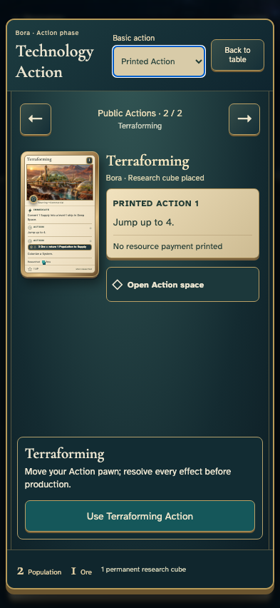](../../screenshots/decommission-a-controlling-ship-and-resolve-the-actual-rival-outpost-with-separate-controllers/044-bora-action-kind-desktop-darwin.png) |

- [x] Bora selects printed technology Actions
- [x] Canonical effects settle before capture.
- [x] Any printed Action plan is ready.
- [x] The rotated trade explanation stays above the opaque footer.
- [x] Public compact topology remains physically separated.
- [x] The gameplay shell fits the actual viewport.

## 46. Read Terraforming's actual research requirement, payment and exclusive pawn space

Viewpoint: **Bora · separate guest controller**.

| phone · 1440 × 1000 | desktop · 393 × 852 |
| --- | --- |
| [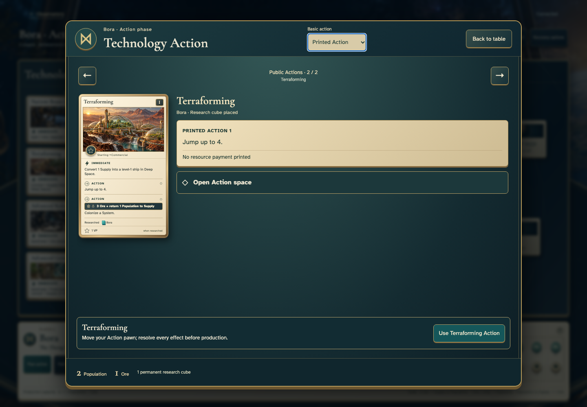](../../screenshots/decommission-a-controlling-ship-and-resolve-the-actual-rival-outpost-with-separate-controllers/045-bora-action-face-phone-darwin.png) |  |

- [x] Read Terraforming's actual research requirement, payment and exclusive pawn space
- [x] Canonical effects settle before capture.
- [x] Any printed Action plan is ready.
- [x] The rotated trade explanation stays above the opaque footer.
- [x] Public compact topology remains physically separated.
- [x] The gameplay shell fits the actual viewport.

## 47. The free printed Terraforming Action permits exactly four jumps shared by owned ships

Viewpoint: **Bora · separate guest controller**.

| phone · 1440 × 1000 | desktop · 393 × 852 |
| --- | --- |
| [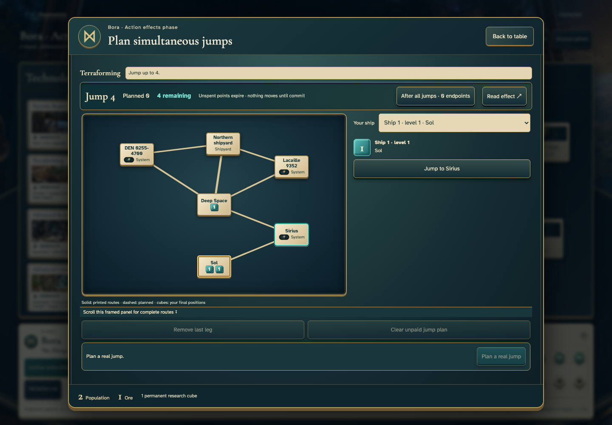](../../screenshots/decommission-a-controlling-ship-and-resolve-the-actual-rival-outpost-with-separate-controllers/046-bora-four-jump-phone-darwin.png) | [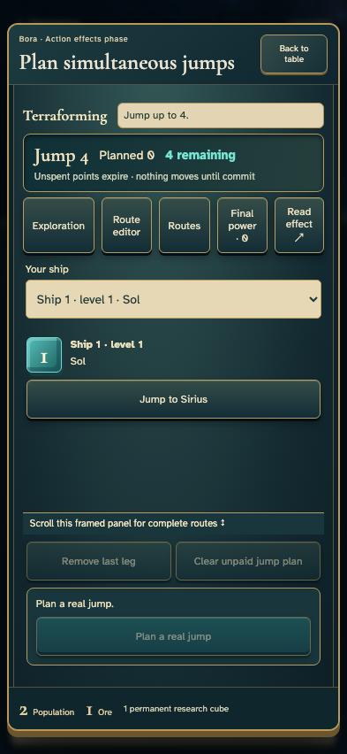](../../screenshots/decommission-a-controlling-ship-and-resolve-the-actual-rival-outpost-with-separate-controllers/046-bora-four-jump-desktop-darwin.png) |

- [x] The free printed Terraforming Action permits exactly four jumps shared by owned ships
- [x] Canonical effects settle before capture.
- [x] Any printed Action plan is ready.
- [x] The rotated trade explanation stays above the opaque footer.
- [x] Public compact topology remains physically separated.
- [x] The gameplay shell fits the actual viewport.

## 48. Choose the second original level1 Sol ship

Viewpoint: **Bora · separate guest controller**.

| phone · 1440 × 1000 | desktop · 393 × 852 |
| --- | --- |
|  |  |

- [x] Choose the second original level1 Sol ship
- [x] Canonical effects settle before capture.
- [x] Any printed Action plan is ready.
- [x] The rotated trade explanation stays above the opaque footer.
- [x] Public compact topology remains physically separated.
- [x] The gameplay shell fits the actual viewport.

## 49. Open the actual connected-destination view

Viewpoint: **Bora · separate guest controller**.

| phone · 1440 × 1000 | desktop · 393 × 852 |
| --- | --- |
|  |  |

- [x] Open the actual connected-destination view
- [x] Canonical effects settle before capture.
- [x] Any printed Action plan is ready.
- [x] The rotated trade explanation stays above the opaque footer.
- [x] Public compact topology remains physically separated.
- [x] The gameplay shell fits the actual viewport.

## 50. Plan the first ship path while control remains unchanged

Viewpoint: **Bora · separate guest controller**.

| phone · 1440 × 1000 | desktop · 393 × 852 |
| --- | --- |
| [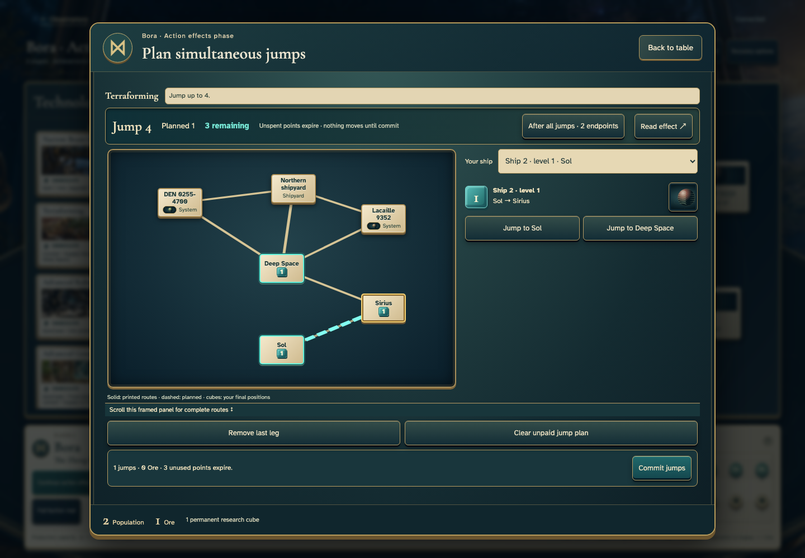](../../screenshots/decommission-a-controlling-ship-and-resolve-the-actual-rival-outpost-with-separate-controllers/049-bora-leg-0-phone-darwin.png) | [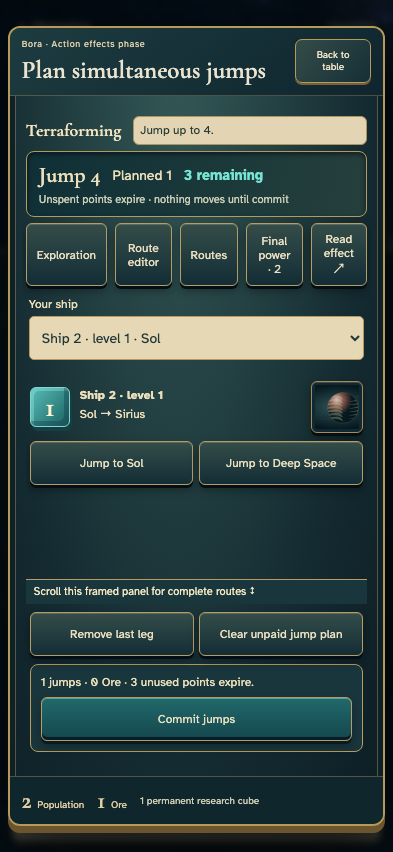](../../screenshots/decommission-a-controlling-ship-and-resolve-the-actual-rival-outpost-with-separate-controllers/049-bora-leg-0-desktop-darwin.png) |

- [x] Plan the first ship path while control remains unchanged
- [x] Canonical effects settle before capture.
- [x] Any printed Action plan is ready.
- [x] The rotated trade explanation stays above the opaque footer.
- [x] Public compact topology remains physically separated.
- [x] The gameplay shell fits the actual viewport.

## 51. Plan the first ship path while control remains unchanged

Viewpoint: **Bora · separate guest controller**.

| phone · 1440 × 1000 | desktop · 393 × 852 |
| --- | --- |
| [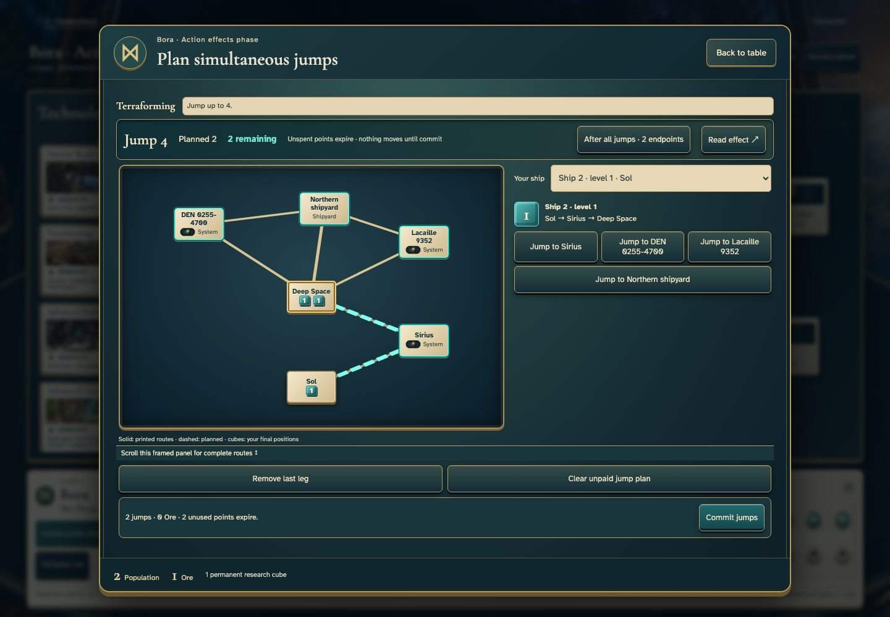](../../screenshots/decommission-a-controlling-ship-and-resolve-the-actual-rival-outpost-with-separate-controllers/050-bora-leg-1-phone-darwin.png) | [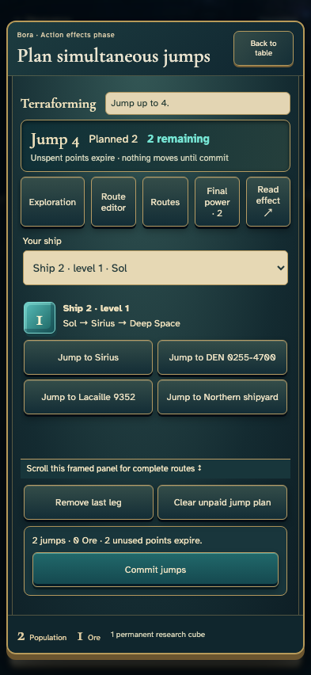](../../screenshots/decommission-a-controlling-ship-and-resolve-the-actual-rival-outpost-with-separate-controllers/050-bora-leg-1-desktop-darwin.png) |

- [x] Plan the first ship path while control remains unchanged
- [x] Canonical effects settle before capture.
- [x] Any printed Action plan is ready.
- [x] The rotated trade explanation stays above the opaque footer.
- [x] Public compact topology remains physically separated.
- [x] The gameplay shell fits the actual viewport.

## 52. Plan the first ship path while control remains unchanged

Viewpoint: **Bora · separate guest controller**.

| phone · 1440 × 1000 | desktop · 393 × 852 |
| --- | --- |
|  |  |

- [x] Plan the first ship path while control remains unchanged
- [x] Canonical effects settle before capture.
- [x] Any printed Action plan is ready.
- [x] The rotated trade explanation stays above the opaque footer.
- [x] Public compact topology remains physically separated.
- [x] The gameplay shell fits the actual viewport.

## 53. Allocate the remaining jump to the distinct Terraforming ship in Deep Space

Viewpoint: **Bora · separate guest controller**.

| phone · 1440 × 1000 | desktop · 393 × 852 |
| --- | --- |
|  |  |

- [x] Allocate the remaining jump to the distinct Terraforming ship in Deep Space
- [x] Canonical effects settle before capture.
- [x] Any printed Action plan is ready.
- [x] The rotated trade explanation stays above the opaque footer.
- [x] Public compact topology remains physically separated.
- [x] The gameplay shell fits the actual viewport.

## 54. Both level1 ships will finish at the same actual shipyard

Viewpoint: **Bora · separate guest controller**.

| phone · 1440 × 1000 | desktop · 393 × 852 |
| --- | --- |
|  |  |

- [x] Both level1 ships will finish at the same actual shipyard
- [x] Canonical effects settle before capture.
- [x] Any printed Action plan is ready.
- [x] The rotated trade explanation stays above the opaque footer.
- [x] Public compact topology remains physically separated.
- [x] The gameplay shell fits the actual viewport.

## 55. Equal2 power preserves Ada as the existing owner before decommission

Viewpoint: **Bora · separate guest controller**.

| phone · 1440 × 1000 | desktop · 393 × 852 |
| --- | --- |
|  |  |

- [x] Equal2 power preserves Ada as the existing owner before decommission
- [x] Canonical effects settle before capture.
- [x] Any printed Action plan is ready.
- [x] The rotated trade explanation stays above the opaque footer.
- [x] Public compact topology remains physically separated.
- [x] The gameplay shell fits the actual viewport.

## 56. Bora completes production and hands off to Ada

Viewpoint: **Bora · separate guest controller**.

| phone · 1440 × 1000 | desktop · 393 × 852 |
| --- | --- |
|  |  |

- [x] Bora completes production and hands off to Ada
- [x] Canonical effects settle before capture.
- [x] Any printed Action plan is ready.
- [x] The rotated trade explanation stays above the opaque footer.
- [x] Public compact topology remains physically separated.
- [x] The gameplay shell fits the actual viewport.

## 57. The independent next controller sees the canonical handoff

Viewpoint: **Ada · separate host controller**.

| phone · 393 × 852 | desktop · 1440 × 1000 |
| --- | --- |
|  |  |

- [x] The independent next controller sees the canonical handoff
- [x] Canonical effects settle before capture.
- [x] Any printed Action plan is ready.
- [x] The rotated trade explanation stays above the opaque footer.
- [x] Public compact topology remains physically separated.
- [x] The gameplay shell fits the actual viewport.

## 58. Ada opens the actual research and Action instrument

Viewpoint: **Ada · separate host controller**.

| phone · 393 × 852 | desktop · 1440 × 1000 |
| --- | --- |
|  |  |

- [x] Ada opens the actual research and Action instrument
- [x] Canonical effects settle before capture.
- [x] Any printed Action plan is ready.
- [x] The rotated trade explanation stays above the opaque footer.
- [x] Public compact topology remains physically separated.
- [x] The gameplay shell fits the actual viewport.

## 59. Ada selects ordinary gathering

Viewpoint: **Ada · separate host controller**.

| phone · 393 × 852 | desktop · 1440 × 1000 |
| --- | --- |
|  |  |

- [x] Ada selects ordinary gathering
- [x] Canonical effects settle before capture.
- [x] Any printed Action plan is ready.
- [x] The rotated trade explanation stays above the opaque footer.
- [x] Public compact topology remains physically separated.
- [x] The gameplay shell fits the actual viewport.

## 60. Receive the printed gather resources before ordinary production

Viewpoint: **Ada · separate host controller**.

| phone · 393 × 852 | desktop · 1440 × 1000 |
| --- | --- |
|  |  |

- [x] Receive the printed gather resources before ordinary production
- [x] Canonical effects settle before capture.
- [x] Any printed Action plan is ready.
- [x] The rotated trade explanation stays above the opaque footer.
- [x] Public compact topology remains physically separated.
- [x] The gameplay shell fits the actual viewport.

## 61. Trade replaces ordinary growth and Ore production without changing the balance

Viewpoint: **Ada · separate host controller**.

| phone · 393 × 852 | desktop · 1440 × 1000 |
| --- | --- |
|  |  |

- [x] Trade replaces ordinary growth and Ore production without changing the balance
- [x] Canonical effects settle before capture.
- [x] Any printed Action plan is ready.
- [x] The rotated trade explanation stays above the opaque footer.
- [x] Public compact topology remains physically separated.
- [x] The gameplay shell fits the actual viewport.

## 62. Inspect the named exchange without committing a resource

Viewpoint: **Ada · separate host controller**.

| phone · 393 × 852 | desktop · 1440 × 1000 |
| --- | --- |
|  |  |

- [x] Inspect the named exchange without committing a resource
- [x] Canonical effects settle before capture.
- [x] Any printed Action plan is ready.
- [x] The rotated trade explanation stays above the opaque footer.
- [x] Public compact topology remains physically separated.
- [x] The gameplay shell fits the actual viewport.

## 63. Inspect the exact ship, payment and public power/control change without committing

Viewpoint: **Ada · separate host controller**.

| phone · 393 × 852 | desktop · 1440 × 1000 |
| --- | --- |
|  |  |

- [x] Inspect the exact ship, payment and public power/control change without committing
- [x] Canonical effects settle before capture.
- [x] Any printed Action plan is ready.
- [x] The rotated trade explanation stays above the opaque footer.
- [x] Public compact topology remains physically separated.
- [x] The gameplay shell fits the actual viewport.

## 64. Decommission is saved once; the resulting outpost choice belongs to Bora

Viewpoint: **Ada · separate host controller**.

| phone · 393 × 852 | desktop · 1440 × 1000 |
| --- | --- |
|  |  |

- [x] Decommission is saved once; the resulting outpost choice belongs to Bora
- [x] Canonical effects settle before capture.
- [x] Any printed Action plan is ready.
- [x] The rotated trade explanation stays above the opaque footer.
- [x] Public compact topology remains physically separated.
- [x] The gameplay shell fits the actual viewport.

## 65. Ada observes public control but cannot place Bora’s disc

Viewpoint: **Ada · separate host controller**.

| phone · 393 × 852 | desktop · 1440 × 1000 |
| --- | --- |
|  |  |

- [x] Ada observes public control but cannot place Bora’s disc
- [x] Canonical effects settle before capture.
- [x] Any printed Action plan is ready.
- [x] The rotated trade explanation stays above the opaque footer.
- [x] Public compact topology remains physically separated.
- [x] The gameplay shell fits the actual viewport.

## 66. The separate Bora identity sees its own contextual continuation

Viewpoint: **Bora · separate guest controller**.

| phone · 1440 × 1000 | desktop · 393 × 852 |
| --- | --- |
|  |  |

- [x] The separate Bora identity sees its own contextual continuation
- [x] Canonical effects settle before capture.
- [x] Any printed Action plan is ready.
- [x] The rotated trade explanation stays above the opaque footer.
- [x] Public compact topology remains physically separated.
- [x] The gameplay shell fits the actual viewport.

## 67. The actual responder chooses a real outpost without any discovery or reveal claim

Viewpoint: **Bora · separate guest controller**.

| phone · 1440 × 1000 | desktop · 393 × 852 |
| --- | --- |
|  |  |

- [x] The actual responder chooses a real outpost without any discovery or reveal claim
- [x] Canonical effects settle before capture.
- [x] Any printed Action plan is ready.
- [x] The rotated trade explanation stays above the opaque footer.
- [x] Public compact topology remains physically separated.
- [x] The gameplay shell fits the actual viewport.

## 68. Reload retains the outpost responder and never replays the decommission

Viewpoint: **Bora · separate guest controller**.

| phone · 1440 × 1000 | desktop · 393 × 852 |
| --- | --- |
|  |  |

- [x] Reload retains the outpost responder and never replays the decommission
- [x] Canonical effects settle before capture.
- [x] Any printed Action plan is ready.
- [x] The rotated trade explanation stays above the opaque footer.
- [x] Public compact topology remains physically separated.
- [x] The gameplay shell fits the actual viewport.

## 69. Reopen the same saved control-transfer decision

Viewpoint: **Bora · separate guest controller**.

| phone · 1440 × 1000 | desktop · 393 × 852 |
| --- | --- |
|  |  |

- [x] Reopen the same saved control-transfer decision
- [x] Canonical effects settle before capture.
- [x] Any printed Action plan is ready.
- [x] The rotated trade explanation stays above the opaque footer.
- [x] Public compact topology remains physically separated.
- [x] The gameplay shell fits the actual viewport.

## 70. The outpost choice settles and returns the original actor to trading

Viewpoint: **Bora · separate guest controller**.

| phone · 1440 × 1000 | desktop · 393 × 852 |
| --- | --- |
|  |  |

- [x] The outpost choice settles and returns the original actor to trading
- [x] Canonical effects settle before capture.
- [x] Any printed Action plan is ready.
- [x] The rotated trade explanation stays above the opaque footer.
- [x] Public compact topology remains physically separated.
- [x] The gameplay shell fits the actual viewport.

## 71. Reload retains the current identity, accepted exchanges and pending trading phase

Viewpoint: **Ada · separate host controller**.

| phone · 393 × 852 | desktop · 1440 × 1000 |
| --- | --- |
|  |  |

- [x] Reload retains the current identity, accepted exchanges and pending trading phase
- [x] Canonical effects settle before capture.
- [x] Any printed Action plan is ready.
- [x] The rotated trade explanation stays above the opaque footer.
- [x] Public compact topology remains physically separated.
- [x] The gameplay shell fits the actual viewport.

## 72. Open the same retained trade without duplicating a payment

Viewpoint: **Ada · separate host controller**.

| phone · 393 × 852 | desktop · 1440 × 1000 |
| --- | --- |
|  |  |

- [x] Open the same retained trade without duplicating a payment
- [x] Canonical effects settle before capture.
- [x] Any printed Action plan is ready.
- [x] The rotated trade explanation stays above the opaque footer.
- [x] Public compact topology remains physically separated.
- [x] The gameplay shell fits the actual viewport.

## 73. The original actor gains exactly one Population and pays exactly one Ore

Viewpoint: **Ada · separate host controller**.

| phone · 393 × 852 | desktop · 1440 × 1000 |
| --- | --- |
|  |  |

- [x] The original actor gains exactly one Population and pays exactly one Ore
- [x] Canonical effects settle before capture.
- [x] Any printed Action plan is ready.
- [x] The rotated trade explanation stays above the opaque footer.
- [x] Public compact topology remains physically separated.
- [x] The gameplay shell fits the actual viewport.

## 74. Inspect all twenty cubes in their current public locations

Viewpoint: **Ada · separate host controller**.

| phone · 393 × 852 | desktop · 1440 × 1000 |
| --- | --- |
|  |  |

- [x] Inspect all twenty cubes in their current public locations
- [x] Canonical effects settle before capture.
- [x] Any printed Action plan is ready.
- [x] The rotated trade explanation stays above the opaque footer.
- [x] Public compact topology remains physically separated.
- [x] The gameplay shell fits the actual viewport.

## 75. Forward Tab stays inside the native cube reader

Viewpoint: **Ada · separate host controller**.

| phone · 393 × 852 | desktop · 1440 × 1000 |
| --- | --- |
|  |  |

- [x] Forward Tab stays inside the native cube reader
- [x] Canonical effects settle before capture.
- [x] Any printed Action plan is ready.
- [x] The rotated trade explanation stays above the opaque footer.
- [x] Public compact topology remains physically separated.
- [x] The gameplay shell fits the actual viewport.

## 76. Reverse Tab also stays inside the native reader

Viewpoint: **Ada · separate host controller**.

| phone · 393 × 852 | desktop · 1440 × 1000 |
| --- | --- |
|  |  |

- [x] Reverse Tab also stays inside the native reader
- [x] Canonical effects settle before capture.
- [x] Any printed Action plan is ready.
- [x] The rotated trade explanation stays above the opaque footer.
- [x] Public compact topology remains physically separated.
- [x] The gameplay shell fits the actual viewport.

## 77. Escape restores the exact inspector opener without committing a trade

Viewpoint: **Ada · separate host controller**.

| phone · 393 × 852 | desktop · 1440 × 1000 |
| --- | --- |
|  |  |

- [x] Escape restores the exact inspector opener without committing a trade
- [x] Canonical effects settle before capture.
- [x] Any printed Action plan is ready.
- [x] The rotated trade explanation stays above the opaque footer.
- [x] Public compact topology remains physically separated.
- [x] The gameplay shell fits the actual viewport.

## 78. Finish trading passes to the next player without adding growth or Ore production

Viewpoint: **Ada · separate host controller**.

| phone · 393 × 852 | desktop · 1440 × 1000 |
| --- | --- |
|  |  |

- [x] Finish trading passes to the next player without adding growth or Ore production
- [x] Canonical effects settle before capture.
- [x] Any printed Action plan is ready.
- [x] The rotated trade explanation stays above the opaque footer.
- [x] Public compact topology remains physically separated.
- [x] The gameplay shell fits the actual viewport.

## 79. The public faction mat retains the final exact trade balance after handoff

Viewpoint: **Ada · separate host controller**.

| phone · 393 × 852 | desktop · 1440 × 1000 |
| --- | --- |
|  |  |

- [x] The public faction mat retains the final exact trade balance after handoff
- [x] Canonical effects settle before capture.
- [x] Any printed Action plan is ready.
- [x] The rotated trade explanation stays above the opaque footer.
- [x] Public compact topology remains physically separated.
- [x] The gameplay shell fits the actual viewport.

## 80. Escape returns from the actual mat to the handed-off board

Viewpoint: **Ada · separate host controller**.

| phone · 393 × 852 | desktop · 1440 × 1000 |
| --- | --- |
|  |  |

- [x] Escape returns from the actual mat to the handed-off board
- [x] Canonical effects settle before capture.
- [x] Any printed Action plan is ready.
- [x] The rotated trade explanation stays above the opaque footer.
- [x] Public compact topology remains physically separated.
- [x] The gameplay shell fits the actual viewport.

## 81. Reload retains the finished trading turn and leaves no orphaned inspector

Viewpoint: **Ada · separate host controller**.

| phone · 393 × 852 | desktop · 1440 × 1000 |
| --- | --- |
|  |  |

- [x] Reload retains the finished trading turn and leaves no orphaned inspector
- [x] Canonical effects settle before capture.
- [x] Any printed Action plan is ready.
- [x] The rotated trade explanation stays above the opaque footer.
- [x] Public compact topology remains physically separated.
- [x] The gameplay shell fits the actual viewport.
