# Trade from a Food-covered Supply column without ordinary production at physical shared seats

One shared authenticated controller; direct physical cardinal or corner seating, ordinary UI setup and legal preparatory turns. No remote claims or personal devices. Only initial setup entropy is fixed to66666666-6666-4666-8666-000000000009. No game-state injection or future-deck inspection. Three exact trade rates, repeated exchanges, rightmost returns/A overflow, covered-column leftmost draws, control-changing decommission and keyboard/reload use production components. No ordinary production is added.

## 1. Arrive using the actual production client

Viewpoint: **Ada · South · one shared controller**.

| desktop · 1440 × 1000 |
| --- |
|  |

tabletop-4k · 3840 × 2160

- [x] Arrive using the actual production client
- [x] Canonical effects settle before capture.
- [x] Any printed Action plan is ready.
- [x] The rotated trade explanation stays above the opaque footer.
- [x] Public compact topology remains physically separated.
- [x] The gameplay shell fits the actual viewport.

## 2. Choose a real production play mode

Viewpoint: **Ada · South · one shared controller**.

| desktop · 1440 × 1000 |
| --- |
|  |

tabletop-4k · 3840 × 2160

- [x] Choose a real production play mode
- [x] Canonical effects settle before capture.
- [x] Any printed Action plan is ready.
- [x] The rotated trade explanation stays above the opaque footer.
- [x] Public compact topology remains physically separated.
- [x] The gameplay shell fits the actual viewport.

## 3. One controller configures physical seats directly on the table

Viewpoint: **Ada · South · one shared controller**.

| desktop · 1440 × 1000 |
| --- |
|  |

tabletop-4k · 3840 × 2160

- [x] One controller configures physical seats directly on the table
- [x] Canonical effects settle before capture.
- [x] Any printed Action plan is ready.
- [x] The rotated trade explanation stays above the opaque footer.
- [x] Public compact topology remains physically separated.
- [x] The gameplay shell fits the actual viewport.

## 4. Open the South seat on the shared surface

Viewpoint: **Ada · South · one shared controller**.

| desktop · 1440 × 1000 |
| --- |
|  |

tabletop-4k · 3840 × 2160

- [x] Open the South seat on the shared surface
- [x] Canonical effects settle before capture.
- [x] Any printed Action plan is ready.
- [x] The rotated trade explanation stays above the opaque footer.
- [x] Public compact topology remains physically separated.
- [x] The gameplay shell fits the actual viewport.

## 5. Name the physical player Ada

Viewpoint: **Ada · South · one shared controller**.

| desktop · 1440 × 1000 |
| --- |
| [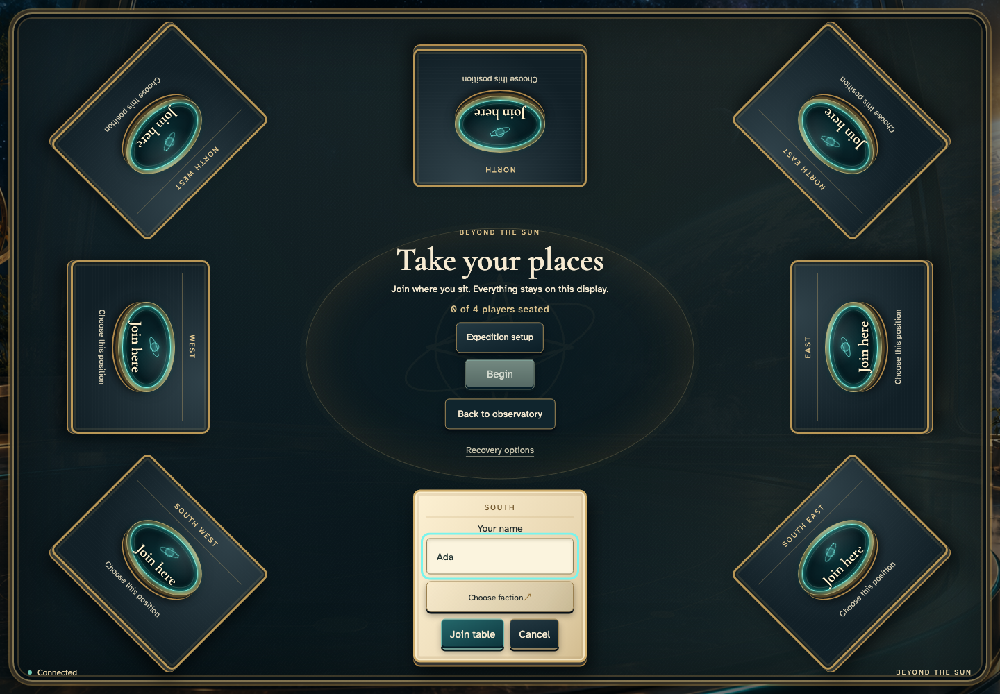](../../screenshots/trade-from-a-food-covered-supply-column-without-ordinary-production-at-physical-shared-seats/004-seat-0-name-desktop-darwin.png) |

tabletop-4k · 3840 × 2160

- [x] Name the physical player Ada
- [x] Canonical effects settle before capture.
- [x] Any printed Action plan is ready.
- [x] The rotated trade explanation stays above the opaque footer.
- [x] Public compact topology remains physically separated.
- [x] The gameplay shell fits the actual viewport.

## 6. The local physical seat is retained on this controller

Viewpoint: **Ada · South · one shared controller**.

| desktop · 1440 × 1000 |
| --- |
|  |

tabletop-4k · 3840 × 2160

- [x] The local physical seat is retained on this controller
- [x] Canonical effects settle before capture.
- [x] Any printed Action plan is ready.
- [x] The rotated trade explanation stays above the opaque footer.
- [x] Public compact topology remains physically separated.
- [x] The gameplay shell fits the actual viewport.

## 7. Open the North seat on the shared surface

Viewpoint: **Bora · North · one shared controller**.

| desktop · 1440 × 1000 |
| --- |
|  |

tabletop-4k · 3840 × 2160

- [x] Open the North seat on the shared surface
- [x] Canonical effects settle before capture.
- [x] Any printed Action plan is ready.
- [x] The rotated trade explanation stays above the opaque footer.
- [x] Public compact topology remains physically separated.
- [x] The gameplay shell fits the actual viewport.

## 8. Name the physical player Bora

Viewpoint: **Bora · North · one shared controller**.

| desktop · 1440 × 1000 |
| --- |
|  |

tabletop-4k · 3840 × 2160

- [x] Name the physical player Bora
- [x] Canonical effects settle before capture.
- [x] Any printed Action plan is ready.
- [x] The rotated trade explanation stays above the opaque footer.
- [x] Public compact topology remains physically separated.
- [x] The gameplay shell fits the actual viewport.

## 9. The local physical seat is retained on this controller

Viewpoint: **Bora · North · one shared controller**.

| desktop · 1440 × 1000 |
| --- |
|  |

tabletop-4k · 3840 × 2160

- [x] The local physical seat is retained on this controller
- [x] Canonical effects settle before capture.
- [x] Any printed Action plan is ready.
- [x] The rotated trade explanation stays above the opaque footer.
- [x] Public compact topology remains physically separated.
- [x] The gameplay shell fits the actual viewport.

## 10. Ada chooses a legal unique Basic faction

Viewpoint: **Ada · South · one shared controller**.

| desktop · 1440 × 1000 |
| --- |
|  |

tabletop-4k · 3840 × 2160

- [x] Ada chooses a legal unique Basic faction
- [x] Canonical effects settle before capture.
- [x] Any printed Action plan is ready.
- [x] The rotated trade explanation stays above the opaque footer.
- [x] Public compact topology remains physically separated.
- [x] The gameplay shell fits the actual viewport.

## 11. Ada retains Nishida-Østergaard Corporation

Viewpoint: **Ada · South · one shared controller**.

| desktop · 1440 × 1000 |
| --- |
|  |

tabletop-4k · 3840 × 2160

[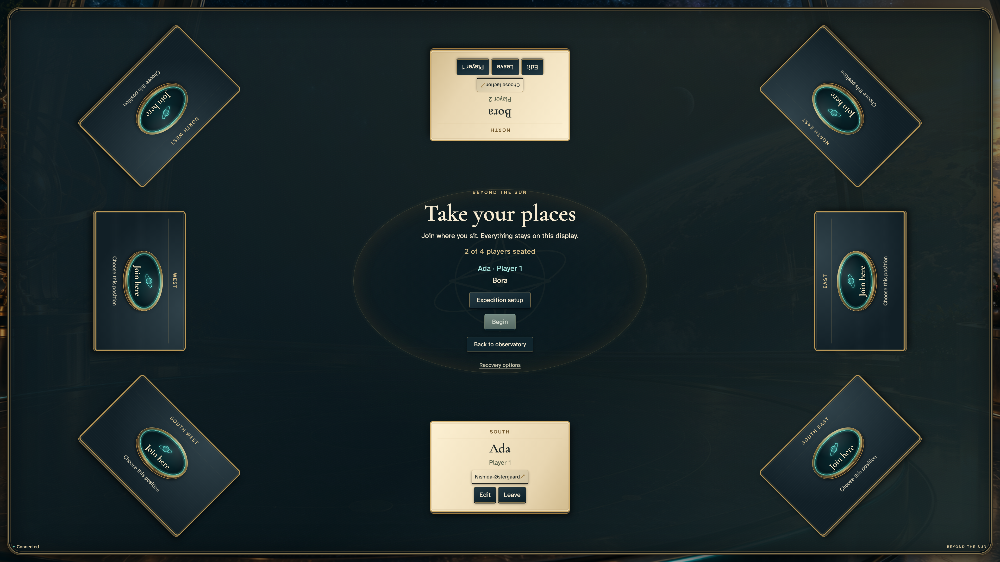](../../screenshots/trade-from-a-food-covered-supply-column-without-ordinary-production-at-physical-shared-seats/010-faction-0-chosen-tabletop-4k-darwin.png)

- [x] Ada retains Nishida-Østergaard Corporation
- [x] Canonical effects settle before capture.
- [x] Any printed Action plan is ready.
- [x] The rotated trade explanation stays above the opaque footer.
- [x] Public compact topology remains physically separated.
- [x] The gameplay shell fits the actual viewport.

## 12. Bora chooses a legal unique Basic faction

Viewpoint: **Bora · North · one shared controller**.

| desktop · 1440 × 1000 |
| --- |
|  |

tabletop-4k · 3840 × 2160

- [x] Bora chooses a legal unique Basic faction
- [x] Canonical effects settle before capture.
- [x] Any printed Action plan is ready.
- [x] The rotated trade explanation stays above the opaque footer.
- [x] Public compact topology remains physically separated.
- [x] The gameplay shell fits the actual viewport.

## 13. Bora retains The Zheng-Yi Brotherhood

Viewpoint: **Bora · North · one shared controller**.

| desktop · 1440 × 1000 |
| --- |
|  |

tabletop-4k · 3840 × 2160

- [x] Bora retains The Zheng-Yi Brotherhood
- [x] Canonical effects settle before capture.
- [x] Any printed Action plan is ready.
- [x] The rotated trade explanation stays above the opaque footer.
- [x] Public compact topology remains physically separated.
- [x] The gameplay shell fits the actual viewport.

## 14. Begin the immutable source-reviewed Basic setup through the ordinary UI

Viewpoint: **Ada · South · one shared controller**.

| desktop · 1440 × 1000 |
| --- |
|  |

tabletop-4k · 3840 × 2160

- [x] Begin the immutable source-reviewed Basic setup through the ordinary UI
- [x] Canonical effects settle before capture.
- [x] Any printed Action plan is ready.
- [x] The rotated trade explanation stays above the opaque footer.
- [x] Public compact topology remains physically separated.
- [x] The gameplay shell fits the actual viewport.

## 15. Ada opens the actual research and Action instrument

Viewpoint: **Ada · South · one shared controller**.

| desktop · 1440 × 1000 |
| --- |
|  |

tabletop-4k · 3840 × 2160

- [x] Ada opens the actual research and Action instrument
- [x] Canonical effects settle before capture.
- [x] Any printed Action plan is ready.
- [x] The rotated trade explanation stays above the opaque footer.
- [x] Public compact topology remains physically separated.
- [x] The gameplay shell fits the actual viewport.

## 16. Ada selects the legal printed space 1

Viewpoint: **Ada · South · one shared controller**.

| desktop · 1440 × 1000 |
| --- |
|  |

tabletop-4k · 3840 × 2160

- [x] Ada selects the legal printed space 1
- [x] Canonical effects settle before capture.
- [x] Any printed Action plan is ready.
- [x] The rotated trade explanation stays above the opaque footer.
- [x] Public compact topology remains physically separated.
- [x] The gameplay shell fits the actual viewport.

## 17. Select Terraforming with its printed cost and consequence

Viewpoint: **Ada · South · one shared controller**.

| desktop · 1440 × 1000 |
| --- |
|  |

tabletop-4k · 3840 × 2160

- [x] Select Terraforming with its printed cost and consequence
- [x] Canonical effects settle before capture.
- [x] Any printed Action plan is ready.
- [x] The rotated trade explanation stays above the opaque footer.
- [x] Public compact topology remains physically separated.
- [x] The gameplay shell fits the actual viewport.

## 18. Pay once and receive Terraforming's immediate bonus

Viewpoint: **Ada · South · one shared controller**.

| desktop · 1440 × 1000 |
| --- |
|  |

tabletop-4k · 3840 × 2160

- [x] Pay once and receive Terraforming's immediate bonus
- [x] Canonical effects settle before capture.
- [x] Any printed Action plan is ready.
- [x] The rotated trade explanation stays above the opaque footer.
- [x] Public compact topology remains physically separated.
- [x] The gameplay shell fits the actual viewport.

## 19. Ada completes production and hands off to Bora

Viewpoint: **Ada · South · one shared controller**.

| desktop · 1440 × 1000 |
| --- |
|  |

tabletop-4k · 3840 × 2160

[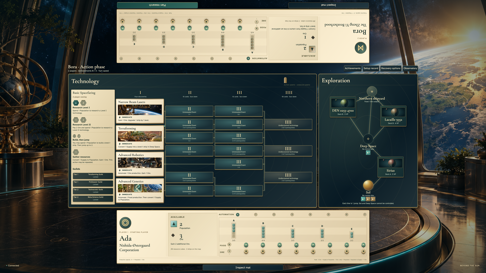](../../screenshots/trade-from-a-food-covered-supply-column-without-ordinary-production-at-physical-shared-seats/018-r0-ada-handoff-tabletop-4k-darwin.png)

- [x] Ada completes production and hands off to Bora
- [x] Canonical effects settle before capture.
- [x] Any printed Action plan is ready.
- [x] The rotated trade explanation stays above the opaque footer.
- [x] Public compact topology remains physically separated.
- [x] The gameplay shell fits the actual viewport.

## 20. Bora opens the actual research and Action instrument

Viewpoint: **Bora · North · one shared controller**.

| desktop · 1440 × 1000 |
| --- |
|  |

tabletop-4k · 3840 × 2160

- [x] Bora opens the actual research and Action instrument
- [x] Canonical effects settle before capture.
- [x] Any printed Action plan is ready.
- [x] The rotated trade explanation stays above the opaque footer.
- [x] Public compact topology remains physically separated.
- [x] The gameplay shell fits the actual viewport.

## 21. Bora selects the legal printed space 2

Viewpoint: **Bora · North · one shared controller**.

| desktop · 1440 × 1000 |
| --- |
|  |

tabletop-4k · 3840 × 2160

- [x] Bora selects the legal printed space 2
- [x] Canonical effects settle before capture.
- [x] Any printed Action plan is ready.
- [x] The rotated trade explanation stays above the opaque footer.
- [x] Public compact topology remains physically separated.
- [x] The gameplay shell fits the actual viewport.

## 22. Select Advanced Robotics with its printed cost and consequence

Viewpoint: **Bora · North · one shared controller**.

| desktop · 1440 × 1000 |
| --- |
| [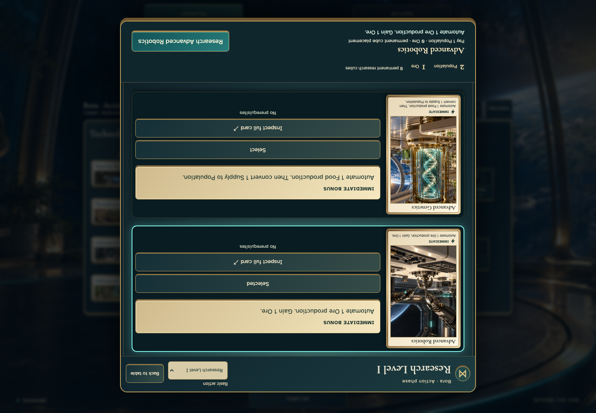](../../screenshots/trade-from-a-food-covered-supply-column-without-ordinary-production-at-physical-shared-seats/021-r0-bora-card-desktop-darwin.png) |

tabletop-4k · 3840 × 2160

[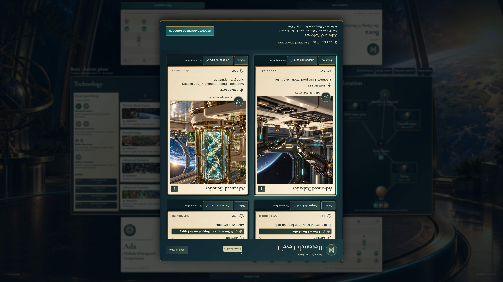](../../screenshots/trade-from-a-food-covered-supply-column-without-ordinary-production-at-physical-shared-seats/021-r0-bora-card-tabletop-4k-darwin.png)

- [x] Select Advanced Robotics with its printed cost and consequence
- [x] Canonical effects settle before capture.
- [x] Any printed Action plan is ready.
- [x] The rotated trade explanation stays above the opaque footer.
- [x] Public compact topology remains physically separated.
- [x] The gameplay shell fits the actual viewport.

## 23. Pay once and receive Advanced Robotics's immediate bonus

Viewpoint: **Bora · North · one shared controller**.

| desktop · 1440 × 1000 |
| --- |
| [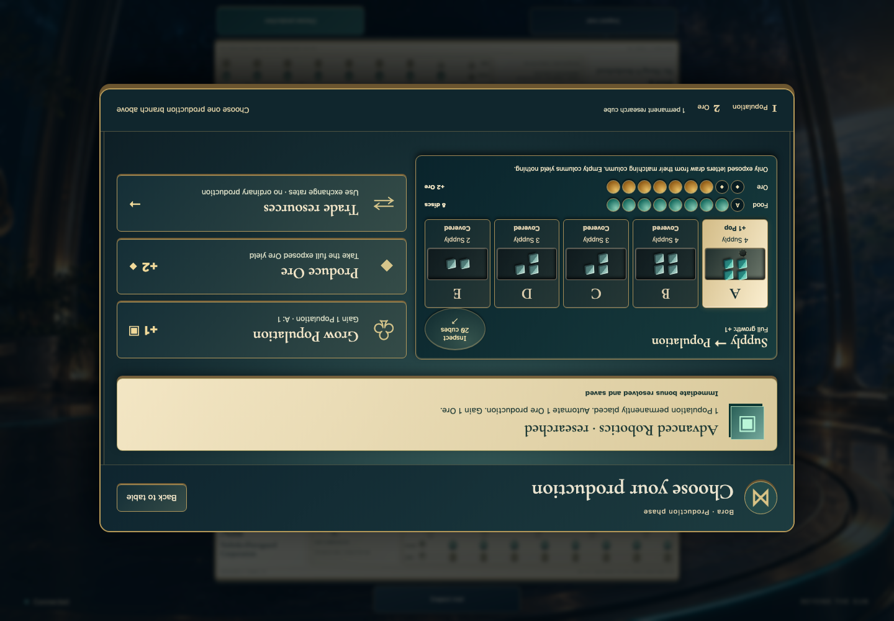](../../screenshots/trade-from-a-food-covered-supply-column-without-ordinary-production-at-physical-shared-seats/022-r0-bora-researched-desktop-darwin.png) |

tabletop-4k · 3840 × 2160

[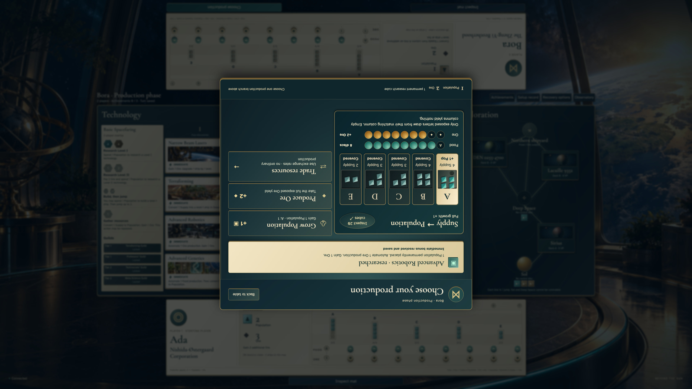](../../screenshots/trade-from-a-food-covered-supply-column-without-ordinary-production-at-physical-shared-seats/022-r0-bora-researched-tabletop-4k-darwin.png)

- [x] Pay once and receive Advanced Robotics's immediate bonus
- [x] Canonical effects settle before capture.
- [x] Any printed Action plan is ready.
- [x] The rotated trade explanation stays above the opaque footer.
- [x] Public compact topology remains physically separated.
- [x] The gameplay shell fits the actual viewport.

## 24. Bora completes production and hands off to Ada

Viewpoint: **Bora · North · one shared controller**.

| desktop · 1440 × 1000 |
| --- |
| [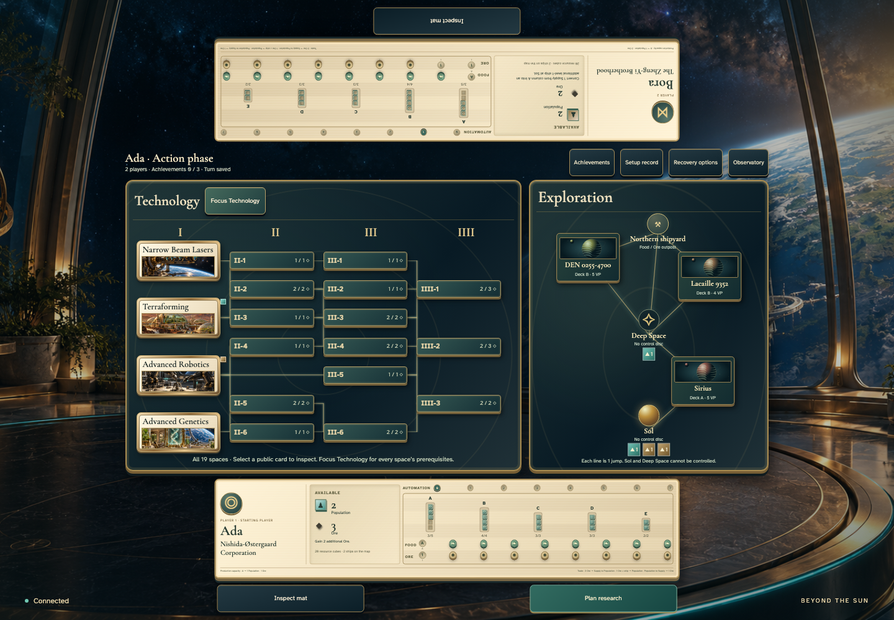](../../screenshots/trade-from-a-food-covered-supply-column-without-ordinary-production-at-physical-shared-seats/023-r0-bora-handoff-desktop-darwin.png) |

tabletop-4k · 3840 × 2160

- [x] Bora completes production and hands off to Ada
- [x] Canonical effects settle before capture.
- [x] Any printed Action plan is ready.
- [x] The rotated trade explanation stays above the opaque footer.
- [x] Public compact topology remains physically separated.
- [x] The gameplay shell fits the actual viewport.

## 25. Ada opens the actual research and Action instrument

Viewpoint: **Ada · South · one shared controller**.

| desktop · 1440 × 1000 |
| --- |
|  |

tabletop-4k · 3840 × 2160

- [x] Ada opens the actual research and Action instrument
- [x] Canonical effects settle before capture.
- [x] Any printed Action plan is ready.
- [x] The rotated trade explanation stays above the opaque footer.
- [x] Public compact topology remains physically separated.
- [x] The gameplay shell fits the actual viewport.

## 26. Ada selects ordinary gathering

Viewpoint: **Ada · South · one shared controller**.

| desktop · 1440 × 1000 |
| --- |
| [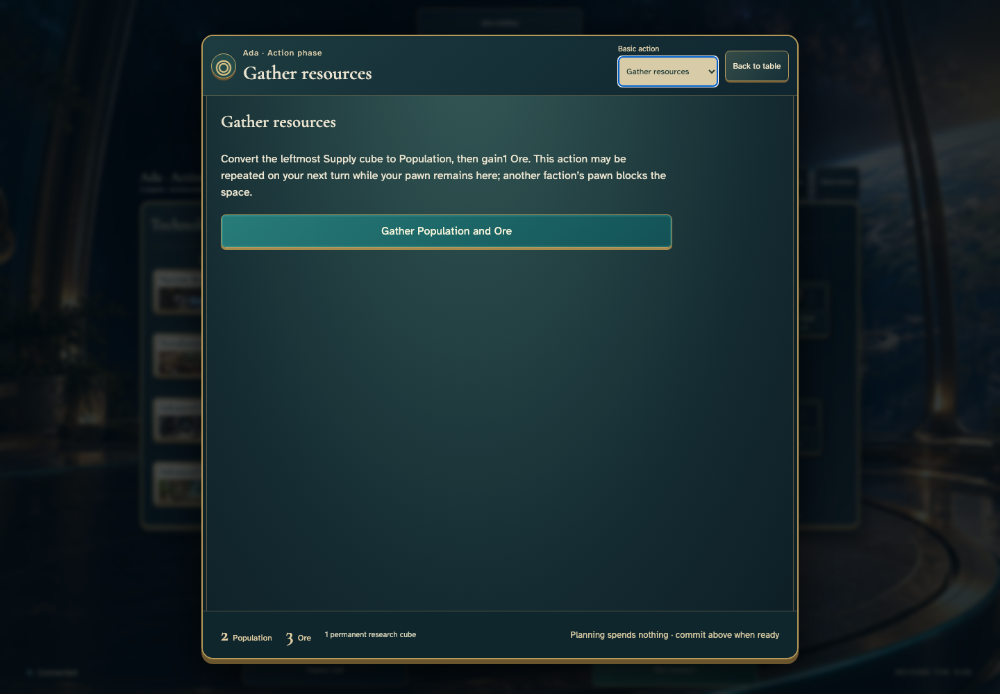](../../screenshots/trade-from-a-food-covered-supply-column-without-ordinary-production-at-physical-shared-seats/025-r1-ada-kind-desktop-darwin.png) |

tabletop-4k · 3840 × 2160

[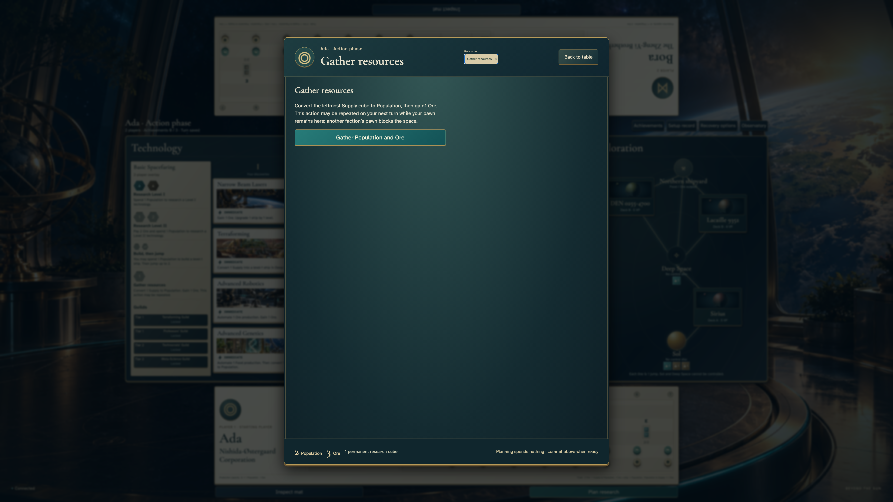](../../screenshots/trade-from-a-food-covered-supply-column-without-ordinary-production-at-physical-shared-seats/025-r1-ada-kind-tabletop-4k-darwin.png)

- [x] Ada selects ordinary gathering
- [x] Canonical effects settle before capture.
- [x] Any printed Action plan is ready.
- [x] The rotated trade explanation stays above the opaque footer.
- [x] Public compact topology remains physically separated.
- [x] The gameplay shell fits the actual viewport.

## 27. Receive the printed gather resources before ordinary production

Viewpoint: **Ada · South · one shared controller**.

| desktop · 1440 × 1000 |
| --- |
| [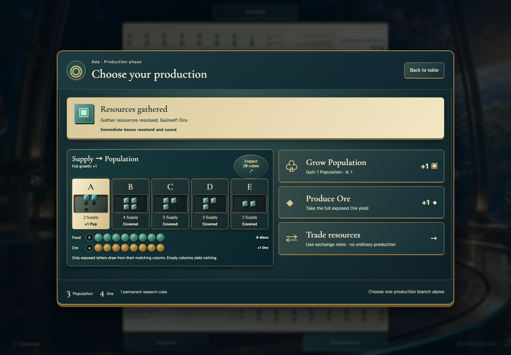](../../screenshots/trade-from-a-food-covered-supply-column-without-ordinary-production-at-physical-shared-seats/026-r1-ada-gathered-desktop-darwin.png) |

tabletop-4k · 3840 × 2160

[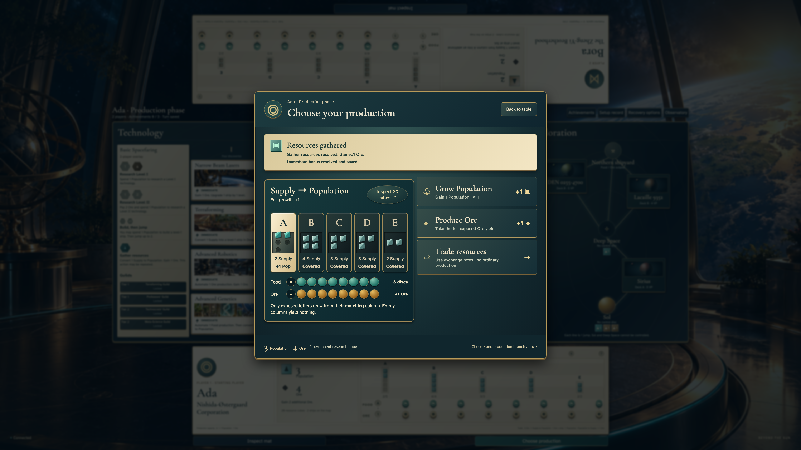](../../screenshots/trade-from-a-food-covered-supply-column-without-ordinary-production-at-physical-shared-seats/026-r1-ada-gathered-tabletop-4k-darwin.png)

- [x] Receive the printed gather resources before ordinary production
- [x] Canonical effects settle before capture.
- [x] Any printed Action plan is ready.
- [x] The rotated trade explanation stays above the opaque footer.
- [x] Public compact topology remains physically separated.
- [x] The gameplay shell fits the actual viewport.

## 28. Ada completes production and hands off to Bora

Viewpoint: **Ada · South · one shared controller**.

| desktop · 1440 × 1000 |
| --- |
| [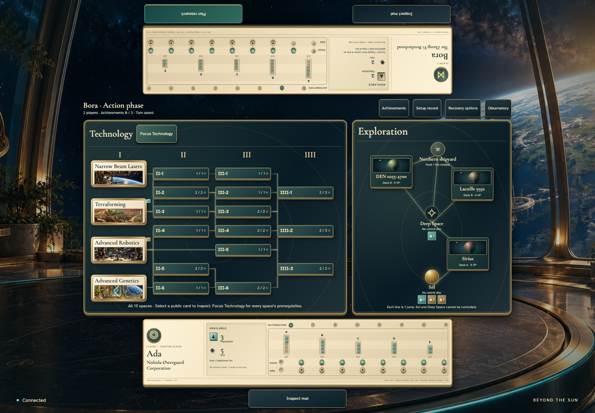](../../screenshots/trade-from-a-food-covered-supply-column-without-ordinary-production-at-physical-shared-seats/027-r1-ada-handoff-desktop-darwin.png) |

tabletop-4k · 3840 × 2160

- [x] Ada completes production and hands off to Bora
- [x] Canonical effects settle before capture.
- [x] Any printed Action plan is ready.
- [x] The rotated trade explanation stays above the opaque footer.
- [x] Public compact topology remains physically separated.
- [x] The gameplay shell fits the actual viewport.

## 29. Bora opens the actual research and Action instrument

Viewpoint: **Bora · North · one shared controller**.

| desktop · 1440 × 1000 |
| --- |
| [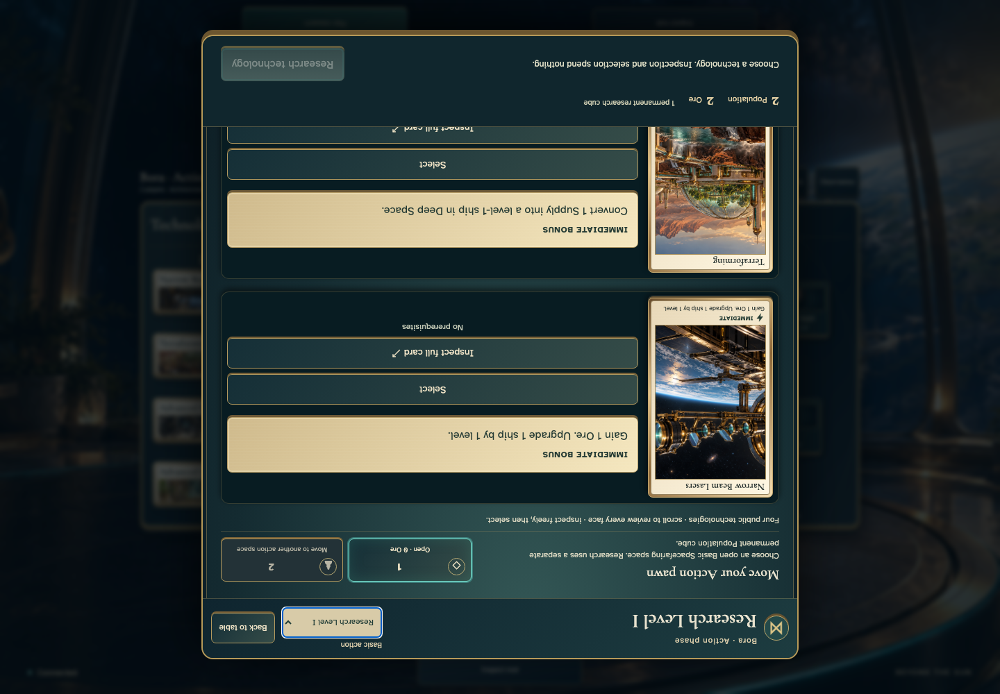](../../screenshots/trade-from-a-food-covered-supply-column-without-ordinary-production-at-physical-shared-seats/028-r1-bora-plan-desktop-darwin.png) |

tabletop-4k · 3840 × 2160

- [x] Bora opens the actual research and Action instrument
- [x] Canonical effects settle before capture.
- [x] Any printed Action plan is ready.
- [x] The rotated trade explanation stays above the opaque footer.
- [x] Public compact topology remains physically separated.
- [x] The gameplay shell fits the actual viewport.

## 30. Bora selects the legal printed space 1

Viewpoint: **Bora · North · one shared controller**.

| desktop · 1440 × 1000 |
| --- |
| [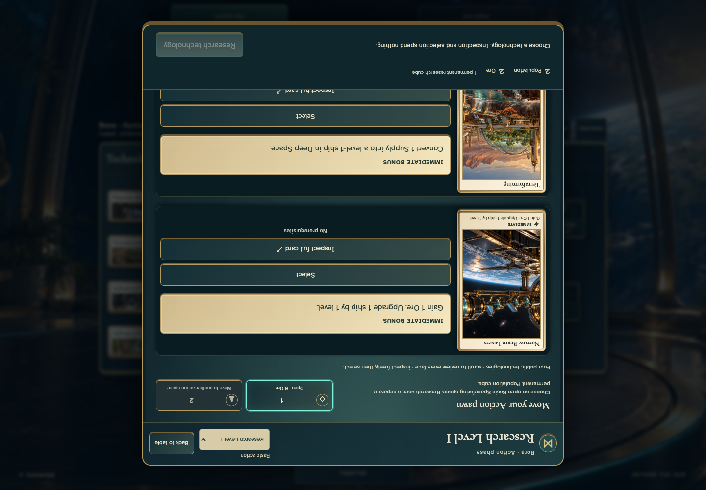](../../screenshots/trade-from-a-food-covered-supply-column-without-ordinary-production-at-physical-shared-seats/029-r1-bora-space-desktop-darwin.png) |

tabletop-4k · 3840 × 2160

[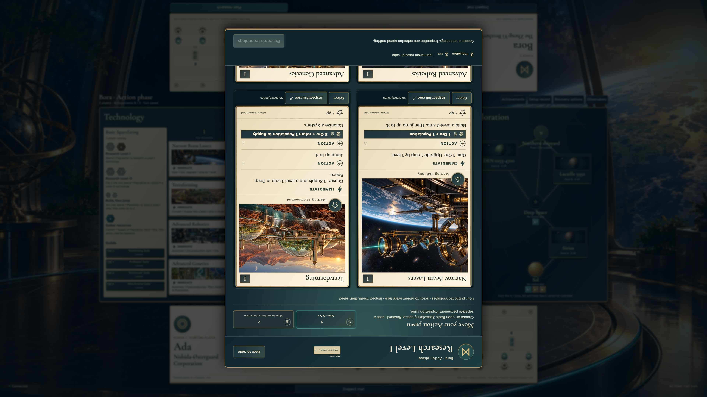](../../screenshots/trade-from-a-food-covered-supply-column-without-ordinary-production-at-physical-shared-seats/029-r1-bora-space-tabletop-4k-darwin.png)

- [x] Bora selects the legal printed space 1
- [x] Canonical effects settle before capture.
- [x] Any printed Action plan is ready.
- [x] The rotated trade explanation stays above the opaque footer.
- [x] Public compact topology remains physically separated.
- [x] The gameplay shell fits the actual viewport.

## 31. Select Advanced Genetics with its printed cost and consequence

Viewpoint: **Bora · North · one shared controller**.

| desktop · 1440 × 1000 |
| --- |
| [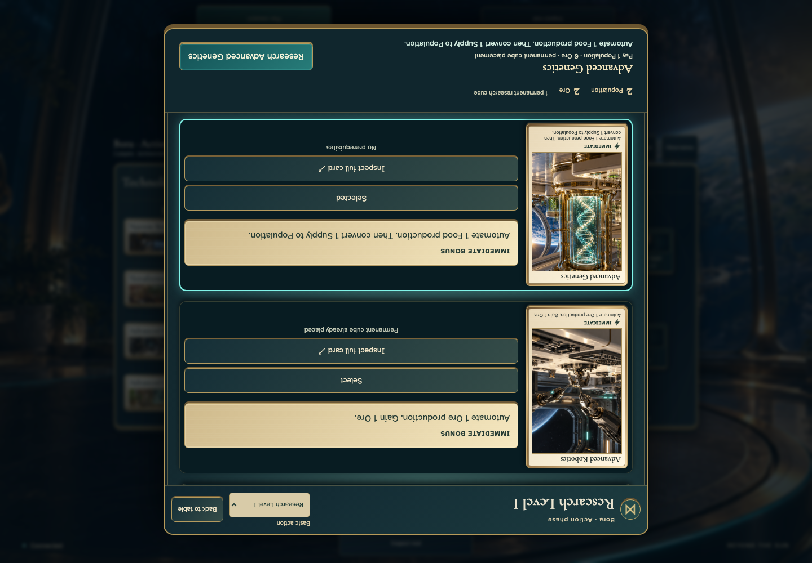](../../screenshots/trade-from-a-food-covered-supply-column-without-ordinary-production-at-physical-shared-seats/030-r1-bora-card-desktop-darwin.png) |

tabletop-4k · 3840 × 2160

[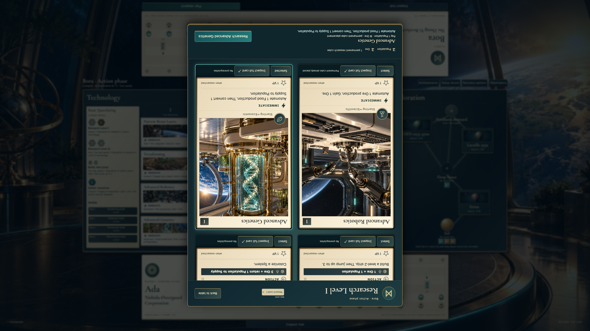](../../screenshots/trade-from-a-food-covered-supply-column-without-ordinary-production-at-physical-shared-seats/030-r1-bora-card-tabletop-4k-darwin.png)

- [x] Select Advanced Genetics with its printed cost and consequence
- [x] Canonical effects settle before capture.
- [x] Any printed Action plan is ready.
- [x] The rotated trade explanation stays above the opaque footer.
- [x] Public compact topology remains physically separated.
- [x] The gameplay shell fits the actual viewport.

## 32. Pay once and receive Advanced Genetics's immediate bonus

Viewpoint: **Bora · North · one shared controller**.

| desktop · 1440 × 1000 |
| --- |
|  |

tabletop-4k · 3840 × 2160

[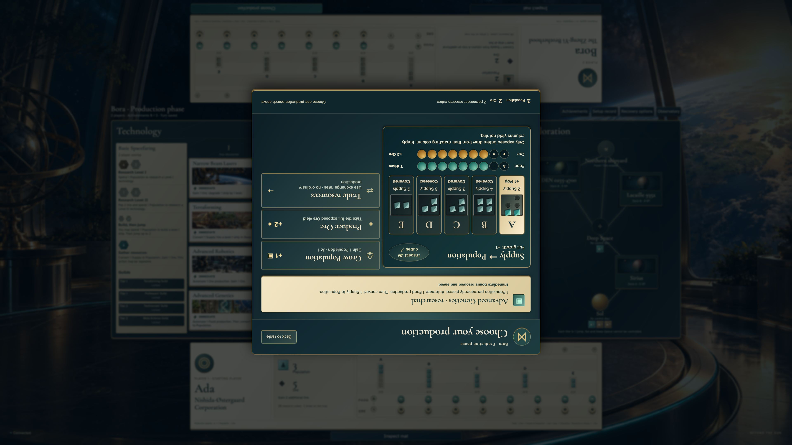](../../screenshots/trade-from-a-food-covered-supply-column-without-ordinary-production-at-physical-shared-seats/031-r1-bora-researched-tabletop-4k-darwin.png)

- [x] Pay once and receive Advanced Genetics's immediate bonus
- [x] Canonical effects settle before capture.
- [x] Any printed Action plan is ready.
- [x] The rotated trade explanation stays above the opaque footer.
- [x] Public compact topology remains physically separated.
- [x] The gameplay shell fits the actual viewport.

## 33. Bora completes production and hands off to Ada

Viewpoint: **Bora · North · one shared controller**.

| desktop · 1440 × 1000 |
| --- |
|  |

tabletop-4k · 3840 × 2160

[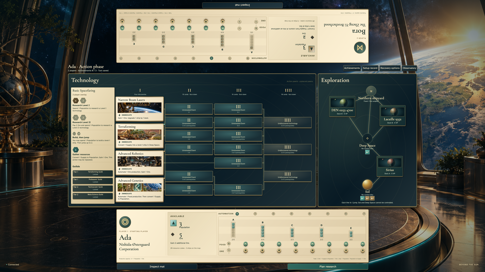](../../screenshots/trade-from-a-food-covered-supply-column-without-ordinary-production-at-physical-shared-seats/032-r1-bora-handoff-tabletop-4k-darwin.png)

- [x] Bora completes production and hands off to Ada
- [x] Canonical effects settle before capture.
- [x] Any printed Action plan is ready.
- [x] The rotated trade explanation stays above the opaque footer.
- [x] Public compact topology remains physically separated.
- [x] The gameplay shell fits the actual viewport.

## 34. Ada opens the actual research and Action instrument

Viewpoint: **Ada · South · one shared controller**.

| desktop · 1440 × 1000 |
| --- |
|  |

tabletop-4k · 3840 × 2160

- [x] Ada opens the actual research and Action instrument
- [x] Canonical effects settle before capture.
- [x] Any printed Action plan is ready.
- [x] The rotated trade explanation stays above the opaque footer.
- [x] Public compact topology remains physically separated.
- [x] The gameplay shell fits the actual viewport.

## 35. Ada selects the legal printed space 2

Viewpoint: **Ada · South · one shared controller**.

| desktop · 1440 × 1000 |
| --- |
| [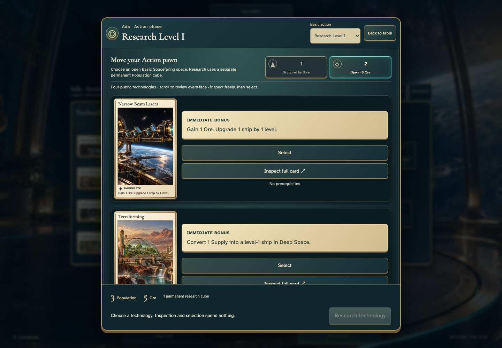](../../screenshots/trade-from-a-food-covered-supply-column-without-ordinary-production-at-physical-shared-seats/034-r2-ada-space-desktop-darwin.png) |

tabletop-4k · 3840 × 2160

- [x] Ada selects the legal printed space 2
- [x] Canonical effects settle before capture.
- [x] Any printed Action plan is ready.
- [x] The rotated trade explanation stays above the opaque footer.
- [x] Public compact topology remains physically separated.
- [x] The gameplay shell fits the actual viewport.

## 36. Select Advanced Genetics with its printed cost and consequence

Viewpoint: **Ada · South · one shared controller**.

| desktop · 1440 × 1000 |
| --- |
| [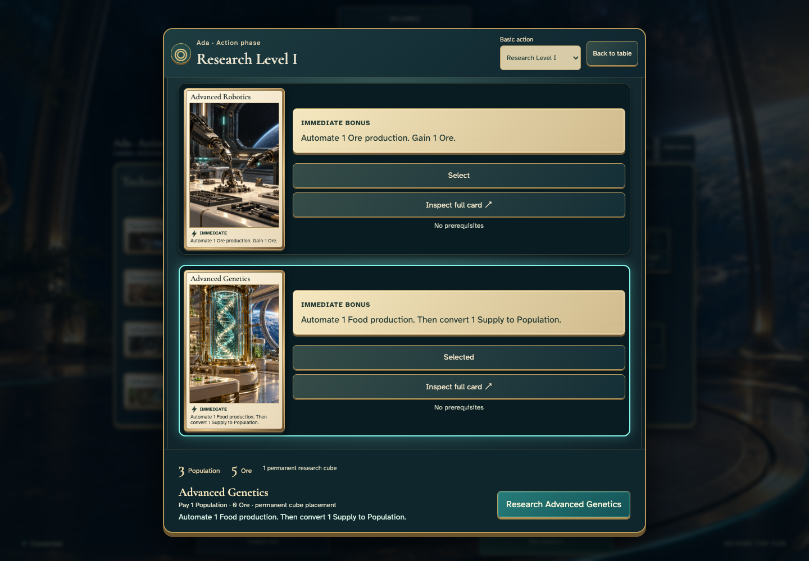](../../screenshots/trade-from-a-food-covered-supply-column-without-ordinary-production-at-physical-shared-seats/035-r2-ada-card-desktop-darwin.png) |

tabletop-4k · 3840 × 2160

[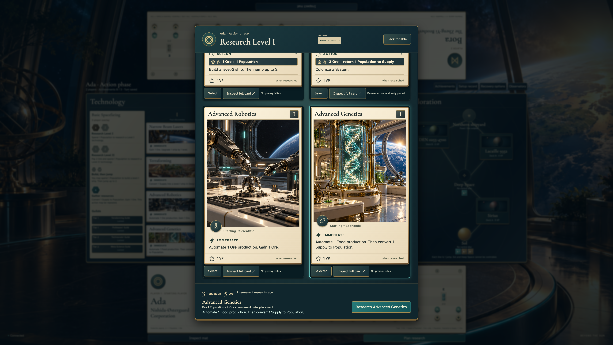](../../screenshots/trade-from-a-food-covered-supply-column-without-ordinary-production-at-physical-shared-seats/035-r2-ada-card-tabletop-4k-darwin.png)

- [x] Select Advanced Genetics with its printed cost and consequence
- [x] Canonical effects settle before capture.
- [x] Any printed Action plan is ready.
- [x] The rotated trade explanation stays above the opaque footer.
- [x] Public compact topology remains physically separated.
- [x] The gameplay shell fits the actual viewport.

## 37. Pay once and receive Advanced Genetics's immediate bonus

Viewpoint: **Ada · South · one shared controller**.

| desktop · 1440 × 1000 |
| --- |
| [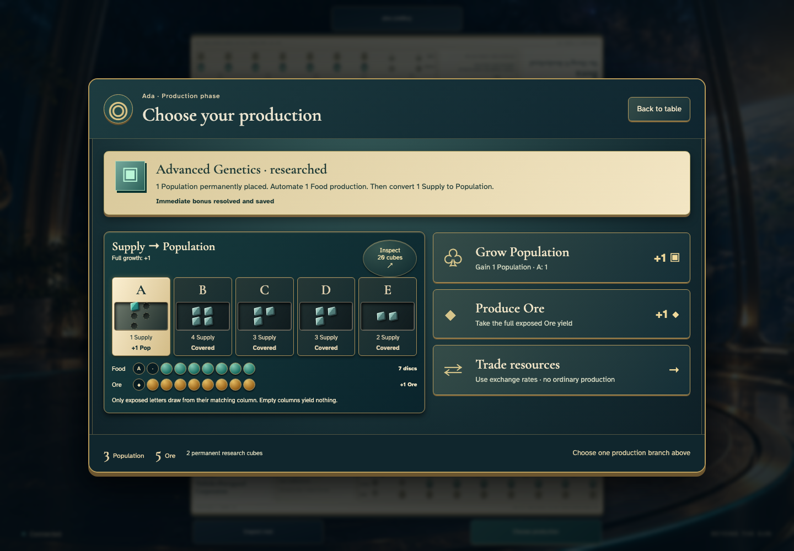](../../screenshots/trade-from-a-food-covered-supply-column-without-ordinary-production-at-physical-shared-seats/036-r2-ada-researched-desktop-darwin.png) |

tabletop-4k · 3840 × 2160

- [x] Pay once and receive Advanced Genetics's immediate bonus
- [x] Canonical effects settle before capture.
- [x] Any printed Action plan is ready.
- [x] The rotated trade explanation stays above the opaque footer.
- [x] Public compact topology remains physically separated.
- [x] The gameplay shell fits the actual viewport.

## 38. Ada completes production and hands off to Bora

Viewpoint: **Ada · South · one shared controller**.

| desktop · 1440 × 1000 |
| --- |
|  |

tabletop-4k · 3840 × 2160

- [x] Ada completes production and hands off to Bora
- [x] Canonical effects settle before capture.
- [x] Any printed Action plan is ready.
- [x] The rotated trade explanation stays above the opaque footer.
- [x] Public compact topology remains physically separated.
- [x] The gameplay shell fits the actual viewport.

## 39. Bora opens the actual research and Action instrument

Viewpoint: **Bora · North · one shared controller**.

| desktop · 1440 × 1000 |
| --- |
| [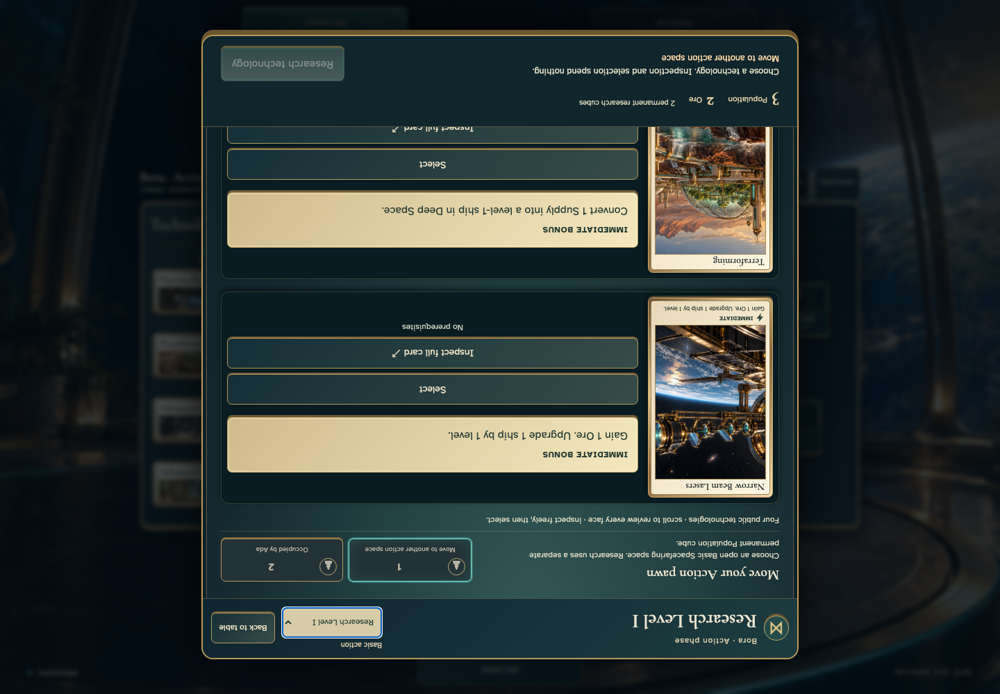](../../screenshots/trade-from-a-food-covered-supply-column-without-ordinary-production-at-physical-shared-seats/038-r2-bora-plan-desktop-darwin.png) |

tabletop-4k · 3840 × 2160

[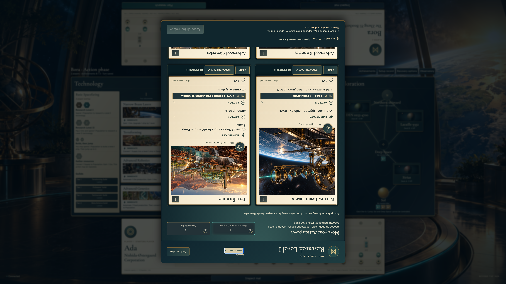](../../screenshots/trade-from-a-food-covered-supply-column-without-ordinary-production-at-physical-shared-seats/038-r2-bora-plan-tabletop-4k-darwin.png)

- [x] Bora opens the actual research and Action instrument
- [x] Canonical effects settle before capture.
- [x] Any printed Action plan is ready.
- [x] The rotated trade explanation stays above the opaque footer.
- [x] Public compact topology remains physically separated.
- [x] The gameplay shell fits the actual viewport.

## 40. Bora selects ordinary gathering

Viewpoint: **Bora · North · one shared controller**.

| desktop · 1440 × 1000 |
| --- |
| [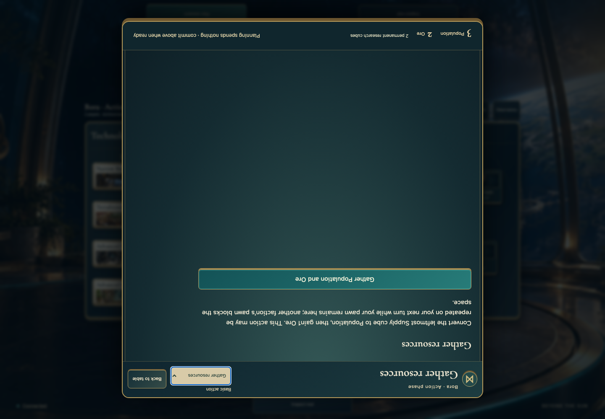](../../screenshots/trade-from-a-food-covered-supply-column-without-ordinary-production-at-physical-shared-seats/039-r2-bora-kind-desktop-darwin.png) |

tabletop-4k · 3840 × 2160

[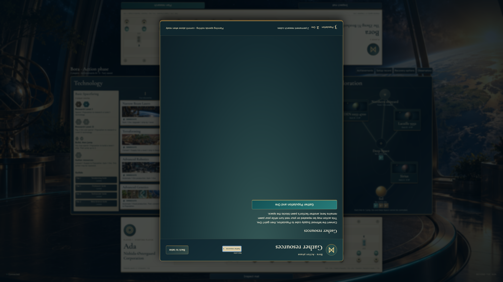](../../screenshots/trade-from-a-food-covered-supply-column-without-ordinary-production-at-physical-shared-seats/039-r2-bora-kind-tabletop-4k-darwin.png)

- [x] Bora selects ordinary gathering
- [x] Canonical effects settle before capture.
- [x] Any printed Action plan is ready.
- [x] The rotated trade explanation stays above the opaque footer.
- [x] Public compact topology remains physically separated.
- [x] The gameplay shell fits the actual viewport.

## 41. Receive the printed gather resources before ordinary production

Viewpoint: **Bora · North · one shared controller**.

| desktop · 1440 × 1000 |
| --- |
|  |

tabletop-4k · 3840 × 2160

[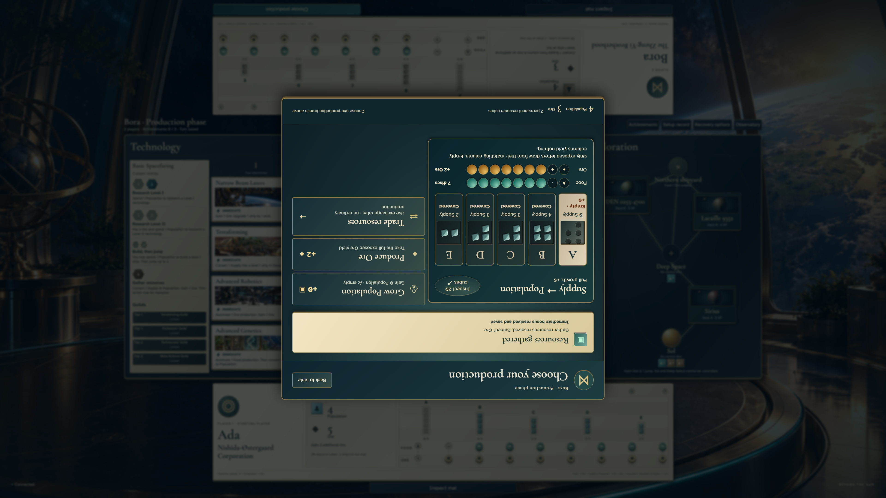](../../screenshots/trade-from-a-food-covered-supply-column-without-ordinary-production-at-physical-shared-seats/040-r2-bora-gathered-tabletop-4k-darwin.png)

- [x] Receive the printed gather resources before ordinary production
- [x] Canonical effects settle before capture.
- [x] Any printed Action plan is ready.
- [x] The rotated trade explanation stays above the opaque footer.
- [x] Public compact topology remains physically separated.
- [x] The gameplay shell fits the actual viewport.

## 42. Bora completes production and hands off to Ada

Viewpoint: **Bora · North · one shared controller**.

| desktop · 1440 × 1000 |
| --- |
|  |

tabletop-4k · 3840 × 2160

- [x] Bora completes production and hands off to Ada
- [x] Canonical effects settle before capture.
- [x] Any printed Action plan is ready.
- [x] The rotated trade explanation stays above the opaque footer.
- [x] Public compact topology remains physically separated.
- [x] The gameplay shell fits the actual viewport.

## 43. Ada opens the actual research and Action instrument

Viewpoint: **Ada · South · one shared controller**.

| desktop · 1440 × 1000 |
| --- |
| [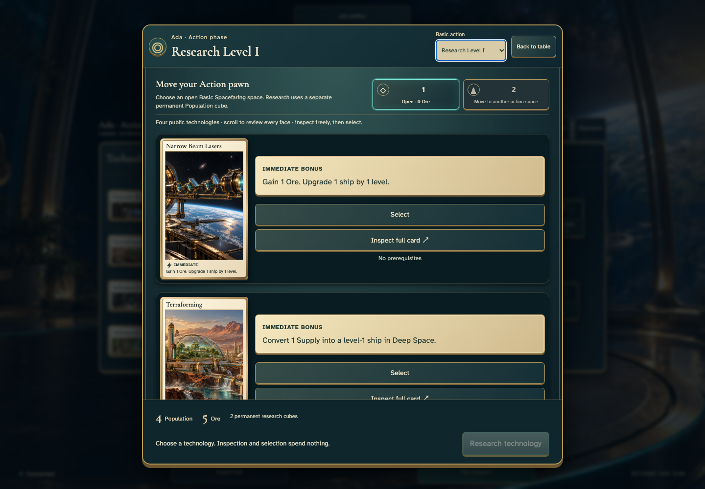](../../screenshots/trade-from-a-food-covered-supply-column-without-ordinary-production-at-physical-shared-seats/042-r3-ada-plan-desktop-darwin.png) |

tabletop-4k · 3840 × 2160

[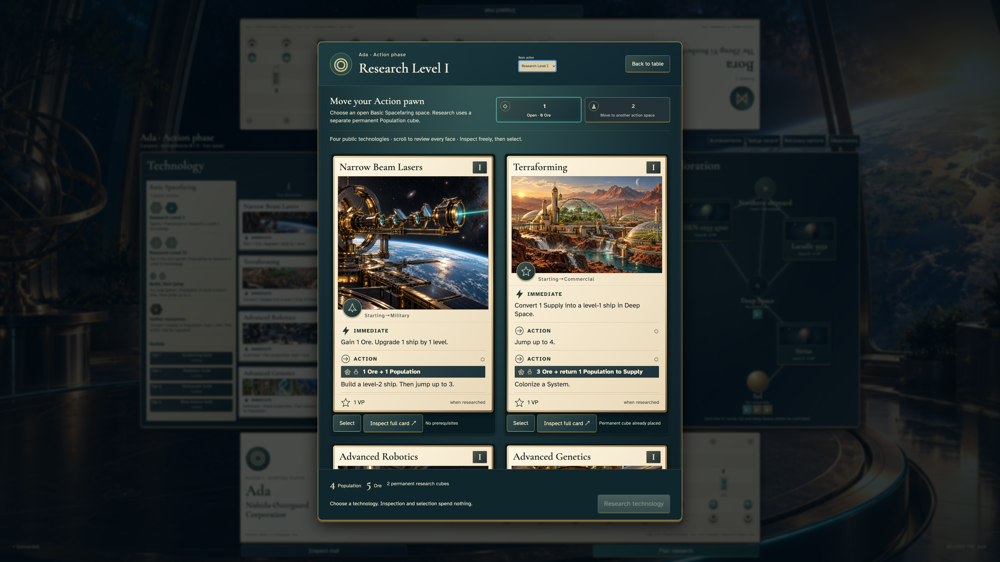](../../screenshots/trade-from-a-food-covered-supply-column-without-ordinary-production-at-physical-shared-seats/042-r3-ada-plan-tabletop-4k-darwin.png)

- [x] Ada opens the actual research and Action instrument
- [x] Canonical effects settle before capture.
- [x] Any printed Action plan is ready.
- [x] The rotated trade explanation stays above the opaque footer.
- [x] Public compact topology remains physically separated.
- [x] The gameplay shell fits the actual viewport.

## 44. Ada selects the legal printed space 1

Viewpoint: **Ada · South · one shared controller**.

| desktop · 1440 × 1000 |
| --- |
|  |

tabletop-4k · 3840 × 2160

- [x] Ada selects the legal printed space 1
- [x] Canonical effects settle before capture.
- [x] Any printed Action plan is ready.
- [x] The rotated trade explanation stays above the opaque footer.
- [x] Public compact topology remains physically separated.
- [x] The gameplay shell fits the actual viewport.

## 45. Select Advanced Robotics with its printed cost and consequence

Viewpoint: **Ada · South · one shared controller**.

| desktop · 1440 × 1000 |
| --- |
| [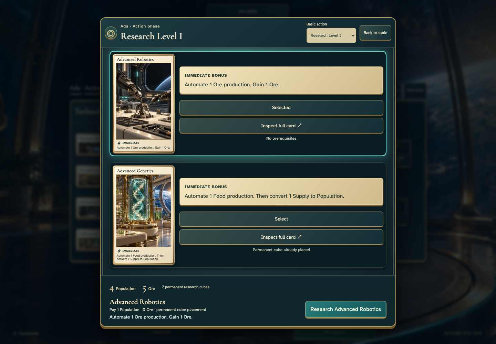](../../screenshots/trade-from-a-food-covered-supply-column-without-ordinary-production-at-physical-shared-seats/044-r3-ada-card-desktop-darwin.png) |

tabletop-4k · 3840 × 2160

[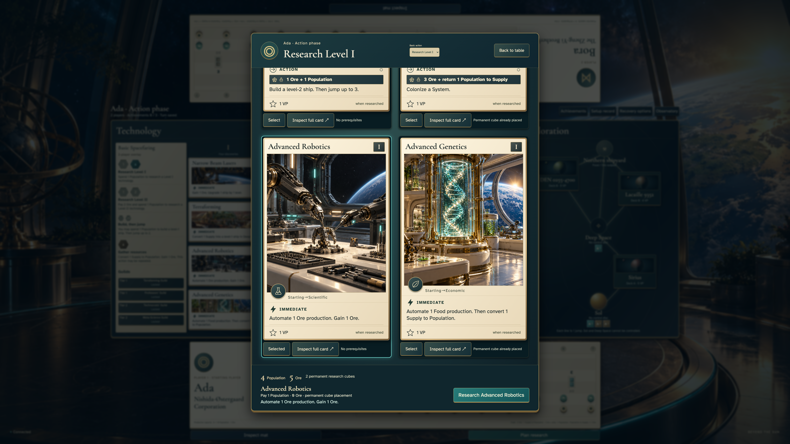](../../screenshots/trade-from-a-food-covered-supply-column-without-ordinary-production-at-physical-shared-seats/044-r3-ada-card-tabletop-4k-darwin.png)

- [x] Select Advanced Robotics with its printed cost and consequence
- [x] Canonical effects settle before capture.
- [x] Any printed Action plan is ready.
- [x] The rotated trade explanation stays above the opaque footer.
- [x] Public compact topology remains physically separated.
- [x] The gameplay shell fits the actual viewport.

## 46. Pay once and receive Advanced Robotics's immediate bonus

Viewpoint: **Ada · South · one shared controller**.

| desktop · 1440 × 1000 |
| --- |
|  |

tabletop-4k · 3840 × 2160

[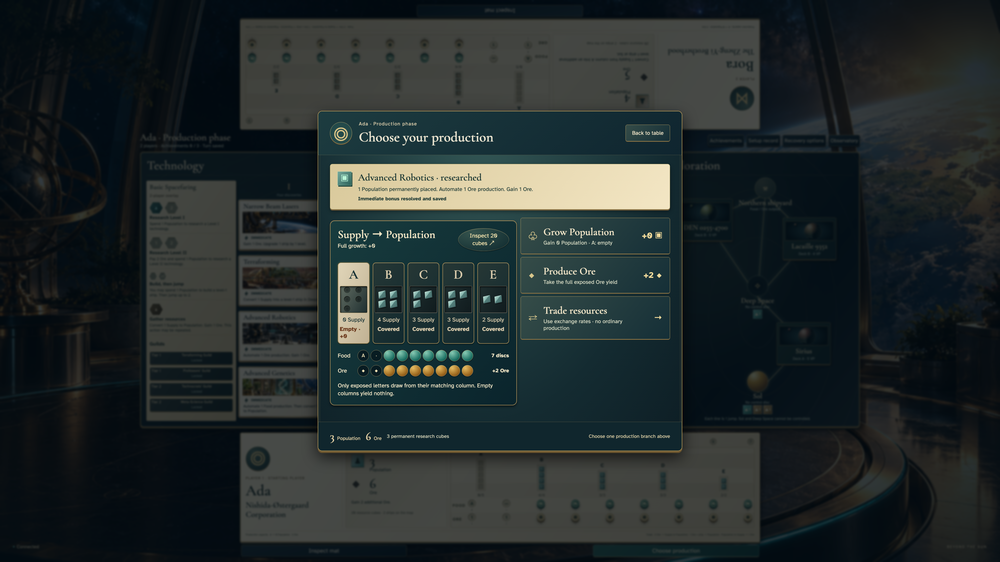](../../screenshots/trade-from-a-food-covered-supply-column-without-ordinary-production-at-physical-shared-seats/045-r3-ada-researched-tabletop-4k-darwin.png)

- [x] Pay once and receive Advanced Robotics's immediate bonus
- [x] Canonical effects settle before capture.
- [x] Any printed Action plan is ready.
- [x] The rotated trade explanation stays above the opaque footer.
- [x] Public compact topology remains physically separated.
- [x] The gameplay shell fits the actual viewport.

## 47. Food still covers B: ordinary growth cannot borrow its four cubes despite empty A

Viewpoint: **Ada · South · one shared controller**.

| desktop · 1440 × 1000 |
| --- |
| [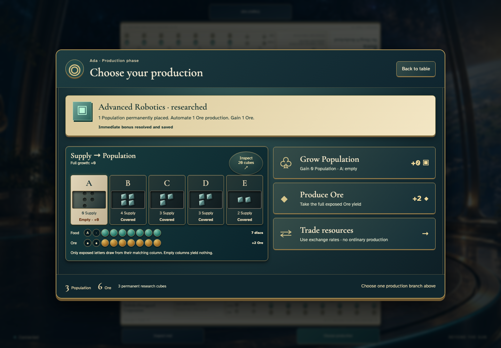](../../screenshots/trade-from-a-food-covered-supply-column-without-ordinary-production-at-physical-shared-seats/046-covered-b-production-desktop-darwin.png) |

tabletop-4k · 3840 × 2160

- [x] Food still covers B: ordinary growth cannot borrow its four cubes despite empty A
- [x] Canonical effects settle before capture.
- [x] Any printed Action plan is ready.
- [x] The rotated trade explanation stays above the opaque footer.
- [x] Public compact topology remains physically separated.
- [x] The gameplay shell fits the actual viewport.

## 48. Trade replaces ordinary growth and Ore production without changing the balance

Viewpoint: **Ada · South · one shared controller**.

| desktop · 1440 × 1000 |
| --- |
|  |

tabletop-4k · 3840 × 2160

[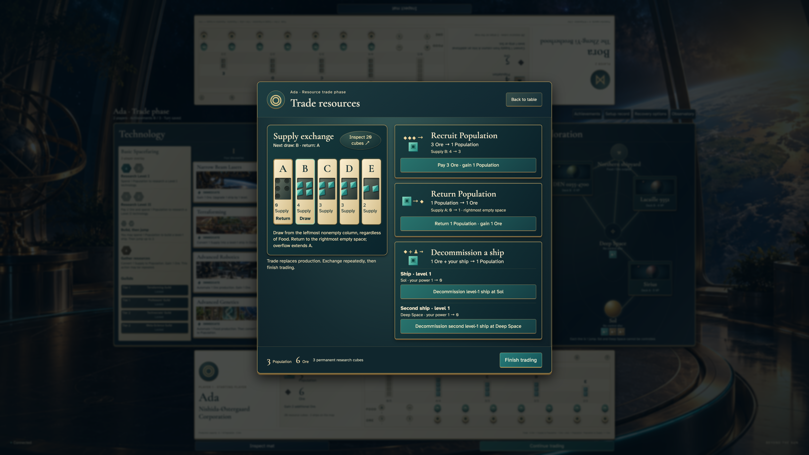](../../screenshots/trade-from-a-food-covered-supply-column-without-ordinary-production-at-physical-shared-seats/047-trade-covered-column-tabletop-4k-darwin.png)

- [x] Trade replaces ordinary growth and Ore production without changing the balance
- [x] Canonical effects settle before capture.
- [x] Any printed Action plan is ready.
- [x] The rotated trade explanation stays above the opaque footer.
- [x] Public compact topology remains physically separated.
- [x] The gameplay shell fits the actual viewport.

## 49. Trade ignores Food exposure and names B as the next leftmost nonempty draw

Viewpoint: **Ada · South · one shared controller**.

| desktop · 1440 × 1000 |
| --- |
|  |

tabletop-4k · 3840 × 2160

- [x] Trade ignores Food exposure and names B as the next leftmost nonempty draw
- [x] Canonical effects settle before capture.
- [x] Any printed Action plan is ready.
- [x] The rotated trade explanation stays above the opaque footer.
- [x] Public compact topology remains physically separated.
- [x] The gameplay shell fits the actual viewport.

## 50. Convert one Food-covered B cube for3 Ore without ordinary production

Viewpoint: **Ada · South · one shared controller**.

| desktop · 1440 × 1000 |
| --- |
| [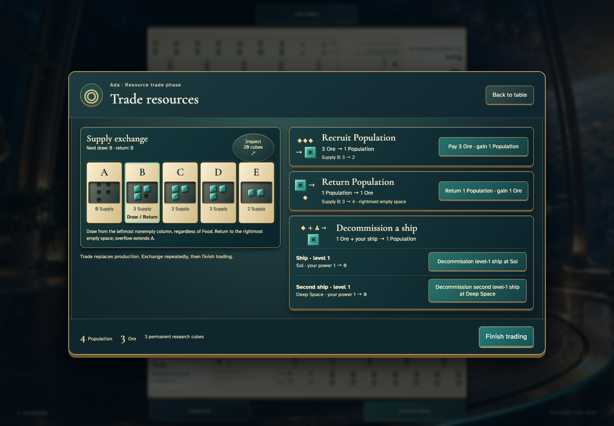](../../screenshots/trade-from-a-food-covered-supply-column-without-ordinary-production-at-physical-shared-seats/049-covered-b-trade-0-desktop-darwin.png) |

tabletop-4k · 3840 × 2160

[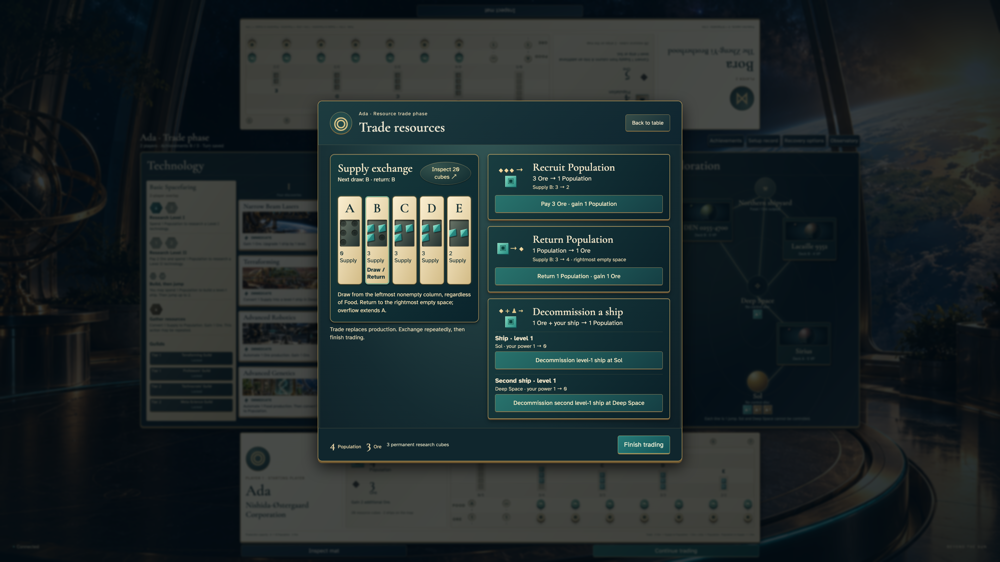](../../screenshots/trade-from-a-food-covered-supply-column-without-ordinary-production-at-physical-shared-seats/049-covered-b-trade-0-tabletop-4k-darwin.png)

- [x] Convert one Food-covered B cube for3 Ore without ordinary production
- [x] Canonical effects settle before capture.
- [x] Any printed Action plan is ready.
- [x] The rotated trade explanation stays above the opaque footer.
- [x] Public compact topology remains physically separated.
- [x] The gameplay shell fits the actual viewport.

## 51. Convert one Food-covered B cube for3 Ore without ordinary production

Viewpoint: **Ada · South · one shared controller**.

| desktop · 1440 × 1000 |
| --- |
|  |

tabletop-4k · 3840 × 2160

[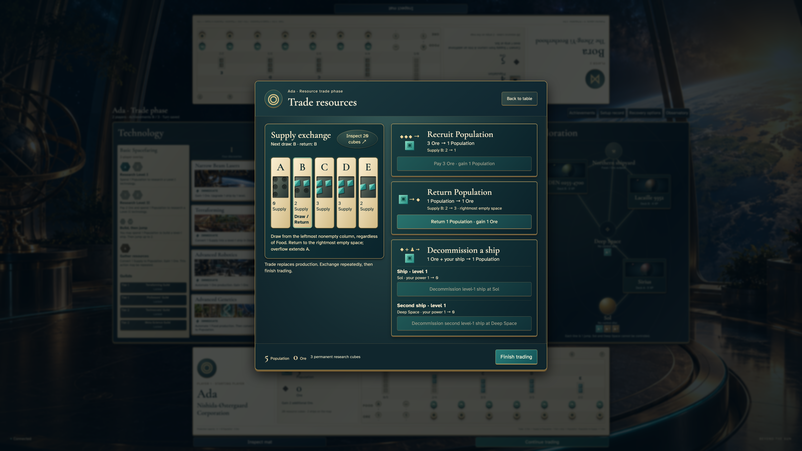](../../screenshots/trade-from-a-food-covered-supply-column-without-ordinary-production-at-physical-shared-seats/050-covered-b-trade-1-tabletop-4k-darwin.png)

- [x] Convert one Food-covered B cube for3 Ore without ordinary production
- [x] Canonical effects settle before capture.
- [x] Any printed Action plan is ready.
- [x] The rotated trade explanation stays above the opaque footer.
- [x] Public compact topology remains physically separated.
- [x] The gameplay shell fits the actual viewport.

## 52. Reload retains the current identity, accepted exchanges and pending trading phase

Viewpoint: **Ada · South · one shared controller**.

| desktop · 1440 × 1000 |
| --- |
| [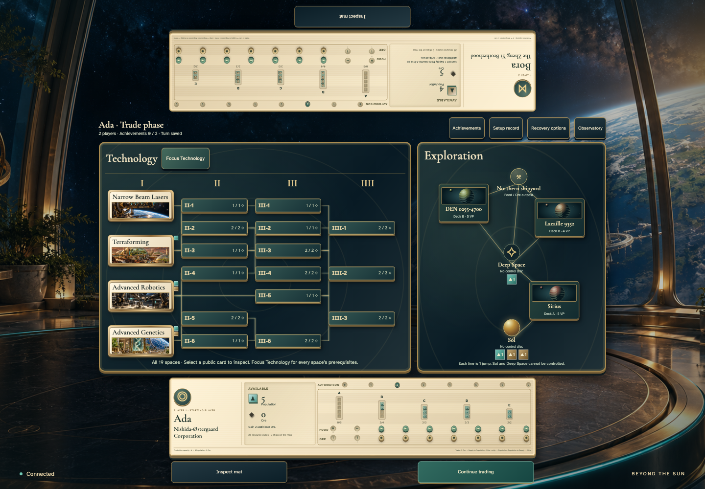](../../screenshots/trade-from-a-food-covered-supply-column-without-ordinary-production-at-physical-shared-seats/051-covered-trade-retained-desktop-darwin.png) |

tabletop-4k · 3840 × 2160

- [x] Reload retains the current identity, accepted exchanges and pending trading phase
- [x] Canonical effects settle before capture.
- [x] Any printed Action plan is ready.
- [x] The rotated trade explanation stays above the opaque footer.
- [x] Public compact topology remains physically separated.
- [x] The gameplay shell fits the actual viewport.

## 53. Open the same retained trade without duplicating a payment

Viewpoint: **Ada · South · one shared controller**.

| desktop · 1440 × 1000 |
| --- |
| [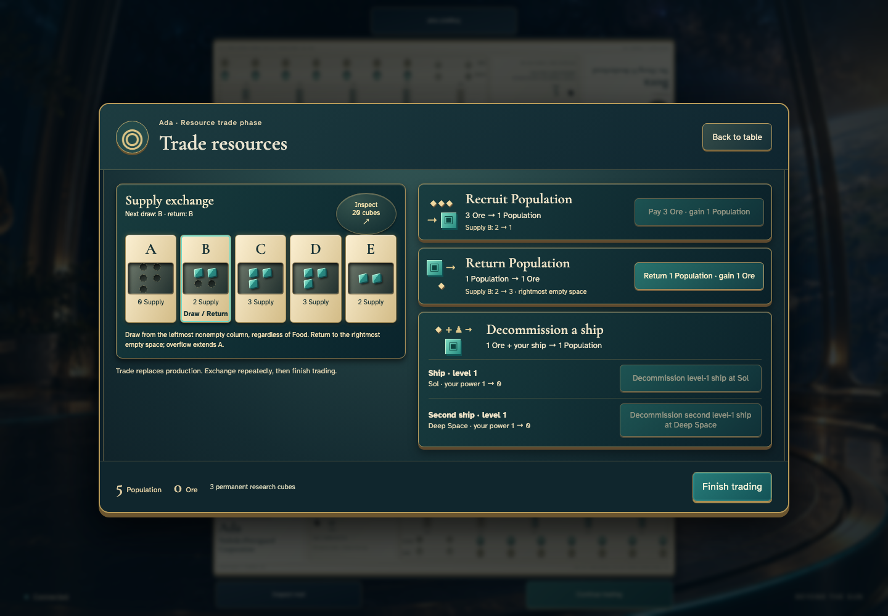](../../screenshots/trade-from-a-food-covered-supply-column-without-ordinary-production-at-physical-shared-seats/052-covered-trade-reopened-desktop-darwin.png) |

tabletop-4k · 3840 × 2160

- [x] Open the same retained trade without duplicating a payment
- [x] Canonical effects settle before capture.
- [x] Any printed Action plan is ready.
- [x] The rotated trade explanation stays above the opaque footer.
- [x] Public compact topology remains physically separated.
- [x] The gameplay shell fits the actual viewport.

## 54. Inspect all twenty cubes in their current public locations

Viewpoint: **Ada · South · one shared controller**.

| desktop · 1440 × 1000 |
| --- |
|  |

tabletop-4k · 3840 × 2160

- [x] Inspect all twenty cubes in their current public locations
- [x] Canonical effects settle before capture.
- [x] Any printed Action plan is ready.
- [x] The rotated trade explanation stays above the opaque footer.
- [x] Public compact topology remains physically separated.
- [x] The gameplay shell fits the actual viewport.

## 55. Forward Tab stays inside the native cube reader

Viewpoint: **Ada · South · one shared controller**.

| desktop · 1440 × 1000 |
| --- |
|  |

tabletop-4k · 3840 × 2160

[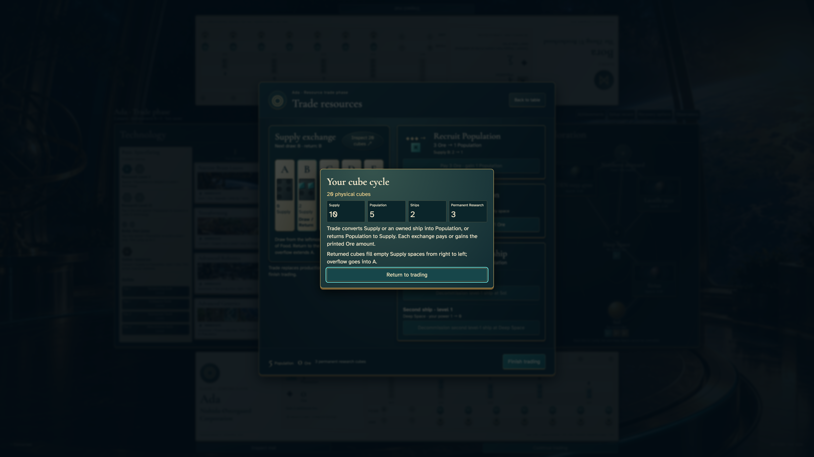](../../screenshots/trade-from-a-food-covered-supply-column-without-ordinary-production-at-physical-shared-seats/054-covered-conservation-tab-tabletop-4k-darwin.png)

- [x] Forward Tab stays inside the native cube reader
- [x] Canonical effects settle before capture.
- [x] Any printed Action plan is ready.
- [x] The rotated trade explanation stays above the opaque footer.
- [x] Public compact topology remains physically separated.
- [x] The gameplay shell fits the actual viewport.

## 56. Reverse Tab also stays inside the native reader

Viewpoint: **Ada · South · one shared controller**.

| desktop · 1440 × 1000 |
| --- |
| [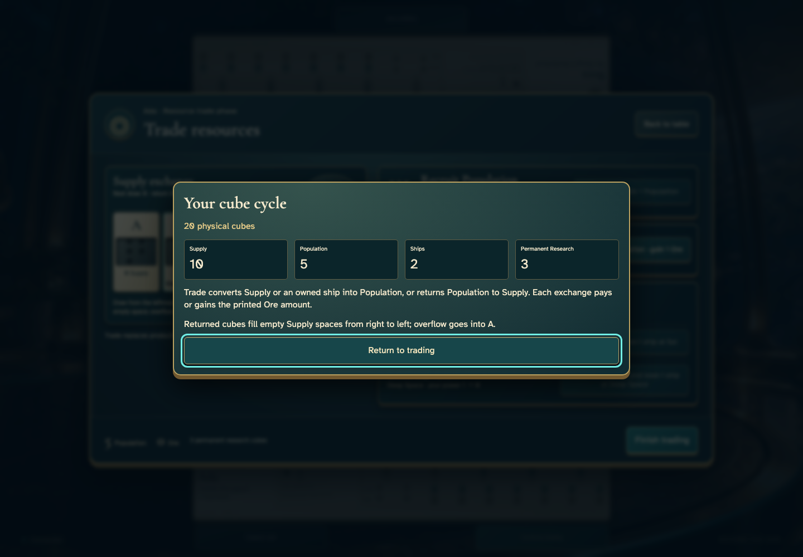](../../screenshots/trade-from-a-food-covered-supply-column-without-ordinary-production-at-physical-shared-seats/055-covered-conservation-reverse-desktop-darwin.png) |

tabletop-4k · 3840 × 2160

- [x] Reverse Tab also stays inside the native reader
- [x] Canonical effects settle before capture.
- [x] Any printed Action plan is ready.
- [x] The rotated trade explanation stays above the opaque footer.
- [x] Public compact topology remains physically separated.
- [x] The gameplay shell fits the actual viewport.

## 57. Escape restores the exact inspector opener without committing a trade

Viewpoint: **Ada · South · one shared controller**.

| desktop · 1440 × 1000 |
| --- |
| [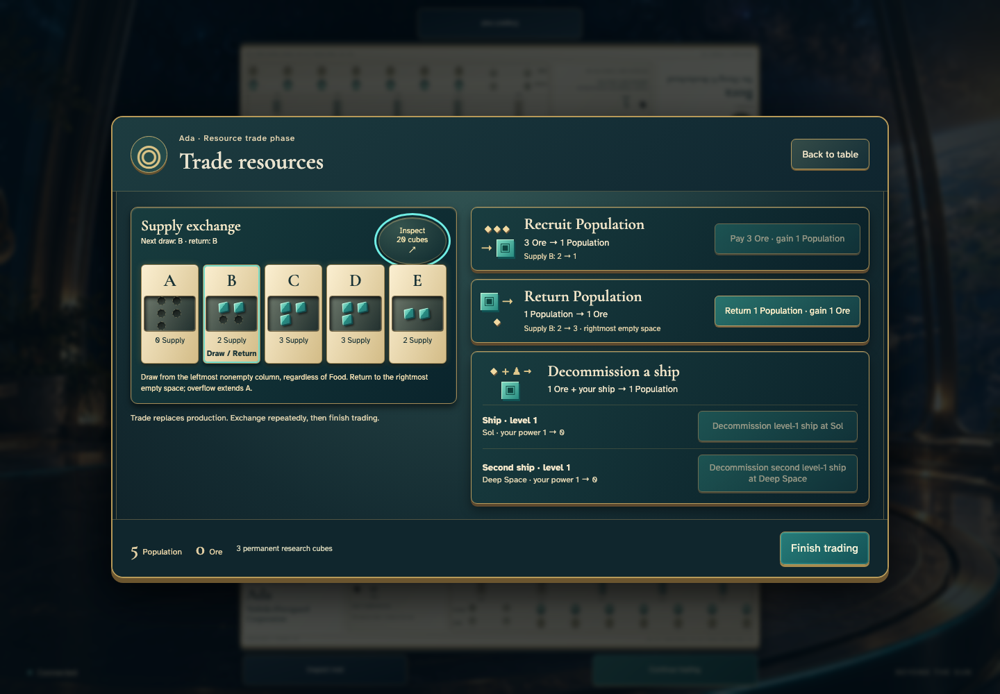](../../screenshots/trade-from-a-food-covered-supply-column-without-ordinary-production-at-physical-shared-seats/056-covered-conservation-return-desktop-darwin.png) |

tabletop-4k · 3840 × 2160

- [x] Escape restores the exact inspector opener without committing a trade
- [x] Canonical effects settle before capture.
- [x] Any printed Action plan is ready.
- [x] The rotated trade explanation stays above the opaque footer.
- [x] Public compact topology remains physically separated.
- [x] The gameplay shell fits the actual viewport.

## 58. Finish trading passes to the next player without adding growth or Ore production

Viewpoint: **Ada · South · one shared controller**.

| desktop · 1440 × 1000 |
| --- |
|  |

tabletop-4k · 3840 × 2160

[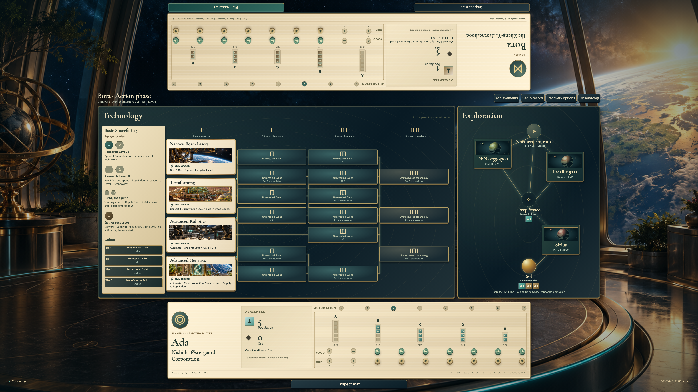](../../screenshots/trade-from-a-food-covered-supply-column-without-ordinary-production-at-physical-shared-seats/057-covered-finished-passed-tabletop-4k-darwin.png)

- [x] Finish trading passes to the next player without adding growth or Ore production
- [x] Canonical effects settle before capture.
- [x] Any printed Action plan is ready.
- [x] The rotated trade explanation stays above the opaque footer.
- [x] Public compact topology remains physically separated.
- [x] The gameplay shell fits the actual viewport.

## 59. The public faction mat retains the final exact trade balance after handoff

Viewpoint: **Ada · South · one shared controller**.

| desktop · 1440 × 1000 |
| --- |
| [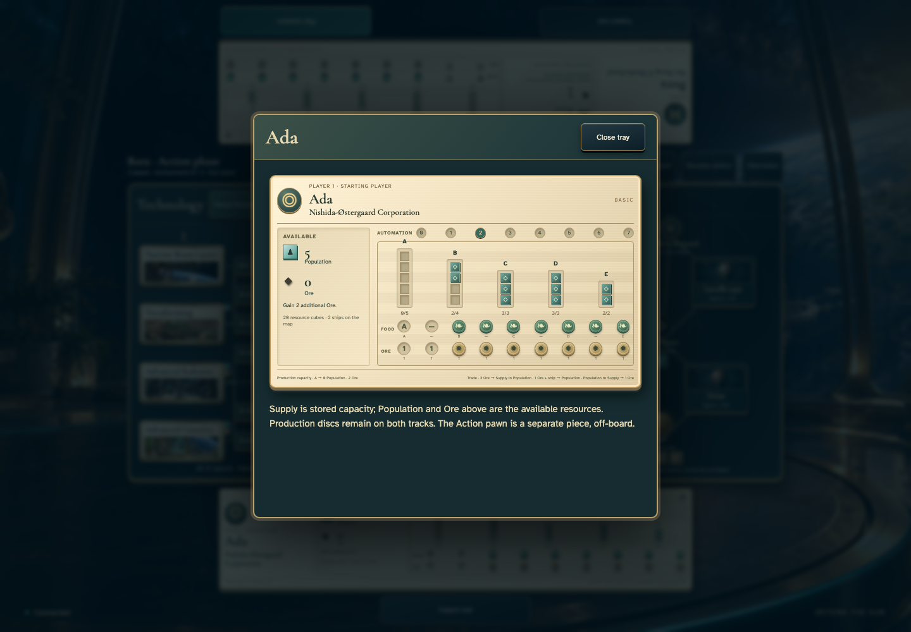](../../screenshots/trade-from-a-food-covered-supply-column-without-ordinary-production-at-physical-shared-seats/058-covered-finished-proof-desktop-darwin.png) |

tabletop-4k · 3840 × 2160

[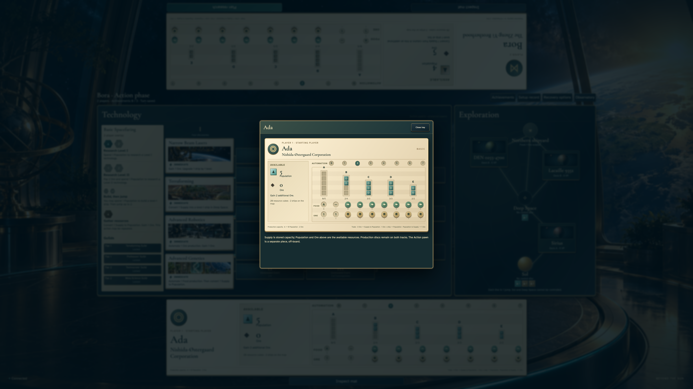](../../screenshots/trade-from-a-food-covered-supply-column-without-ordinary-production-at-physical-shared-seats/058-covered-finished-proof-tabletop-4k-darwin.png)

- [x] The public faction mat retains the final exact trade balance after handoff
- [x] Canonical effects settle before capture.
- [x] Any printed Action plan is ready.
- [x] The rotated trade explanation stays above the opaque footer.
- [x] Public compact topology remains physically separated.
- [x] The gameplay shell fits the actual viewport.

## 60. Escape returns from the actual mat to the handed-off board

Viewpoint: **Ada · South · one shared controller**.

| desktop · 1440 × 1000 |
| --- |
| [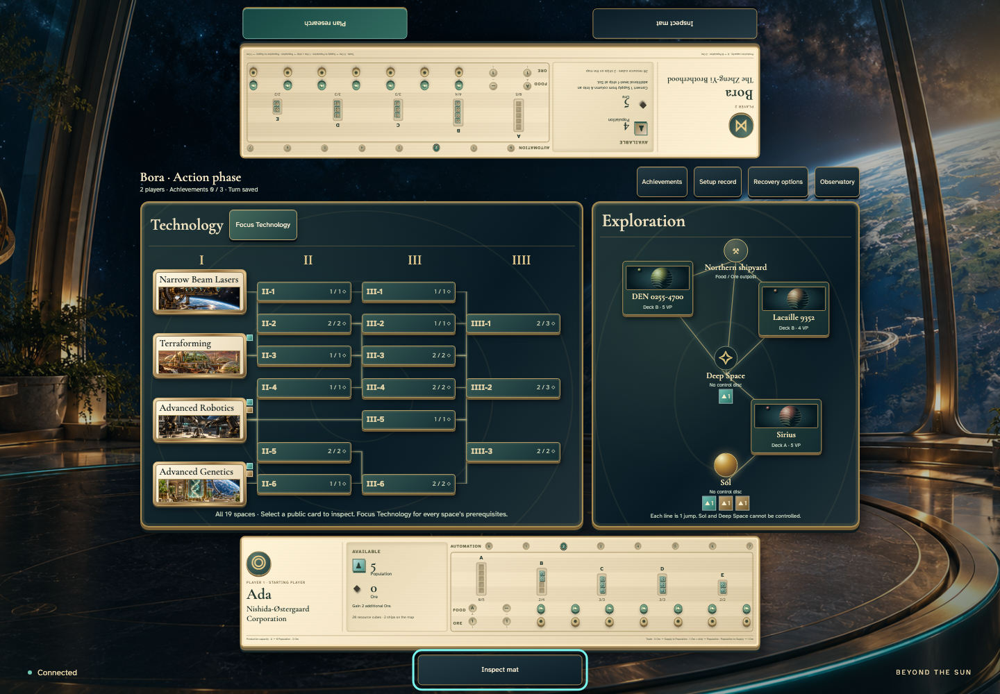](../../screenshots/trade-from-a-food-covered-supply-column-without-ordinary-production-at-physical-shared-seats/059-covered-finished-return-desktop-darwin.png) |

tabletop-4k · 3840 × 2160

[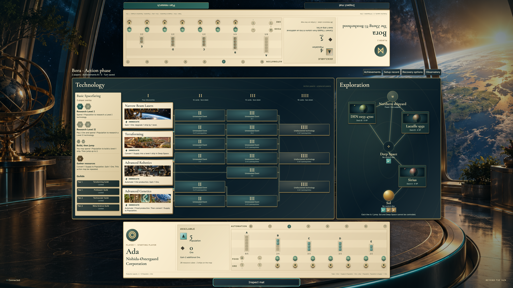](../../screenshots/trade-from-a-food-covered-supply-column-without-ordinary-production-at-physical-shared-seats/059-covered-finished-return-tabletop-4k-darwin.png)

- [x] Escape returns from the actual mat to the handed-off board
- [x] Canonical effects settle before capture.
- [x] Any printed Action plan is ready.
- [x] The rotated trade explanation stays above the opaque footer.
- [x] Public compact topology remains physically separated.
- [x] The gameplay shell fits the actual viewport.

## 61. Reload retains the finished trading turn and leaves no orphaned inspector

Viewpoint: **Ada · South · one shared controller**.

| desktop · 1440 × 1000 |
| --- |
|  |

tabletop-4k · 3840 × 2160

- [x] Reload retains the finished trading turn and leaves no orphaned inspector
- [x] Canonical effects settle before capture.
- [x] Any printed Action plan is ready.
- [x] The rotated trade explanation stays above the opaque footer.
- [x] Public compact topology remains physically separated.
- [x] The gameplay shell fits the actual viewport.
