# Trade from a Food-covered Supply column without ordinary production with separate controllers

Two separate authenticated remote controllers; ordinary UI setup and legal preparatory turns. Only initial setup entropy is fixed to66666666-6666-4666-8666-000000000009. No game-state injection or future-deck inspection. Three exact trade rates, repeated exchanges, rightmost returns/A overflow, covered-column leftmost draws, control-changing decommission and keyboard/reload use production components. No ordinary production is added.

## 1. Arrive using the actual production client

Viewpoint: **Ada · separate host controller**.

| phone · 393 × 852 | desktop · 1440 × 1000 |
| --- | --- |
|  |  |

- [x] Arrive using the actual production client
- [x] Canonical effects settle before capture.
- [x] Any printed Action plan is ready.
- [x] The rotated trade explanation stays above the opaque footer.
- [x] Public compact topology remains physically separated.
- [x] The gameplay shell fits the actual viewport.

## 2. Choose a real production play mode

Viewpoint: **Ada · separate host controller**.

| phone · 393 × 852 | desktop · 1440 × 1000 |
| --- | --- |
|  |  |

- [x] Choose a real production play mode
- [x] Canonical effects settle before capture.
- [x] Any printed Action plan is ready.
- [x] The rotated trade explanation stays above the opaque footer.
- [x] Public compact topology remains physically separated.
- [x] The gameplay shell fits the actual viewport.

## 3. Create an independent remote host controller

Viewpoint: **Ada · separate host controller**.

| phone · 393 × 852 | desktop · 1440 × 1000 |
| --- | --- |
|  |  |

- [x] Create an independent remote host controller
- [x] Canonical effects settle before capture.
- [x] Any printed Action plan is ready.
- [x] The rotated trade explanation stays above the opaque footer.
- [x] Public compact topology remains physically separated.
- [x] The gameplay shell fits the actual viewport.

## 4. Name the host Ada

Viewpoint: **Ada · separate host controller**.

| phone · 393 × 852 | desktop · 1440 × 1000 |
| --- | --- |
|  |  |

- [x] Name the host Ada
- [x] Canonical effects settle before capture.
- [x] Any printed Action plan is ready.
- [x] The rotated trade explanation stays above the opaque footer.
- [x] Public compact topology remains physically separated.
- [x] The gameplay shell fits the actual viewport.

## 5. The canonical remote room exposes its actual invitation code

Viewpoint: **Ada · separate host controller**.

| phone · 393 × 852 | desktop · 1440 × 1000 |
| --- | --- |
| [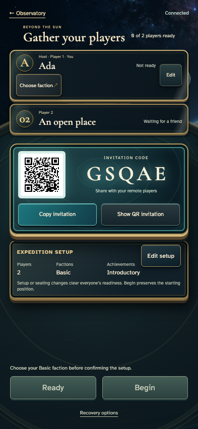](../../screenshots/trade-from-a-food-covered-supply-column-without-ordinary-production-with-separate-controllers/004-host-room-phone-darwin.png) | [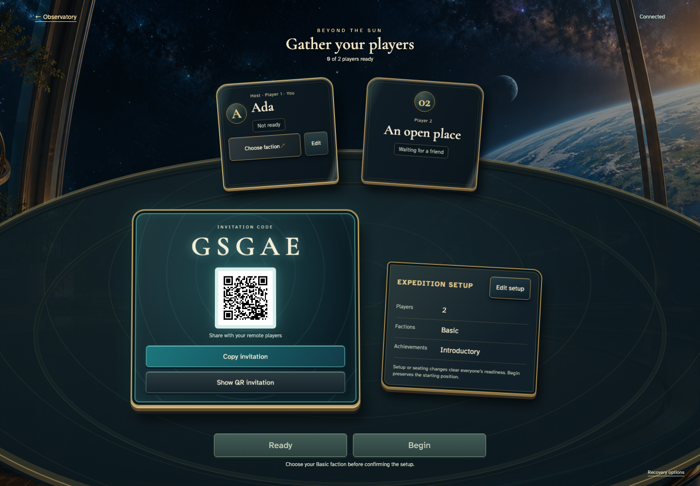](../../screenshots/trade-from-a-food-covered-supply-column-without-ordinary-production-with-separate-controllers/004-host-room-desktop-darwin.png) |

- [x] The canonical remote room exposes its actual invitation code
- [x] Canonical effects settle before capture.
- [x] Any printed Action plan is ready.
- [x] The rotated trade explanation stays above the opaque footer.
- [x] Public compact topology remains physically separated.
- [x] The gameplay shell fits the actual viewport.

## 6. A different identity previews the public invitation

Viewpoint: **Bora · separate guest controller**.

| phone · 1440 × 1000 | desktop · 393 × 852 |
| --- | --- |
| [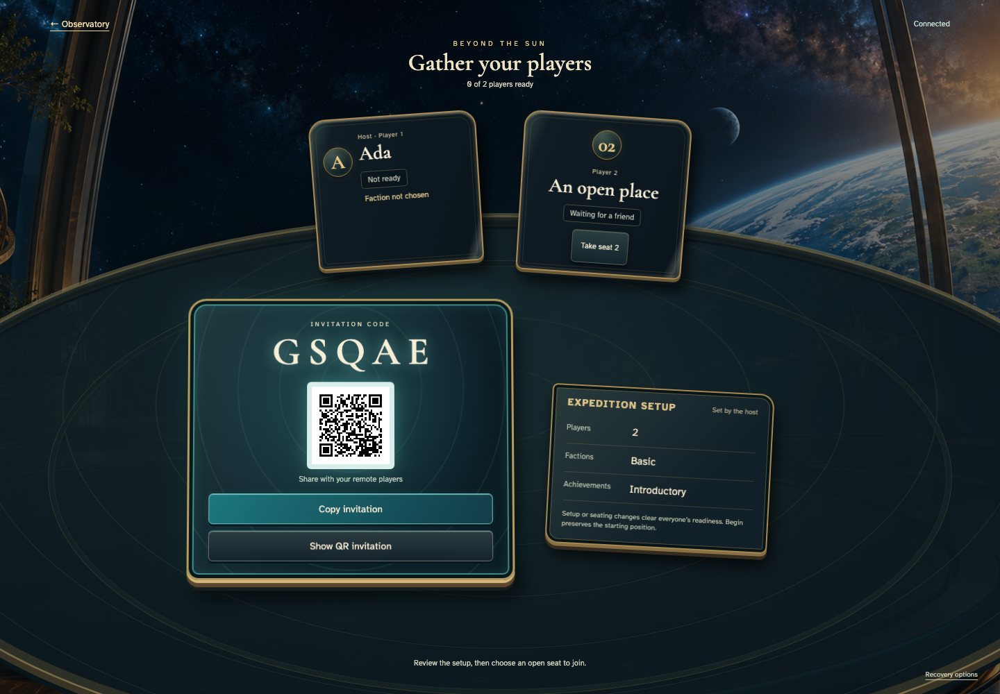](../../screenshots/trade-from-a-food-covered-supply-column-without-ordinary-production-with-separate-controllers/005-guest-preview-phone-darwin.png) | [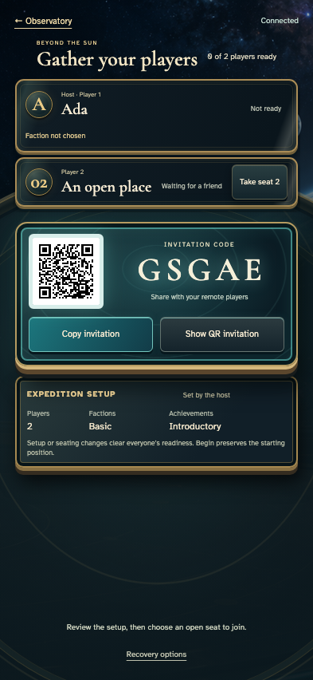](../../screenshots/trade-from-a-food-covered-supply-column-without-ordinary-production-with-separate-controllers/005-guest-preview-desktop-darwin.png) |

- [x] A different identity previews the public invitation
- [x] Canonical effects settle before capture.
- [x] Any printed Action plan is ready.
- [x] The rotated trade explanation stays above the opaque footer.
- [x] Public compact topology remains physically separated.
- [x] The gameplay shell fits the actual viewport.

## 7. The guest claims only the remote seat

Viewpoint: **Bora · separate guest controller**.

| phone · 1440 × 1000 | desktop · 393 × 852 |
| --- | --- |
| [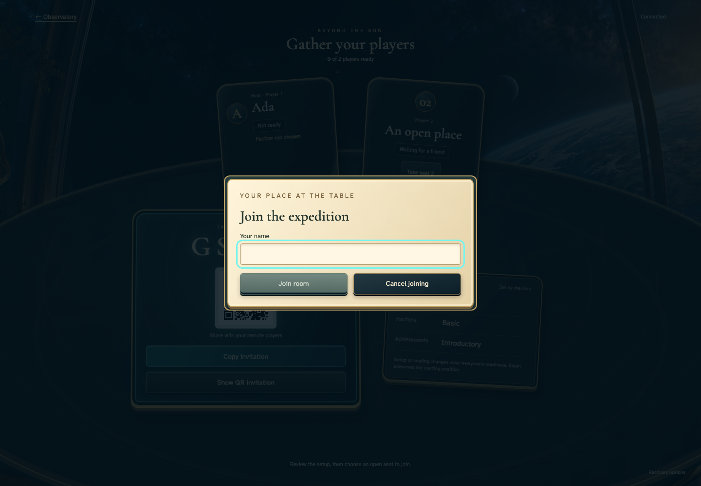](../../screenshots/trade-from-a-food-covered-supply-column-without-ordinary-production-with-separate-controllers/006-guest-editor-phone-darwin.png) |  |

- [x] The guest claims only the remote seat
- [x] Canonical effects settle before capture.
- [x] Any printed Action plan is ready.
- [x] The rotated trade explanation stays above the opaque footer.
- [x] Public compact topology remains physically separated.
- [x] The gameplay shell fits the actual viewport.

## 8. Name the independent guest Bora

Viewpoint: **Bora · separate guest controller**.

| phone · 1440 × 1000 | desktop · 393 × 852 |
| --- | --- |
| [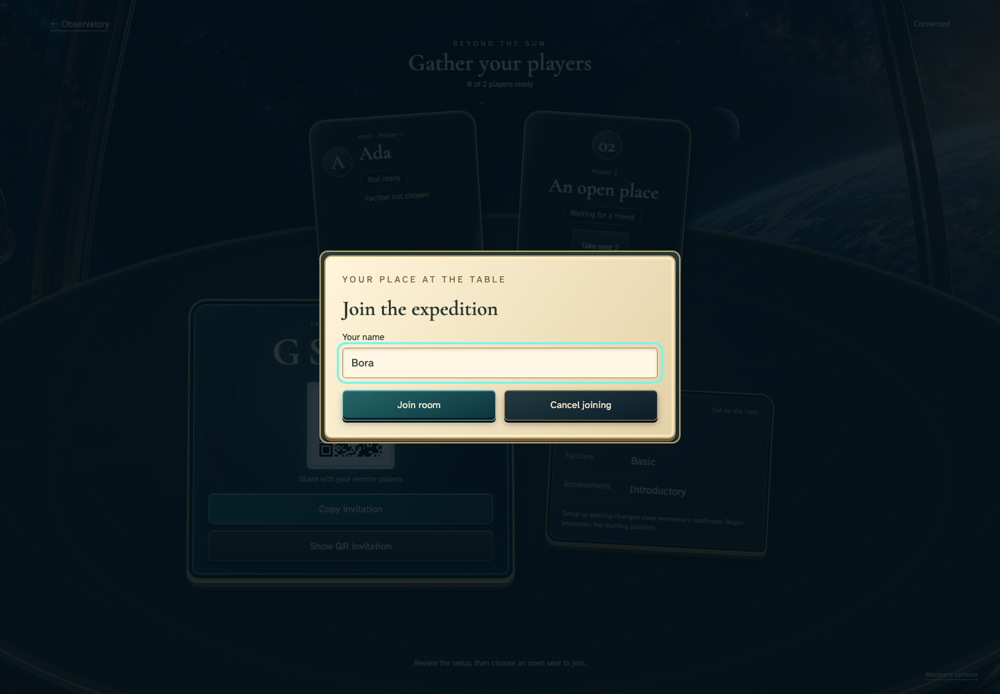](../../screenshots/trade-from-a-food-covered-supply-column-without-ordinary-production-with-separate-controllers/007-guest-name-phone-darwin.png) |  |

- [x] Name the independent guest Bora
- [x] Canonical effects settle before capture.
- [x] Any printed Action plan is ready.
- [x] The rotated trade explanation stays above the opaque footer.
- [x] Public compact topology remains physically separated.
- [x] The gameplay shell fits the actual viewport.

## 9. Both named remote identities share the same room

Viewpoint: **Bora · separate guest controller**.

| phone · 1440 × 1000 | desktop · 393 × 852 |
| --- | --- |
| [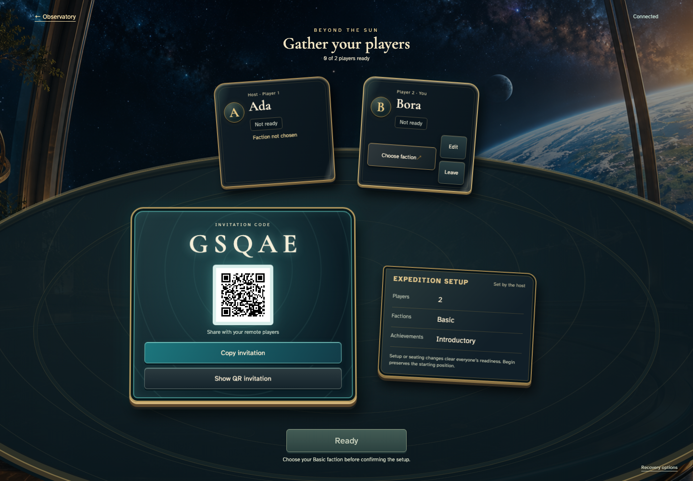](../../screenshots/trade-from-a-food-covered-supply-column-without-ordinary-production-with-separate-controllers/008-guest-joined-phone-darwin.png) | [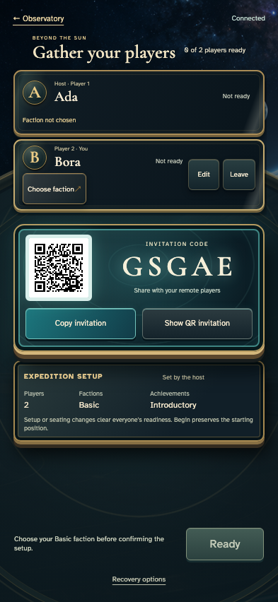](../../screenshots/trade-from-a-food-covered-supply-column-without-ordinary-production-with-separate-controllers/008-guest-joined-desktop-darwin.png) |

- [x] Both named remote identities share the same room
- [x] Canonical effects settle before capture.
- [x] Any printed Action plan is ready.
- [x] The rotated trade explanation stays above the opaque footer.
- [x] Public compact topology remains physically separated.
- [x] The gameplay shell fits the actual viewport.

## 10. Ada chooses a legal unique Basic faction

Viewpoint: **Ada · separate host controller**.

| phone · 393 × 852 | desktop · 1440 × 1000 |
| --- | --- |
|  |  |

- [x] Ada chooses a legal unique Basic faction
- [x] Canonical effects settle before capture.
- [x] Any printed Action plan is ready.
- [x] The rotated trade explanation stays above the opaque footer.
- [x] Public compact topology remains physically separated.
- [x] The gameplay shell fits the actual viewport.

## 11. Ada retains Nishida-Østergaard Corporation

Viewpoint: **Ada · separate host controller**.

| phone · 393 × 852 | desktop · 1440 × 1000 |
| --- | --- |
| [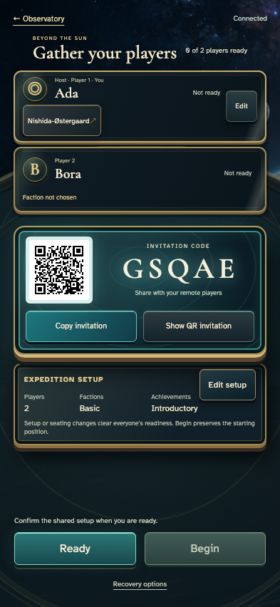](../../screenshots/trade-from-a-food-covered-supply-column-without-ordinary-production-with-separate-controllers/010-faction-0-chosen-phone-darwin.png) | [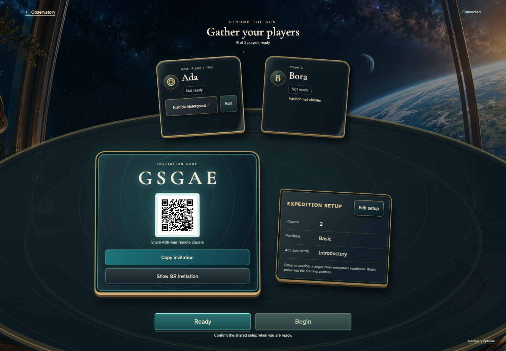](../../screenshots/trade-from-a-food-covered-supply-column-without-ordinary-production-with-separate-controllers/010-faction-0-chosen-desktop-darwin.png) |

- [x] Ada retains Nishida-Østergaard Corporation
- [x] Canonical effects settle before capture.
- [x] Any printed Action plan is ready.
- [x] The rotated trade explanation stays above the opaque footer.
- [x] Public compact topology remains physically separated.
- [x] The gameplay shell fits the actual viewport.

## 12. Bora chooses a legal unique Basic faction

Viewpoint: **Bora · separate guest controller**.

| phone · 1440 × 1000 | desktop · 393 × 852 |
| --- | --- |
|  |  |

- [x] Bora chooses a legal unique Basic faction
- [x] Canonical effects settle before capture.
- [x] Any printed Action plan is ready.
- [x] The rotated trade explanation stays above the opaque footer.
- [x] Public compact topology remains physically separated.
- [x] The gameplay shell fits the actual viewport.

## 13. Bora retains The Zheng-Yi Brotherhood

Viewpoint: **Bora · separate guest controller**.

| phone · 1440 × 1000 | desktop · 393 × 852 |
| --- | --- |
| [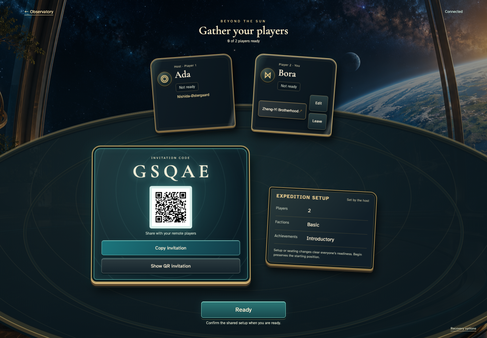](../../screenshots/trade-from-a-food-covered-supply-column-without-ordinary-production-with-separate-controllers/012-faction-1-chosen-phone-darwin.png) | [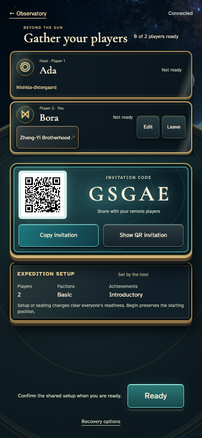](../../screenshots/trade-from-a-food-covered-supply-column-without-ordinary-production-with-separate-controllers/012-faction-1-chosen-desktop-darwin.png) |

- [x] Bora retains The Zheng-Yi Brotherhood
- [x] Canonical effects settle before capture.
- [x] Any printed Action plan is ready.
- [x] The rotated trade explanation stays above the opaque footer.
- [x] Public compact topology remains physically separated.
- [x] The gameplay shell fits the actual viewport.

## 14. Confirm this identity is ready for the exact saved configuration

Viewpoint: **Bora · separate guest controller**.

| phone · 1440 × 1000 | desktop · 393 × 852 |
| --- | --- |
|  | [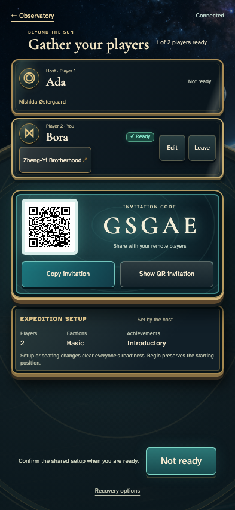](../../screenshots/trade-from-a-food-covered-supply-column-without-ordinary-production-with-separate-controllers/013-ready-1-desktop-darwin.png) |

- [x] Confirm this identity is ready for the exact saved configuration
- [x] Canonical effects settle before capture.
- [x] Any printed Action plan is ready.
- [x] The rotated trade explanation stays above the opaque footer.
- [x] Public compact topology remains physically separated.
- [x] The gameplay shell fits the actual viewport.

## 15. Confirm this identity is ready for the exact saved configuration

Viewpoint: **Ada · separate host controller**.

| phone · 393 × 852 | desktop · 1440 × 1000 |
| --- | --- |
| [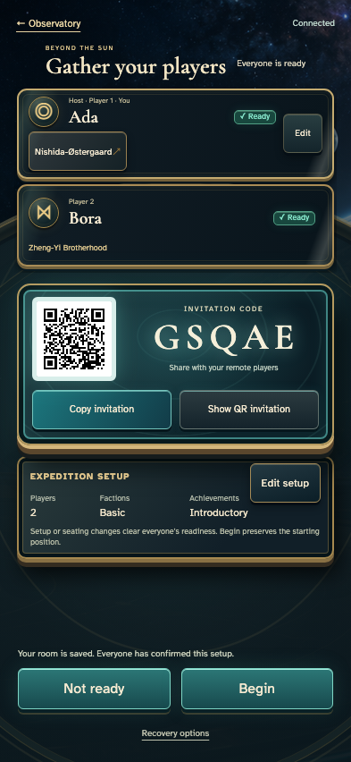](../../screenshots/trade-from-a-food-covered-supply-column-without-ordinary-production-with-separate-controllers/014-ready-0-phone-darwin.png) |  |

- [x] Confirm this identity is ready for the exact saved configuration
- [x] Canonical effects settle before capture.
- [x] Any printed Action plan is ready.
- [x] The rotated trade explanation stays above the opaque footer.
- [x] Public compact topology remains physically separated.
- [x] The gameplay shell fits the actual viewport.

## 16. Begin the immutable source-reviewed Basic setup through the ordinary UI

Viewpoint: **Ada · separate host controller**.

| phone · 393 × 852 | desktop · 1440 × 1000 |
| --- | --- |
|  | [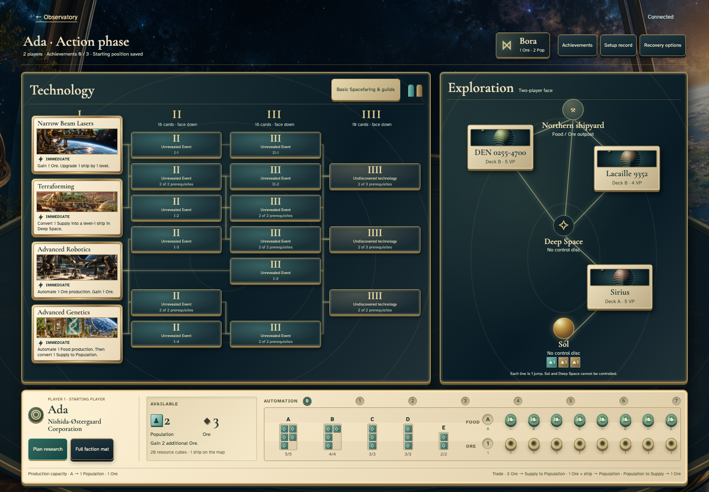](../../screenshots/trade-from-a-food-covered-supply-column-without-ordinary-production-with-separate-controllers/015-begun-desktop-darwin.png) |

- [x] Begin the immutable source-reviewed Basic setup through the ordinary UI
- [x] Canonical effects settle before capture.
- [x] Any printed Action plan is ready.
- [x] The rotated trade explanation stays above the opaque footer.
- [x] Public compact topology remains physically separated.
- [x] The gameplay shell fits the actual viewport.

## 17. Ada opens the actual research and Action instrument

Viewpoint: **Ada · separate host controller**.

| phone · 393 × 852 | desktop · 1440 × 1000 |
| --- | --- |
|  |  |

- [x] Ada opens the actual research and Action instrument
- [x] Canonical effects settle before capture.
- [x] Any printed Action plan is ready.
- [x] The rotated trade explanation stays above the opaque footer.
- [x] Public compact topology remains physically separated.
- [x] The gameplay shell fits the actual viewport.

## 18. Ada selects the legal printed space 1

Viewpoint: **Ada · separate host controller**.

| phone · 393 × 852 | desktop · 1440 × 1000 |
| --- | --- |
|  |  |

- [x] Ada selects the legal printed space 1
- [x] Canonical effects settle before capture.
- [x] Any printed Action plan is ready.
- [x] The rotated trade explanation stays above the opaque footer.
- [x] Public compact topology remains physically separated.
- [x] The gameplay shell fits the actual viewport.

## 19. Select Terraforming with its printed cost and consequence

Viewpoint: **Ada · separate host controller**.

| phone · 393 × 852 | desktop · 1440 × 1000 |
| --- | --- |
| [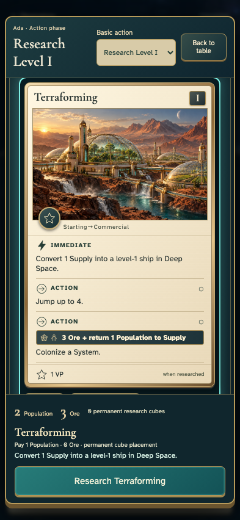](../../screenshots/trade-from-a-food-covered-supply-column-without-ordinary-production-with-separate-controllers/018-r0-ada-card-phone-darwin.png) |  |

- [x] Select Terraforming with its printed cost and consequence
- [x] Canonical effects settle before capture.
- [x] Any printed Action plan is ready.
- [x] The rotated trade explanation stays above the opaque footer.
- [x] Public compact topology remains physically separated.
- [x] The gameplay shell fits the actual viewport.

## 20. Pay once and receive Terraforming's immediate bonus

Viewpoint: **Ada · separate host controller**.

| phone · 393 × 852 | desktop · 1440 × 1000 |
| --- | --- |
|  | [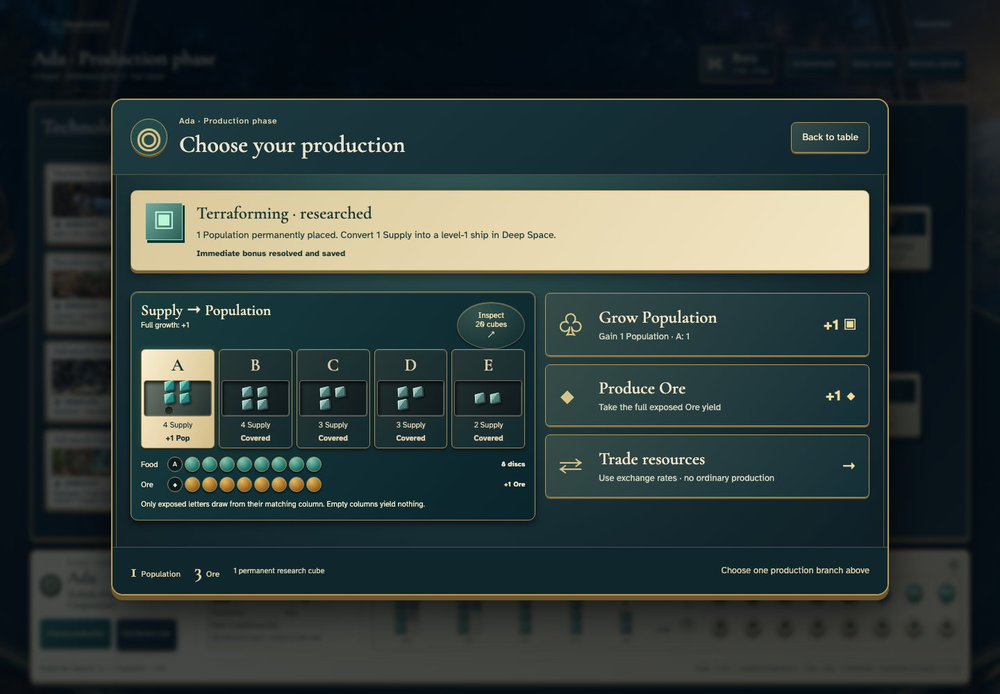](../../screenshots/trade-from-a-food-covered-supply-column-without-ordinary-production-with-separate-controllers/019-r0-ada-researched-desktop-darwin.png) |

- [x] Pay once and receive Terraforming's immediate bonus
- [x] Canonical effects settle before capture.
- [x] Any printed Action plan is ready.
- [x] The rotated trade explanation stays above the opaque footer.
- [x] Public compact topology remains physically separated.
- [x] The gameplay shell fits the actual viewport.

## 21. Ada completes production and hands off to Bora

Viewpoint: **Ada · separate host controller**.

| phone · 393 × 852 | desktop · 1440 × 1000 |
| --- | --- |
|  | [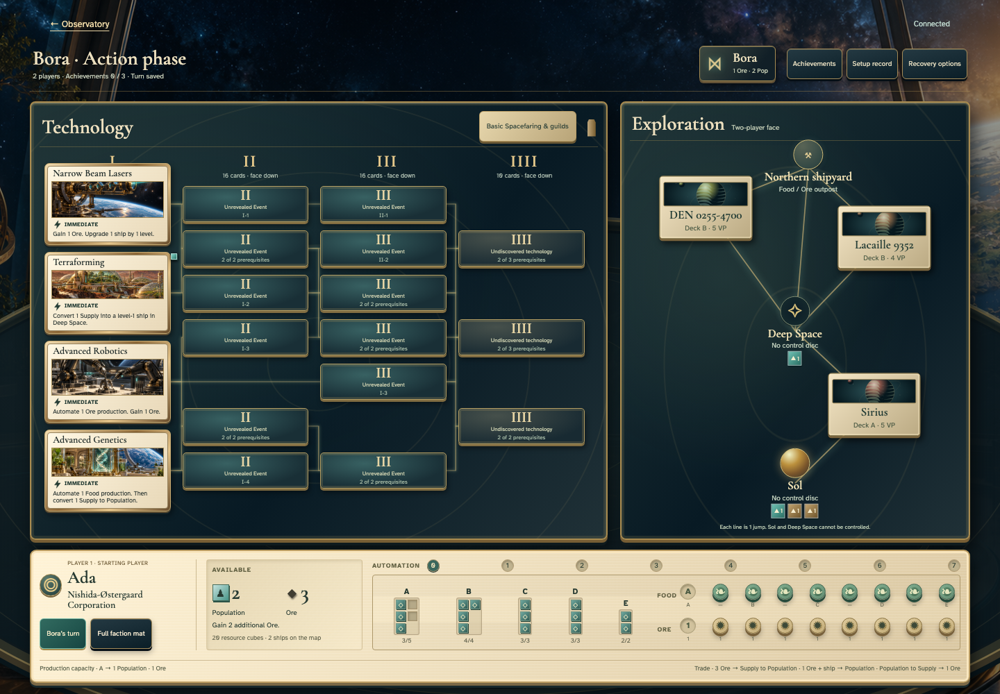](../../screenshots/trade-from-a-food-covered-supply-column-without-ordinary-production-with-separate-controllers/020-r0-ada-handoff-desktop-darwin.png) |

- [x] Ada completes production and hands off to Bora
- [x] Canonical effects settle before capture.
- [x] Any printed Action plan is ready.
- [x] The rotated trade explanation stays above the opaque footer.
- [x] Public compact topology remains physically separated.
- [x] The gameplay shell fits the actual viewport.

## 22. The independent next controller sees the canonical handoff

Viewpoint: **Bora · separate guest controller**.

| phone · 1440 × 1000 | desktop · 393 × 852 |
| --- | --- |
|  |  |

- [x] The independent next controller sees the canonical handoff
- [x] Canonical effects settle before capture.
- [x] Any printed Action plan is ready.
- [x] The rotated trade explanation stays above the opaque footer.
- [x] Public compact topology remains physically separated.
- [x] The gameplay shell fits the actual viewport.

## 23. Bora opens the actual research and Action instrument

Viewpoint: **Bora · separate guest controller**.

| phone · 1440 × 1000 | desktop · 393 × 852 |
| --- | --- |
| [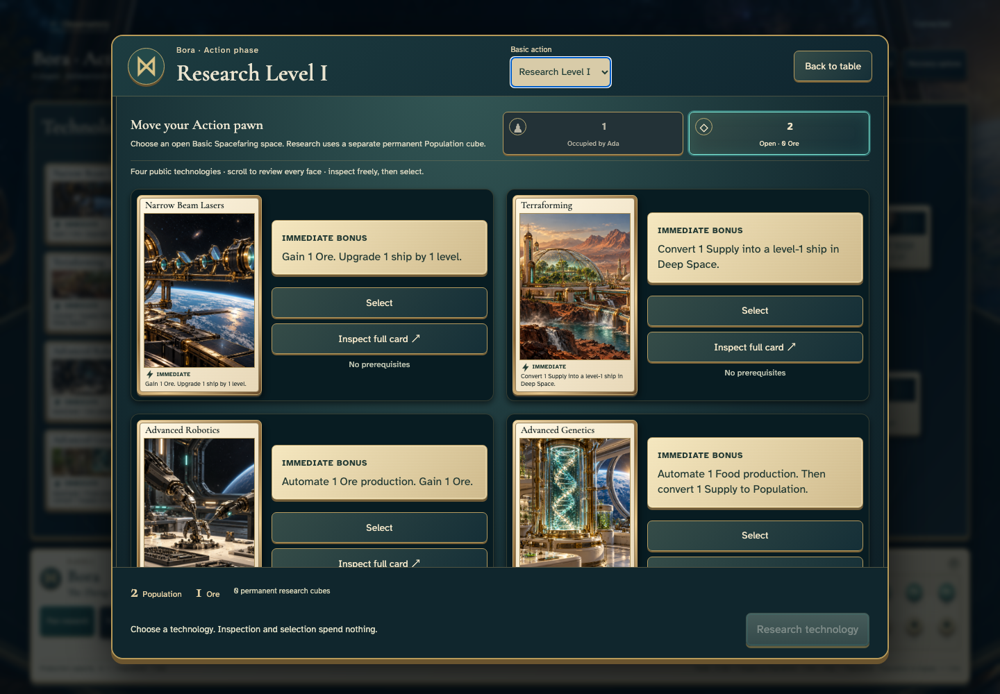](../../screenshots/trade-from-a-food-covered-supply-column-without-ordinary-production-with-separate-controllers/022-r0-bora-plan-phone-darwin.png) |  |

- [x] Bora opens the actual research and Action instrument
- [x] Canonical effects settle before capture.
- [x] Any printed Action plan is ready.
- [x] The rotated trade explanation stays above the opaque footer.
- [x] Public compact topology remains physically separated.
- [x] The gameplay shell fits the actual viewport.

## 24. Bora selects the legal printed space 2

Viewpoint: **Bora · separate guest controller**.

| phone · 1440 × 1000 | desktop · 393 × 852 |
| --- | --- |
| [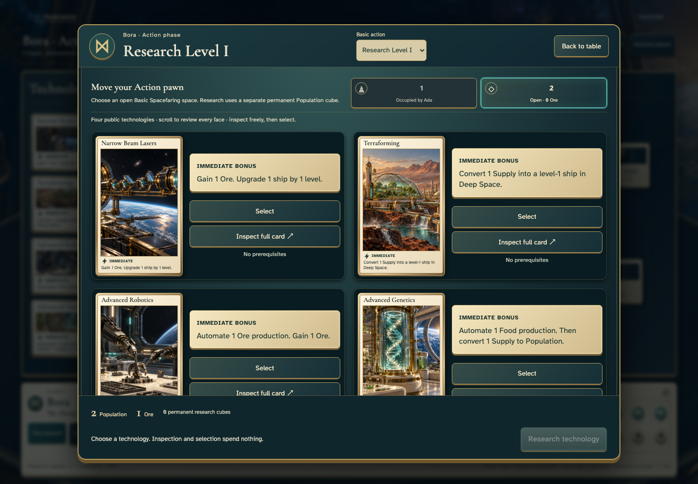](../../screenshots/trade-from-a-food-covered-supply-column-without-ordinary-production-with-separate-controllers/023-r0-bora-space-phone-darwin.png) |  |

- [x] Bora selects the legal printed space 2
- [x] Canonical effects settle before capture.
- [x] Any printed Action plan is ready.
- [x] The rotated trade explanation stays above the opaque footer.
- [x] Public compact topology remains physically separated.
- [x] The gameplay shell fits the actual viewport.

## 25. Select Advanced Robotics with its printed cost and consequence

Viewpoint: **Bora · separate guest controller**.

| phone · 1440 × 1000 | desktop · 393 × 852 |
| --- | --- |
| [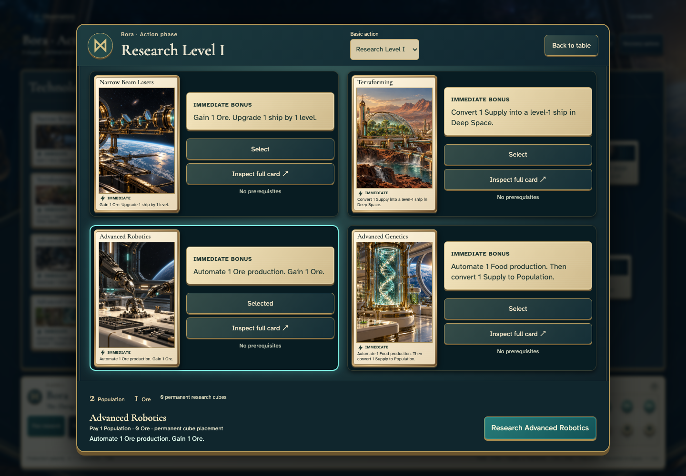](../../screenshots/trade-from-a-food-covered-supply-column-without-ordinary-production-with-separate-controllers/024-r0-bora-card-phone-darwin.png) |  |

- [x] Select Advanced Robotics with its printed cost and consequence
- [x] Canonical effects settle before capture.
- [x] Any printed Action plan is ready.
- [x] The rotated trade explanation stays above the opaque footer.
- [x] Public compact topology remains physically separated.
- [x] The gameplay shell fits the actual viewport.

## 26. Pay once and receive Advanced Robotics's immediate bonus

Viewpoint: **Bora · separate guest controller**.

| phone · 1440 × 1000 | desktop · 393 × 852 |
| --- | --- |
|  |  |

- [x] Pay once and receive Advanced Robotics's immediate bonus
- [x] Canonical effects settle before capture.
- [x] Any printed Action plan is ready.
- [x] The rotated trade explanation stays above the opaque footer.
- [x] Public compact topology remains physically separated.
- [x] The gameplay shell fits the actual viewport.

## 27. Bora completes production and hands off to Ada

Viewpoint: **Bora · separate guest controller**.

| phone · 1440 × 1000 | desktop · 393 × 852 |
| --- | --- |
|  |  |

- [x] Bora completes production and hands off to Ada
- [x] Canonical effects settle before capture.
- [x] Any printed Action plan is ready.
- [x] The rotated trade explanation stays above the opaque footer.
- [x] Public compact topology remains physically separated.
- [x] The gameplay shell fits the actual viewport.

## 28. The independent next controller sees the canonical handoff

Viewpoint: **Ada · separate host controller**.

| phone · 393 × 852 | desktop · 1440 × 1000 |
| --- | --- |
| [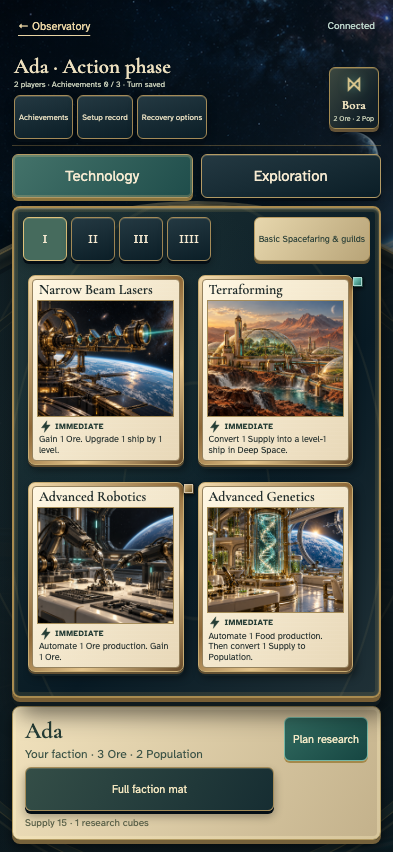](../../screenshots/trade-from-a-food-covered-supply-column-without-ordinary-production-with-separate-controllers/027-r0-bora-next-phone-darwin.png) |  |

- [x] The independent next controller sees the canonical handoff
- [x] Canonical effects settle before capture.
- [x] Any printed Action plan is ready.
- [x] The rotated trade explanation stays above the opaque footer.
- [x] Public compact topology remains physically separated.
- [x] The gameplay shell fits the actual viewport.

## 29. Ada opens the actual research and Action instrument

Viewpoint: **Ada · separate host controller**.

| phone · 393 × 852 | desktop · 1440 × 1000 |
| --- | --- |
| [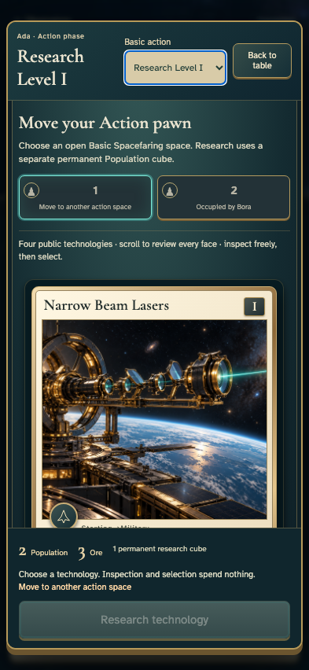](../../screenshots/trade-from-a-food-covered-supply-column-without-ordinary-production-with-separate-controllers/028-r1-ada-plan-phone-darwin.png) | [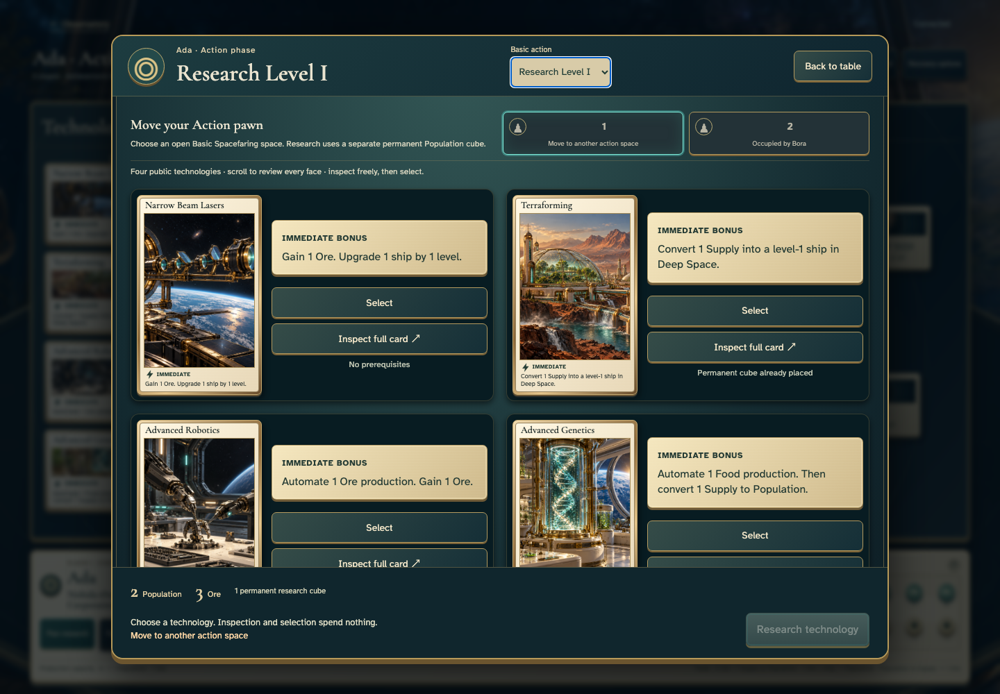](../../screenshots/trade-from-a-food-covered-supply-column-without-ordinary-production-with-separate-controllers/028-r1-ada-plan-desktop-darwin.png) |

- [x] Ada opens the actual research and Action instrument
- [x] Canonical effects settle before capture.
- [x] Any printed Action plan is ready.
- [x] The rotated trade explanation stays above the opaque footer.
- [x] Public compact topology remains physically separated.
- [x] The gameplay shell fits the actual viewport.

## 30. Ada selects ordinary gathering

Viewpoint: **Ada · separate host controller**.

| phone · 393 × 852 | desktop · 1440 × 1000 |
| --- | --- |
|  |  |

- [x] Ada selects ordinary gathering
- [x] Canonical effects settle before capture.
- [x] Any printed Action plan is ready.
- [x] The rotated trade explanation stays above the opaque footer.
- [x] Public compact topology remains physically separated.
- [x] The gameplay shell fits the actual viewport.

## 31. Receive the printed gather resources before ordinary production

Viewpoint: **Ada · separate host controller**.

| phone · 393 × 852 | desktop · 1440 × 1000 |
| --- | --- |
| [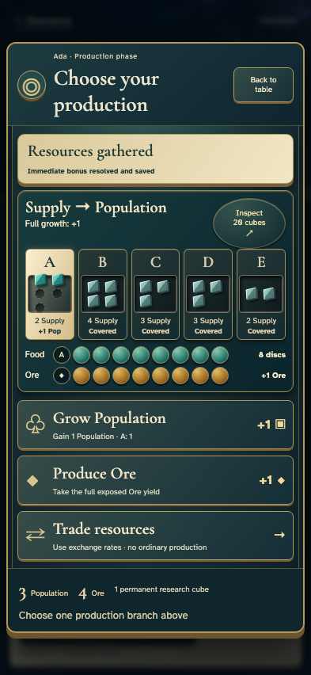](../../screenshots/trade-from-a-food-covered-supply-column-without-ordinary-production-with-separate-controllers/030-r1-ada-gathered-phone-darwin.png) |  |

- [x] Receive the printed gather resources before ordinary production
- [x] Canonical effects settle before capture.
- [x] Any printed Action plan is ready.
- [x] The rotated trade explanation stays above the opaque footer.
- [x] Public compact topology remains physically separated.
- [x] The gameplay shell fits the actual viewport.

## 32. Ada completes production and hands off to Bora

Viewpoint: **Ada · separate host controller**.

| phone · 393 × 852 | desktop · 1440 × 1000 |
| --- | --- |
|  |  |

- [x] Ada completes production and hands off to Bora
- [x] Canonical effects settle before capture.
- [x] Any printed Action plan is ready.
- [x] The rotated trade explanation stays above the opaque footer.
- [x] Public compact topology remains physically separated.
- [x] The gameplay shell fits the actual viewport.

## 33. The independent next controller sees the canonical handoff

Viewpoint: **Bora · separate guest controller**.

| phone · 1440 × 1000 | desktop · 393 × 852 |
| --- | --- |
|  |  |

- [x] The independent next controller sees the canonical handoff
- [x] Canonical effects settle before capture.
- [x] Any printed Action plan is ready.
- [x] The rotated trade explanation stays above the opaque footer.
- [x] Public compact topology remains physically separated.
- [x] The gameplay shell fits the actual viewport.

## 34. Bora opens the actual research and Action instrument

Viewpoint: **Bora · separate guest controller**.

| phone · 1440 × 1000 | desktop · 393 × 852 |
| --- | --- |
| [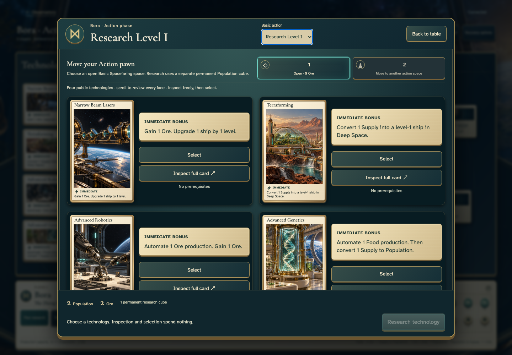](../../screenshots/trade-from-a-food-covered-supply-column-without-ordinary-production-with-separate-controllers/033-r1-bora-plan-phone-darwin.png) |  |

- [x] Bora opens the actual research and Action instrument
- [x] Canonical effects settle before capture.
- [x] Any printed Action plan is ready.
- [x] The rotated trade explanation stays above the opaque footer.
- [x] Public compact topology remains physically separated.
- [x] The gameplay shell fits the actual viewport.

## 35. Bora selects the legal printed space 1

Viewpoint: **Bora · separate guest controller**.

| phone · 1440 × 1000 | desktop · 393 × 852 |
| --- | --- |
|  |  |

- [x] Bora selects the legal printed space 1
- [x] Canonical effects settle before capture.
- [x] Any printed Action plan is ready.
- [x] The rotated trade explanation stays above the opaque footer.
- [x] Public compact topology remains physically separated.
- [x] The gameplay shell fits the actual viewport.

## 36. Select Advanced Genetics with its printed cost and consequence

Viewpoint: **Bora · separate guest controller**.

| phone · 1440 × 1000 | desktop · 393 × 852 |
| --- | --- |
| [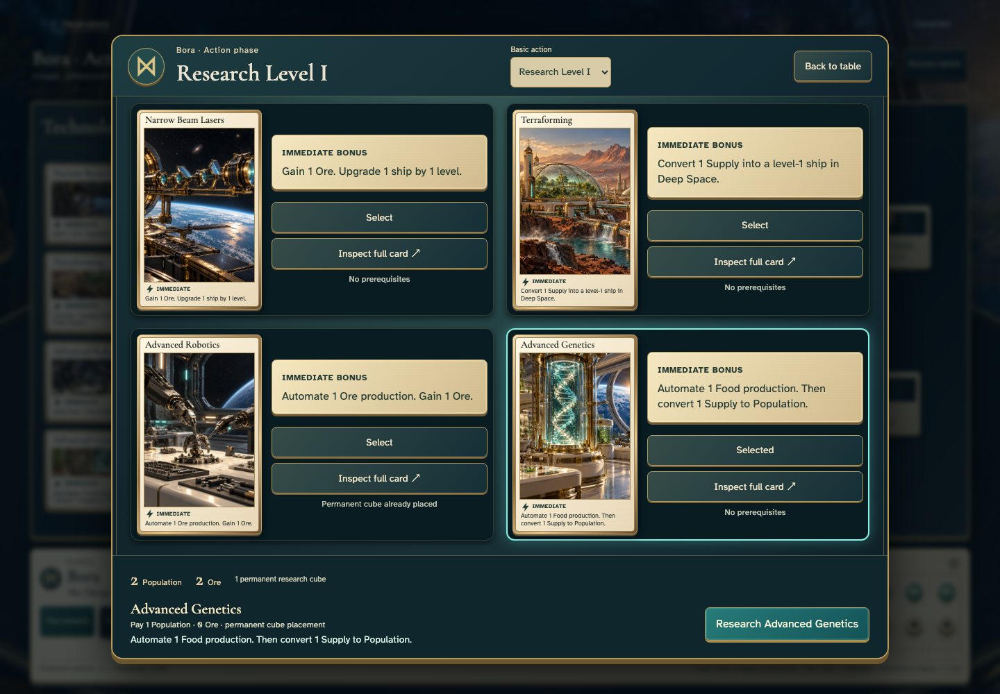](../../screenshots/trade-from-a-food-covered-supply-column-without-ordinary-production-with-separate-controllers/035-r1-bora-card-phone-darwin.png) |  |

- [x] Select Advanced Genetics with its printed cost and consequence
- [x] Canonical effects settle before capture.
- [x] Any printed Action plan is ready.
- [x] The rotated trade explanation stays above the opaque footer.
- [x] Public compact topology remains physically separated.
- [x] The gameplay shell fits the actual viewport.

## 37. Pay once and receive Advanced Genetics's immediate bonus

Viewpoint: **Bora · separate guest controller**.

| phone · 1440 × 1000 | desktop · 393 × 852 |
| --- | --- |
|  |  |

- [x] Pay once and receive Advanced Genetics's immediate bonus
- [x] Canonical effects settle before capture.
- [x] Any printed Action plan is ready.
- [x] The rotated trade explanation stays above the opaque footer.
- [x] Public compact topology remains physically separated.
- [x] The gameplay shell fits the actual viewport.

## 38. Bora completes production and hands off to Ada

Viewpoint: **Bora · separate guest controller**.

| phone · 1440 × 1000 | desktop · 393 × 852 |
| --- | --- |
|  |  |

- [x] Bora completes production and hands off to Ada
- [x] Canonical effects settle before capture.
- [x] Any printed Action plan is ready.
- [x] The rotated trade explanation stays above the opaque footer.
- [x] Public compact topology remains physically separated.
- [x] The gameplay shell fits the actual viewport.

## 39. The independent next controller sees the canonical handoff

Viewpoint: **Ada · separate host controller**.

| phone · 393 × 852 | desktop · 1440 × 1000 |
| --- | --- |
| [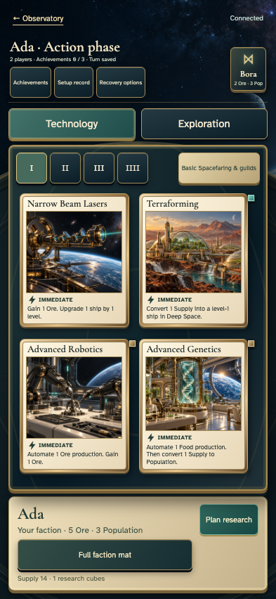](../../screenshots/trade-from-a-food-covered-supply-column-without-ordinary-production-with-separate-controllers/038-r1-bora-next-phone-darwin.png) |  |

- [x] The independent next controller sees the canonical handoff
- [x] Canonical effects settle before capture.
- [x] Any printed Action plan is ready.
- [x] The rotated trade explanation stays above the opaque footer.
- [x] Public compact topology remains physically separated.
- [x] The gameplay shell fits the actual viewport.

## 40. Ada opens the actual research and Action instrument

Viewpoint: **Ada · separate host controller**.

| phone · 393 × 852 | desktop · 1440 × 1000 |
| --- | --- |
|  | [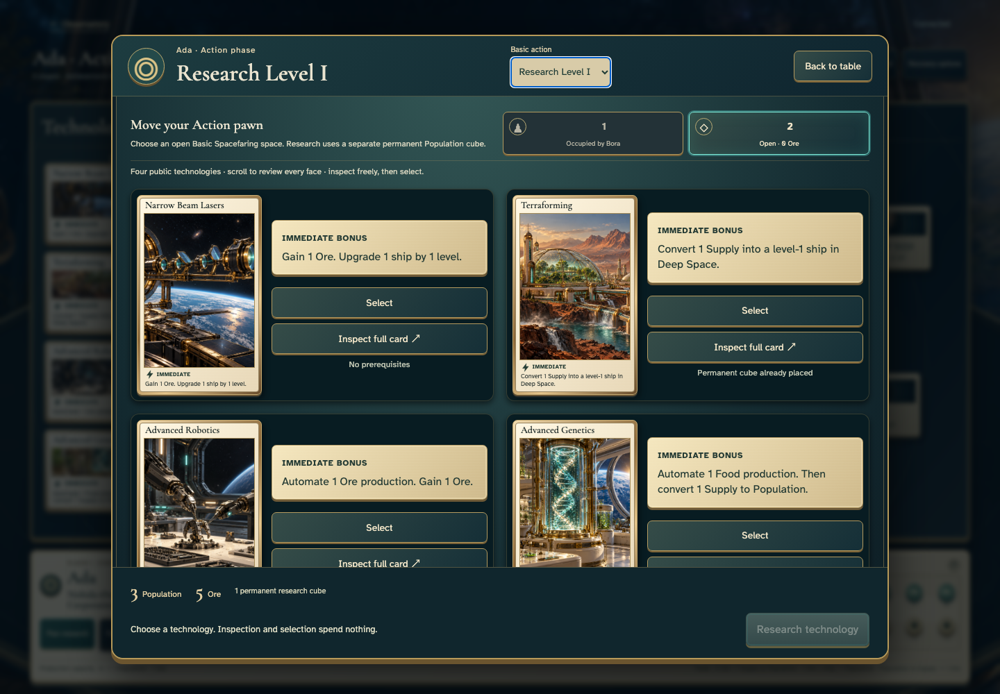](../../screenshots/trade-from-a-food-covered-supply-column-without-ordinary-production-with-separate-controllers/039-r2-ada-plan-desktop-darwin.png) |

- [x] Ada opens the actual research and Action instrument
- [x] Canonical effects settle before capture.
- [x] Any printed Action plan is ready.
- [x] The rotated trade explanation stays above the opaque footer.
- [x] Public compact topology remains physically separated.
- [x] The gameplay shell fits the actual viewport.

## 41. Ada selects the legal printed space 2

Viewpoint: **Ada · separate host controller**.

| phone · 393 × 852 | desktop · 1440 × 1000 |
| --- | --- |
| [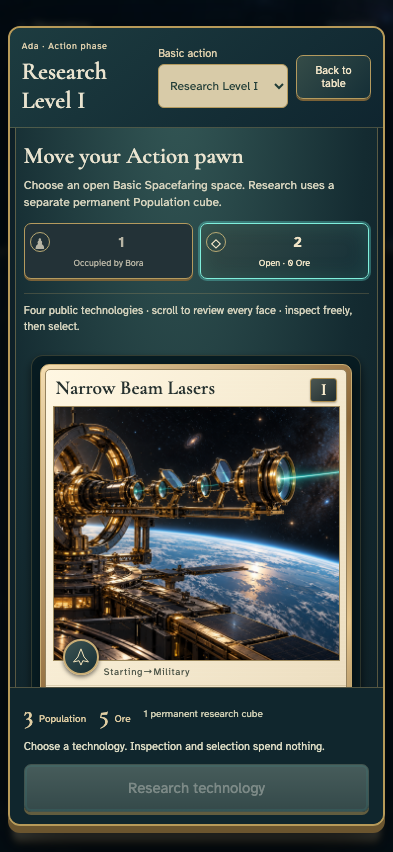](../../screenshots/trade-from-a-food-covered-supply-column-without-ordinary-production-with-separate-controllers/040-r2-ada-space-phone-darwin.png) |  |

- [x] Ada selects the legal printed space 2
- [x] Canonical effects settle before capture.
- [x] Any printed Action plan is ready.
- [x] The rotated trade explanation stays above the opaque footer.
- [x] Public compact topology remains physically separated.
- [x] The gameplay shell fits the actual viewport.

## 42. Select Advanced Genetics with its printed cost and consequence

Viewpoint: **Ada · separate host controller**.

| phone · 393 × 852 | desktop · 1440 × 1000 |
| --- | --- |
| [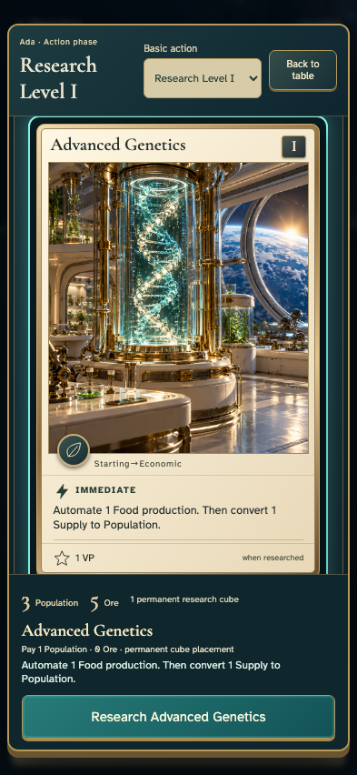](../../screenshots/trade-from-a-food-covered-supply-column-without-ordinary-production-with-separate-controllers/041-r2-ada-card-phone-darwin.png) | [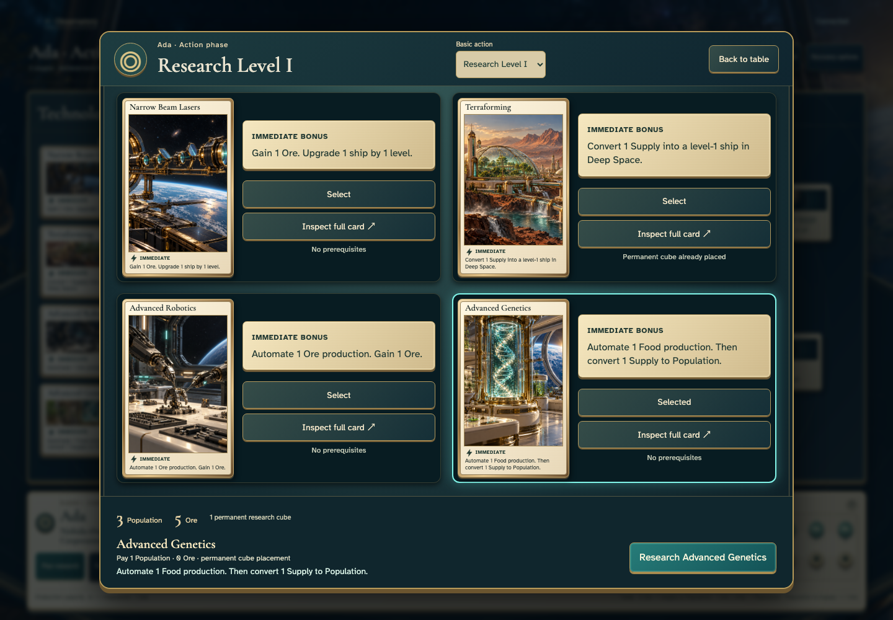](../../screenshots/trade-from-a-food-covered-supply-column-without-ordinary-production-with-separate-controllers/041-r2-ada-card-desktop-darwin.png) |

- [x] Select Advanced Genetics with its printed cost and consequence
- [x] Canonical effects settle before capture.
- [x] Any printed Action plan is ready.
- [x] The rotated trade explanation stays above the opaque footer.
- [x] Public compact topology remains physically separated.
- [x] The gameplay shell fits the actual viewport.

## 43. Pay once and receive Advanced Genetics's immediate bonus

Viewpoint: **Ada · separate host controller**.

| phone · 393 × 852 | desktop · 1440 × 1000 |
| --- | --- |
| [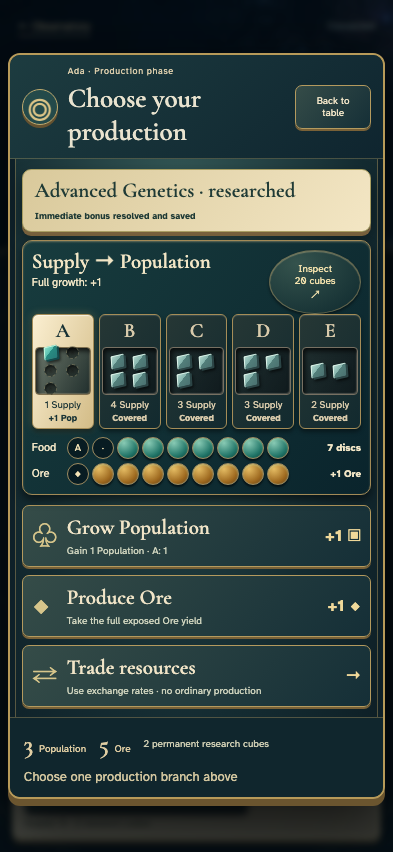](../../screenshots/trade-from-a-food-covered-supply-column-without-ordinary-production-with-separate-controllers/042-r2-ada-researched-phone-darwin.png) | [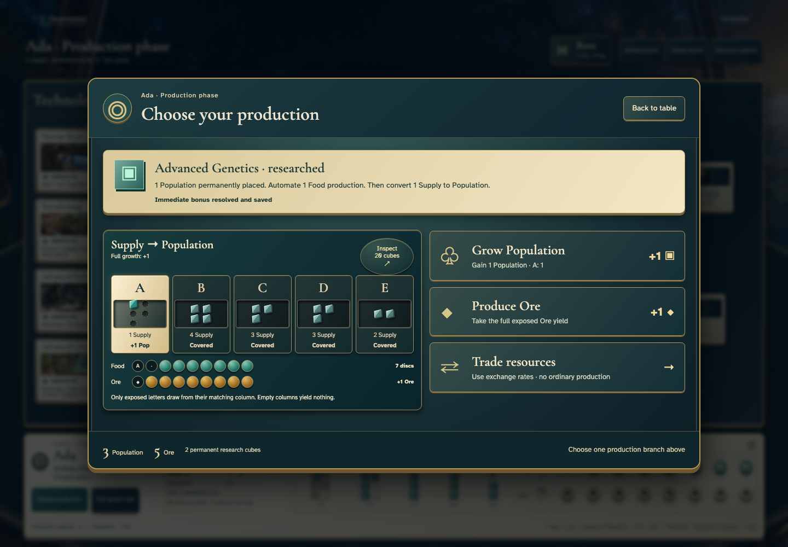](../../screenshots/trade-from-a-food-covered-supply-column-without-ordinary-production-with-separate-controllers/042-r2-ada-researched-desktop-darwin.png) |

- [x] Pay once and receive Advanced Genetics's immediate bonus
- [x] Canonical effects settle before capture.
- [x] Any printed Action plan is ready.
- [x] The rotated trade explanation stays above the opaque footer.
- [x] Public compact topology remains physically separated.
- [x] The gameplay shell fits the actual viewport.

## 44. Ada completes production and hands off to Bora

Viewpoint: **Ada · separate host controller**.

| phone · 393 × 852 | desktop · 1440 × 1000 |
| --- | --- |
|  |  |

- [x] Ada completes production and hands off to Bora
- [x] Canonical effects settle before capture.
- [x] Any printed Action plan is ready.
- [x] The rotated trade explanation stays above the opaque footer.
- [x] Public compact topology remains physically separated.
- [x] The gameplay shell fits the actual viewport.

## 45. The independent next controller sees the canonical handoff

Viewpoint: **Bora · separate guest controller**.

| phone · 1440 × 1000 | desktop · 393 × 852 |
| --- | --- |
|  |  |

- [x] The independent next controller sees the canonical handoff
- [x] Canonical effects settle before capture.
- [x] Any printed Action plan is ready.
- [x] The rotated trade explanation stays above the opaque footer.
- [x] Public compact topology remains physically separated.
- [x] The gameplay shell fits the actual viewport.

## 46. Bora opens the actual research and Action instrument

Viewpoint: **Bora · separate guest controller**.

| phone · 1440 × 1000 | desktop · 393 × 852 |
| --- | --- |
| [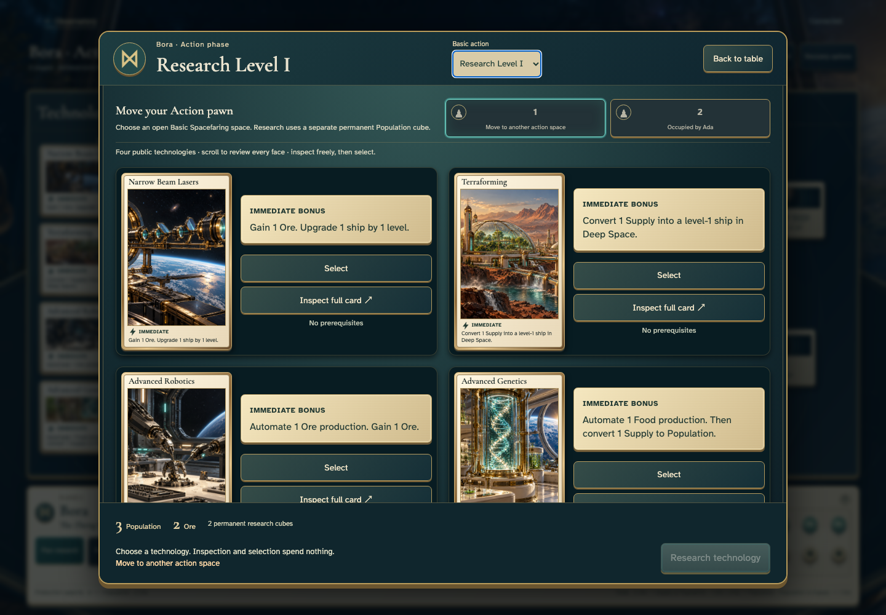](../../screenshots/trade-from-a-food-covered-supply-column-without-ordinary-production-with-separate-controllers/045-r2-bora-plan-phone-darwin.png) |  |

- [x] Bora opens the actual research and Action instrument
- [x] Canonical effects settle before capture.
- [x] Any printed Action plan is ready.
- [x] The rotated trade explanation stays above the opaque footer.
- [x] Public compact topology remains physically separated.
- [x] The gameplay shell fits the actual viewport.

## 47. Bora selects ordinary gathering

Viewpoint: **Bora · separate guest controller**.

| phone · 1440 × 1000 | desktop · 393 × 852 |
| --- | --- |
| [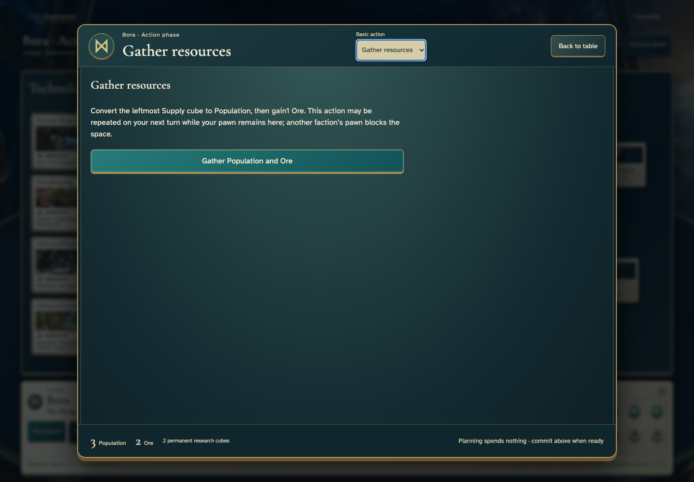](../../screenshots/trade-from-a-food-covered-supply-column-without-ordinary-production-with-separate-controllers/046-r2-bora-kind-phone-darwin.png) | [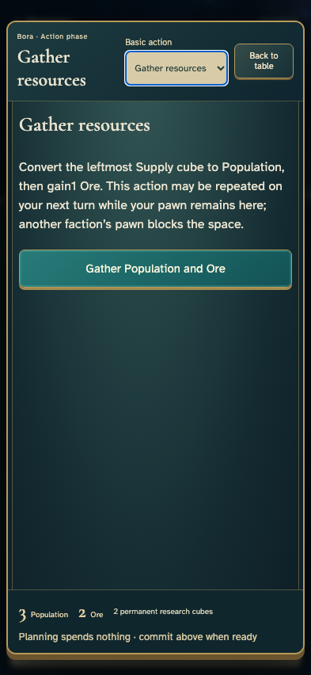](../../screenshots/trade-from-a-food-covered-supply-column-without-ordinary-production-with-separate-controllers/046-r2-bora-kind-desktop-darwin.png) |

- [x] Bora selects ordinary gathering
- [x] Canonical effects settle before capture.
- [x] Any printed Action plan is ready.
- [x] The rotated trade explanation stays above the opaque footer.
- [x] Public compact topology remains physically separated.
- [x] The gameplay shell fits the actual viewport.

## 48. Receive the printed gather resources before ordinary production

Viewpoint: **Bora · separate guest controller**.

| phone · 1440 × 1000 | desktop · 393 × 852 |
| --- | --- |
| [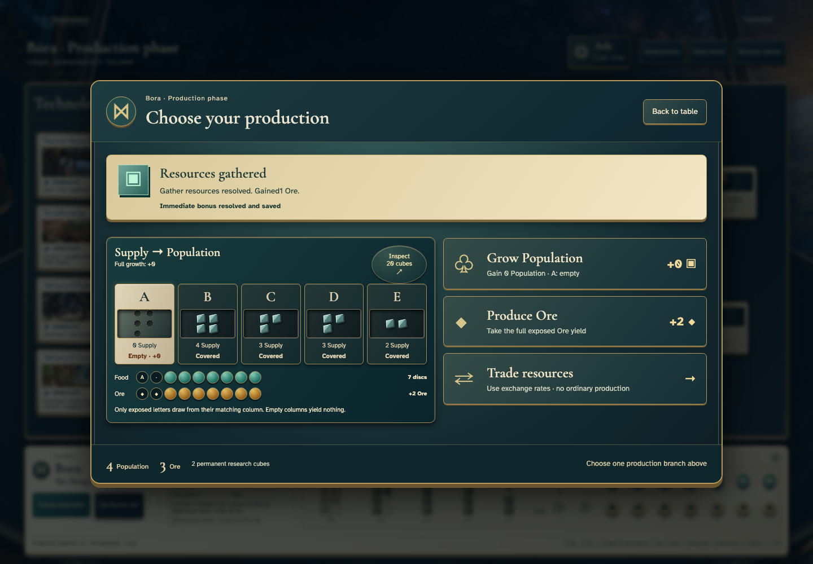](../../screenshots/trade-from-a-food-covered-supply-column-without-ordinary-production-with-separate-controllers/047-r2-bora-gathered-phone-darwin.png) | [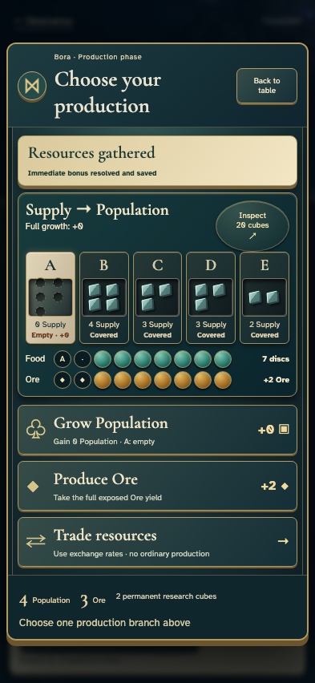](../../screenshots/trade-from-a-food-covered-supply-column-without-ordinary-production-with-separate-controllers/047-r2-bora-gathered-desktop-darwin.png) |

- [x] Receive the printed gather resources before ordinary production
- [x] Canonical effects settle before capture.
- [x] Any printed Action plan is ready.
- [x] The rotated trade explanation stays above the opaque footer.
- [x] Public compact topology remains physically separated.
- [x] The gameplay shell fits the actual viewport.

## 49. Bora completes production and hands off to Ada

Viewpoint: **Bora · separate guest controller**.

| phone · 1440 × 1000 | desktop · 393 × 852 |
| --- | --- |
| [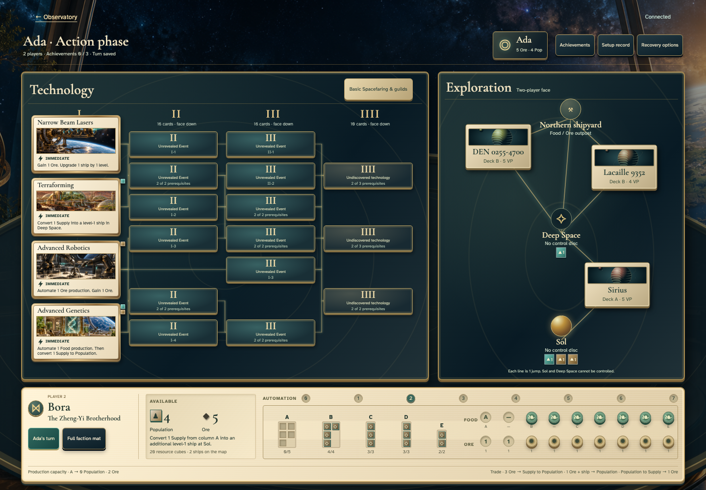](../../screenshots/trade-from-a-food-covered-supply-column-without-ordinary-production-with-separate-controllers/048-r2-bora-handoff-phone-darwin.png) |  |

- [x] Bora completes production and hands off to Ada
- [x] Canonical effects settle before capture.
- [x] Any printed Action plan is ready.
- [x] The rotated trade explanation stays above the opaque footer.
- [x] Public compact topology remains physically separated.
- [x] The gameplay shell fits the actual viewport.

## 50. The independent next controller sees the canonical handoff

Viewpoint: **Ada · separate host controller**.

| phone · 393 × 852 | desktop · 1440 × 1000 |
| --- | --- |
| [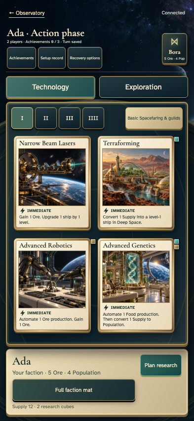](../../screenshots/trade-from-a-food-covered-supply-column-without-ordinary-production-with-separate-controllers/049-r2-bora-next-phone-darwin.png) | [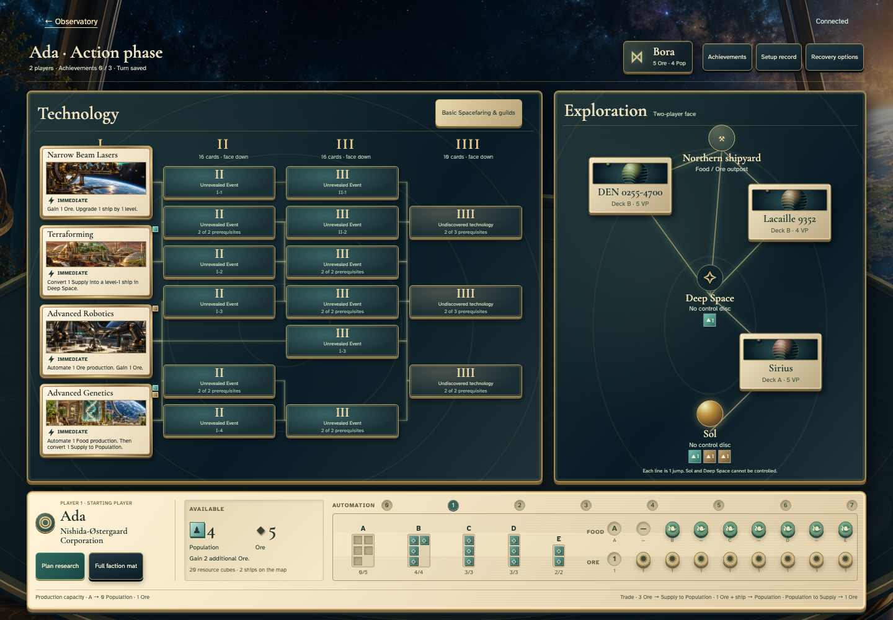](../../screenshots/trade-from-a-food-covered-supply-column-without-ordinary-production-with-separate-controllers/049-r2-bora-next-desktop-darwin.png) |

- [x] The independent next controller sees the canonical handoff
- [x] Canonical effects settle before capture.
- [x] Any printed Action plan is ready.
- [x] The rotated trade explanation stays above the opaque footer.
- [x] Public compact topology remains physically separated.
- [x] The gameplay shell fits the actual viewport.

## 51. Ada opens the actual research and Action instrument

Viewpoint: **Ada · separate host controller**.

| phone · 393 × 852 | desktop · 1440 × 1000 |
| --- | --- |
|  | [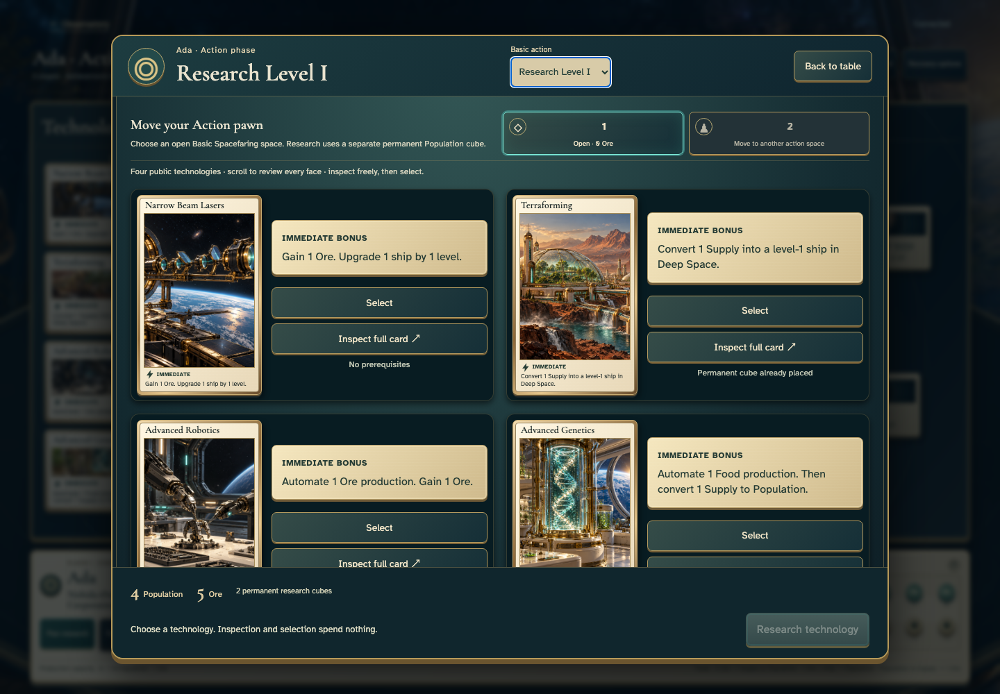](../../screenshots/trade-from-a-food-covered-supply-column-without-ordinary-production-with-separate-controllers/050-r3-ada-plan-desktop-darwin.png) |

- [x] Ada opens the actual research and Action instrument
- [x] Canonical effects settle before capture.
- [x] Any printed Action plan is ready.
- [x] The rotated trade explanation stays above the opaque footer.
- [x] Public compact topology remains physically separated.
- [x] The gameplay shell fits the actual viewport.

## 52. Ada selects the legal printed space 1

Viewpoint: **Ada · separate host controller**.

| phone · 393 × 852 | desktop · 1440 × 1000 |
| --- | --- |
| [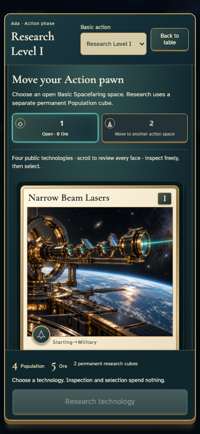](../../screenshots/trade-from-a-food-covered-supply-column-without-ordinary-production-with-separate-controllers/051-r3-ada-space-phone-darwin.png) | [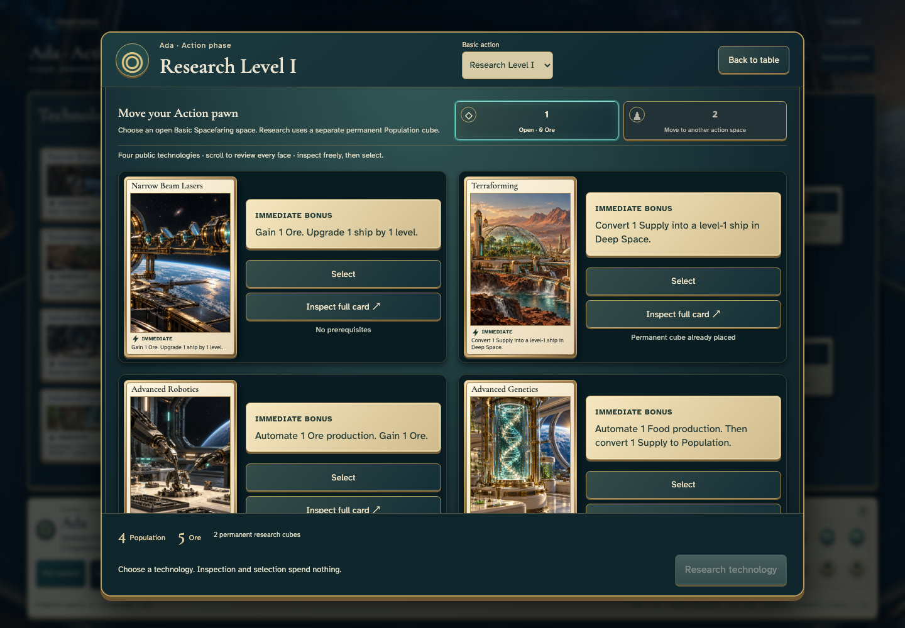](../../screenshots/trade-from-a-food-covered-supply-column-without-ordinary-production-with-separate-controllers/051-r3-ada-space-desktop-darwin.png) |

- [x] Ada selects the legal printed space 1
- [x] Canonical effects settle before capture.
- [x] Any printed Action plan is ready.
- [x] The rotated trade explanation stays above the opaque footer.
- [x] Public compact topology remains physically separated.
- [x] The gameplay shell fits the actual viewport.

## 53. Select Advanced Robotics with its printed cost and consequence

Viewpoint: **Ada · separate host controller**.

| phone · 393 × 852 | desktop · 1440 × 1000 |
| --- | --- |
| [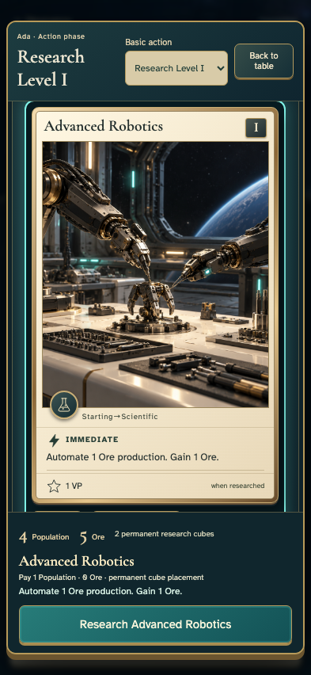](../../screenshots/trade-from-a-food-covered-supply-column-without-ordinary-production-with-separate-controllers/052-r3-ada-card-phone-darwin.png) |  |

- [x] Select Advanced Robotics with its printed cost and consequence
- [x] Canonical effects settle before capture.
- [x] Any printed Action plan is ready.
- [x] The rotated trade explanation stays above the opaque footer.
- [x] Public compact topology remains physically separated.
- [x] The gameplay shell fits the actual viewport.

## 54. Pay once and receive Advanced Robotics's immediate bonus

Viewpoint: **Ada · separate host controller**.

| phone · 393 × 852 | desktop · 1440 × 1000 |
| --- | --- |
|  |  |

- [x] Pay once and receive Advanced Robotics's immediate bonus
- [x] Canonical effects settle before capture.
- [x] Any printed Action plan is ready.
- [x] The rotated trade explanation stays above the opaque footer.
- [x] Public compact topology remains physically separated.
- [x] The gameplay shell fits the actual viewport.

## 55. Food still covers B: ordinary growth cannot borrow its four cubes despite empty A

Viewpoint: **Ada · separate host controller**.

| phone · 393 × 852 | desktop · 1440 × 1000 |
| --- | --- |
|  |  |

- [x] Food still covers B: ordinary growth cannot borrow its four cubes despite empty A
- [x] Canonical effects settle before capture.
- [x] Any printed Action plan is ready.
- [x] The rotated trade explanation stays above the opaque footer.
- [x] Public compact topology remains physically separated.
- [x] The gameplay shell fits the actual viewport.

## 56. Trade replaces ordinary growth and Ore production without changing the balance

Viewpoint: **Ada · separate host controller**.

| phone · 393 × 852 | desktop · 1440 × 1000 |
| --- | --- |
| [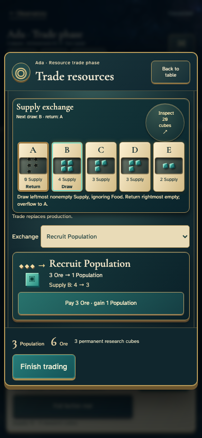](../../screenshots/trade-from-a-food-covered-supply-column-without-ordinary-production-with-separate-controllers/055-trade-covered-column-phone-darwin.png) |  |

- [x] Trade replaces ordinary growth and Ore production without changing the balance
- [x] Canonical effects settle before capture.
- [x] Any printed Action plan is ready.
- [x] The rotated trade explanation stays above the opaque footer.
- [x] Public compact topology remains physically separated.
- [x] The gameplay shell fits the actual viewport.

## 57. Trade ignores Food exposure and names B as the next leftmost nonempty draw

Viewpoint: **Ada · separate host controller**.

| phone · 393 × 852 | desktop · 1440 × 1000 |
| --- | --- |
|  |  |

- [x] Trade ignores Food exposure and names B as the next leftmost nonempty draw
- [x] Canonical effects settle before capture.
- [x] Any printed Action plan is ready.
- [x] The rotated trade explanation stays above the opaque footer.
- [x] Public compact topology remains physically separated.
- [x] The gameplay shell fits the actual viewport.

## 58. Convert one Food-covered B cube for3 Ore without ordinary production

Viewpoint: **Ada · separate host controller**.

| phone · 393 × 852 | desktop · 1440 × 1000 |
| --- | --- |
| [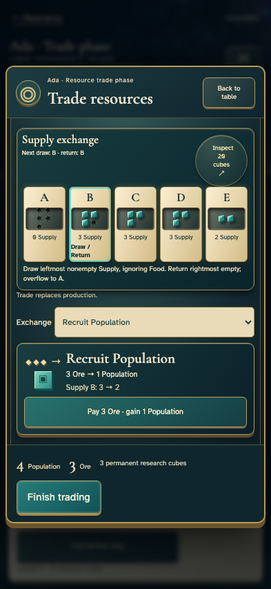](../../screenshots/trade-from-a-food-covered-supply-column-without-ordinary-production-with-separate-controllers/057-covered-b-trade-0-phone-darwin.png) | [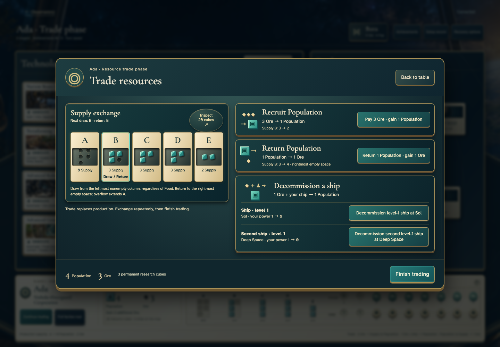](../../screenshots/trade-from-a-food-covered-supply-column-without-ordinary-production-with-separate-controllers/057-covered-b-trade-0-desktop-darwin.png) |

- [x] Convert one Food-covered B cube for3 Ore without ordinary production
- [x] Canonical effects settle before capture.
- [x] Any printed Action plan is ready.
- [x] The rotated trade explanation stays above the opaque footer.
- [x] Public compact topology remains physically separated.
- [x] The gameplay shell fits the actual viewport.

## 59. Convert one Food-covered B cube for3 Ore without ordinary production

Viewpoint: **Ada · separate host controller**.

| phone · 393 × 852 | desktop · 1440 × 1000 |
| --- | --- |
| [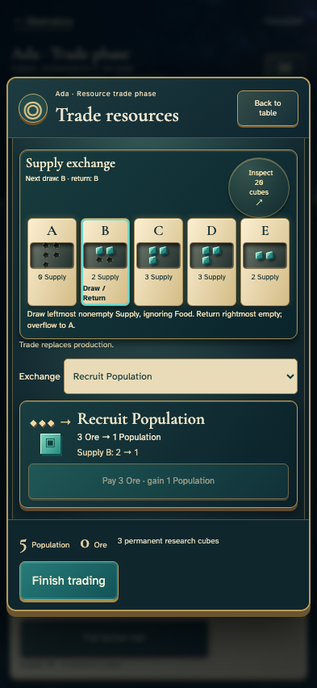](../../screenshots/trade-from-a-food-covered-supply-column-without-ordinary-production-with-separate-controllers/058-covered-b-trade-1-phone-darwin.png) |  |

- [x] Convert one Food-covered B cube for3 Ore without ordinary production
- [x] Canonical effects settle before capture.
- [x] Any printed Action plan is ready.
- [x] The rotated trade explanation stays above the opaque footer.
- [x] Public compact topology remains physically separated.
- [x] The gameplay shell fits the actual viewport.

## 60. Reload retains the current identity, accepted exchanges and pending trading phase

Viewpoint: **Ada · separate host controller**.

| phone · 393 × 852 | desktop · 1440 × 1000 |
| --- | --- |
|  |  |

- [x] Reload retains the current identity, accepted exchanges and pending trading phase
- [x] Canonical effects settle before capture.
- [x] Any printed Action plan is ready.
- [x] The rotated trade explanation stays above the opaque footer.
- [x] Public compact topology remains physically separated.
- [x] The gameplay shell fits the actual viewport.

## 61. Open the same retained trade without duplicating a payment

Viewpoint: **Ada · separate host controller**.

| phone · 393 × 852 | desktop · 1440 × 1000 |
| --- | --- |
|  |  |

- [x] Open the same retained trade without duplicating a payment
- [x] Canonical effects settle before capture.
- [x] Any printed Action plan is ready.
- [x] The rotated trade explanation stays above the opaque footer.
- [x] Public compact topology remains physically separated.
- [x] The gameplay shell fits the actual viewport.

## 62. Inspect all twenty cubes in their current public locations

Viewpoint: **Ada · separate host controller**.

| phone · 393 × 852 | desktop · 1440 × 1000 |
| --- | --- |
|  |  |

- [x] Inspect all twenty cubes in their current public locations
- [x] Canonical effects settle before capture.
- [x] Any printed Action plan is ready.
- [x] The rotated trade explanation stays above the opaque footer.
- [x] Public compact topology remains physically separated.
- [x] The gameplay shell fits the actual viewport.

## 63. Forward Tab stays inside the native cube reader

Viewpoint: **Ada · separate host controller**.

| phone · 393 × 852 | desktop · 1440 × 1000 |
| --- | --- |
|  |  |

- [x] Forward Tab stays inside the native cube reader
- [x] Canonical effects settle before capture.
- [x] Any printed Action plan is ready.
- [x] The rotated trade explanation stays above the opaque footer.
- [x] Public compact topology remains physically separated.
- [x] The gameplay shell fits the actual viewport.

## 64. Reverse Tab also stays inside the native reader

Viewpoint: **Ada · separate host controller**.

| phone · 393 × 852 | desktop · 1440 × 1000 |
| --- | --- |
|  |  |

- [x] Reverse Tab also stays inside the native reader
- [x] Canonical effects settle before capture.
- [x] Any printed Action plan is ready.
- [x] The rotated trade explanation stays above the opaque footer.
- [x] Public compact topology remains physically separated.
- [x] The gameplay shell fits the actual viewport.

## 65. Escape restores the exact inspector opener without committing a trade

Viewpoint: **Ada · separate host controller**.

| phone · 393 × 852 | desktop · 1440 × 1000 |
| --- | --- |
|  |  |

- [x] Escape restores the exact inspector opener without committing a trade
- [x] Canonical effects settle before capture.
- [x] Any printed Action plan is ready.
- [x] The rotated trade explanation stays above the opaque footer.
- [x] Public compact topology remains physically separated.
- [x] The gameplay shell fits the actual viewport.

## 66. Finish trading passes to the next player without adding growth or Ore production

Viewpoint: **Ada · separate host controller**.

| phone · 393 × 852 | desktop · 1440 × 1000 |
| --- | --- |
|  |  |

- [x] Finish trading passes to the next player without adding growth or Ore production
- [x] Canonical effects settle before capture.
- [x] Any printed Action plan is ready.
- [x] The rotated trade explanation stays above the opaque footer.
- [x] Public compact topology remains physically separated.
- [x] The gameplay shell fits the actual viewport.

## 67. The public faction mat retains the final exact trade balance after handoff

Viewpoint: **Ada · separate host controller**.

| phone · 393 × 852 | desktop · 1440 × 1000 |
| --- | --- |
|  |  |

- [x] The public faction mat retains the final exact trade balance after handoff
- [x] Canonical effects settle before capture.
- [x] Any printed Action plan is ready.
- [x] The rotated trade explanation stays above the opaque footer.
- [x] Public compact topology remains physically separated.
- [x] The gameplay shell fits the actual viewport.

## 68. Escape returns from the actual mat to the handed-off board

Viewpoint: **Ada · separate host controller**.

| phone · 393 × 852 | desktop · 1440 × 1000 |
| --- | --- |
|  |  |

- [x] Escape returns from the actual mat to the handed-off board
- [x] Canonical effects settle before capture.
- [x] Any printed Action plan is ready.
- [x] The rotated trade explanation stays above the opaque footer.
- [x] Public compact topology remains physically separated.
- [x] The gameplay shell fits the actual viewport.

## 69. Reload retains the finished trading turn and leaves no orphaned inspector

Viewpoint: **Ada · separate host controller**.

| phone · 393 × 852 | desktop · 1440 × 1000 |
| --- | --- |
|  |  |

- [x] Reload retains the finished trading turn and leaves no orphaned inspector
- [x] Canonical effects settle before capture.
- [x] Any printed Action plan is ready.
- [x] The rotated trade explanation stays above the opaque footer.
- [x] Public compact topology remains physically separated.
- [x] The gameplay shell fits the actual viewport.
