# Trade repeatedly and return every cube through the real Supply overflow at physical shared seats

One shared authenticated controller; direct physical cardinal or corner seating, ordinary UI setup and legal preparatory turns. No remote claims or personal devices. Only initial setup entropy is fixed to66666666-6666-4666-8666-000000000009. No game-state injection or future-deck inspection. Three exact trade rates, repeated exchanges, rightmost returns/A overflow, covered-column leftmost draws, control-changing decommission and keyboard/reload use production components. No ordinary production is added.

## 1. Arrive using the actual production client

Viewpoint: **Ada · South · one shared controller**.

| desktop · 1440 × 1000 |
| --- |
|  |

tabletop-4k · 3840 × 2160

- [x] Arrive using the actual production client
- [x] Canonical effects settle before capture.
- [x] Any printed Action plan is ready.
- [x] The rotated trade explanation stays above the opaque footer.
- [x] Public compact topology remains physically separated.
- [x] The gameplay shell fits the actual viewport.

## 2. Choose a real production play mode

Viewpoint: **Ada · South · one shared controller**.

| desktop · 1440 × 1000 |
| --- |
|  |

tabletop-4k · 3840 × 2160

- [x] Choose a real production play mode
- [x] Canonical effects settle before capture.
- [x] Any printed Action plan is ready.
- [x] The rotated trade explanation stays above the opaque footer.
- [x] Public compact topology remains physically separated.
- [x] The gameplay shell fits the actual viewport.

## 3. One controller configures physical seats directly on the table

Viewpoint: **Ada · South · one shared controller**.

| desktop · 1440 × 1000 |
| --- |
| [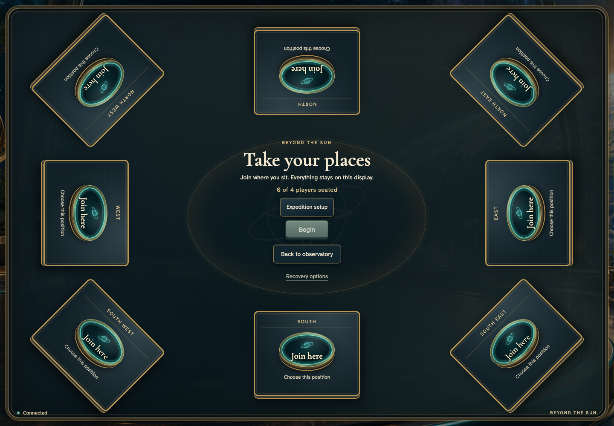](../../screenshots/trade-repeatedly-and-return-every-cube-through-the-real-supply-overflow-at-physical-shared-seats/002-shared-empty-desktop-darwin.png) |

tabletop-4k · 3840 × 2160

- [x] One controller configures physical seats directly on the table
- [x] Canonical effects settle before capture.
- [x] Any printed Action plan is ready.
- [x] The rotated trade explanation stays above the opaque footer.
- [x] Public compact topology remains physically separated.
- [x] The gameplay shell fits the actual viewport.

## 4. Open the South seat on the shared surface

Viewpoint: **Ada · South · one shared controller**.

| desktop · 1440 × 1000 |
| --- |
|  |

tabletop-4k · 3840 × 2160

- [x] Open the South seat on the shared surface
- [x] Canonical effects settle before capture.
- [x] Any printed Action plan is ready.
- [x] The rotated trade explanation stays above the opaque footer.
- [x] Public compact topology remains physically separated.
- [x] The gameplay shell fits the actual viewport.

## 5. Name the physical player Ada

Viewpoint: **Ada · South · one shared controller**.

| desktop · 1440 × 1000 |
| --- |
|  |

tabletop-4k · 3840 × 2160

- [x] Name the physical player Ada
- [x] Canonical effects settle before capture.
- [x] Any printed Action plan is ready.
- [x] The rotated trade explanation stays above the opaque footer.
- [x] Public compact topology remains physically separated.
- [x] The gameplay shell fits the actual viewport.

## 6. The local physical seat is retained on this controller

Viewpoint: **Ada · South · one shared controller**.

| desktop · 1440 × 1000 |
| --- |
|  |

tabletop-4k · 3840 × 2160

- [x] The local physical seat is retained on this controller
- [x] Canonical effects settle before capture.
- [x] Any printed Action plan is ready.
- [x] The rotated trade explanation stays above the opaque footer.
- [x] Public compact topology remains physically separated.
- [x] The gameplay shell fits the actual viewport.

## 7. Open the North seat on the shared surface

Viewpoint: **Bora · North · one shared controller**.

| desktop · 1440 × 1000 |
| --- |
|  |

tabletop-4k · 3840 × 2160

- [x] Open the North seat on the shared surface
- [x] Canonical effects settle before capture.
- [x] Any printed Action plan is ready.
- [x] The rotated trade explanation stays above the opaque footer.
- [x] Public compact topology remains physically separated.
- [x] The gameplay shell fits the actual viewport.

## 8. Name the physical player Bora

Viewpoint: **Bora · North · one shared controller**.

| desktop · 1440 × 1000 |
| --- |
|  |

tabletop-4k · 3840 × 2160

- [x] Name the physical player Bora
- [x] Canonical effects settle before capture.
- [x] Any printed Action plan is ready.
- [x] The rotated trade explanation stays above the opaque footer.
- [x] Public compact topology remains physically separated.
- [x] The gameplay shell fits the actual viewport.

## 9. The local physical seat is retained on this controller

Viewpoint: **Bora · North · one shared controller**.

| desktop · 1440 × 1000 |
| --- |
|  |

tabletop-4k · 3840 × 2160

- [x] The local physical seat is retained on this controller
- [x] Canonical effects settle before capture.
- [x] Any printed Action plan is ready.
- [x] The rotated trade explanation stays above the opaque footer.
- [x] Public compact topology remains physically separated.
- [x] The gameplay shell fits the actual viewport.

## 10. Ada chooses a legal unique Basic faction

Viewpoint: **Ada · South · one shared controller**.

| desktop · 1440 × 1000 |
| --- |
|  |

tabletop-4k · 3840 × 2160

- [x] Ada chooses a legal unique Basic faction
- [x] Canonical effects settle before capture.
- [x] Any printed Action plan is ready.
- [x] The rotated trade explanation stays above the opaque footer.
- [x] Public compact topology remains physically separated.
- [x] The gameplay shell fits the actual viewport.

## 11. Ada retains Nishida-Østergaard Corporation

Viewpoint: **Ada · South · one shared controller**.

| desktop · 1440 × 1000 |
| --- |
|  |

tabletop-4k · 3840 × 2160

- [x] Ada retains Nishida-Østergaard Corporation
- [x] Canonical effects settle before capture.
- [x] Any printed Action plan is ready.
- [x] The rotated trade explanation stays above the opaque footer.
- [x] Public compact topology remains physically separated.
- [x] The gameplay shell fits the actual viewport.

## 12. Bora chooses a legal unique Basic faction

Viewpoint: **Bora · North · one shared controller**.

| desktop · 1440 × 1000 |
| --- |
| [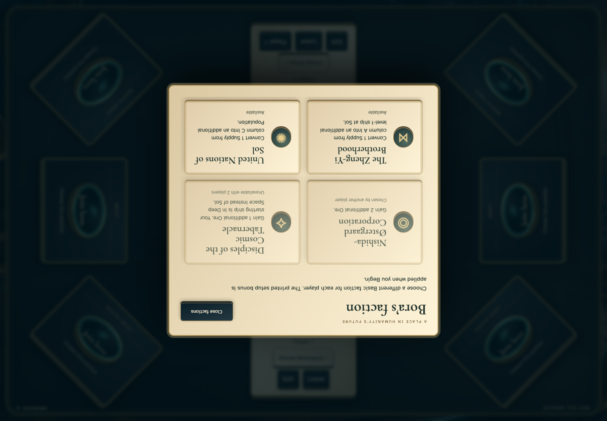](../../screenshots/trade-repeatedly-and-return-every-cube-through-the-real-supply-overflow-at-physical-shared-seats/011-faction-1-editor-desktop-darwin.png) |

tabletop-4k · 3840 × 2160

- [x] Bora chooses a legal unique Basic faction
- [x] Canonical effects settle before capture.
- [x] Any printed Action plan is ready.
- [x] The rotated trade explanation stays above the opaque footer.
- [x] Public compact topology remains physically separated.
- [x] The gameplay shell fits the actual viewport.

## 13. Bora retains The Zheng-Yi Brotherhood

Viewpoint: **Bora · North · one shared controller**.

| desktop · 1440 × 1000 |
| --- |
|  |

tabletop-4k · 3840 × 2160

- [x] Bora retains The Zheng-Yi Brotherhood
- [x] Canonical effects settle before capture.
- [x] Any printed Action plan is ready.
- [x] The rotated trade explanation stays above the opaque footer.
- [x] Public compact topology remains physically separated.
- [x] The gameplay shell fits the actual viewport.

## 14. Begin the immutable source-reviewed Basic setup through the ordinary UI

Viewpoint: **Ada · South · one shared controller**.

| desktop · 1440 × 1000 |
| --- |
|  |

tabletop-4k · 3840 × 2160

- [x] Begin the immutable source-reviewed Basic setup through the ordinary UI
- [x] Canonical effects settle before capture.
- [x] Any printed Action plan is ready.
- [x] The rotated trade explanation stays above the opaque footer.
- [x] Public compact topology remains physically separated.
- [x] The gameplay shell fits the actual viewport.

## 15. Ada opens the actual research and Action instrument

Viewpoint: **Ada · South · one shared controller**.

| desktop · 1440 × 1000 |
| --- |
| [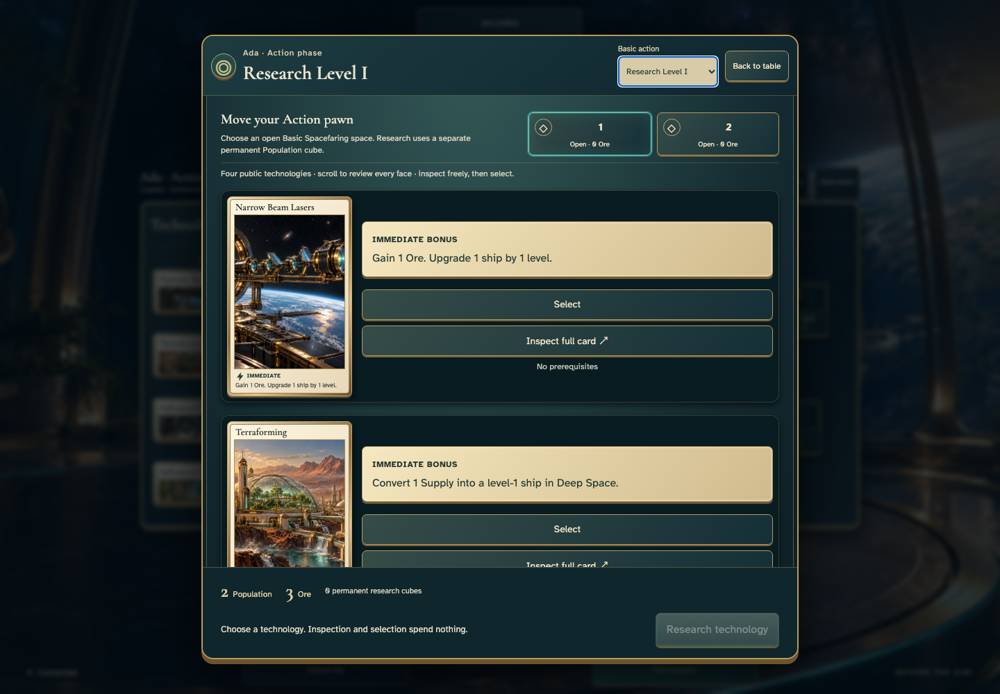](../../screenshots/trade-repeatedly-and-return-every-cube-through-the-real-supply-overflow-at-physical-shared-seats/014-ordinary-gather-plan-desktop-darwin.png) |

tabletop-4k · 3840 × 2160

- [x] Ada opens the actual research and Action instrument
- [x] Canonical effects settle before capture.
- [x] Any printed Action plan is ready.
- [x] The rotated trade explanation stays above the opaque footer.
- [x] Public compact topology remains physically separated.
- [x] The gameplay shell fits the actual viewport.

## 16. Ada selects ordinary gathering

Viewpoint: **Ada · South · one shared controller**.

| desktop · 1440 × 1000 |
| --- |
| [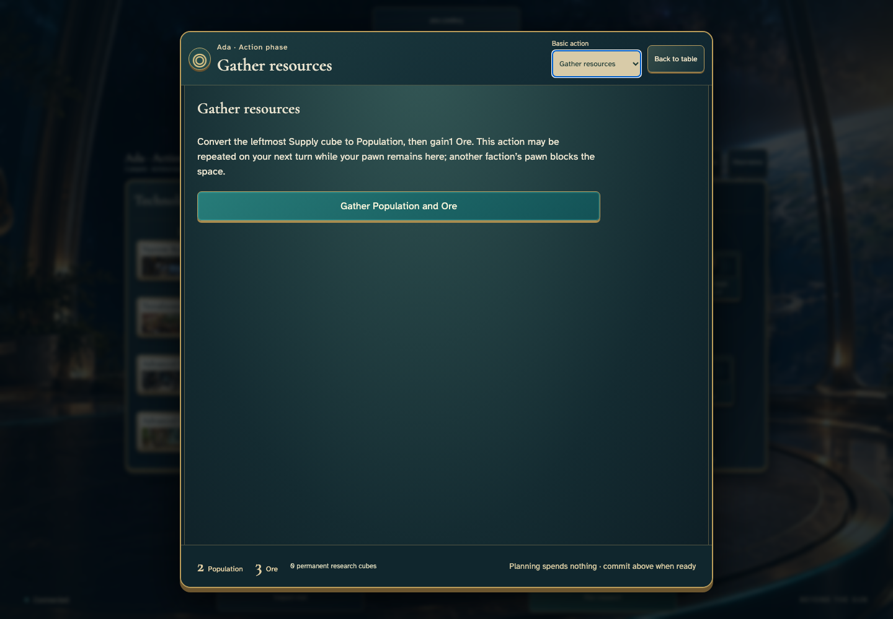](../../screenshots/trade-repeatedly-and-return-every-cube-through-the-real-supply-overflow-at-physical-shared-seats/015-ordinary-gather-kind-desktop-darwin.png) |

tabletop-4k · 3840 × 2160

[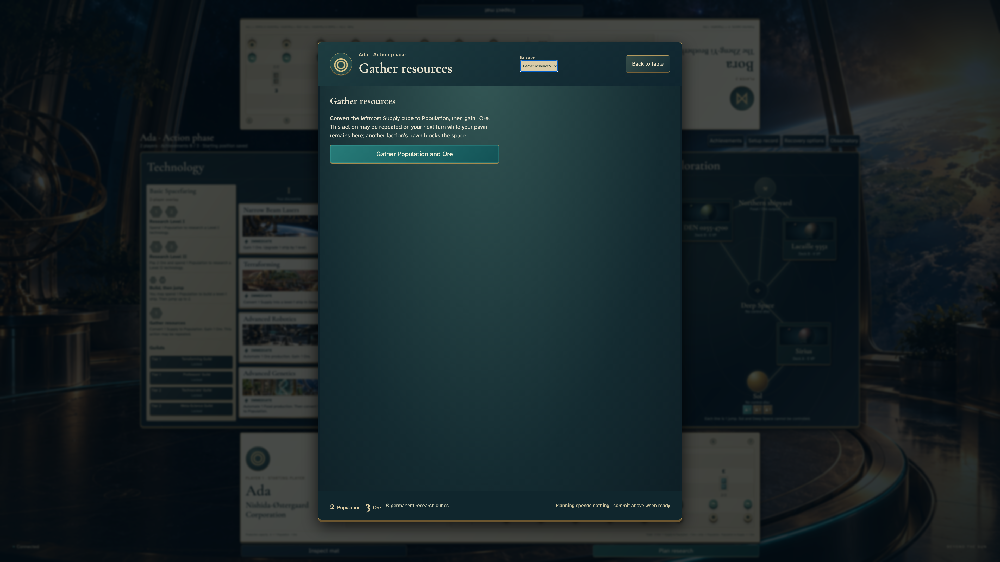](../../screenshots/trade-repeatedly-and-return-every-cube-through-the-real-supply-overflow-at-physical-shared-seats/015-ordinary-gather-kind-tabletop-4k-darwin.png)

- [x] Ada selects ordinary gathering
- [x] Canonical effects settle before capture.
- [x] Any printed Action plan is ready.
- [x] The rotated trade explanation stays above the opaque footer.
- [x] Public compact topology remains physically separated.
- [x] The gameplay shell fits the actual viewport.

## 17. Receive the printed gather resources before ordinary production

Viewpoint: **Ada · South · one shared controller**.

| desktop · 1440 × 1000 |
| --- |
| [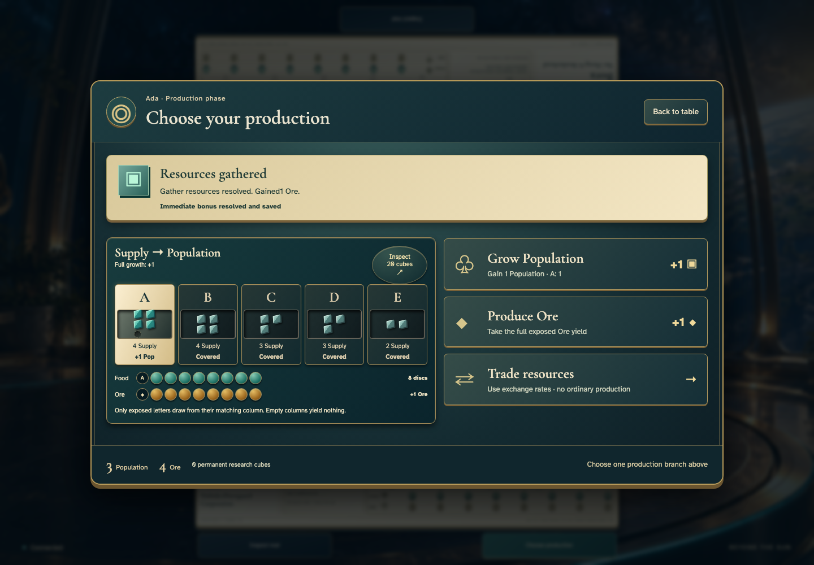](../../screenshots/trade-repeatedly-and-return-every-cube-through-the-real-supply-overflow-at-physical-shared-seats/016-ordinary-gather-gathered-desktop-darwin.png) |

tabletop-4k · 3840 × 2160

[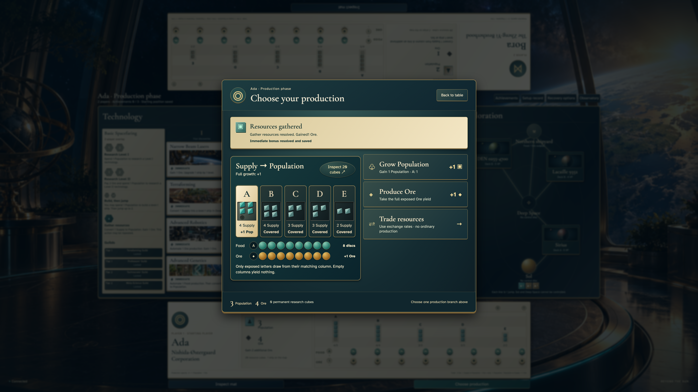](../../screenshots/trade-repeatedly-and-return-every-cube-through-the-real-supply-overflow-at-physical-shared-seats/016-ordinary-gather-gathered-tabletop-4k-darwin.png)

- [x] Receive the printed gather resources before ordinary production
- [x] Canonical effects settle before capture.
- [x] Any printed Action plan is ready.
- [x] The rotated trade explanation stays above the opaque footer.
- [x] Public compact topology remains physically separated.
- [x] The gameplay shell fits the actual viewport.

## 18. Trade replaces ordinary growth and Ore production without changing the balance

Viewpoint: **Ada · South · one shared controller**.

| desktop · 1440 × 1000 |
| --- |
|  |

tabletop-4k · 3840 × 2160

[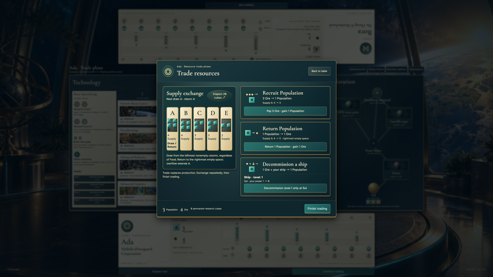](../../screenshots/trade-repeatedly-and-return-every-cube-through-the-real-supply-overflow-at-physical-shared-seats/017-trade-selected-tabletop-4k-darwin.png)

- [x] Trade replaces ordinary growth and Ore production without changing the balance
- [x] Canonical effects settle before capture.
- [x] Any printed Action plan is ready.
- [x] The rotated trade explanation stays above the opaque footer.
- [x] Public compact topology remains physically separated.
- [x] The gameplay shell fits the actual viewport.

## 19. Inspect the named exchange without committing a resource

Viewpoint: **Ada · South · one shared controller**.

| desktop · 1440 × 1000 |
| --- |
| [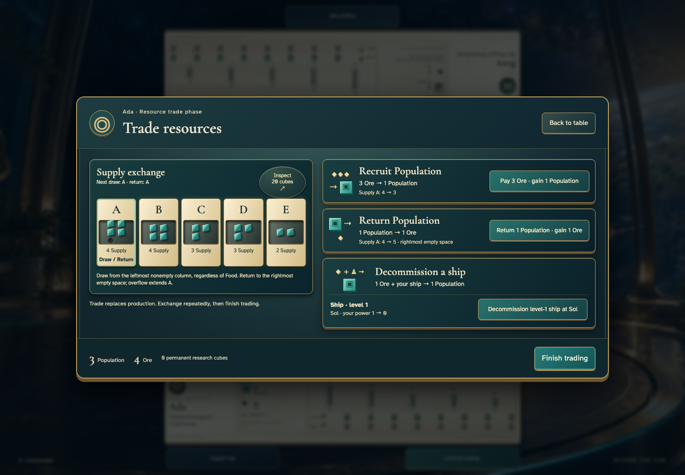](../../screenshots/trade-repeatedly-and-return-every-cube-through-the-real-supply-overflow-at-physical-shared-seats/018-return-route-desktop-darwin.png) |

tabletop-4k · 3840 × 2160

- [x] Inspect the named exchange without committing a resource
- [x] Canonical effects settle before capture.
- [x] Any printed Action plan is ready.
- [x] The rotated trade explanation stays above the opaque footer.
- [x] Public compact topology remains physically separated.
- [x] The gameplay shell fits the actual viewport.

## 20. Return one available Population to the rightmost open Supply space, extending A when full

Viewpoint: **Ada · South · one shared controller**.

| desktop · 1440 × 1000 |
| --- |
| [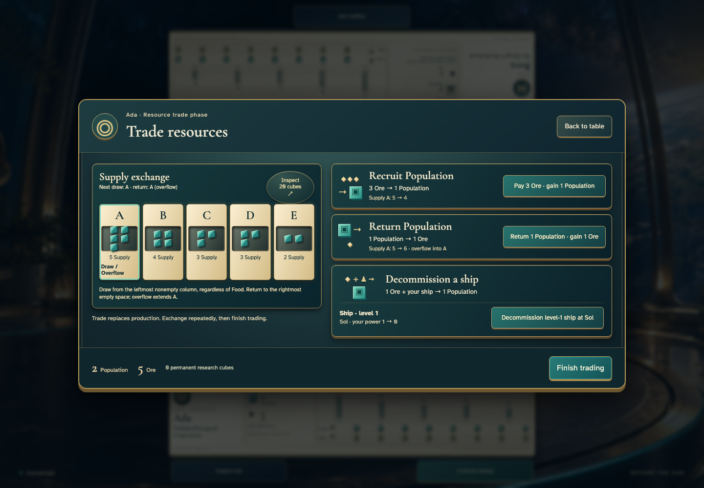](../../screenshots/trade-repeatedly-and-return-every-cube-through-the-real-supply-overflow-at-physical-shared-seats/019-return-0-desktop-darwin.png) |

tabletop-4k · 3840 × 2160

[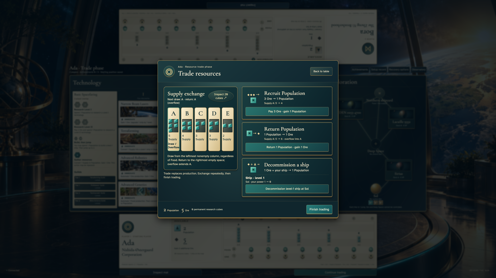](../../screenshots/trade-repeatedly-and-return-every-cube-through-the-real-supply-overflow-at-physical-shared-seats/019-return-0-tabletop-4k-darwin.png)

- [x] Return one available Population to the rightmost open Supply space, extending A when full
- [x] Canonical effects settle before capture.
- [x] Any printed Action plan is ready.
- [x] The rotated trade explanation stays above the opaque footer.
- [x] Public compact topology remains physically separated.
- [x] The gameplay shell fits the actual viewport.

## 21. Return one available Population to the rightmost open Supply space, extending A when full

Viewpoint: **Ada · South · one shared controller**.

| desktop · 1440 × 1000 |
| --- |
|  |

tabletop-4k · 3840 × 2160

- [x] Return one available Population to the rightmost open Supply space, extending A when full
- [x] Canonical effects settle before capture.
- [x] Any printed Action plan is ready.
- [x] The rotated trade explanation stays above the opaque footer.
- [x] Public compact topology remains physically separated.
- [x] The gameplay shell fits the actual viewport.

## 22. Return one available Population to the rightmost open Supply space, extending A when full

Viewpoint: **Ada · South · one shared controller**.

| desktop · 1440 × 1000 |
| --- |
|  |

tabletop-4k · 3840 × 2160

- [x] Return one available Population to the rightmost open Supply space, extending A when full
- [x] Canonical effects settle before capture.
- [x] Any printed Action plan is ready.
- [x] The rotated trade explanation stays above the opaque footer.
- [x] Public compact topology remains physically separated.
- [x] The gameplay shell fits the actual viewport.

## 23. The return control disables when no available Population remains

Viewpoint: **Ada · South · one shared controller**.

| desktop · 1440 × 1000 |
| --- |
| [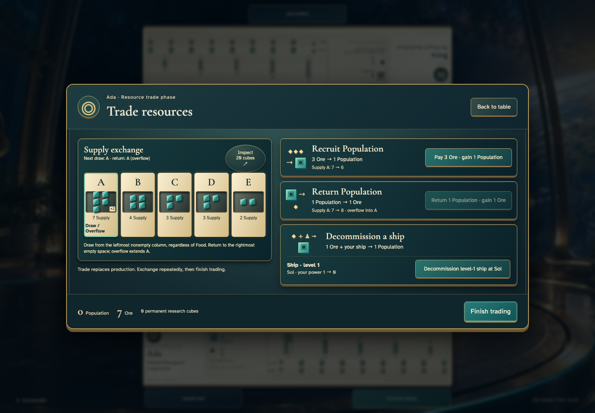](../../screenshots/trade-repeatedly-and-return-every-cube-through-the-real-supply-overflow-at-physical-shared-seats/022-empty-population-desktop-darwin.png) |

tabletop-4k · 3840 × 2160

- [x] The return control disables when no available Population remains
- [x] Canonical effects settle before capture.
- [x] Any printed Action plan is ready.
- [x] The rotated trade explanation stays above the opaque footer.
- [x] Public compact topology remains physically separated.
- [x] The gameplay shell fits the actual viewport.

## 24. Inspect the named exchange without committing a resource

Viewpoint: **Ada · South · one shared controller**.

| desktop · 1440 × 1000 |
| --- |
|  |

tabletop-4k · 3840 × 2160

- [x] Inspect the named exchange without committing a resource
- [x] Canonical effects settle before capture.
- [x] Any printed Action plan is ready.
- [x] The rotated trade explanation stays above the opaque footer.
- [x] Public compact topology remains physically separated.
- [x] The gameplay shell fits the actual viewport.

## 25. Choose the actual owned Sol ship without paying yet

Viewpoint: **Ada · South · one shared controller**.

| desktop · 1440 × 1000 |
| --- |
|  |

tabletop-4k · 3840 × 2160

- [x] Choose the actual owned Sol ship without paying yet
- [x] Canonical effects settle before capture.
- [x] Any printed Action plan is ready.
- [x] The rotated trade explanation stays above the opaque footer.
- [x] Public compact topology remains physically separated.
- [x] The gameplay shell fits the actual viewport.

## 26. Pay exactly1 Ore and convert the owned ship into one available Population

Viewpoint: **Ada · South · one shared controller**.

| desktop · 1440 × 1000 |
| --- |
|  |

tabletop-4k · 3840 × 2160

- [x] Pay exactly1 Ore and convert the owned ship into one available Population
- [x] Canonical effects settle before capture.
- [x] Any printed Action plan is ready.
- [x] The rotated trade explanation stays above the opaque footer.
- [x] Public compact topology remains physically separated.
- [x] The gameplay shell fits the actual viewport.

## 27. Inspect the named exchange without committing a resource

Viewpoint: **Ada · South · one shared controller**.

| desktop · 1440 × 1000 |
| --- |
| [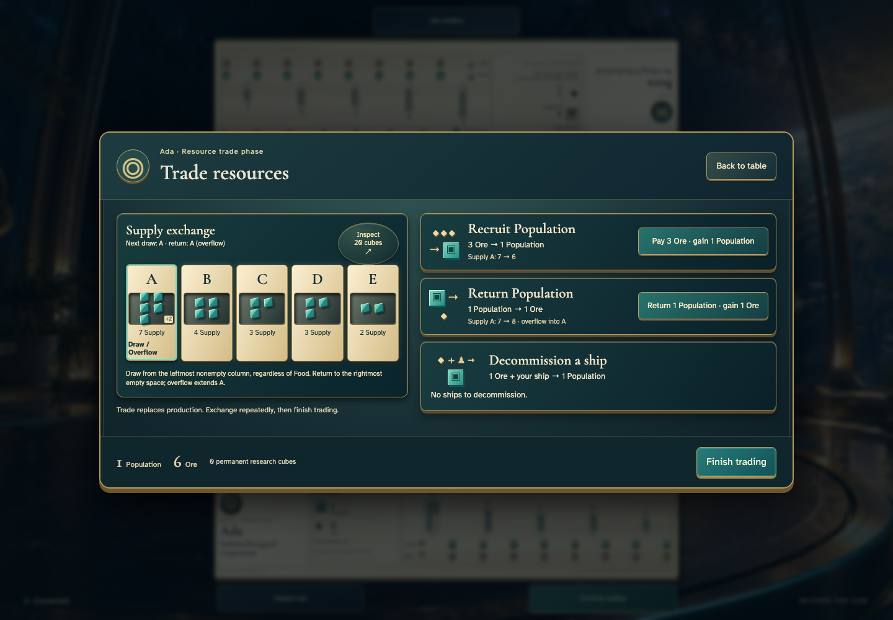](../../screenshots/trade-repeatedly-and-return-every-cube-through-the-real-supply-overflow-at-physical-shared-seats/026-last-return-route-desktop-darwin.png) |

tabletop-4k · 3840 × 2160

- [x] Inspect the named exchange without committing a resource
- [x] Canonical effects settle before capture.
- [x] Any printed Action plan is ready.
- [x] The rotated trade explanation stays above the opaque footer.
- [x] Public compact topology remains physically separated.
- [x] The gameplay shell fits the actual viewport.

## 28. All twenty cubes are now Supply; the eighth A cube is explicit overflow

Viewpoint: **Ada · South · one shared controller**.

| desktop · 1440 × 1000 |
| --- |
| [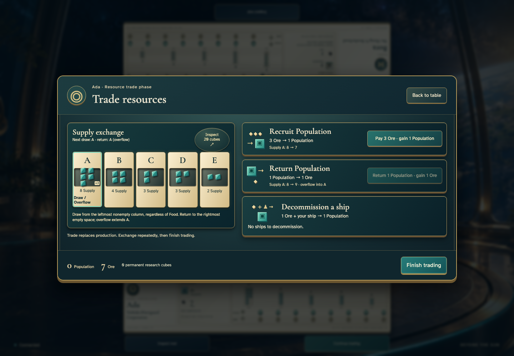](../../screenshots/trade-repeatedly-and-return-every-cube-through-the-real-supply-overflow-at-physical-shared-seats/027-all-supply-desktop-darwin.png) |

tabletop-4k · 3840 × 2160

[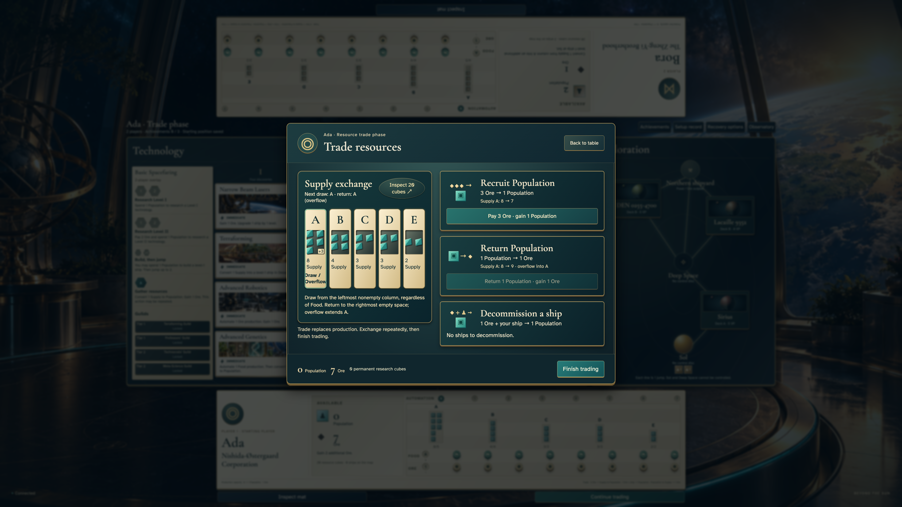](../../screenshots/trade-repeatedly-and-return-every-cube-through-the-real-supply-overflow-at-physical-shared-seats/027-all-supply-tabletop-4k-darwin.png)

- [x] All twenty cubes are now Supply; the eighth A cube is explicit overflow
- [x] Canonical effects settle before capture.
- [x] Any printed Action plan is ready.
- [x] The rotated trade explanation stays above the opaque footer.
- [x] Public compact topology remains physically separated.
- [x] The gameplay shell fits the actual viewport.

## 29. Inspect all twenty cubes in their current public locations

Viewpoint: **Ada · South · one shared controller**.

| desktop · 1440 × 1000 |
| --- |
| [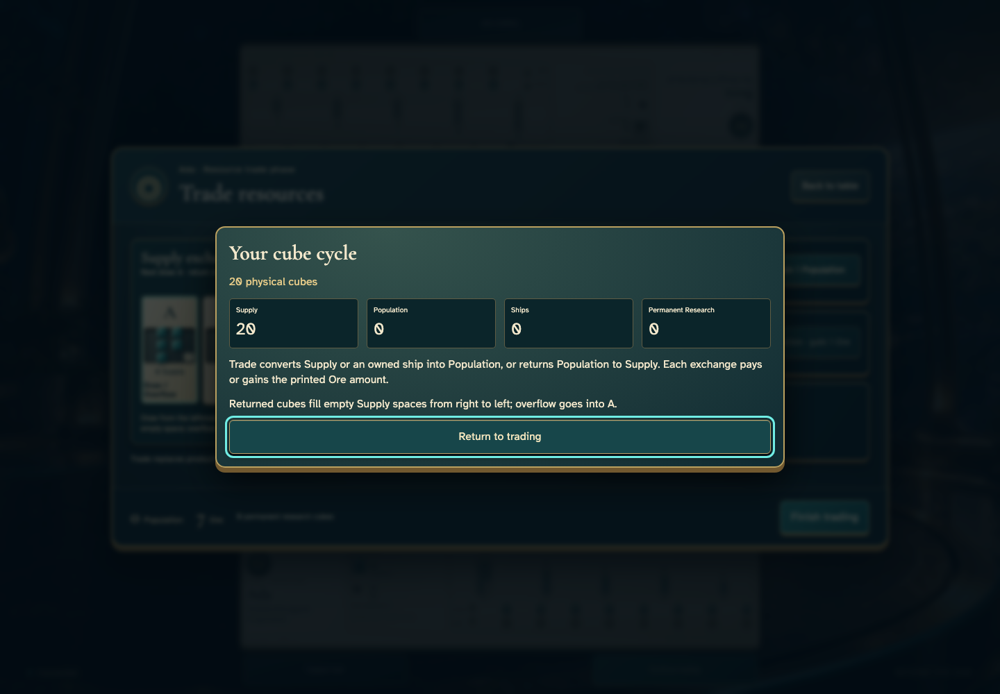](../../screenshots/trade-repeatedly-and-return-every-cube-through-the-real-supply-overflow-at-physical-shared-seats/028-twenty-supply-open-desktop-darwin.png) |

tabletop-4k · 3840 × 2160

- [x] Inspect all twenty cubes in their current public locations
- [x] Canonical effects settle before capture.
- [x] Any printed Action plan is ready.
- [x] The rotated trade explanation stays above the opaque footer.
- [x] Public compact topology remains physically separated.
- [x] The gameplay shell fits the actual viewport.

## 30. Forward Tab stays inside the native cube reader

Viewpoint: **Ada · South · one shared controller**.

| desktop · 1440 × 1000 |
| --- |
|  |

tabletop-4k · 3840 × 2160

- [x] Forward Tab stays inside the native cube reader
- [x] Canonical effects settle before capture.
- [x] Any printed Action plan is ready.
- [x] The rotated trade explanation stays above the opaque footer.
- [x] Public compact topology remains physically separated.
- [x] The gameplay shell fits the actual viewport.

## 31. Reverse Tab also stays inside the native reader

Viewpoint: **Ada · South · one shared controller**.

| desktop · 1440 × 1000 |
| --- |
|  |

tabletop-4k · 3840 × 2160

- [x] Reverse Tab also stays inside the native reader
- [x] Canonical effects settle before capture.
- [x] Any printed Action plan is ready.
- [x] The rotated trade explanation stays above the opaque footer.
- [x] Public compact topology remains physically separated.
- [x] The gameplay shell fits the actual viewport.

## 32. Escape restores the exact inspector opener without committing a trade

Viewpoint: **Ada · South · one shared controller**.

| desktop · 1440 × 1000 |
| --- |
|  |

tabletop-4k · 3840 × 2160

- [x] Escape restores the exact inspector opener without committing a trade
- [x] Canonical effects settle before capture.
- [x] Any printed Action plan is ready.
- [x] The rotated trade explanation stays above the opaque footer.
- [x] Public compact topology remains physically separated.
- [x] The gameplay shell fits the actual viewport.

## 33. Inspect the named exchange without committing a resource

Viewpoint: **Ada · South · one shared controller**.

| desktop · 1440 × 1000 |
| --- |
| [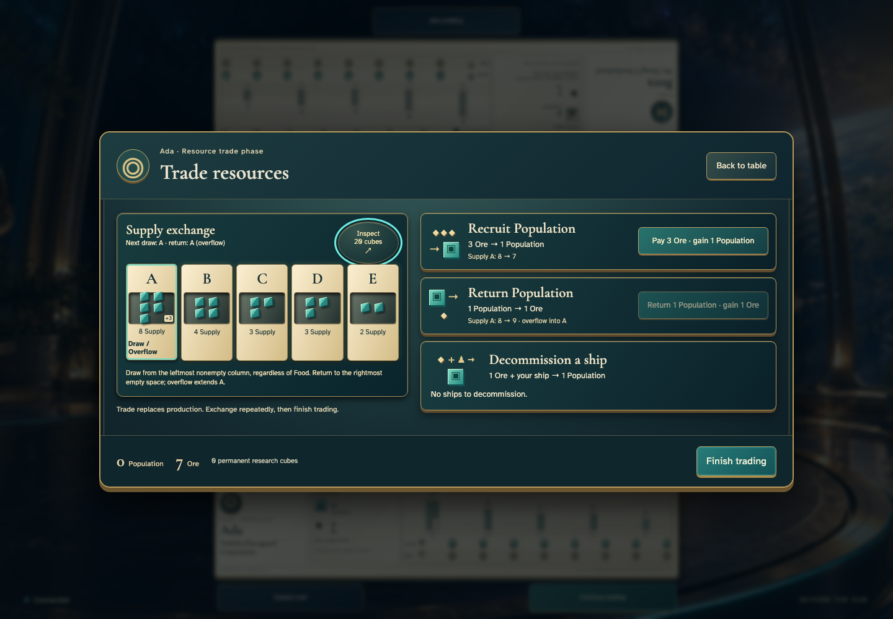](../../screenshots/trade-repeatedly-and-return-every-cube-through-the-real-supply-overflow-at-physical-shared-seats/032-recruit-route-desktop-darwin.png) |

tabletop-4k · 3840 × 2160

- [x] Inspect the named exchange without committing a resource
- [x] Canonical effects settle before capture.
- [x] Any printed Action plan is ready.
- [x] The rotated trade explanation stays above the opaque footer.
- [x] Public compact topology remains physically separated.
- [x] The gameplay shell fits the actual viewport.

## 34. Pay exactly3 Ore and convert the current leftmost Supply cube into Population

Viewpoint: **Ada · South · one shared controller**.

| desktop · 1440 × 1000 |
| --- |
|  |

tabletop-4k · 3840 × 2160

[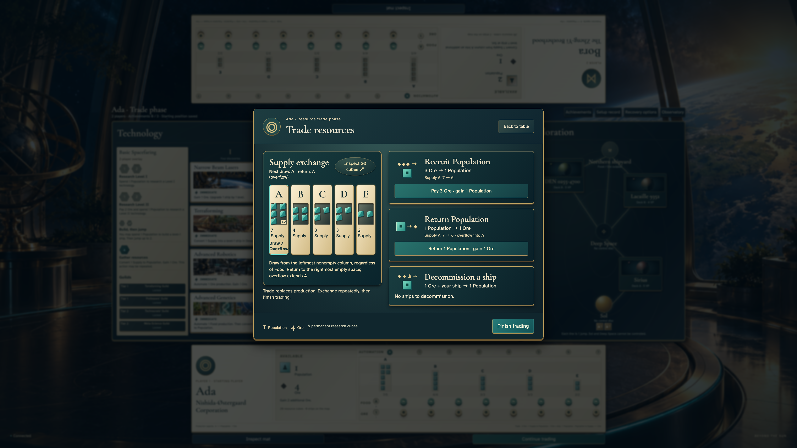](../../screenshots/trade-repeatedly-and-return-every-cube-through-the-real-supply-overflow-at-physical-shared-seats/033-recruit-0-tabletop-4k-darwin.png)

- [x] Pay exactly3 Ore and convert the current leftmost Supply cube into Population
- [x] Canonical effects settle before capture.
- [x] Any printed Action plan is ready.
- [x] The rotated trade explanation stays above the opaque footer.
- [x] Public compact topology remains physically separated.
- [x] The gameplay shell fits the actual viewport.

## 35. Pay exactly3 Ore and convert the current leftmost Supply cube into Population

Viewpoint: **Ada · South · one shared controller**.

| desktop · 1440 × 1000 |
| --- |
|  |

tabletop-4k · 3840 × 2160

- [x] Pay exactly3 Ore and convert the current leftmost Supply cube into Population
- [x] Canonical effects settle before capture.
- [x] Any printed Action plan is ready.
- [x] The rotated trade explanation stays above the opaque footer.
- [x] Public compact topology remains physically separated.
- [x] The gameplay shell fits the actual viewport.

## 36. Further recruitment is disabled at1 Ore rather than inventing a partial trade

Viewpoint: **Ada · South · one shared controller**.

| desktop · 1440 × 1000 |
| --- |
| [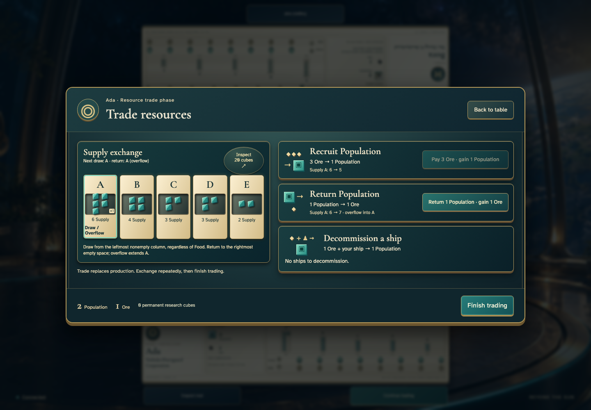](../../screenshots/trade-repeatedly-and-return-every-cube-through-the-real-supply-overflow-at-physical-shared-seats/035-insufficient-ore-desktop-darwin.png) |

tabletop-4k · 3840 × 2160

- [x] Further recruitment is disabled at1 Ore rather than inventing a partial trade
- [x] Canonical effects settle before capture.
- [x] Any printed Action plan is ready.
- [x] The rotated trade explanation stays above the opaque footer.
- [x] Public compact topology remains physically separated.
- [x] The gameplay shell fits the actual viewport.

## 37. Reload retains the current identity, accepted exchanges and pending trading phase

Viewpoint: **Ada · South · one shared controller**.

| desktop · 1440 × 1000 |
| --- |
| [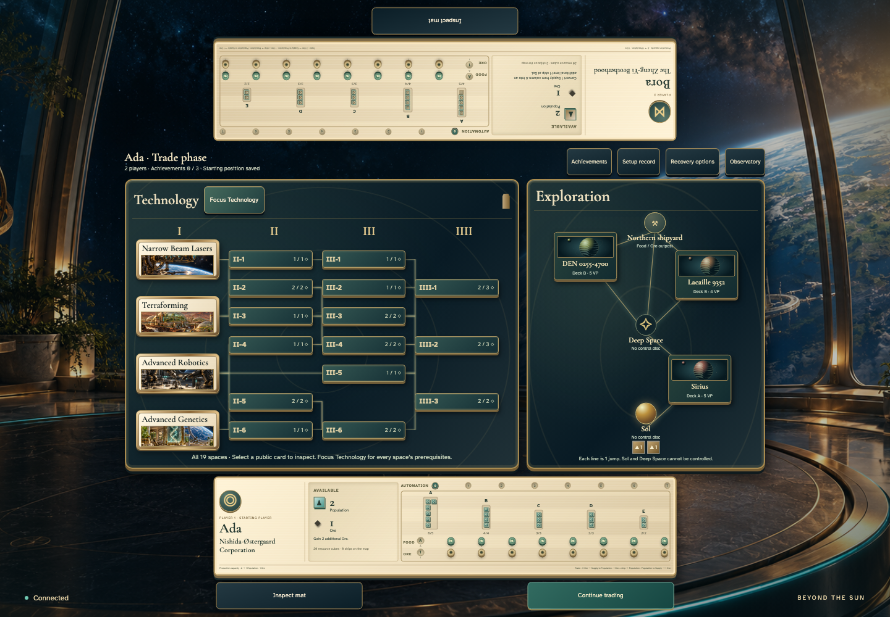](../../screenshots/trade-repeatedly-and-return-every-cube-through-the-real-supply-overflow-at-physical-shared-seats/036-repeated-trade-retained-desktop-darwin.png) |

tabletop-4k · 3840 × 2160

[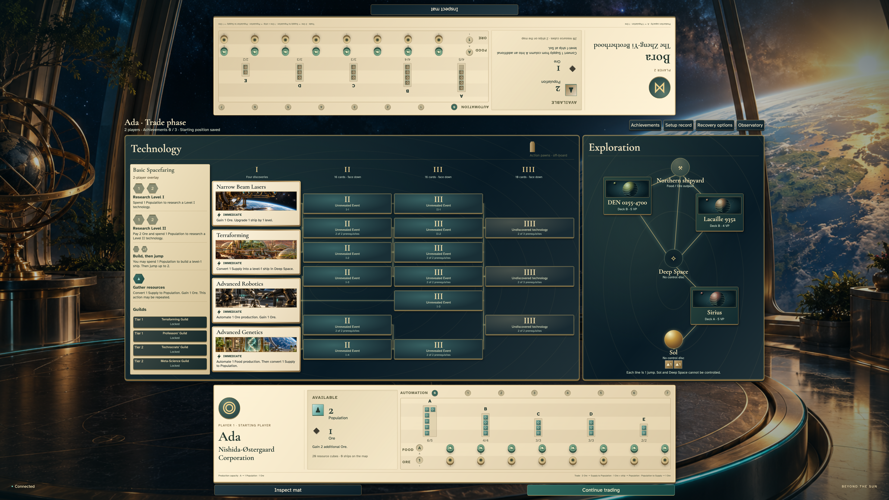](../../screenshots/trade-repeatedly-and-return-every-cube-through-the-real-supply-overflow-at-physical-shared-seats/036-repeated-trade-retained-tabletop-4k-darwin.png)

- [x] Reload retains the current identity, accepted exchanges and pending trading phase
- [x] Canonical effects settle before capture.
- [x] Any printed Action plan is ready.
- [x] The rotated trade explanation stays above the opaque footer.
- [x] Public compact topology remains physically separated.
- [x] The gameplay shell fits the actual viewport.

## 38. Open the same retained trade without duplicating a payment

Viewpoint: **Ada · South · one shared controller**.

| desktop · 1440 × 1000 |
| --- |
|  |

tabletop-4k · 3840 × 2160

- [x] Open the same retained trade without duplicating a payment
- [x] Canonical effects settle before capture.
- [x] Any printed Action plan is ready.
- [x] The rotated trade explanation stays above the opaque footer.
- [x] Public compact topology remains physically separated.
- [x] The gameplay shell fits the actual viewport.

## 39. Inspect all twenty cubes in their current public locations

Viewpoint: **Ada · South · one shared controller**.

| desktop · 1440 × 1000 |
| --- |
|  |

tabletop-4k · 3840 × 2160

- [x] Inspect all twenty cubes in their current public locations
- [x] Canonical effects settle before capture.
- [x] Any printed Action plan is ready.
- [x] The rotated trade explanation stays above the opaque footer.
- [x] Public compact topology remains physically separated.
- [x] The gameplay shell fits the actual viewport.

## 40. Forward Tab stays inside the native cube reader

Viewpoint: **Ada · South · one shared controller**.

| desktop · 1440 × 1000 |
| --- |
|  |

tabletop-4k · 3840 × 2160

[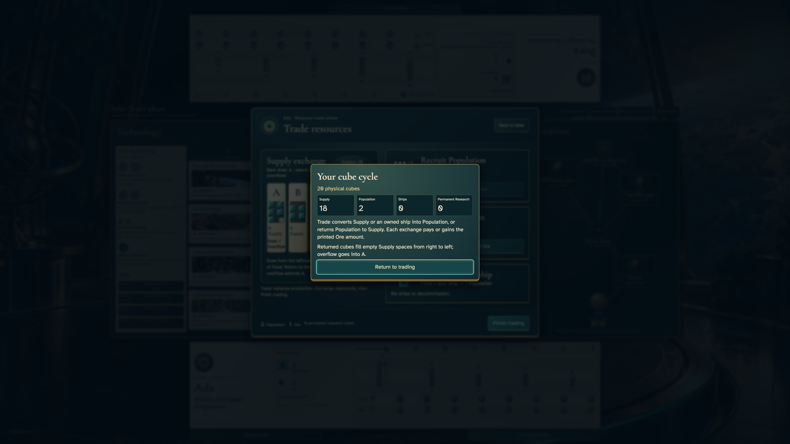](../../screenshots/trade-repeatedly-and-return-every-cube-through-the-real-supply-overflow-at-physical-shared-seats/039-retained-cycle-tab-tabletop-4k-darwin.png)

- [x] Forward Tab stays inside the native cube reader
- [x] Canonical effects settle before capture.
- [x] Any printed Action plan is ready.
- [x] The rotated trade explanation stays above the opaque footer.
- [x] Public compact topology remains physically separated.
- [x] The gameplay shell fits the actual viewport.

## 41. Reverse Tab also stays inside the native reader

Viewpoint: **Ada · South · one shared controller**.

| desktop · 1440 × 1000 |
| --- |
| [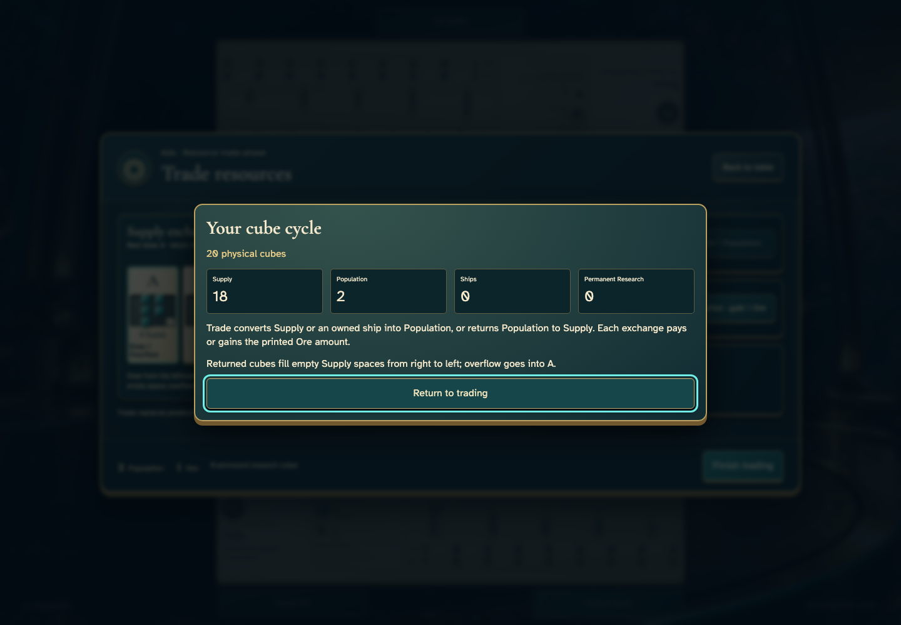](../../screenshots/trade-repeatedly-and-return-every-cube-through-the-real-supply-overflow-at-physical-shared-seats/040-retained-cycle-reverse-desktop-darwin.png) |

tabletop-4k · 3840 × 2160

- [x] Reverse Tab also stays inside the native reader
- [x] Canonical effects settle before capture.
- [x] Any printed Action plan is ready.
- [x] The rotated trade explanation stays above the opaque footer.
- [x] Public compact topology remains physically separated.
- [x] The gameplay shell fits the actual viewport.

## 42. Escape restores the exact inspector opener without committing a trade

Viewpoint: **Ada · South · one shared controller**.

| desktop · 1440 × 1000 |
| --- |
| [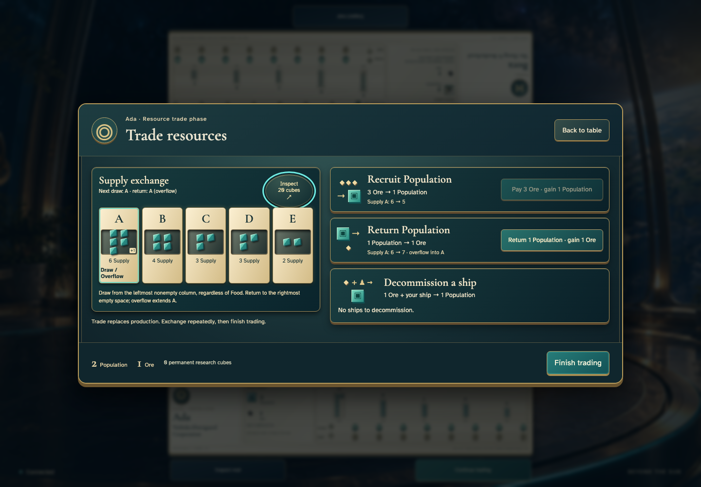](../../screenshots/trade-repeatedly-and-return-every-cube-through-the-real-supply-overflow-at-physical-shared-seats/041-retained-cycle-return-desktop-darwin.png) |

tabletop-4k · 3840 × 2160

- [x] Escape restores the exact inspector opener without committing a trade
- [x] Canonical effects settle before capture.
- [x] Any printed Action plan is ready.
- [x] The rotated trade explanation stays above the opaque footer.
- [x] Public compact topology remains physically separated.
- [x] The gameplay shell fits the actual viewport.

## 43. Finish trading passes to the next player without adding growth or Ore production

Viewpoint: **Ada · South · one shared controller**.

| desktop · 1440 × 1000 |
| --- |
| [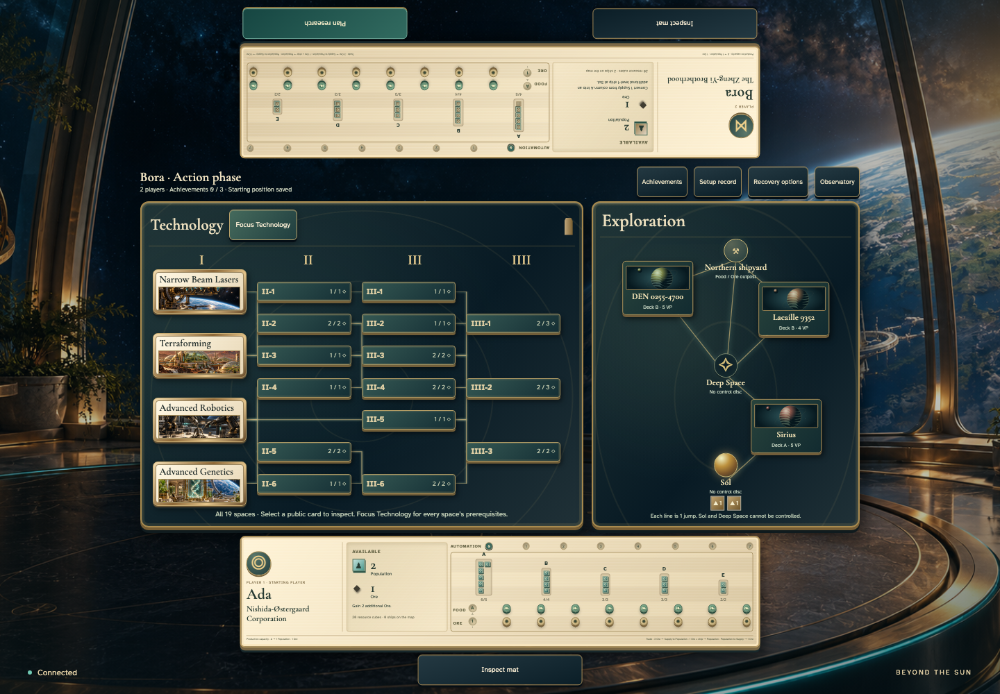](../../screenshots/trade-repeatedly-and-return-every-cube-through-the-real-supply-overflow-at-physical-shared-seats/042-finished-passed-desktop-darwin.png) |

tabletop-4k · 3840 × 2160

- [x] Finish trading passes to the next player without adding growth or Ore production
- [x] Canonical effects settle before capture.
- [x] Any printed Action plan is ready.
- [x] The rotated trade explanation stays above the opaque footer.
- [x] Public compact topology remains physically separated.
- [x] The gameplay shell fits the actual viewport.

## 44. The public faction mat retains the final exact trade balance after handoff

Viewpoint: **Ada · South · one shared controller**.

| desktop · 1440 × 1000 |
| --- |
| [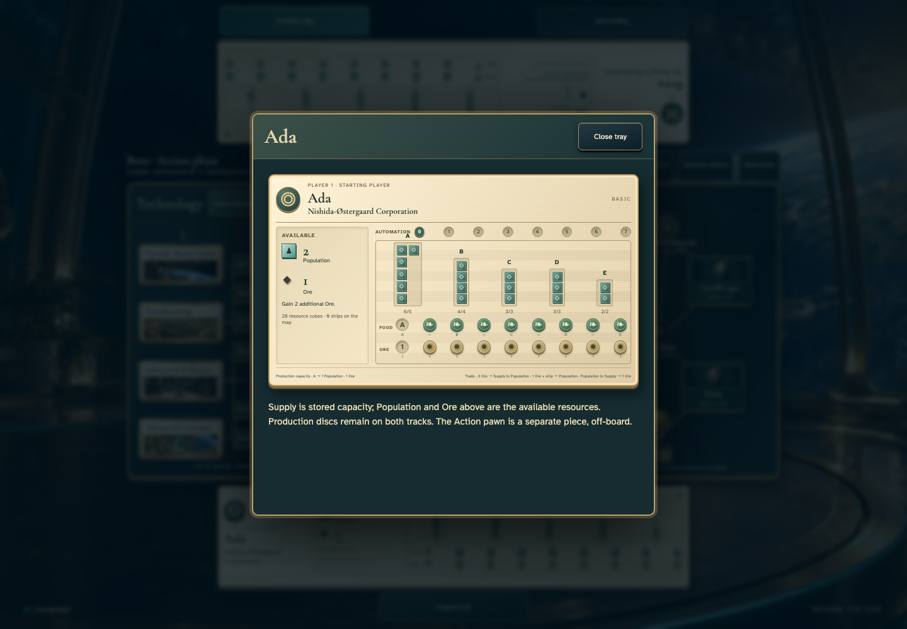](../../screenshots/trade-repeatedly-and-return-every-cube-through-the-real-supply-overflow-at-physical-shared-seats/043-finished-proof-desktop-darwin.png) |

tabletop-4k · 3840 × 2160

[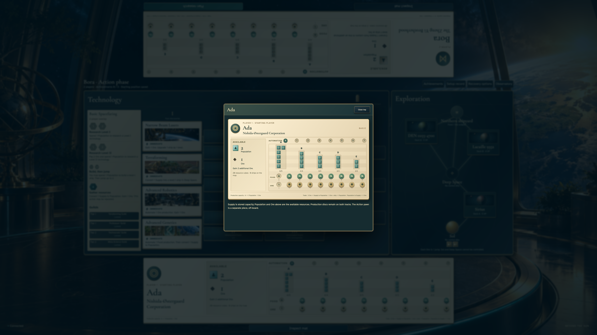](../../screenshots/trade-repeatedly-and-return-every-cube-through-the-real-supply-overflow-at-physical-shared-seats/043-finished-proof-tabletop-4k-darwin.png)

- [x] The public faction mat retains the final exact trade balance after handoff
- [x] Canonical effects settle before capture.
- [x] Any printed Action plan is ready.
- [x] The rotated trade explanation stays above the opaque footer.
- [x] Public compact topology remains physically separated.
- [x] The gameplay shell fits the actual viewport.

## 45. Escape returns from the actual mat to the handed-off board

Viewpoint: **Ada · South · one shared controller**.

| desktop · 1440 × 1000 |
| --- |
| [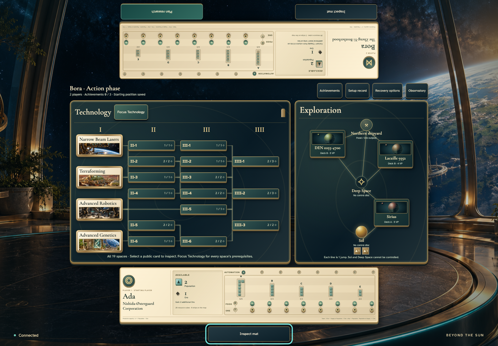](../../screenshots/trade-repeatedly-and-return-every-cube-through-the-real-supply-overflow-at-physical-shared-seats/044-finished-return-desktop-darwin.png) |

tabletop-4k · 3840 × 2160

[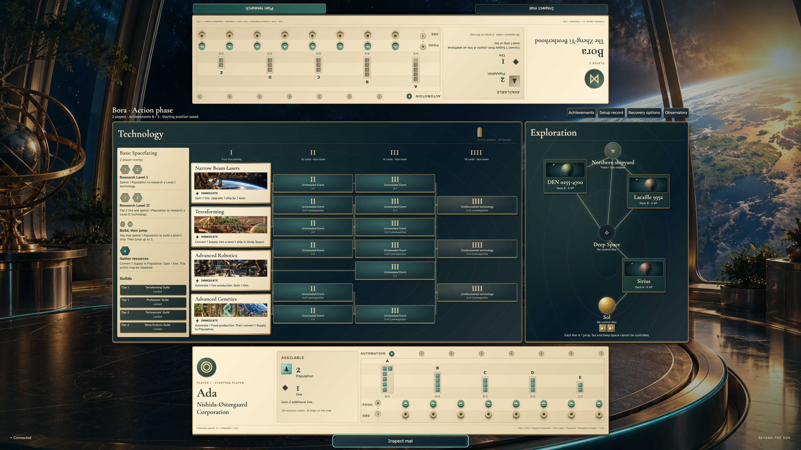](../../screenshots/trade-repeatedly-and-return-every-cube-through-the-real-supply-overflow-at-physical-shared-seats/044-finished-return-tabletop-4k-darwin.png)

- [x] Escape returns from the actual mat to the handed-off board
- [x] Canonical effects settle before capture.
- [x] Any printed Action plan is ready.
- [x] The rotated trade explanation stays above the opaque footer.
- [x] Public compact topology remains physically separated.
- [x] The gameplay shell fits the actual viewport.

## 46. Reload retains the finished trading turn and leaves no orphaned inspector

Viewpoint: **Ada · South · one shared controller**.

| desktop · 1440 × 1000 |
| --- |
|  |

tabletop-4k · 3840 × 2160

- [x] Reload retains the finished trading turn and leaves no orphaned inspector
- [x] Canonical effects settle before capture.
- [x] Any printed Action plan is ready.
- [x] The rotated trade explanation stays above the opaque footer.
- [x] Public compact topology remains physically separated.
- [x] The gameplay shell fits the actual viewport.
