# Automate Food and Ore permanently and retain cumulative awards with separate controllers

Ordinary production UI setup, legal unique Basic factions and preparatory turns. Fixed setup entropy66666666-6666-4666-8666-000000000009; command identities are deterministic, never injected game state or a transferred controller. Production-disc removal, exposed yields, permanent level and cumulative printed scoring are real canonical effects. Read-only future inspection pays nothing. Deterministic exhausted-track/above-seven cases remain backend coverage; no fake advanced UI state.

## 1. Arrive using the actual production client

Viewpoint: **Ada · separate host controller**.

| phone · 393 × 852 | desktop · 1440 × 1000 |
| --- | --- |
|  |  |

- [x] Arrive using the actual production client
- [x] The canonical effect and backend acknowledgement settle.
- [x] Public technology topology retains physical separation.
- [x] The actual viewport fits without page scrolling.

## 2. Choose a real production play mode

Viewpoint: **Ada · separate host controller**.

| phone · 393 × 852 | desktop · 1440 × 1000 |
| --- | --- |
|  |  |

- [x] Choose a real production play mode
- [x] The canonical effect and backend acknowledgement settle.
- [x] Public technology topology retains physical separation.
- [x] The actual viewport fits without page scrolling.

## 3. Create an independent remote host controller

Viewpoint: **Ada · separate host controller**.

| phone · 393 × 852 | desktop · 1440 × 1000 |
| --- | --- |
|  |  |

- [x] Create an independent remote host controller
- [x] The canonical effect and backend acknowledgement settle.
- [x] Public technology topology retains physical separation.
- [x] The actual viewport fits without page scrolling.

## 4. Name the host Ada

Viewpoint: **Ada · separate host controller**.

| phone · 393 × 852 | desktop · 1440 × 1000 |
| --- | --- |
|  |  |

- [x] Name the host Ada
- [x] The canonical effect and backend acknowledgement settle.
- [x] Public technology topology retains physical separation.
- [x] The actual viewport fits without page scrolling.

## 5. The canonical remote room exposes its actual invitation code

Viewpoint: **Ada · separate host controller**.

| phone · 393 × 852 | desktop · 1440 × 1000 |
| --- | --- |
| [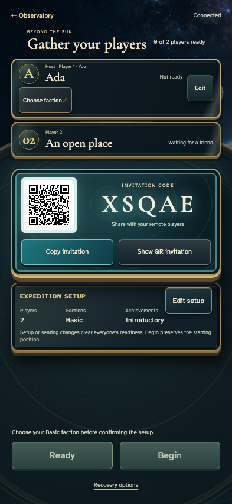](../../screenshots/automate-food-and-ore-permanently-and-retain-cumulative-awards-with-separate-controllers/004-host-room-phone-darwin.png) |  |

- [x] The canonical remote room exposes its actual invitation code
- [x] The canonical effect and backend acknowledgement settle.
- [x] Public technology topology retains physical separation.
- [x] The actual viewport fits without page scrolling.

## 6. A different identity previews the public invitation

Viewpoint: **Bora · separate guest controller**.

| phone · 1440 × 1000 | desktop · 393 × 852 |
| --- | --- |
| [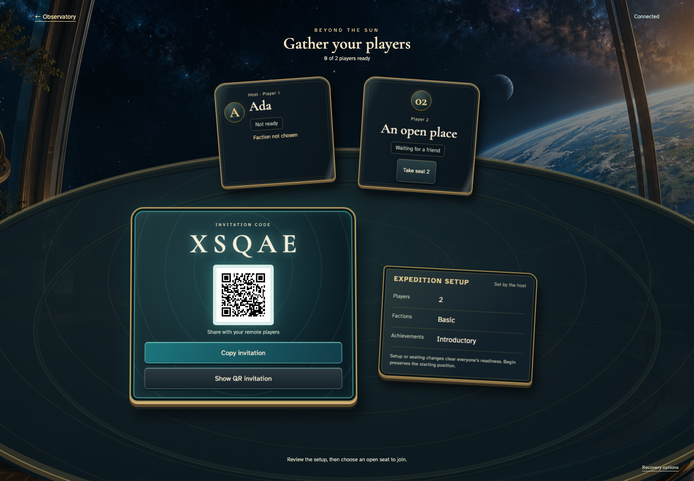](../../screenshots/automate-food-and-ore-permanently-and-retain-cumulative-awards-with-separate-controllers/005-guest-preview-phone-darwin.png) | [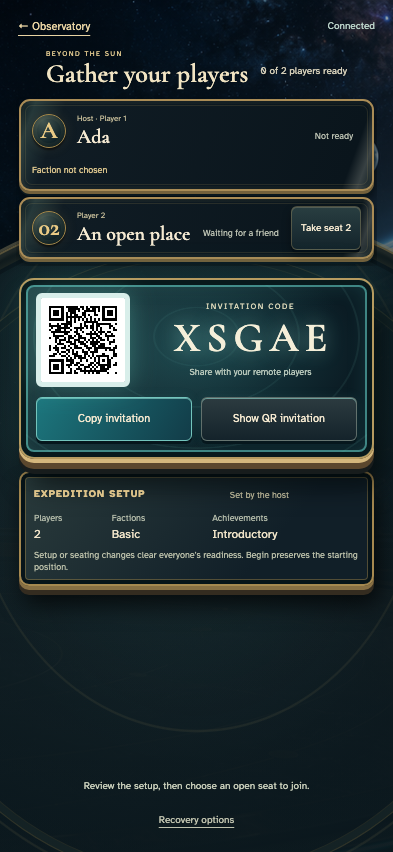](../../screenshots/automate-food-and-ore-permanently-and-retain-cumulative-awards-with-separate-controllers/005-guest-preview-desktop-darwin.png) |

- [x] A different identity previews the public invitation
- [x] The canonical effect and backend acknowledgement settle.
- [x] Public technology topology retains physical separation.
- [x] The actual viewport fits without page scrolling.

## 7. The guest claims only the remote seat

Viewpoint: **Bora · separate guest controller**.

| phone · 1440 × 1000 | desktop · 393 × 852 |
| --- | --- |
| [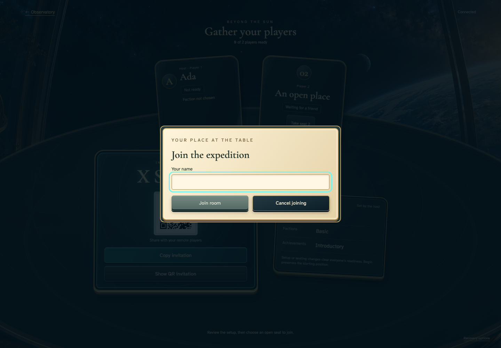](../../screenshots/automate-food-and-ore-permanently-and-retain-cumulative-awards-with-separate-controllers/006-guest-editor-phone-darwin.png) | [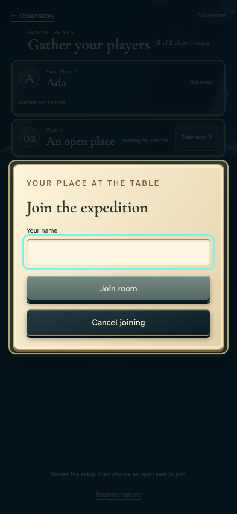](../../screenshots/automate-food-and-ore-permanently-and-retain-cumulative-awards-with-separate-controllers/006-guest-editor-desktop-darwin.png) |

- [x] The guest claims only the remote seat
- [x] The canonical effect and backend acknowledgement settle.
- [x] Public technology topology retains physical separation.
- [x] The actual viewport fits without page scrolling.

## 8. Name the independent guest Bora

Viewpoint: **Bora · separate guest controller**.

| phone · 1440 × 1000 | desktop · 393 × 852 |
| --- | --- |
| [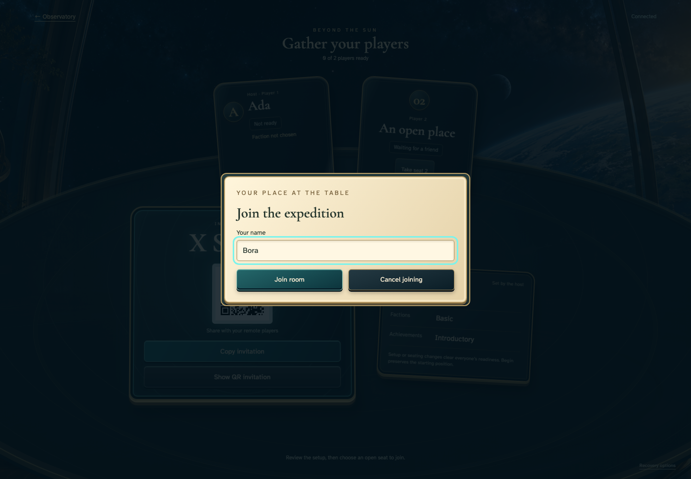](../../screenshots/automate-food-and-ore-permanently-and-retain-cumulative-awards-with-separate-controllers/007-guest-name-phone-darwin.png) |  |

- [x] Name the independent guest Bora
- [x] The canonical effect and backend acknowledgement settle.
- [x] Public technology topology retains physical separation.
- [x] The actual viewport fits without page scrolling.

## 9. Both named remote identities share the same room

Viewpoint: **Bora · separate guest controller**.

| phone · 1440 × 1000 | desktop · 393 × 852 |
| --- | --- |
| [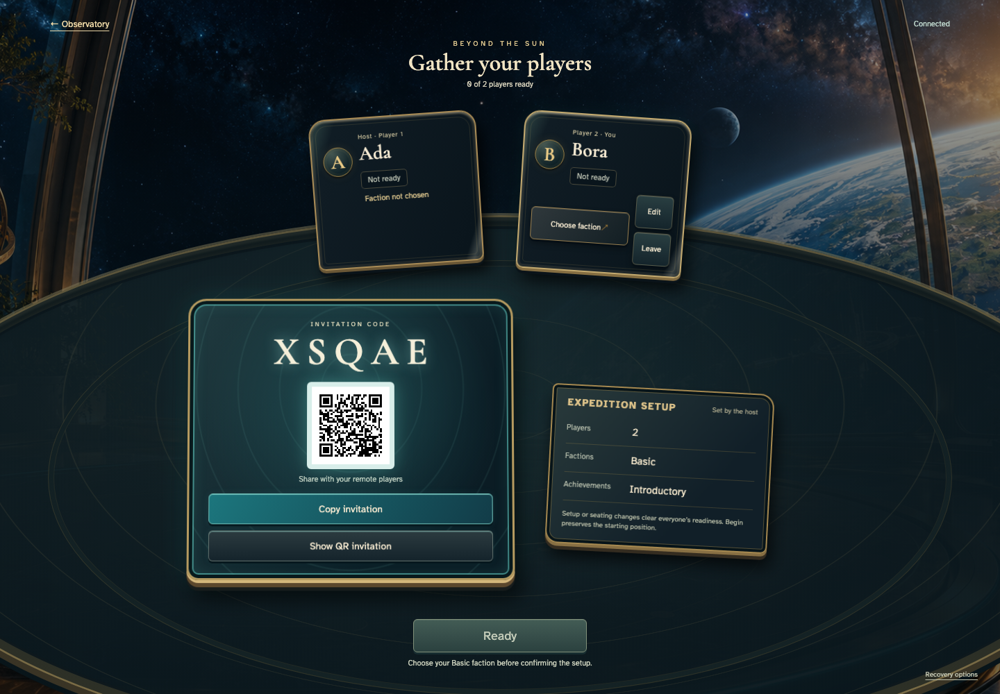](../../screenshots/automate-food-and-ore-permanently-and-retain-cumulative-awards-with-separate-controllers/008-guest-joined-phone-darwin.png) | [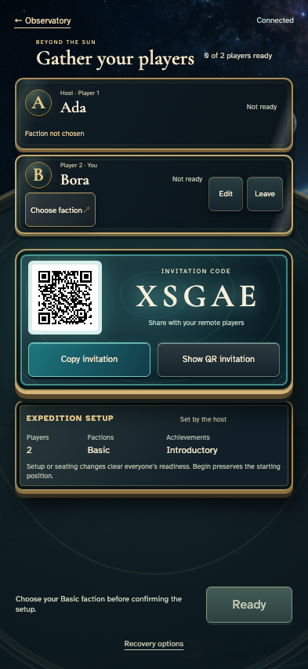](../../screenshots/automate-food-and-ore-permanently-and-retain-cumulative-awards-with-separate-controllers/008-guest-joined-desktop-darwin.png) |

- [x] Both named remote identities share the same room
- [x] The canonical effect and backend acknowledgement settle.
- [x] Public technology topology retains physical separation.
- [x] The actual viewport fits without page scrolling.

## 10. Ada chooses a legal unique Basic faction

Viewpoint: **Ada · separate host controller**.

| phone · 393 × 852 | desktop · 1440 × 1000 |
| --- | --- |
| [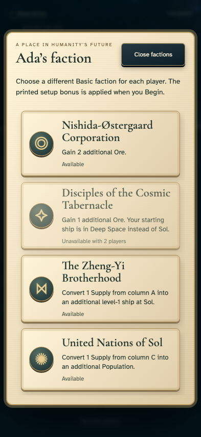](../../screenshots/automate-food-and-ore-permanently-and-retain-cumulative-awards-with-separate-controllers/009-faction-0-editor-phone-darwin.png) |  |

- [x] Ada chooses a legal unique Basic faction
- [x] The canonical effect and backend acknowledgement settle.
- [x] Public technology topology retains physical separation.
- [x] The actual viewport fits without page scrolling.

## 11. Ada retains Nishida-Østergaard Corporation

Viewpoint: **Ada · separate host controller**.

| phone · 393 × 852 | desktop · 1440 × 1000 |
| --- | --- |
| [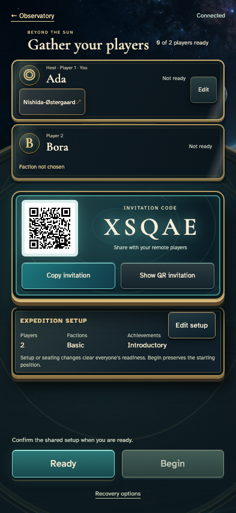](../../screenshots/automate-food-and-ore-permanently-and-retain-cumulative-awards-with-separate-controllers/010-faction-0-chosen-phone-darwin.png) |  |

- [x] Ada retains Nishida-Østergaard Corporation
- [x] The canonical effect and backend acknowledgement settle.
- [x] Public technology topology retains physical separation.
- [x] The actual viewport fits without page scrolling.

## 12. Bora chooses a legal unique Basic faction

Viewpoint: **Bora · separate guest controller**.

| phone · 1440 × 1000 | desktop · 393 × 852 |
| --- | --- |
|  |  |

- [x] Bora chooses a legal unique Basic faction
- [x] The canonical effect and backend acknowledgement settle.
- [x] Public technology topology retains physical separation.
- [x] The actual viewport fits without page scrolling.

## 13. Bora retains The Zheng-Yi Brotherhood

Viewpoint: **Bora · separate guest controller**.

| phone · 1440 × 1000 | desktop · 393 × 852 |
| --- | --- |
|  |  |

- [x] Bora retains The Zheng-Yi Brotherhood
- [x] The canonical effect and backend acknowledgement settle.
- [x] Public technology topology retains physical separation.
- [x] The actual viewport fits without page scrolling.

## 14. Confirm this identity is ready for the exact saved configuration

Viewpoint: **Bora · separate guest controller**.

| phone · 1440 × 1000 | desktop · 393 × 852 |
| --- | --- |
|  | [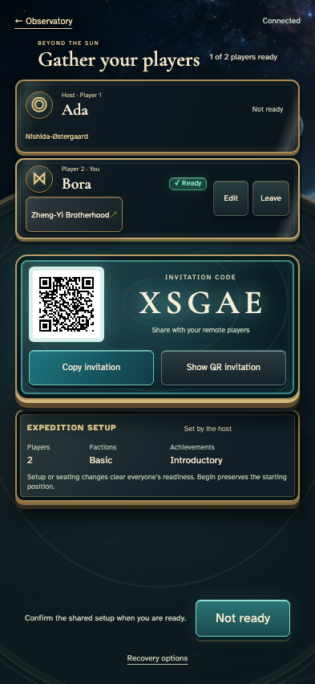](../../screenshots/automate-food-and-ore-permanently-and-retain-cumulative-awards-with-separate-controllers/013-ready-1-desktop-darwin.png) |

- [x] Confirm this identity is ready for the exact saved configuration
- [x] The canonical effect and backend acknowledgement settle.
- [x] Public technology topology retains physical separation.
- [x] The actual viewport fits without page scrolling.

## 15. Confirm this identity is ready for the exact saved configuration

Viewpoint: **Ada · separate host controller**.

| phone · 393 × 852 | desktop · 1440 × 1000 |
| --- | --- |
| [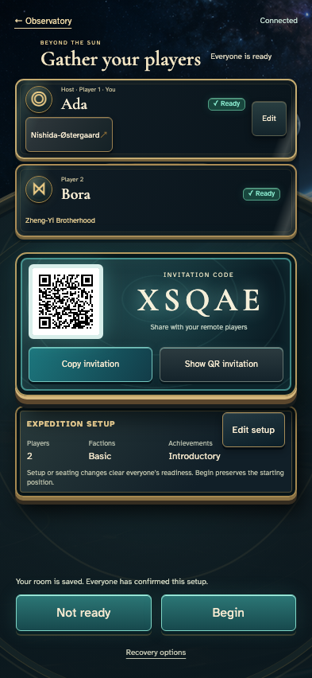](../../screenshots/automate-food-and-ore-permanently-and-retain-cumulative-awards-with-separate-controllers/014-ready-0-phone-darwin.png) |  |

- [x] Confirm this identity is ready for the exact saved configuration
- [x] The canonical effect and backend acknowledgement settle.
- [x] Public technology topology retains physical separation.
- [x] The actual viewport fits without page scrolling.

## 16. Begin the immutable source-reviewed Basic setup through the ordinary UI

Viewpoint: **Ada · separate host controller**.

| phone · 393 × 852 | desktop · 1440 × 1000 |
| --- | --- |
|  |  |

- [x] Begin the immutable source-reviewed Basic setup through the ordinary UI
- [x] The canonical effect and backend acknowledgement settle.
- [x] Public technology topology retains physical separation.
- [x] The actual viewport fits without page scrolling.

## 17. Ada inspects the actual retained production discs and Supply

Viewpoint: **Ada · separate host controller**.

| phone · 393 × 852 | desktop · 1440 × 1000 |
| --- | --- |
| [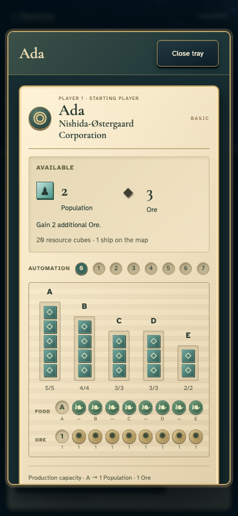](../../screenshots/automate-food-and-ore-permanently-and-retain-cumulative-awards-with-separate-controllers/016-initial-mat-phone-darwin.png) | [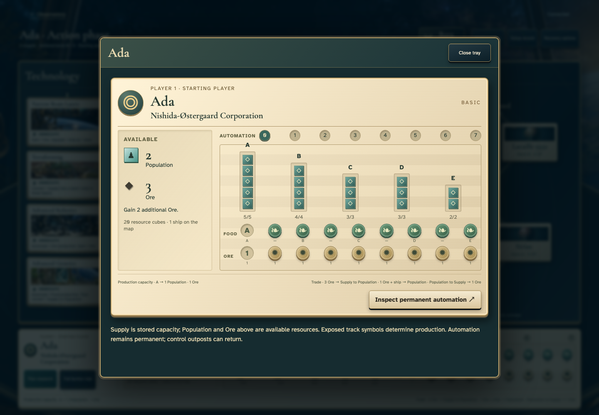](../../screenshots/automate-food-and-ore-permanently-and-retain-cumulative-awards-with-separate-controllers/016-initial-mat-desktop-darwin.png) |

- [x] Ada inspects the actual retained production discs and Supply
- [x] The canonical effect and backend acknowledgement settle.
- [x] Public technology topology retains physical separation.
- [x] The actual viewport fits without page scrolling.

## 18. Permanent level 0 contributes 0 cumulative endgame VP without an immediate payout

Viewpoint: **Ada · separate host controller**.

| phone · 393 × 852 | desktop · 1440 × 1000 |
| --- | --- |
| [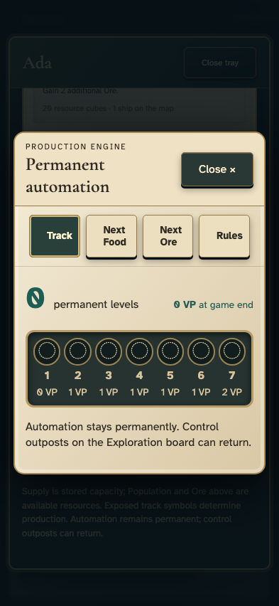](../../screenshots/automate-food-and-ore-permanently-and-retain-cumulative-awards-with-separate-controllers/017-initial-track-phone-darwin.png) | [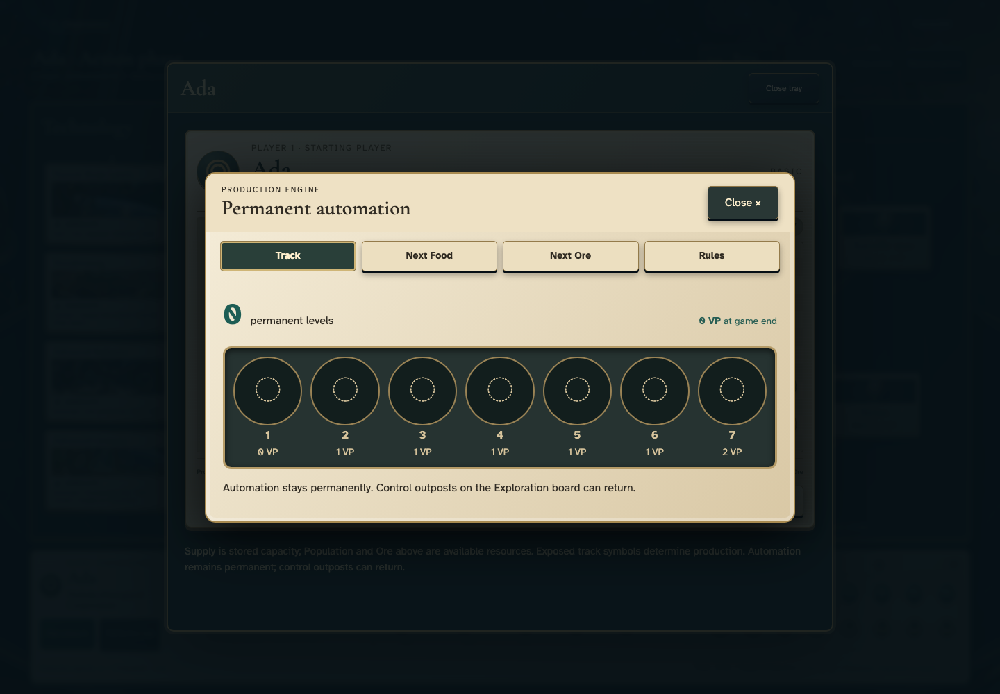](../../screenshots/automate-food-and-ore-permanently-and-retain-cumulative-awards-with-separate-controllers/017-initial-track-desktop-darwin.png) |

- [x] Permanent level 0 contributes 0 cumulative endgame VP without an immediate payout
- [x] The canonical effect and backend acknowledgement settle.
- [x] Public technology topology retains physical separation.
- [x] The actual viewport fits without page scrolling.

## 19. Escape returns to the exact mat opener; inspection never spends or collects

Viewpoint: **Ada · separate host controller**.

| phone · 393 × 852 | desktop · 1440 × 1000 |
| --- | --- |
| [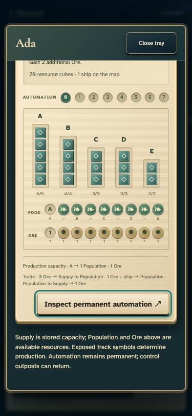](../../screenshots/automate-food-and-ore-permanently-and-retain-cumulative-awards-with-separate-controllers/018-initial-return-phone-darwin.png) | [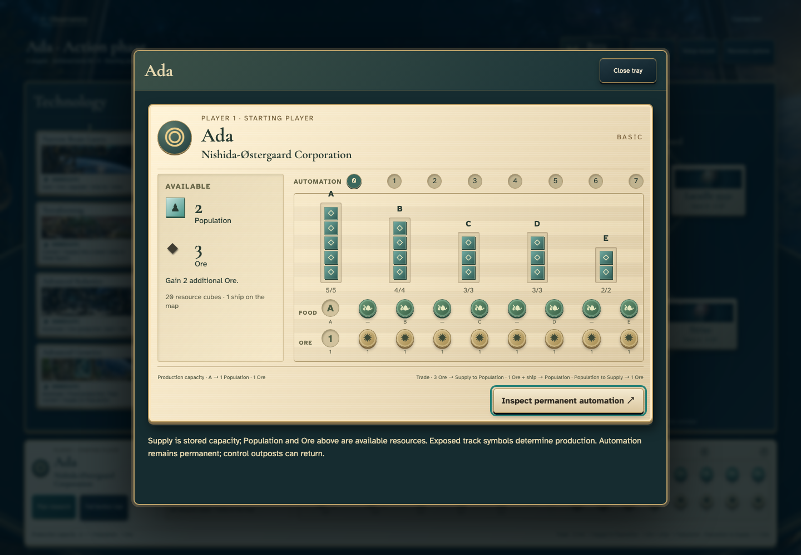](../../screenshots/automate-food-and-ore-permanently-and-retain-cumulative-awards-with-separate-controllers/018-initial-return-desktop-darwin.png) |

- [x] Escape returns to the exact mat opener; inspection never spends or collects
- [x] The canonical effect and backend acknowledgement settle.
- [x] Public technology topology retains physical separation.
- [x] The actual viewport fits without page scrolling.

## 20. Return to the real turn with all production choices still pending

Viewpoint: **Ada · separate host controller**.

| phone · 393 × 852 | desktop · 1440 × 1000 |
| --- | --- |
|  |  |

- [x] Return to the real turn with all production choices still pending
- [x] The canonical effect and backend acknowledgement settle.
- [x] Public technology topology retains physical separation.
- [x] The actual viewport fits without page scrolling.

## 21. Ada opens the actual research and Action instrument

Viewpoint: **Ada · separate host controller**.

| phone · 393 × 852 | desktop · 1440 × 1000 |
| --- | --- |
|  |  |

- [x] Ada opens the actual research and Action instrument
- [x] The canonical effect and backend acknowledgement settle.
- [x] Public technology topology retains physical separation.
- [x] The actual viewport fits without page scrolling.

## 22. Ada selects the legal printed space 1

Viewpoint: **Ada · separate host controller**.

| phone · 393 × 852 | desktop · 1440 × 1000 |
| --- | --- |
|  |  |

- [x] Ada selects the legal printed space 1
- [x] The canonical effect and backend acknowledgement settle.
- [x] Public technology topology retains physical separation.
- [x] The actual viewport fits without page scrolling.

## 23. Select Advanced Genetics with its printed cost and consequence

Viewpoint: **Ada · separate host controller**.

| phone · 393 × 852 | desktop · 1440 × 1000 |
| --- | --- |
|  |  |

- [x] Select Advanced Genetics with its printed cost and consequence
- [x] The canonical effect and backend acknowledgement settle.
- [x] Public technology topology retains physical separation.
- [x] The actual viewport fits without page scrolling.

## 24. Pay once and receive Advanced Genetics's immediate bonus

Viewpoint: **Ada · separate host controller**.

| phone · 393 × 852 | desktop · 1440 × 1000 |
| --- | --- |
|  |  |

- [x] Pay once and receive Advanced Genetics's immediate bonus
- [x] The canonical effect and backend acknowledgement settle.
- [x] Public technology topology retains physical separation.
- [x] The actual viewport fits without page scrolling.

## 25. The first Food automation exposes a blank slot, retaining only A growth

Viewpoint: **Ada · separate host controller**.

| phone · 393 × 852 | desktop · 1440 × 1000 |
| --- | --- |
|  | [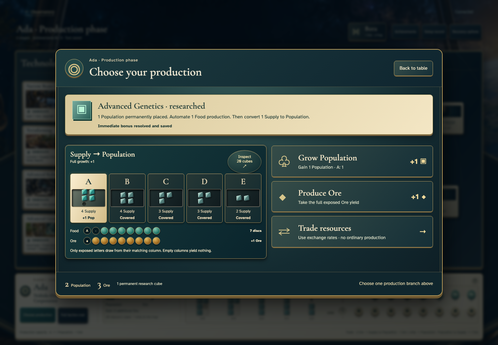](../../screenshots/automate-food-and-ore-permanently-and-retain-cumulative-awards-with-separate-controllers/024-food-blank-desktop-darwin.png) |

- [x] The first Food automation exposes a blank slot, retaining only A growth
- [x] The canonical effect and backend acknowledgement settle.
- [x] Public technology topology retains physical separation.
- [x] The actual viewport fits without page scrolling.

## 26. Close the decision without paying or collecting any further resource

Viewpoint: **Ada · separate host controller**.

| phone · 393 × 852 | desktop · 1440 × 1000 |
| --- | --- |
| [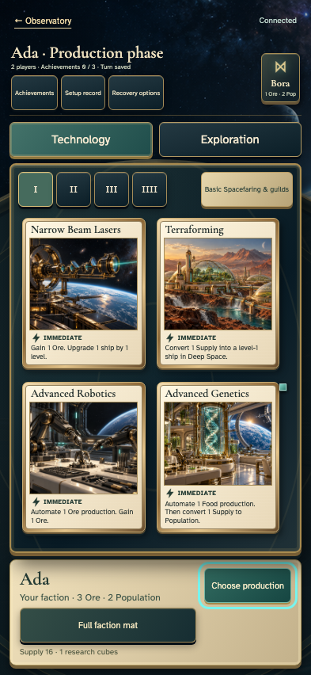](../../screenshots/automate-food-and-ore-permanently-and-retain-cumulative-awards-with-separate-controllers/025-food-permanent-board-phone-darwin.png) |  |

- [x] Close the decision without paying or collecting any further resource
- [x] The canonical effect and backend acknowledgement settle.
- [x] Public technology topology retains physical separation.
- [x] The actual viewport fits without page scrolling.

## 27. Ada inspects the actual retained production discs and Supply

Viewpoint: **Ada · separate host controller**.

| phone · 393 × 852 | desktop · 1440 × 1000 |
| --- | --- |
| [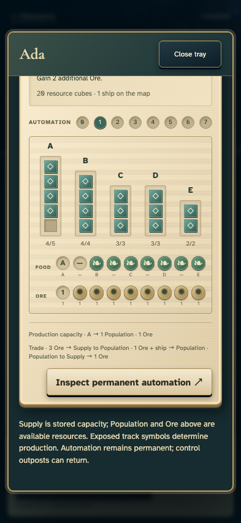](../../screenshots/automate-food-and-ore-permanently-and-retain-cumulative-awards-with-separate-controllers/026-food-permanent-mat-phone-darwin.png) | [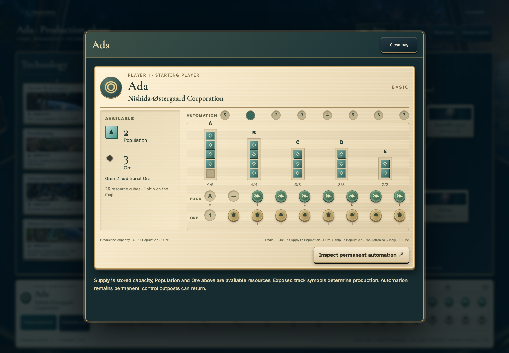](../../screenshots/automate-food-and-ore-permanently-and-retain-cumulative-awards-with-separate-controllers/026-food-permanent-mat-desktop-darwin.png) |

- [x] Ada inspects the actual retained production discs and Supply
- [x] The canonical effect and backend acknowledgement settle.
- [x] Public technology topology retains physical separation.
- [x] The actual viewport fits without page scrolling.

## 28. Permanent level 1 contributes 0 cumulative endgame VP without an immediate payout

Viewpoint: **Ada · separate host controller**.

| phone · 393 × 852 | desktop · 1440 × 1000 |
| --- | --- |
| [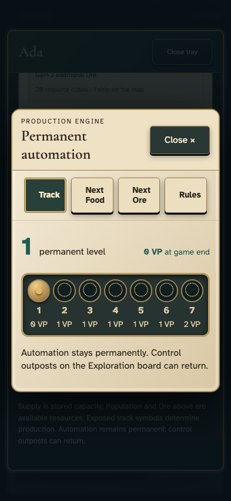](../../screenshots/automate-food-and-ore-permanently-and-retain-cumulative-awards-with-separate-controllers/027-food-permanent-track-phone-darwin.png) | [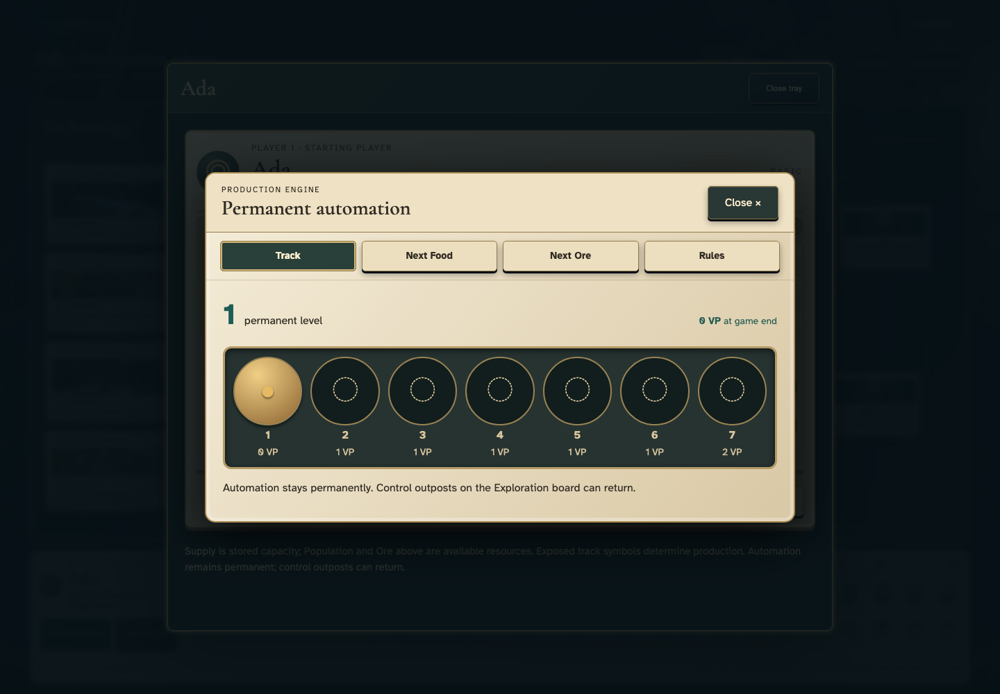](../../screenshots/automate-food-and-ore-permanently-and-retain-cumulative-awards-with-separate-controllers/027-food-permanent-track-desktop-darwin.png) |

- [x] Permanent level 1 contributes 0 cumulative endgame VP without an immediate payout
- [x] The canonical effect and backend acknowledgement settle.
- [x] Public technology topology retains physical separation.
- [x] The actual viewport fits without page scrolling.

## 29. Inspect the next Food disc and exposed yield as a read-only consequence

Viewpoint: **Ada · separate host controller**.

| phone · 393 × 852 | desktop · 1440 × 1000 |
| --- | --- |
| [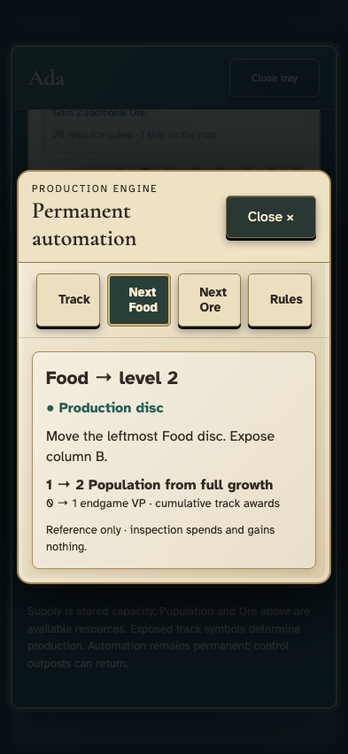](../../screenshots/automate-food-and-ore-permanently-and-retain-cumulative-awards-with-separate-controllers/028-food-permanent-food-phone-darwin.png) |  |

- [x] Inspect the next Food disc and exposed yield as a read-only consequence
- [x] The canonical effect and backend acknowledgement settle.
- [x] Public technology topology retains physical separation.
- [x] The actual viewport fits without page scrolling.

## 30. Inspect the next Ore disc and exposed yield as a read-only consequence

Viewpoint: **Ada · separate host controller**.

| phone · 393 × 852 | desktop · 1440 × 1000 |
| --- | --- |
| [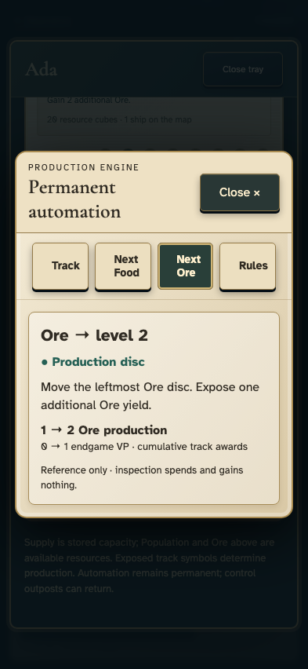](../../screenshots/automate-food-and-ore-permanently-and-retain-cumulative-awards-with-separate-controllers/029-food-permanent-ore-phone-darwin.png) | [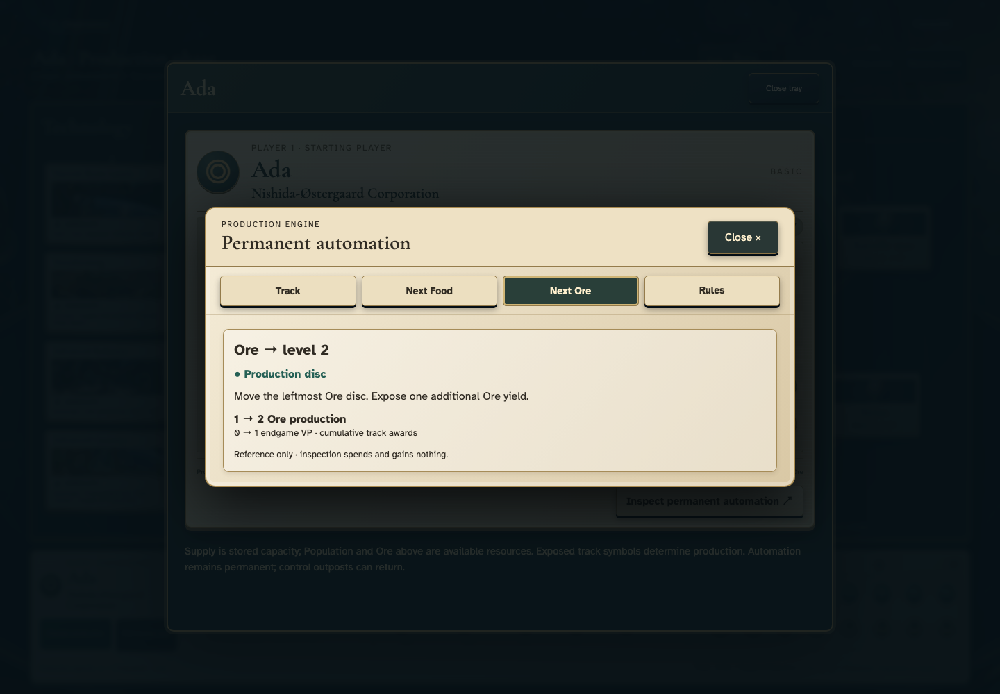](../../screenshots/automate-food-and-ore-permanently-and-retain-cumulative-awards-with-separate-controllers/029-food-permanent-ore-desktop-darwin.png) |

- [x] Inspect the next Ore disc and exposed yield as a read-only consequence
- [x] The canonical effect and backend acknowledgement settle.
- [x] Public technology topology retains physical separation.
- [x] The actual viewport fits without page scrolling.

## 31. Read permanent discs, unlimited placeholders and cumulative awards without changing the game

Viewpoint: **Ada · separate host controller**.

| phone · 393 × 852 | desktop · 1440 × 1000 |
| --- | --- |
| [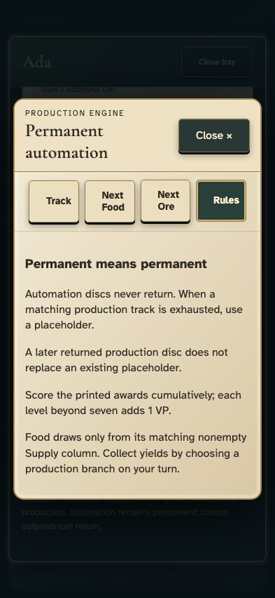](../../screenshots/automate-food-and-ore-permanently-and-retain-cumulative-awards-with-separate-controllers/030-food-permanent-rules-phone-darwin.png) |  |

- [x] Read permanent discs, unlimited placeholders and cumulative awards without changing the game
- [x] The canonical effect and backend acknowledgement settle.
- [x] Public technology topology retains physical separation.
- [x] The actual viewport fits without page scrolling.

## 32. Tab reaches the named internally scrolling automation details

Viewpoint: **Ada · separate host controller**.

| phone · 393 × 852 | desktop · 1440 × 1000 |
| --- | --- |
| [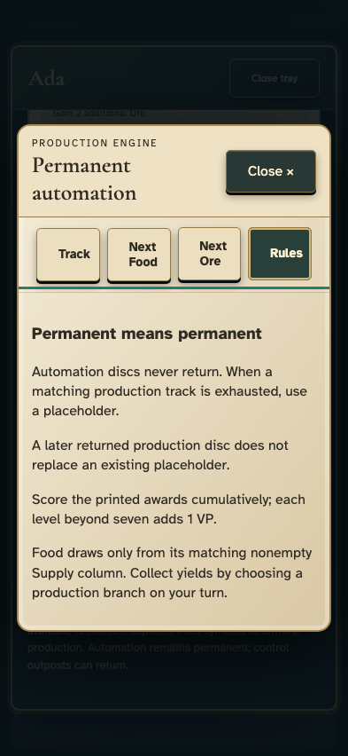](../../screenshots/automate-food-and-ore-permanently-and-retain-cumulative-awards-with-separate-controllers/031-food-permanent-details-focus-phone-darwin.png) |  |

- [x] Tab reaches the named internally scrolling automation details
- [x] The canonical effect and backend acknowledgement settle.
- [x] Public technology topology retains physical separation.
- [x] The actual viewport fits without page scrolling.

## 33. Forward Tab remains inside the native automation inspector

Viewpoint: **Ada · separate host controller**.

| phone · 393 × 852 | desktop · 1440 × 1000 |
| --- | --- |
| [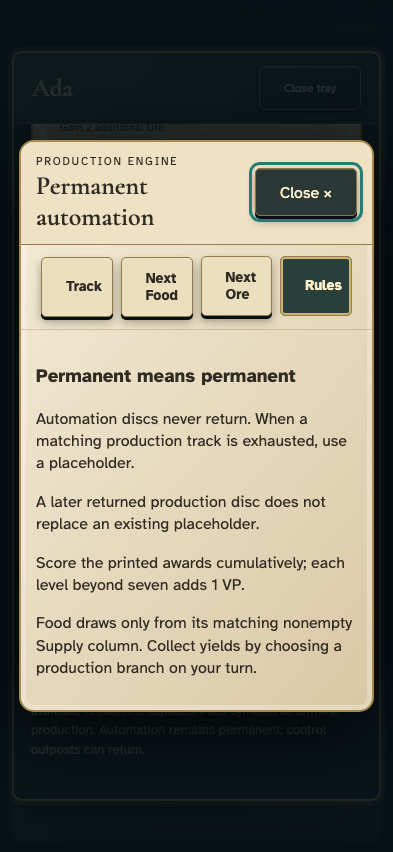](../../screenshots/automate-food-and-ore-permanently-and-retain-cumulative-awards-with-separate-controllers/032-food-permanent-focus-wrap-phone-darwin.png) | [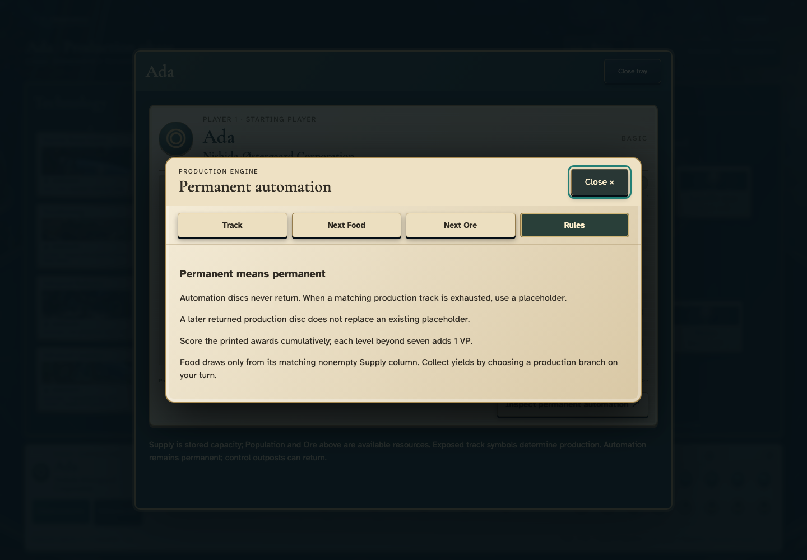](../../screenshots/automate-food-and-ore-permanently-and-retain-cumulative-awards-with-separate-controllers/032-food-permanent-focus-wrap-desktop-darwin.png) |

- [x] Forward Tab remains inside the native automation inspector
- [x] The canonical effect and backend acknowledgement settle.
- [x] Public technology topology retains physical separation.
- [x] The actual viewport fits without page scrolling.

## 34. Reverse Tab also remains inside the inspector

Viewpoint: **Ada · separate host controller**.

| phone · 393 × 852 | desktop · 1440 × 1000 |
| --- | --- |
|  | [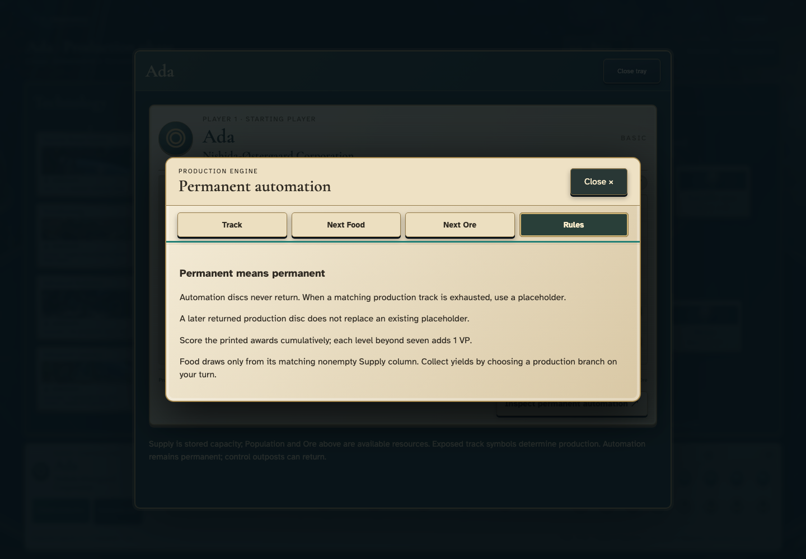](../../screenshots/automate-food-and-ore-permanently-and-retain-cumulative-awards-with-separate-controllers/033-food-permanent-focus-reverse-desktop-darwin.png) |

- [x] Reverse Tab also remains inside the inspector
- [x] The canonical effect and backend acknowledgement settle.
- [x] Public technology topology retains physical separation.
- [x] The actual viewport fits without page scrolling.

## 35. Escape returns to the exact mat opener; inspection never spends or collects

Viewpoint: **Ada · separate host controller**.

| phone · 393 × 852 | desktop · 1440 × 1000 |
| --- | --- |
| [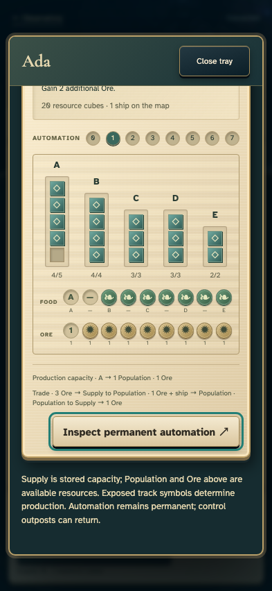](../../screenshots/automate-food-and-ore-permanently-and-retain-cumulative-awards-with-separate-controllers/034-food-permanent-return-phone-darwin.png) | [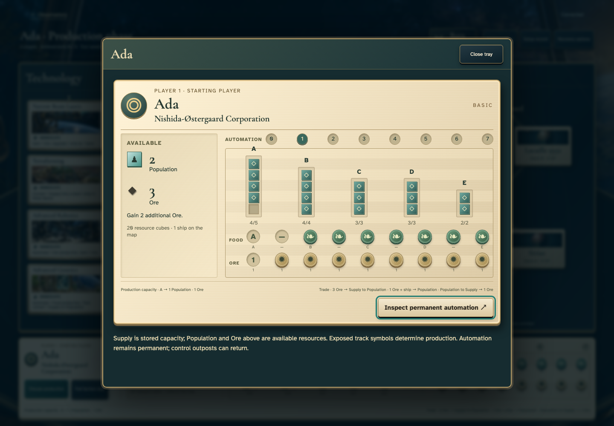](../../screenshots/automate-food-and-ore-permanently-and-retain-cumulative-awards-with-separate-controllers/034-food-permanent-return-desktop-darwin.png) |

- [x] Escape returns to the exact mat opener; inspection never spends or collects
- [x] The canonical effect and backend acknowledgement settle.
- [x] Public technology topology retains physical separation.
- [x] The actual viewport fits without page scrolling.

## 36. Return to the real turn with all production choices still pending

Viewpoint: **Ada · separate host controller**.

| phone · 393 × 852 | desktop · 1440 × 1000 |
| --- | --- |
| [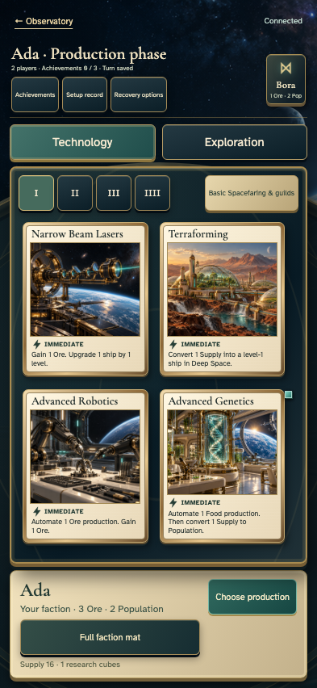](../../screenshots/automate-food-and-ore-permanently-and-retain-cumulative-awards-with-separate-controllers/035-food-permanent-closed-phone-darwin.png) | [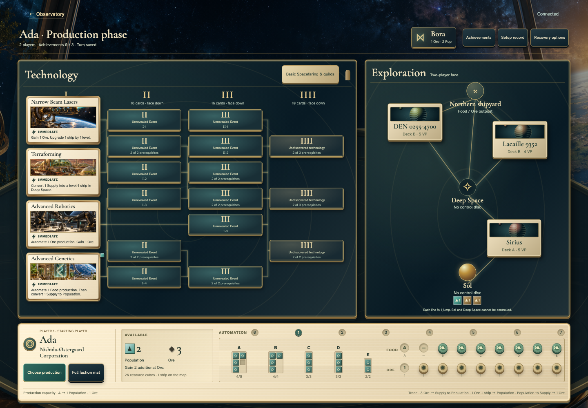](../../screenshots/automate-food-and-ore-permanently-and-retain-cumulative-awards-with-separate-controllers/035-food-permanent-closed-desktop-darwin.png) |

- [x] Return to the real turn with all production choices still pending
- [x] The canonical effect and backend acknowledgement settle.
- [x] Public technology topology retains physical separation.
- [x] The actual viewport fits without page scrolling.

## 37. Reload retains the same controller and the paid pending production

Viewpoint: **Ada · separate host controller**.

| phone · 393 × 852 | desktop · 1440 × 1000 |
| --- | --- |
|  |  |

- [x] Reload retains the same controller and the paid pending production
- [x] The canonical effect and backend acknowledgement settle.
- [x] Public technology topology retains physical separation.
- [x] The actual viewport fits without page scrolling.

## 38. Reopening production never repeats the permanent automation bonus

Viewpoint: **Ada · separate host controller**.

| phone · 393 × 852 | desktop · 1440 × 1000 |
| --- | --- |
|  |  |

- [x] Reopening production never repeats the permanent automation bonus
- [x] The canonical effect and backend acknowledgement settle.
- [x] Public technology topology retains physical separation.
- [x] The actual viewport fits without page scrolling.

## 39. Ada completes production and hands off to Bora

Viewpoint: **Ada · separate host controller**.

| phone · 393 × 852 | desktop · 1440 × 1000 |
| --- | --- |
| [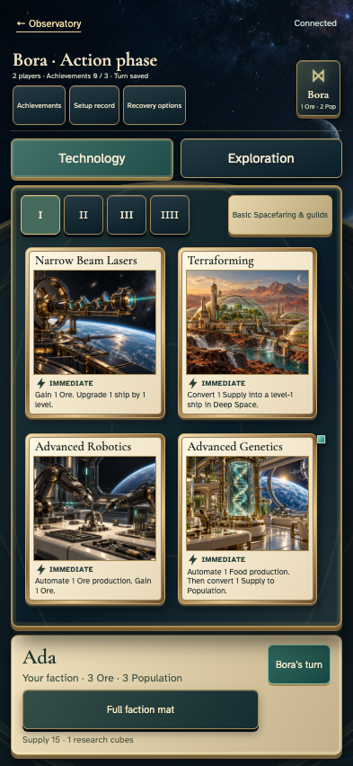](../../screenshots/automate-food-and-ore-permanently-and-retain-cumulative-awards-with-separate-controllers/038-food-produced-handoff-phone-darwin.png) |  |

- [x] Ada completes production and hands off to Bora
- [x] The canonical effect and backend acknowledgement settle.
- [x] Public technology topology retains physical separation.
- [x] The actual viewport fits without page scrolling.

## 40. The independent next controller sees the canonical handoff

Viewpoint: **Bora · separate guest controller**.

| phone · 1440 × 1000 | desktop · 393 × 852 |
| --- | --- |
|  |  |

- [x] The independent next controller sees the canonical handoff
- [x] The canonical effect and backend acknowledgement settle.
- [x] Public technology topology retains physical separation.
- [x] The actual viewport fits without page scrolling.

## 41. Collect exactly 1 Population; automation is permanent and not a second payout

Viewpoint: **Ada · separate host controller**.

| phone · 393 × 852 | desktop · 1440 × 1000 |
| --- | --- |
| [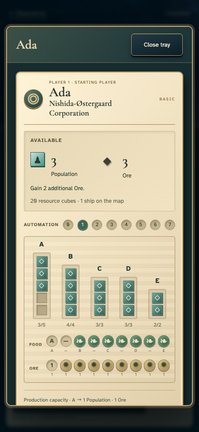](../../screenshots/automate-food-and-ore-permanently-and-retain-cumulative-awards-with-separate-controllers/040-food-produced-paid-phone-darwin.png) |  |

- [x] Collect exactly 1 Population; automation is permanent and not a second payout
- [x] The canonical effect and backend acknowledgement settle.
- [x] Public technology topology retains physical separation.
- [x] The actual viewport fits without page scrolling.

## 42. Close the proof and leave the next actual controller active

Viewpoint: **Ada · separate host controller**.

| phone · 393 × 852 | desktop · 1440 × 1000 |
| --- | --- |
|  |  |

- [x] Close the proof and leave the next actual controller active
- [x] The canonical effect and backend acknowledgement settle.
- [x] Public technology topology retains physical separation.
- [x] The actual viewport fits without page scrolling.

## 43. Bora opens the actual research and Action instrument

Viewpoint: **Bora · separate guest controller**.

| phone · 1440 × 1000 | desktop · 393 × 852 |
| --- | --- |
|  |  |

- [x] Bora opens the actual research and Action instrument
- [x] The canonical effect and backend acknowledgement settle.
- [x] Public technology topology retains physical separation.
- [x] The actual viewport fits without page scrolling.

## 44. Bora selects the legal printed space 2

Viewpoint: **Bora · separate guest controller**.

| phone · 1440 × 1000 | desktop · 393 × 852 |
| --- | --- |
|  |  |

- [x] Bora selects the legal printed space 2
- [x] The canonical effect and backend acknowledgement settle.
- [x] Public technology topology retains physical separation.
- [x] The actual viewport fits without page scrolling.

## 45. Select Advanced Robotics with its printed cost and consequence

Viewpoint: **Bora · separate guest controller**.

| phone · 1440 × 1000 | desktop · 393 × 852 |
| --- | --- |
|  | [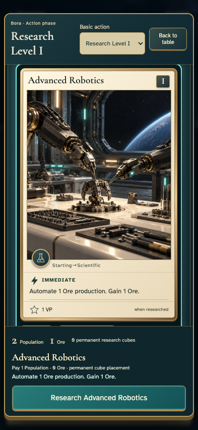](../../screenshots/automate-food-and-ore-permanently-and-retain-cumulative-awards-with-separate-controllers/044-bora-ore-card-desktop-darwin.png) |

- [x] Select Advanced Robotics with its printed cost and consequence
- [x] The canonical effect and backend acknowledgement settle.
- [x] Public technology topology retains physical separation.
- [x] The actual viewport fits without page scrolling.

## 46. Pay once and receive Advanced Robotics's immediate bonus

Viewpoint: **Bora · separate guest controller**.

| phone · 1440 × 1000 | desktop · 393 × 852 |
| --- | --- |
|  |  |

- [x] Pay once and receive Advanced Robotics's immediate bonus
- [x] The canonical effect and backend acknowledgement settle.
- [x] Public technology topology retains physical separation.
- [x] The actual viewport fits without page scrolling.

## 47. The first Ore automation exposes a second complete Ore yield

Viewpoint: **Bora · separate guest controller**.

| phone · 1440 × 1000 | desktop · 393 × 852 |
| --- | --- |
|  |  |

- [x] The first Ore automation exposes a second complete Ore yield
- [x] The canonical effect and backend acknowledgement settle.
- [x] Public technology topology retains physical separation.
- [x] The actual viewport fits without page scrolling.

## 48. Close the decision without paying or collecting any further resource

Viewpoint: **Bora · separate guest controller**.

| phone · 1440 × 1000 | desktop · 393 × 852 |
| --- | --- |
| [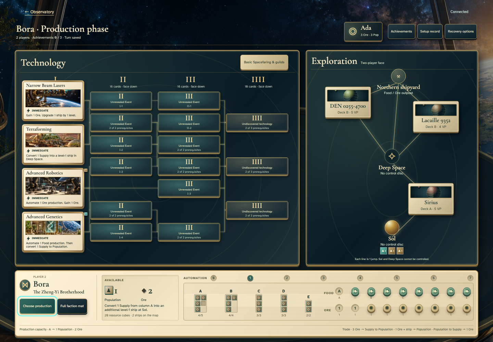](../../screenshots/automate-food-and-ore-permanently-and-retain-cumulative-awards-with-separate-controllers/047-ore-permanent-board-phone-darwin.png) | [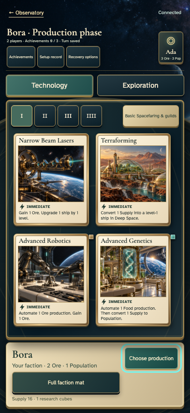](../../screenshots/automate-food-and-ore-permanently-and-retain-cumulative-awards-with-separate-controllers/047-ore-permanent-board-desktop-darwin.png) |

- [x] Close the decision without paying or collecting any further resource
- [x] The canonical effect and backend acknowledgement settle.
- [x] Public technology topology retains physical separation.
- [x] The actual viewport fits without page scrolling.

## 49. Bora inspects the actual retained production discs and Supply

Viewpoint: **Bora · separate guest controller**.

| phone · 1440 × 1000 | desktop · 393 × 852 |
| --- | --- |
| [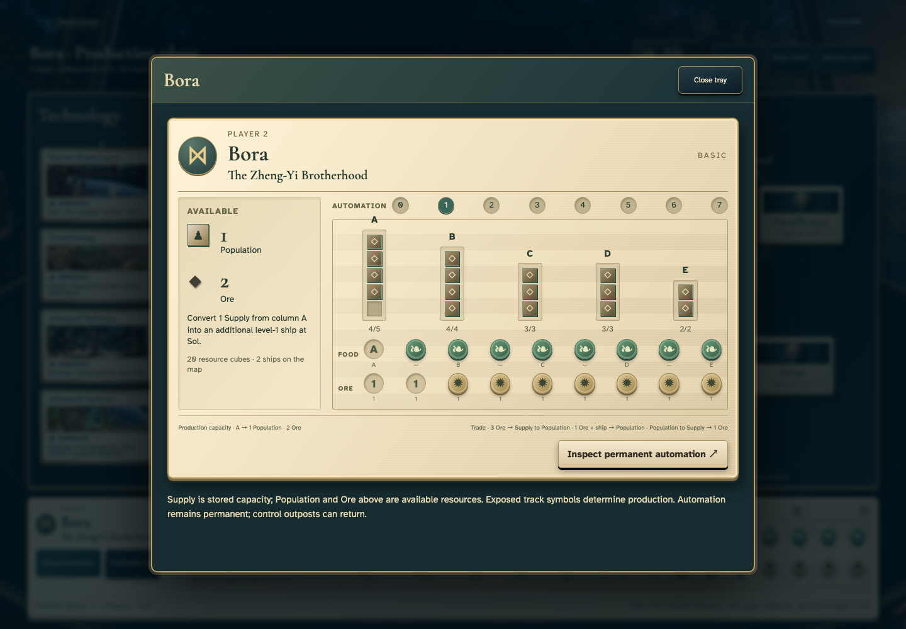](../../screenshots/automate-food-and-ore-permanently-and-retain-cumulative-awards-with-separate-controllers/048-ore-permanent-mat-phone-darwin.png) | [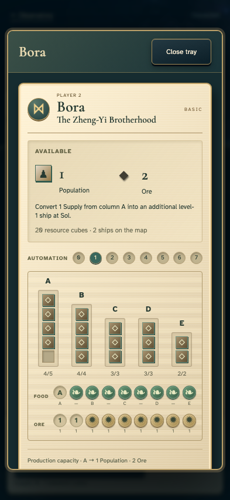](../../screenshots/automate-food-and-ore-permanently-and-retain-cumulative-awards-with-separate-controllers/048-ore-permanent-mat-desktop-darwin.png) |

- [x] Bora inspects the actual retained production discs and Supply
- [x] The canonical effect and backend acknowledgement settle.
- [x] Public technology topology retains physical separation.
- [x] The actual viewport fits without page scrolling.

## 50. Permanent level 1 contributes 0 cumulative endgame VP without an immediate payout

Viewpoint: **Bora · separate guest controller**.

| phone · 1440 × 1000 | desktop · 393 × 852 |
| --- | --- |
|  |  |

- [x] Permanent level 1 contributes 0 cumulative endgame VP without an immediate payout
- [x] The canonical effect and backend acknowledgement settle.
- [x] Public technology topology retains physical separation.
- [x] The actual viewport fits without page scrolling.

## 51. Inspect the next Ore disc and exposed yield as a read-only consequence

Viewpoint: **Bora · separate guest controller**.

| phone · 1440 × 1000 | desktop · 393 × 852 |
| --- | --- |
|  |  |

- [x] Inspect the next Ore disc and exposed yield as a read-only consequence
- [x] The canonical effect and backend acknowledgement settle.
- [x] Public technology topology retains physical separation.
- [x] The actual viewport fits without page scrolling.

## 52. Escape returns to the exact mat opener; inspection never spends or collects

Viewpoint: **Bora · separate guest controller**.

| phone · 1440 × 1000 | desktop · 393 × 852 |
| --- | --- |
| [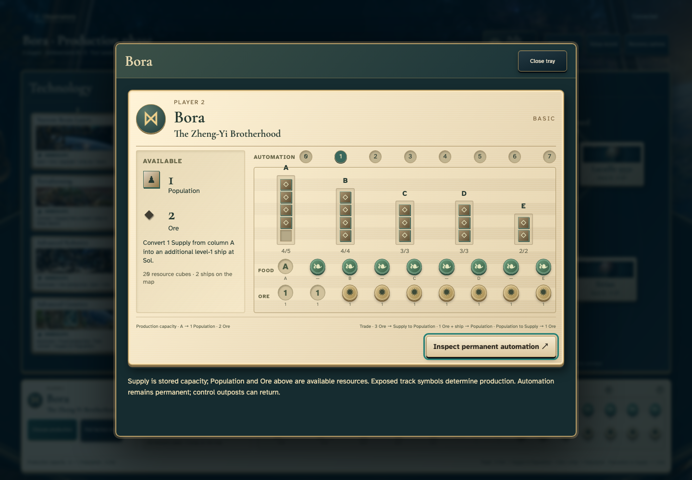](../../screenshots/automate-food-and-ore-permanently-and-retain-cumulative-awards-with-separate-controllers/051-ore-permanent-return-phone-darwin.png) | [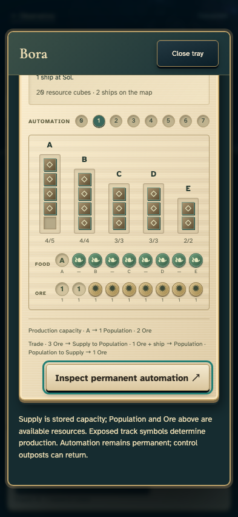](../../screenshots/automate-food-and-ore-permanently-and-retain-cumulative-awards-with-separate-controllers/051-ore-permanent-return-desktop-darwin.png) |

- [x] Escape returns to the exact mat opener; inspection never spends or collects
- [x] The canonical effect and backend acknowledgement settle.
- [x] Public technology topology retains physical separation.
- [x] The actual viewport fits without page scrolling.

## 53. Return to the real turn with all production choices still pending

Viewpoint: **Bora · separate guest controller**.

| phone · 1440 × 1000 | desktop · 393 × 852 |
| --- | --- |
|  | [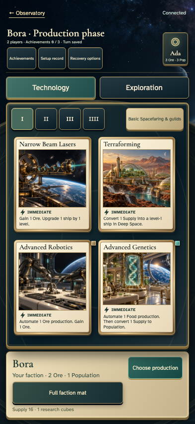](../../screenshots/automate-food-and-ore-permanently-and-retain-cumulative-awards-with-separate-controllers/052-ore-permanent-closed-desktop-darwin.png) |

- [x] Return to the real turn with all production choices still pending
- [x] The canonical effect and backend acknowledgement settle.
- [x] Public technology topology retains physical separation.
- [x] The actual viewport fits without page scrolling.

## 54. Reload retains the same controller and the paid pending production

Viewpoint: **Bora · separate guest controller**.

| phone · 1440 × 1000 | desktop · 393 × 852 |
| --- | --- |
|  |  |

- [x] Reload retains the same controller and the paid pending production
- [x] The canonical effect and backend acknowledgement settle.
- [x] Public technology topology retains physical separation.
- [x] The actual viewport fits without page scrolling.

## 55. Reopening production never repeats the permanent automation bonus

Viewpoint: **Bora · separate guest controller**.

| phone · 1440 × 1000 | desktop · 393 × 852 |
| --- | --- |
|  | [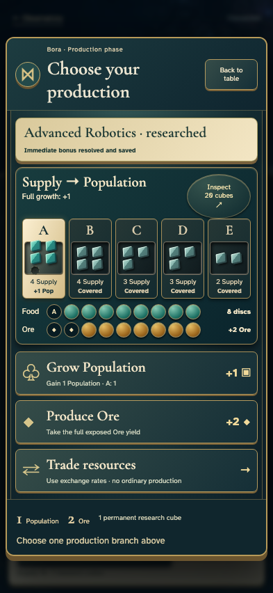](../../screenshots/automate-food-and-ore-permanently-and-retain-cumulative-awards-with-separate-controllers/054-ore-retained-reopen-desktop-darwin.png) |

- [x] Reopening production never repeats the permanent automation bonus
- [x] The canonical effect and backend acknowledgement settle.
- [x] Public technology topology retains physical separation.
- [x] The actual viewport fits without page scrolling.

## 56. Bora completes production and hands off to Ada

Viewpoint: **Bora · separate guest controller**.

| phone · 1440 × 1000 | desktop · 393 × 852 |
| --- | --- |
| [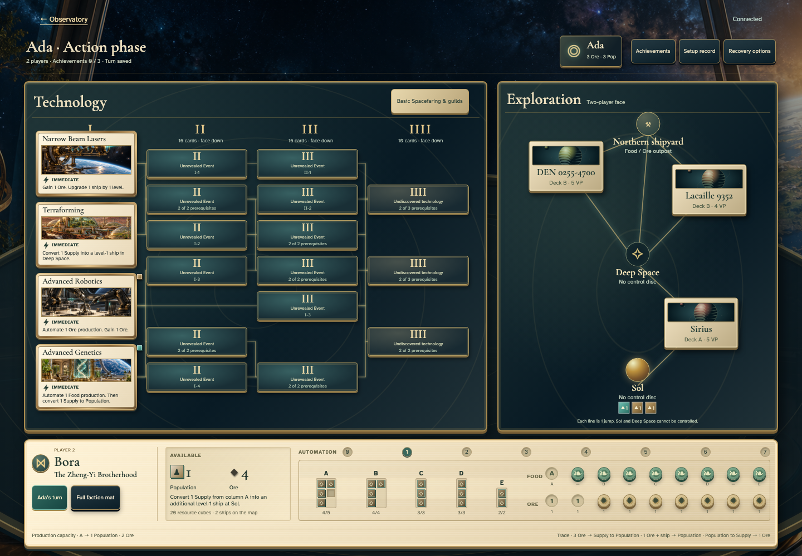](../../screenshots/automate-food-and-ore-permanently-and-retain-cumulative-awards-with-separate-controllers/055-ore-produced-handoff-phone-darwin.png) |  |

- [x] Bora completes production and hands off to Ada
- [x] The canonical effect and backend acknowledgement settle.
- [x] Public technology topology retains physical separation.
- [x] The actual viewport fits without page scrolling.

## 57. The independent next controller sees the canonical handoff

Viewpoint: **Ada · separate host controller**.

| phone · 393 × 852 | desktop · 1440 × 1000 |
| --- | --- |
|  | [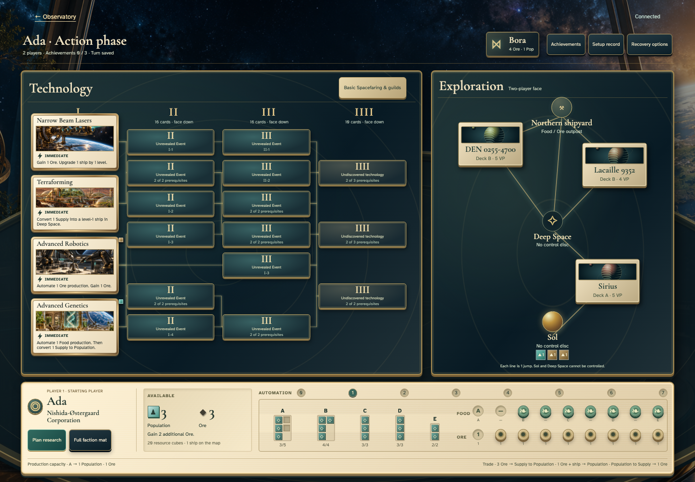](../../screenshots/automate-food-and-ore-permanently-and-retain-cumulative-awards-with-separate-controllers/056-ore-produced-next-desktop-darwin.png) |

- [x] The independent next controller sees the canonical handoff
- [x] The canonical effect and backend acknowledgement settle.
- [x] Public technology topology retains physical separation.
- [x] The actual viewport fits without page scrolling.

## 58. Collect exactly 2 Ore; automation is permanent and not a second payout

Viewpoint: **Bora · separate guest controller**.

| phone · 1440 × 1000 | desktop · 393 × 852 |
| --- | --- |
|  |  |

- [x] Collect exactly 2 Ore; automation is permanent and not a second payout
- [x] The canonical effect and backend acknowledgement settle.
- [x] Public technology topology retains physical separation.
- [x] The actual viewport fits without page scrolling.

## 59. Close the proof and leave the next actual controller active

Viewpoint: **Bora · separate guest controller**.

| phone · 1440 × 1000 | desktop · 393 × 852 |
| --- | --- |
|  |  |

- [x] Close the proof and leave the next actual controller active
- [x] The canonical effect and backend acknowledgement settle.
- [x] Public technology topology retains physical separation.
- [x] The actual viewport fits without page scrolling.

## 60. Ada opens the actual research and Action instrument

Viewpoint: **Ada · separate host controller**.

| phone · 393 × 852 | desktop · 1440 × 1000 |
| --- | --- |
| [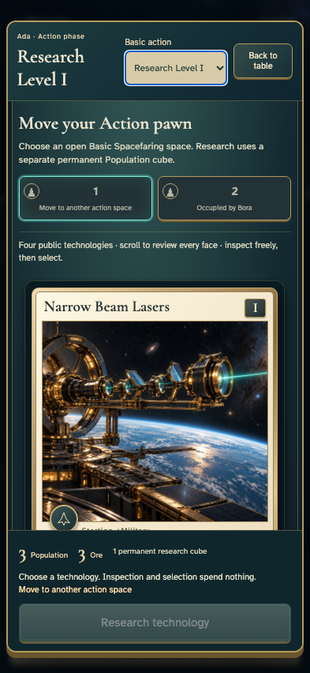](../../screenshots/automate-food-and-ore-permanently-and-retain-cumulative-awards-with-separate-controllers/059-ada-vacates-plan-phone-darwin.png) |  |

- [x] Ada opens the actual research and Action instrument
- [x] The canonical effect and backend acknowledgement settle.
- [x] Public technology topology retains physical separation.
- [x] The actual viewport fits without page scrolling.

## 61. Ada selects ordinary gathering

Viewpoint: **Ada · separate host controller**.

| phone · 393 × 852 | desktop · 1440 × 1000 |
| --- | --- |
|  |  |

- [x] Ada selects ordinary gathering
- [x] The canonical effect and backend acknowledgement settle.
- [x] Public technology topology retains physical separation.
- [x] The actual viewport fits without page scrolling.

## 62. Receive the printed gather resources before ordinary production

Viewpoint: **Ada · separate host controller**.

| phone · 393 × 852 | desktop · 1440 × 1000 |
| --- | --- |
|  |  |

- [x] Receive the printed gather resources before ordinary production
- [x] The canonical effect and backend acknowledgement settle.
- [x] Public technology topology retains physical separation.
- [x] The actual viewport fits without page scrolling.

## 63. Ada completes production and hands off to Bora

Viewpoint: **Ada · separate host controller**.

| phone · 393 × 852 | desktop · 1440 × 1000 |
| --- | --- |
|  |  |

- [x] Ada completes production and hands off to Bora
- [x] The canonical effect and backend acknowledgement settle.
- [x] Public technology topology retains physical separation.
- [x] The actual viewport fits without page scrolling.

## 64. The independent next controller sees the canonical handoff

Viewpoint: **Bora · separate guest controller**.

| phone · 1440 × 1000 | desktop · 393 × 852 |
| --- | --- |
|  |  |

- [x] The independent next controller sees the canonical handoff
- [x] The canonical effect and backend acknowledgement settle.
- [x] Public technology topology retains physical separation.
- [x] The actual viewport fits without page scrolling.

## 65. Collect exactly 1 Ore; automation is permanent and not a second payout

Viewpoint: **Ada · separate host controller**.

| phone · 393 × 852 | desktop · 1440 × 1000 |
| --- | --- |
|  |  |

- [x] Collect exactly 1 Ore; automation is permanent and not a second payout
- [x] The canonical effect and backend acknowledgement settle.
- [x] Public technology topology retains physical separation.
- [x] The actual viewport fits without page scrolling.

## 66. Close the proof and leave the next actual controller active

Viewpoint: **Ada · separate host controller**.

| phone · 393 × 852 | desktop · 1440 × 1000 |
| --- | --- |
|  |  |

- [x] Close the proof and leave the next actual controller active
- [x] The canonical effect and backend acknowledgement settle.
- [x] Public technology topology retains physical separation.
- [x] The actual viewport fits without page scrolling.

## 67. Bora opens the actual research and Action instrument

Viewpoint: **Bora · separate guest controller**.

| phone · 1440 × 1000 | desktop · 393 × 852 |
| --- | --- |
|  |  |

- [x] Bora opens the actual research and Action instrument
- [x] The canonical effect and backend acknowledgement settle.
- [x] Public technology topology retains physical separation.
- [x] The actual viewport fits without page scrolling.

## 68. Bora selects the legal printed space 1

Viewpoint: **Bora · separate guest controller**.

| phone · 1440 × 1000 | desktop · 393 × 852 |
| --- | --- |
|  |  |

- [x] Bora selects the legal printed space 1
- [x] The canonical effect and backend acknowledgement settle.
- [x] Public technology topology retains physical separation.
- [x] The actual viewport fits without page scrolling.

## 69. Select Advanced Genetics with its printed cost and consequence

Viewpoint: **Bora · separate guest controller**.

| phone · 1440 × 1000 | desktop · 393 × 852 |
| --- | --- |
|  |  |

- [x] Select Advanced Genetics with its printed cost and consequence
- [x] The canonical effect and backend acknowledgement settle.
- [x] Public technology topology retains physical separation.
- [x] The actual viewport fits without page scrolling.

## 70. Pay once and receive Advanced Genetics's immediate bonus

Viewpoint: **Bora · separate guest controller**.

| phone · 1440 × 1000 | desktop · 393 × 852 |
| --- | --- |
|  |  |

- [x] Pay once and receive Advanced Genetics's immediate bonus
- [x] The canonical effect and backend acknowledgement settle.
- [x] Public technology topology retains physical separation.
- [x] The actual viewport fits without page scrolling.

## 71. Close the decision without paying or collecting any further resource

Viewpoint: **Bora · separate guest controller**.

| phone · 1440 × 1000 | desktop · 393 × 852 |
| --- | --- |
|  |  |

- [x] Close the decision without paying or collecting any further resource
- [x] The canonical effect and backend acknowledgement settle.
- [x] Public technology topology retains physical separation.
- [x] The actual viewport fits without page scrolling.

## 72. Bora inspects the actual retained production discs and Supply

Viewpoint: **Bora · separate guest controller**.

| phone · 1440 × 1000 | desktop · 393 × 852 |
| --- | --- |
|  |  |

- [x] Bora inspects the actual retained production discs and Supply
- [x] The canonical effect and backend acknowledgement settle.
- [x] Public technology topology retains physical separation.
- [x] The actual viewport fits without page scrolling.

## 73. Permanent level 2 contributes 1 cumulative endgame VP without an immediate payout

Viewpoint: **Bora · separate guest controller**.

| phone · 1440 × 1000 | desktop · 393 × 852 |
| --- | --- |
|  |  |

- [x] Permanent level 2 contributes 1 cumulative endgame VP without an immediate payout
- [x] The canonical effect and backend acknowledgement settle.
- [x] Public technology topology retains physical separation.
- [x] The actual viewport fits without page scrolling.

## 74. Escape returns to the exact mat opener; inspection never spends or collects

Viewpoint: **Bora · separate guest controller**.

| phone · 1440 × 1000 | desktop · 393 × 852 |
| --- | --- |
|  |  |

- [x] Escape returns to the exact mat opener; inspection never spends or collects
- [x] The canonical effect and backend acknowledgement settle.
- [x] Public technology topology retains physical separation.
- [x] The actual viewport fits without page scrolling.

## 75. Return to the real turn with all production choices still pending

Viewpoint: **Bora · separate guest controller**.

| phone · 1440 × 1000 | desktop · 393 × 852 |
| --- | --- |
|  |  |

- [x] Return to the real turn with all production choices still pending
- [x] The canonical effect and backend acknowledgement settle.
- [x] Public technology topology retains physical separation.
- [x] The actual viewport fits without page scrolling.

## 76. Reopen the same pending production after read-only inspection

Viewpoint: **Bora · separate guest controller**.

| phone · 1440 × 1000 | desktop · 393 × 852 |
| --- | --- |
|  |  |

- [x] Reopen the same pending production after read-only inspection
- [x] The canonical effect and backend acknowledgement settle.
- [x] Public technology topology retains physical separation.
- [x] The actual viewport fits without page scrolling.

## 77. Bora completes production and hands off to Ada

Viewpoint: **Bora · separate guest controller**.

| phone · 1440 × 1000 | desktop · 393 × 852 |
| --- | --- |
|  |  |

- [x] Bora completes production and hands off to Ada
- [x] The canonical effect and backend acknowledgement settle.
- [x] Public technology topology retains physical separation.
- [x] The actual viewport fits without page scrolling.

## 78. The independent next controller sees the canonical handoff

Viewpoint: **Ada · separate host controller**.

| phone · 393 × 852 | desktop · 1440 × 1000 |
| --- | --- |
|  |  |

- [x] The independent next controller sees the canonical handoff
- [x] The canonical effect and backend acknowledgement settle.
- [x] Public technology topology retains physical separation.
- [x] The actual viewport fits without page scrolling.

## 79. Collect exactly 1 Population; automation is permanent and not a second payout

Viewpoint: **Bora · separate guest controller**.

| phone · 1440 × 1000 | desktop · 393 × 852 |
| --- | --- |
|  |  |

- [x] Collect exactly 1 Population; automation is permanent and not a second payout
- [x] The canonical effect and backend acknowledgement settle.
- [x] Public technology topology retains physical separation.
- [x] The actual viewport fits without page scrolling.

## 80. Close the proof and leave the next actual controller active

Viewpoint: **Bora · separate guest controller**.

| phone · 1440 × 1000 | desktop · 393 × 852 |
| --- | --- |
|  |  |

- [x] Close the proof and leave the next actual controller active
- [x] The canonical effect and backend acknowledgement settle.
- [x] Public technology topology retains physical separation.
- [x] The actual viewport fits without page scrolling.

## 81. Ada opens the actual research and Action instrument

Viewpoint: **Ada · separate host controller**.

| phone · 393 × 852 | desktop · 1440 × 1000 |
| --- | --- |
|  |  |

- [x] Ada opens the actual research and Action instrument
- [x] The canonical effect and backend acknowledgement settle.
- [x] Public technology topology retains physical separation.
- [x] The actual viewport fits without page scrolling.

## 82. Ada selects the legal printed space 2

Viewpoint: **Ada · separate host controller**.

| phone · 393 × 852 | desktop · 1440 × 1000 |
| --- | --- |
|  |  |

- [x] Ada selects the legal printed space 2
- [x] The canonical effect and backend acknowledgement settle.
- [x] Public technology topology retains physical separation.
- [x] The actual viewport fits without page scrolling.

## 83. Select Advanced Robotics with its printed cost and consequence

Viewpoint: **Ada · separate host controller**.

| phone · 393 × 852 | desktop · 1440 × 1000 |
| --- | --- |
|  |  |

- [x] Select Advanced Robotics with its printed cost and consequence
- [x] The canonical effect and backend acknowledgement settle.
- [x] Public technology topology retains physical separation.
- [x] The actual viewport fits without page scrolling.

## 84. Pay once and receive Advanced Robotics's immediate bonus

Viewpoint: **Ada · separate host controller**.

| phone · 393 × 852 | desktop · 1440 × 1000 |
| --- | --- |
|  |  |

- [x] Pay once and receive Advanced Robotics's immediate bonus
- [x] The canonical effect and backend acknowledgement settle.
- [x] Public technology topology retains physical separation.
- [x] The actual viewport fits without page scrolling.

## 85. Close the decision without paying or collecting any further resource

Viewpoint: **Ada · separate host controller**.

| phone · 393 × 852 | desktop · 1440 × 1000 |
| --- | --- |
|  |  |

- [x] Close the decision without paying or collecting any further resource
- [x] The canonical effect and backend acknowledgement settle.
- [x] Public technology topology retains physical separation.
- [x] The actual viewport fits without page scrolling.

## 86. Ada inspects the actual retained production discs and Supply

Viewpoint: **Ada · separate host controller**.

| phone · 393 × 852 | desktop · 1440 × 1000 |
| --- | --- |
|  |  |

- [x] Ada inspects the actual retained production discs and Supply
- [x] The canonical effect and backend acknowledgement settle.
- [x] Public technology topology retains physical separation.
- [x] The actual viewport fits without page scrolling.

## 87. Permanent level 2 contributes 1 cumulative endgame VP without an immediate payout

Viewpoint: **Ada · separate host controller**.

| phone · 393 × 852 | desktop · 1440 × 1000 |
| --- | --- |
|  |  |

- [x] Permanent level 2 contributes 1 cumulative endgame VP without an immediate payout
- [x] The canonical effect and backend acknowledgement settle.
- [x] Public technology topology retains physical separation.
- [x] The actual viewport fits without page scrolling.

## 88. Inspect the next Food disc and exposed yield as a read-only consequence

Viewpoint: **Ada · separate host controller**.

| phone · 393 × 852 | desktop · 1440 × 1000 |
| --- | --- |
|  |  |

- [x] Inspect the next Food disc and exposed yield as a read-only consequence
- [x] The canonical effect and backend acknowledgement settle.
- [x] Public technology topology retains physical separation.
- [x] The actual viewport fits without page scrolling.

## 89. Inspect the next Ore disc and exposed yield as a read-only consequence

Viewpoint: **Ada · separate host controller**.

| phone · 393 × 852 | desktop · 1440 × 1000 |
| --- | --- |
|  |  |

- [x] Inspect the next Ore disc and exposed yield as a read-only consequence
- [x] The canonical effect and backend acknowledgement settle.
- [x] Public technology topology retains physical separation.
- [x] The actual viewport fits without page scrolling.

## 90. Read permanent discs, unlimited placeholders and cumulative awards without changing the game

Viewpoint: **Ada · separate host controller**.

| phone · 393 × 852 | desktop · 1440 × 1000 |
| --- | --- |
|  |  |

- [x] Read permanent discs, unlimited placeholders and cumulative awards without changing the game
- [x] The canonical effect and backend acknowledgement settle.
- [x] Public technology topology retains physical separation.
- [x] The actual viewport fits without page scrolling.

## 91. Tab reaches the named internally scrolling automation details

Viewpoint: **Ada · separate host controller**.

| phone · 393 × 852 | desktop · 1440 × 1000 |
| --- | --- |
|  |  |

- [x] Tab reaches the named internally scrolling automation details
- [x] The canonical effect and backend acknowledgement settle.
- [x] Public technology topology retains physical separation.
- [x] The actual viewport fits without page scrolling.

## 92. Forward Tab remains inside the native automation inspector

Viewpoint: **Ada · separate host controller**.

| phone · 393 × 852 | desktop · 1440 × 1000 |
| --- | --- |
|  |  |

- [x] Forward Tab remains inside the native automation inspector
- [x] The canonical effect and backend acknowledgement settle.
- [x] Public technology topology retains physical separation.
- [x] The actual viewport fits without page scrolling.

## 93. Reverse Tab also remains inside the inspector

Viewpoint: **Ada · separate host controller**.

| phone · 393 × 852 | desktop · 1440 × 1000 |
| --- | --- |
|  |  |

- [x] Reverse Tab also remains inside the inspector
- [x] The canonical effect and backend acknowledgement settle.
- [x] Public technology topology retains physical separation.
- [x] The actual viewport fits without page scrolling.

## 94. Escape returns to the exact mat opener; inspection never spends or collects

Viewpoint: **Ada · separate host controller**.

| phone · 393 × 852 | desktop · 1440 × 1000 |
| --- | --- |
|  |  |

- [x] Escape returns to the exact mat opener; inspection never spends or collects
- [x] The canonical effect and backend acknowledgement settle.
- [x] Public technology topology retains physical separation.
- [x] The actual viewport fits without page scrolling.

## 95. Return to the real turn with all production choices still pending

Viewpoint: **Ada · separate host controller**.

| phone · 393 × 852 | desktop · 1440 × 1000 |
| --- | --- |
|  |  |

- [x] Return to the real turn with all production choices still pending
- [x] The canonical effect and backend acknowledgement settle.
- [x] Public technology topology retains physical separation.
- [x] The actual viewport fits without page scrolling.

## 96. Reload retains the same controller and the paid pending production

Viewpoint: **Ada · separate host controller**.

| phone · 393 × 852 | desktop · 1440 × 1000 |
| --- | --- |
|  |  |

- [x] Reload retains the same controller and the paid pending production
- [x] The canonical effect and backend acknowledgement settle.
- [x] Public technology topology retains physical separation.
- [x] The actual viewport fits without page scrolling.

## 97. Reopening production never repeats the permanent automation bonus

Viewpoint: **Ada · separate host controller**.

| phone · 393 × 852 | desktop · 1440 × 1000 |
| --- | --- |
|  |  |

- [x] Reopening production never repeats the permanent automation bonus
- [x] The canonical effect and backend acknowledgement settle.
- [x] Public technology topology retains physical separation.
- [x] The actual viewport fits without page scrolling.

## 98. The saved production and cumulative award survive reload without an extra turn

Viewpoint: **Ada · separate host controller**.

| phone · 393 × 852 | desktop · 1440 × 1000 |
| --- | --- |
|  |  |

- [x] The saved production and cumulative award survive reload without an extra turn
- [x] The canonical effect and backend acknowledgement settle.
- [x] Public technology topology retains physical separation.
- [x] The actual viewport fits without page scrolling.

## 99. Ada inspects the actual retained production discs and Supply

Viewpoint: **Ada · separate host controller**.

| phone · 393 × 852 | desktop · 1440 × 1000 |
| --- | --- |
|  |  |

- [x] Ada inspects the actual retained production discs and Supply
- [x] The canonical effect and backend acknowledgement settle.
- [x] Public technology topology retains physical separation.
- [x] The actual viewport fits without page scrolling.

## 100. Permanent level 2 contributes 1 cumulative endgame VP without an immediate payout

Viewpoint: **Ada · separate host controller**.

| phone · 393 × 852 | desktop · 1440 × 1000 |
| --- | --- |
|  |  |

- [x] Permanent level 2 contributes 1 cumulative endgame VP without an immediate payout
- [x] The canonical effect and backend acknowledgement settle.
- [x] Public technology topology retains physical separation.
- [x] The actual viewport fits without page scrolling.

## 101. Escape returns to the exact mat opener; inspection never spends or collects

Viewpoint: **Ada · separate host controller**.

| phone · 393 × 852 | desktop · 1440 × 1000 |
| --- | --- |
|  |  |

- [x] Escape returns to the exact mat opener; inspection never spends or collects
- [x] The canonical effect and backend acknowledgement settle.
- [x] Public technology topology retains physical separation.
- [x] The actual viewport fits without page scrolling.

## 102. Return to the real turn with all production choices still pending

Viewpoint: **Ada · separate host controller**.

| phone · 393 × 852 | desktop · 1440 × 1000 |
| --- | --- |
|  |  |

- [x] Return to the real turn with all production choices still pending
- [x] The canonical effect and backend acknowledgement settle.
- [x] Public technology topology retains physical separation.
- [x] The actual viewport fits without page scrolling.
