# Automate production permanently at 2 shared corner seats

One shared controller; direct physical seating without remote identities or devices. Ordinary production UI setup, legal unique Basic factions and preparatory turns. Fixed setup entropy66666666-6666-4666-8666-000000000009; command identities are deterministic, never injected game state or a transferred controller. Production-disc removal, exposed yields, permanent level and cumulative printed scoring are real canonical effects. Read-only future inspection pays nothing. Deterministic exhausted-track/above-seven cases remain backend coverage; no fake advanced UI state.

## 1. Arrive using the actual production client

Viewpoint: **Ada · South West · one shared controller**.

| desktop · 1440 × 1000 |
| --- |
|  |

tabletop-4k · 3840 × 2160

- [x] Arrive using the actual production client
- [x] The canonical effect and backend acknowledgement settle.
- [x] Public technology topology retains physical separation.
- [x] The actual viewport fits without page scrolling.

## 2. Choose a real production play mode

Viewpoint: **Ada · South West · one shared controller**.

| desktop · 1440 × 1000 |
| --- |
|  |

tabletop-4k · 3840 × 2160

- [x] Choose a real production play mode
- [x] The canonical effect and backend acknowledgement settle.
- [x] Public technology topology retains physical separation.
- [x] The actual viewport fits without page scrolling.

## 3. One controller configures physical seats directly on the table

Viewpoint: **Ada · South West · one shared controller**.

| desktop · 1440 × 1000 |
| --- |
|  |

tabletop-4k · 3840 × 2160

- [x] One controller configures physical seats directly on the table
- [x] The canonical effect and backend acknowledgement settle.
- [x] Public technology topology retains physical separation.
- [x] The actual viewport fits without page scrolling.

## 4. Open the South West seat on the shared surface

Viewpoint: **Ada · South West · one shared controller**.

| desktop · 1440 × 1000 |
| --- |
|  |

tabletop-4k · 3840 × 2160

- [x] Open the South West seat on the shared surface
- [x] The canonical effect and backend acknowledgement settle.
- [x] Public technology topology retains physical separation.
- [x] The actual viewport fits without page scrolling.

## 5. Name the physical player Ada

Viewpoint: **Ada · South West · one shared controller**.

| desktop · 1440 × 1000 |
| --- |
|  |

tabletop-4k · 3840 × 2160

- [x] Name the physical player Ada
- [x] The canonical effect and backend acknowledgement settle.
- [x] Public technology topology retains physical separation.
- [x] The actual viewport fits without page scrolling.

## 6. The local physical seat is retained on this controller

Viewpoint: **Ada · South West · one shared controller**.

| desktop · 1440 × 1000 |
| --- |
|  |

tabletop-4k · 3840 × 2160

- [x] The local physical seat is retained on this controller
- [x] The canonical effect and backend acknowledgement settle.
- [x] Public technology topology retains physical separation.
- [x] The actual viewport fits without page scrolling.

## 7. Open the North East seat on the shared surface

Viewpoint: **Bora · North East · one shared controller**.

| desktop · 1440 × 1000 |
| --- |
|  |

tabletop-4k · 3840 × 2160

- [x] Open the North East seat on the shared surface
- [x] The canonical effect and backend acknowledgement settle.
- [x] Public technology topology retains physical separation.
- [x] The actual viewport fits without page scrolling.

## 8. Name the physical player Bora

Viewpoint: **Bora · North East · one shared controller**.

| desktop · 1440 × 1000 |
| --- |
|  |

tabletop-4k · 3840 × 2160

[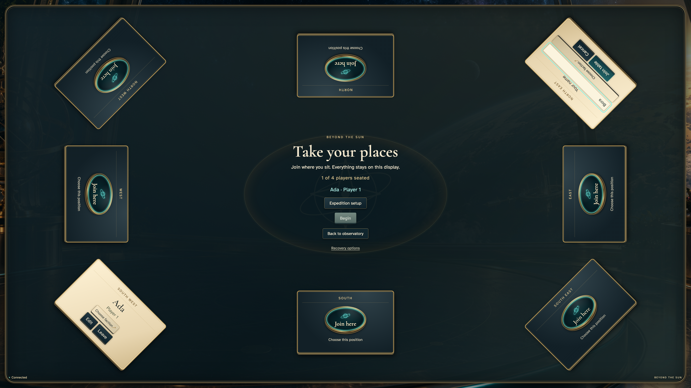](../../screenshots/automate-production-permanently-at-2-shared-corner-seats/007-seat-1-name-tabletop-4k-darwin.png)

- [x] Name the physical player Bora
- [x] The canonical effect and backend acknowledgement settle.
- [x] Public technology topology retains physical separation.
- [x] The actual viewport fits without page scrolling.

## 9. The local physical seat is retained on this controller

Viewpoint: **Bora · North East · one shared controller**.

| desktop · 1440 × 1000 |
| --- |
| [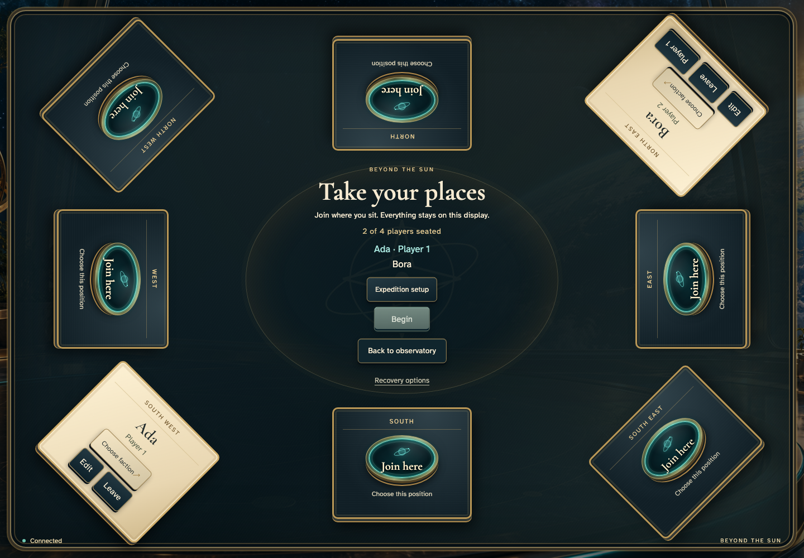](../../screenshots/automate-production-permanently-at-2-shared-corner-seats/008-seat-1-joined-desktop-darwin.png) |

tabletop-4k · 3840 × 2160

- [x] The local physical seat is retained on this controller
- [x] The canonical effect and backend acknowledgement settle.
- [x] Public technology topology retains physical separation.
- [x] The actual viewport fits without page scrolling.

## 10. Ada chooses a legal unique Basic faction

Viewpoint: **Ada · South West · one shared controller**.

| desktop · 1440 × 1000 |
| --- |
|  |

tabletop-4k · 3840 × 2160

- [x] Ada chooses a legal unique Basic faction
- [x] The canonical effect and backend acknowledgement settle.
- [x] Public technology topology retains physical separation.
- [x] The actual viewport fits without page scrolling.

## 11. Ada retains Nishida-Østergaard Corporation

Viewpoint: **Ada · South West · one shared controller**.

| desktop · 1440 × 1000 |
| --- |
|  |

tabletop-4k · 3840 × 2160

- [x] Ada retains Nishida-Østergaard Corporation
- [x] The canonical effect and backend acknowledgement settle.
- [x] Public technology topology retains physical separation.
- [x] The actual viewport fits without page scrolling.

## 12. Bora chooses a legal unique Basic faction

Viewpoint: **Bora · North East · one shared controller**.

| desktop · 1440 × 1000 |
| --- |
|  |

tabletop-4k · 3840 × 2160

[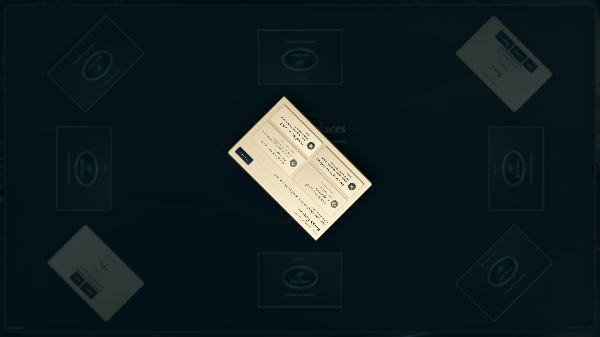](../../screenshots/automate-production-permanently-at-2-shared-corner-seats/011-faction-1-editor-tabletop-4k-darwin.png)

- [x] Bora chooses a legal unique Basic faction
- [x] The canonical effect and backend acknowledgement settle.
- [x] Public technology topology retains physical separation.
- [x] The actual viewport fits without page scrolling.

## 13. Bora retains The Zheng-Yi Brotherhood

Viewpoint: **Bora · North East · one shared controller**.

| desktop · 1440 × 1000 |
| --- |
|  |

tabletop-4k · 3840 × 2160

- [x] Bora retains The Zheng-Yi Brotherhood
- [x] The canonical effect and backend acknowledgement settle.
- [x] Public technology topology retains physical separation.
- [x] The actual viewport fits without page scrolling.

## 14. Begin the immutable source-reviewed Basic setup through the ordinary UI

Viewpoint: **Ada · South West · one shared controller**.

| desktop · 1440 × 1000 |
| --- |
| [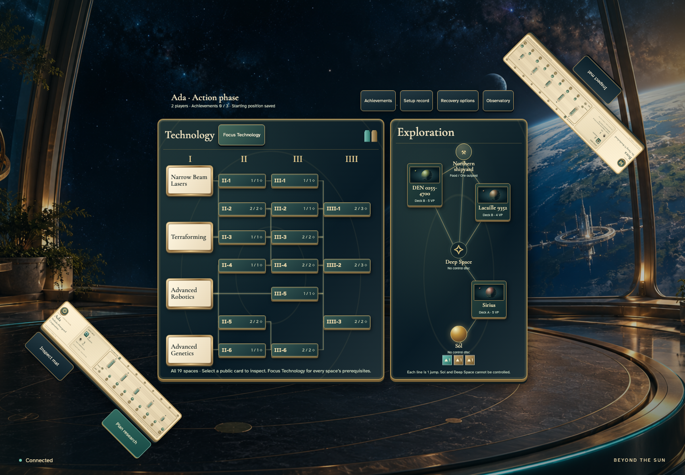](../../screenshots/automate-production-permanently-at-2-shared-corner-seats/013-begun-desktop-darwin.png) |

tabletop-4k · 3840 × 2160

- [x] Begin the immutable source-reviewed Basic setup through the ordinary UI
- [x] The canonical effect and backend acknowledgement settle.
- [x] Public technology topology retains physical separation.
- [x] The actual viewport fits without page scrolling.

## 15. Ada inspects the actual retained production discs and Supply

Viewpoint: **Ada · South West · one shared controller**.

| desktop · 1440 × 1000 |
| --- |
| [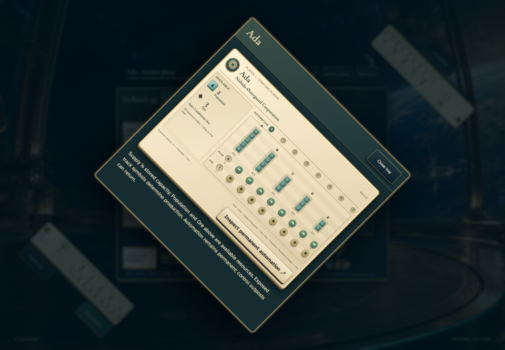](../../screenshots/automate-production-permanently-at-2-shared-corner-seats/014-initial-mat-desktop-darwin.png) |

tabletop-4k · 3840 × 2160

- [x] Ada inspects the actual retained production discs and Supply
- [x] The canonical effect and backend acknowledgement settle.
- [x] Public technology topology retains physical separation.
- [x] The actual viewport fits without page scrolling.

## 16. Permanent level 0 contributes 0 cumulative endgame VP without an immediate payout

Viewpoint: **Ada · South West · one shared controller**.

| desktop · 1440 × 1000 |
| --- |
| [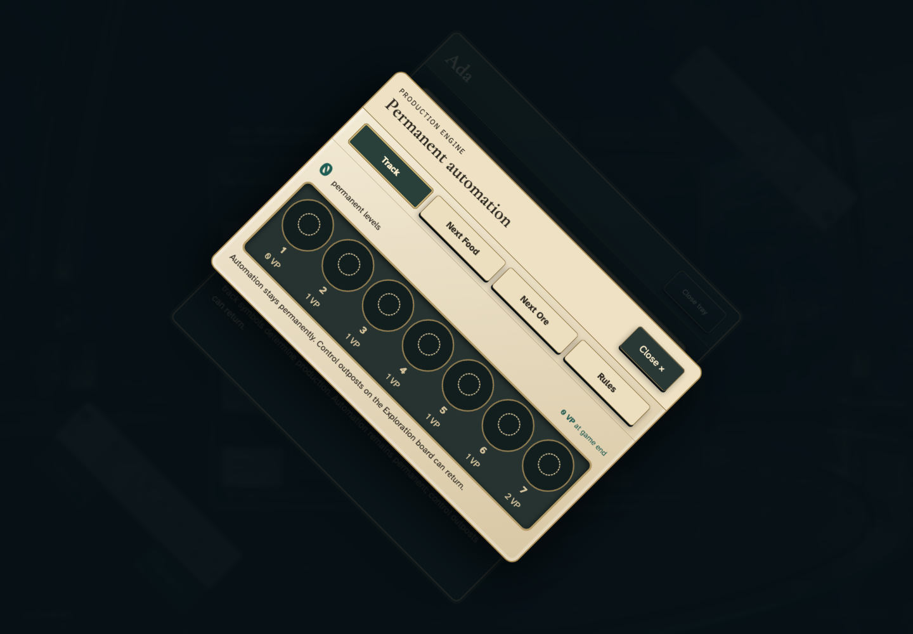](../../screenshots/automate-production-permanently-at-2-shared-corner-seats/015-initial-track-desktop-darwin.png) |

tabletop-4k · 3840 × 2160

[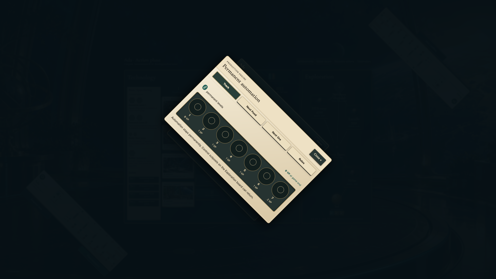](../../screenshots/automate-production-permanently-at-2-shared-corner-seats/015-initial-track-tabletop-4k-darwin.png)

- [x] Permanent level 0 contributes 0 cumulative endgame VP without an immediate payout
- [x] The canonical effect and backend acknowledgement settle.
- [x] Public technology topology retains physical separation.
- [x] The actual viewport fits without page scrolling.

## 17. Escape returns to the exact mat opener; inspection never spends or collects

Viewpoint: **Ada · South West · one shared controller**.

| desktop · 1440 × 1000 |
| --- |
| [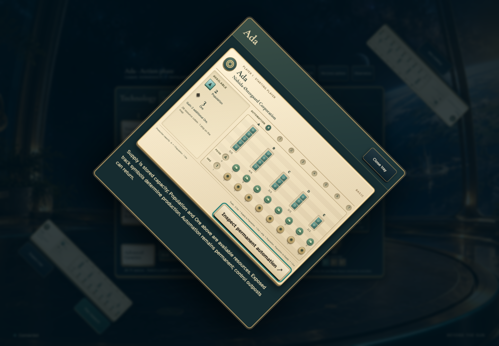](../../screenshots/automate-production-permanently-at-2-shared-corner-seats/016-initial-return-desktop-darwin.png) |

tabletop-4k · 3840 × 2160

- [x] Escape returns to the exact mat opener; inspection never spends or collects
- [x] The canonical effect and backend acknowledgement settle.
- [x] Public technology topology retains physical separation.
- [x] The actual viewport fits without page scrolling.

## 18. Return to the real turn with all production choices still pending

Viewpoint: **Ada · South West · one shared controller**.

| desktop · 1440 × 1000 |
| --- |
|  |

tabletop-4k · 3840 × 2160

- [x] Return to the real turn with all production choices still pending
- [x] The canonical effect and backend acknowledgement settle.
- [x] Public technology topology retains physical separation.
- [x] The actual viewport fits without page scrolling.

## 19. Ada opens the actual research and Action instrument

Viewpoint: **Ada · South West · one shared controller**.

| desktop · 1440 × 1000 |
| --- |
| [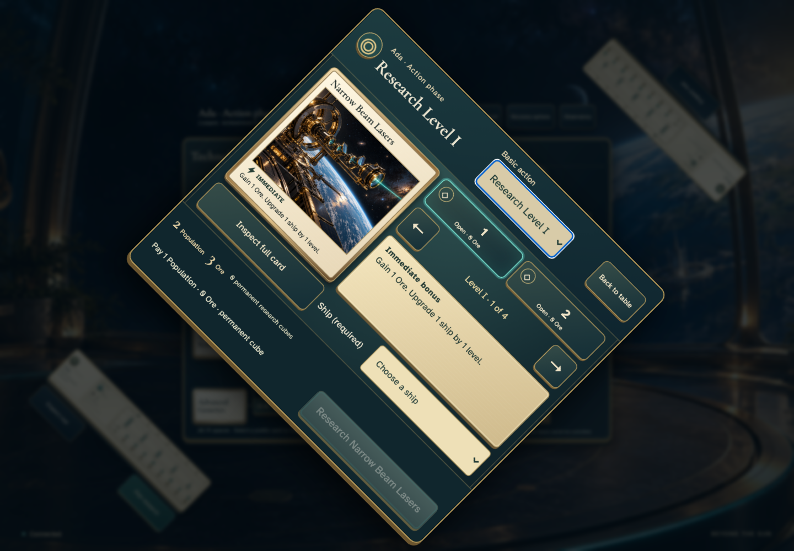](../../screenshots/automate-production-permanently-at-2-shared-corner-seats/018-ada-food-plan-desktop-darwin.png) |

tabletop-4k · 3840 × 2160

[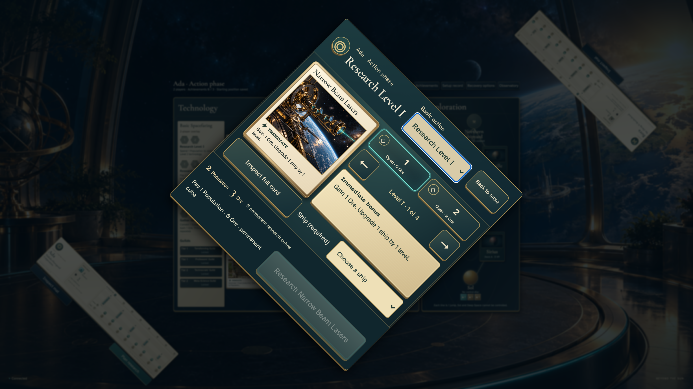](../../screenshots/automate-production-permanently-at-2-shared-corner-seats/018-ada-food-plan-tabletop-4k-darwin.png)

- [x] Ada opens the actual research and Action instrument
- [x] The canonical effect and backend acknowledgement settle.
- [x] Public technology topology retains physical separation.
- [x] The actual viewport fits without page scrolling.

## 20. Ada selects the legal printed space 1

Viewpoint: **Ada · South West · one shared controller**.

| desktop · 1440 × 1000 |
| --- |
| [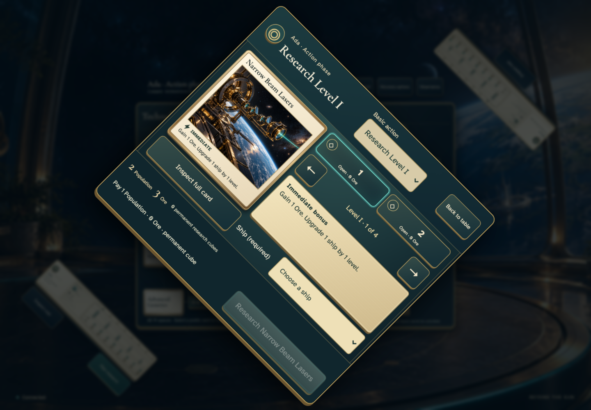](../../screenshots/automate-production-permanently-at-2-shared-corner-seats/019-ada-food-space-desktop-darwin.png) |

tabletop-4k · 3840 × 2160

- [x] Ada selects the legal printed space 1
- [x] The canonical effect and backend acknowledgement settle.
- [x] Public technology topology retains physical separation.
- [x] The actual viewport fits without page scrolling.

## 21. Browse the next public Level I face

Viewpoint: **Ada · South West · one shared controller**.

| desktop · 1440 × 1000 |
| --- |
| [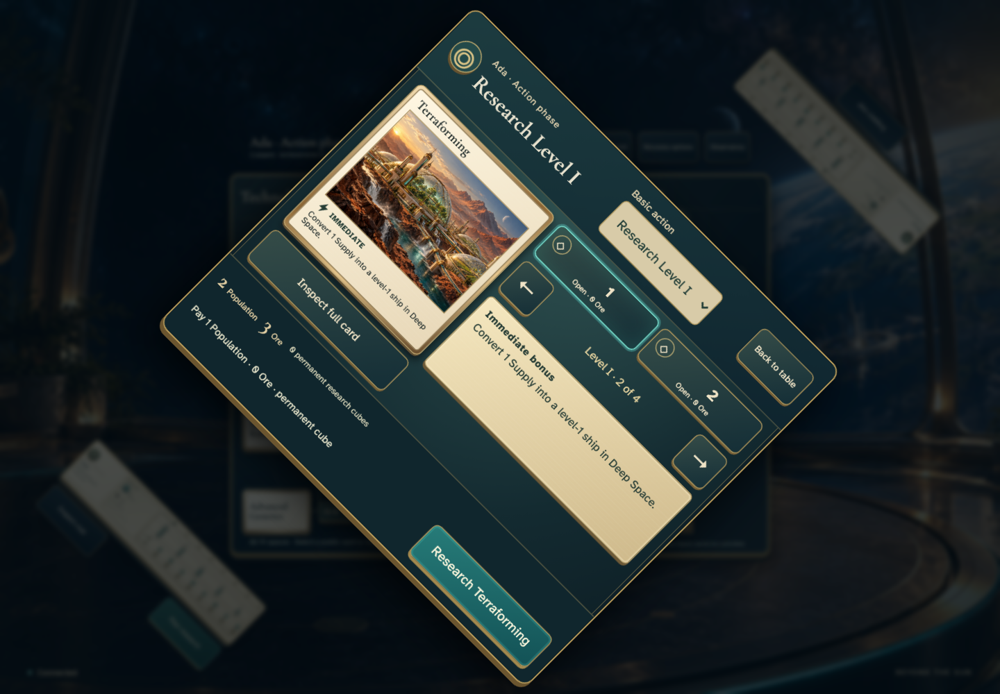](../../screenshots/automate-production-permanently-at-2-shared-corner-seats/020-ada-food-browse-0-desktop-darwin.png) |

tabletop-4k · 3840 × 2160

[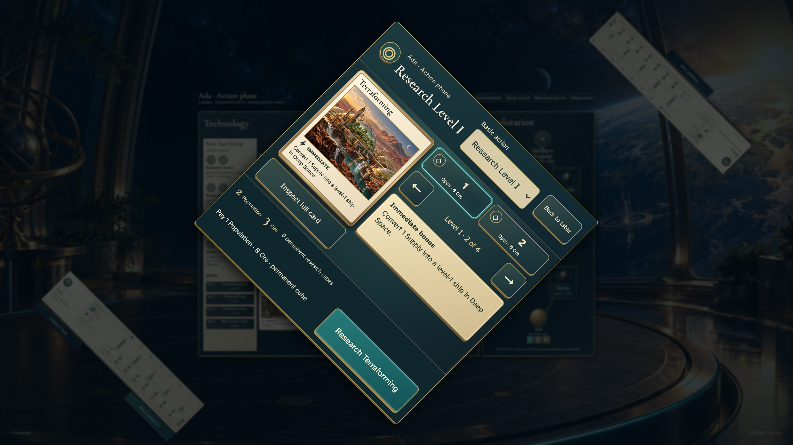](../../screenshots/automate-production-permanently-at-2-shared-corner-seats/020-ada-food-browse-0-tabletop-4k-darwin.png)

- [x] Browse the next public Level I face
- [x] The canonical effect and backend acknowledgement settle.
- [x] Public technology topology retains physical separation.
- [x] The actual viewport fits without page scrolling.

## 22. Browse the next public Level I face

Viewpoint: **Ada · South West · one shared controller**.

| desktop · 1440 × 1000 |
| --- |
| [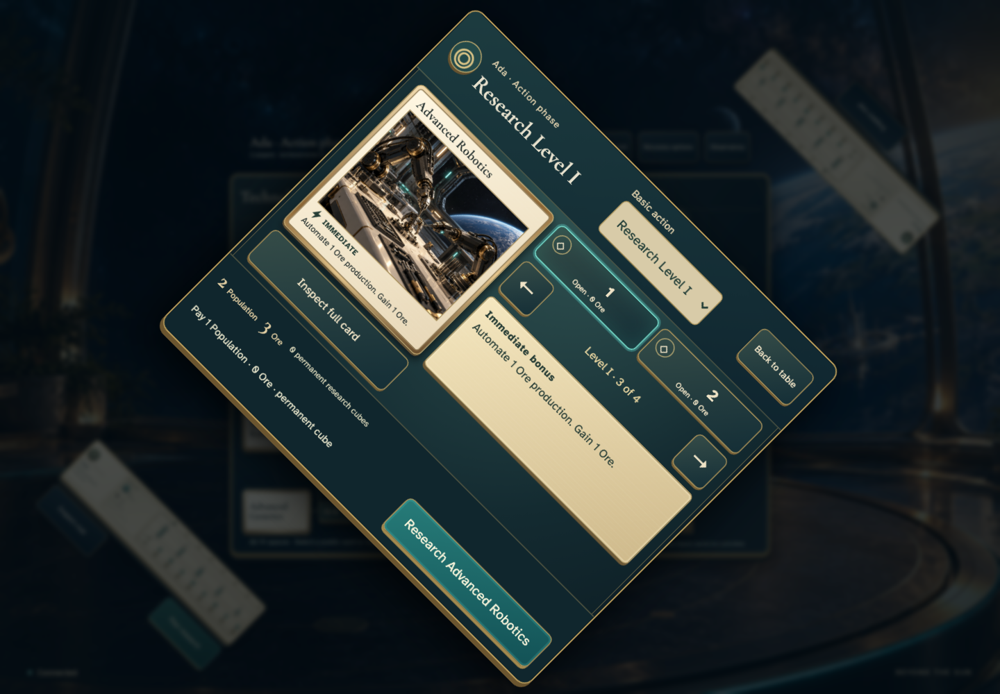](../../screenshots/automate-production-permanently-at-2-shared-corner-seats/021-ada-food-browse-1-desktop-darwin.png) |

tabletop-4k · 3840 × 2160

[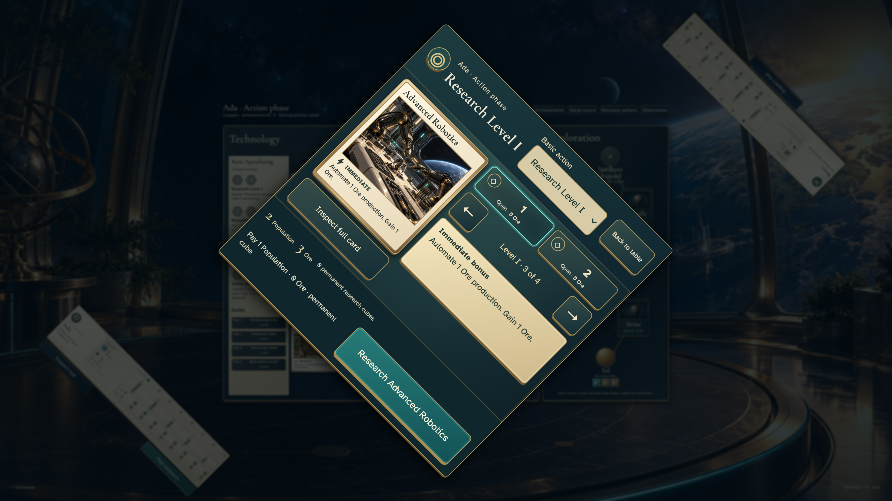](../../screenshots/automate-production-permanently-at-2-shared-corner-seats/021-ada-food-browse-1-tabletop-4k-darwin.png)

- [x] Browse the next public Level I face
- [x] The canonical effect and backend acknowledgement settle.
- [x] Public technology topology retains physical separation.
- [x] The actual viewport fits without page scrolling.

## 23. Browse the next public Level I face

Viewpoint: **Ada · South West · one shared controller**.

| desktop · 1440 × 1000 |
| --- |
| [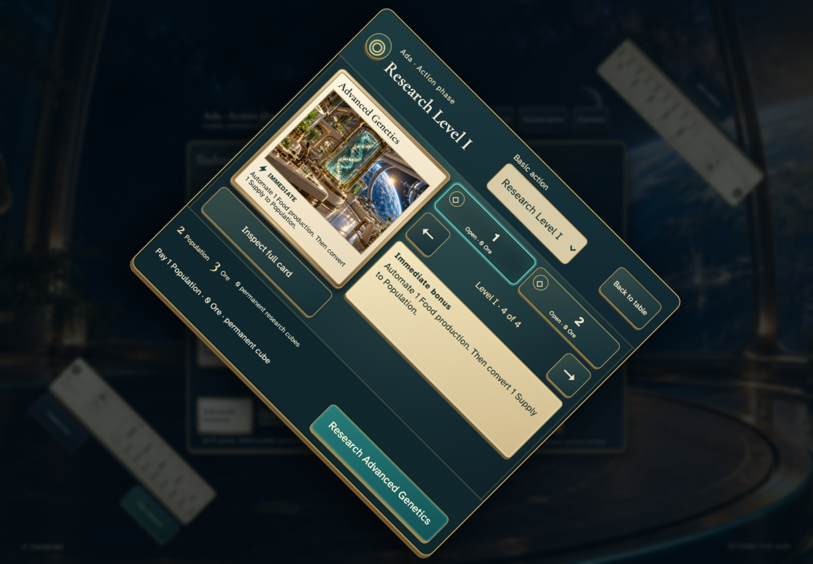](../../screenshots/automate-production-permanently-at-2-shared-corner-seats/022-ada-food-browse-2-desktop-darwin.png) |

tabletop-4k · 3840 × 2160

[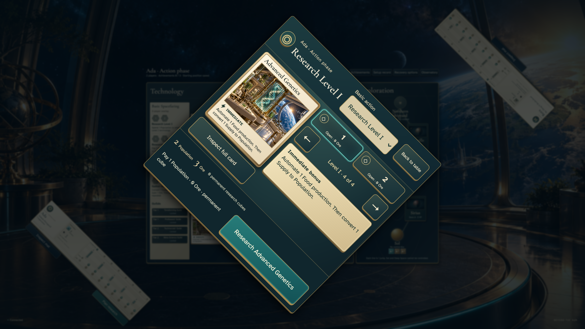](../../screenshots/automate-production-permanently-at-2-shared-corner-seats/022-ada-food-browse-2-tabletop-4k-darwin.png)

- [x] Browse the next public Level I face
- [x] The canonical effect and backend acknowledgement settle.
- [x] Public technology topology retains physical separation.
- [x] The actual viewport fits without page scrolling.

## 24. Pay once and receive Advanced Genetics's immediate bonus

Viewpoint: **Ada · South West · one shared controller**.

| desktop · 1440 × 1000 |
| --- |
|  |

tabletop-4k · 3840 × 2160

[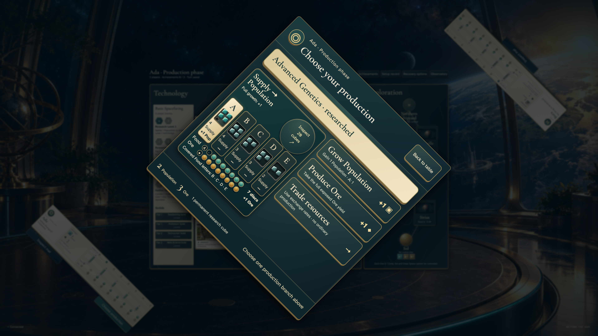](../../screenshots/automate-production-permanently-at-2-shared-corner-seats/023-ada-food-researched-tabletop-4k-darwin.png)

- [x] Pay once and receive Advanced Genetics's immediate bonus
- [x] The canonical effect and backend acknowledgement settle.
- [x] Public technology topology retains physical separation.
- [x] The actual viewport fits without page scrolling.

## 25. The first Food automation exposes a blank slot, retaining only A growth

Viewpoint: **Ada · South West · one shared controller**.

| desktop · 1440 × 1000 |
| --- |
| [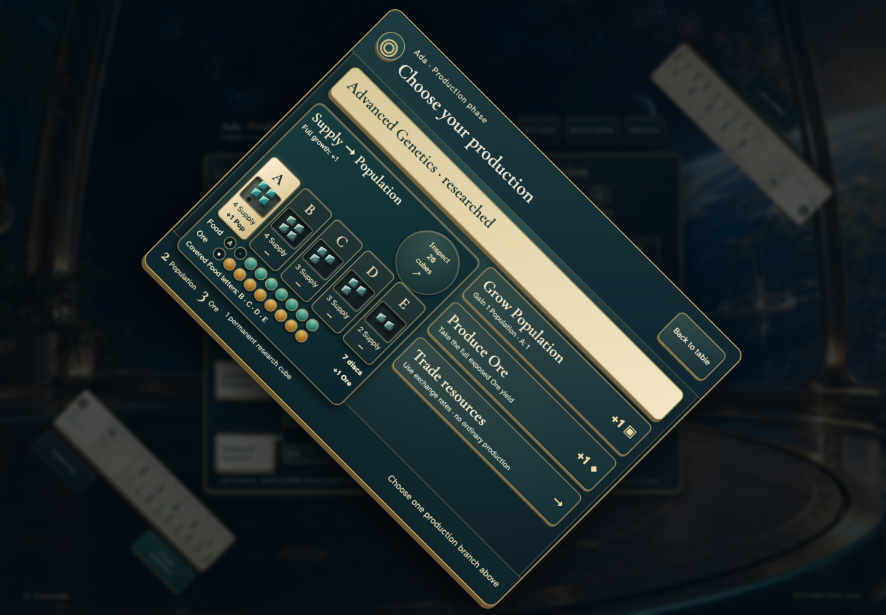](../../screenshots/automate-production-permanently-at-2-shared-corner-seats/024-food-blank-desktop-darwin.png) |

tabletop-4k · 3840 × 2160

- [x] The first Food automation exposes a blank slot, retaining only A growth
- [x] The canonical effect and backend acknowledgement settle.
- [x] Public technology topology retains physical separation.
- [x] The actual viewport fits without page scrolling.

## 26. Close the decision without paying or collecting any further resource

Viewpoint: **Ada · South West · one shared controller**.

| desktop · 1440 × 1000 |
| --- |
|  |

tabletop-4k · 3840 × 2160

[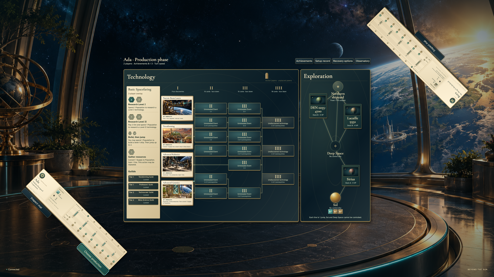](../../screenshots/automate-production-permanently-at-2-shared-corner-seats/025-food-permanent-board-tabletop-4k-darwin.png)

- [x] Close the decision without paying or collecting any further resource
- [x] The canonical effect and backend acknowledgement settle.
- [x] Public technology topology retains physical separation.
- [x] The actual viewport fits without page scrolling.

## 27. Ada inspects the actual retained production discs and Supply

Viewpoint: **Ada · South West · one shared controller**.

| desktop · 1440 × 1000 |
| --- |
|  |

tabletop-4k · 3840 × 2160

- [x] Ada inspects the actual retained production discs and Supply
- [x] The canonical effect and backend acknowledgement settle.
- [x] Public technology topology retains physical separation.
- [x] The actual viewport fits without page scrolling.

## 28. Permanent level 1 contributes 0 cumulative endgame VP without an immediate payout

Viewpoint: **Ada · South West · one shared controller**.

| desktop · 1440 × 1000 |
| --- |
| [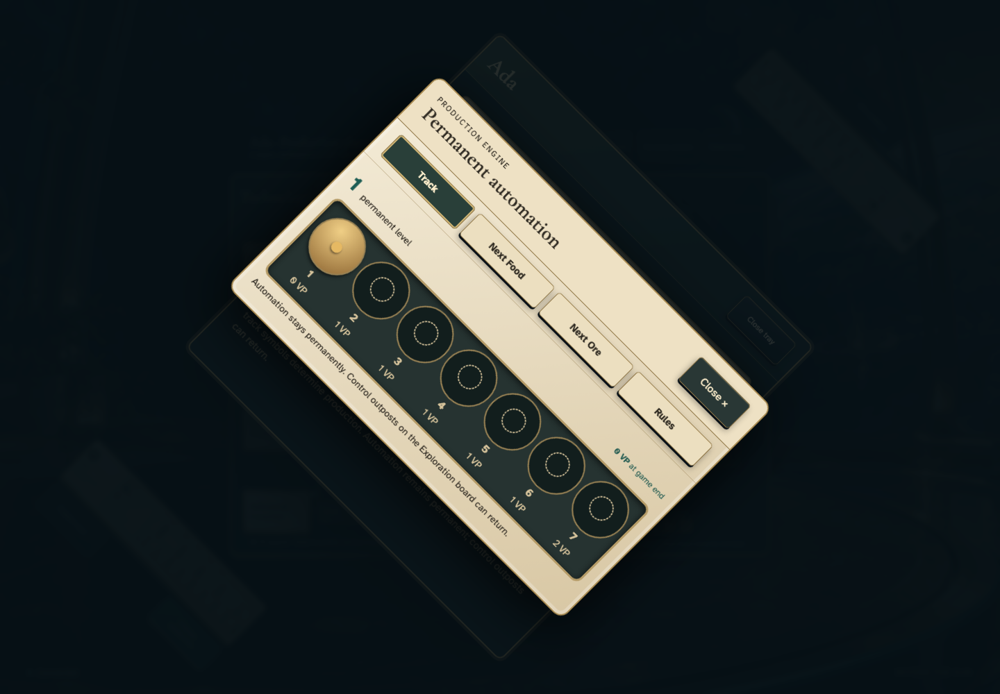](../../screenshots/automate-production-permanently-at-2-shared-corner-seats/027-food-permanent-track-desktop-darwin.png) |

tabletop-4k · 3840 × 2160

[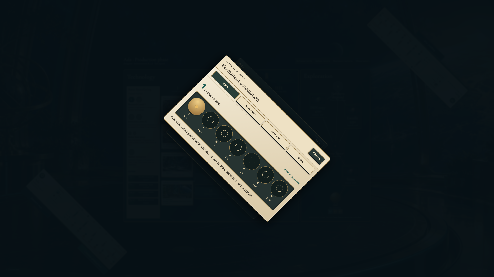](../../screenshots/automate-production-permanently-at-2-shared-corner-seats/027-food-permanent-track-tabletop-4k-darwin.png)

- [x] Permanent level 1 contributes 0 cumulative endgame VP without an immediate payout
- [x] The canonical effect and backend acknowledgement settle.
- [x] Public technology topology retains physical separation.
- [x] The actual viewport fits without page scrolling.

## 29. Inspect the next Food disc and exposed yield as a read-only consequence

Viewpoint: **Ada · South West · one shared controller**.

| desktop · 1440 × 1000 |
| --- |
|  |

tabletop-4k · 3840 × 2160

[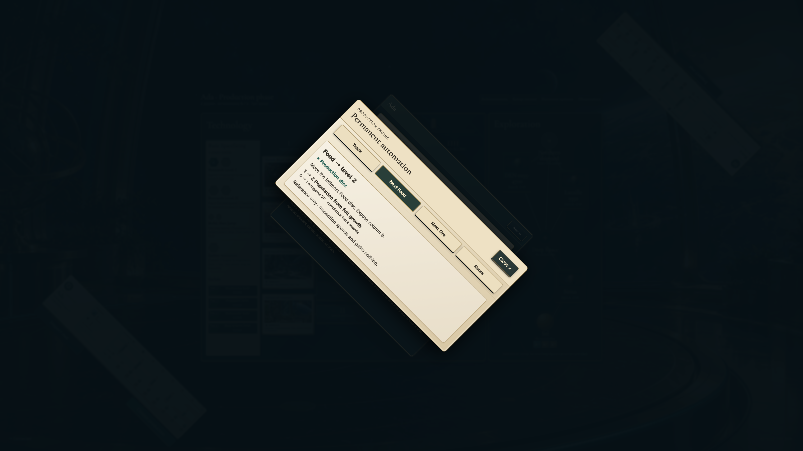](../../screenshots/automate-production-permanently-at-2-shared-corner-seats/028-food-permanent-food-tabletop-4k-darwin.png)

- [x] Inspect the next Food disc and exposed yield as a read-only consequence
- [x] The canonical effect and backend acknowledgement settle.
- [x] Public technology topology retains physical separation.
- [x] The actual viewport fits without page scrolling.

## 30. Inspect the next Ore disc and exposed yield as a read-only consequence

Viewpoint: **Ada · South West · one shared controller**.

| desktop · 1440 × 1000 |
| --- |
| [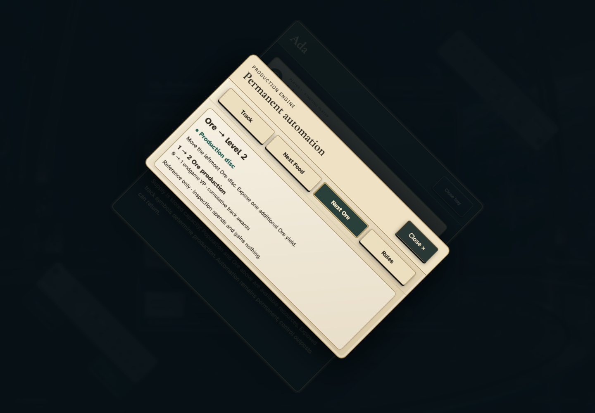](../../screenshots/automate-production-permanently-at-2-shared-corner-seats/029-food-permanent-ore-desktop-darwin.png) |

tabletop-4k · 3840 × 2160

- [x] Inspect the next Ore disc and exposed yield as a read-only consequence
- [x] The canonical effect and backend acknowledgement settle.
- [x] Public technology topology retains physical separation.
- [x] The actual viewport fits without page scrolling.

## 31. Read permanent discs, unlimited placeholders and cumulative awards without changing the game

Viewpoint: **Ada · South West · one shared controller**.

| desktop · 1440 × 1000 |
| --- |
| [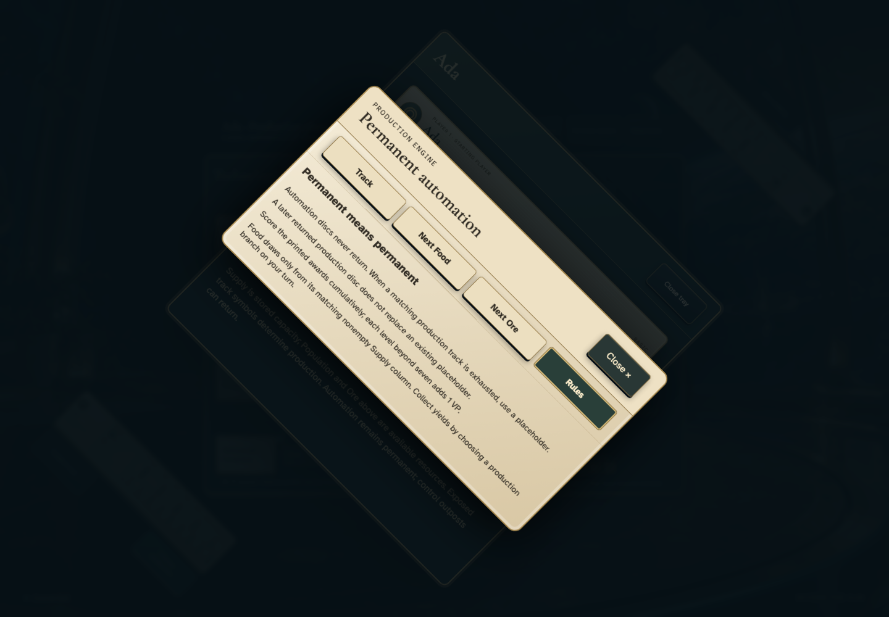](../../screenshots/automate-production-permanently-at-2-shared-corner-seats/030-food-permanent-rules-desktop-darwin.png) |

tabletop-4k · 3840 × 2160

[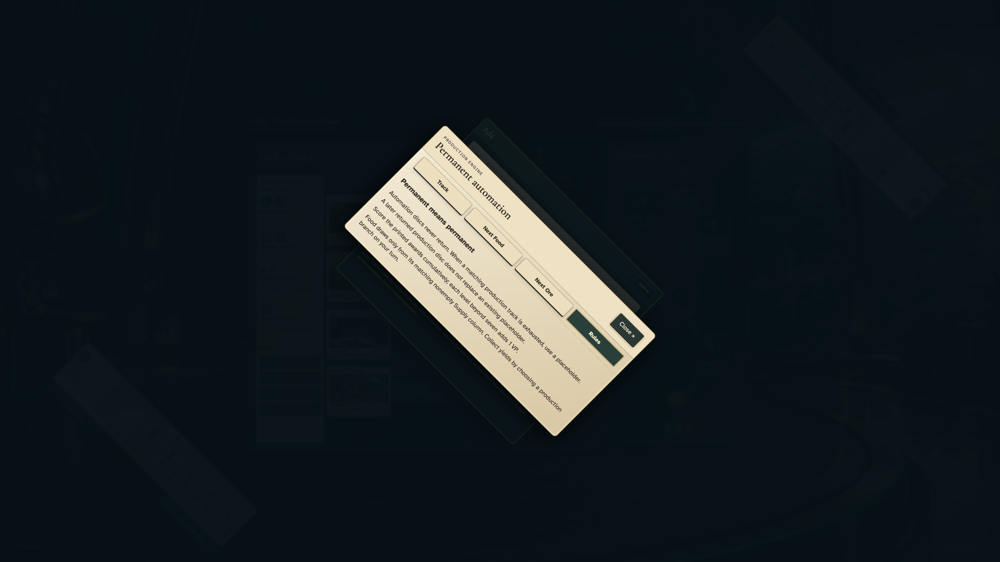](../../screenshots/automate-production-permanently-at-2-shared-corner-seats/030-food-permanent-rules-tabletop-4k-darwin.png)

- [x] Read permanent discs, unlimited placeholders and cumulative awards without changing the game
- [x] The canonical effect and backend acknowledgement settle.
- [x] Public technology topology retains physical separation.
- [x] The actual viewport fits without page scrolling.

## 32. Tab reaches the named internally scrolling automation details

Viewpoint: **Ada · South West · one shared controller**.

| desktop · 1440 × 1000 |
| --- |
|  |

tabletop-4k · 3840 × 2160

- [x] Tab reaches the named internally scrolling automation details
- [x] The canonical effect and backend acknowledgement settle.
- [x] Public technology topology retains physical separation.
- [x] The actual viewport fits without page scrolling.

## 33. Forward Tab remains inside the native automation inspector

Viewpoint: **Ada · South West · one shared controller**.

| desktop · 1440 × 1000 |
| --- |
|  |

tabletop-4k · 3840 × 2160

[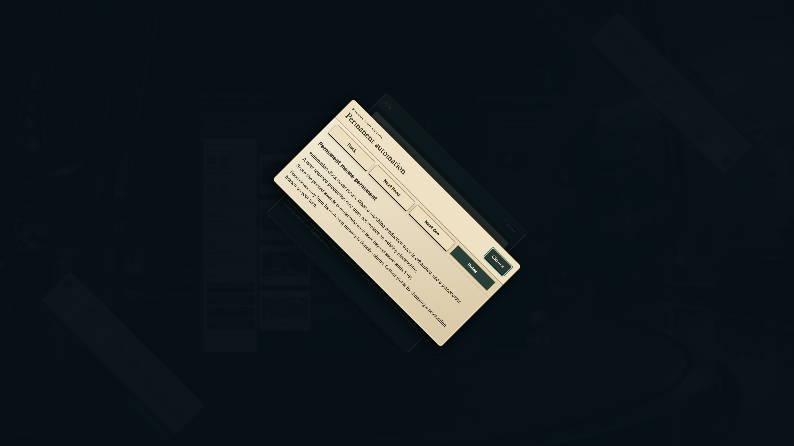](../../screenshots/automate-production-permanently-at-2-shared-corner-seats/032-food-permanent-focus-wrap-tabletop-4k-darwin.png)

- [x] Forward Tab remains inside the native automation inspector
- [x] The canonical effect and backend acknowledgement settle.
- [x] Public technology topology retains physical separation.
- [x] The actual viewport fits without page scrolling.

## 34. Reverse Tab also remains inside the inspector

Viewpoint: **Ada · South West · one shared controller**.

| desktop · 1440 × 1000 |
| --- |
| [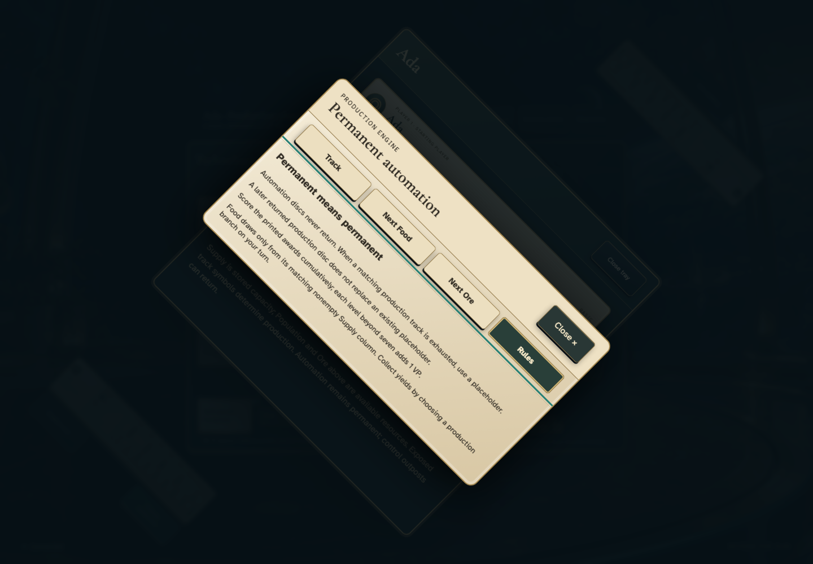](../../screenshots/automate-production-permanently-at-2-shared-corner-seats/033-food-permanent-focus-reverse-desktop-darwin.png) |

tabletop-4k · 3840 × 2160

- [x] Reverse Tab also remains inside the inspector
- [x] The canonical effect and backend acknowledgement settle.
- [x] Public technology topology retains physical separation.
- [x] The actual viewport fits without page scrolling.

## 35. Escape returns to the exact mat opener; inspection never spends or collects

Viewpoint: **Ada · South West · one shared controller**.

| desktop · 1440 × 1000 |
| --- |
| [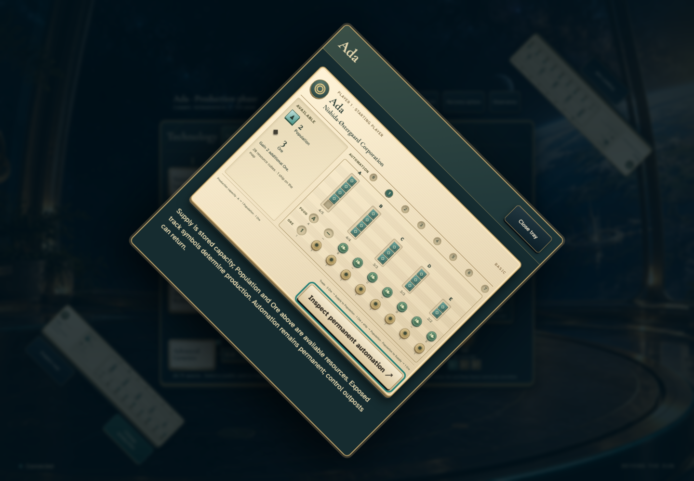](../../screenshots/automate-production-permanently-at-2-shared-corner-seats/034-food-permanent-return-desktop-darwin.png) |

tabletop-4k · 3840 × 2160

- [x] Escape returns to the exact mat opener; inspection never spends or collects
- [x] The canonical effect and backend acknowledgement settle.
- [x] Public technology topology retains physical separation.
- [x] The actual viewport fits without page scrolling.

## 36. Return to the real turn with all production choices still pending

Viewpoint: **Ada · South West · one shared controller**.

| desktop · 1440 × 1000 |
| --- |
|  |

tabletop-4k · 3840 × 2160

- [x] Return to the real turn with all production choices still pending
- [x] The canonical effect and backend acknowledgement settle.
- [x] Public technology topology retains physical separation.
- [x] The actual viewport fits without page scrolling.

## 37. Reload retains the same controller and the paid pending production

Viewpoint: **Ada · South West · one shared controller**.

| desktop · 1440 × 1000 |
| --- |
|  |

tabletop-4k · 3840 × 2160

- [x] Reload retains the same controller and the paid pending production
- [x] The canonical effect and backend acknowledgement settle.
- [x] Public technology topology retains physical separation.
- [x] The actual viewport fits without page scrolling.

## 38. Reopening production never repeats the permanent automation bonus

Viewpoint: **Ada · South West · one shared controller**.

| desktop · 1440 × 1000 |
| --- |
|  |

tabletop-4k · 3840 × 2160

- [x] Reopening production never repeats the permanent automation bonus
- [x] The canonical effect and backend acknowledgement settle.
- [x] Public technology topology retains physical separation.
- [x] The actual viewport fits without page scrolling.

## 39. Ada completes production and hands off to Bora

Viewpoint: **Ada · South West · one shared controller**.

| desktop · 1440 × 1000 |
| --- |
|  |

tabletop-4k · 3840 × 2160

- [x] Ada completes production and hands off to Bora
- [x] The canonical effect and backend acknowledgement settle.
- [x] Public technology topology retains physical separation.
- [x] The actual viewport fits without page scrolling.

## 40. Collect exactly 1 Population; automation is permanent and not a second payout

Viewpoint: **Ada · South West · one shared controller**.

| desktop · 1440 × 1000 |
| --- |
| [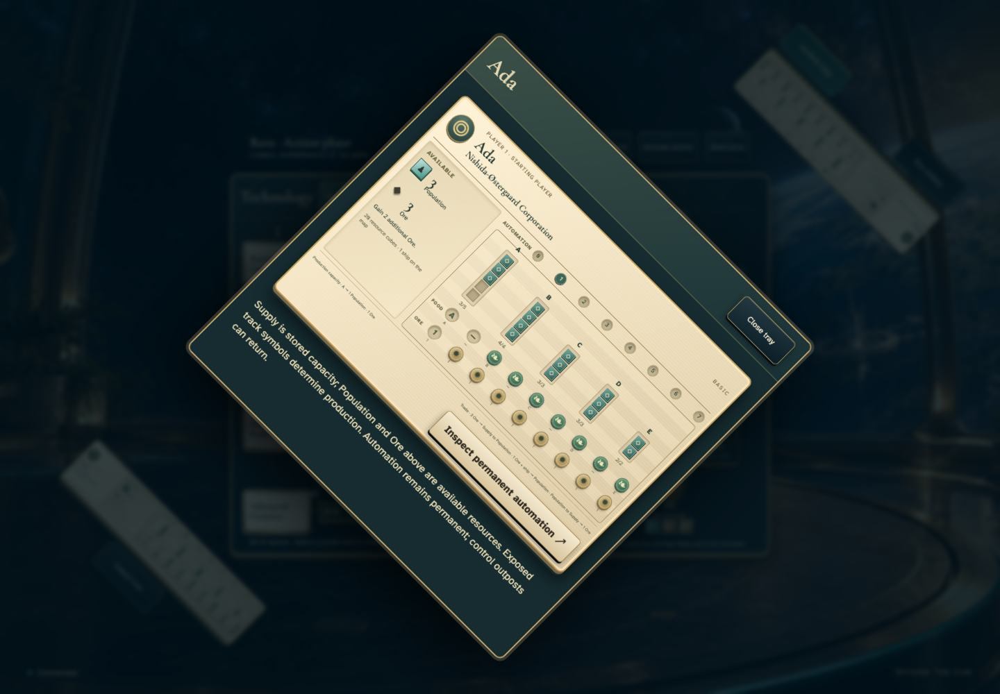](../../screenshots/automate-production-permanently-at-2-shared-corner-seats/039-food-produced-paid-desktop-darwin.png) |

tabletop-4k · 3840 × 2160

[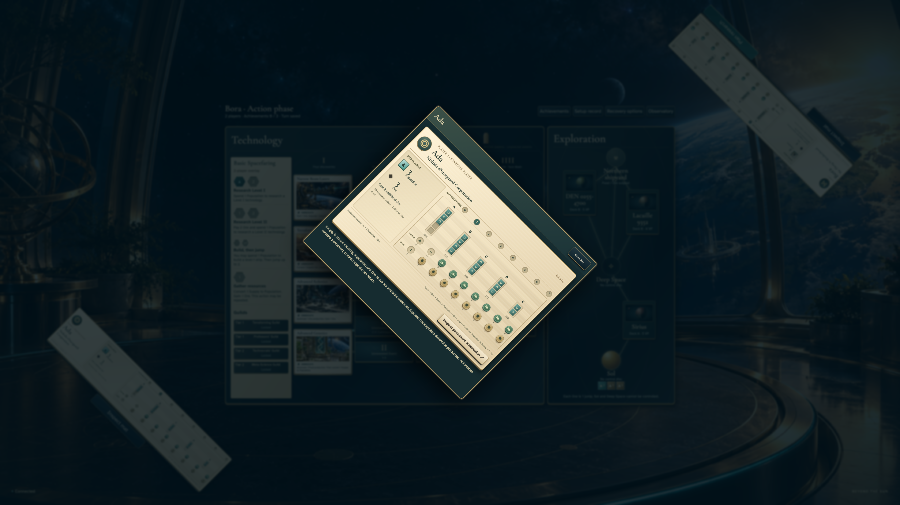](../../screenshots/automate-production-permanently-at-2-shared-corner-seats/039-food-produced-paid-tabletop-4k-darwin.png)

- [x] Collect exactly 1 Population; automation is permanent and not a second payout
- [x] The canonical effect and backend acknowledgement settle.
- [x] Public technology topology retains physical separation.
- [x] The actual viewport fits without page scrolling.

## 41. Close the proof and leave the next actual controller active

Viewpoint: **Ada · South West · one shared controller**.

| desktop · 1440 × 1000 |
| --- |
|  |

tabletop-4k · 3840 × 2160

[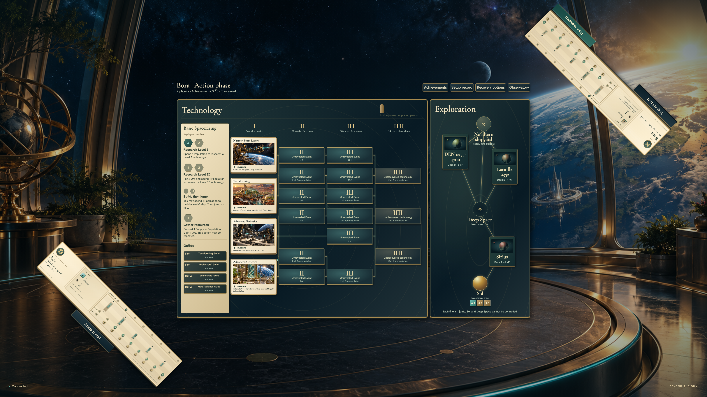](../../screenshots/automate-production-permanently-at-2-shared-corner-seats/040-food-produced-paid-close-tabletop-4k-darwin.png)

- [x] Close the proof and leave the next actual controller active
- [x] The canonical effect and backend acknowledgement settle.
- [x] Public technology topology retains physical separation.
- [x] The actual viewport fits without page scrolling.

## 42. Bora opens the actual research and Action instrument

Viewpoint: **Bora · North East · one shared controller**.

| desktop · 1440 × 1000 |
| --- |
| [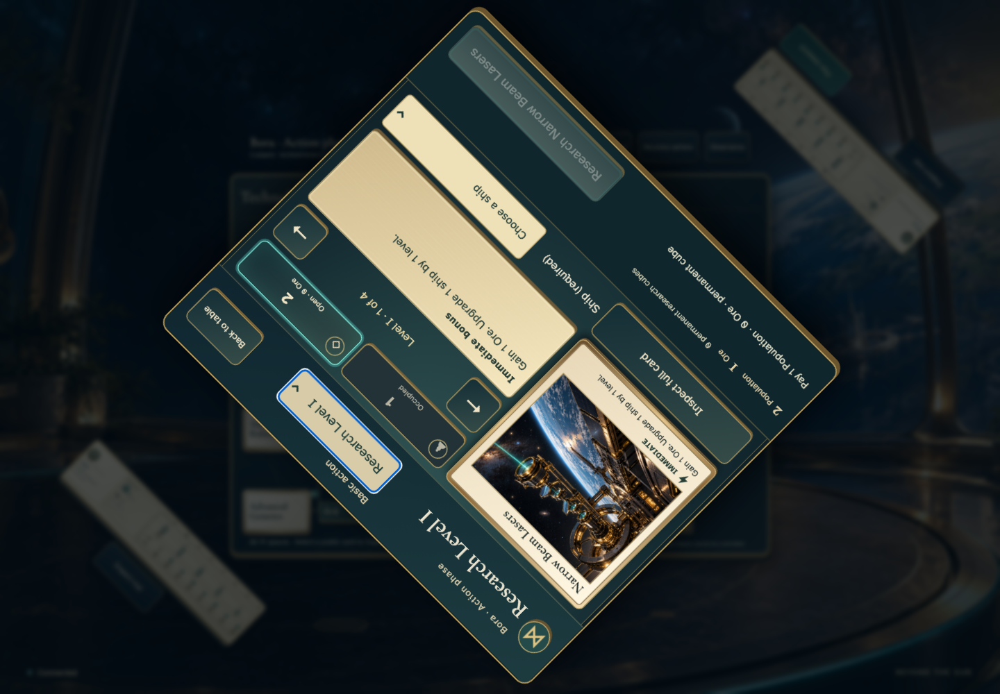](../../screenshots/automate-production-permanently-at-2-shared-corner-seats/041-bora-ore-plan-desktop-darwin.png) |

tabletop-4k · 3840 × 2160

[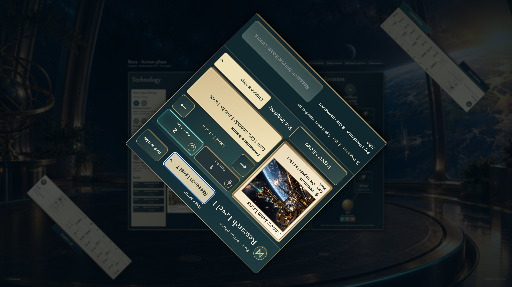](../../screenshots/automate-production-permanently-at-2-shared-corner-seats/041-bora-ore-plan-tabletop-4k-darwin.png)

- [x] Bora opens the actual research and Action instrument
- [x] The canonical effect and backend acknowledgement settle.
- [x] Public technology topology retains physical separation.
- [x] The actual viewport fits without page scrolling.

## 43. Bora selects the legal printed space 2

Viewpoint: **Bora · North East · one shared controller**.

| desktop · 1440 × 1000 |
| --- |
| [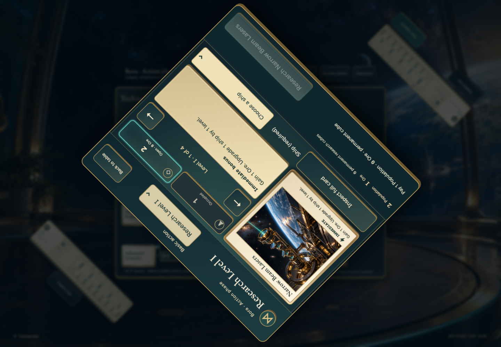](../../screenshots/automate-production-permanently-at-2-shared-corner-seats/042-bora-ore-space-desktop-darwin.png) |

tabletop-4k · 3840 × 2160

[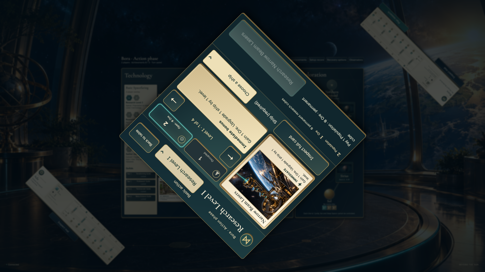](../../screenshots/automate-production-permanently-at-2-shared-corner-seats/042-bora-ore-space-tabletop-4k-darwin.png)

- [x] Bora selects the legal printed space 2
- [x] The canonical effect and backend acknowledgement settle.
- [x] Public technology topology retains physical separation.
- [x] The actual viewport fits without page scrolling.

## 44. Browse the next public Level I face

Viewpoint: **Bora · North East · one shared controller**.

| desktop · 1440 × 1000 |
| --- |
|  |

tabletop-4k · 3840 × 2160

[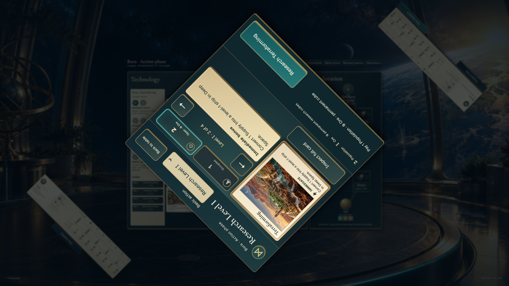](../../screenshots/automate-production-permanently-at-2-shared-corner-seats/043-bora-ore-browse-0-tabletop-4k-darwin.png)

- [x] Browse the next public Level I face
- [x] The canonical effect and backend acknowledgement settle.
- [x] Public technology topology retains physical separation.
- [x] The actual viewport fits without page scrolling.

## 45. Browse the next public Level I face

Viewpoint: **Bora · North East · one shared controller**.

| desktop · 1440 × 1000 |
| --- |
| [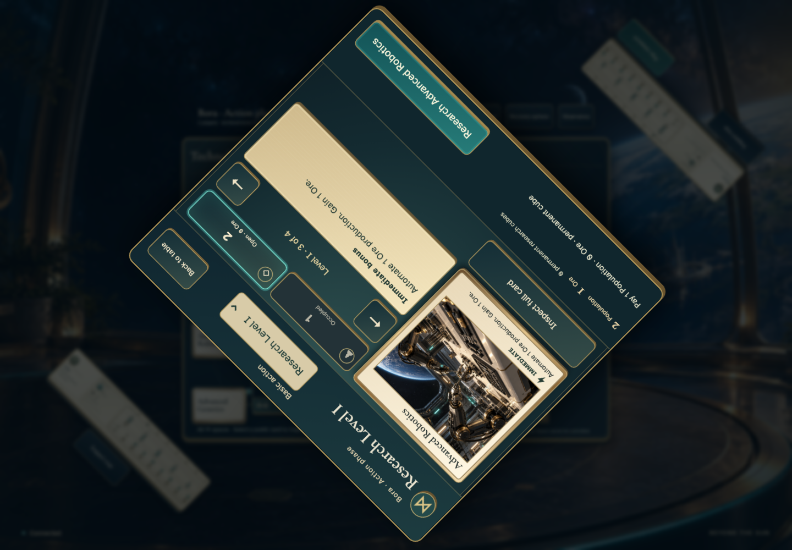](../../screenshots/automate-production-permanently-at-2-shared-corner-seats/044-bora-ore-browse-1-desktop-darwin.png) |

tabletop-4k · 3840 × 2160

[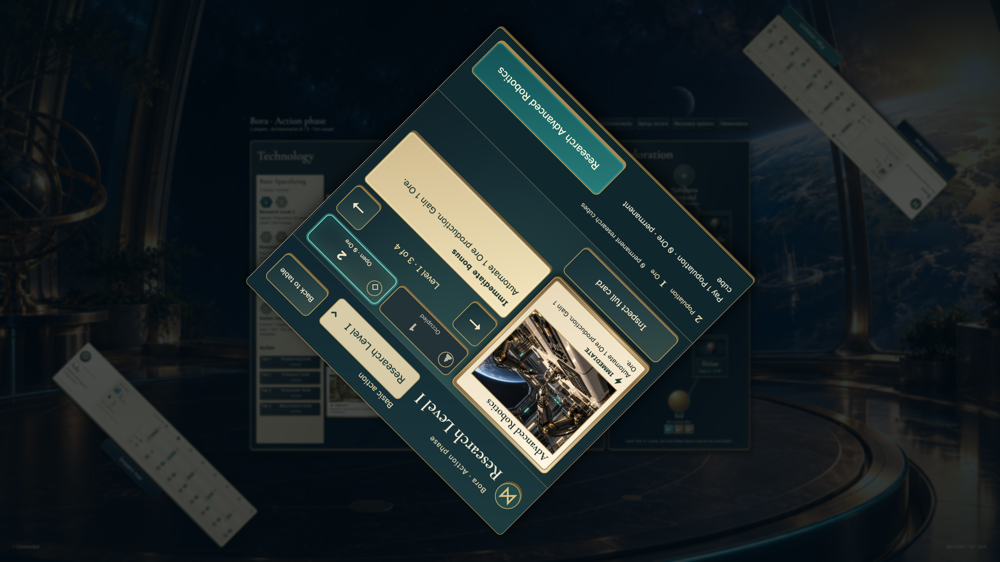](../../screenshots/automate-production-permanently-at-2-shared-corner-seats/044-bora-ore-browse-1-tabletop-4k-darwin.png)

- [x] Browse the next public Level I face
- [x] The canonical effect and backend acknowledgement settle.
- [x] Public technology topology retains physical separation.
- [x] The actual viewport fits without page scrolling.

## 46. Pay once and receive Advanced Robotics's immediate bonus

Viewpoint: **Bora · North East · one shared controller**.

| desktop · 1440 × 1000 |
| --- |
|  |

tabletop-4k · 3840 × 2160

- [x] Pay once and receive Advanced Robotics's immediate bonus
- [x] The canonical effect and backend acknowledgement settle.
- [x] Public technology topology retains physical separation.
- [x] The actual viewport fits without page scrolling.

## 47. The first Ore automation exposes a second complete Ore yield

Viewpoint: **Bora · North East · one shared controller**.

| desktop · 1440 × 1000 |
| --- |
|  |

tabletop-4k · 3840 × 2160

- [x] The first Ore automation exposes a second complete Ore yield
- [x] The canonical effect and backend acknowledgement settle.
- [x] Public technology topology retains physical separation.
- [x] The actual viewport fits without page scrolling.

## 48. Close the decision without paying or collecting any further resource

Viewpoint: **Bora · North East · one shared controller**.

| desktop · 1440 × 1000 |
| --- |
|  |

tabletop-4k · 3840 × 2160

- [x] Close the decision without paying or collecting any further resource
- [x] The canonical effect and backend acknowledgement settle.
- [x] Public technology topology retains physical separation.
- [x] The actual viewport fits without page scrolling.

## 49. Bora inspects the actual retained production discs and Supply

Viewpoint: **Bora · North East · one shared controller**.

| desktop · 1440 × 1000 |
| --- |
| [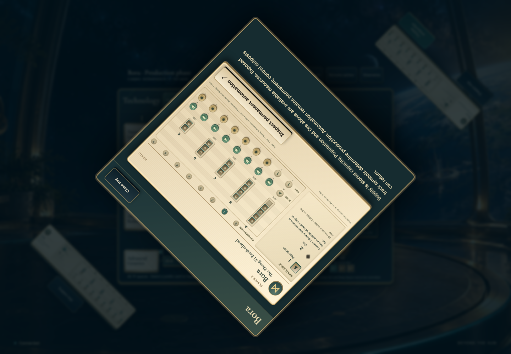](../../screenshots/automate-production-permanently-at-2-shared-corner-seats/048-ore-permanent-mat-desktop-darwin.png) |

tabletop-4k · 3840 × 2160

- [x] Bora inspects the actual retained production discs and Supply
- [x] The canonical effect and backend acknowledgement settle.
- [x] Public technology topology retains physical separation.
- [x] The actual viewport fits without page scrolling.

## 50. Permanent level 1 contributes 0 cumulative endgame VP without an immediate payout

Viewpoint: **Bora · North East · one shared controller**.

| desktop · 1440 × 1000 |
| --- |
| [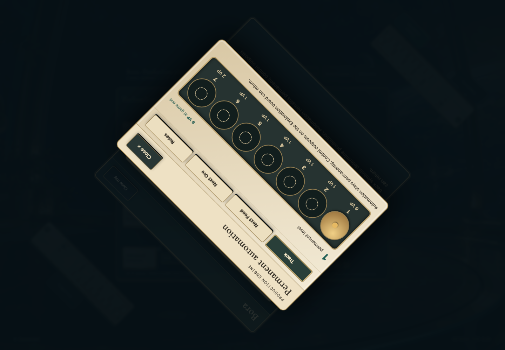](../../screenshots/automate-production-permanently-at-2-shared-corner-seats/049-ore-permanent-track-desktop-darwin.png) |

tabletop-4k · 3840 × 2160

[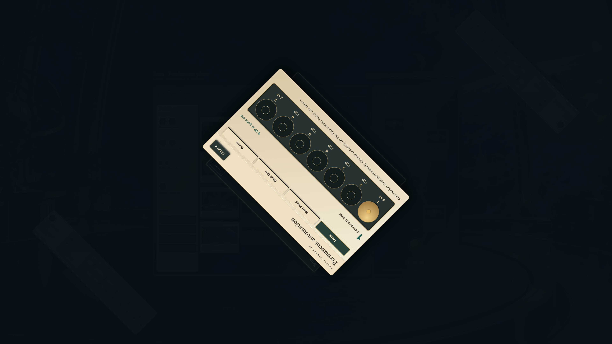](../../screenshots/automate-production-permanently-at-2-shared-corner-seats/049-ore-permanent-track-tabletop-4k-darwin.png)

- [x] Permanent level 1 contributes 0 cumulative endgame VP without an immediate payout
- [x] The canonical effect and backend acknowledgement settle.
- [x] Public technology topology retains physical separation.
- [x] The actual viewport fits without page scrolling.

## 51. Inspect the next Ore disc and exposed yield as a read-only consequence

Viewpoint: **Bora · North East · one shared controller**.

| desktop · 1440 × 1000 |
| --- |
| [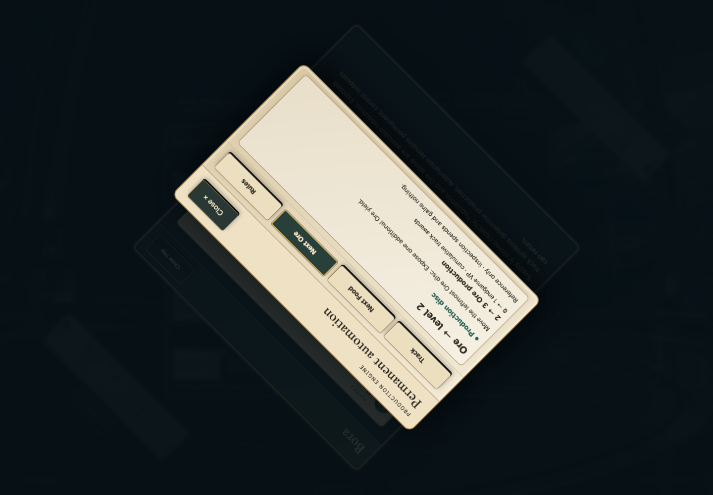](../../screenshots/automate-production-permanently-at-2-shared-corner-seats/050-ore-permanent-ore-desktop-darwin.png) |

tabletop-4k · 3840 × 2160

[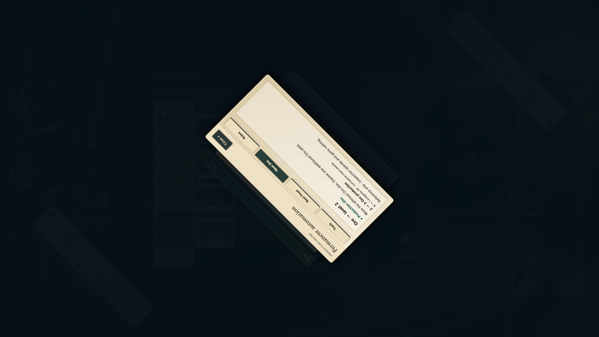](../../screenshots/automate-production-permanently-at-2-shared-corner-seats/050-ore-permanent-ore-tabletop-4k-darwin.png)

- [x] Inspect the next Ore disc and exposed yield as a read-only consequence
- [x] The canonical effect and backend acknowledgement settle.
- [x] Public technology topology retains physical separation.
- [x] The actual viewport fits without page scrolling.

## 52. Escape returns to the exact mat opener; inspection never spends or collects

Viewpoint: **Bora · North East · one shared controller**.

| desktop · 1440 × 1000 |
| --- |
|  |

tabletop-4k · 3840 × 2160

- [x] Escape returns to the exact mat opener; inspection never spends or collects
- [x] The canonical effect and backend acknowledgement settle.
- [x] Public technology topology retains physical separation.
- [x] The actual viewport fits without page scrolling.

## 53. Return to the real turn with all production choices still pending

Viewpoint: **Bora · North East · one shared controller**.

| desktop · 1440 × 1000 |
| --- |
|  |

tabletop-4k · 3840 × 2160

- [x] Return to the real turn with all production choices still pending
- [x] The canonical effect and backend acknowledgement settle.
- [x] Public technology topology retains physical separation.
- [x] The actual viewport fits without page scrolling.

## 54. Reload retains the same controller and the paid pending production

Viewpoint: **Bora · North East · one shared controller**.

| desktop · 1440 × 1000 |
| --- |
|  |

tabletop-4k · 3840 × 2160

- [x] Reload retains the same controller and the paid pending production
- [x] The canonical effect and backend acknowledgement settle.
- [x] Public technology topology retains physical separation.
- [x] The actual viewport fits without page scrolling.

## 55. Reopening production never repeats the permanent automation bonus

Viewpoint: **Bora · North East · one shared controller**.

| desktop · 1440 × 1000 |
| --- |
|  |

tabletop-4k · 3840 × 2160

- [x] Reopening production never repeats the permanent automation bonus
- [x] The canonical effect and backend acknowledgement settle.
- [x] Public technology topology retains physical separation.
- [x] The actual viewport fits without page scrolling.

## 56. Bora completes production and hands off to Ada

Viewpoint: **Bora · North East · one shared controller**.

| desktop · 1440 × 1000 |
| --- |
|  |

tabletop-4k · 3840 × 2160

- [x] Bora completes production and hands off to Ada
- [x] The canonical effect and backend acknowledgement settle.
- [x] Public technology topology retains physical separation.
- [x] The actual viewport fits without page scrolling.

## 57. Collect exactly 2 Ore; automation is permanent and not a second payout

Viewpoint: **Bora · North East · one shared controller**.

| desktop · 1440 × 1000 |
| --- |
|  |

tabletop-4k · 3840 × 2160

- [x] Collect exactly 2 Ore; automation is permanent and not a second payout
- [x] The canonical effect and backend acknowledgement settle.
- [x] Public technology topology retains physical separation.
- [x] The actual viewport fits without page scrolling.

## 58. Close the proof and leave the next actual controller active

Viewpoint: **Bora · North East · one shared controller**.

| desktop · 1440 × 1000 |
| --- |
|  |

tabletop-4k · 3840 × 2160

- [x] Close the proof and leave the next actual controller active
- [x] The canonical effect and backend acknowledgement settle.
- [x] Public technology topology retains physical separation.
- [x] The actual viewport fits without page scrolling.

## 59. Ada opens the actual research and Action instrument

Viewpoint: **Ada · South West · one shared controller**.

| desktop · 1440 × 1000 |
| --- |
| [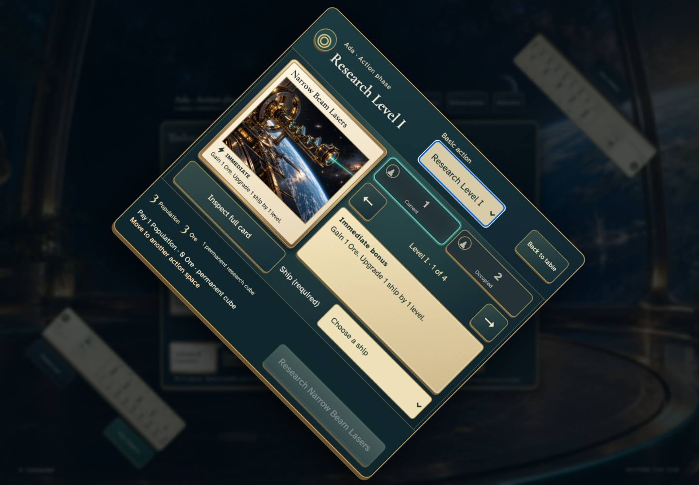](../../screenshots/automate-production-permanently-at-2-shared-corner-seats/058-ada-vacates-plan-desktop-darwin.png) |

tabletop-4k · 3840 × 2160

[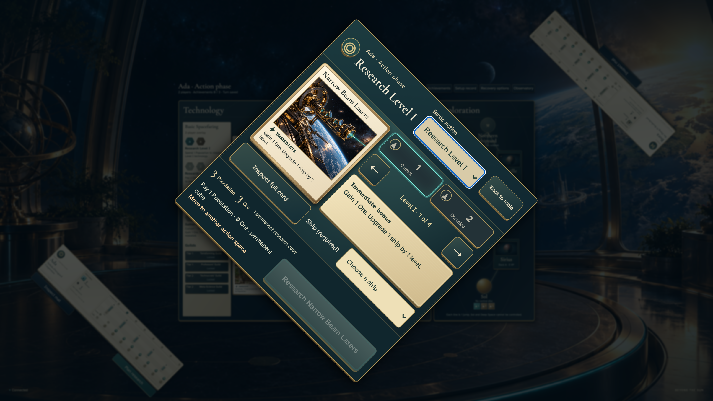](../../screenshots/automate-production-permanently-at-2-shared-corner-seats/058-ada-vacates-plan-tabletop-4k-darwin.png)

- [x] Ada opens the actual research and Action instrument
- [x] The canonical effect and backend acknowledgement settle.
- [x] Public technology topology retains physical separation.
- [x] The actual viewport fits without page scrolling.

## 60. Ada selects ordinary gathering

Viewpoint: **Ada · South West · one shared controller**.

| desktop · 1440 × 1000 |
| --- |
| [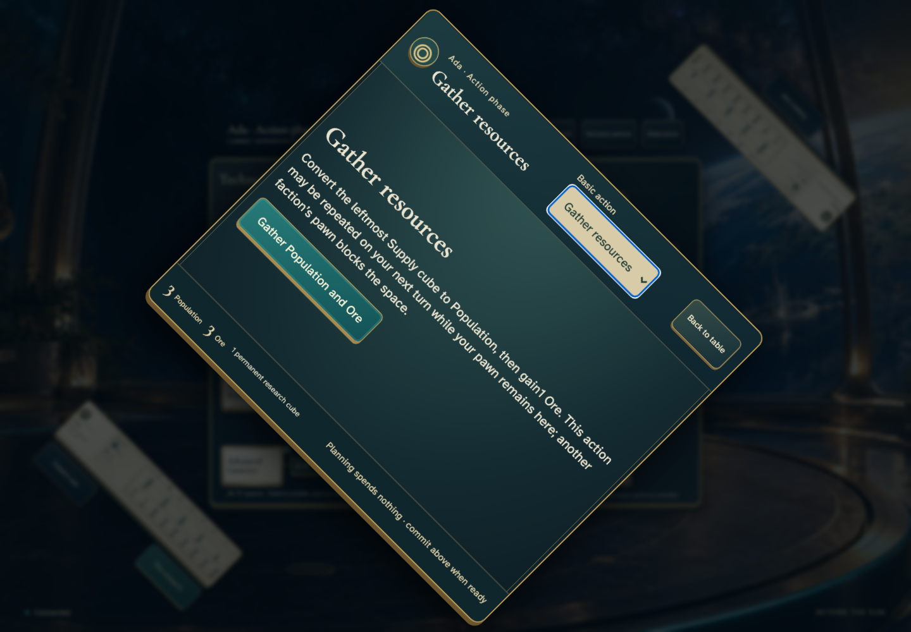](../../screenshots/automate-production-permanently-at-2-shared-corner-seats/059-ada-vacates-kind-desktop-darwin.png) |

tabletop-4k · 3840 × 2160

[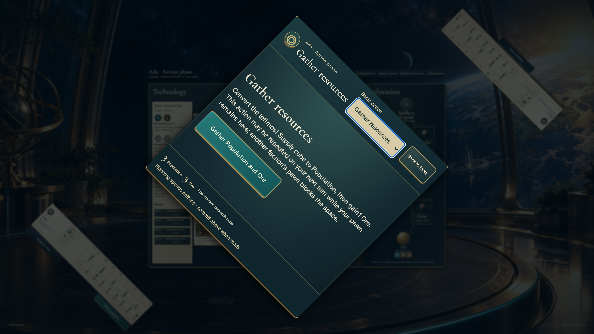](../../screenshots/automate-production-permanently-at-2-shared-corner-seats/059-ada-vacates-kind-tabletop-4k-darwin.png)

- [x] Ada selects ordinary gathering
- [x] The canonical effect and backend acknowledgement settle.
- [x] Public technology topology retains physical separation.
- [x] The actual viewport fits without page scrolling.

## 61. Receive the printed gather resources before ordinary production

Viewpoint: **Ada · South West · one shared controller**.

| desktop · 1440 × 1000 |
| --- |
| [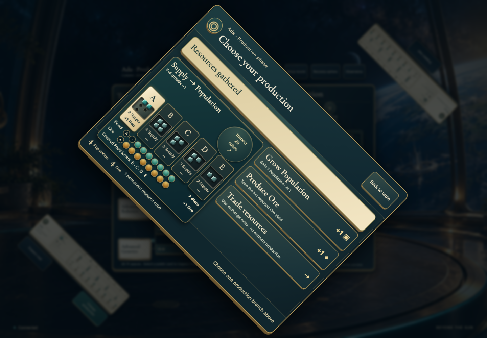](../../screenshots/automate-production-permanently-at-2-shared-corner-seats/060-ada-vacates-gathered-desktop-darwin.png) |

tabletop-4k · 3840 × 2160

- [x] Receive the printed gather resources before ordinary production
- [x] The canonical effect and backend acknowledgement settle.
- [x] Public technology topology retains physical separation.
- [x] The actual viewport fits without page scrolling.

## 62. Ada completes production and hands off to Bora

Viewpoint: **Ada · South West · one shared controller**.

| desktop · 1440 × 1000 |
| --- |
|  |

tabletop-4k · 3840 × 2160

- [x] Ada completes production and hands off to Bora
- [x] The canonical effect and backend acknowledgement settle.
- [x] Public technology topology retains physical separation.
- [x] The actual viewport fits without page scrolling.

## 63. Collect exactly 1 Ore; automation is permanent and not a second payout

Viewpoint: **Ada · South West · one shared controller**.

| desktop · 1440 × 1000 |
| --- |
|  |

tabletop-4k · 3840 × 2160

- [x] Collect exactly 1 Ore; automation is permanent and not a second payout
- [x] The canonical effect and backend acknowledgement settle.
- [x] Public technology topology retains physical separation.
- [x] The actual viewport fits without page scrolling.

## 64. Close the proof and leave the next actual controller active

Viewpoint: **Ada · South West · one shared controller**.

| desktop · 1440 × 1000 |
| --- |
|  |

tabletop-4k · 3840 × 2160

- [x] Close the proof and leave the next actual controller active
- [x] The canonical effect and backend acknowledgement settle.
- [x] Public technology topology retains physical separation.
- [x] The actual viewport fits without page scrolling.

## 65. Bora opens the actual research and Action instrument

Viewpoint: **Bora · North East · one shared controller**.

| desktop · 1440 × 1000 |
| --- |
| [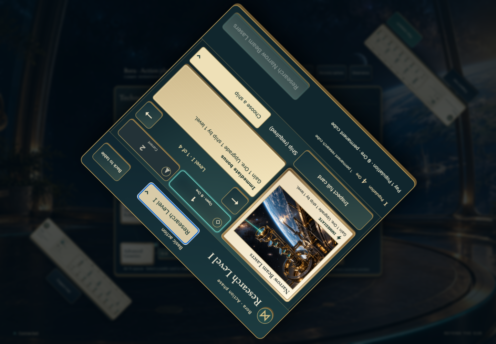](../../screenshots/automate-production-permanently-at-2-shared-corner-seats/064-bora-second-plan-desktop-darwin.png) |

tabletop-4k · 3840 × 2160

- [x] Bora opens the actual research and Action instrument
- [x] The canonical effect and backend acknowledgement settle.
- [x] Public technology topology retains physical separation.
- [x] The actual viewport fits without page scrolling.

## 66. Bora selects the legal printed space 1

Viewpoint: **Bora · North East · one shared controller**.

| desktop · 1440 × 1000 |
| --- |
|  |

tabletop-4k · 3840 × 2160

- [x] Bora selects the legal printed space 1
- [x] The canonical effect and backend acknowledgement settle.
- [x] Public technology topology retains physical separation.
- [x] The actual viewport fits without page scrolling.

## 67. Browse the next public Level I face

Viewpoint: **Bora · North East · one shared controller**.

| desktop · 1440 × 1000 |
| --- |
|  |

tabletop-4k · 3840 × 2160

- [x] Browse the next public Level I face
- [x] The canonical effect and backend acknowledgement settle.
- [x] Public technology topology retains physical separation.
- [x] The actual viewport fits without page scrolling.

## 68. Browse the next public Level I face

Viewpoint: **Bora · North East · one shared controller**.

| desktop · 1440 × 1000 |
| --- |
|  |

tabletop-4k · 3840 × 2160

- [x] Browse the next public Level I face
- [x] The canonical effect and backend acknowledgement settle.
- [x] Public technology topology retains physical separation.
- [x] The actual viewport fits without page scrolling.

## 69. Browse the next public Level I face

Viewpoint: **Bora · North East · one shared controller**.

| desktop · 1440 × 1000 |
| --- |
|  |

tabletop-4k · 3840 × 2160

- [x] Browse the next public Level I face
- [x] The canonical effect and backend acknowledgement settle.
- [x] Public technology topology retains physical separation.
- [x] The actual viewport fits without page scrolling.

## 70. Pay once and receive Advanced Genetics's immediate bonus

Viewpoint: **Bora · North East · one shared controller**.

| desktop · 1440 × 1000 |
| --- |
|  |

tabletop-4k · 3840 × 2160

- [x] Pay once and receive Advanced Genetics's immediate bonus
- [x] The canonical effect and backend acknowledgement settle.
- [x] Public technology topology retains physical separation.
- [x] The actual viewport fits without page scrolling.

## 71. Close the decision without paying or collecting any further resource

Viewpoint: **Bora · North East · one shared controller**.

| desktop · 1440 × 1000 |
| --- |
|  |

tabletop-4k · 3840 × 2160

- [x] Close the decision without paying or collecting any further resource
- [x] The canonical effect and backend acknowledgement settle.
- [x] Public technology topology retains physical separation.
- [x] The actual viewport fits without page scrolling.

## 72. Bora inspects the actual retained production discs and Supply

Viewpoint: **Bora · North East · one shared controller**.

| desktop · 1440 × 1000 |
| --- |
|  |

tabletop-4k · 3840 × 2160

- [x] Bora inspects the actual retained production discs and Supply
- [x] The canonical effect and backend acknowledgement settle.
- [x] Public technology topology retains physical separation.
- [x] The actual viewport fits without page scrolling.

## 73. Permanent level 2 contributes 1 cumulative endgame VP without an immediate payout

Viewpoint: **Bora · North East · one shared controller**.

| desktop · 1440 × 1000 |
| --- |
|  |

tabletop-4k · 3840 × 2160

- [x] Permanent level 2 contributes 1 cumulative endgame VP without an immediate payout
- [x] The canonical effect and backend acknowledgement settle.
- [x] Public technology topology retains physical separation.
- [x] The actual viewport fits without page scrolling.

## 74. Escape returns to the exact mat opener; inspection never spends or collects

Viewpoint: **Bora · North East · one shared controller**.

| desktop · 1440 × 1000 |
| --- |
|  |

tabletop-4k · 3840 × 2160

- [x] Escape returns to the exact mat opener; inspection never spends or collects
- [x] The canonical effect and backend acknowledgement settle.
- [x] Public technology topology retains physical separation.
- [x] The actual viewport fits without page scrolling.

## 75. Return to the real turn with all production choices still pending

Viewpoint: **Bora · North East · one shared controller**.

| desktop · 1440 × 1000 |
| --- |
|  |

tabletop-4k · 3840 × 2160

- [x] Return to the real turn with all production choices still pending
- [x] The canonical effect and backend acknowledgement settle.
- [x] Public technology topology retains physical separation.
- [x] The actual viewport fits without page scrolling.

## 76. Reopen the same pending production after read-only inspection

Viewpoint: **Bora · North East · one shared controller**.

| desktop · 1440 × 1000 |
| --- |
|  |

tabletop-4k · 3840 × 2160

- [x] Reopen the same pending production after read-only inspection
- [x] The canonical effect and backend acknowledgement settle.
- [x] Public technology topology retains physical separation.
- [x] The actual viewport fits without page scrolling.

## 77. Bora completes production and hands off to Ada

Viewpoint: **Bora · North East · one shared controller**.

| desktop · 1440 × 1000 |
| --- |
|  |

tabletop-4k · 3840 × 2160

- [x] Bora completes production and hands off to Ada
- [x] The canonical effect and backend acknowledgement settle.
- [x] Public technology topology retains physical separation.
- [x] The actual viewport fits without page scrolling.

## 78. Collect exactly 1 Population; automation is permanent and not a second payout

Viewpoint: **Bora · North East · one shared controller**.

| desktop · 1440 × 1000 |
| --- |
|  |

tabletop-4k · 3840 × 2160

- [x] Collect exactly 1 Population; automation is permanent and not a second payout
- [x] The canonical effect and backend acknowledgement settle.
- [x] Public technology topology retains physical separation.
- [x] The actual viewport fits without page scrolling.

## 79. Close the proof and leave the next actual controller active

Viewpoint: **Bora · North East · one shared controller**.

| desktop · 1440 × 1000 |
| --- |
|  |

tabletop-4k · 3840 × 2160

- [x] Close the proof and leave the next actual controller active
- [x] The canonical effect and backend acknowledgement settle.
- [x] Public technology topology retains physical separation.
- [x] The actual viewport fits without page scrolling.

## 80. Ada opens the actual research and Action instrument

Viewpoint: **Ada · South West · one shared controller**.

| desktop · 1440 × 1000 |
| --- |
|  |

tabletop-4k · 3840 × 2160

- [x] Ada opens the actual research and Action instrument
- [x] The canonical effect and backend acknowledgement settle.
- [x] Public technology topology retains physical separation.
- [x] The actual viewport fits without page scrolling.

## 81. Ada selects the legal printed space 2

Viewpoint: **Ada · South West · one shared controller**.

| desktop · 1440 × 1000 |
| --- |
|  |

tabletop-4k · 3840 × 2160

- [x] Ada selects the legal printed space 2
- [x] The canonical effect and backend acknowledgement settle.
- [x] Public technology topology retains physical separation.
- [x] The actual viewport fits without page scrolling.

## 82. Browse the next public Level I face

Viewpoint: **Ada · South West · one shared controller**.

| desktop · 1440 × 1000 |
| --- |
|  |

tabletop-4k · 3840 × 2160

- [x] Browse the next public Level I face
- [x] The canonical effect and backend acknowledgement settle.
- [x] Public technology topology retains physical separation.
- [x] The actual viewport fits without page scrolling.

## 83. Browse the next public Level I face

Viewpoint: **Ada · South West · one shared controller**.

| desktop · 1440 × 1000 |
| --- |
|  |

tabletop-4k · 3840 × 2160

- [x] Browse the next public Level I face
- [x] The canonical effect and backend acknowledgement settle.
- [x] Public technology topology retains physical separation.
- [x] The actual viewport fits without page scrolling.

## 84. Pay once and receive Advanced Robotics's immediate bonus

Viewpoint: **Ada · South West · one shared controller**.

| desktop · 1440 × 1000 |
| --- |
|  |

tabletop-4k · 3840 × 2160

- [x] Pay once and receive Advanced Robotics's immediate bonus
- [x] The canonical effect and backend acknowledgement settle.
- [x] Public technology topology retains physical separation.
- [x] The actual viewport fits without page scrolling.

## 85. Close the decision without paying or collecting any further resource

Viewpoint: **Ada · South West · one shared controller**.

| desktop · 1440 × 1000 |
| --- |
|  |

tabletop-4k · 3840 × 2160

- [x] Close the decision without paying or collecting any further resource
- [x] The canonical effect and backend acknowledgement settle.
- [x] Public technology topology retains physical separation.
- [x] The actual viewport fits without page scrolling.

## 86. Ada inspects the actual retained production discs and Supply

Viewpoint: **Ada · South West · one shared controller**.

| desktop · 1440 × 1000 |
| --- |
|  |

tabletop-4k · 3840 × 2160

- [x] Ada inspects the actual retained production discs and Supply
- [x] The canonical effect and backend acknowledgement settle.
- [x] Public technology topology retains physical separation.
- [x] The actual viewport fits without page scrolling.

## 87. Permanent level 2 contributes 1 cumulative endgame VP without an immediate payout

Viewpoint: **Ada · South West · one shared controller**.

| desktop · 1440 × 1000 |
| --- |
|  |

tabletop-4k · 3840 × 2160

- [x] Permanent level 2 contributes 1 cumulative endgame VP without an immediate payout
- [x] The canonical effect and backend acknowledgement settle.
- [x] Public technology topology retains physical separation.
- [x] The actual viewport fits without page scrolling.

## 88. Inspect the next Food disc and exposed yield as a read-only consequence

Viewpoint: **Ada · South West · one shared controller**.

| desktop · 1440 × 1000 |
| --- |
|  |

tabletop-4k · 3840 × 2160

- [x] Inspect the next Food disc and exposed yield as a read-only consequence
- [x] The canonical effect and backend acknowledgement settle.
- [x] Public technology topology retains physical separation.
- [x] The actual viewport fits without page scrolling.

## 89. Inspect the next Ore disc and exposed yield as a read-only consequence

Viewpoint: **Ada · South West · one shared controller**.

| desktop · 1440 × 1000 |
| --- |
|  |

tabletop-4k · 3840 × 2160

- [x] Inspect the next Ore disc and exposed yield as a read-only consequence
- [x] The canonical effect and backend acknowledgement settle.
- [x] Public technology topology retains physical separation.
- [x] The actual viewport fits without page scrolling.

## 90. Read permanent discs, unlimited placeholders and cumulative awards without changing the game

Viewpoint: **Ada · South West · one shared controller**.

| desktop · 1440 × 1000 |
| --- |
|  |

tabletop-4k · 3840 × 2160

- [x] Read permanent discs, unlimited placeholders and cumulative awards without changing the game
- [x] The canonical effect and backend acknowledgement settle.
- [x] Public technology topology retains physical separation.
- [x] The actual viewport fits without page scrolling.

## 91. Tab reaches the named internally scrolling automation details

Viewpoint: **Ada · South West · one shared controller**.

| desktop · 1440 × 1000 |
| --- |
|  |

tabletop-4k · 3840 × 2160

- [x] Tab reaches the named internally scrolling automation details
- [x] The canonical effect and backend acknowledgement settle.
- [x] Public technology topology retains physical separation.
- [x] The actual viewport fits without page scrolling.

## 92. Forward Tab remains inside the native automation inspector

Viewpoint: **Ada · South West · one shared controller**.

| desktop · 1440 × 1000 |
| --- |
|  |

tabletop-4k · 3840 × 2160

- [x] Forward Tab remains inside the native automation inspector
- [x] The canonical effect and backend acknowledgement settle.
- [x] Public technology topology retains physical separation.
- [x] The actual viewport fits without page scrolling.

## 93. Reverse Tab also remains inside the inspector

Viewpoint: **Ada · South West · one shared controller**.

| desktop · 1440 × 1000 |
| --- |
|  |

tabletop-4k · 3840 × 2160

- [x] Reverse Tab also remains inside the inspector
- [x] The canonical effect and backend acknowledgement settle.
- [x] Public technology topology retains physical separation.
- [x] The actual viewport fits without page scrolling.

## 94. Escape returns to the exact mat opener; inspection never spends or collects

Viewpoint: **Ada · South West · one shared controller**.

| desktop · 1440 × 1000 |
| --- |
|  |

tabletop-4k · 3840 × 2160

- [x] Escape returns to the exact mat opener; inspection never spends or collects
- [x] The canonical effect and backend acknowledgement settle.
- [x] Public technology topology retains physical separation.
- [x] The actual viewport fits without page scrolling.

## 95. Return to the real turn with all production choices still pending

Viewpoint: **Ada · South West · one shared controller**.

| desktop · 1440 × 1000 |
| --- |
|  |

tabletop-4k · 3840 × 2160

- [x] Return to the real turn with all production choices still pending
- [x] The canonical effect and backend acknowledgement settle.
- [x] Public technology topology retains physical separation.
- [x] The actual viewport fits without page scrolling.

## 96. Reload retains the same controller and the paid pending production

Viewpoint: **Ada · South West · one shared controller**.

| desktop · 1440 × 1000 |
| --- |
|  |

tabletop-4k · 3840 × 2160

- [x] Reload retains the same controller and the paid pending production
- [x] The canonical effect and backend acknowledgement settle.
- [x] Public technology topology retains physical separation.
- [x] The actual viewport fits without page scrolling.

## 97. Reopening production never repeats the permanent automation bonus

Viewpoint: **Ada · South West · one shared controller**.

| desktop · 1440 × 1000 |
| --- |
|  |

tabletop-4k · 3840 × 2160

- [x] Reopening production never repeats the permanent automation bonus
- [x] The canonical effect and backend acknowledgement settle.
- [x] Public technology topology retains physical separation.
- [x] The actual viewport fits without page scrolling.

## 98. The saved production and cumulative award survive reload without an extra turn

Viewpoint: **Ada · South West · one shared controller**.

| desktop · 1440 × 1000 |
| --- |
|  |

tabletop-4k · 3840 × 2160

- [x] The saved production and cumulative award survive reload without an extra turn
- [x] The canonical effect and backend acknowledgement settle.
- [x] Public technology topology retains physical separation.
- [x] The actual viewport fits without page scrolling.

## 99. Ada inspects the actual retained production discs and Supply

Viewpoint: **Ada · South West · one shared controller**.

| desktop · 1440 × 1000 |
| --- |
|  |

tabletop-4k · 3840 × 2160

- [x] Ada inspects the actual retained production discs and Supply
- [x] The canonical effect and backend acknowledgement settle.
- [x] Public technology topology retains physical separation.
- [x] The actual viewport fits without page scrolling.

## 100. Permanent level 2 contributes 1 cumulative endgame VP without an immediate payout

Viewpoint: **Ada · South West · one shared controller**.

| desktop · 1440 × 1000 |
| --- |
|  |

tabletop-4k · 3840 × 2160

- [x] Permanent level 2 contributes 1 cumulative endgame VP without an immediate payout
- [x] The canonical effect and backend acknowledgement settle.
- [x] Public technology topology retains physical separation.
- [x] The actual viewport fits without page scrolling.

## 101. Escape returns to the exact mat opener; inspection never spends or collects

Viewpoint: **Ada · South West · one shared controller**.

| desktop · 1440 × 1000 |
| --- |
|  |

tabletop-4k · 3840 × 2160

- [x] Escape returns to the exact mat opener; inspection never spends or collects
- [x] The canonical effect and backend acknowledgement settle.
- [x] Public technology topology retains physical separation.
- [x] The actual viewport fits without page scrolling.

## 102. Return to the real turn with all production choices still pending

Viewpoint: **Ada · South West · one shared controller**.

| desktop · 1440 × 1000 |
| --- |
|  |

tabletop-4k · 3840 × 2160

- [x] Return to the real turn with all production choices still pending
- [x] The canonical effect and backend acknowledgement settle.
- [x] Public technology topology retains physical separation.
- [x] The actual viewport fits without page scrolling.
