# Automate production permanently at 4 shared cardinal seats

One shared controller; direct physical seating without remote identities or devices. Ordinary production UI setup, legal unique Basic factions and preparatory turns. Fixed setup entropy66666666-6666-4666-8666-000000000009; command identities are deterministic, never injected game state or a transferred controller. Production-disc removal, exposed yields, permanent level and cumulative printed scoring are real canonical effects. Read-only future inspection pays nothing. Deterministic exhausted-track/above-seven cases remain backend coverage; no fake advanced UI state.

## 1. Arrive using the actual production client

Viewpoint: **Ada · South · one shared controller**.

| desktop · 1440 × 1000 |
| --- |
|  |

tabletop-4k · 3840 × 2160

- [x] Arrive using the actual production client
- [x] The canonical effect and backend acknowledgement settle.
- [x] Public technology topology retains physical separation.
- [x] The actual viewport fits without page scrolling.

## 2. Choose a real production play mode

Viewpoint: **Ada · South · one shared controller**.

| desktop · 1440 × 1000 |
| --- |
|  |

tabletop-4k · 3840 × 2160

- [x] Choose a real production play mode
- [x] The canonical effect and backend acknowledgement settle.
- [x] Public technology topology retains physical separation.
- [x] The actual viewport fits without page scrolling.

## 3. One controller configures physical seats directly on the table

Viewpoint: **Ada · South · one shared controller**.

| desktop · 1440 × 1000 |
| --- |
|  |

tabletop-4k · 3840 × 2160

[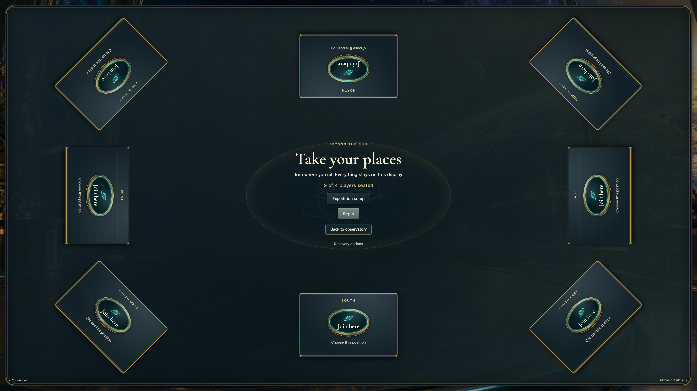](../../screenshots/automate-production-permanently-at-4-shared-cardinal-seats/002-shared-empty-tabletop-4k-darwin.png)

- [x] One controller configures physical seats directly on the table
- [x] The canonical effect and backend acknowledgement settle.
- [x] Public technology topology retains physical separation.
- [x] The actual viewport fits without page scrolling.

## 4. Open the South seat on the shared surface

Viewpoint: **Ada · South · one shared controller**.

| desktop · 1440 × 1000 |
| --- |
|  |

tabletop-4k · 3840 × 2160

- [x] Open the South seat on the shared surface
- [x] The canonical effect and backend acknowledgement settle.
- [x] Public technology topology retains physical separation.
- [x] The actual viewport fits without page scrolling.

## 5. Name the physical player Ada

Viewpoint: **Ada · South · one shared controller**.

| desktop · 1440 × 1000 |
| --- |
|  |

tabletop-4k · 3840 × 2160

- [x] Name the physical player Ada
- [x] The canonical effect and backend acknowledgement settle.
- [x] Public technology topology retains physical separation.
- [x] The actual viewport fits without page scrolling.

## 6. The local physical seat is retained on this controller

Viewpoint: **Ada · South · one shared controller**.

| desktop · 1440 × 1000 |
| --- |
|  |

tabletop-4k · 3840 × 2160

- [x] The local physical seat is retained on this controller
- [x] The canonical effect and backend acknowledgement settle.
- [x] Public technology topology retains physical separation.
- [x] The actual viewport fits without page scrolling.

## 7. Open the West seat on the shared surface

Viewpoint: **Bora · West · one shared controller**.

| desktop · 1440 × 1000 |
| --- |
|  |

tabletop-4k · 3840 × 2160

- [x] Open the West seat on the shared surface
- [x] The canonical effect and backend acknowledgement settle.
- [x] Public technology topology retains physical separation.
- [x] The actual viewport fits without page scrolling.

## 8. Name the physical player Bora

Viewpoint: **Bora · West · one shared controller**.

| desktop · 1440 × 1000 |
| --- |
|  |

tabletop-4k · 3840 × 2160

- [x] Name the physical player Bora
- [x] The canonical effect and backend acknowledgement settle.
- [x] Public technology topology retains physical separation.
- [x] The actual viewport fits without page scrolling.

## 9. The local physical seat is retained on this controller

Viewpoint: **Bora · West · one shared controller**.

| desktop · 1440 × 1000 |
| --- |
|  |

tabletop-4k · 3840 × 2160

[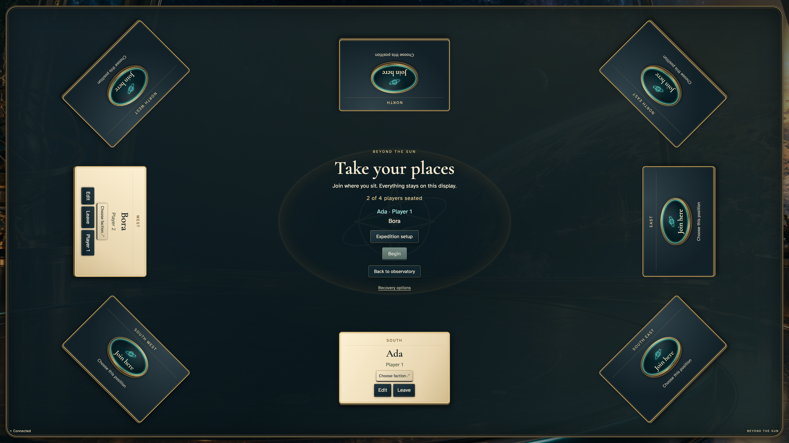](../../screenshots/automate-production-permanently-at-4-shared-cardinal-seats/008-seat-1-joined-tabletop-4k-darwin.png)

- [x] The local physical seat is retained on this controller
- [x] The canonical effect and backend acknowledgement settle.
- [x] Public technology topology retains physical separation.
- [x] The actual viewport fits without page scrolling.

## 10. Open the North seat on the shared surface

Viewpoint: **Cleo · North · one shared controller**.

| desktop · 1440 × 1000 |
| --- |
|  |

tabletop-4k · 3840 × 2160

- [x] Open the North seat on the shared surface
- [x] The canonical effect and backend acknowledgement settle.
- [x] Public technology topology retains physical separation.
- [x] The actual viewport fits without page scrolling.

## 11. Name the physical player Cleo

Viewpoint: **Cleo · North · one shared controller**.

| desktop · 1440 × 1000 |
| --- |
|  |

tabletop-4k · 3840 × 2160

[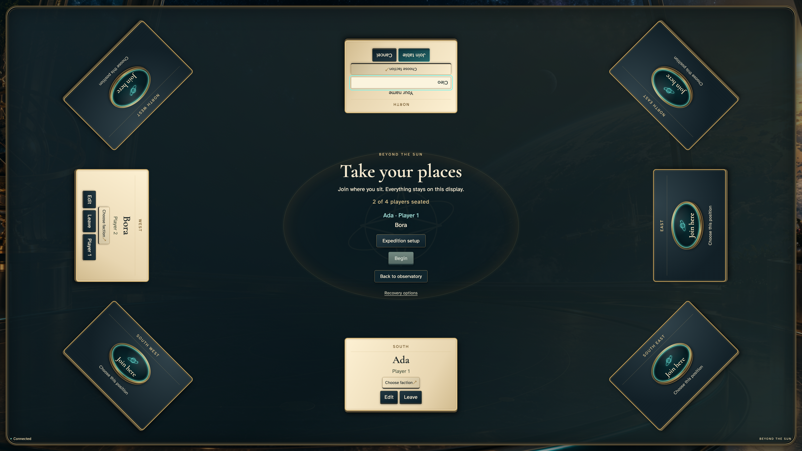](../../screenshots/automate-production-permanently-at-4-shared-cardinal-seats/010-seat-2-name-tabletop-4k-darwin.png)

- [x] Name the physical player Cleo
- [x] The canonical effect and backend acknowledgement settle.
- [x] Public technology topology retains physical separation.
- [x] The actual viewport fits without page scrolling.

## 12. The local physical seat is retained on this controller

Viewpoint: **Cleo · North · one shared controller**.

| desktop · 1440 × 1000 |
| --- |
|  |

tabletop-4k · 3840 × 2160

- [x] The local physical seat is retained on this controller
- [x] The canonical effect and backend acknowledgement settle.
- [x] Public technology topology retains physical separation.
- [x] The actual viewport fits without page scrolling.

## 13. Open the East seat on the shared surface

Viewpoint: **Dara · East · one shared controller**.

| desktop · 1440 × 1000 |
| --- |
|  |

tabletop-4k · 3840 × 2160

- [x] Open the East seat on the shared surface
- [x] The canonical effect and backend acknowledgement settle.
- [x] Public technology topology retains physical separation.
- [x] The actual viewport fits without page scrolling.

## 14. Name the physical player Dara

Viewpoint: **Dara · East · one shared controller**.

| desktop · 1440 × 1000 |
| --- |
| [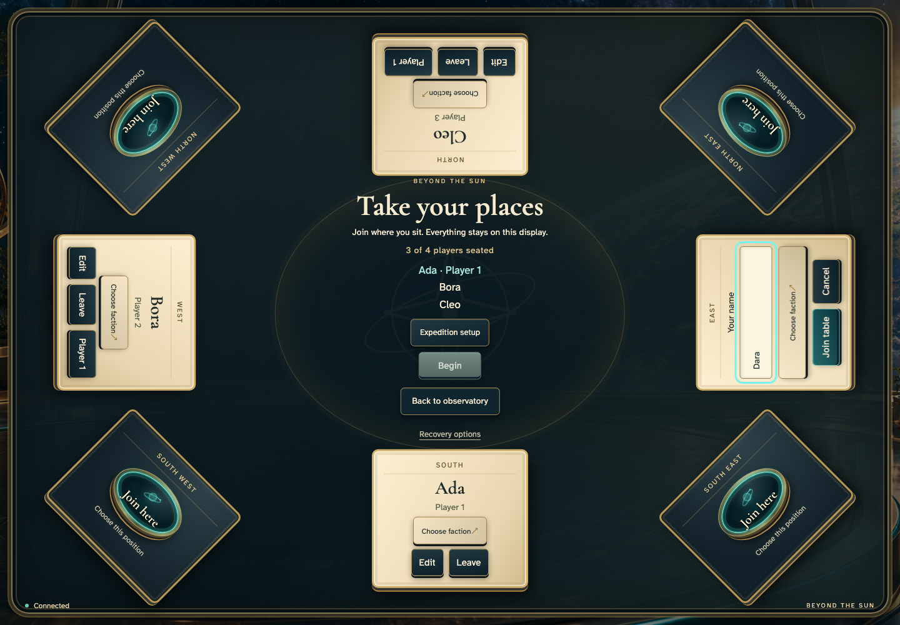](../../screenshots/automate-production-permanently-at-4-shared-cardinal-seats/013-seat-3-name-desktop-darwin.png) |

tabletop-4k · 3840 × 2160

- [x] Name the physical player Dara
- [x] The canonical effect and backend acknowledgement settle.
- [x] Public technology topology retains physical separation.
- [x] The actual viewport fits without page scrolling.

## 15. The local physical seat is retained on this controller

Viewpoint: **Dara · East · one shared controller**.

| desktop · 1440 × 1000 |
| --- |
|  |

tabletop-4k · 3840 × 2160

- [x] The local physical seat is retained on this controller
- [x] The canonical effect and backend acknowledgement settle.
- [x] Public technology topology retains physical separation.
- [x] The actual viewport fits without page scrolling.

## 16. Ada chooses a legal unique Basic faction

Viewpoint: **Ada · South · one shared controller**.

| desktop · 1440 × 1000 |
| --- |
|  |

tabletop-4k · 3840 × 2160

- [x] Ada chooses a legal unique Basic faction
- [x] The canonical effect and backend acknowledgement settle.
- [x] Public technology topology retains physical separation.
- [x] The actual viewport fits without page scrolling.

## 17. Ada retains Nishida-Østergaard Corporation

Viewpoint: **Ada · South · one shared controller**.

| desktop · 1440 × 1000 |
| --- |
|  |

tabletop-4k · 3840 × 2160

- [x] Ada retains Nishida-Østergaard Corporation
- [x] The canonical effect and backend acknowledgement settle.
- [x] Public technology topology retains physical separation.
- [x] The actual viewport fits without page scrolling.

## 18. Bora chooses a legal unique Basic faction

Viewpoint: **Bora · West · one shared controller**.

| desktop · 1440 × 1000 |
| --- |
| [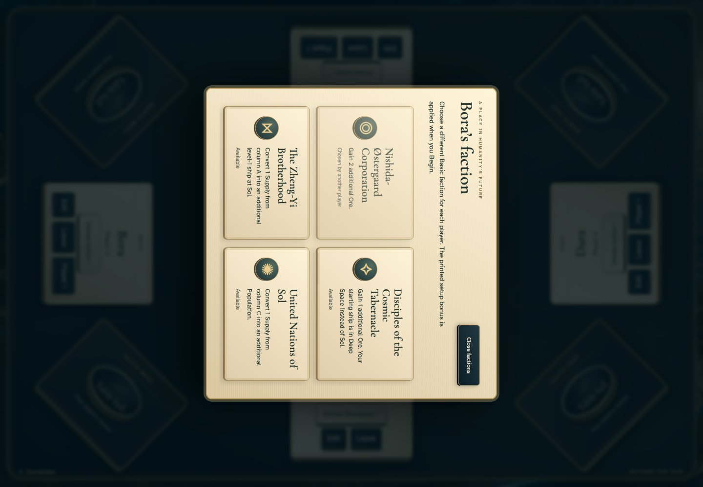](../../screenshots/automate-production-permanently-at-4-shared-cardinal-seats/017-faction-1-editor-desktop-darwin.png) |

tabletop-4k · 3840 × 2160

- [x] Bora chooses a legal unique Basic faction
- [x] The canonical effect and backend acknowledgement settle.
- [x] Public technology topology retains physical separation.
- [x] The actual viewport fits without page scrolling.

## 19. Bora retains The Zheng-Yi Brotherhood

Viewpoint: **Bora · West · one shared controller**.

| desktop · 1440 × 1000 |
| --- |
| [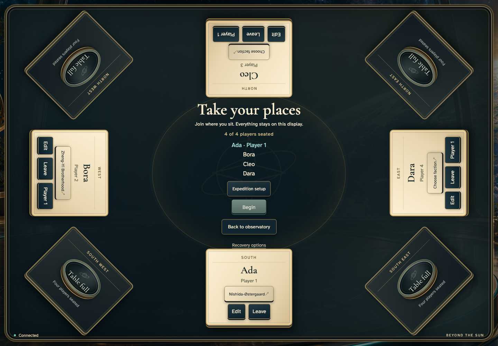](../../screenshots/automate-production-permanently-at-4-shared-cardinal-seats/018-faction-1-chosen-desktop-darwin.png) |

tabletop-4k · 3840 × 2160

- [x] Bora retains The Zheng-Yi Brotherhood
- [x] The canonical effect and backend acknowledgement settle.
- [x] Public technology topology retains physical separation.
- [x] The actual viewport fits without page scrolling.

## 20. Cleo chooses a legal unique Basic faction

Viewpoint: **Cleo · North · one shared controller**.

| desktop · 1440 × 1000 |
| --- |
| [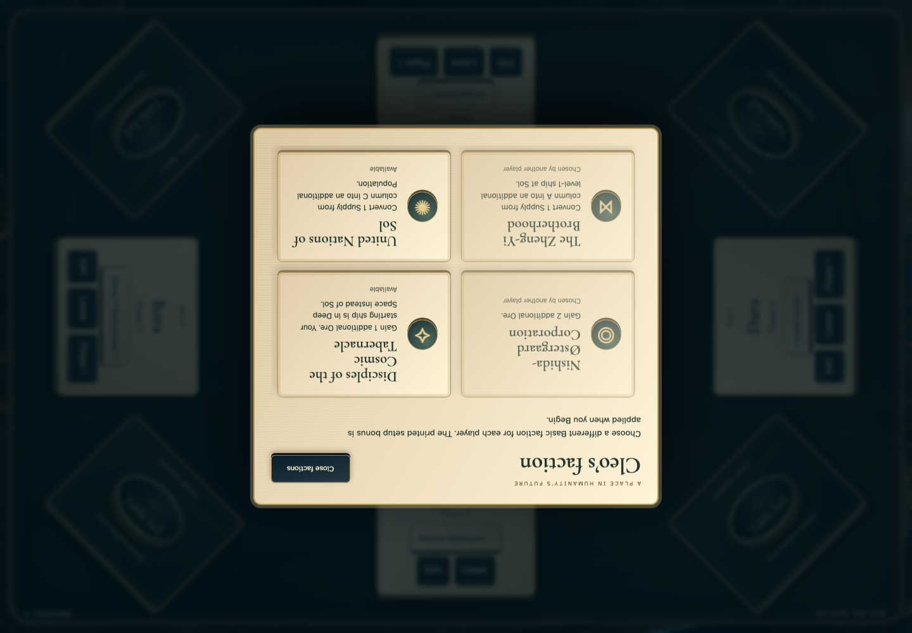](../../screenshots/automate-production-permanently-at-4-shared-cardinal-seats/019-faction-2-editor-desktop-darwin.png) |

tabletop-4k · 3840 × 2160

[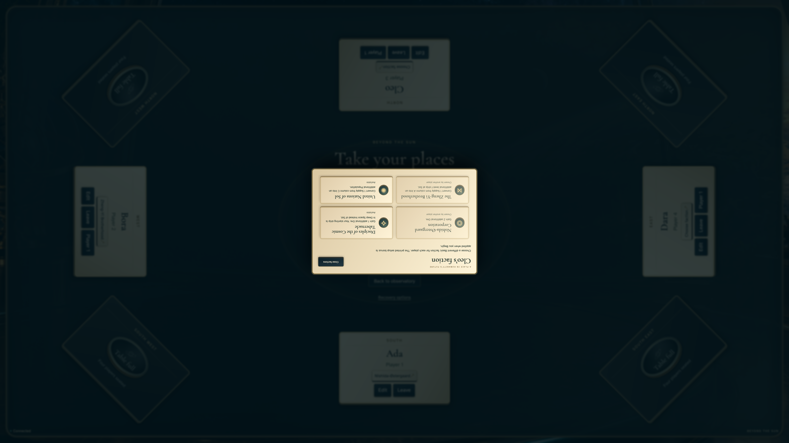](../../screenshots/automate-production-permanently-at-4-shared-cardinal-seats/019-faction-2-editor-tabletop-4k-darwin.png)

- [x] Cleo chooses a legal unique Basic faction
- [x] The canonical effect and backend acknowledgement settle.
- [x] Public technology topology retains physical separation.
- [x] The actual viewport fits without page scrolling.

## 21. Cleo retains Disciples of the Cosmic Tabernacle

Viewpoint: **Cleo · North · one shared controller**.

| desktop · 1440 × 1000 |
| --- |
|  |

tabletop-4k · 3840 × 2160

- [x] Cleo retains Disciples of the Cosmic Tabernacle
- [x] The canonical effect and backend acknowledgement settle.
- [x] Public technology topology retains physical separation.
- [x] The actual viewport fits without page scrolling.

## 22. Dara chooses a legal unique Basic faction

Viewpoint: **Dara · East · one shared controller**.

| desktop · 1440 × 1000 |
| --- |
|  |

tabletop-4k · 3840 × 2160

[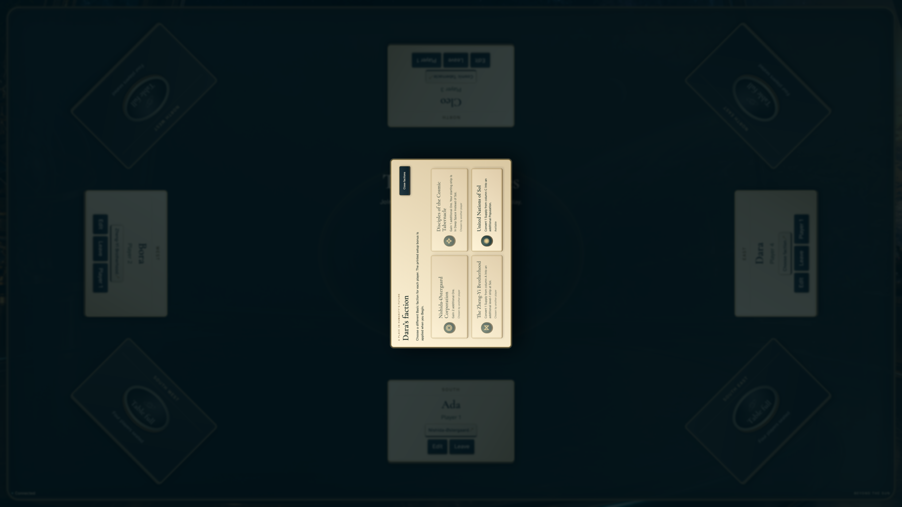](../../screenshots/automate-production-permanently-at-4-shared-cardinal-seats/021-faction-3-editor-tabletop-4k-darwin.png)

- [x] Dara chooses a legal unique Basic faction
- [x] The canonical effect and backend acknowledgement settle.
- [x] Public technology topology retains physical separation.
- [x] The actual viewport fits without page scrolling.

## 23. Dara retains United Nations of Sol

Viewpoint: **Dara · East · one shared controller**.

| desktop · 1440 × 1000 |
| --- |
|  |

tabletop-4k · 3840 × 2160

[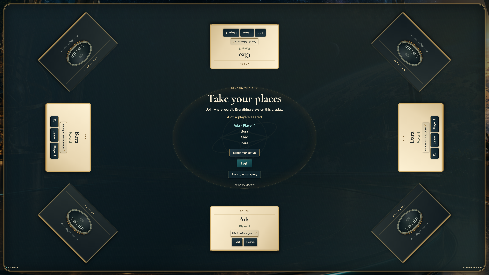](../../screenshots/automate-production-permanently-at-4-shared-cardinal-seats/022-faction-3-chosen-tabletop-4k-darwin.png)

- [x] Dara retains United Nations of Sol
- [x] The canonical effect and backend acknowledgement settle.
- [x] Public technology topology retains physical separation.
- [x] The actual viewport fits without page scrolling.

## 24. Begin the immutable source-reviewed Basic setup through the ordinary UI

Viewpoint: **Ada · South · one shared controller**.

| desktop · 1440 × 1000 |
| --- |
|  |

tabletop-4k · 3840 × 2160

[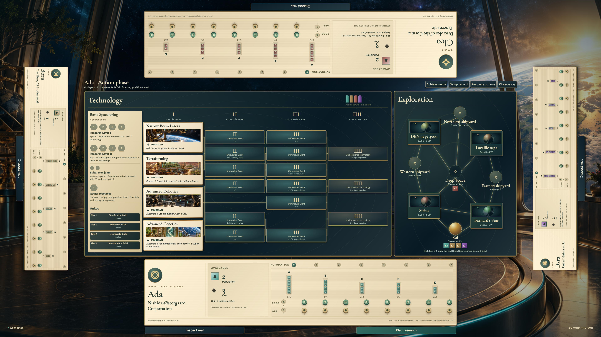](../../screenshots/automate-production-permanently-at-4-shared-cardinal-seats/023-begun-tabletop-4k-darwin.png)

- [x] Begin the immutable source-reviewed Basic setup through the ordinary UI
- [x] The canonical effect and backend acknowledgement settle.
- [x] Public technology topology retains physical separation.
- [x] The actual viewport fits without page scrolling.

## 25. Ada opens the actual research and Action instrument

Viewpoint: **Ada · South · one shared controller**.

| desktop · 1440 × 1000 |
| --- |
| [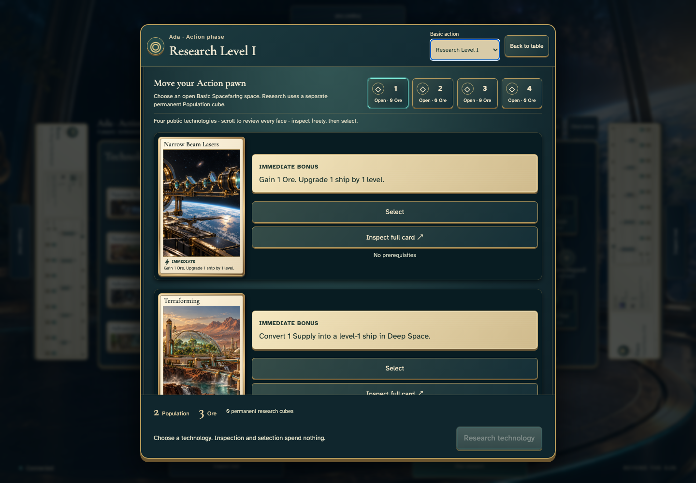](../../screenshots/automate-production-permanently-at-4-shared-cardinal-seats/024-ada-food-plan-desktop-darwin.png) |

tabletop-4k · 3840 × 2160

- [x] Ada opens the actual research and Action instrument
- [x] The canonical effect and backend acknowledgement settle.
- [x] Public technology topology retains physical separation.
- [x] The actual viewport fits without page scrolling.

## 26. Ada selects the legal printed space 1

Viewpoint: **Ada · South · one shared controller**.

| desktop · 1440 × 1000 |
| --- |
|  |

tabletop-4k · 3840 × 2160

- [x] Ada selects the legal printed space 1
- [x] The canonical effect and backend acknowledgement settle.
- [x] Public technology topology retains physical separation.
- [x] The actual viewport fits without page scrolling.

## 27. Select Advanced Genetics with its printed cost and consequence

Viewpoint: **Ada · South · one shared controller**.

| desktop · 1440 × 1000 |
| --- |
| [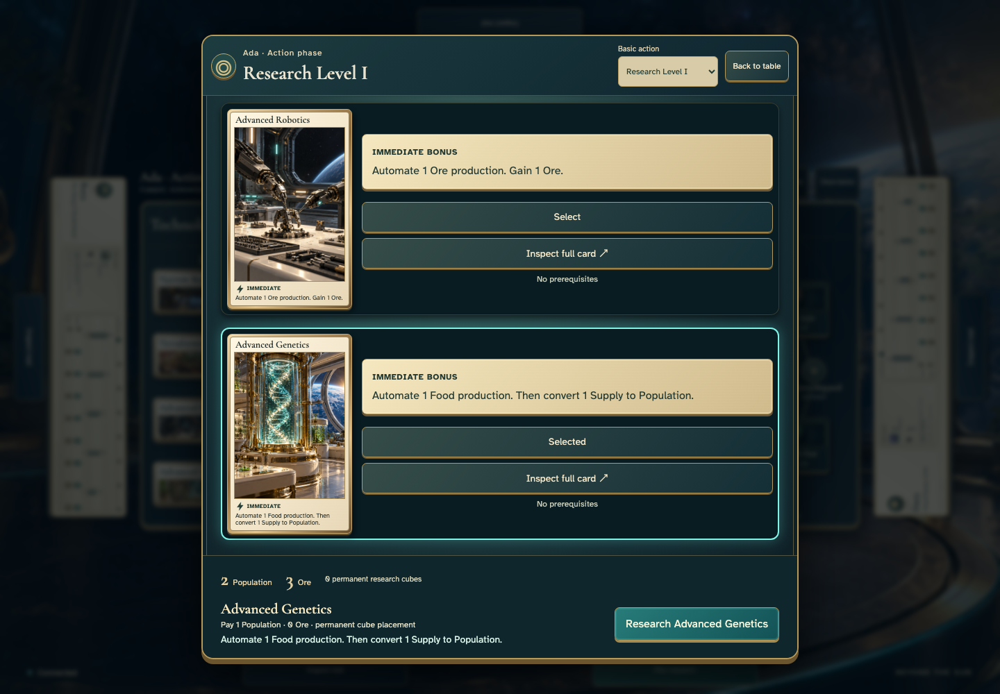](../../screenshots/automate-production-permanently-at-4-shared-cardinal-seats/026-ada-food-card-desktop-darwin.png) |

tabletop-4k · 3840 × 2160

[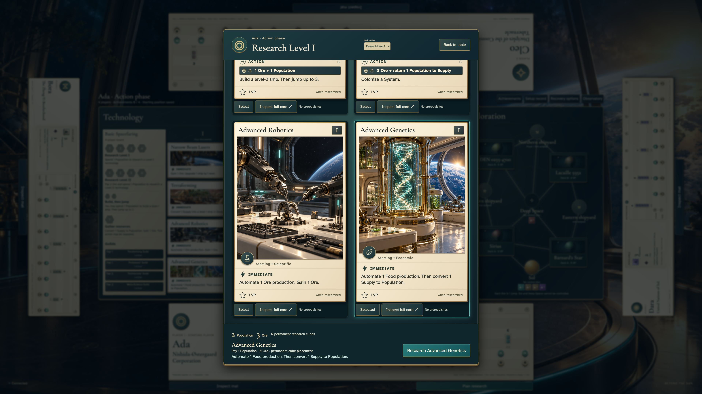](../../screenshots/automate-production-permanently-at-4-shared-cardinal-seats/026-ada-food-card-tabletop-4k-darwin.png)

- [x] Select Advanced Genetics with its printed cost and consequence
- [x] The canonical effect and backend acknowledgement settle.
- [x] Public technology topology retains physical separation.
- [x] The actual viewport fits without page scrolling.

## 28. Pay once and receive Advanced Genetics's immediate bonus

Viewpoint: **Ada · South · one shared controller**.

| desktop · 1440 × 1000 |
| --- |
|  |

tabletop-4k · 3840 × 2160

- [x] Pay once and receive Advanced Genetics's immediate bonus
- [x] The canonical effect and backend acknowledgement settle.
- [x] Public technology topology retains physical separation.
- [x] The actual viewport fits without page scrolling.

## 29. The first Food automation exposes a blank slot, retaining only A growth

Viewpoint: **Ada · South · one shared controller**.

| desktop · 1440 × 1000 |
| --- |
|  |

tabletop-4k · 3840 × 2160

- [x] The first Food automation exposes a blank slot, retaining only A growth
- [x] The canonical effect and backend acknowledgement settle.
- [x] Public technology topology retains physical separation.
- [x] The actual viewport fits without page scrolling.

## 30. Close the decision without paying or collecting any further resource

Viewpoint: **Ada · South · one shared controller**.

| desktop · 1440 × 1000 |
| --- |
| [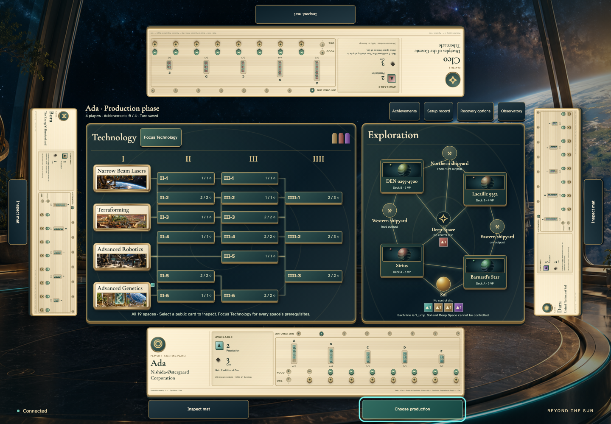](../../screenshots/automate-production-permanently-at-4-shared-cardinal-seats/029-food-permanent-board-desktop-darwin.png) |

tabletop-4k · 3840 × 2160

[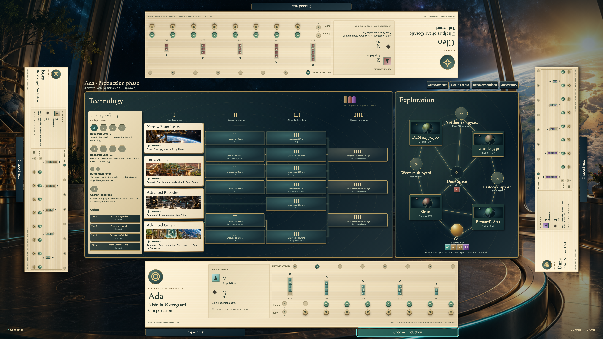](../../screenshots/automate-production-permanently-at-4-shared-cardinal-seats/029-food-permanent-board-tabletop-4k-darwin.png)

- [x] Close the decision without paying or collecting any further resource
- [x] The canonical effect and backend acknowledgement settle.
- [x] Public technology topology retains physical separation.
- [x] The actual viewport fits without page scrolling.

## 31. Ada inspects the actual retained production discs and Supply

Viewpoint: **Ada · South · one shared controller**.

| desktop · 1440 × 1000 |
| --- |
| [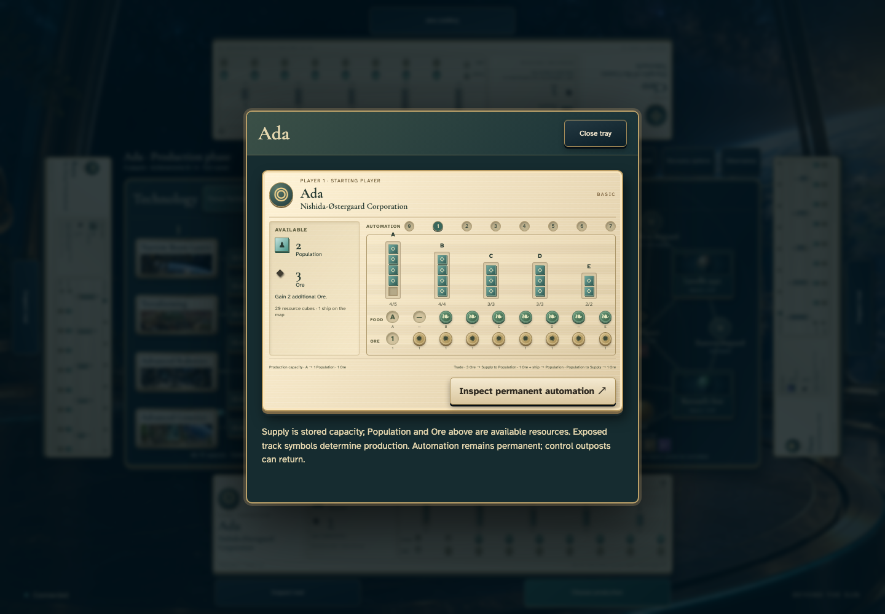](../../screenshots/automate-production-permanently-at-4-shared-cardinal-seats/030-food-permanent-mat-desktop-darwin.png) |

tabletop-4k · 3840 × 2160

[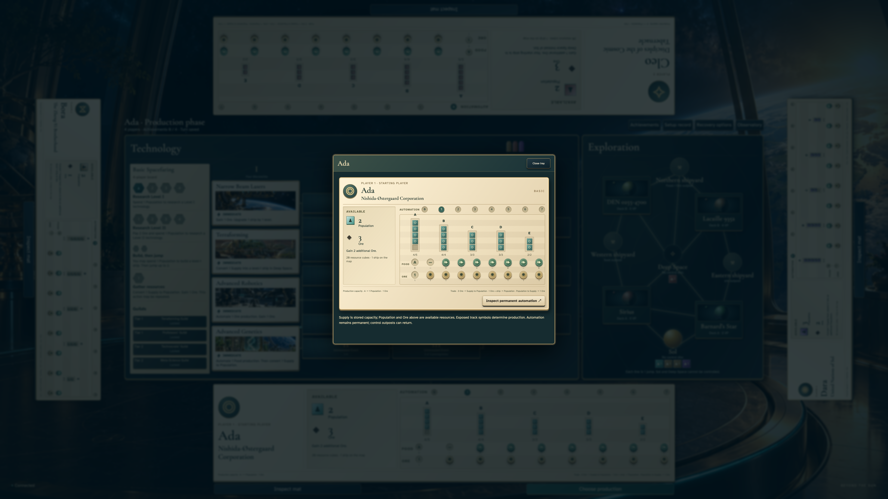](../../screenshots/automate-production-permanently-at-4-shared-cardinal-seats/030-food-permanent-mat-tabletop-4k-darwin.png)

- [x] Ada inspects the actual retained production discs and Supply
- [x] The canonical effect and backend acknowledgement settle.
- [x] Public technology topology retains physical separation.
- [x] The actual viewport fits without page scrolling.

## 32. Permanent level 1 contributes 0 cumulative endgame VP without an immediate payout

Viewpoint: **Ada · South · one shared controller**.

| desktop · 1440 × 1000 |
| --- |
| [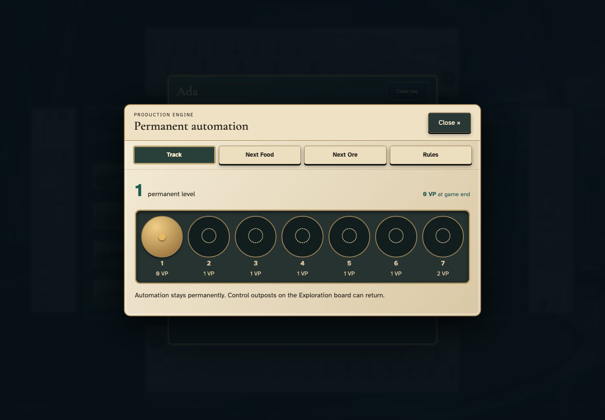](../../screenshots/automate-production-permanently-at-4-shared-cardinal-seats/031-food-permanent-track-desktop-darwin.png) |

tabletop-4k · 3840 × 2160

[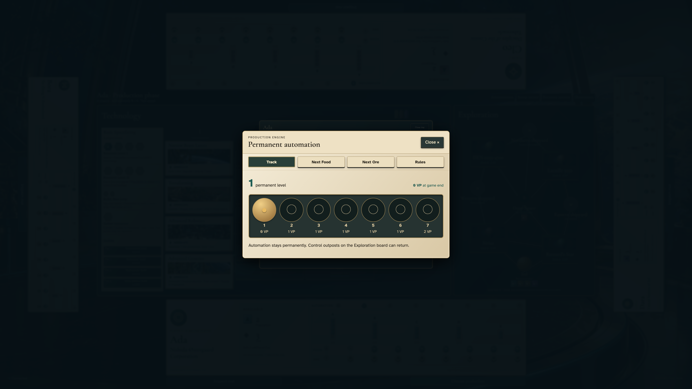](../../screenshots/automate-production-permanently-at-4-shared-cardinal-seats/031-food-permanent-track-tabletop-4k-darwin.png)

- [x] Permanent level 1 contributes 0 cumulative endgame VP without an immediate payout
- [x] The canonical effect and backend acknowledgement settle.
- [x] Public technology topology retains physical separation.
- [x] The actual viewport fits without page scrolling.

## 33. Inspect the next Food disc and exposed yield as a read-only consequence

Viewpoint: **Ada · South · one shared controller**.

| desktop · 1440 × 1000 |
| --- |
| [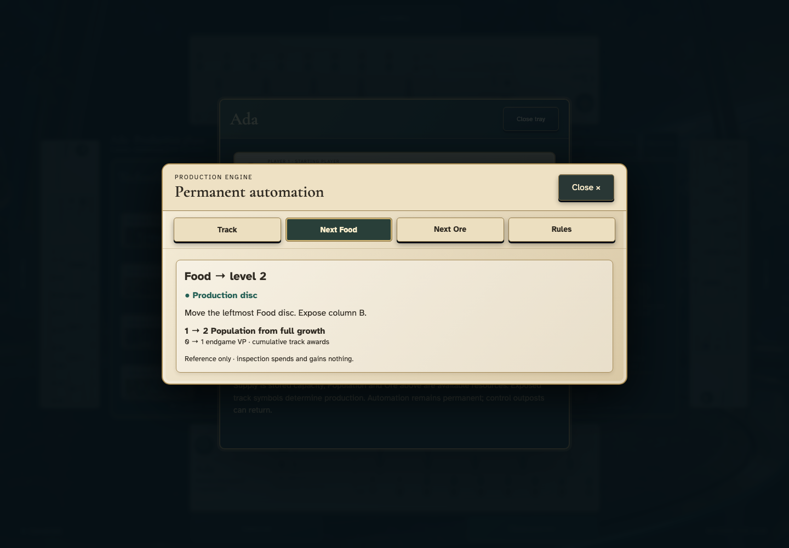](../../screenshots/automate-production-permanently-at-4-shared-cardinal-seats/032-food-permanent-food-desktop-darwin.png) |

tabletop-4k · 3840 × 2160

[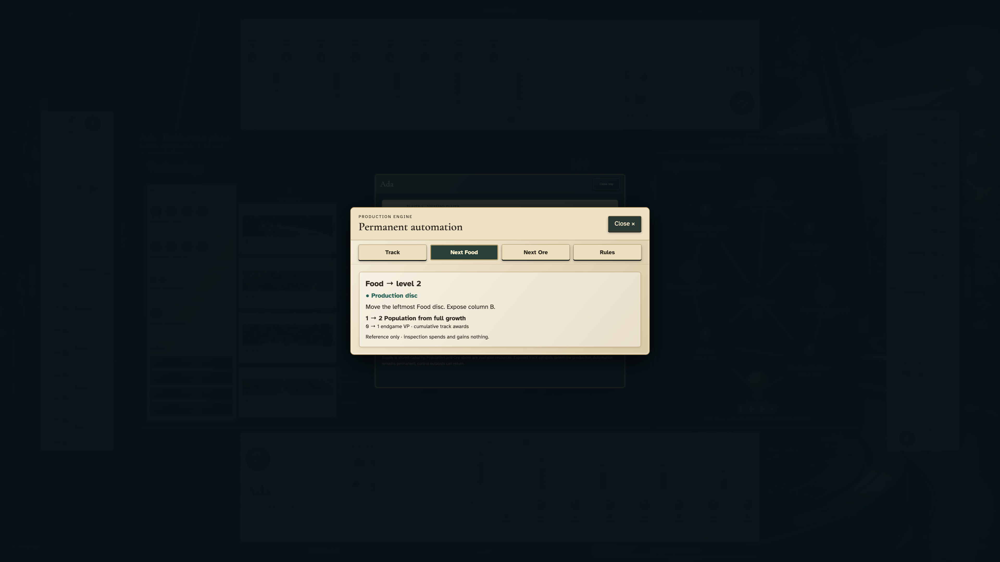](../../screenshots/automate-production-permanently-at-4-shared-cardinal-seats/032-food-permanent-food-tabletop-4k-darwin.png)

- [x] Inspect the next Food disc and exposed yield as a read-only consequence
- [x] The canonical effect and backend acknowledgement settle.
- [x] Public technology topology retains physical separation.
- [x] The actual viewport fits without page scrolling.

## 34. Inspect the next Ore disc and exposed yield as a read-only consequence

Viewpoint: **Ada · South · one shared controller**.

| desktop · 1440 × 1000 |
| --- |
| [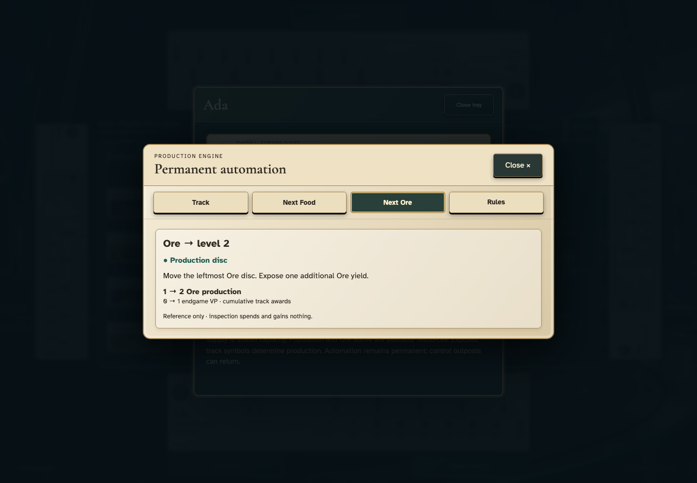](../../screenshots/automate-production-permanently-at-4-shared-cardinal-seats/033-food-permanent-ore-desktop-darwin.png) |

tabletop-4k · 3840 × 2160

[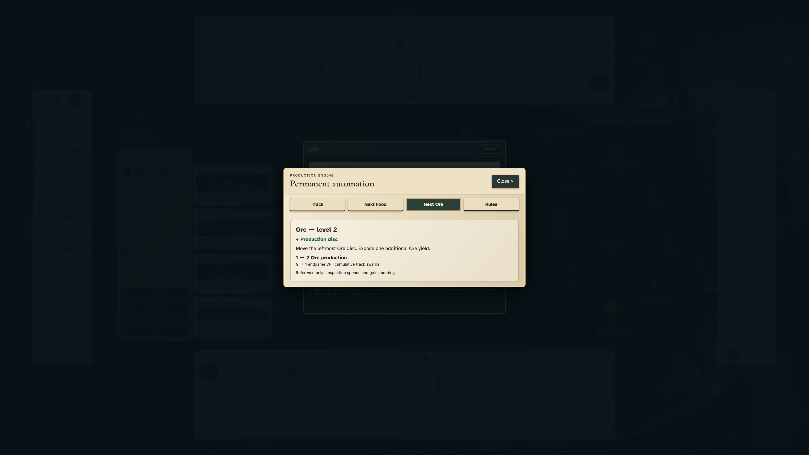](../../screenshots/automate-production-permanently-at-4-shared-cardinal-seats/033-food-permanent-ore-tabletop-4k-darwin.png)

- [x] Inspect the next Ore disc and exposed yield as a read-only consequence
- [x] The canonical effect and backend acknowledgement settle.
- [x] Public technology topology retains physical separation.
- [x] The actual viewport fits without page scrolling.

## 35. Read permanent discs, unlimited placeholders and cumulative awards without changing the game

Viewpoint: **Ada · South · one shared controller**.

| desktop · 1440 × 1000 |
| --- |
| [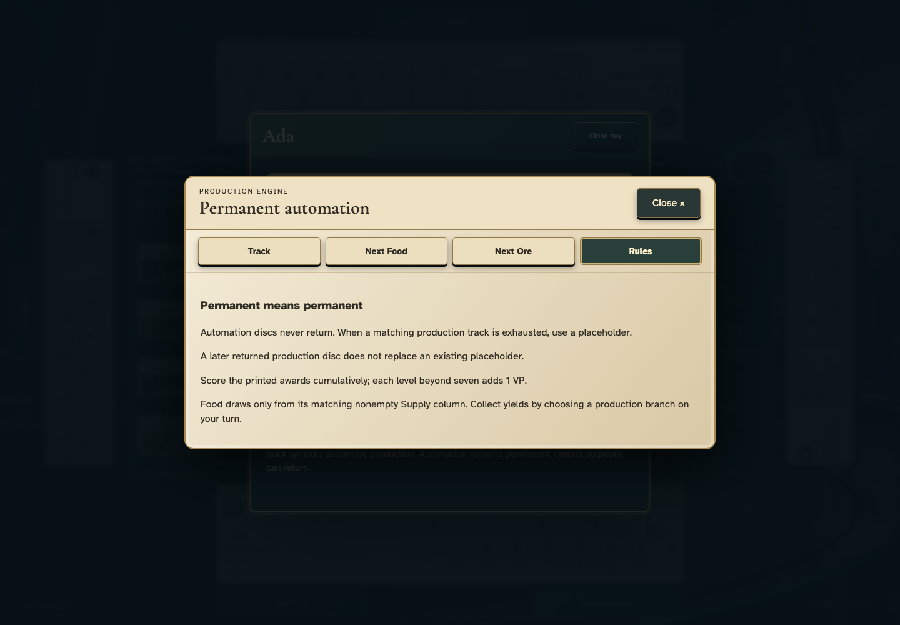](../../screenshots/automate-production-permanently-at-4-shared-cardinal-seats/034-food-permanent-rules-desktop-darwin.png) |

tabletop-4k · 3840 × 2160

- [x] Read permanent discs, unlimited placeholders and cumulative awards without changing the game
- [x] The canonical effect and backend acknowledgement settle.
- [x] Public technology topology retains physical separation.
- [x] The actual viewport fits without page scrolling.

## 36. Tab reaches the named internally scrolling automation details

Viewpoint: **Ada · South · one shared controller**.

| desktop · 1440 × 1000 |
| --- |
| [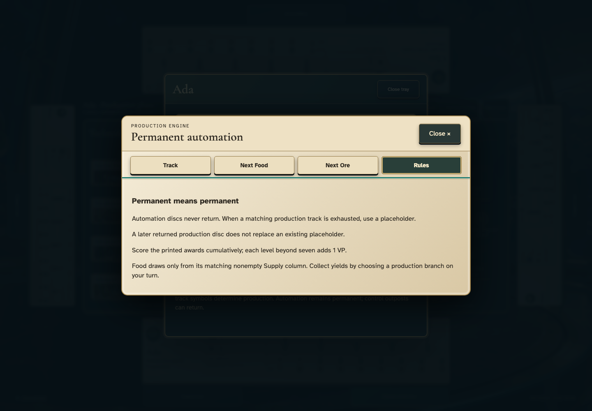](../../screenshots/automate-production-permanently-at-4-shared-cardinal-seats/035-food-permanent-details-focus-desktop-darwin.png) |

tabletop-4k · 3840 × 2160

- [x] Tab reaches the named internally scrolling automation details
- [x] The canonical effect and backend acknowledgement settle.
- [x] Public technology topology retains physical separation.
- [x] The actual viewport fits without page scrolling.

## 37. Forward Tab remains inside the native automation inspector

Viewpoint: **Ada · South · one shared controller**.

| desktop · 1440 × 1000 |
| --- |
| [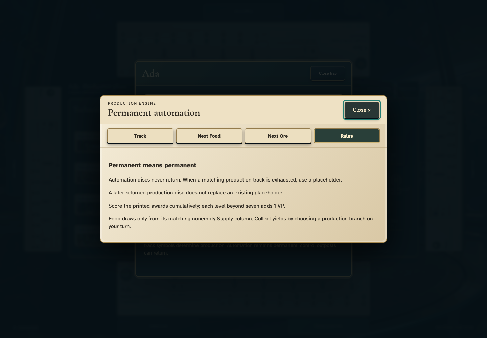](../../screenshots/automate-production-permanently-at-4-shared-cardinal-seats/036-food-permanent-focus-wrap-desktop-darwin.png) |

tabletop-4k · 3840 × 2160

[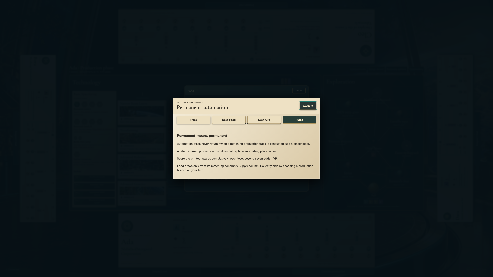](../../screenshots/automate-production-permanently-at-4-shared-cardinal-seats/036-food-permanent-focus-wrap-tabletop-4k-darwin.png)

- [x] Forward Tab remains inside the native automation inspector
- [x] The canonical effect and backend acknowledgement settle.
- [x] Public technology topology retains physical separation.
- [x] The actual viewport fits without page scrolling.

## 38. Reverse Tab also remains inside the inspector

Viewpoint: **Ada · South · one shared controller**.

| desktop · 1440 × 1000 |
| --- |
|  |

tabletop-4k · 3840 × 2160

[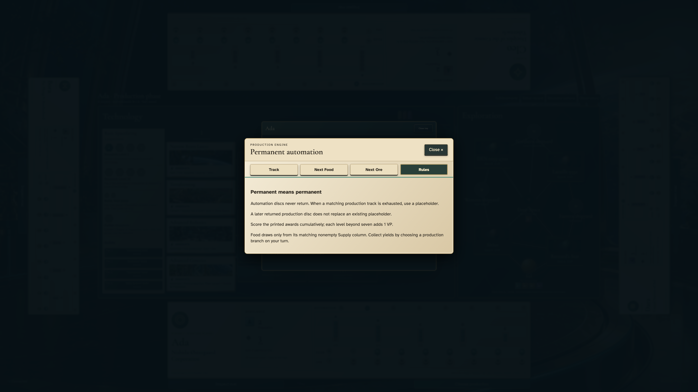](../../screenshots/automate-production-permanently-at-4-shared-cardinal-seats/037-food-permanent-focus-reverse-tabletop-4k-darwin.png)

- [x] Reverse Tab also remains inside the inspector
- [x] The canonical effect and backend acknowledgement settle.
- [x] Public technology topology retains physical separation.
- [x] The actual viewport fits without page scrolling.

## 39. Escape returns to the exact mat opener; inspection never spends or collects

Viewpoint: **Ada · South · one shared controller**.

| desktop · 1440 × 1000 |
| --- |
| [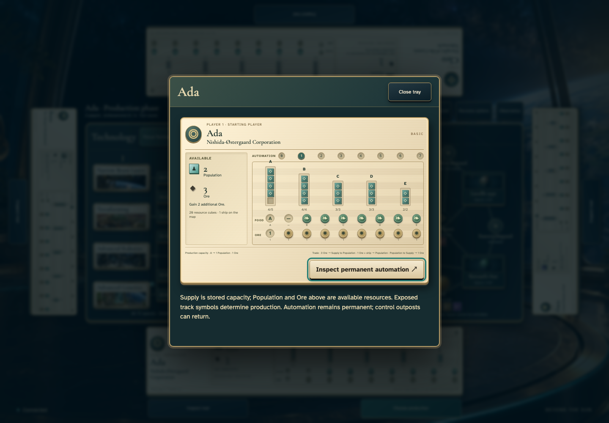](../../screenshots/automate-production-permanently-at-4-shared-cardinal-seats/038-food-permanent-return-desktop-darwin.png) |

tabletop-4k · 3840 × 2160

[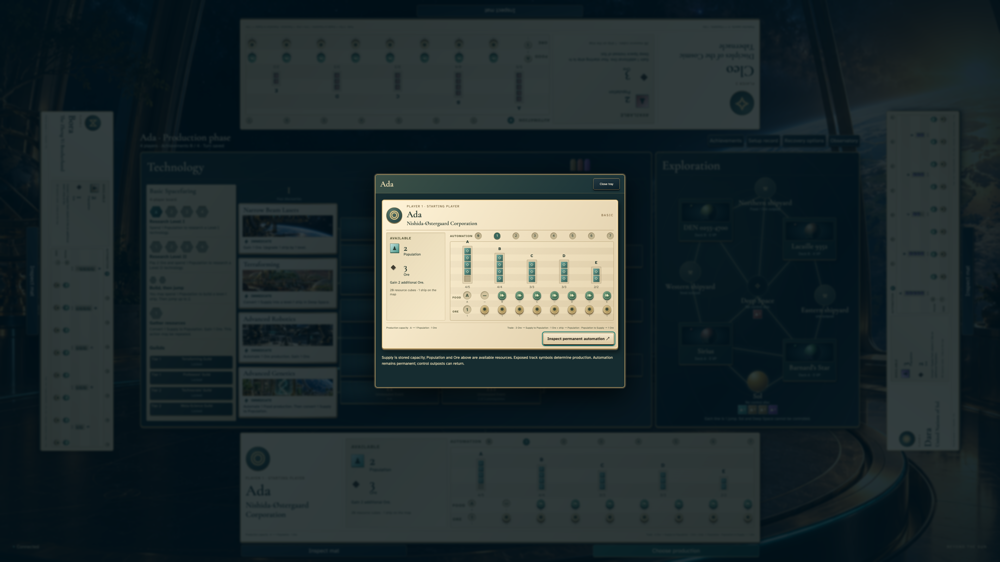](../../screenshots/automate-production-permanently-at-4-shared-cardinal-seats/038-food-permanent-return-tabletop-4k-darwin.png)

- [x] Escape returns to the exact mat opener; inspection never spends or collects
- [x] The canonical effect and backend acknowledgement settle.
- [x] Public technology topology retains physical separation.
- [x] The actual viewport fits without page scrolling.

## 40. Return to the real turn with all production choices still pending

Viewpoint: **Ada · South · one shared controller**.

| desktop · 1440 × 1000 |
| --- |
|  |

tabletop-4k · 3840 × 2160

[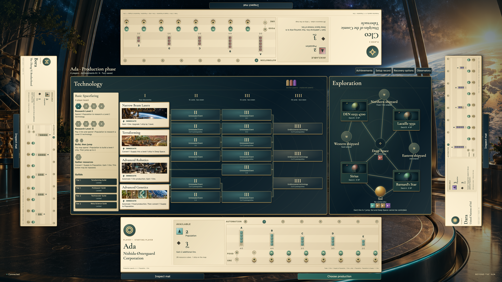](../../screenshots/automate-production-permanently-at-4-shared-cardinal-seats/039-food-permanent-closed-tabletop-4k-darwin.png)

- [x] Return to the real turn with all production choices still pending
- [x] The canonical effect and backend acknowledgement settle.
- [x] Public technology topology retains physical separation.
- [x] The actual viewport fits without page scrolling.

## 41. Reload retains the same controller and the paid pending production

Viewpoint: **Ada · South · one shared controller**.

| desktop · 1440 × 1000 |
| --- |
| [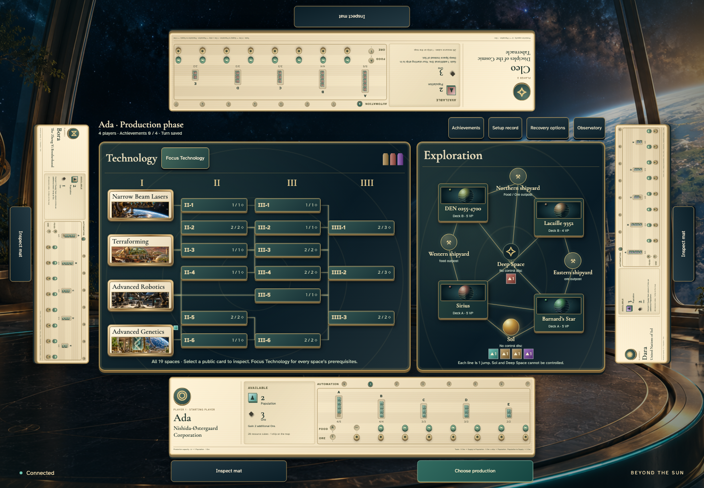](../../screenshots/automate-production-permanently-at-4-shared-cardinal-seats/040-food-retained-reload-desktop-darwin.png) |

tabletop-4k · 3840 × 2160

- [x] Reload retains the same controller and the paid pending production
- [x] The canonical effect and backend acknowledgement settle.
- [x] Public technology topology retains physical separation.
- [x] The actual viewport fits without page scrolling.

## 42. Reopening production never repeats the permanent automation bonus

Viewpoint: **Ada · South · one shared controller**.

| desktop · 1440 × 1000 |
| --- |
| [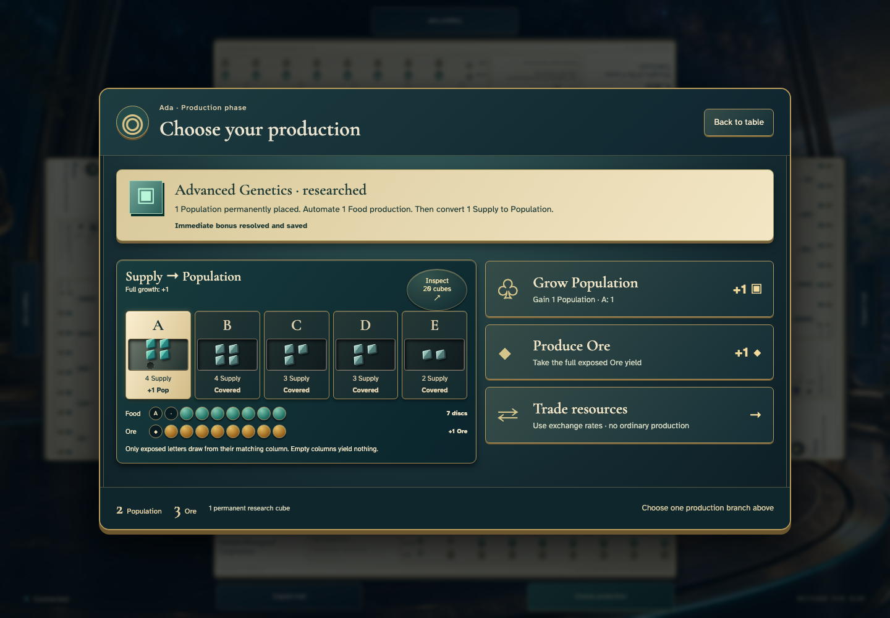](../../screenshots/automate-production-permanently-at-4-shared-cardinal-seats/041-food-retained-reopen-desktop-darwin.png) |

tabletop-4k · 3840 × 2160

[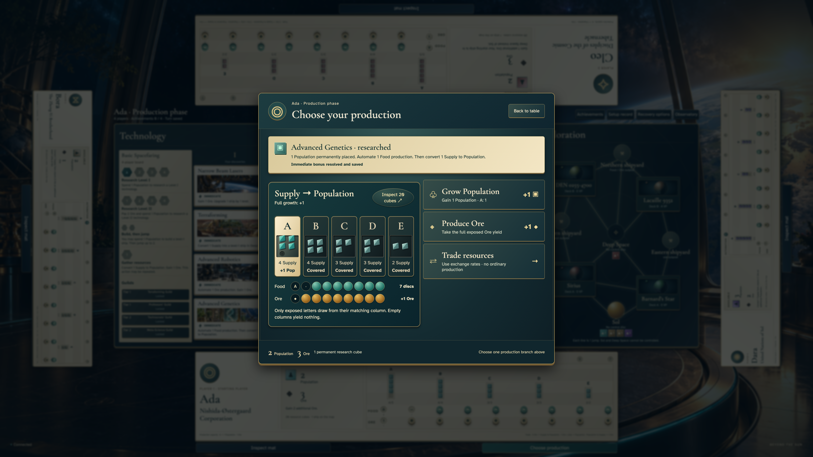](../../screenshots/automate-production-permanently-at-4-shared-cardinal-seats/041-food-retained-reopen-tabletop-4k-darwin.png)

- [x] Reopening production never repeats the permanent automation bonus
- [x] The canonical effect and backend acknowledgement settle.
- [x] Public technology topology retains physical separation.
- [x] The actual viewport fits without page scrolling.

## 43. Ada completes production and hands off to Bora

Viewpoint: **Ada · South · one shared controller**.

| desktop · 1440 × 1000 |
| --- |
|  |

tabletop-4k · 3840 × 2160

[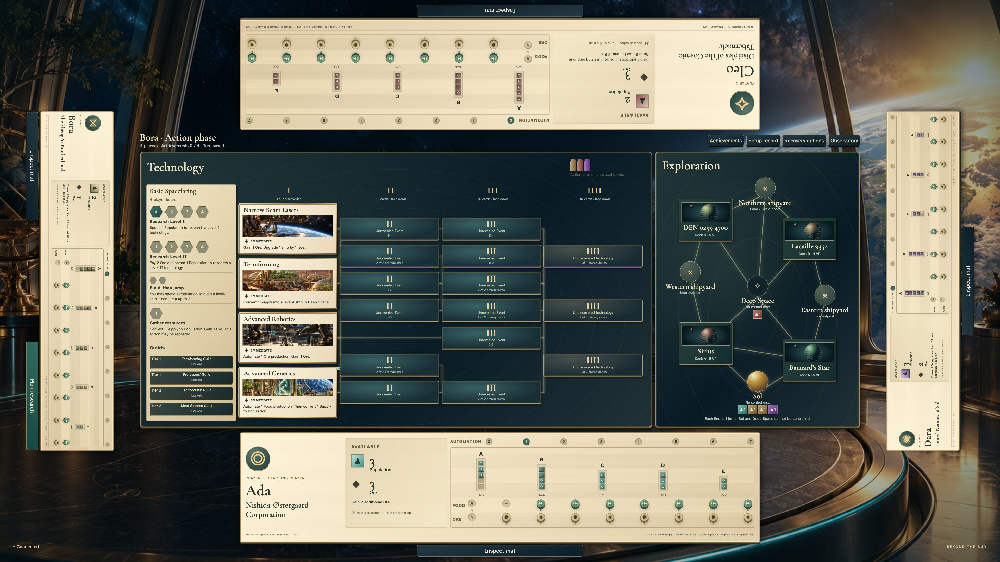](../../screenshots/automate-production-permanently-at-4-shared-cardinal-seats/042-food-produced-handoff-tabletop-4k-darwin.png)

- [x] Ada completes production and hands off to Bora
- [x] The canonical effect and backend acknowledgement settle.
- [x] Public technology topology retains physical separation.
- [x] The actual viewport fits without page scrolling.

## 44. Collect exactly 1 Population; automation is permanent and not a second payout

Viewpoint: **Ada · South · one shared controller**.

| desktop · 1440 × 1000 |
| --- |
| [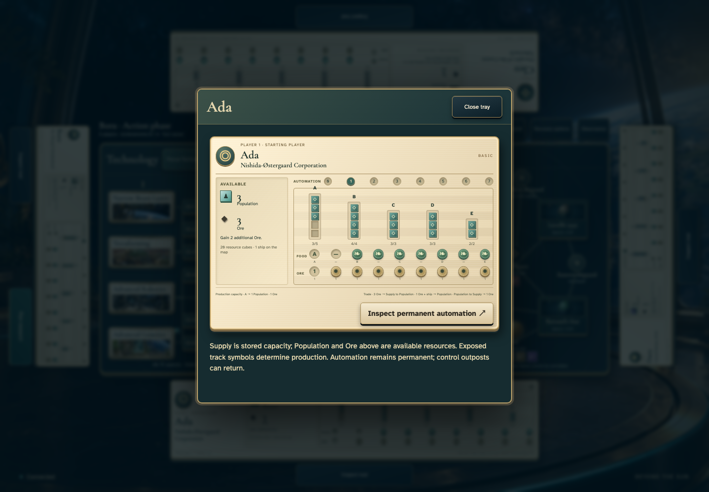](../../screenshots/automate-production-permanently-at-4-shared-cardinal-seats/043-food-produced-paid-desktop-darwin.png) |

tabletop-4k · 3840 × 2160

- [x] Collect exactly 1 Population; automation is permanent and not a second payout
- [x] The canonical effect and backend acknowledgement settle.
- [x] Public technology topology retains physical separation.
- [x] The actual viewport fits without page scrolling.

## 45. Close the proof and leave the next actual controller active

Viewpoint: **Ada · South · one shared controller**.

| desktop · 1440 × 1000 |
| --- |
|  |

tabletop-4k · 3840 × 2160

- [x] Close the proof and leave the next actual controller active
- [x] The canonical effect and backend acknowledgement settle.
- [x] Public technology topology retains physical separation.
- [x] The actual viewport fits without page scrolling.

## 46. Bora opens the actual research and Action instrument

Viewpoint: **Bora · West · one shared controller**.

| desktop · 1440 × 1000 |
| --- |
|  |

tabletop-4k · 3840 × 2160

- [x] Bora opens the actual research and Action instrument
- [x] The canonical effect and backend acknowledgement settle.
- [x] Public technology topology retains physical separation.
- [x] The actual viewport fits without page scrolling.

## 47. Bora selects the legal printed space 2

Viewpoint: **Bora · West · one shared controller**.

| desktop · 1440 × 1000 |
| --- |
| [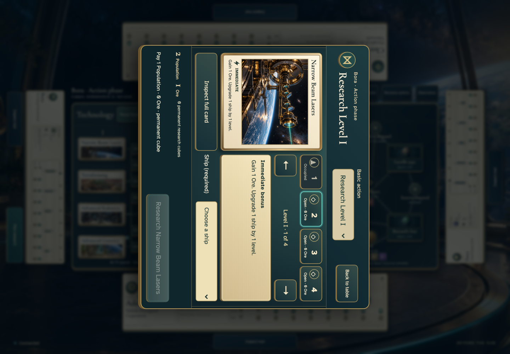](../../screenshots/automate-production-permanently-at-4-shared-cardinal-seats/046-bora-ore-space-desktop-darwin.png) |

tabletop-4k · 3840 × 2160

[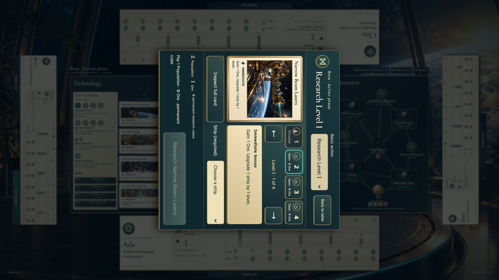](../../screenshots/automate-production-permanently-at-4-shared-cardinal-seats/046-bora-ore-space-tabletop-4k-darwin.png)

- [x] Bora selects the legal printed space 2
- [x] The canonical effect and backend acknowledgement settle.
- [x] Public technology topology retains physical separation.
- [x] The actual viewport fits without page scrolling.

## 48. Browse the next public Level I face

Viewpoint: **Bora · West · one shared controller**.

| desktop · 1440 × 1000 |
| --- |
| [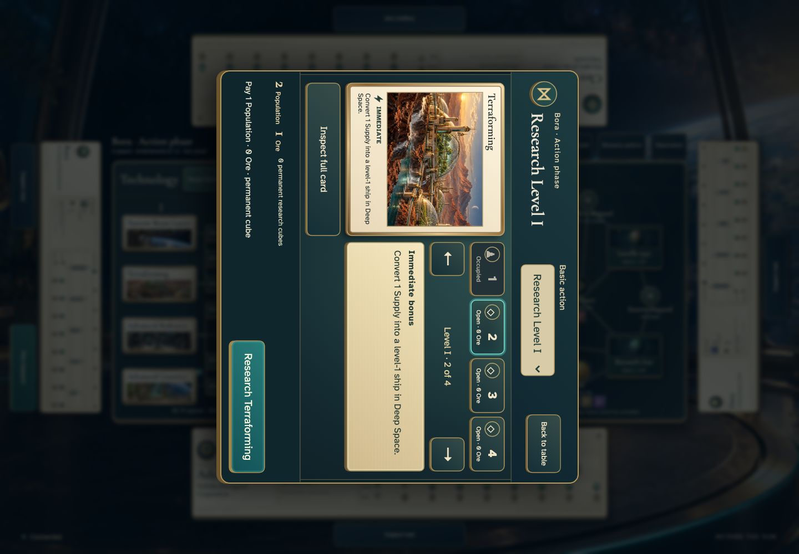](../../screenshots/automate-production-permanently-at-4-shared-cardinal-seats/047-bora-ore-browse-0-desktop-darwin.png) |

tabletop-4k · 3840 × 2160

[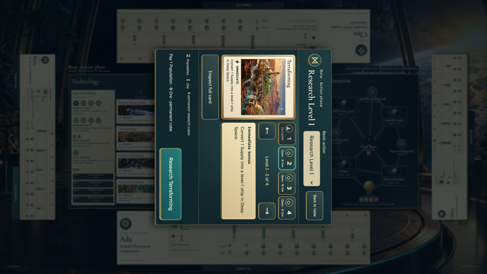](../../screenshots/automate-production-permanently-at-4-shared-cardinal-seats/047-bora-ore-browse-0-tabletop-4k-darwin.png)

- [x] Browse the next public Level I face
- [x] The canonical effect and backend acknowledgement settle.
- [x] Public technology topology retains physical separation.
- [x] The actual viewport fits without page scrolling.

## 49. Browse the next public Level I face

Viewpoint: **Bora · West · one shared controller**.

| desktop · 1440 × 1000 |
| --- |
| [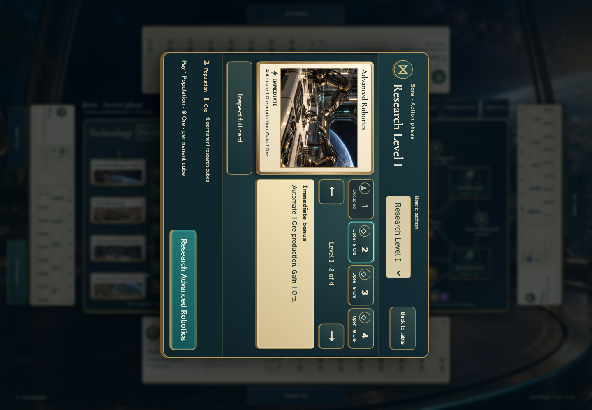](../../screenshots/automate-production-permanently-at-4-shared-cardinal-seats/048-bora-ore-browse-1-desktop-darwin.png) |

tabletop-4k · 3840 × 2160

[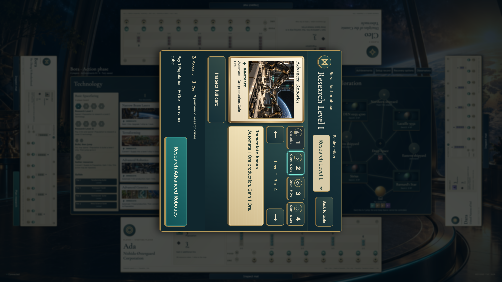](../../screenshots/automate-production-permanently-at-4-shared-cardinal-seats/048-bora-ore-browse-1-tabletop-4k-darwin.png)

- [x] Browse the next public Level I face
- [x] The canonical effect and backend acknowledgement settle.
- [x] Public technology topology retains physical separation.
- [x] The actual viewport fits without page scrolling.

## 50. Pay once and receive Advanced Robotics's immediate bonus

Viewpoint: **Bora · West · one shared controller**.

| desktop · 1440 × 1000 |
| --- |
|  |

tabletop-4k · 3840 × 2160

- [x] Pay once and receive Advanced Robotics's immediate bonus
- [x] The canonical effect and backend acknowledgement settle.
- [x] Public technology topology retains physical separation.
- [x] The actual viewport fits without page scrolling.

## 51. The first Ore automation exposes a second complete Ore yield

Viewpoint: **Bora · West · one shared controller**.

| desktop · 1440 × 1000 |
| --- |
|  |

tabletop-4k · 3840 × 2160

- [x] The first Ore automation exposes a second complete Ore yield
- [x] The canonical effect and backend acknowledgement settle.
- [x] Public technology topology retains physical separation.
- [x] The actual viewport fits without page scrolling.

## 52. Close the decision without paying or collecting any further resource

Viewpoint: **Bora · West · one shared controller**.

| desktop · 1440 × 1000 |
| --- |
| [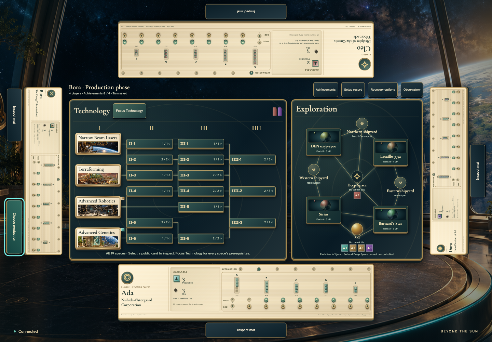](../../screenshots/automate-production-permanently-at-4-shared-cardinal-seats/051-ore-permanent-board-desktop-darwin.png) |

tabletop-4k · 3840 × 2160

[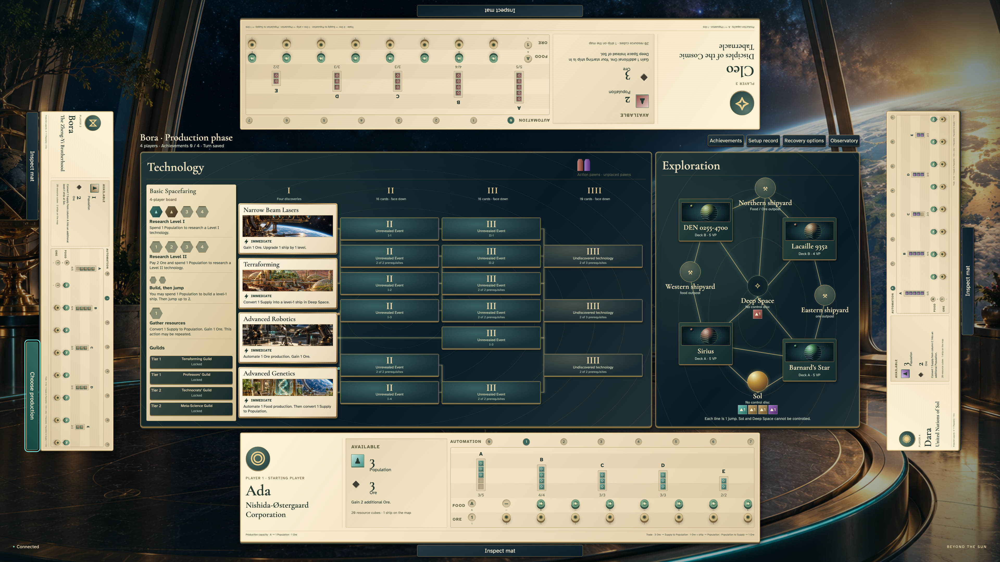](../../screenshots/automate-production-permanently-at-4-shared-cardinal-seats/051-ore-permanent-board-tabletop-4k-darwin.png)

- [x] Close the decision without paying or collecting any further resource
- [x] The canonical effect and backend acknowledgement settle.
- [x] Public technology topology retains physical separation.
- [x] The actual viewport fits without page scrolling.

## 53. Bora inspects the actual retained production discs and Supply

Viewpoint: **Bora · West · one shared controller**.

| desktop · 1440 × 1000 |
| --- |
| [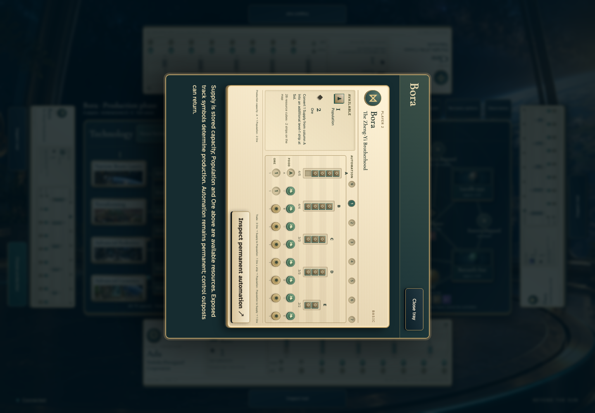](../../screenshots/automate-production-permanently-at-4-shared-cardinal-seats/052-ore-permanent-mat-desktop-darwin.png) |

tabletop-4k · 3840 × 2160

[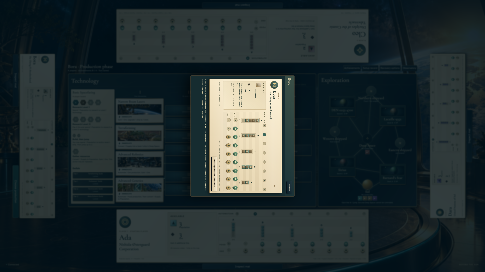](../../screenshots/automate-production-permanently-at-4-shared-cardinal-seats/052-ore-permanent-mat-tabletop-4k-darwin.png)

- [x] Bora inspects the actual retained production discs and Supply
- [x] The canonical effect and backend acknowledgement settle.
- [x] Public technology topology retains physical separation.
- [x] The actual viewport fits without page scrolling.

## 54. Permanent level 1 contributes 0 cumulative endgame VP without an immediate payout

Viewpoint: **Bora · West · one shared controller**.

| desktop · 1440 × 1000 |
| --- |
| [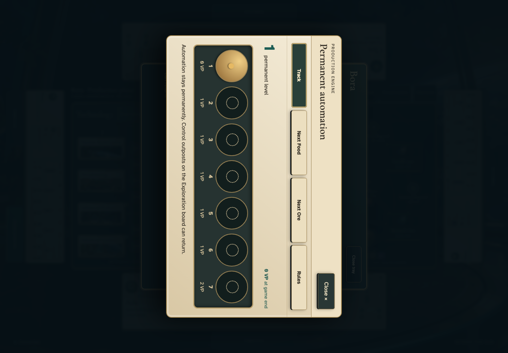](../../screenshots/automate-production-permanently-at-4-shared-cardinal-seats/053-ore-permanent-track-desktop-darwin.png) |

tabletop-4k · 3840 × 2160

[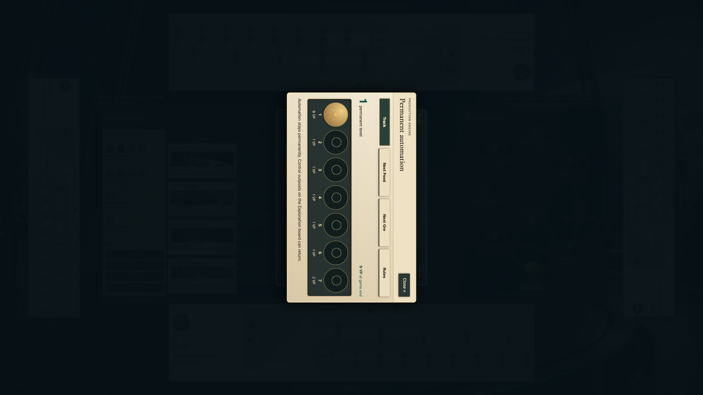](../../screenshots/automate-production-permanently-at-4-shared-cardinal-seats/053-ore-permanent-track-tabletop-4k-darwin.png)

- [x] Permanent level 1 contributes 0 cumulative endgame VP without an immediate payout
- [x] The canonical effect and backend acknowledgement settle.
- [x] Public technology topology retains physical separation.
- [x] The actual viewport fits without page scrolling.

## 55. Inspect the next Ore disc and exposed yield as a read-only consequence

Viewpoint: **Bora · West · one shared controller**.

| desktop · 1440 × 1000 |
| --- |
| [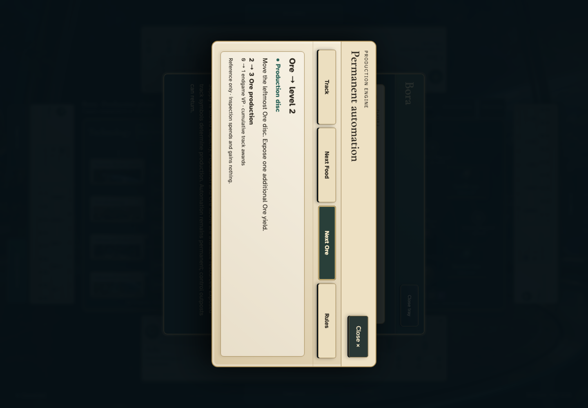](../../screenshots/automate-production-permanently-at-4-shared-cardinal-seats/054-ore-permanent-ore-desktop-darwin.png) |

tabletop-4k · 3840 × 2160

- [x] Inspect the next Ore disc and exposed yield as a read-only consequence
- [x] The canonical effect and backend acknowledgement settle.
- [x] Public technology topology retains physical separation.
- [x] The actual viewport fits without page scrolling.

## 56. Escape returns to the exact mat opener; inspection never spends or collects

Viewpoint: **Bora · West · one shared controller**.

| desktop · 1440 × 1000 |
| --- |
|  |

tabletop-4k · 3840 × 2160

- [x] Escape returns to the exact mat opener; inspection never spends or collects
- [x] The canonical effect and backend acknowledgement settle.
- [x] Public technology topology retains physical separation.
- [x] The actual viewport fits without page scrolling.

## 57. Return to the real turn with all production choices still pending

Viewpoint: **Bora · West · one shared controller**.

| desktop · 1440 × 1000 |
| --- |
|  |

tabletop-4k · 3840 × 2160

- [x] Return to the real turn with all production choices still pending
- [x] The canonical effect and backend acknowledgement settle.
- [x] Public technology topology retains physical separation.
- [x] The actual viewport fits without page scrolling.

## 58. Reload retains the same controller and the paid pending production

Viewpoint: **Bora · West · one shared controller**.

| desktop · 1440 × 1000 |
| --- |
|  |

tabletop-4k · 3840 × 2160

- [x] Reload retains the same controller and the paid pending production
- [x] The canonical effect and backend acknowledgement settle.
- [x] Public technology topology retains physical separation.
- [x] The actual viewport fits without page scrolling.

## 59. Reopening production never repeats the permanent automation bonus

Viewpoint: **Bora · West · one shared controller**.

| desktop · 1440 × 1000 |
| --- |
|  |

tabletop-4k · 3840 × 2160

- [x] Reopening production never repeats the permanent automation bonus
- [x] The canonical effect and backend acknowledgement settle.
- [x] Public technology topology retains physical separation.
- [x] The actual viewport fits without page scrolling.

## 60. Bora completes production and hands off to Cleo

Viewpoint: **Bora · West · one shared controller**.

| desktop · 1440 × 1000 |
| --- |
|  |

tabletop-4k · 3840 × 2160

- [x] Bora completes production and hands off to Cleo
- [x] The canonical effect and backend acknowledgement settle.
- [x] Public technology topology retains physical separation.
- [x] The actual viewport fits without page scrolling.

## 61. Collect exactly 2 Ore; automation is permanent and not a second payout

Viewpoint: **Bora · West · one shared controller**.

| desktop · 1440 × 1000 |
| --- |
|  |

tabletop-4k · 3840 × 2160

- [x] Collect exactly 2 Ore; automation is permanent and not a second payout
- [x] The canonical effect and backend acknowledgement settle.
- [x] Public technology topology retains physical separation.
- [x] The actual viewport fits without page scrolling.

## 62. Close the proof and leave the next actual controller active

Viewpoint: **Bora · West · one shared controller**.

| desktop · 1440 × 1000 |
| --- |
|  |

tabletop-4k · 3840 × 2160

- [x] Close the proof and leave the next actual controller active
- [x] The canonical effect and backend acknowledgement settle.
- [x] Public technology topology retains physical separation.
- [x] The actual viewport fits without page scrolling.

## 63. Cleo opens the actual research and Action instrument

Viewpoint: **Cleo · North · one shared controller**.

| desktop · 1440 × 1000 |
| --- |
|  |

tabletop-4k · 3840 × 2160

- [x] Cleo opens the actual research and Action instrument
- [x] The canonical effect and backend acknowledgement settle.
- [x] Public technology topology retains physical separation.
- [x] The actual viewport fits without page scrolling.

## 64. Cleo selects the legal printed space 3

Viewpoint: **Cleo · North · one shared controller**.

| desktop · 1440 × 1000 |
| --- |
|  |

tabletop-4k · 3840 × 2160

- [x] Cleo selects the legal printed space 3
- [x] The canonical effect and backend acknowledgement settle.
- [x] Public technology topology retains physical separation.
- [x] The actual viewport fits without page scrolling.

## 65. Select Advanced Genetics with its printed cost and consequence

Viewpoint: **Cleo · North · one shared controller**.

| desktop · 1440 × 1000 |
| --- |
|  |

tabletop-4k · 3840 × 2160

- [x] Select Advanced Genetics with its printed cost and consequence
- [x] The canonical effect and backend acknowledgement settle.
- [x] Public technology topology retains physical separation.
- [x] The actual viewport fits without page scrolling.

## 66. Pay once and receive Advanced Genetics's immediate bonus

Viewpoint: **Cleo · North · one shared controller**.

| desktop · 1440 × 1000 |
| --- |
|  |

tabletop-4k · 3840 × 2160

- [x] Pay once and receive Advanced Genetics's immediate bonus
- [x] The canonical effect and backend acknowledgement settle.
- [x] Public technology topology retains physical separation.
- [x] The actual viewport fits without page scrolling.

## 67. Close the decision without paying or collecting any further resource

Viewpoint: **Cleo · North · one shared controller**.

| desktop · 1440 × 1000 |
| --- |
|  |

tabletop-4k · 3840 × 2160

- [x] Close the decision without paying or collecting any further resource
- [x] The canonical effect and backend acknowledgement settle.
- [x] Public technology topology retains physical separation.
- [x] The actual viewport fits without page scrolling.

## 68. Cleo inspects the actual retained production discs and Supply

Viewpoint: **Cleo · North · one shared controller**.

| desktop · 1440 × 1000 |
| --- |
|  |

tabletop-4k · 3840 × 2160

- [x] Cleo inspects the actual retained production discs and Supply
- [x] The canonical effect and backend acknowledgement settle.
- [x] Public technology topology retains physical separation.
- [x] The actual viewport fits without page scrolling.

## 69. Permanent level 1 contributes 0 cumulative endgame VP without an immediate payout

Viewpoint: **Cleo · North · one shared controller**.

| desktop · 1440 × 1000 |
| --- |
|  |

tabletop-4k · 3840 × 2160

- [x] Permanent level 1 contributes 0 cumulative endgame VP without an immediate payout
- [x] The canonical effect and backend acknowledgement settle.
- [x] Public technology topology retains physical separation.
- [x] The actual viewport fits without page scrolling.

## 70. Inspect the next Food disc and exposed yield as a read-only consequence

Viewpoint: **Cleo · North · one shared controller**.

| desktop · 1440 × 1000 |
| --- |
|  |

tabletop-4k · 3840 × 2160

- [x] Inspect the next Food disc and exposed yield as a read-only consequence
- [x] The canonical effect and backend acknowledgement settle.
- [x] Public technology topology retains physical separation.
- [x] The actual viewport fits without page scrolling.

## 71. Escape returns to the exact mat opener; inspection never spends or collects

Viewpoint: **Cleo · North · one shared controller**.

| desktop · 1440 × 1000 |
| --- |
|  |

tabletop-4k · 3840 × 2160

- [x] Escape returns to the exact mat opener; inspection never spends or collects
- [x] The canonical effect and backend acknowledgement settle.
- [x] Public technology topology retains physical separation.
- [x] The actual viewport fits without page scrolling.

## 72. Return to the real turn with all production choices still pending

Viewpoint: **Cleo · North · one shared controller**.

| desktop · 1440 × 1000 |
| --- |
|  |

tabletop-4k · 3840 × 2160

- [x] Return to the real turn with all production choices still pending
- [x] The canonical effect and backend acknowledgement settle.
- [x] Public technology topology retains physical separation.
- [x] The actual viewport fits without page scrolling.

## 73. Reopen the same pending production after read-only inspection

Viewpoint: **Cleo · North · one shared controller**.

| desktop · 1440 × 1000 |
| --- |
|  |

tabletop-4k · 3840 × 2160

- [x] Reopen the same pending production after read-only inspection
- [x] The canonical effect and backend acknowledgement settle.
- [x] Public technology topology retains physical separation.
- [x] The actual viewport fits without page scrolling.

## 74. Cleo completes production and hands off to Dara

Viewpoint: **Cleo · North · one shared controller**.

| desktop · 1440 × 1000 |
| --- |
|  |

tabletop-4k · 3840 × 2160

- [x] Cleo completes production and hands off to Dara
- [x] The canonical effect and backend acknowledgement settle.
- [x] Public technology topology retains physical separation.
- [x] The actual viewport fits without page scrolling.

## 75. Collect exactly 1 Population; automation is permanent and not a second payout

Viewpoint: **Cleo · North · one shared controller**.

| desktop · 1440 × 1000 |
| --- |
|  |

tabletop-4k · 3840 × 2160

- [x] Collect exactly 1 Population; automation is permanent and not a second payout
- [x] The canonical effect and backend acknowledgement settle.
- [x] Public technology topology retains physical separation.
- [x] The actual viewport fits without page scrolling.

## 76. Close the proof and leave the next actual controller active

Viewpoint: **Cleo · North · one shared controller**.

| desktop · 1440 × 1000 |
| --- |
|  |

tabletop-4k · 3840 × 2160

- [x] Close the proof and leave the next actual controller active
- [x] The canonical effect and backend acknowledgement settle.
- [x] Public technology topology retains physical separation.
- [x] The actual viewport fits without page scrolling.

## 77. Dara opens the actual research and Action instrument

Viewpoint: **Dara · East · one shared controller**.

| desktop · 1440 × 1000 |
| --- |
|  |

tabletop-4k · 3840 × 2160

- [x] Dara opens the actual research and Action instrument
- [x] The canonical effect and backend acknowledgement settle.
- [x] Public technology topology retains physical separation.
- [x] The actual viewport fits without page scrolling.

## 78. Dara selects the legal printed space 4

Viewpoint: **Dara · East · one shared controller**.

| desktop · 1440 × 1000 |
| --- |
|  |

tabletop-4k · 3840 × 2160

- [x] Dara selects the legal printed space 4
- [x] The canonical effect and backend acknowledgement settle.
- [x] Public technology topology retains physical separation.
- [x] The actual viewport fits without page scrolling.

## 79. Browse the next public Level I face

Viewpoint: **Dara · East · one shared controller**.

| desktop · 1440 × 1000 |
| --- |
|  |

tabletop-4k · 3840 × 2160

- [x] Browse the next public Level I face
- [x] The canonical effect and backend acknowledgement settle.
- [x] Public technology topology retains physical separation.
- [x] The actual viewport fits without page scrolling.

## 80. Browse the next public Level I face

Viewpoint: **Dara · East · one shared controller**.

| desktop · 1440 × 1000 |
| --- |
|  |

tabletop-4k · 3840 × 2160

- [x] Browse the next public Level I face
- [x] The canonical effect and backend acknowledgement settle.
- [x] Public technology topology retains physical separation.
- [x] The actual viewport fits without page scrolling.

## 81. Pay once and receive Advanced Robotics's immediate bonus

Viewpoint: **Dara · East · one shared controller**.

| desktop · 1440 × 1000 |
| --- |
|  |

tabletop-4k · 3840 × 2160

- [x] Pay once and receive Advanced Robotics's immediate bonus
- [x] The canonical effect and backend acknowledgement settle.
- [x] Public technology topology retains physical separation.
- [x] The actual viewport fits without page scrolling.

## 82. Close the decision without paying or collecting any further resource

Viewpoint: **Dara · East · one shared controller**.

| desktop · 1440 × 1000 |
| --- |
|  |

tabletop-4k · 3840 × 2160

- [x] Close the decision without paying or collecting any further resource
- [x] The canonical effect and backend acknowledgement settle.
- [x] Public technology topology retains physical separation.
- [x] The actual viewport fits without page scrolling.

## 83. Dara inspects the actual retained production discs and Supply

Viewpoint: **Dara · East · one shared controller**.

| desktop · 1440 × 1000 |
| --- |
|  |

tabletop-4k · 3840 × 2160

- [x] Dara inspects the actual retained production discs and Supply
- [x] The canonical effect and backend acknowledgement settle.
- [x] Public technology topology retains physical separation.
- [x] The actual viewport fits without page scrolling.

## 84. Permanent level 1 contributes 0 cumulative endgame VP without an immediate payout

Viewpoint: **Dara · East · one shared controller**.

| desktop · 1440 × 1000 |
| --- |
|  |

tabletop-4k · 3840 × 2160

- [x] Permanent level 1 contributes 0 cumulative endgame VP without an immediate payout
- [x] The canonical effect and backend acknowledgement settle.
- [x] Public technology topology retains physical separation.
- [x] The actual viewport fits without page scrolling.

## 85. Inspect the next Ore disc and exposed yield as a read-only consequence

Viewpoint: **Dara · East · one shared controller**.

| desktop · 1440 × 1000 |
| --- |
|  |

tabletop-4k · 3840 × 2160

- [x] Inspect the next Ore disc and exposed yield as a read-only consequence
- [x] The canonical effect and backend acknowledgement settle.
- [x] Public technology topology retains physical separation.
- [x] The actual viewport fits without page scrolling.

## 86. Escape returns to the exact mat opener; inspection never spends or collects

Viewpoint: **Dara · East · one shared controller**.

| desktop · 1440 × 1000 |
| --- |
|  |

tabletop-4k · 3840 × 2160

- [x] Escape returns to the exact mat opener; inspection never spends or collects
- [x] The canonical effect and backend acknowledgement settle.
- [x] Public technology topology retains physical separation.
- [x] The actual viewport fits without page scrolling.

## 87. Return to the real turn with all production choices still pending

Viewpoint: **Dara · East · one shared controller**.

| desktop · 1440 × 1000 |
| --- |
|  |

tabletop-4k · 3840 × 2160

- [x] Return to the real turn with all production choices still pending
- [x] The canonical effect and backend acknowledgement settle.
- [x] Public technology topology retains physical separation.
- [x] The actual viewport fits without page scrolling.

## 88. Reopen the same pending production after read-only inspection

Viewpoint: **Dara · East · one shared controller**.

| desktop · 1440 × 1000 |
| --- |
|  |

tabletop-4k · 3840 × 2160

- [x] Reopen the same pending production after read-only inspection
- [x] The canonical effect and backend acknowledgement settle.
- [x] Public technology topology retains physical separation.
- [x] The actual viewport fits without page scrolling.

## 89. Dara completes production and hands off to Ada

Viewpoint: **Dara · East · one shared controller**.

| desktop · 1440 × 1000 |
| --- |
|  |

tabletop-4k · 3840 × 2160

- [x] Dara completes production and hands off to Ada
- [x] The canonical effect and backend acknowledgement settle.
- [x] Public technology topology retains physical separation.
- [x] The actual viewport fits without page scrolling.

## 90. Collect exactly 2 Ore; automation is permanent and not a second payout

Viewpoint: **Dara · East · one shared controller**.

| desktop · 1440 × 1000 |
| --- |
|  |

tabletop-4k · 3840 × 2160

- [x] Collect exactly 2 Ore; automation is permanent and not a second payout
- [x] The canonical effect and backend acknowledgement settle.
- [x] Public technology topology retains physical separation.
- [x] The actual viewport fits without page scrolling.

## 91. Close the proof and leave the next actual controller active

Viewpoint: **Dara · East · one shared controller**.

| desktop · 1440 × 1000 |
| --- |
|  |

tabletop-4k · 3840 × 2160

- [x] Close the proof and leave the next actual controller active
- [x] The canonical effect and backend acknowledgement settle.
- [x] Public technology topology retains physical separation.
- [x] The actual viewport fits without page scrolling.
