# Automate production permanently at 4 shared corner seats

One shared controller; direct physical seating without remote identities or devices. Ordinary production UI setup, legal unique Basic factions and preparatory turns. Fixed setup entropy66666666-6666-4666-8666-000000000009; command identities are deterministic, never injected game state or a transferred controller. Production-disc removal, exposed yields, permanent level and cumulative printed scoring are real canonical effects. Read-only future inspection pays nothing. Deterministic exhausted-track/above-seven cases remain backend coverage; no fake advanced UI state.

## 1. Arrive using the actual production client

Viewpoint: **Ada · South West · one shared controller**.

| desktop · 1440 × 1000 |
| --- |
|  |

tabletop-4k · 3840 × 2160

- [x] Arrive using the actual production client
- [x] The canonical effect and backend acknowledgement settle.
- [x] Public technology topology retains physical separation.
- [x] The actual viewport fits without page scrolling.

## 2. Choose a real production play mode

Viewpoint: **Ada · South West · one shared controller**.

| desktop · 1440 × 1000 |
| --- |
|  |

tabletop-4k · 3840 × 2160

- [x] Choose a real production play mode
- [x] The canonical effect and backend acknowledgement settle.
- [x] Public technology topology retains physical separation.
- [x] The actual viewport fits without page scrolling.

## 3. One controller configures physical seats directly on the table

Viewpoint: **Ada · South West · one shared controller**.

| desktop · 1440 × 1000 |
| --- |
|  |

tabletop-4k · 3840 × 2160

- [x] One controller configures physical seats directly on the table
- [x] The canonical effect and backend acknowledgement settle.
- [x] Public technology topology retains physical separation.
- [x] The actual viewport fits without page scrolling.

## 4. Open the South West seat on the shared surface

Viewpoint: **Ada · South West · one shared controller**.

| desktop · 1440 × 1000 |
| --- |
|  |

tabletop-4k · 3840 × 2160

- [x] Open the South West seat on the shared surface
- [x] The canonical effect and backend acknowledgement settle.
- [x] Public technology topology retains physical separation.
- [x] The actual viewport fits without page scrolling.

## 5. Name the physical player Ada

Viewpoint: **Ada · South West · one shared controller**.

| desktop · 1440 × 1000 |
| --- |
|  |

tabletop-4k · 3840 × 2160

- [x] Name the physical player Ada
- [x] The canonical effect and backend acknowledgement settle.
- [x] Public technology topology retains physical separation.
- [x] The actual viewport fits without page scrolling.

## 6. The local physical seat is retained on this controller

Viewpoint: **Ada · South West · one shared controller**.

| desktop · 1440 × 1000 |
| --- |
|  |

tabletop-4k · 3840 × 2160

[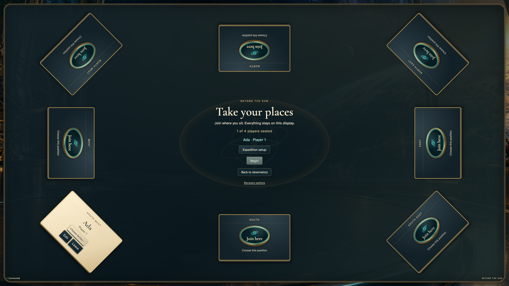](../../screenshots/automate-production-permanently-at-4-shared-corner-seats/005-seat-0-joined-tabletop-4k-darwin.png)

- [x] The local physical seat is retained on this controller
- [x] The canonical effect and backend acknowledgement settle.
- [x] Public technology topology retains physical separation.
- [x] The actual viewport fits without page scrolling.

## 7. Open the North West seat on the shared surface

Viewpoint: **Bora · North West · one shared controller**.

| desktop · 1440 × 1000 |
| --- |
|  |

tabletop-4k · 3840 × 2160

- [x] Open the North West seat on the shared surface
- [x] The canonical effect and backend acknowledgement settle.
- [x] Public technology topology retains physical separation.
- [x] The actual viewport fits without page scrolling.

## 8. Name the physical player Bora

Viewpoint: **Bora · North West · one shared controller**.

| desktop · 1440 × 1000 |
| --- |
|  |

tabletop-4k · 3840 × 2160

- [x] Name the physical player Bora
- [x] The canonical effect and backend acknowledgement settle.
- [x] Public technology topology retains physical separation.
- [x] The actual viewport fits without page scrolling.

## 9. The local physical seat is retained on this controller

Viewpoint: **Bora · North West · one shared controller**.

| desktop · 1440 × 1000 |
| --- |
|  |

tabletop-4k · 3840 × 2160

- [x] The local physical seat is retained on this controller
- [x] The canonical effect and backend acknowledgement settle.
- [x] Public technology topology retains physical separation.
- [x] The actual viewport fits without page scrolling.

## 10. Open the North East seat on the shared surface

Viewpoint: **Cleo · North East · one shared controller**.

| desktop · 1440 × 1000 |
| --- |
|  |

tabletop-4k · 3840 × 2160

- [x] Open the North East seat on the shared surface
- [x] The canonical effect and backend acknowledgement settle.
- [x] Public technology topology retains physical separation.
- [x] The actual viewport fits without page scrolling.

## 11. Name the physical player Cleo

Viewpoint: **Cleo · North East · one shared controller**.

| desktop · 1440 × 1000 |
| --- |
|  |

tabletop-4k · 3840 × 2160

- [x] Name the physical player Cleo
- [x] The canonical effect and backend acknowledgement settle.
- [x] Public technology topology retains physical separation.
- [x] The actual viewport fits without page scrolling.

## 12. The local physical seat is retained on this controller

Viewpoint: **Cleo · North East · one shared controller**.

| desktop · 1440 × 1000 |
| --- |
|  |

tabletop-4k · 3840 × 2160

- [x] The local physical seat is retained on this controller
- [x] The canonical effect and backend acknowledgement settle.
- [x] Public technology topology retains physical separation.
- [x] The actual viewport fits without page scrolling.

## 13. Open the South East seat on the shared surface

Viewpoint: **Dara · South East · one shared controller**.

| desktop · 1440 × 1000 |
| --- |
|  |

tabletop-4k · 3840 × 2160

- [x] Open the South East seat on the shared surface
- [x] The canonical effect and backend acknowledgement settle.
- [x] Public technology topology retains physical separation.
- [x] The actual viewport fits without page scrolling.

## 14. Name the physical player Dara

Viewpoint: **Dara · South East · one shared controller**.

| desktop · 1440 × 1000 |
| --- |
|  |

tabletop-4k · 3840 × 2160

- [x] Name the physical player Dara
- [x] The canonical effect and backend acknowledgement settle.
- [x] Public technology topology retains physical separation.
- [x] The actual viewport fits without page scrolling.

## 15. The local physical seat is retained on this controller

Viewpoint: **Dara · South East · one shared controller**.

| desktop · 1440 × 1000 |
| --- |
|  |

tabletop-4k · 3840 × 2160

- [x] The local physical seat is retained on this controller
- [x] The canonical effect and backend acknowledgement settle.
- [x] Public technology topology retains physical separation.
- [x] The actual viewport fits without page scrolling.

## 16. Ada chooses a legal unique Basic faction

Viewpoint: **Ada · South West · one shared controller**.

| desktop · 1440 × 1000 |
| --- |
|  |

tabletop-4k · 3840 × 2160

- [x] Ada chooses a legal unique Basic faction
- [x] The canonical effect and backend acknowledgement settle.
- [x] Public technology topology retains physical separation.
- [x] The actual viewport fits without page scrolling.

## 17. Ada retains Nishida-Østergaard Corporation

Viewpoint: **Ada · South West · one shared controller**.

| desktop · 1440 × 1000 |
| --- |
| [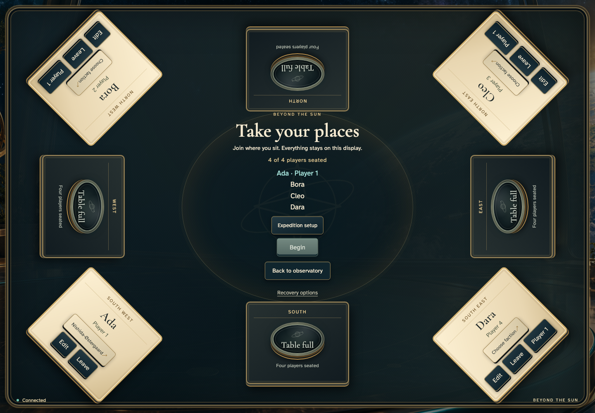](../../screenshots/automate-production-permanently-at-4-shared-corner-seats/016-faction-0-chosen-desktop-darwin.png) |

tabletop-4k · 3840 × 2160

- [x] Ada retains Nishida-Østergaard Corporation
- [x] The canonical effect and backend acknowledgement settle.
- [x] Public technology topology retains physical separation.
- [x] The actual viewport fits without page scrolling.

## 18. Bora chooses a legal unique Basic faction

Viewpoint: **Bora · North West · one shared controller**.

| desktop · 1440 × 1000 |
| --- |
|  |

tabletop-4k · 3840 × 2160

- [x] Bora chooses a legal unique Basic faction
- [x] The canonical effect and backend acknowledgement settle.
- [x] Public technology topology retains physical separation.
- [x] The actual viewport fits without page scrolling.

## 19. Bora retains The Zheng-Yi Brotherhood

Viewpoint: **Bora · North West · one shared controller**.

| desktop · 1440 × 1000 |
| --- |
|  |

tabletop-4k · 3840 × 2160

- [x] Bora retains The Zheng-Yi Brotherhood
- [x] The canonical effect and backend acknowledgement settle.
- [x] Public technology topology retains physical separation.
- [x] The actual viewport fits without page scrolling.

## 20. Cleo chooses a legal unique Basic faction

Viewpoint: **Cleo · North East · one shared controller**.

| desktop · 1440 × 1000 |
| --- |
| [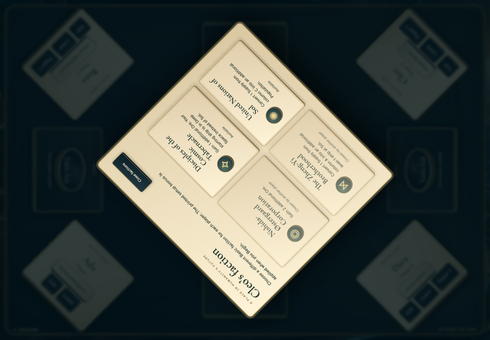](../../screenshots/automate-production-permanently-at-4-shared-corner-seats/019-faction-2-editor-desktop-darwin.png) |

tabletop-4k · 3840 × 2160

- [x] Cleo chooses a legal unique Basic faction
- [x] The canonical effect and backend acknowledgement settle.
- [x] Public technology topology retains physical separation.
- [x] The actual viewport fits without page scrolling.

## 21. Cleo retains Disciples of the Cosmic Tabernacle

Viewpoint: **Cleo · North East · one shared controller**.

| desktop · 1440 × 1000 |
| --- |
|  |

tabletop-4k · 3840 × 2160

- [x] Cleo retains Disciples of the Cosmic Tabernacle
- [x] The canonical effect and backend acknowledgement settle.
- [x] Public technology topology retains physical separation.
- [x] The actual viewport fits without page scrolling.

## 22. Dara chooses a legal unique Basic faction

Viewpoint: **Dara · South East · one shared controller**.

| desktop · 1440 × 1000 |
| --- |
|  |

tabletop-4k · 3840 × 2160

- [x] Dara chooses a legal unique Basic faction
- [x] The canonical effect and backend acknowledgement settle.
- [x] Public technology topology retains physical separation.
- [x] The actual viewport fits without page scrolling.

## 23. Dara retains United Nations of Sol

Viewpoint: **Dara · South East · one shared controller**.

| desktop · 1440 × 1000 |
| --- |
|  |

tabletop-4k · 3840 × 2160

- [x] Dara retains United Nations of Sol
- [x] The canonical effect and backend acknowledgement settle.
- [x] Public technology topology retains physical separation.
- [x] The actual viewport fits without page scrolling.

## 24. Begin the immutable source-reviewed Basic setup through the ordinary UI

Viewpoint: **Ada · South West · one shared controller**.

| desktop · 1440 × 1000 |
| --- |
|  |

tabletop-4k · 3840 × 2160

[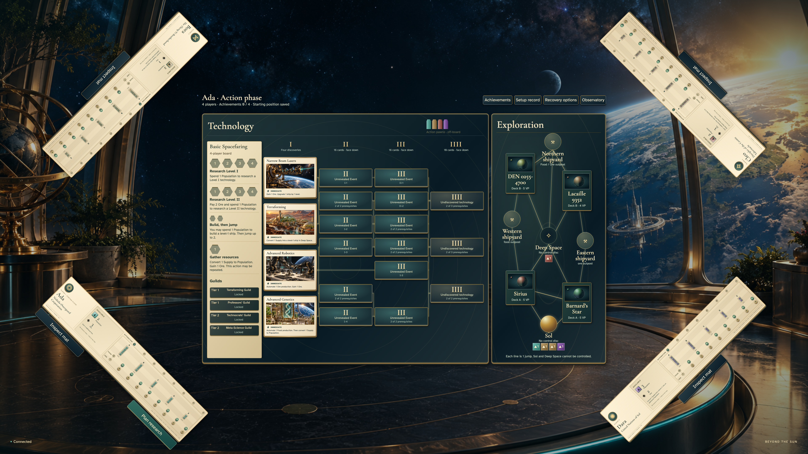](../../screenshots/automate-production-permanently-at-4-shared-corner-seats/023-begun-tabletop-4k-darwin.png)

- [x] Begin the immutable source-reviewed Basic setup through the ordinary UI
- [x] The canonical effect and backend acknowledgement settle.
- [x] Public technology topology retains physical separation.
- [x] The actual viewport fits without page scrolling.

## 25. Ada opens the actual research and Action instrument

Viewpoint: **Ada · South West · one shared controller**.

| desktop · 1440 × 1000 |
| --- |
|  |

tabletop-4k · 3840 × 2160

- [x] Ada opens the actual research and Action instrument
- [x] The canonical effect and backend acknowledgement settle.
- [x] Public technology topology retains physical separation.
- [x] The actual viewport fits without page scrolling.

## 26. Ada selects the legal printed space 1

Viewpoint: **Ada · South West · one shared controller**.

| desktop · 1440 × 1000 |
| --- |
|  |

tabletop-4k · 3840 × 2160

[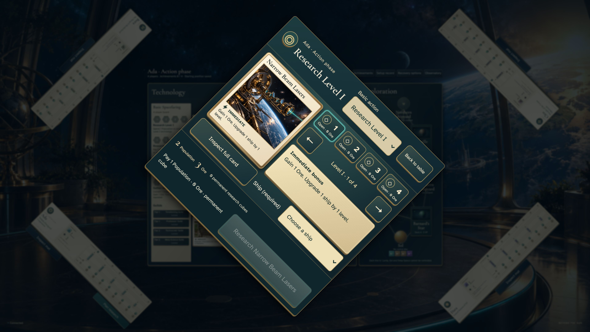](../../screenshots/automate-production-permanently-at-4-shared-corner-seats/025-ada-food-space-tabletop-4k-darwin.png)

- [x] Ada selects the legal printed space 1
- [x] The canonical effect and backend acknowledgement settle.
- [x] Public technology topology retains physical separation.
- [x] The actual viewport fits without page scrolling.

## 27. Browse the next public Level I face

Viewpoint: **Ada · South West · one shared controller**.

| desktop · 1440 × 1000 |
| --- |
| [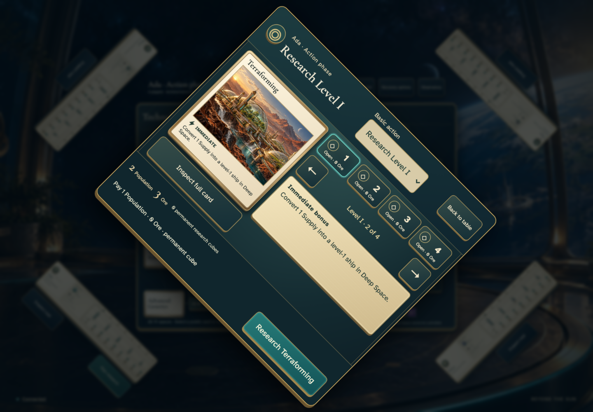](../../screenshots/automate-production-permanently-at-4-shared-corner-seats/026-ada-food-browse-0-desktop-darwin.png) |

tabletop-4k · 3840 × 2160

[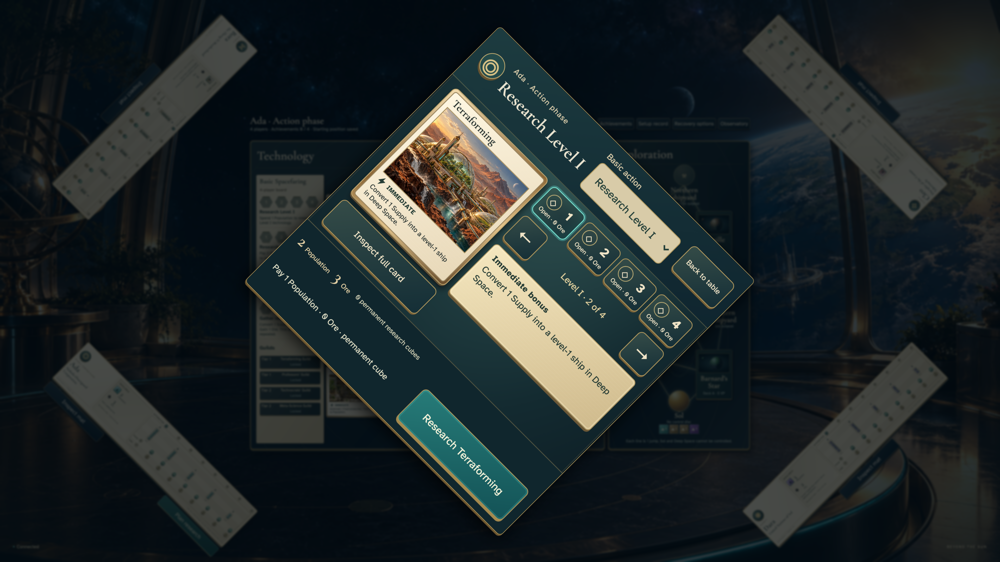](../../screenshots/automate-production-permanently-at-4-shared-corner-seats/026-ada-food-browse-0-tabletop-4k-darwin.png)

- [x] Browse the next public Level I face
- [x] The canonical effect and backend acknowledgement settle.
- [x] Public technology topology retains physical separation.
- [x] The actual viewport fits without page scrolling.

## 28. Browse the next public Level I face

Viewpoint: **Ada · South West · one shared controller**.

| desktop · 1440 × 1000 |
| --- |
| [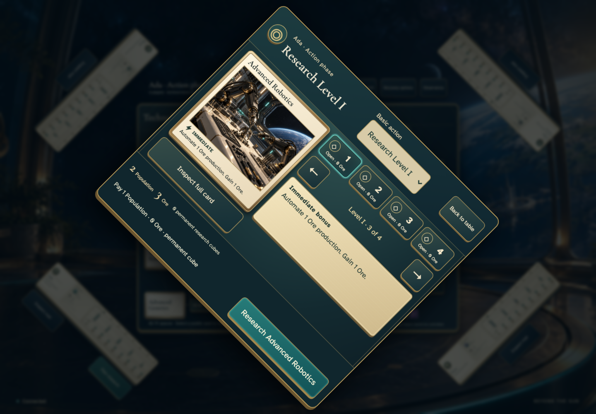](../../screenshots/automate-production-permanently-at-4-shared-corner-seats/027-ada-food-browse-1-desktop-darwin.png) |

tabletop-4k · 3840 × 2160

- [x] Browse the next public Level I face
- [x] The canonical effect and backend acknowledgement settle.
- [x] Public technology topology retains physical separation.
- [x] The actual viewport fits without page scrolling.

## 29. Browse the next public Level I face

Viewpoint: **Ada · South West · one shared controller**.

| desktop · 1440 × 1000 |
| --- |
|  |

tabletop-4k · 3840 × 2160

- [x] Browse the next public Level I face
- [x] The canonical effect and backend acknowledgement settle.
- [x] Public technology topology retains physical separation.
- [x] The actual viewport fits without page scrolling.

## 30. Pay once and receive Advanced Genetics's immediate bonus

Viewpoint: **Ada · South West · one shared controller**.

| desktop · 1440 × 1000 |
| --- |
|  |

tabletop-4k · 3840 × 2160

- [x] Pay once and receive Advanced Genetics's immediate bonus
- [x] The canonical effect and backend acknowledgement settle.
- [x] Public technology topology retains physical separation.
- [x] The actual viewport fits without page scrolling.

## 31. The first Food automation exposes a blank slot, retaining only A growth

Viewpoint: **Ada · South West · one shared controller**.

| desktop · 1440 × 1000 |
| --- |
| [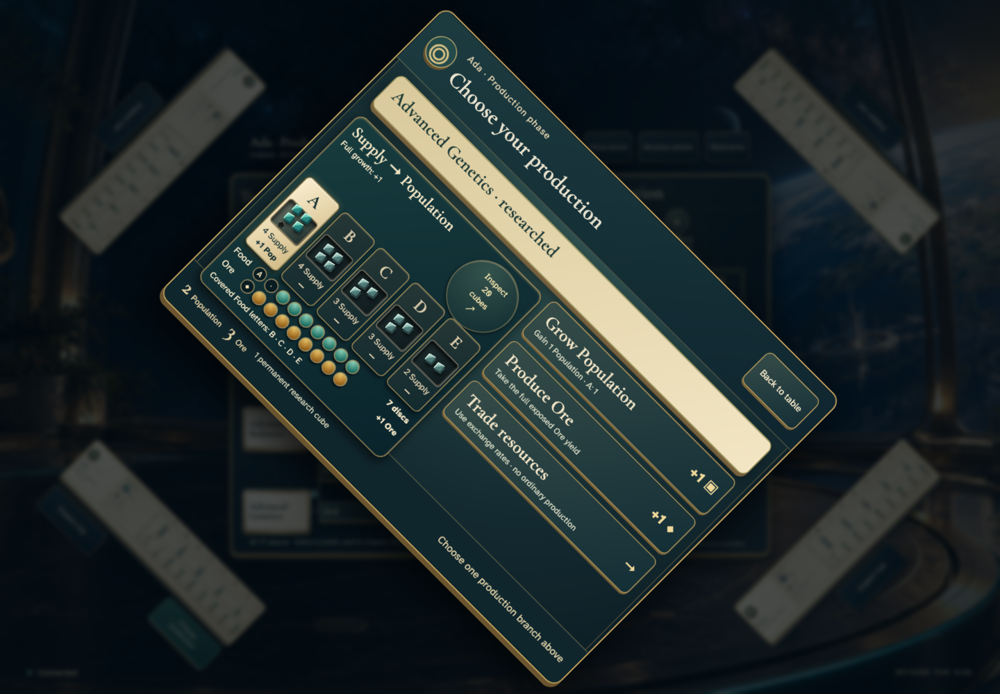](../../screenshots/automate-production-permanently-at-4-shared-corner-seats/030-food-blank-desktop-darwin.png) |

tabletop-4k · 3840 × 2160

- [x] The first Food automation exposes a blank slot, retaining only A growth
- [x] The canonical effect and backend acknowledgement settle.
- [x] Public technology topology retains physical separation.
- [x] The actual viewport fits without page scrolling.

## 32. Close the decision without paying or collecting any further resource

Viewpoint: **Ada · South West · one shared controller**.

| desktop · 1440 × 1000 |
| --- |
| [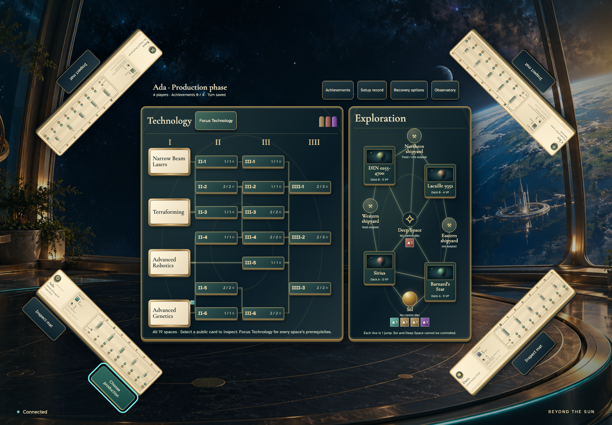](../../screenshots/automate-production-permanently-at-4-shared-corner-seats/031-food-permanent-board-desktop-darwin.png) |

tabletop-4k · 3840 × 2160

- [x] Close the decision without paying or collecting any further resource
- [x] The canonical effect and backend acknowledgement settle.
- [x] Public technology topology retains physical separation.
- [x] The actual viewport fits without page scrolling.

## 33. Ada inspects the actual retained production discs and Supply

Viewpoint: **Ada · South West · one shared controller**.

| desktop · 1440 × 1000 |
| --- |
| [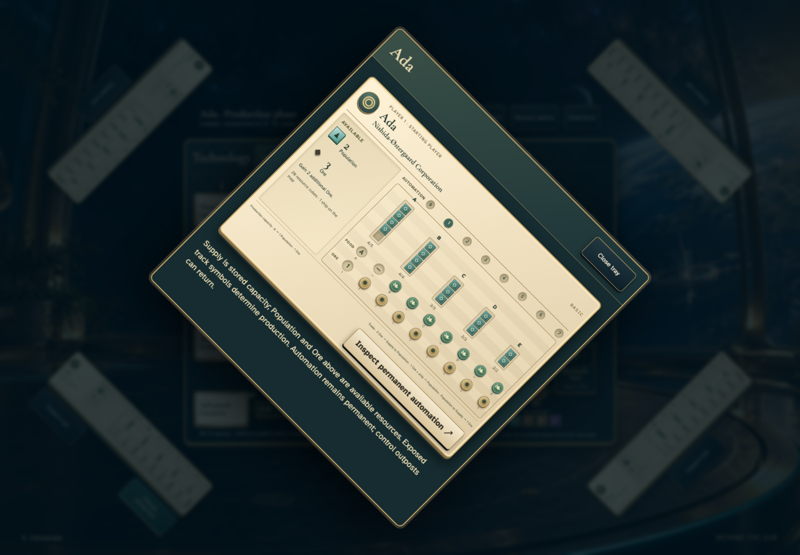](../../screenshots/automate-production-permanently-at-4-shared-corner-seats/032-food-permanent-mat-desktop-darwin.png) |

tabletop-4k · 3840 × 2160

- [x] Ada inspects the actual retained production discs and Supply
- [x] The canonical effect and backend acknowledgement settle.
- [x] Public technology topology retains physical separation.
- [x] The actual viewport fits without page scrolling.

## 34. Permanent level 1 contributes 0 cumulative endgame VP without an immediate payout

Viewpoint: **Ada · South West · one shared controller**.

| desktop · 1440 × 1000 |
| --- |
| [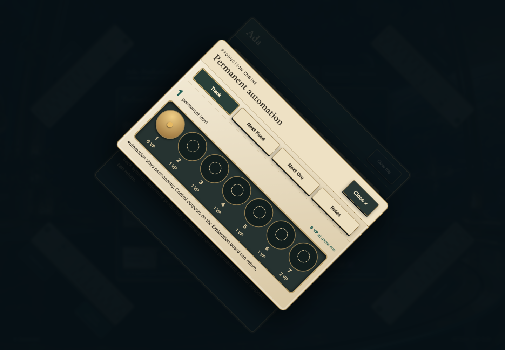](../../screenshots/automate-production-permanently-at-4-shared-corner-seats/033-food-permanent-track-desktop-darwin.png) |

tabletop-4k · 3840 × 2160

[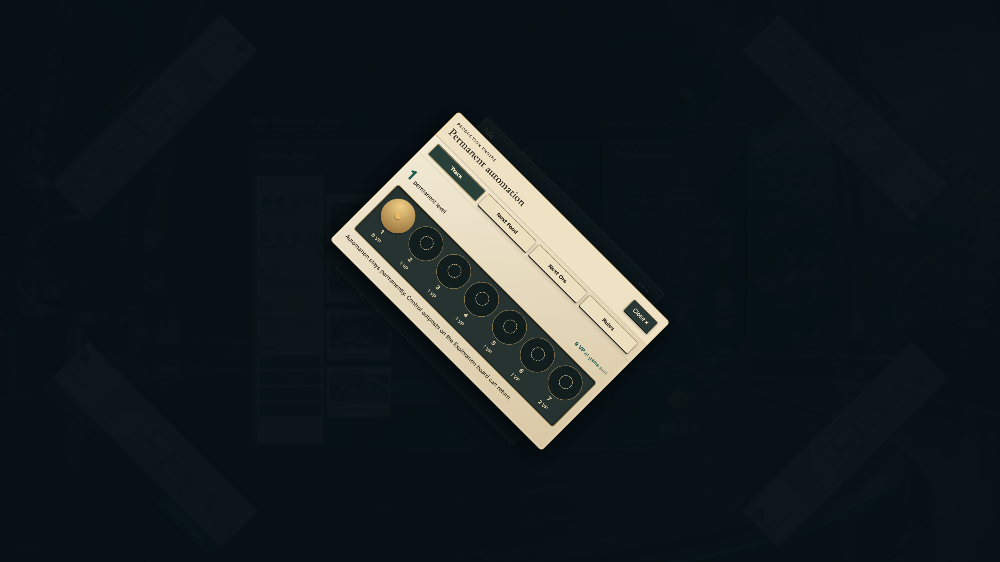](../../screenshots/automate-production-permanently-at-4-shared-corner-seats/033-food-permanent-track-tabletop-4k-darwin.png)

- [x] Permanent level 1 contributes 0 cumulative endgame VP without an immediate payout
- [x] The canonical effect and backend acknowledgement settle.
- [x] Public technology topology retains physical separation.
- [x] The actual viewport fits without page scrolling.

## 35. Inspect the next Food disc and exposed yield as a read-only consequence

Viewpoint: **Ada · South West · one shared controller**.

| desktop · 1440 × 1000 |
| --- |
| [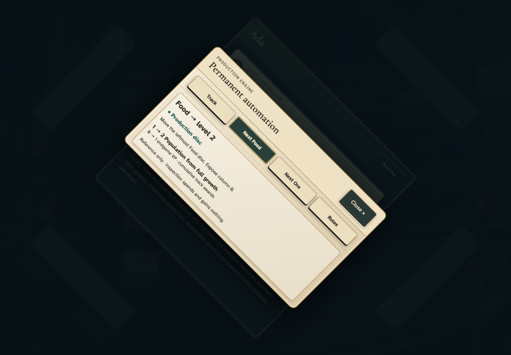](../../screenshots/automate-production-permanently-at-4-shared-corner-seats/034-food-permanent-food-desktop-darwin.png) |

tabletop-4k · 3840 × 2160

[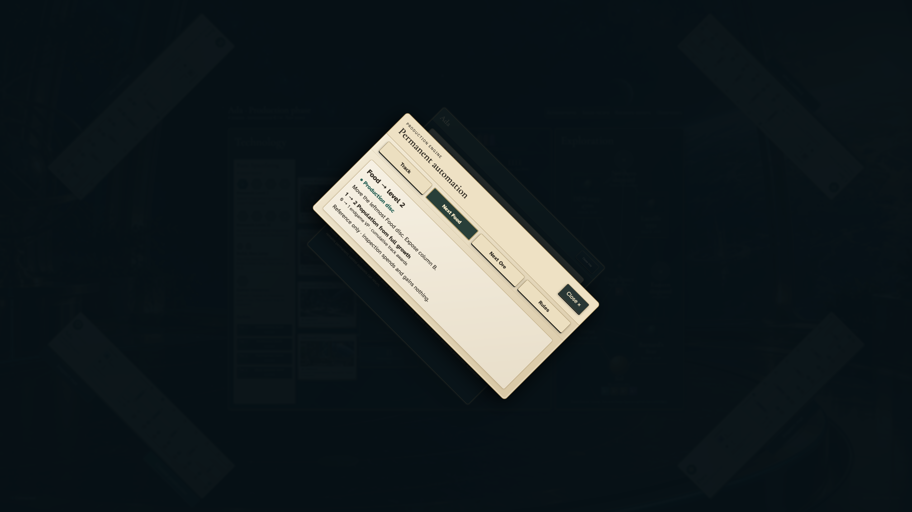](../../screenshots/automate-production-permanently-at-4-shared-corner-seats/034-food-permanent-food-tabletop-4k-darwin.png)

- [x] Inspect the next Food disc and exposed yield as a read-only consequence
- [x] The canonical effect and backend acknowledgement settle.
- [x] Public technology topology retains physical separation.
- [x] The actual viewport fits without page scrolling.

## 36. Inspect the next Ore disc and exposed yield as a read-only consequence

Viewpoint: **Ada · South West · one shared controller**.

| desktop · 1440 × 1000 |
| --- |
| [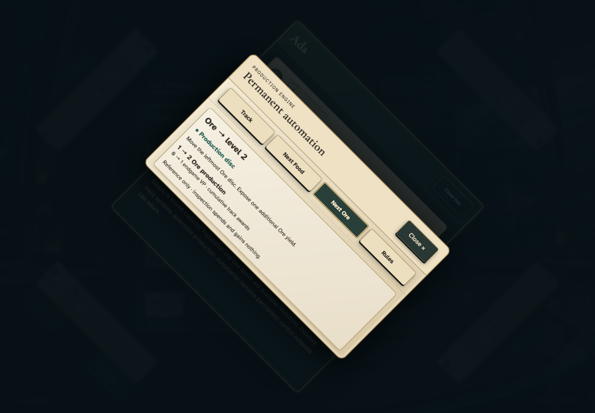](../../screenshots/automate-production-permanently-at-4-shared-corner-seats/035-food-permanent-ore-desktop-darwin.png) |

tabletop-4k · 3840 × 2160

[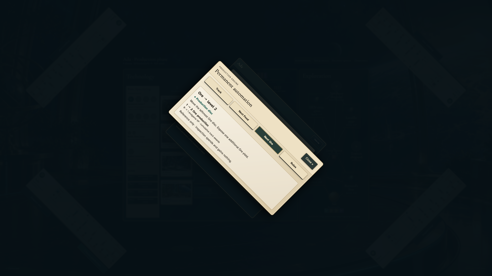](../../screenshots/automate-production-permanently-at-4-shared-corner-seats/035-food-permanent-ore-tabletop-4k-darwin.png)

- [x] Inspect the next Ore disc and exposed yield as a read-only consequence
- [x] The canonical effect and backend acknowledgement settle.
- [x] Public technology topology retains physical separation.
- [x] The actual viewport fits without page scrolling.

## 37. Read permanent discs, unlimited placeholders and cumulative awards without changing the game

Viewpoint: **Ada · South West · one shared controller**.

| desktop · 1440 × 1000 |
| --- |
| [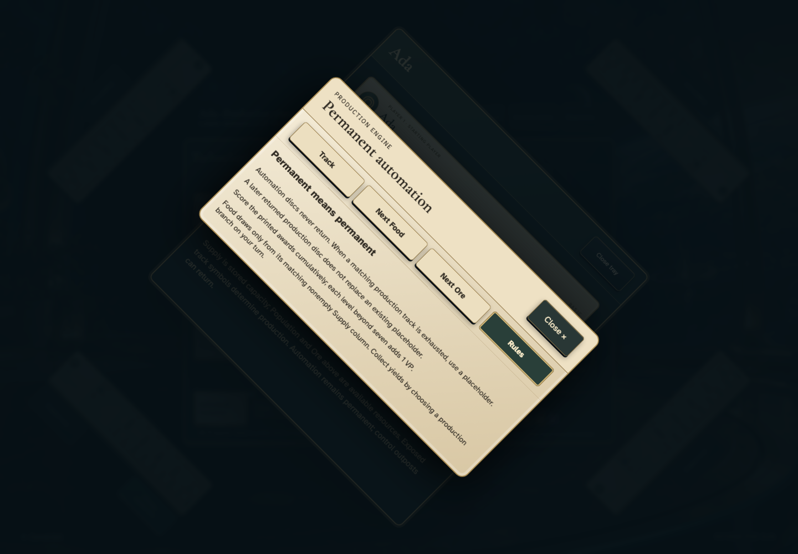](../../screenshots/automate-production-permanently-at-4-shared-corner-seats/036-food-permanent-rules-desktop-darwin.png) |

tabletop-4k · 3840 × 2160

[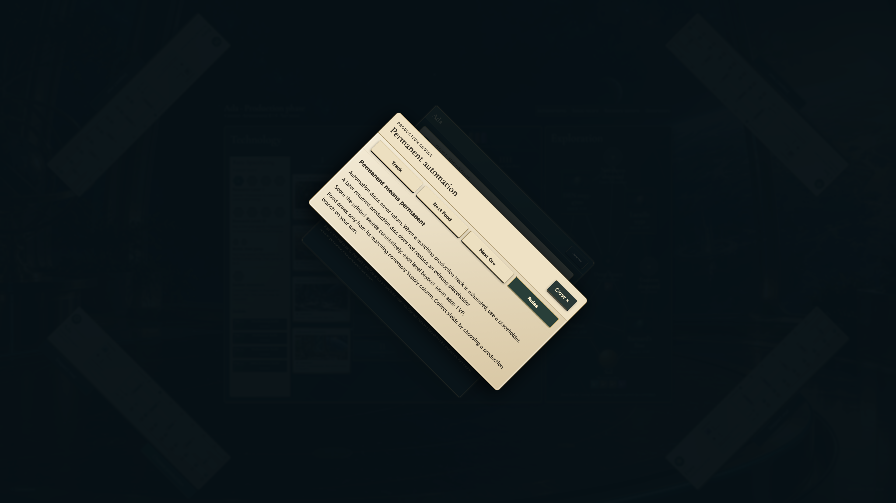](../../screenshots/automate-production-permanently-at-4-shared-corner-seats/036-food-permanent-rules-tabletop-4k-darwin.png)

- [x] Read permanent discs, unlimited placeholders and cumulative awards without changing the game
- [x] The canonical effect and backend acknowledgement settle.
- [x] Public technology topology retains physical separation.
- [x] The actual viewport fits without page scrolling.

## 38. Tab reaches the named internally scrolling automation details

Viewpoint: **Ada · South West · one shared controller**.

| desktop · 1440 × 1000 |
| --- |
|  |

tabletop-4k · 3840 × 2160

- [x] Tab reaches the named internally scrolling automation details
- [x] The canonical effect and backend acknowledgement settle.
- [x] Public technology topology retains physical separation.
- [x] The actual viewport fits without page scrolling.

## 39. Forward Tab remains inside the native automation inspector

Viewpoint: **Ada · South West · one shared controller**.

| desktop · 1440 × 1000 |
| --- |
| [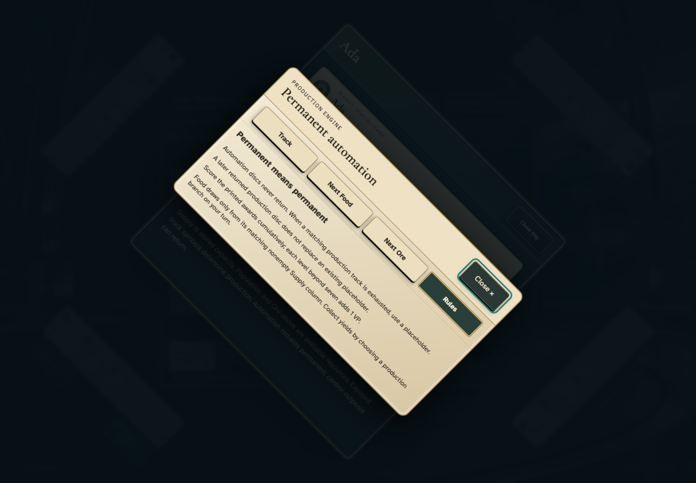](../../screenshots/automate-production-permanently-at-4-shared-corner-seats/038-food-permanent-focus-wrap-desktop-darwin.png) |

tabletop-4k · 3840 × 2160

[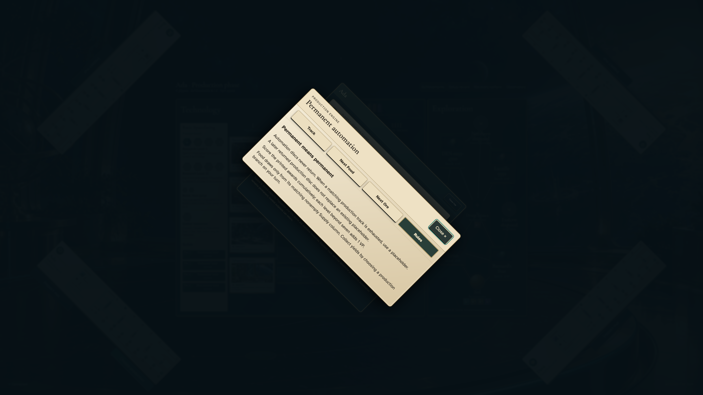](../../screenshots/automate-production-permanently-at-4-shared-corner-seats/038-food-permanent-focus-wrap-tabletop-4k-darwin.png)

- [x] Forward Tab remains inside the native automation inspector
- [x] The canonical effect and backend acknowledgement settle.
- [x] Public technology topology retains physical separation.
- [x] The actual viewport fits without page scrolling.

## 40. Reverse Tab also remains inside the inspector

Viewpoint: **Ada · South West · one shared controller**.

| desktop · 1440 × 1000 |
| --- |
| [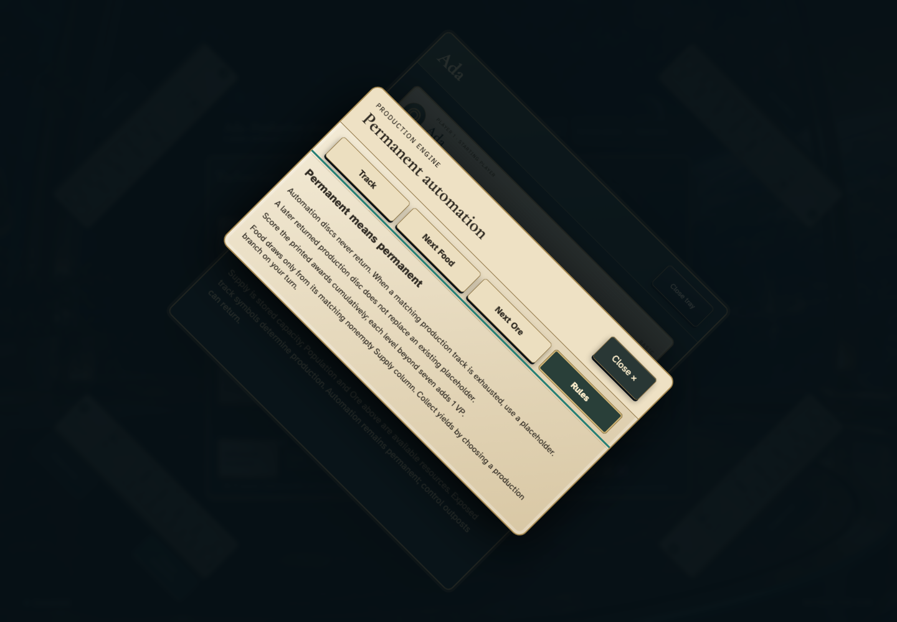](../../screenshots/automate-production-permanently-at-4-shared-corner-seats/039-food-permanent-focus-reverse-desktop-darwin.png) |

tabletop-4k · 3840 × 2160

- [x] Reverse Tab also remains inside the inspector
- [x] The canonical effect and backend acknowledgement settle.
- [x] Public technology topology retains physical separation.
- [x] The actual viewport fits without page scrolling.

## 41. Escape returns to the exact mat opener; inspection never spends or collects

Viewpoint: **Ada · South West · one shared controller**.

| desktop · 1440 × 1000 |
| --- |
| [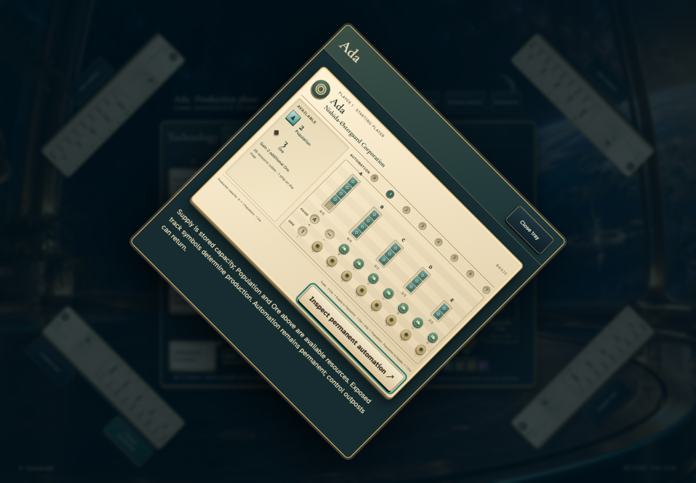](../../screenshots/automate-production-permanently-at-4-shared-corner-seats/040-food-permanent-return-desktop-darwin.png) |

tabletop-4k · 3840 × 2160

[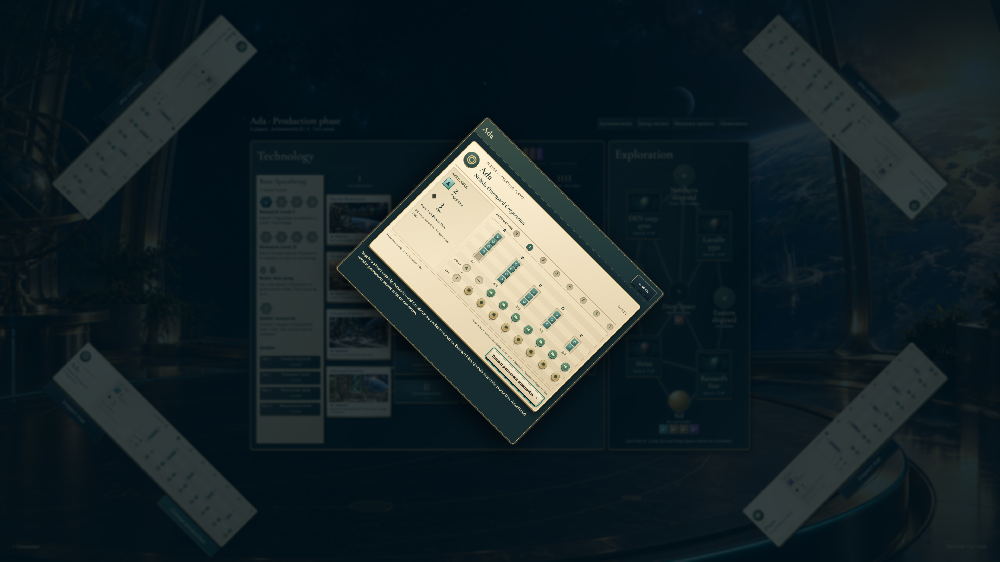](../../screenshots/automate-production-permanently-at-4-shared-corner-seats/040-food-permanent-return-tabletop-4k-darwin.png)

- [x] Escape returns to the exact mat opener; inspection never spends or collects
- [x] The canonical effect and backend acknowledgement settle.
- [x] Public technology topology retains physical separation.
- [x] The actual viewport fits without page scrolling.

## 42. Return to the real turn with all production choices still pending

Viewpoint: **Ada · South West · one shared controller**.

| desktop · 1440 × 1000 |
| --- |
|  |

tabletop-4k · 3840 × 2160

- [x] Return to the real turn with all production choices still pending
- [x] The canonical effect and backend acknowledgement settle.
- [x] Public technology topology retains physical separation.
- [x] The actual viewport fits without page scrolling.

## 43. Reload retains the same controller and the paid pending production

Viewpoint: **Ada · South West · one shared controller**.

| desktop · 1440 × 1000 |
| --- |
|  |

tabletop-4k · 3840 × 2160

- [x] Reload retains the same controller and the paid pending production
- [x] The canonical effect and backend acknowledgement settle.
- [x] Public technology topology retains physical separation.
- [x] The actual viewport fits without page scrolling.

## 44. Reopening production never repeats the permanent automation bonus

Viewpoint: **Ada · South West · one shared controller**.

| desktop · 1440 × 1000 |
| --- |
|  |

tabletop-4k · 3840 × 2160

[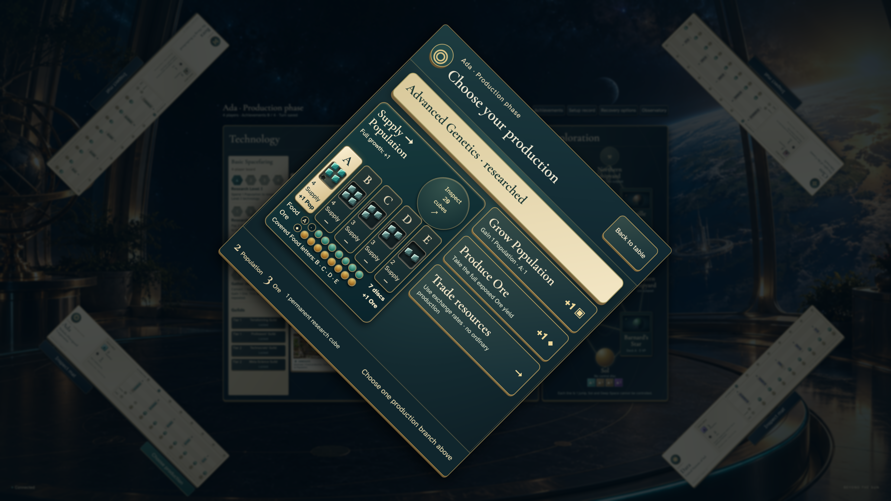](../../screenshots/automate-production-permanently-at-4-shared-corner-seats/043-food-retained-reopen-tabletop-4k-darwin.png)

- [x] Reopening production never repeats the permanent automation bonus
- [x] The canonical effect and backend acknowledgement settle.
- [x] Public technology topology retains physical separation.
- [x] The actual viewport fits without page scrolling.

## 45. Ada completes production and hands off to Bora

Viewpoint: **Ada · South West · one shared controller**.

| desktop · 1440 × 1000 |
| --- |
|  |

tabletop-4k · 3840 × 2160

- [x] Ada completes production and hands off to Bora
- [x] The canonical effect and backend acknowledgement settle.
- [x] Public technology topology retains physical separation.
- [x] The actual viewport fits without page scrolling.

## 46. Collect exactly 1 Population; automation is permanent and not a second payout

Viewpoint: **Ada · South West · one shared controller**.

| desktop · 1440 × 1000 |
| --- |
| [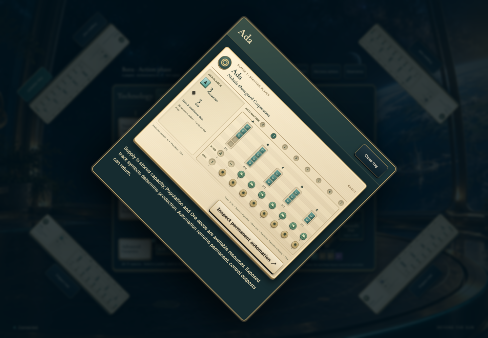](../../screenshots/automate-production-permanently-at-4-shared-corner-seats/045-food-produced-paid-desktop-darwin.png) |

tabletop-4k · 3840 × 2160

[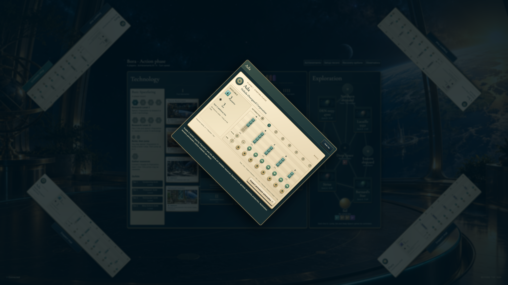](../../screenshots/automate-production-permanently-at-4-shared-corner-seats/045-food-produced-paid-tabletop-4k-darwin.png)

- [x] Collect exactly 1 Population; automation is permanent and not a second payout
- [x] The canonical effect and backend acknowledgement settle.
- [x] Public technology topology retains physical separation.
- [x] The actual viewport fits without page scrolling.

## 47. Close the proof and leave the next actual controller active

Viewpoint: **Ada · South West · one shared controller**.

| desktop · 1440 × 1000 |
| --- |
|  |

tabletop-4k · 3840 × 2160

- [x] Close the proof and leave the next actual controller active
- [x] The canonical effect and backend acknowledgement settle.
- [x] Public technology topology retains physical separation.
- [x] The actual viewport fits without page scrolling.

## 48. Bora opens the actual research and Action instrument

Viewpoint: **Bora · North West · one shared controller**.

| desktop · 1440 × 1000 |
| --- |
|  |

tabletop-4k · 3840 × 2160

[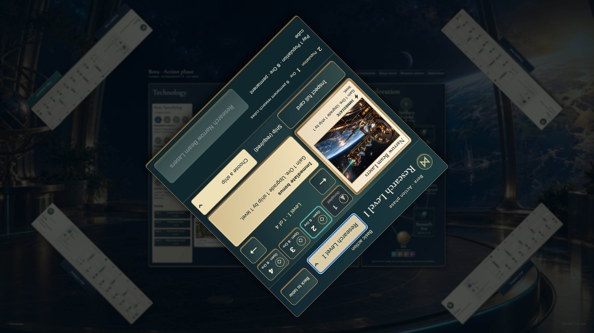](../../screenshots/automate-production-permanently-at-4-shared-corner-seats/047-bora-ore-plan-tabletop-4k-darwin.png)

- [x] Bora opens the actual research and Action instrument
- [x] The canonical effect and backend acknowledgement settle.
- [x] Public technology topology retains physical separation.
- [x] The actual viewport fits without page scrolling.

## 49. Bora selects the legal printed space 2

Viewpoint: **Bora · North West · one shared controller**.

| desktop · 1440 × 1000 |
| --- |
| [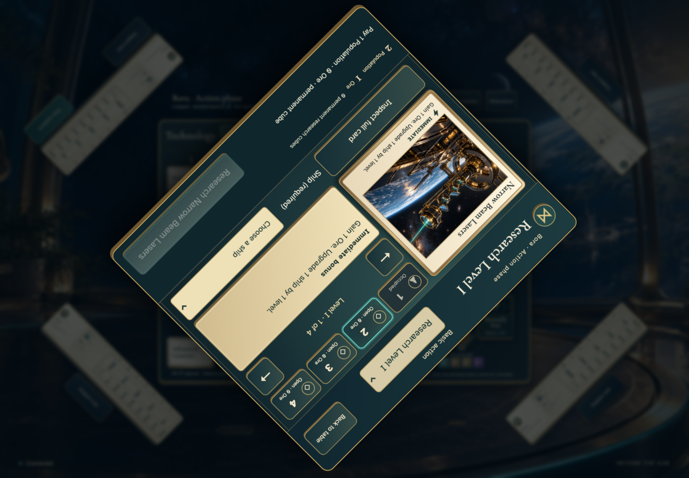](../../screenshots/automate-production-permanently-at-4-shared-corner-seats/048-bora-ore-space-desktop-darwin.png) |

tabletop-4k · 3840 × 2160

[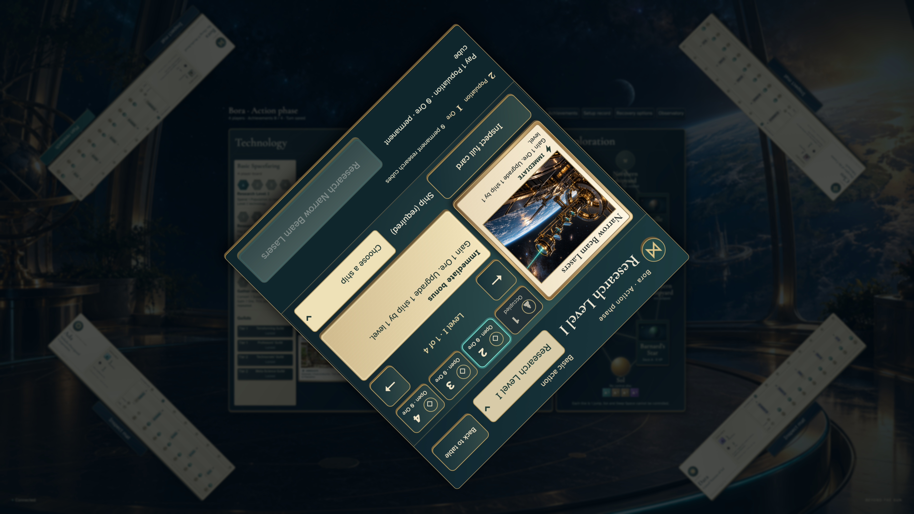](../../screenshots/automate-production-permanently-at-4-shared-corner-seats/048-bora-ore-space-tabletop-4k-darwin.png)

- [x] Bora selects the legal printed space 2
- [x] The canonical effect and backend acknowledgement settle.
- [x] Public technology topology retains physical separation.
- [x] The actual viewport fits without page scrolling.

## 50. Browse the next public Level I face

Viewpoint: **Bora · North West · one shared controller**.

| desktop · 1440 × 1000 |
| --- |
| [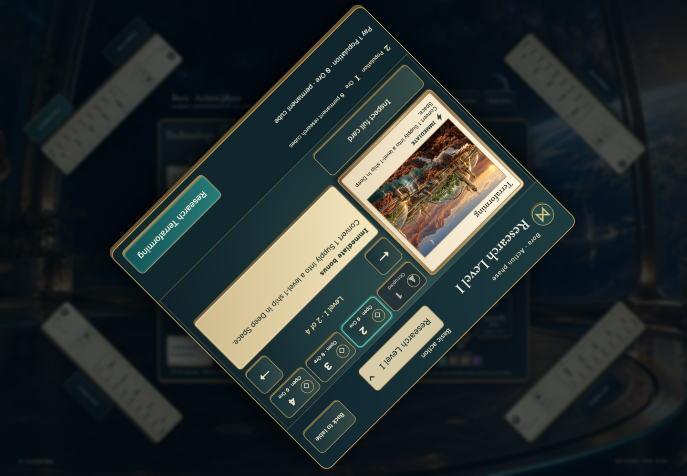](../../screenshots/automate-production-permanently-at-4-shared-corner-seats/049-bora-ore-browse-0-desktop-darwin.png) |

tabletop-4k · 3840 × 2160

[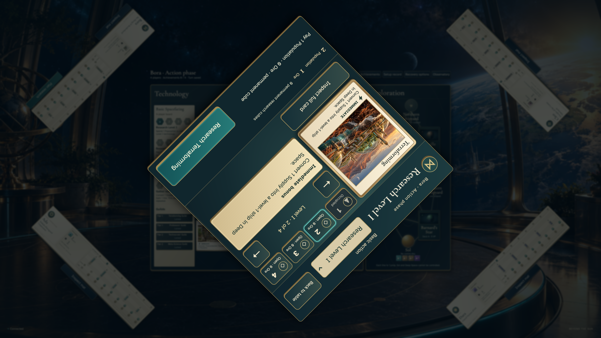](../../screenshots/automate-production-permanently-at-4-shared-corner-seats/049-bora-ore-browse-0-tabletop-4k-darwin.png)

- [x] Browse the next public Level I face
- [x] The canonical effect and backend acknowledgement settle.
- [x] Public technology topology retains physical separation.
- [x] The actual viewport fits without page scrolling.

## 51. Browse the next public Level I face

Viewpoint: **Bora · North West · one shared controller**.

| desktop · 1440 × 1000 |
| --- |
| [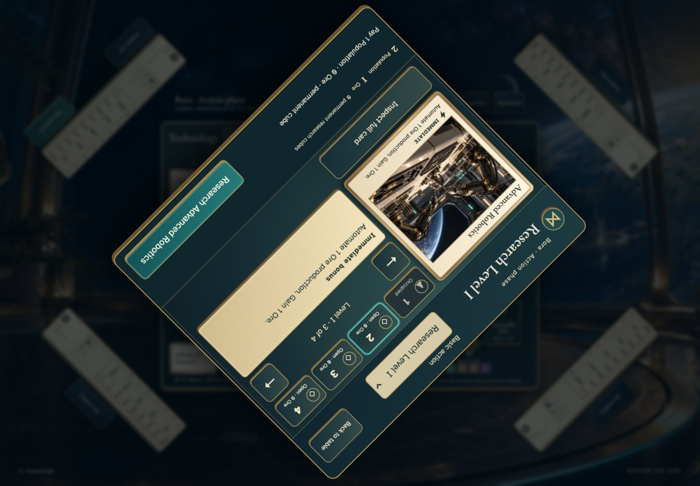](../../screenshots/automate-production-permanently-at-4-shared-corner-seats/050-bora-ore-browse-1-desktop-darwin.png) |

tabletop-4k · 3840 × 2160

[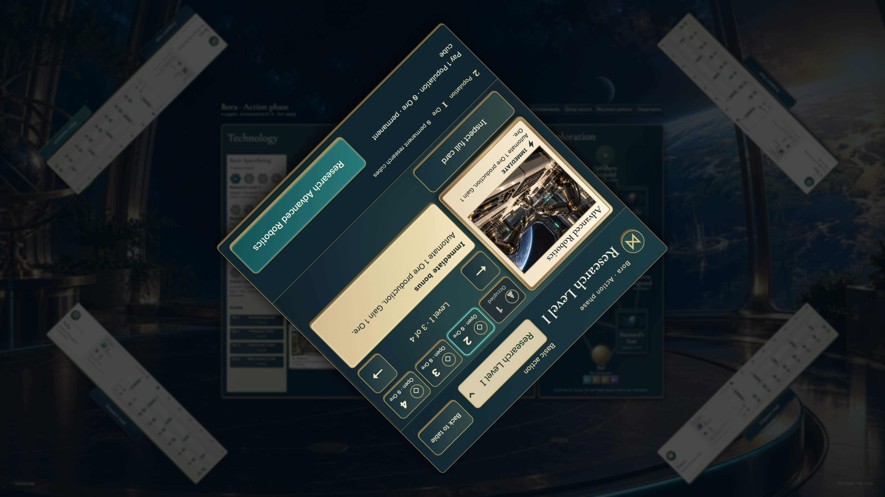](../../screenshots/automate-production-permanently-at-4-shared-corner-seats/050-bora-ore-browse-1-tabletop-4k-darwin.png)

- [x] Browse the next public Level I face
- [x] The canonical effect and backend acknowledgement settle.
- [x] Public technology topology retains physical separation.
- [x] The actual viewport fits without page scrolling.

## 52. Pay once and receive Advanced Robotics's immediate bonus

Viewpoint: **Bora · North West · one shared controller**.

| desktop · 1440 × 1000 |
| --- |
|  |

tabletop-4k · 3840 × 2160

- [x] Pay once and receive Advanced Robotics's immediate bonus
- [x] The canonical effect and backend acknowledgement settle.
- [x] Public technology topology retains physical separation.
- [x] The actual viewport fits without page scrolling.

## 53. The first Ore automation exposes a second complete Ore yield

Viewpoint: **Bora · North West · one shared controller**.

| desktop · 1440 × 1000 |
| --- |
| [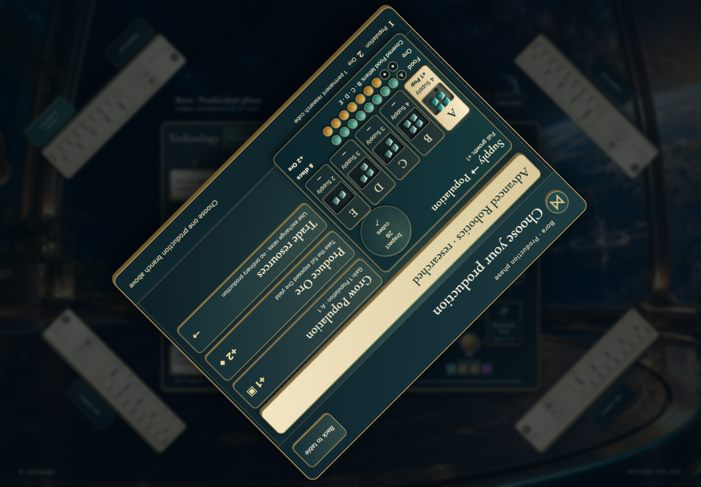](../../screenshots/automate-production-permanently-at-4-shared-corner-seats/052-ore-yield-desktop-darwin.png) |

tabletop-4k · 3840 × 2160

- [x] The first Ore automation exposes a second complete Ore yield
- [x] The canonical effect and backend acknowledgement settle.
- [x] Public technology topology retains physical separation.
- [x] The actual viewport fits without page scrolling.

## 54. Close the decision without paying or collecting any further resource

Viewpoint: **Bora · North West · one shared controller**.

| desktop · 1440 × 1000 |
| --- |
|  |

tabletop-4k · 3840 × 2160

[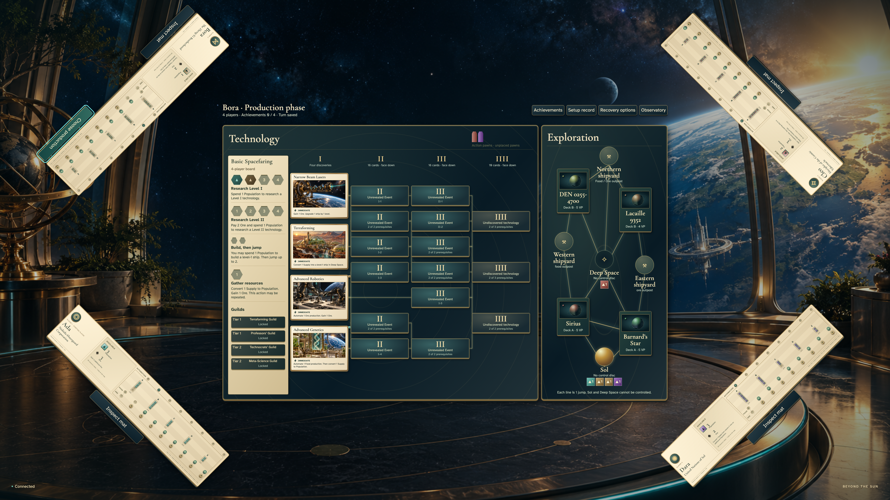](../../screenshots/automate-production-permanently-at-4-shared-corner-seats/053-ore-permanent-board-tabletop-4k-darwin.png)

- [x] Close the decision without paying or collecting any further resource
- [x] The canonical effect and backend acknowledgement settle.
- [x] Public technology topology retains physical separation.
- [x] The actual viewport fits without page scrolling.

## 55. Bora inspects the actual retained production discs and Supply

Viewpoint: **Bora · North West · one shared controller**.

| desktop · 1440 × 1000 |
| --- |
| [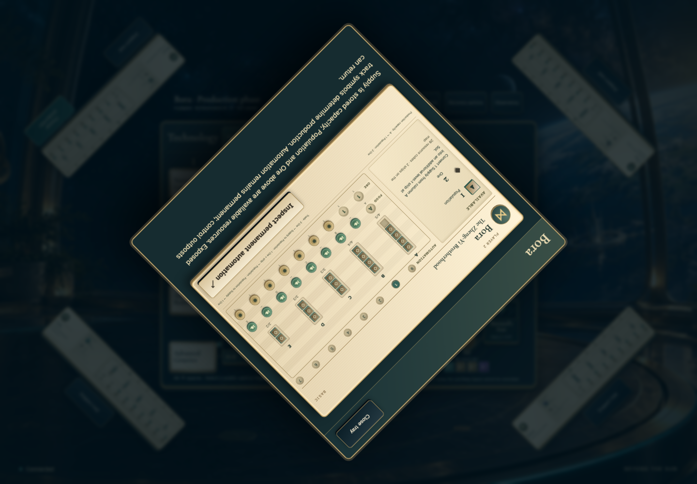](../../screenshots/automate-production-permanently-at-4-shared-corner-seats/054-ore-permanent-mat-desktop-darwin.png) |

tabletop-4k · 3840 × 2160

[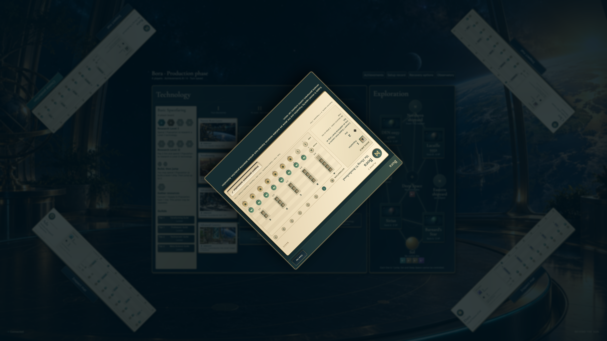](../../screenshots/automate-production-permanently-at-4-shared-corner-seats/054-ore-permanent-mat-tabletop-4k-darwin.png)

- [x] Bora inspects the actual retained production discs and Supply
- [x] The canonical effect and backend acknowledgement settle.
- [x] Public technology topology retains physical separation.
- [x] The actual viewport fits without page scrolling.

## 56. Permanent level 1 contributes 0 cumulative endgame VP without an immediate payout

Viewpoint: **Bora · North West · one shared controller**.

| desktop · 1440 × 1000 |
| --- |
| [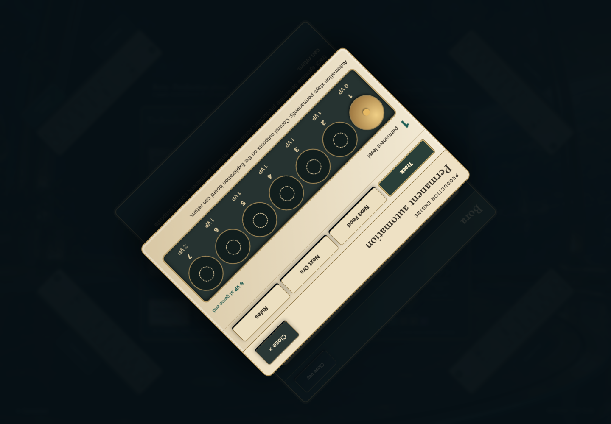](../../screenshots/automate-production-permanently-at-4-shared-corner-seats/055-ore-permanent-track-desktop-darwin.png) |

tabletop-4k · 3840 × 2160

- [x] Permanent level 1 contributes 0 cumulative endgame VP without an immediate payout
- [x] The canonical effect and backend acknowledgement settle.
- [x] Public technology topology retains physical separation.
- [x] The actual viewport fits without page scrolling.

## 57. Inspect the next Ore disc and exposed yield as a read-only consequence

Viewpoint: **Bora · North West · one shared controller**.

| desktop · 1440 × 1000 |
| --- |
| [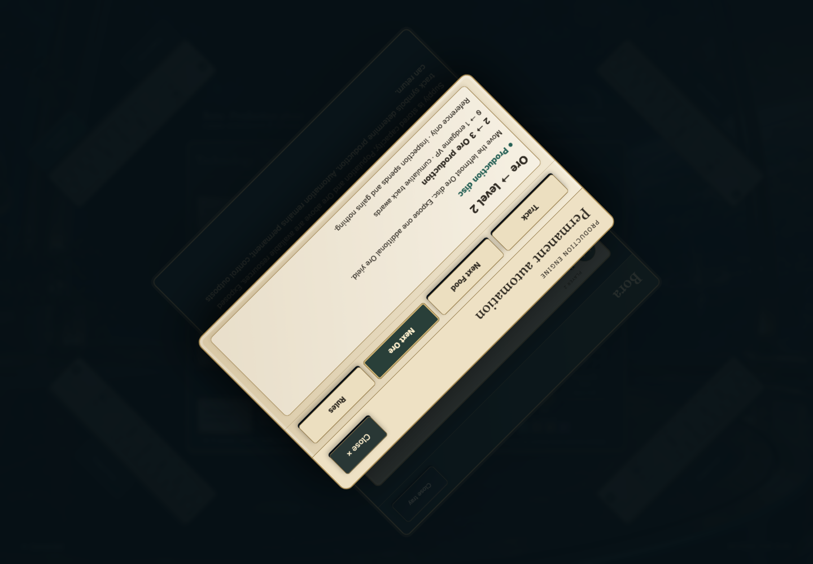](../../screenshots/automate-production-permanently-at-4-shared-corner-seats/056-ore-permanent-ore-desktop-darwin.png) |

tabletop-4k · 3840 × 2160

- [x] Inspect the next Ore disc and exposed yield as a read-only consequence
- [x] The canonical effect and backend acknowledgement settle.
- [x] Public technology topology retains physical separation.
- [x] The actual viewport fits without page scrolling.

## 58. Escape returns to the exact mat opener; inspection never spends or collects

Viewpoint: **Bora · North West · one shared controller**.

| desktop · 1440 × 1000 |
| --- |
| [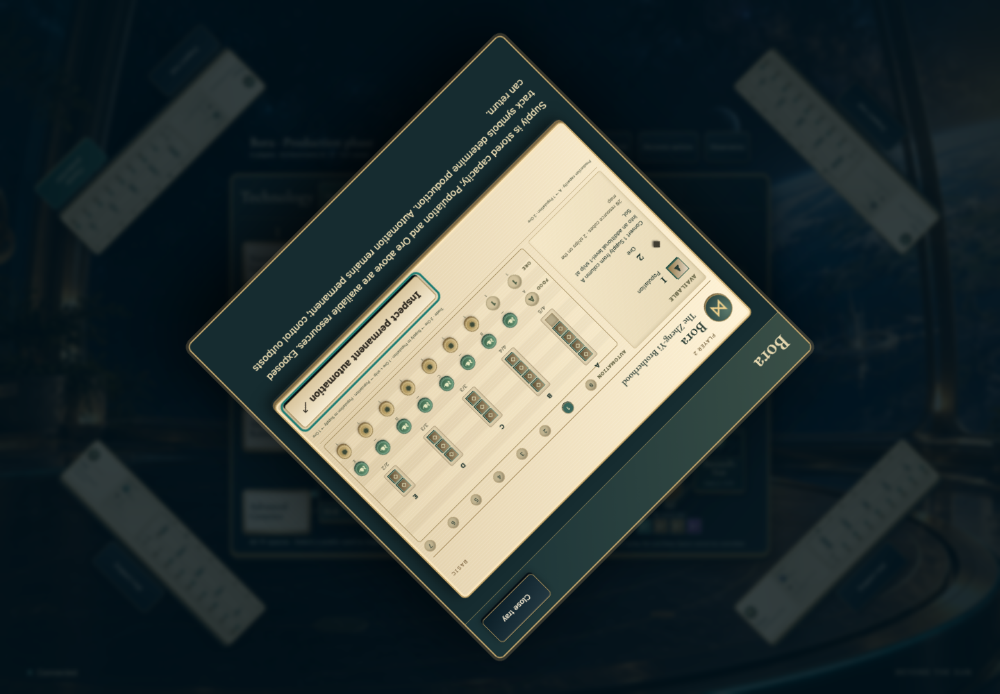](../../screenshots/automate-production-permanently-at-4-shared-corner-seats/057-ore-permanent-return-desktop-darwin.png) |

tabletop-4k · 3840 × 2160

[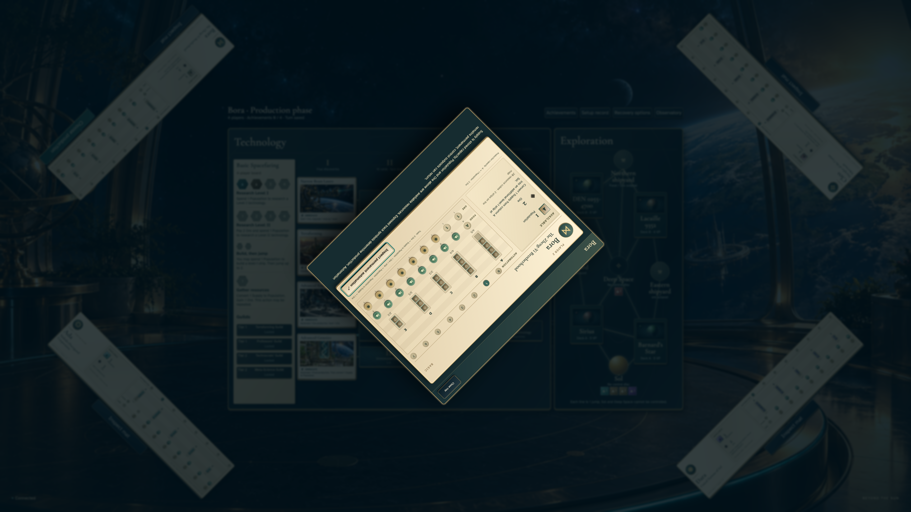](../../screenshots/automate-production-permanently-at-4-shared-corner-seats/057-ore-permanent-return-tabletop-4k-darwin.png)

- [x] Escape returns to the exact mat opener; inspection never spends or collects
- [x] The canonical effect and backend acknowledgement settle.
- [x] Public technology topology retains physical separation.
- [x] The actual viewport fits without page scrolling.

## 59. Return to the real turn with all production choices still pending

Viewpoint: **Bora · North West · one shared controller**.

| desktop · 1440 × 1000 |
| --- |
|  |

tabletop-4k · 3840 × 2160

- [x] Return to the real turn with all production choices still pending
- [x] The canonical effect and backend acknowledgement settle.
- [x] Public technology topology retains physical separation.
- [x] The actual viewport fits without page scrolling.

## 60. Reload retains the same controller and the paid pending production

Viewpoint: **Bora · North West · one shared controller**.

| desktop · 1440 × 1000 |
| --- |
|  |

tabletop-4k · 3840 × 2160

- [x] Reload retains the same controller and the paid pending production
- [x] The canonical effect and backend acknowledgement settle.
- [x] Public technology topology retains physical separation.
- [x] The actual viewport fits without page scrolling.

## 61. Reopening production never repeats the permanent automation bonus

Viewpoint: **Bora · North West · one shared controller**.

| desktop · 1440 × 1000 |
| --- |
|  |

tabletop-4k · 3840 × 2160

[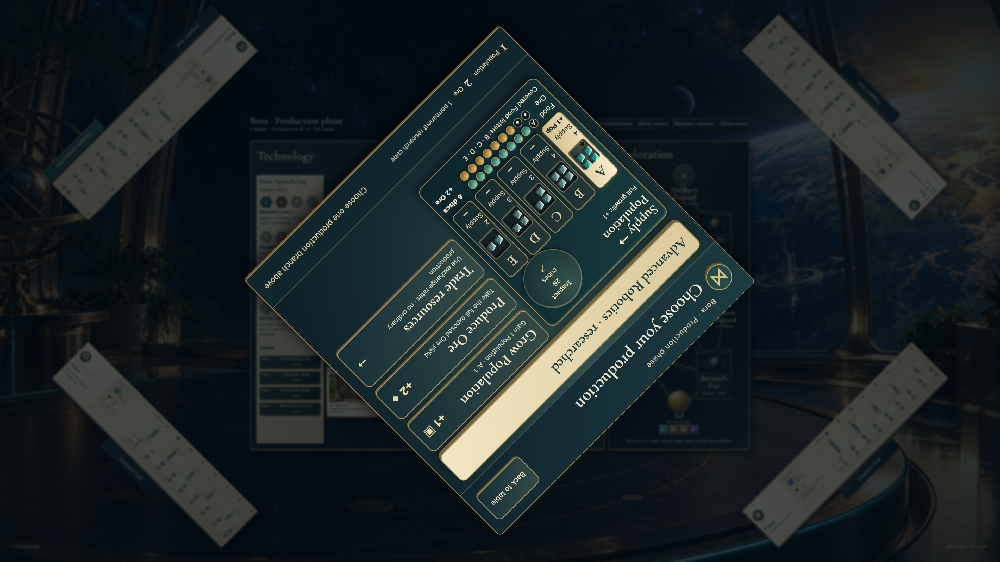](../../screenshots/automate-production-permanently-at-4-shared-corner-seats/060-ore-retained-reopen-tabletop-4k-darwin.png)

- [x] Reopening production never repeats the permanent automation bonus
- [x] The canonical effect and backend acknowledgement settle.
- [x] Public technology topology retains physical separation.
- [x] The actual viewport fits without page scrolling.

## 62. Bora completes production and hands off to Cleo

Viewpoint: **Bora · North West · one shared controller**.

| desktop · 1440 × 1000 |
| --- |
|  |

tabletop-4k · 3840 × 2160

- [x] Bora completes production and hands off to Cleo
- [x] The canonical effect and backend acknowledgement settle.
- [x] Public technology topology retains physical separation.
- [x] The actual viewport fits without page scrolling.

## 63. Collect exactly 2 Ore; automation is permanent and not a second payout

Viewpoint: **Bora · North West · one shared controller**.

| desktop · 1440 × 1000 |
| --- |
| [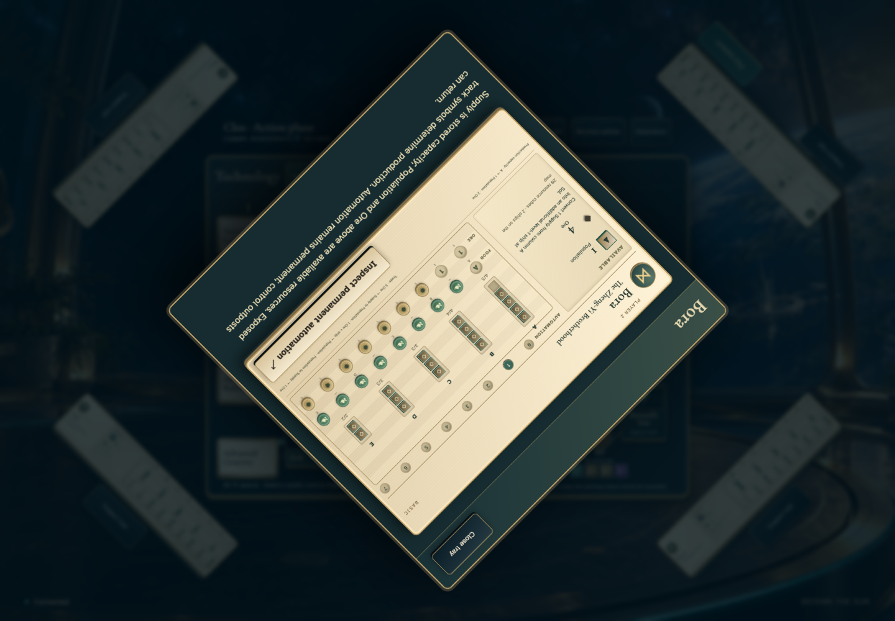](../../screenshots/automate-production-permanently-at-4-shared-corner-seats/062-ore-produced-paid-desktop-darwin.png) |

tabletop-4k · 3840 × 2160

- [x] Collect exactly 2 Ore; automation is permanent and not a second payout
- [x] The canonical effect and backend acknowledgement settle.
- [x] Public technology topology retains physical separation.
- [x] The actual viewport fits without page scrolling.

## 64. Close the proof and leave the next actual controller active

Viewpoint: **Bora · North West · one shared controller**.

| desktop · 1440 × 1000 |
| --- |
|  |

tabletop-4k · 3840 × 2160

- [x] Close the proof and leave the next actual controller active
- [x] The canonical effect and backend acknowledgement settle.
- [x] Public technology topology retains physical separation.
- [x] The actual viewport fits without page scrolling.

## 65. Cleo opens the actual research and Action instrument

Viewpoint: **Cleo · North East · one shared controller**.

| desktop · 1440 × 1000 |
| --- |
| [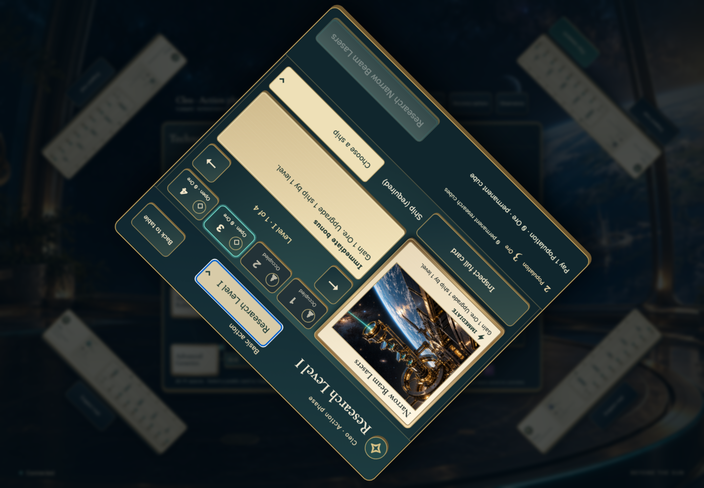](../../screenshots/automate-production-permanently-at-4-shared-corner-seats/064-cleo-food-plan-desktop-darwin.png) |

tabletop-4k · 3840 × 2160

[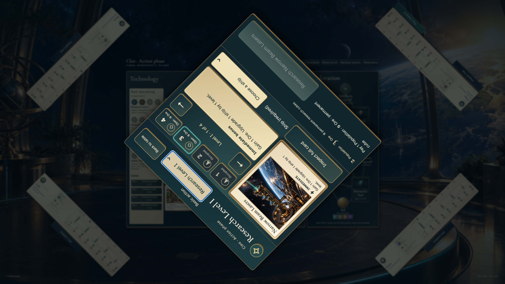](../../screenshots/automate-production-permanently-at-4-shared-corner-seats/064-cleo-food-plan-tabletop-4k-darwin.png)

- [x] Cleo opens the actual research and Action instrument
- [x] The canonical effect and backend acknowledgement settle.
- [x] Public technology topology retains physical separation.
- [x] The actual viewport fits without page scrolling.

## 66. Cleo selects the legal printed space 3

Viewpoint: **Cleo · North East · one shared controller**.

| desktop · 1440 × 1000 |
| --- |
| [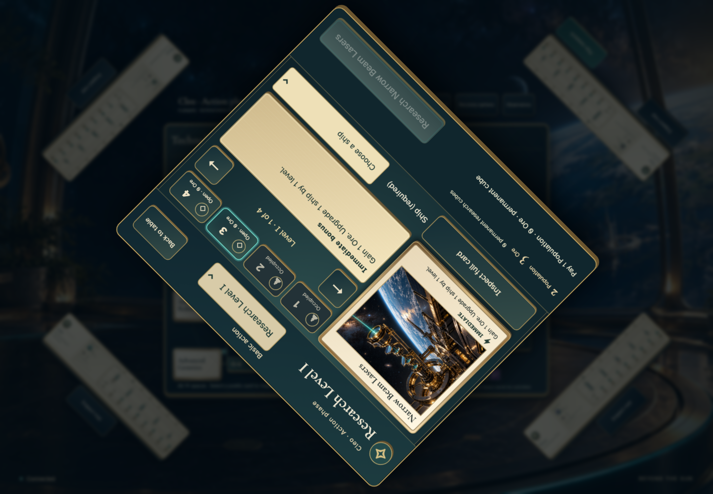](../../screenshots/automate-production-permanently-at-4-shared-corner-seats/065-cleo-food-space-desktop-darwin.png) |

tabletop-4k · 3840 × 2160

[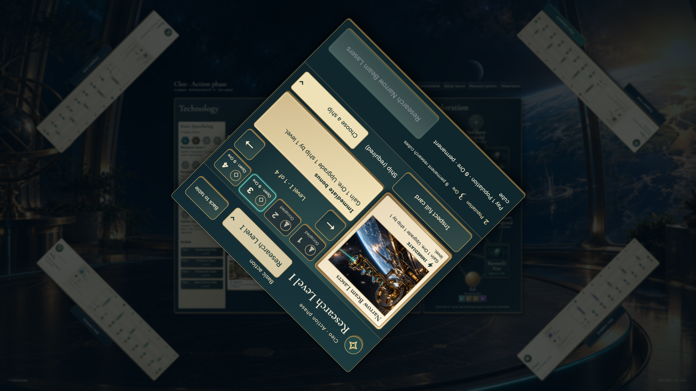](../../screenshots/automate-production-permanently-at-4-shared-corner-seats/065-cleo-food-space-tabletop-4k-darwin.png)

- [x] Cleo selects the legal printed space 3
- [x] The canonical effect and backend acknowledgement settle.
- [x] Public technology topology retains physical separation.
- [x] The actual viewport fits without page scrolling.

## 67. Browse the next public Level I face

Viewpoint: **Cleo · North East · one shared controller**.

| desktop · 1440 × 1000 |
| --- |
| [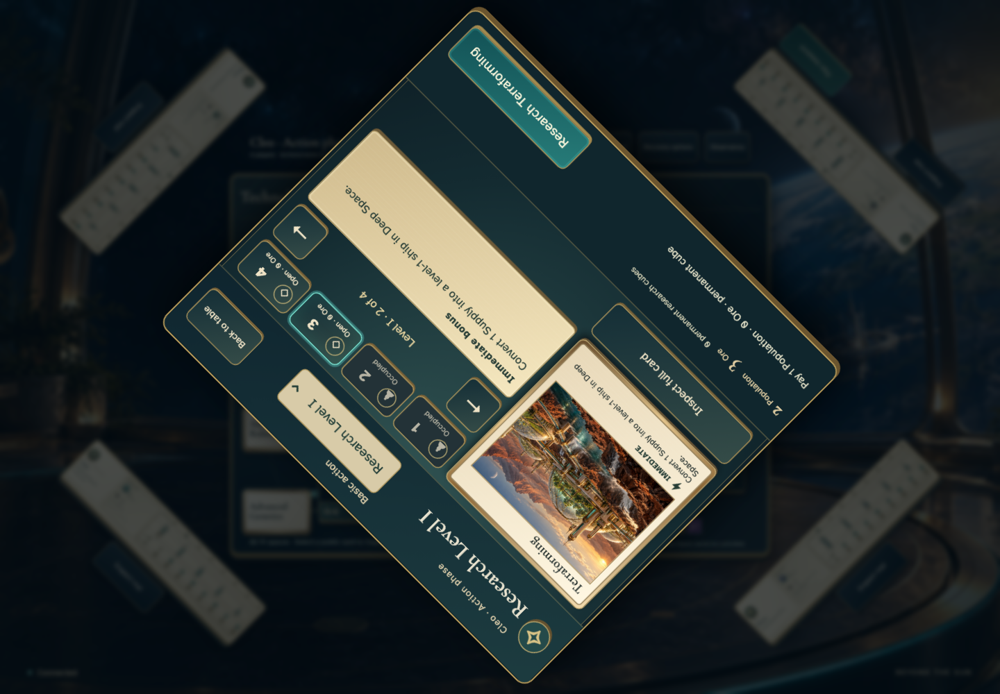](../../screenshots/automate-production-permanently-at-4-shared-corner-seats/066-cleo-food-browse-0-desktop-darwin.png) |

tabletop-4k · 3840 × 2160

[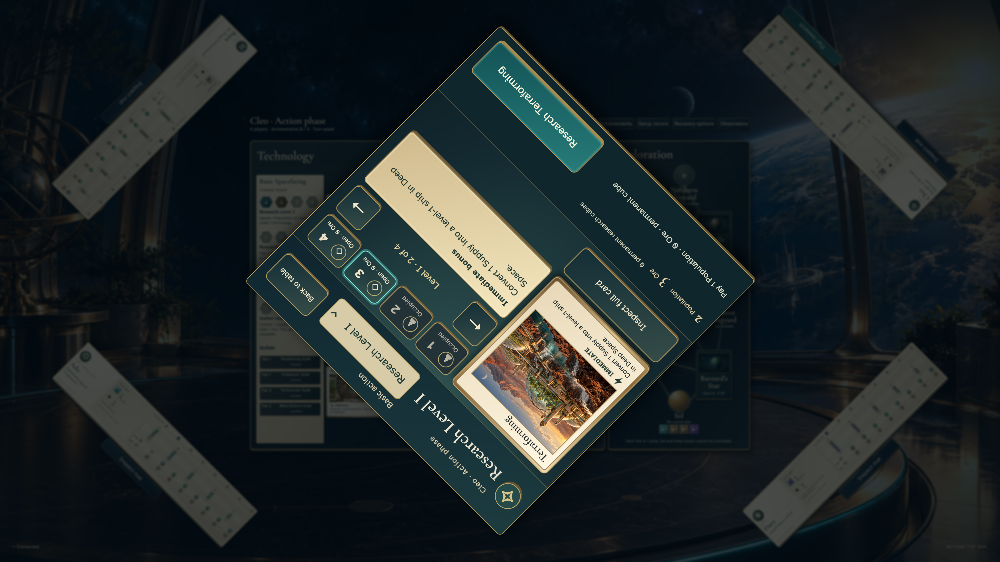](../../screenshots/automate-production-permanently-at-4-shared-corner-seats/066-cleo-food-browse-0-tabletop-4k-darwin.png)

- [x] Browse the next public Level I face
- [x] The canonical effect and backend acknowledgement settle.
- [x] Public technology topology retains physical separation.
- [x] The actual viewport fits without page scrolling.

## 68. Browse the next public Level I face

Viewpoint: **Cleo · North East · one shared controller**.

| desktop · 1440 × 1000 |
| --- |
|  |

tabletop-4k · 3840 × 2160

- [x] Browse the next public Level I face
- [x] The canonical effect and backend acknowledgement settle.
- [x] Public technology topology retains physical separation.
- [x] The actual viewport fits without page scrolling.

## 69. Browse the next public Level I face

Viewpoint: **Cleo · North East · one shared controller**.

| desktop · 1440 × 1000 |
| --- |
|  |

tabletop-4k · 3840 × 2160

- [x] Browse the next public Level I face
- [x] The canonical effect and backend acknowledgement settle.
- [x] Public technology topology retains physical separation.
- [x] The actual viewport fits without page scrolling.

## 70. Pay once and receive Advanced Genetics's immediate bonus

Viewpoint: **Cleo · North East · one shared controller**.

| desktop · 1440 × 1000 |
| --- |
|  |

tabletop-4k · 3840 × 2160

- [x] Pay once and receive Advanced Genetics's immediate bonus
- [x] The canonical effect and backend acknowledgement settle.
- [x] Public technology topology retains physical separation.
- [x] The actual viewport fits without page scrolling.

## 71. Close the decision without paying or collecting any further resource

Viewpoint: **Cleo · North East · one shared controller**.

| desktop · 1440 × 1000 |
| --- |
|  |

tabletop-4k · 3840 × 2160

- [x] Close the decision without paying or collecting any further resource
- [x] The canonical effect and backend acknowledgement settle.
- [x] Public technology topology retains physical separation.
- [x] The actual viewport fits without page scrolling.

## 72. Cleo inspects the actual retained production discs and Supply

Viewpoint: **Cleo · North East · one shared controller**.

| desktop · 1440 × 1000 |
| --- |
|  |

tabletop-4k · 3840 × 2160

- [x] Cleo inspects the actual retained production discs and Supply
- [x] The canonical effect and backend acknowledgement settle.
- [x] Public technology topology retains physical separation.
- [x] The actual viewport fits without page scrolling.

## 73. Permanent level 1 contributes 0 cumulative endgame VP without an immediate payout

Viewpoint: **Cleo · North East · one shared controller**.

| desktop · 1440 × 1000 |
| --- |
|  |

tabletop-4k · 3840 × 2160

- [x] Permanent level 1 contributes 0 cumulative endgame VP without an immediate payout
- [x] The canonical effect and backend acknowledgement settle.
- [x] Public technology topology retains physical separation.
- [x] The actual viewport fits without page scrolling.

## 74. Inspect the next Food disc and exposed yield as a read-only consequence

Viewpoint: **Cleo · North East · one shared controller**.

| desktop · 1440 × 1000 |
| --- |
|  |

tabletop-4k · 3840 × 2160

- [x] Inspect the next Food disc and exposed yield as a read-only consequence
- [x] The canonical effect and backend acknowledgement settle.
- [x] Public technology topology retains physical separation.
- [x] The actual viewport fits without page scrolling.

## 75. Escape returns to the exact mat opener; inspection never spends or collects

Viewpoint: **Cleo · North East · one shared controller**.

| desktop · 1440 × 1000 |
| --- |
|  |

tabletop-4k · 3840 × 2160

- [x] Escape returns to the exact mat opener; inspection never spends or collects
- [x] The canonical effect and backend acknowledgement settle.
- [x] Public technology topology retains physical separation.
- [x] The actual viewport fits without page scrolling.

## 76. Return to the real turn with all production choices still pending

Viewpoint: **Cleo · North East · one shared controller**.

| desktop · 1440 × 1000 |
| --- |
|  |

tabletop-4k · 3840 × 2160

- [x] Return to the real turn with all production choices still pending
- [x] The canonical effect and backend acknowledgement settle.
- [x] Public technology topology retains physical separation.
- [x] The actual viewport fits without page scrolling.

## 77. Reopen the same pending production after read-only inspection

Viewpoint: **Cleo · North East · one shared controller**.

| desktop · 1440 × 1000 |
| --- |
|  |

tabletop-4k · 3840 × 2160

- [x] Reopen the same pending production after read-only inspection
- [x] The canonical effect and backend acknowledgement settle.
- [x] Public technology topology retains physical separation.
- [x] The actual viewport fits without page scrolling.

## 78. Cleo completes production and hands off to Dara

Viewpoint: **Cleo · North East · one shared controller**.

| desktop · 1440 × 1000 |
| --- |
|  |

tabletop-4k · 3840 × 2160

- [x] Cleo completes production and hands off to Dara
- [x] The canonical effect and backend acknowledgement settle.
- [x] Public technology topology retains physical separation.
- [x] The actual viewport fits without page scrolling.

## 79. Collect exactly 1 Population; automation is permanent and not a second payout

Viewpoint: **Cleo · North East · one shared controller**.

| desktop · 1440 × 1000 |
| --- |
|  |

tabletop-4k · 3840 × 2160

- [x] Collect exactly 1 Population; automation is permanent and not a second payout
- [x] The canonical effect and backend acknowledgement settle.
- [x] Public technology topology retains physical separation.
- [x] The actual viewport fits without page scrolling.

## 80. Close the proof and leave the next actual controller active

Viewpoint: **Cleo · North East · one shared controller**.

| desktop · 1440 × 1000 |
| --- |
|  |

tabletop-4k · 3840 × 2160

- [x] Close the proof and leave the next actual controller active
- [x] The canonical effect and backend acknowledgement settle.
- [x] Public technology topology retains physical separation.
- [x] The actual viewport fits without page scrolling.

## 81. Dara opens the actual research and Action instrument

Viewpoint: **Dara · South East · one shared controller**.

| desktop · 1440 × 1000 |
| --- |
|  |

tabletop-4k · 3840 × 2160

- [x] Dara opens the actual research and Action instrument
- [x] The canonical effect and backend acknowledgement settle.
- [x] Public technology topology retains physical separation.
- [x] The actual viewport fits without page scrolling.

## 82. Dara selects the legal printed space 4

Viewpoint: **Dara · South East · one shared controller**.

| desktop · 1440 × 1000 |
| --- |
|  |

tabletop-4k · 3840 × 2160

- [x] Dara selects the legal printed space 4
- [x] The canonical effect and backend acknowledgement settle.
- [x] Public technology topology retains physical separation.
- [x] The actual viewport fits without page scrolling.

## 83. Browse the next public Level I face

Viewpoint: **Dara · South East · one shared controller**.

| desktop · 1440 × 1000 |
| --- |
|  |

tabletop-4k · 3840 × 2160

- [x] Browse the next public Level I face
- [x] The canonical effect and backend acknowledgement settle.
- [x] Public technology topology retains physical separation.
- [x] The actual viewport fits without page scrolling.

## 84. Browse the next public Level I face

Viewpoint: **Dara · South East · one shared controller**.

| desktop · 1440 × 1000 |
| --- |
|  |

tabletop-4k · 3840 × 2160

- [x] Browse the next public Level I face
- [x] The canonical effect and backend acknowledgement settle.
- [x] Public technology topology retains physical separation.
- [x] The actual viewport fits without page scrolling.

## 85. Pay once and receive Advanced Robotics's immediate bonus

Viewpoint: **Dara · South East · one shared controller**.

| desktop · 1440 × 1000 |
| --- |
|  |

tabletop-4k · 3840 × 2160

- [x] Pay once and receive Advanced Robotics's immediate bonus
- [x] The canonical effect and backend acknowledgement settle.
- [x] Public technology topology retains physical separation.
- [x] The actual viewport fits without page scrolling.

## 86. Close the decision without paying or collecting any further resource

Viewpoint: **Dara · South East · one shared controller**.

| desktop · 1440 × 1000 |
| --- |
|  |

tabletop-4k · 3840 × 2160

- [x] Close the decision without paying or collecting any further resource
- [x] The canonical effect and backend acknowledgement settle.
- [x] Public technology topology retains physical separation.
- [x] The actual viewport fits without page scrolling.

## 87. Dara inspects the actual retained production discs and Supply

Viewpoint: **Dara · South East · one shared controller**.

| desktop · 1440 × 1000 |
| --- |
|  |

tabletop-4k · 3840 × 2160

- [x] Dara inspects the actual retained production discs and Supply
- [x] The canonical effect and backend acknowledgement settle.
- [x] Public technology topology retains physical separation.
- [x] The actual viewport fits without page scrolling.

## 88. Permanent level 1 contributes 0 cumulative endgame VP without an immediate payout

Viewpoint: **Dara · South East · one shared controller**.

| desktop · 1440 × 1000 |
| --- |
|  |

tabletop-4k · 3840 × 2160

- [x] Permanent level 1 contributes 0 cumulative endgame VP without an immediate payout
- [x] The canonical effect and backend acknowledgement settle.
- [x] Public technology topology retains physical separation.
- [x] The actual viewport fits without page scrolling.

## 89. Inspect the next Ore disc and exposed yield as a read-only consequence

Viewpoint: **Dara · South East · one shared controller**.

| desktop · 1440 × 1000 |
| --- |
|  |

tabletop-4k · 3840 × 2160

- [x] Inspect the next Ore disc and exposed yield as a read-only consequence
- [x] The canonical effect and backend acknowledgement settle.
- [x] Public technology topology retains physical separation.
- [x] The actual viewport fits without page scrolling.

## 90. Escape returns to the exact mat opener; inspection never spends or collects

Viewpoint: **Dara · South East · one shared controller**.

| desktop · 1440 × 1000 |
| --- |
|  |

tabletop-4k · 3840 × 2160

- [x] Escape returns to the exact mat opener; inspection never spends or collects
- [x] The canonical effect and backend acknowledgement settle.
- [x] Public technology topology retains physical separation.
- [x] The actual viewport fits without page scrolling.

## 91. Return to the real turn with all production choices still pending

Viewpoint: **Dara · South East · one shared controller**.

| desktop · 1440 × 1000 |
| --- |
|  |

tabletop-4k · 3840 × 2160

- [x] Return to the real turn with all production choices still pending
- [x] The canonical effect and backend acknowledgement settle.
- [x] Public technology topology retains physical separation.
- [x] The actual viewport fits without page scrolling.

## 92. Reopen the same pending production after read-only inspection

Viewpoint: **Dara · South East · one shared controller**.

| desktop · 1440 × 1000 |
| --- |
|  |

tabletop-4k · 3840 × 2160

- [x] Reopen the same pending production after read-only inspection
- [x] The canonical effect and backend acknowledgement settle.
- [x] Public technology topology retains physical separation.
- [x] The actual viewport fits without page scrolling.

## 93. Dara completes production and hands off to Ada

Viewpoint: **Dara · South East · one shared controller**.

| desktop · 1440 × 1000 |
| --- |
|  |

tabletop-4k · 3840 × 2160

- [x] Dara completes production and hands off to Ada
- [x] The canonical effect and backend acknowledgement settle.
- [x] Public technology topology retains physical separation.
- [x] The actual viewport fits without page scrolling.

## 94. Collect exactly 2 Ore; automation is permanent and not a second payout

Viewpoint: **Dara · South East · one shared controller**.

| desktop · 1440 × 1000 |
| --- |
|  |

tabletop-4k · 3840 × 2160

- [x] Collect exactly 2 Ore; automation is permanent and not a second payout
- [x] The canonical effect and backend acknowledgement settle.
- [x] Public technology topology retains physical separation.
- [x] The actual viewport fits without page scrolling.

## 95. Close the proof and leave the next actual controller active

Viewpoint: **Dara · South East · one shared controller**.

| desktop · 1440 × 1000 |
| --- |
|  |

tabletop-4k · 3840 × 2160

- [x] Close the proof and leave the next actual controller active
- [x] The canonical effect and backend acknowledgement settle.
- [x] Public technology topology retains physical separation.
- [x] The actual viewport fits without page scrolling.
