# Build upgrade and inspect 2 shared cardinal fleets

One shared controller with direct physical seating, no remote identities or companion devices. Ordinary production UI setup, named legal unique Basic factions and real preparatory turns. Fixed setup entropy55555555-5555-4555-8555-000000000002; deterministic command identities never inject game state or inspect concealed decks. Basic builds use Population, second-space costs follow the actual player overlay, printed Lasers builds/upgrades and Terraforming paths resolve canonically. Separate backend integration coverage verifies exhausted source, cap4, invalid targets and atomic split denials.

## 1. Arrive using the actual production client

Viewpoint: **Ada · South · one shared controller**.

| desktop · 1440 × 1000 |
| --- |
|  |

tabletop-4k · 3840 × 2160

- [x] Arrive using the actual production client
- [x] The actual canonical effect and backend acknowledgement settle.
- [x] Public technology topology retains physical separation.
- [x] The actual viewport fits without page scrolling.

## 2. Choose a real production play mode

Viewpoint: **Ada · South · one shared controller**.

| desktop · 1440 × 1000 |
| --- |
|  |

tabletop-4k · 3840 × 2160

- [x] Choose a real production play mode
- [x] The actual canonical effect and backend acknowledgement settle.
- [x] Public technology topology retains physical separation.
- [x] The actual viewport fits without page scrolling.

## 3. One controller configures physical seats directly on the table

Viewpoint: **Ada · South · one shared controller**.

| desktop · 1440 × 1000 |
| --- |
|  |

tabletop-4k · 3840 × 2160

- [x] One controller configures physical seats directly on the table
- [x] The actual canonical effect and backend acknowledgement settle.
- [x] Public technology topology retains physical separation.
- [x] The actual viewport fits without page scrolling.

## 4. Open the South seat on the shared surface

Viewpoint: **Ada · South · one shared controller**.

| desktop · 1440 × 1000 |
| --- |
|  |

tabletop-4k · 3840 × 2160

- [x] Open the South seat on the shared surface
- [x] The actual canonical effect and backend acknowledgement settle.
- [x] Public technology topology retains physical separation.
- [x] The actual viewport fits without page scrolling.

## 5. Name the physical player Ada

Viewpoint: **Ada · South · one shared controller**.

| desktop · 1440 × 1000 |
| --- |
|  |

tabletop-4k · 3840 × 2160

- [x] Name the physical player Ada
- [x] The actual canonical effect and backend acknowledgement settle.
- [x] Public technology topology retains physical separation.
- [x] The actual viewport fits without page scrolling.

## 6. The local physical seat is retained on this controller

Viewpoint: **Ada · South · one shared controller**.

| desktop · 1440 × 1000 |
| --- |
|  |

tabletop-4k · 3840 × 2160

- [x] The local physical seat is retained on this controller
- [x] The actual canonical effect and backend acknowledgement settle.
- [x] Public technology topology retains physical separation.
- [x] The actual viewport fits without page scrolling.

## 7. Open the North seat on the shared surface

Viewpoint: **Bora · North · one shared controller**.

| desktop · 1440 × 1000 |
| --- |
|  |

tabletop-4k · 3840 × 2160

- [x] Open the North seat on the shared surface
- [x] The actual canonical effect and backend acknowledgement settle.
- [x] Public technology topology retains physical separation.
- [x] The actual viewport fits without page scrolling.

## 8. Name the physical player Bora

Viewpoint: **Bora · North · one shared controller**.

| desktop · 1440 × 1000 |
| --- |
|  |

tabletop-4k · 3840 × 2160

- [x] Name the physical player Bora
- [x] The actual canonical effect and backend acknowledgement settle.
- [x] Public technology topology retains physical separation.
- [x] The actual viewport fits without page scrolling.

## 9. The local physical seat is retained on this controller

Viewpoint: **Bora · North · one shared controller**.

| desktop · 1440 × 1000 |
| --- |
|  |

tabletop-4k · 3840 × 2160

- [x] The local physical seat is retained on this controller
- [x] The actual canonical effect and backend acknowledgement settle.
- [x] Public technology topology retains physical separation.
- [x] The actual viewport fits without page scrolling.

## 10. Ada chooses a legal unique Basic faction

Viewpoint: **Ada · South · one shared controller**.

| desktop · 1440 × 1000 |
| --- |
|  |

tabletop-4k · 3840 × 2160

- [x] Ada chooses a legal unique Basic faction
- [x] The actual canonical effect and backend acknowledgement settle.
- [x] Public technology topology retains physical separation.
- [x] The actual viewport fits without page scrolling.

## 11. Ada retains Nishida-Østergaard Corporation

Viewpoint: **Ada · South · one shared controller**.

| desktop · 1440 × 1000 |
| --- |
|  |

tabletop-4k · 3840 × 2160

- [x] Ada retains Nishida-Østergaard Corporation
- [x] The actual canonical effect and backend acknowledgement settle.
- [x] Public technology topology retains physical separation.
- [x] The actual viewport fits without page scrolling.

## 12. Bora chooses a legal unique Basic faction

Viewpoint: **Bora · North · one shared controller**.

| desktop · 1440 × 1000 |
| --- |
|  |

tabletop-4k · 3840 × 2160

- [x] Bora chooses a legal unique Basic faction
- [x] The actual canonical effect and backend acknowledgement settle.
- [x] Public technology topology retains physical separation.
- [x] The actual viewport fits without page scrolling.

## 13. Bora retains United Nations of Sol

Viewpoint: **Bora · North · one shared controller**.

| desktop · 1440 × 1000 |
| --- |
| [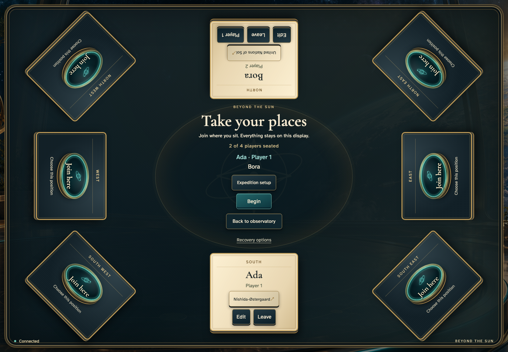](../../screenshots/build-upgrade-and-inspect-2-shared-cardinal-fleets/012-faction-1-chosen-desktop-darwin.png) |

tabletop-4k · 3840 × 2160

[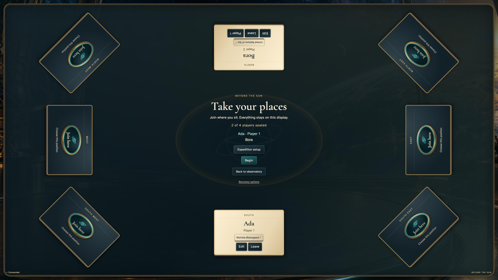](../../screenshots/build-upgrade-and-inspect-2-shared-cardinal-fleets/012-faction-1-chosen-tabletop-4k-darwin.png)

- [x] Bora retains United Nations of Sol
- [x] The actual canonical effect and backend acknowledgement settle.
- [x] Public technology topology retains physical separation.
- [x] The actual viewport fits without page scrolling.

## 14. Begin the immutable source-reviewed Basic setup through the ordinary UI

Viewpoint: **Ada · South · one shared controller**.

| desktop · 1440 × 1000 |
| --- |
| [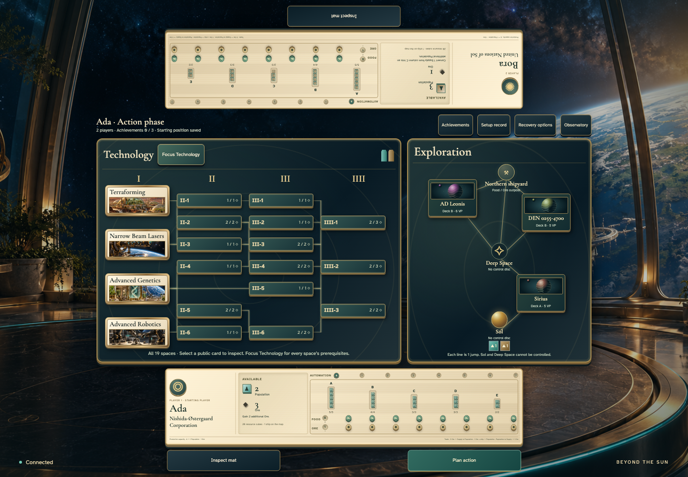](../../screenshots/build-upgrade-and-inspect-2-shared-cardinal-fleets/013-begun-desktop-darwin.png) |

tabletop-4k · 3840 × 2160

- [x] Begin the immutable source-reviewed Basic setup through the ordinary UI
- [x] The actual canonical effect and backend acknowledgement settle.
- [x] Public technology topology retains physical separation.
- [x] The actual viewport fits without page scrolling.

## 15. Ada opens the actual Action instrument

Viewpoint: **Ada · South · one shared controller**.

| desktop · 1440 × 1000 |
| --- |
|  |

tabletop-4k · 3840 × 2160

- [x] Ada opens the actual Action instrument
- [x] The actual canonical effect and backend acknowledgement settle.
- [x] Public technology topology retains physical separation.
- [x] The actual viewport fits without page scrolling.

## 16. Ada selects Basic construction

Viewpoint: **Ada · South · one shared controller**.

| desktop · 1440 × 1000 |
| --- |
|  |

tabletop-4k · 3840 × 2160

[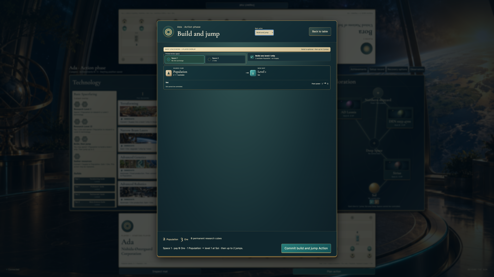](../../screenshots/build-upgrade-and-inspect-2-shared-cardinal-fleets/015-ada-build-kind-tabletop-4k-darwin.png)

- [x] Ada selects Basic construction
- [x] The actual canonical effect and backend acknowledgement settle.
- [x] Public technology topology retains physical separation.
- [x] The actual viewport fits without page scrolling.

## 17. Keyboard may decline the optional build and retain Population

Viewpoint: **Ada · South · one shared controller**.

| desktop · 1440 × 1000 |
| --- |
| [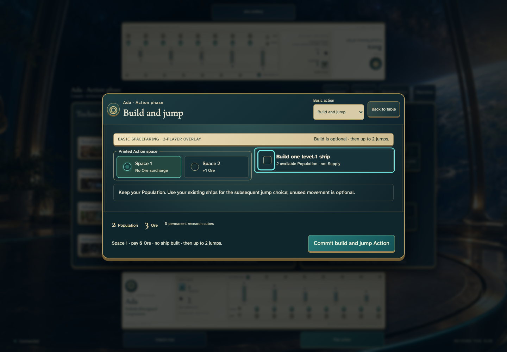](../../screenshots/build-upgrade-and-inspect-2-shared-cardinal-fleets/016-ada-no-build-desktop-darwin.png) |

tabletop-4k · 3840 × 2160

[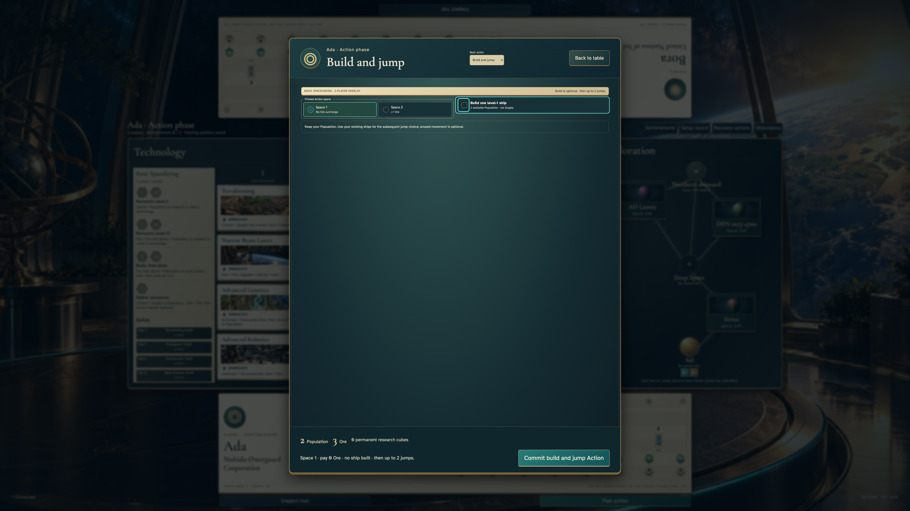](../../screenshots/build-upgrade-and-inspect-2-shared-cardinal-fleets/016-ada-no-build-tabletop-4k-darwin.png)

- [x] Keyboard may decline the optional build and retain Population
- [x] The actual canonical effect and backend acknowledgement settle.
- [x] Public technology topology retains physical separation.
- [x] The actual viewport fits without page scrolling.

## 18. Keyboard restores the explicit Population-to-level-one build

Viewpoint: **Ada · South · one shared controller**.

| desktop · 1440 × 1000 |
| --- |
| [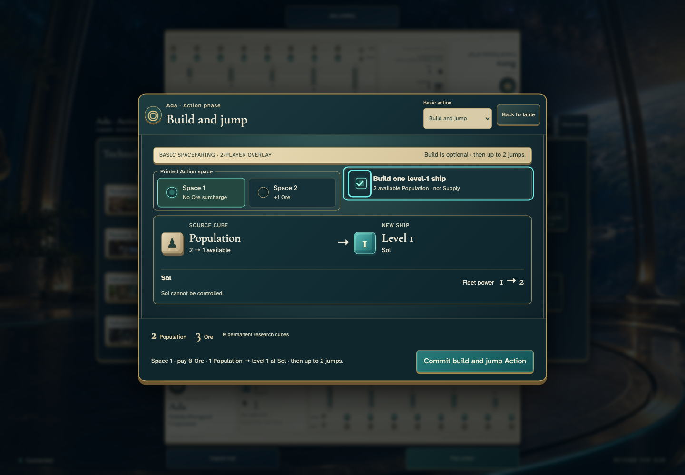](../../screenshots/build-upgrade-and-inspect-2-shared-cardinal-fleets/017-ada-build-selected-desktop-darwin.png) |

tabletop-4k · 3840 × 2160

- [x] Keyboard restores the explicit Population-to-level-one build
- [x] The actual canonical effect and backend acknowledgement settle.
- [x] Public technology topology retains physical separation.
- [x] The actual viewport fits without page scrolling.

## 19. Cancel restores Plan action and spends no resources

Viewpoint: **Ada · South · one shared controller**.

| desktop · 1440 × 1000 |
| --- |
| [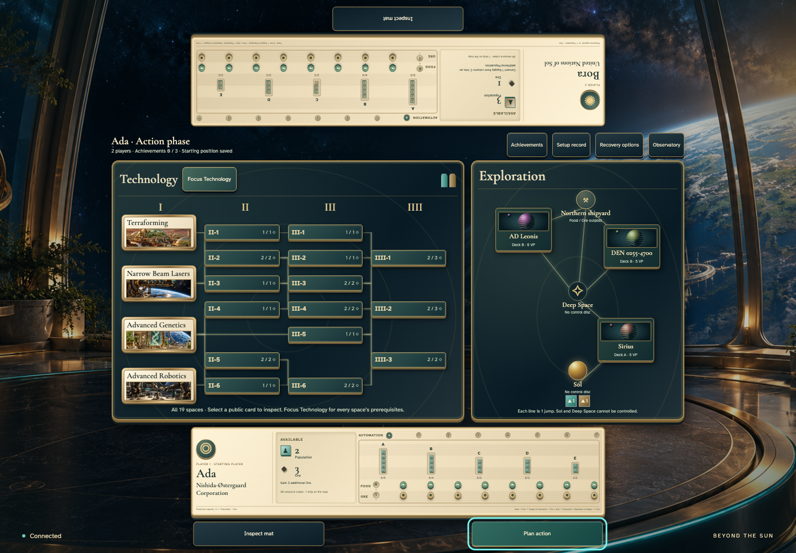](../../screenshots/build-upgrade-and-inspect-2-shared-cardinal-fleets/018-ada-cancel-desktop-darwin.png) |

tabletop-4k · 3840 × 2160

- [x] Cancel restores Plan action and spends no resources
- [x] The actual canonical effect and backend acknowledgement settle.
- [x] Public technology topology retains physical separation.
- [x] The actual viewport fits without page scrolling.

## 20. Ada opens the actual Action instrument

Viewpoint: **Ada · South · one shared controller**.

| desktop · 1440 × 1000 |
| --- |
|  |

tabletop-4k · 3840 × 2160

[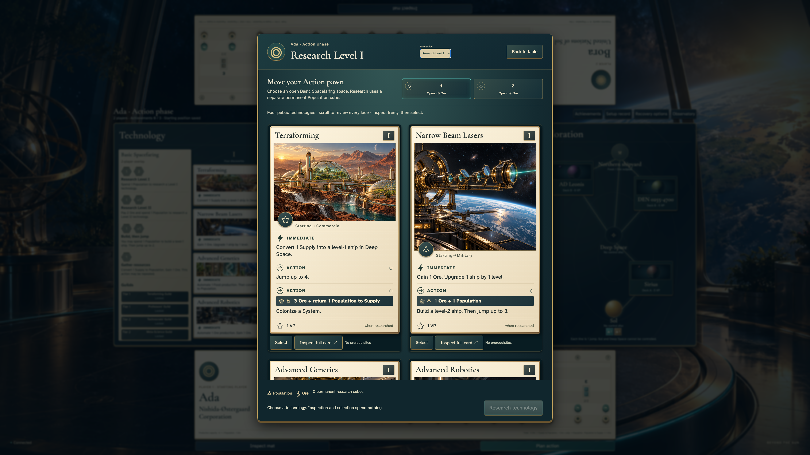](../../screenshots/build-upgrade-and-inspect-2-shared-cardinal-fleets/019-ada-reopen-plan-tabletop-4k-darwin.png)

- [x] Ada opens the actual Action instrument
- [x] The actual canonical effect and backend acknowledgement settle.
- [x] Public technology topology retains physical separation.
- [x] The actual viewport fits without page scrolling.

## 21. Ada selects Basic construction

Viewpoint: **Ada · South · one shared controller**.

| desktop · 1440 × 1000 |
| --- |
| [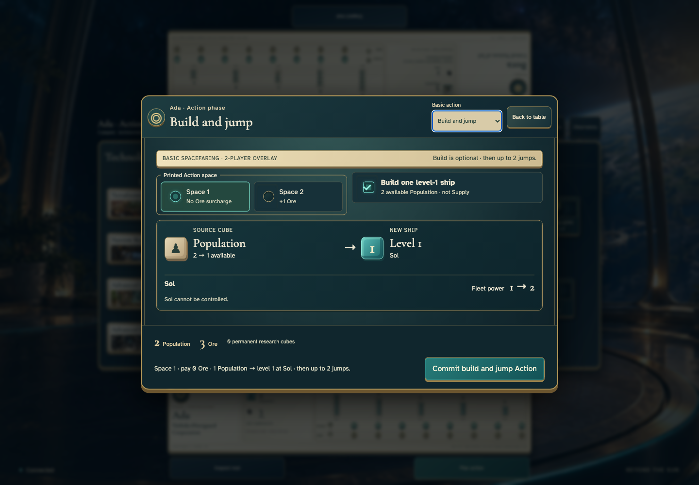](../../screenshots/build-upgrade-and-inspect-2-shared-cardinal-fleets/020-ada-reopen-kind-desktop-darwin.png) |

tabletop-4k · 3840 × 2160

- [x] Ada selects Basic construction
- [x] The actual canonical effect and backend acknowledgement settle.
- [x] Public technology topology retains physical separation.
- [x] The actual viewport fits without page scrolling.

## 22. Commit one Population cube into a level-one Sol ship; movement is still optional

Viewpoint: **Ada · South · one shared controller**.

| desktop · 1440 × 1000 |
| --- |
|  |

tabletop-4k · 3840 × 2160

- [x] Commit one Population cube into a level-one Sol ship; movement is still optional
- [x] The actual canonical effect and backend acknowledgement settle.
- [x] Public technology topology retains physical separation.
- [x] The actual viewport fits without page scrolling.

## 23. Reload retains the saved ship and pending movement

Viewpoint: **Ada · South · one shared controller**.

| desktop · 1440 × 1000 |
| --- |
|  |

tabletop-4k · 3840 × 2160

[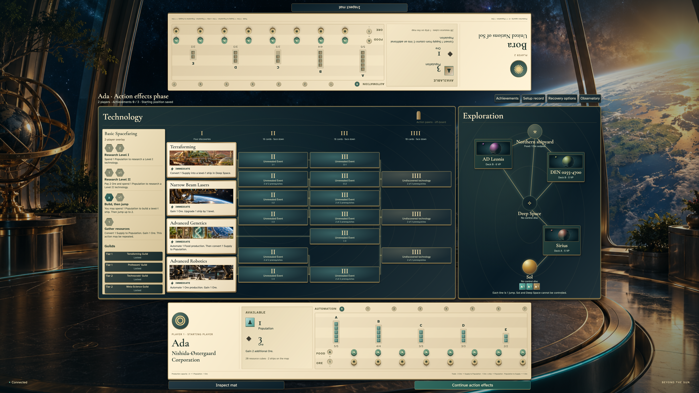](../../screenshots/build-upgrade-and-inspect-2-shared-cardinal-fleets/022-ada-build-retained-tabletop-4k-darwin.png)

- [x] Reload retains the saved ship and pending movement
- [x] The actual canonical effect and backend acknowledgement settle.
- [x] Public technology topology retains physical separation.
- [x] The actual viewport fits without page scrolling.

## 24. Resume the same optional movement without rebuilding or charging again

Viewpoint: **Ada · South · one shared controller**.

| desktop · 1440 × 1000 |
| --- |
|  |

tabletop-4k · 3840 × 2160

[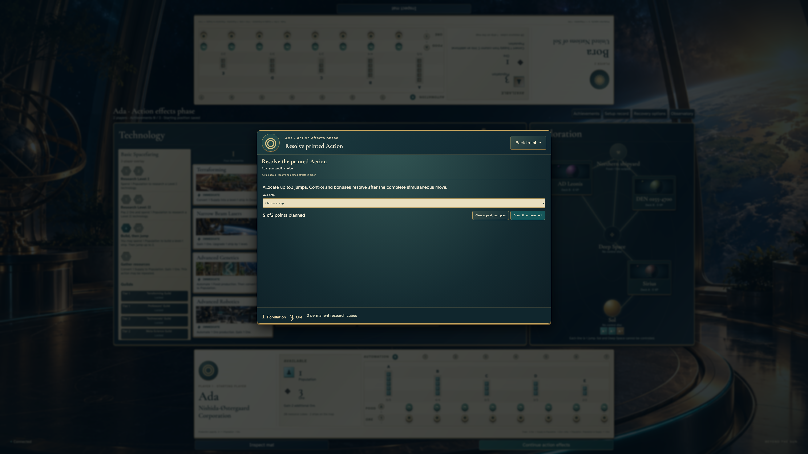](../../screenshots/build-upgrade-and-inspect-2-shared-cardinal-fleets/023-ada-movement-restored-tabletop-4k-darwin.png)

- [x] Resume the same optional movement without rebuilding or charging again
- [x] The actual canonical effect and backend acknowledgement settle.
- [x] Public technology topology retains physical separation.
- [x] The actual viewport fits without page scrolling.

## 25. Decline optional movement without undoing the ship or Action cost

Viewpoint: **Ada · South · one shared controller**.

| desktop · 1440 × 1000 |
| --- |
|  |

tabletop-4k · 3840 × 2160

[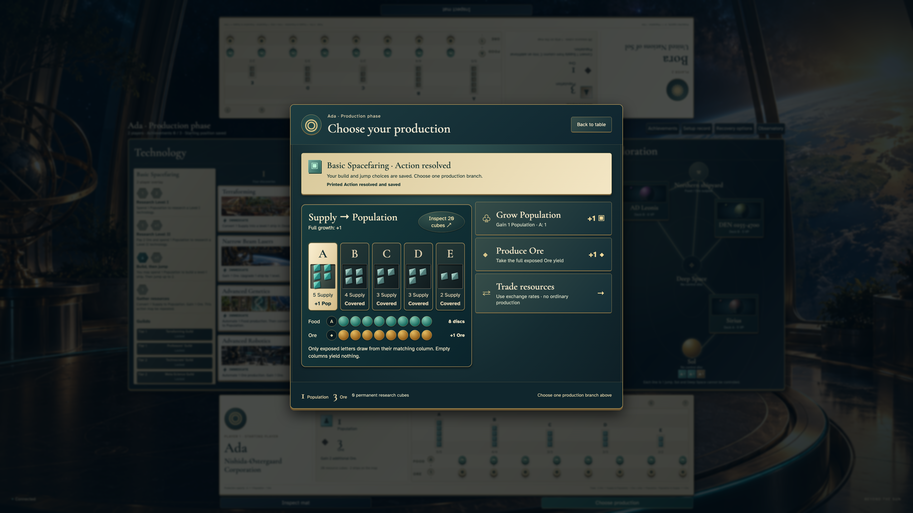](../../screenshots/build-upgrade-and-inspect-2-shared-cardinal-fleets/024-ada-no-move-tabletop-4k-darwin.png)

- [x] Decline optional movement without undoing the ship or Action cost
- [x] The actual canonical effect and backend acknowledgement settle.
- [x] Public technology topology retains physical separation.
- [x] The actual viewport fits without page scrolling.

## 26. Ada completes ordinary production and hands off

Viewpoint: **Ada · South · one shared controller**.

| desktop · 1440 × 1000 |
| --- |
| [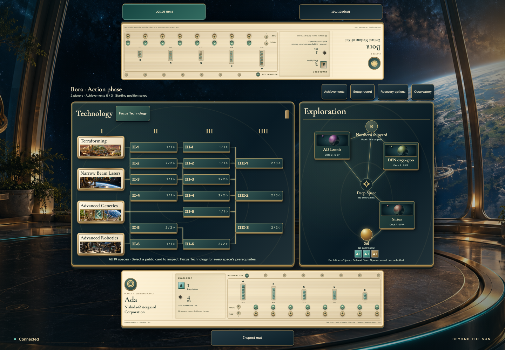](../../screenshots/build-upgrade-and-inspect-2-shared-cardinal-fleets/025-ada-handoff-desktop-darwin.png) |

tabletop-4k · 3840 × 2160

[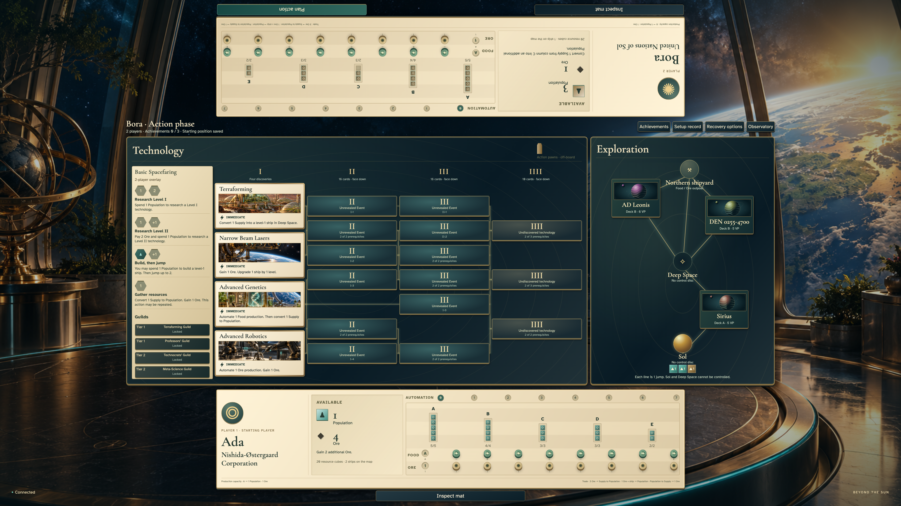](../../screenshots/build-upgrade-and-inspect-2-shared-cardinal-fleets/025-ada-handoff-tabletop-4k-darwin.png)

- [x] Ada completes ordinary production and hands off
- [x] The actual canonical effect and backend acknowledgement settle.
- [x] Public technology topology retains physical separation.
- [x] The actual viewport fits without page scrolling.

## 27. Bora opens the actual Action instrument

Viewpoint: **Bora · North · one shared controller**.

| desktop · 1440 × 1000 |
| --- |
| [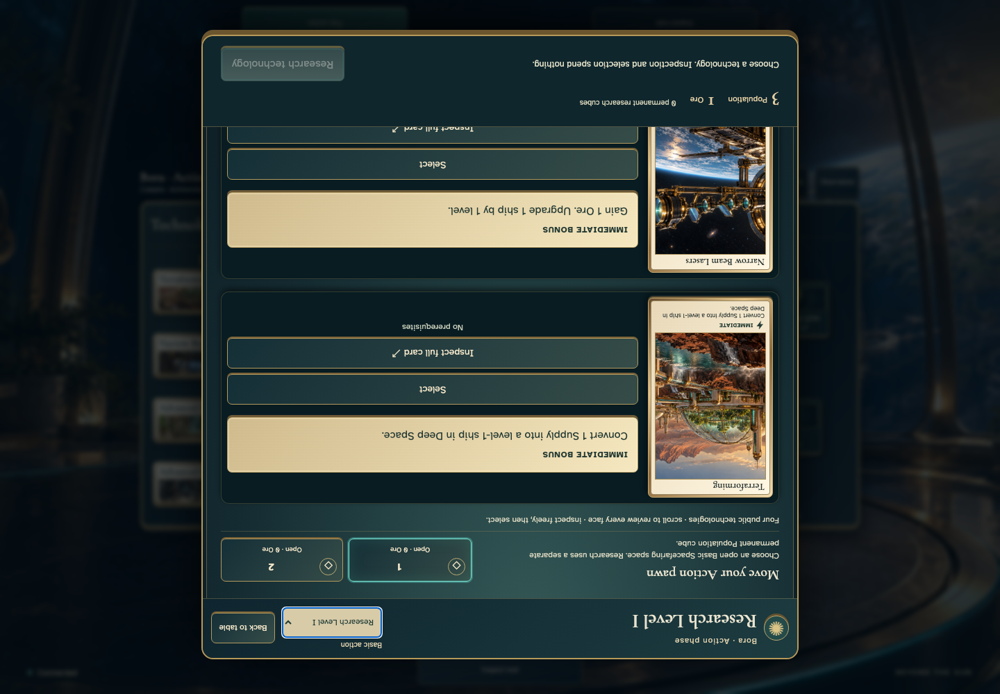](../../screenshots/build-upgrade-and-inspect-2-shared-cardinal-fleets/026-bora-build-plan-desktop-darwin.png) |

tabletop-4k · 3840 × 2160

[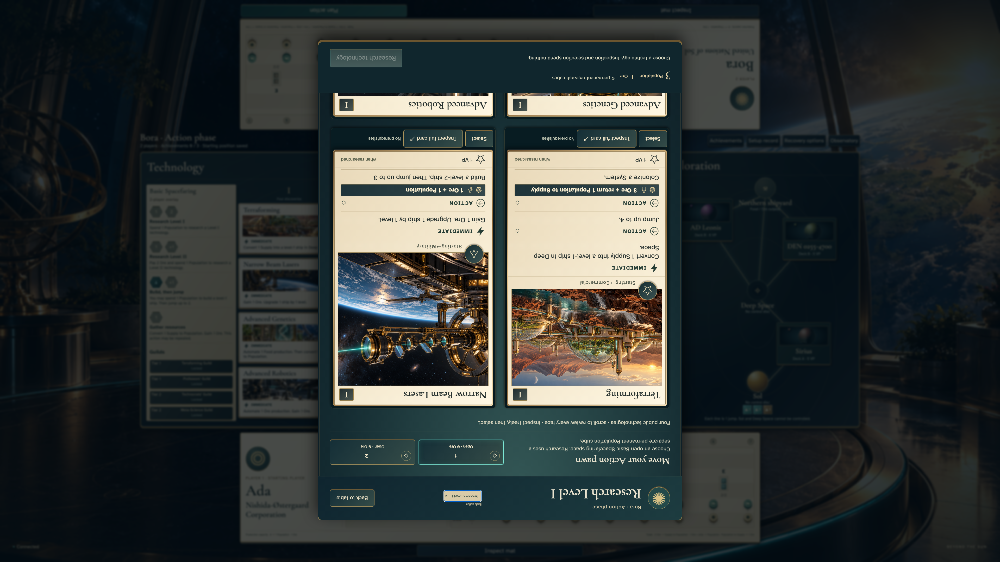](../../screenshots/build-upgrade-and-inspect-2-shared-cardinal-fleets/026-bora-build-plan-tabletop-4k-darwin.png)

- [x] Bora opens the actual Action instrument
- [x] The actual canonical effect and backend acknowledgement settle.
- [x] Public technology topology retains physical separation.
- [x] The actual viewport fits without page scrolling.

## 28. Bora selects Basic construction

Viewpoint: **Bora · North · one shared controller**.

| desktop · 1440 × 1000 |
| --- |
| [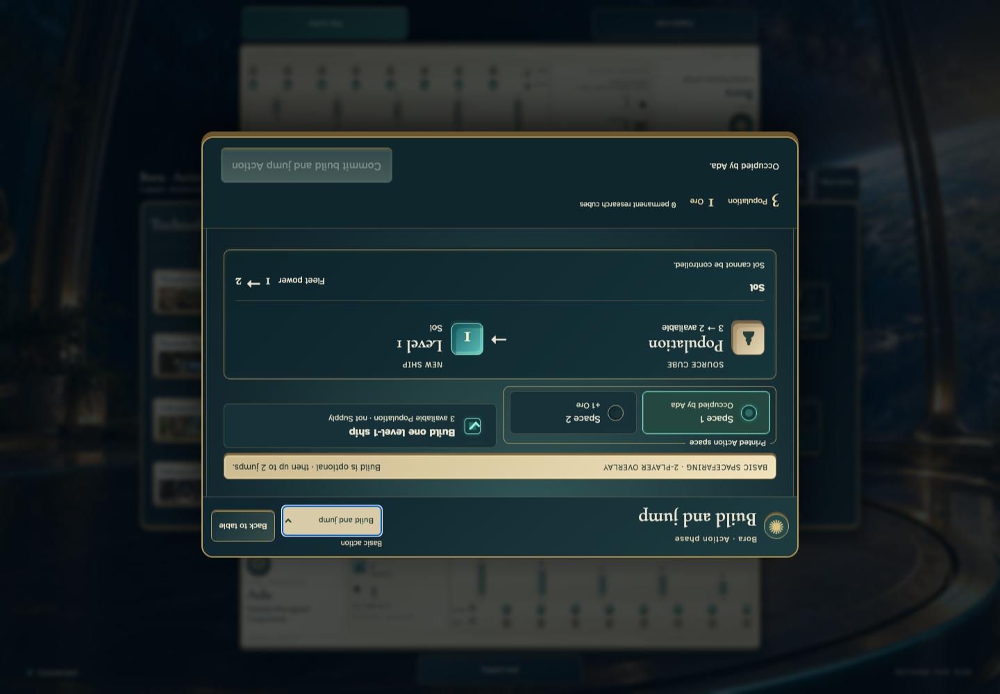](../../screenshots/build-upgrade-and-inspect-2-shared-cardinal-fleets/027-bora-build-kind-desktop-darwin.png) |

tabletop-4k · 3840 × 2160

[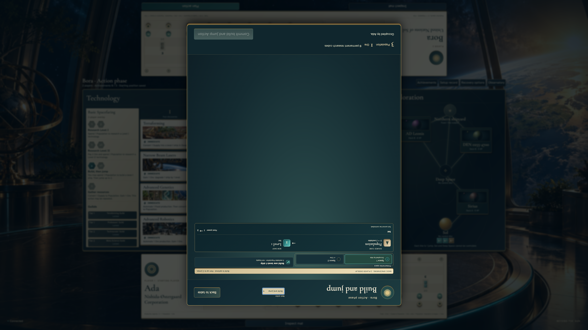](../../screenshots/build-upgrade-and-inspect-2-shared-cardinal-fleets/027-bora-build-kind-tabletop-4k-darwin.png)

- [x] Bora selects Basic construction
- [x] The actual canonical effect and backend acknowledgement settle.
- [x] Public technology topology retains physical separation.
- [x] The actual viewport fits without page scrolling.

## 29. Ada’s occupied Basic space prevents a second pawn from using it

Viewpoint: **Bora · North · one shared controller**.

| desktop · 1440 × 1000 |
| --- |
|  |

tabletop-4k · 3840 × 2160

- [x] Ada’s occupied Basic space prevents a second pawn from using it
- [x] The actual canonical effect and backend acknowledgement settle.
- [x] Public technology topology retains physical separation.
- [x] The actual viewport fits without page scrolling.

## 30. Choose the second printed space with one Ore surcharge

Viewpoint: **Bora · North · one shared controller**.

| desktop · 1440 × 1000 |
| --- |
| [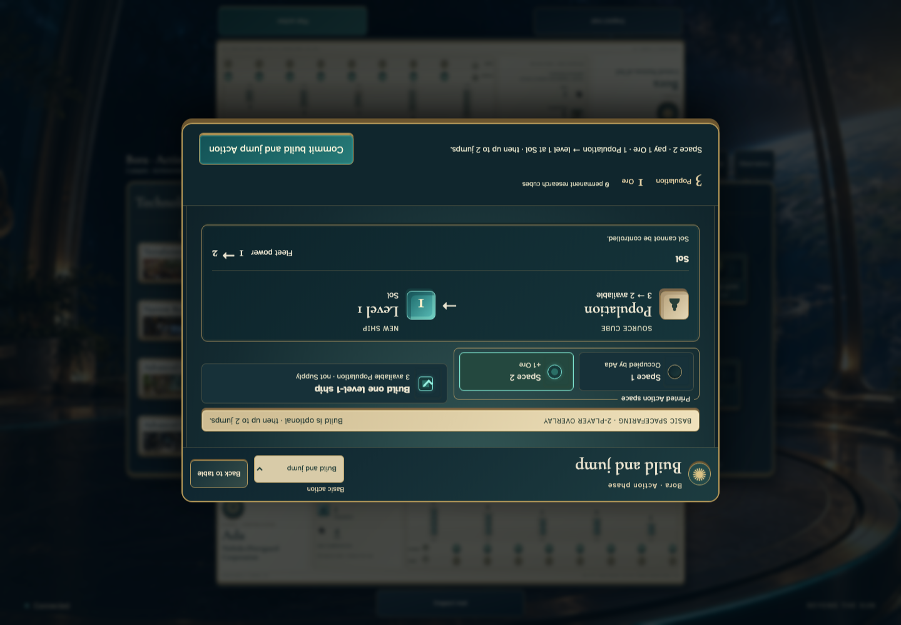](../../screenshots/build-upgrade-and-inspect-2-shared-cardinal-fleets/029-bora-second-space-desktop-darwin.png) |

tabletop-4k · 3840 × 2160

[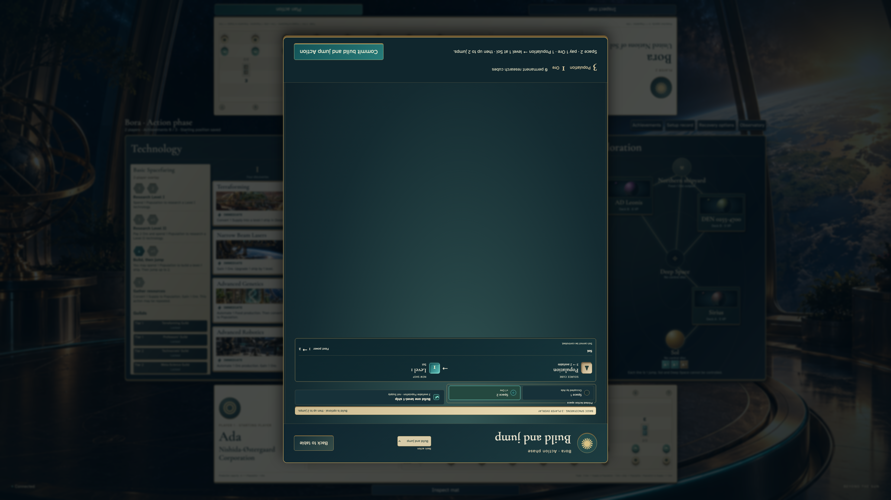](../../screenshots/build-upgrade-and-inspect-2-shared-cardinal-fleets/029-bora-second-space-tabletop-4k-darwin.png)

- [x] Choose the second printed space with one Ore surcharge
- [x] The actual canonical effect and backend acknowledgement settle.
- [x] Public technology topology retains physical separation.
- [x] The actual viewport fits without page scrolling.

## 31. Build from Population at Sol and retain the exact second-space charge

Viewpoint: **Bora · North · one shared controller**.

| desktop · 1440 × 1000 |
| --- |
| [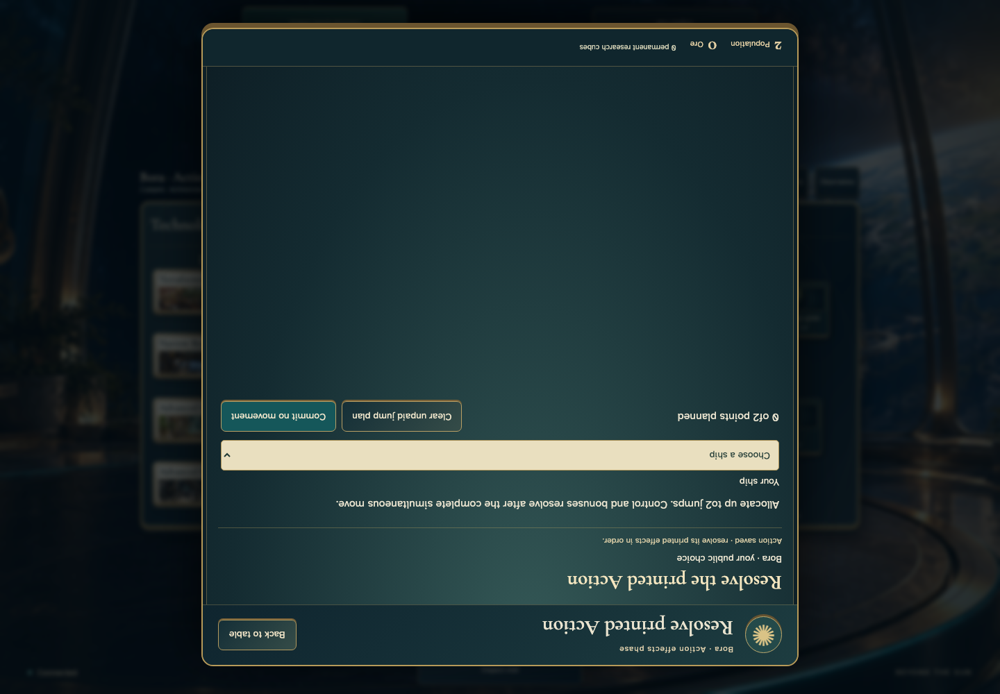](../../screenshots/build-upgrade-and-inspect-2-shared-cardinal-fleets/030-bora-built-desktop-darwin.png) |

tabletop-4k · 3840 × 2160

[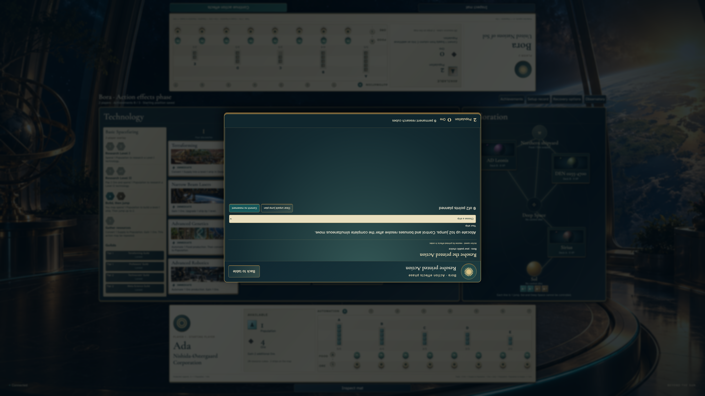](../../screenshots/build-upgrade-and-inspect-2-shared-cardinal-fleets/030-bora-built-tabletop-4k-darwin.png)

- [x] Build from Population at Sol and retain the exact second-space charge
- [x] The actual canonical effect and backend acknowledgement settle.
- [x] Public technology topology retains physical separation.
- [x] The actual viewport fits without page scrolling.

## 32. Decline optional movement without undoing the ship or Action cost

Viewpoint: **Bora · North · one shared controller**.

| desktop · 1440 × 1000 |
| --- |
| [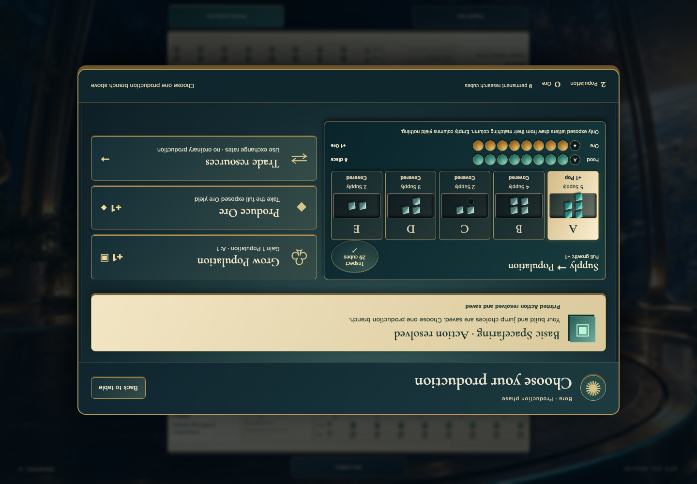](../../screenshots/build-upgrade-and-inspect-2-shared-cardinal-fleets/031-bora-no-move-desktop-darwin.png) |

tabletop-4k · 3840 × 2160

- [x] Decline optional movement without undoing the ship or Action cost
- [x] The actual canonical effect and backend acknowledgement settle.
- [x] Public technology topology retains physical separation.
- [x] The actual viewport fits without page scrolling.

## 33. Bora completes ordinary production and hands off

Viewpoint: **Bora · North · one shared controller**.

| desktop · 1440 × 1000 |
| --- |
|  |

tabletop-4k · 3840 × 2160

[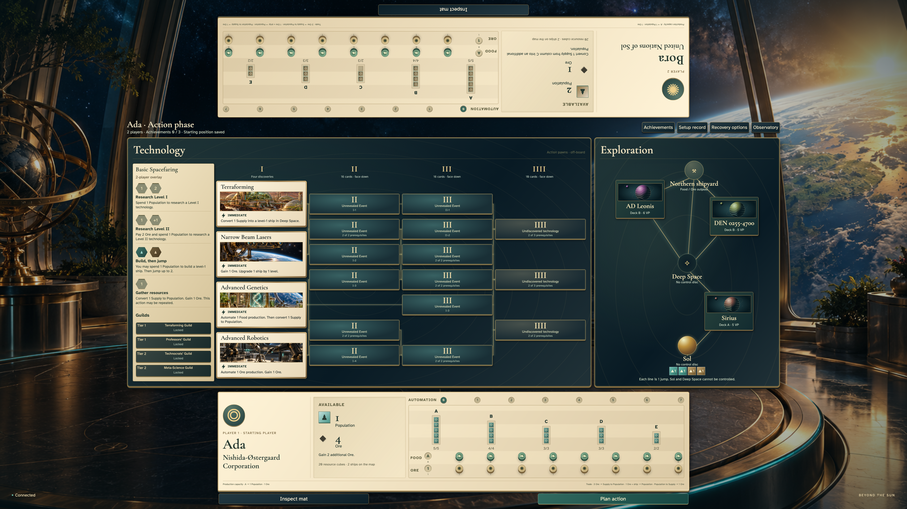](../../screenshots/build-upgrade-and-inspect-2-shared-cardinal-fleets/032-bora-handoff-tabletop-4k-darwin.png)

- [x] Bora completes ordinary production and hands off
- [x] The actual canonical effect and backend acknowledgement settle.
- [x] Public technology topology retains physical separation.
- [x] The actual viewport fits without page scrolling.

## 34. Open the retained faction economy and physical fleet register

Viewpoint: **Bora · North · one shared controller**.

| desktop · 1440 × 1000 |
| --- |
| [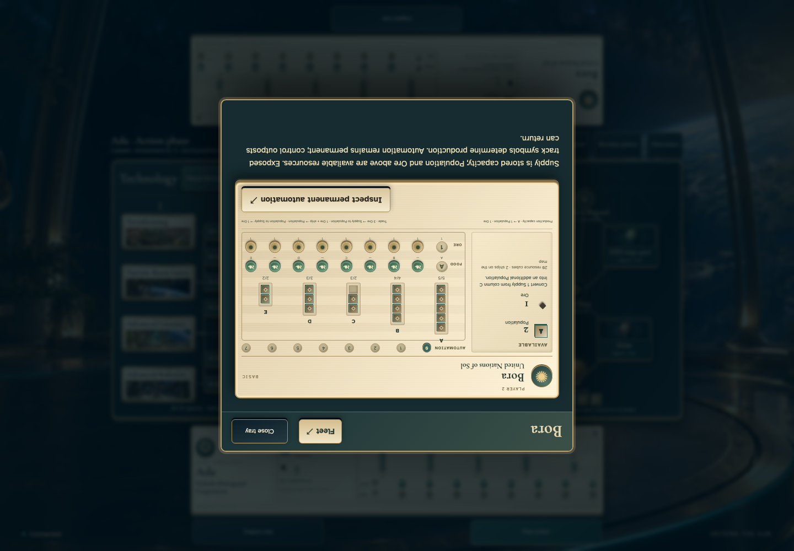](../../screenshots/build-upgrade-and-inspect-2-shared-cardinal-fleets/033-bora-register-mat-desktop-darwin.png) |

tabletop-4k · 3840 × 2160

- [x] Open the retained faction economy and physical fleet register
- [x] The actual canonical effect and backend acknowledgement settle.
- [x] Public technology topology retains physical separation.
- [x] The actual viewport fits without page scrolling.

## 35. Inspect 2 real ships with explicit levels and public summed power

Viewpoint: **Bora · North · one shared controller**.

| desktop · 1440 × 1000 |
| --- |
| [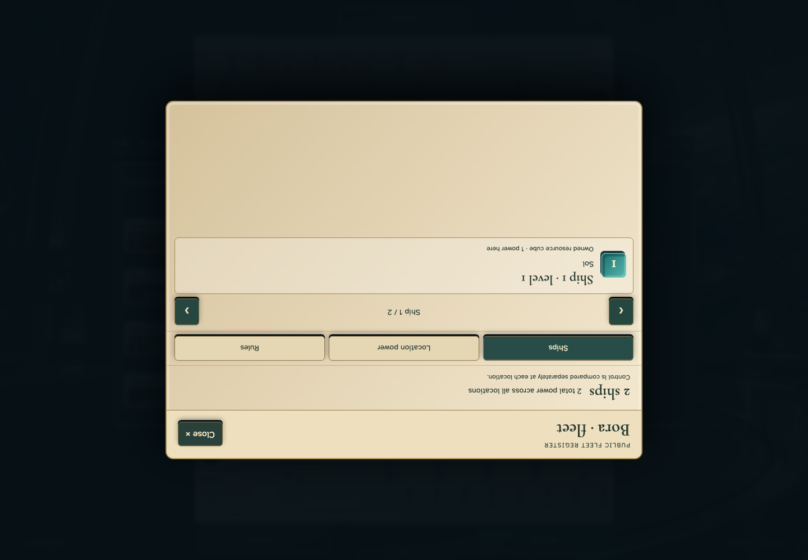](../../screenshots/build-upgrade-and-inspect-2-shared-cardinal-fleets/034-bora-register-ships-desktop-darwin.png) |

tabletop-4k · 3840 × 2160

[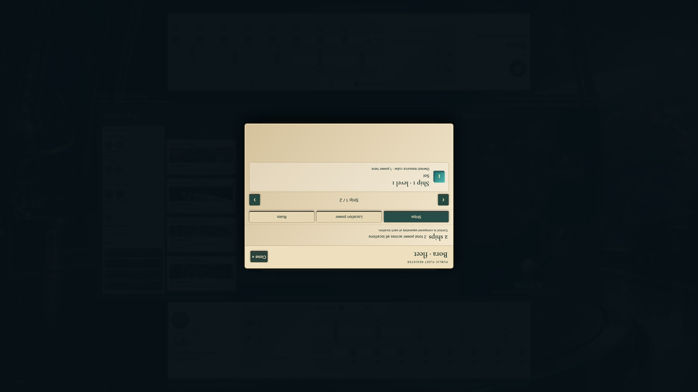](../../screenshots/build-upgrade-and-inspect-2-shared-cardinal-fleets/034-bora-register-ships-tabletop-4k-darwin.png)

- [x] Inspect 2 real ships with explicit levels and public summed power
- [x] The actual canonical effect and backend acknowledgement settle.
- [x] Public technology topology retains physical separation.
- [x] The actual viewport fits without page scrolling.

## 36. Open the paged public location register

Viewpoint: **Bora · North · one shared controller**.

| desktop · 1440 × 1000 |
| --- |
| [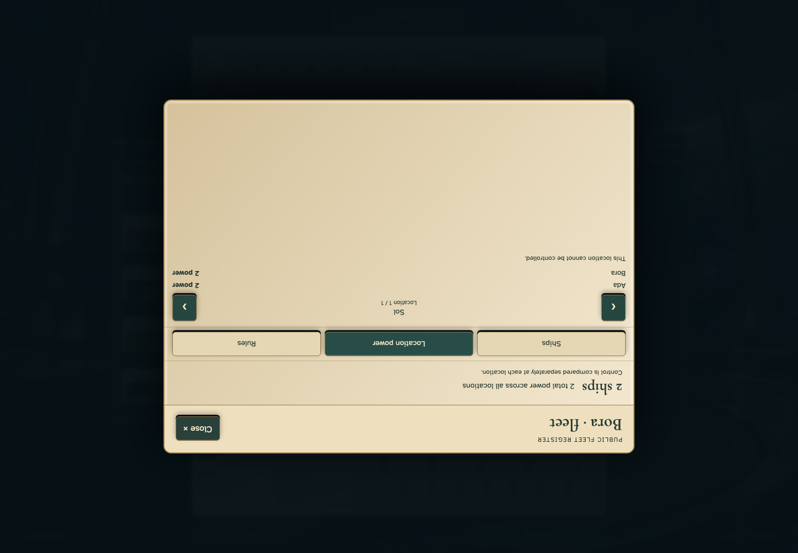](../../screenshots/build-upgrade-and-inspect-2-shared-cardinal-fleets/035-bora-register-power-initial-desktop-darwin.png) |

tabletop-4k · 3840 × 2160

[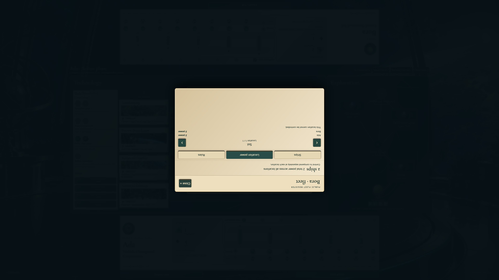](../../screenshots/build-upgrade-and-inspect-2-shared-cardinal-fleets/035-bora-register-power-initial-tabletop-4k-darwin.png)

- [x] Open the paged public location register
- [x] The actual canonical effect and backend acknowledgement settle.
- [x] Public technology topology retains physical separation.
- [x] The actual viewport fits without page scrolling.

## 37. Inspect Bora's actual power at Sol

Viewpoint: **Bora · North · one shared controller**.

| desktop · 1440 × 1000 |
| --- |
|  |

tabletop-4k · 3840 × 2160

- [x] Inspect Bora's actual power at Sol
- [x] The actual canonical effect and backend acknowledgement settle.
- [x] Public technology topology retains physical separation.
- [x] The actual viewport fits without page scrolling.

## 38. The register explains levels, location-specific power and incumbent ties without taking a turn

Viewpoint: **Bora · North · one shared controller**.

| desktop · 1440 × 1000 |
| --- |
|  |

tabletop-4k · 3840 × 2160

[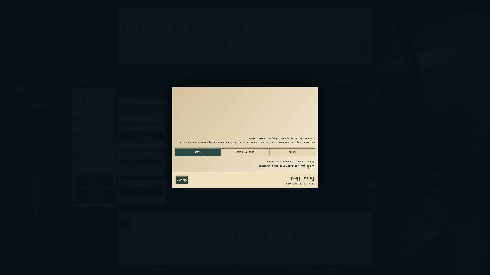](../../screenshots/build-upgrade-and-inspect-2-shared-cardinal-fleets/037-bora-register-rules-tabletop-4k-darwin.png)

- [x] The register explains levels, location-specific power and incumbent ties without taking a turn
- [x] The actual canonical effect and backend acknowledgement settle.
- [x] Public technology topology retains physical separation.
- [x] The actual viewport fits without page scrolling.

## 39. Keyboard reaches the bounded fleet details

Viewpoint: **Bora · North · one shared controller**.

| desktop · 1440 × 1000 |
| --- |
|  |

tabletop-4k · 3840 × 2160

- [x] Keyboard reaches the bounded fleet details
- [x] The actual canonical effect and backend acknowledgement settle.
- [x] Public technology topology retains physical separation.
- [x] The actual viewport fits without page scrolling.

## 40. Reverse Tab stays within the fleet reader

Viewpoint: **Bora · North · one shared controller**.

| desktop · 1440 × 1000 |
| --- |
| [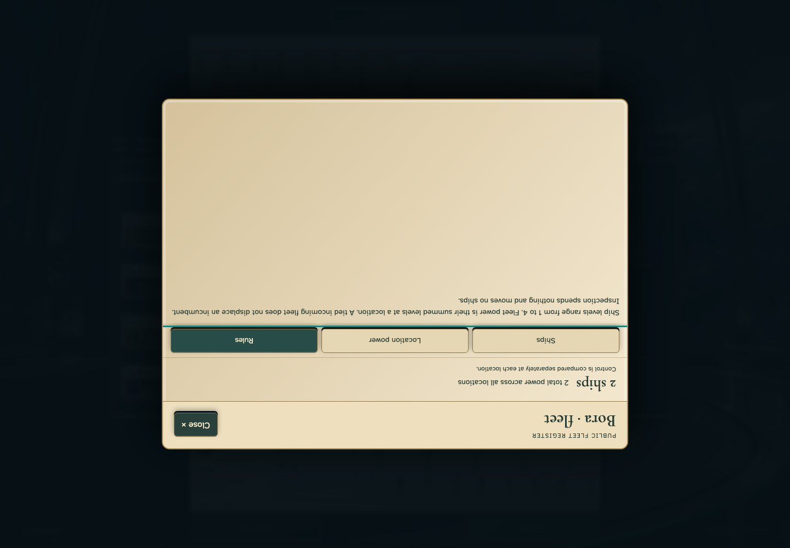](../../screenshots/build-upgrade-and-inspect-2-shared-cardinal-fleets/039-bora-register-reverse-tab-desktop-darwin.png) |

tabletop-4k · 3840 × 2160

[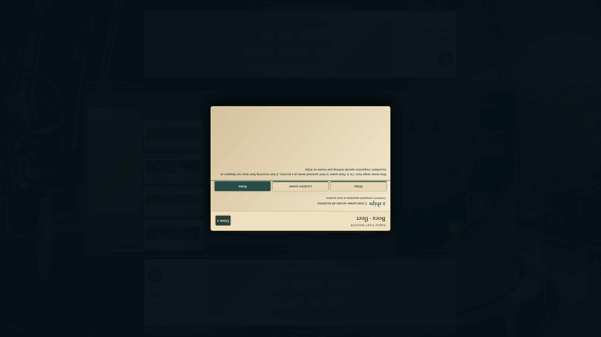](../../screenshots/build-upgrade-and-inspect-2-shared-cardinal-fleets/039-bora-register-reverse-tab-tabletop-4k-darwin.png)

- [x] Reverse Tab stays within the fleet reader
- [x] The actual canonical effect and backend acknowledgement settle.
- [x] Public technology topology retains physical separation.
- [x] The actual viewport fits without page scrolling.

## 41. Forward Tab wraps back to persistent Close

Viewpoint: **Bora · North · one shared controller**.

| desktop · 1440 × 1000 |
| --- |
| [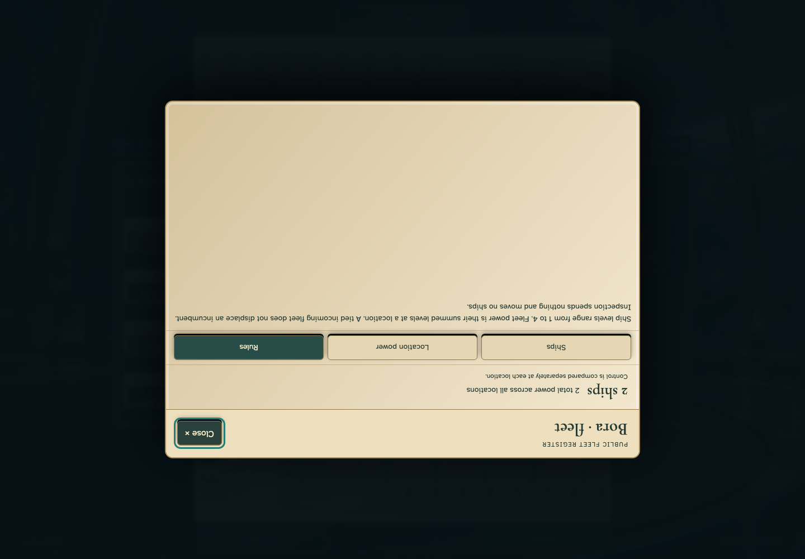](../../screenshots/build-upgrade-and-inspect-2-shared-cardinal-fleets/040-bora-register-tab-wrap-desktop-darwin.png) |

tabletop-4k · 3840 × 2160

- [x] Forward Tab wraps back to persistent Close
- [x] The actual canonical effect and backend acknowledgement settle.
- [x] Public technology topology retains physical separation.
- [x] The actual viewport fits without page scrolling.

## 42. Escape restores the actual Fleet opener

Viewpoint: **Bora · North · one shared controller**.

| desktop · 1440 × 1000 |
| --- |
|  |

tabletop-4k · 3840 × 2160

[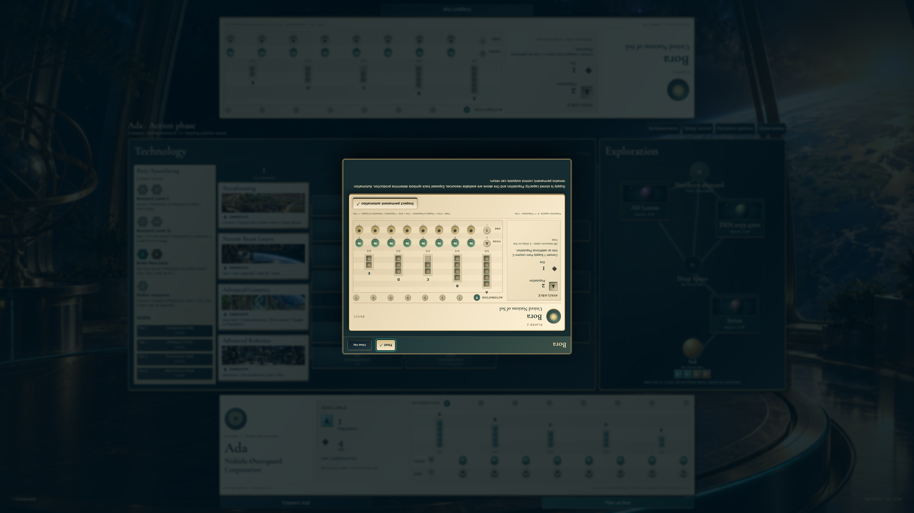](../../screenshots/build-upgrade-and-inspect-2-shared-cardinal-fleets/041-bora-register-return-tabletop-4k-darwin.png)

- [x] Escape restores the actual Fleet opener
- [x] The actual canonical effect and backend acknowledgement settle.
- [x] Public technology topology retains physical separation.
- [x] The actual viewport fits without page scrolling.

## 43. Close the mat and restore its physical opener

Viewpoint: **Bora · North · one shared controller**.

| desktop · 1440 × 1000 |
| --- |
|  |

tabletop-4k · 3840 × 2160

[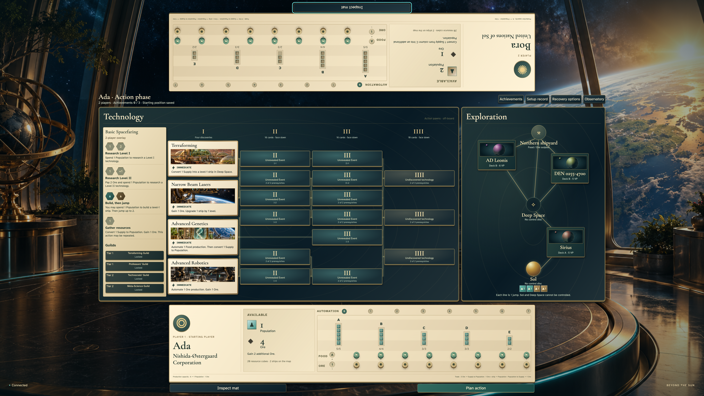](../../screenshots/build-upgrade-and-inspect-2-shared-cardinal-fleets/042-bora-register-mat-return-tabletop-4k-darwin.png)

- [x] Close the mat and restore its physical opener
- [x] The actual canonical effect and backend acknowledgement settle.
- [x] Public technology topology retains physical separation.
- [x] The actual viewport fits without page scrolling.

## 44. Ada opens the actual Action instrument

Viewpoint: **Ada · South · one shared controller**.

| desktop · 1440 × 1000 |
| --- |
| [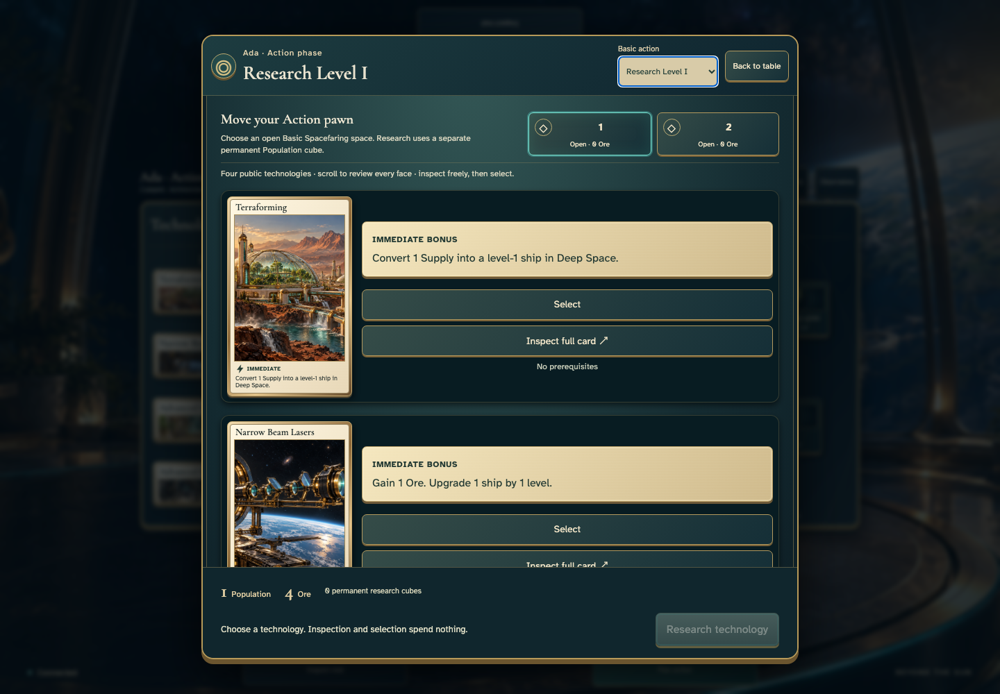](../../screenshots/build-upgrade-and-inspect-2-shared-cardinal-fleets/043-ada-lasers-plan-desktop-darwin.png) |

tabletop-4k · 3840 × 2160

- [x] Ada opens the actual Action instrument
- [x] The actual canonical effect and backend acknowledgement settle.
- [x] Public technology topology retains physical separation.
- [x] The actual viewport fits without page scrolling.

## 45. Ada chooses the unoccupied printed research space

Viewpoint: **Ada · South · one shared controller**.

| desktop · 1440 × 1000 |
| --- |
| [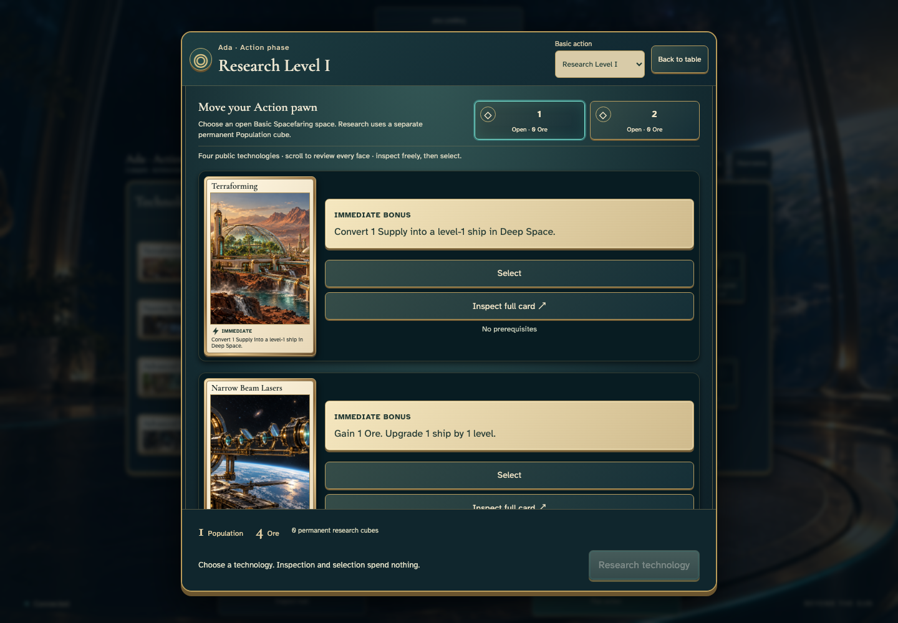](../../screenshots/build-upgrade-and-inspect-2-shared-cardinal-fleets/044-ada-lasers-space-desktop-darwin.png) |

tabletop-4k · 3840 × 2160

[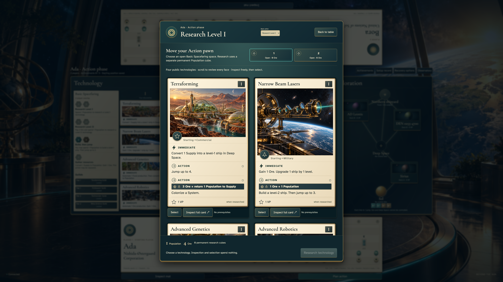](../../screenshots/build-upgrade-and-inspect-2-shared-cardinal-fleets/044-ada-lasers-space-tabletop-4k-darwin.png)

- [x] Ada chooses the unoccupied printed research space
- [x] The actual canonical effect and backend acknowledgement settle.
- [x] Public technology topology retains physical separation.
- [x] The actual viewport fits without page scrolling.

## 46. Choose the public Narrow Beam Lasers face and read its printed effect

Viewpoint: **Ada · South · one shared controller**.

| desktop · 1440 × 1000 |
| --- |
|  |

tabletop-4k · 3840 × 2160

[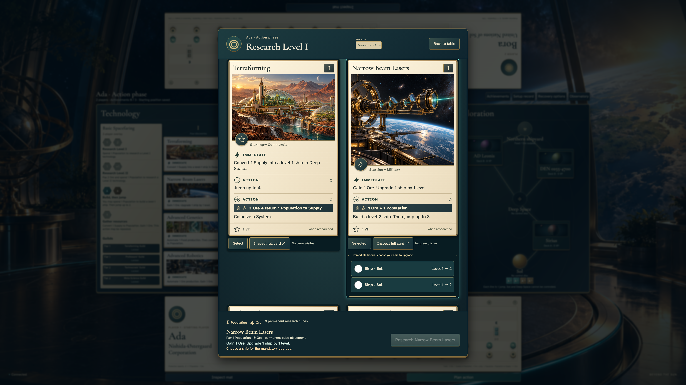](../../screenshots/build-upgrade-and-inspect-2-shared-cardinal-fleets/045-ada-lasers-card-tabletop-4k-darwin.png)

- [x] Choose the public Narrow Beam Lasers face and read its printed effect
- [x] The actual canonical effect and backend acknowledgement settle.
- [x] Public technology topology retains physical separation.
- [x] The actual viewport fits without page scrolling.

## 47. The mandatory one-level upgrade needs an explicit owned ship

Viewpoint: **Ada · South · one shared controller**.

| desktop · 1440 × 1000 |
| --- |
| [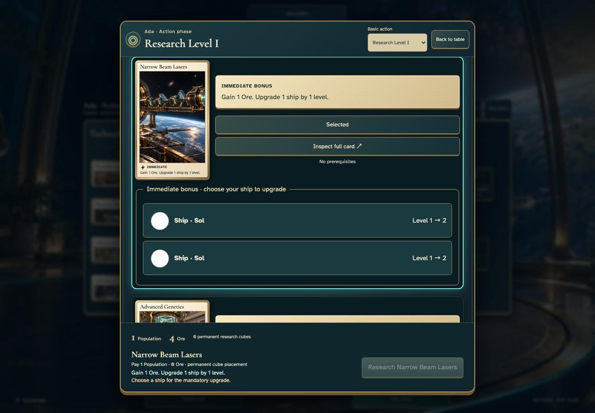](../../screenshots/build-upgrade-and-inspect-2-shared-cardinal-fleets/046-ada-lasers-target-required-desktop-darwin.png) |

tabletop-4k · 3840 × 2160

- [x] The mandatory one-level upgrade needs an explicit owned ship
- [x] The actual canonical effect and backend acknowledgement settle.
- [x] Public technology topology retains physical separation.
- [x] The actual viewport fits without page scrolling.

## 48. Select the owned ship and inspect the exact level change

Viewpoint: **Ada · South · one shared controller**.

| desktop · 1440 × 1000 |
| --- |
| [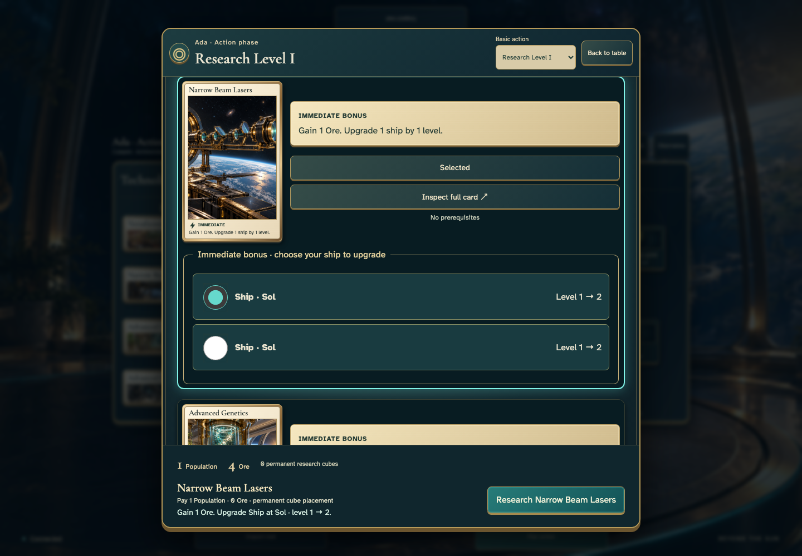](../../screenshots/build-upgrade-and-inspect-2-shared-cardinal-fleets/047-ada-lasers-target-desktop-darwin.png) |

tabletop-4k · 3840 × 2160

[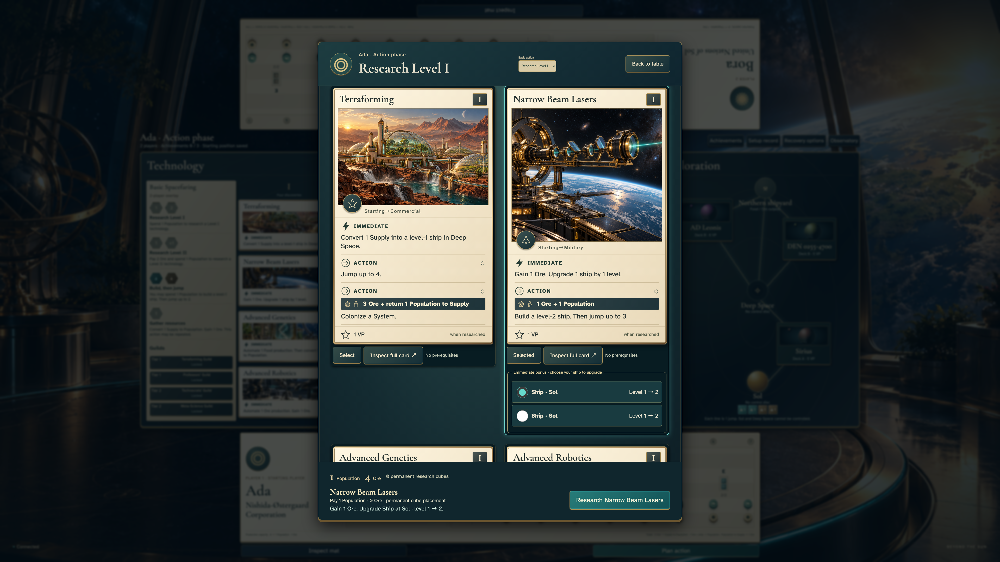](../../screenshots/build-upgrade-and-inspect-2-shared-cardinal-fleets/047-ada-lasers-target-tabletop-4k-darwin.png)

- [x] Select the owned ship and inspect the exact level change
- [x] The actual canonical effect and backend acknowledgement settle.
- [x] Public technology topology retains physical separation.
- [x] The actual viewport fits without page scrolling.

## 49. Ada pays permanent research Population and resolves the printed bonus

Viewpoint: **Ada · South · one shared controller**.

| desktop · 1440 × 1000 |
| --- |
| [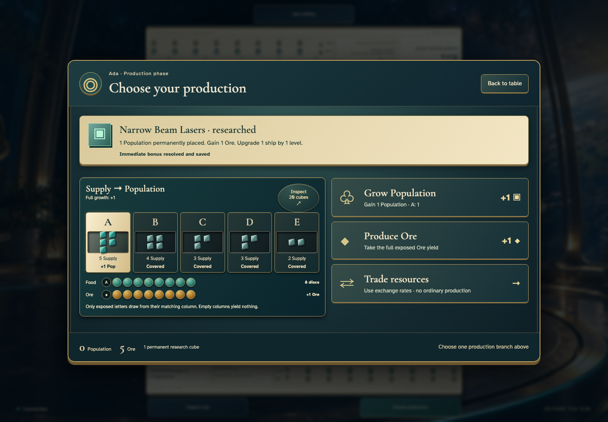](../../screenshots/build-upgrade-and-inspect-2-shared-cardinal-fleets/048-ada-lasers-paid-desktop-darwin.png) |

tabletop-4k · 3840 × 2160

[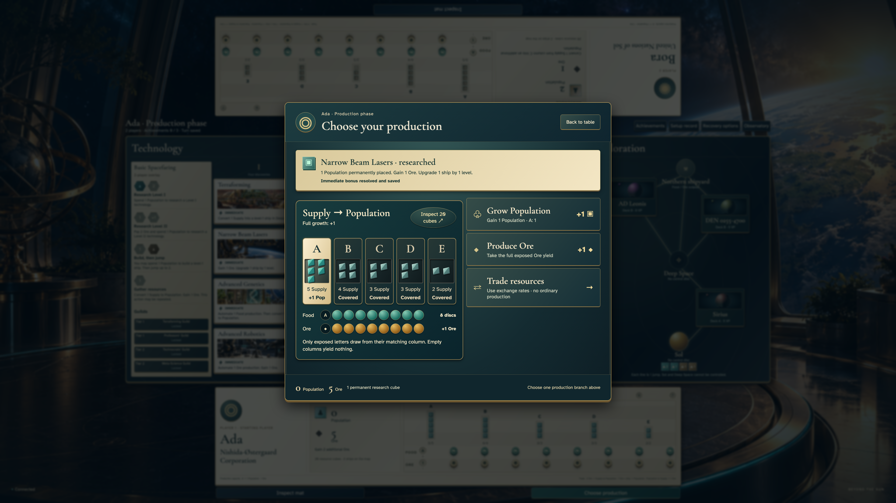](../../screenshots/build-upgrade-and-inspect-2-shared-cardinal-fleets/048-ada-lasers-paid-tabletop-4k-darwin.png)

- [x] Ada pays permanent research Population and resolves the printed bonus
- [x] The actual canonical effect and backend acknowledgement settle.
- [x] Public technology topology retains physical separation.
- [x] The actual viewport fits without page scrolling.

## 50. Ada completes ordinary production and hands off

Viewpoint: **Ada · South · one shared controller**.

| desktop · 1440 × 1000 |
| --- |
|  |

tabletop-4k · 3840 × 2160

- [x] Ada completes ordinary production and hands off
- [x] The actual canonical effect and backend acknowledgement settle.
- [x] Public technology topology retains physical separation.
- [x] The actual viewport fits without page scrolling.

## 51. Bora opens the actual Action instrument

Viewpoint: **Bora · North · one shared controller**.

| desktop · 1440 × 1000 |
| --- |
| [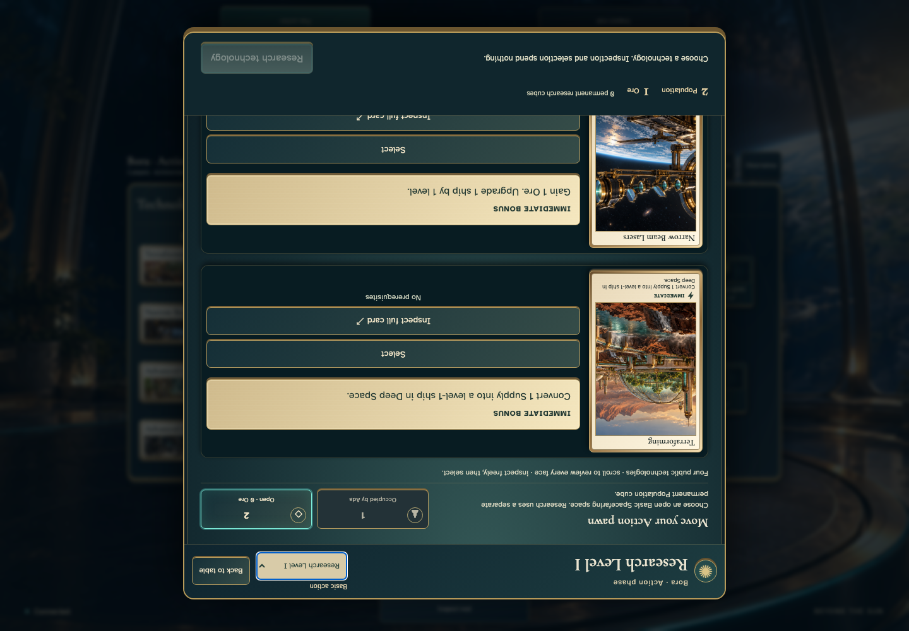](../../screenshots/build-upgrade-and-inspect-2-shared-cardinal-fleets/050-bora-gather-plan-desktop-darwin.png) |

tabletop-4k · 3840 × 2160

[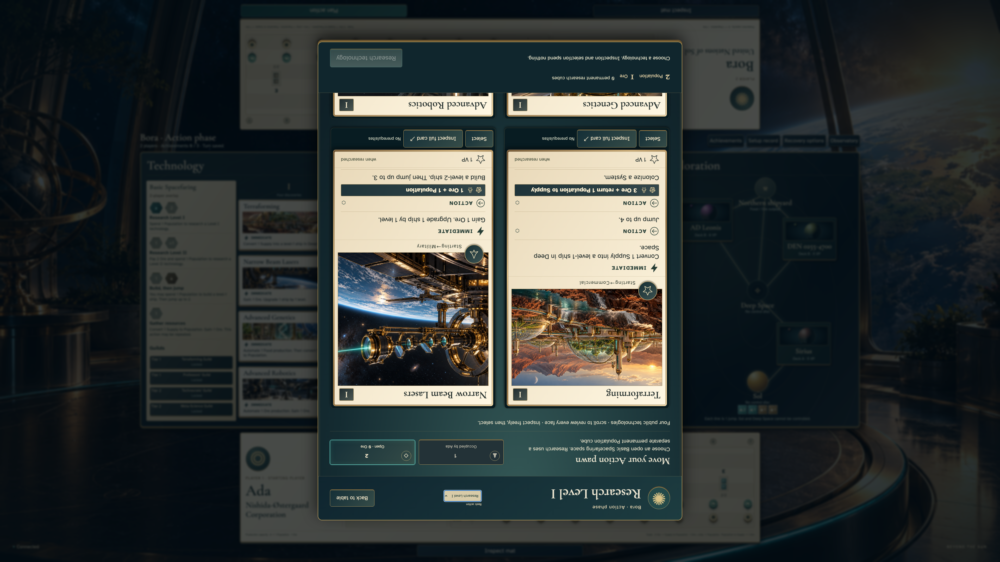](../../screenshots/build-upgrade-and-inspect-2-shared-cardinal-fleets/050-bora-gather-plan-tabletop-4k-darwin.png)

- [x] Bora opens the actual Action instrument
- [x] The actual canonical effect and backend acknowledgement settle.
- [x] Public technology topology retains physical separation.
- [x] The actual viewport fits without page scrolling.

## 52. Bora selects ordinary gathering

Viewpoint: **Bora · North · one shared controller**.

| desktop · 1440 × 1000 |
| --- |
| [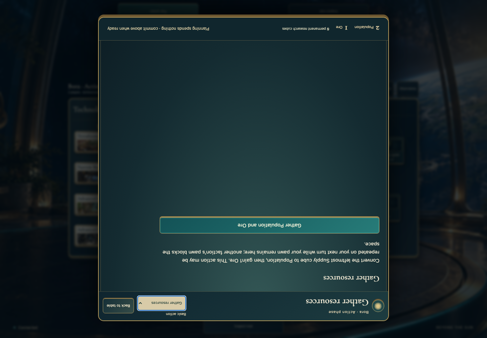](../../screenshots/build-upgrade-and-inspect-2-shared-cardinal-fleets/051-bora-gather-kind-desktop-darwin.png) |

tabletop-4k · 3840 × 2160

[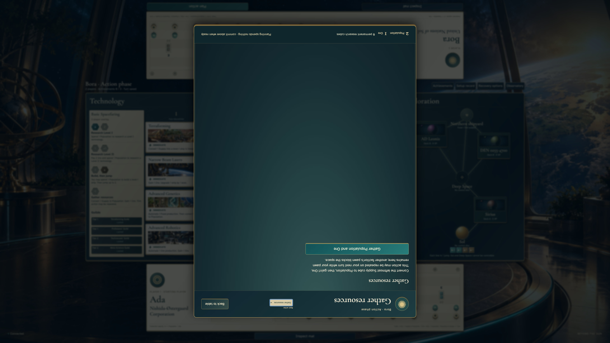](../../screenshots/build-upgrade-and-inspect-2-shared-cardinal-fleets/051-bora-gather-kind-tabletop-4k-darwin.png)

- [x] Bora selects ordinary gathering
- [x] The actual canonical effect and backend acknowledgement settle.
- [x] Public technology topology retains physical separation.
- [x] The actual viewport fits without page scrolling.

## 53. Receive actual Gather resources before production

Viewpoint: **Bora · North · one shared controller**.

| desktop · 1440 × 1000 |
| --- |
| [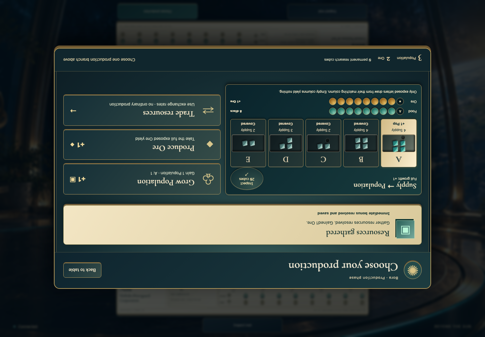](../../screenshots/build-upgrade-and-inspect-2-shared-cardinal-fleets/052-bora-gather-gathered-desktop-darwin.png) |

tabletop-4k · 3840 × 2160

- [x] Receive actual Gather resources before production
- [x] The actual canonical effect and backend acknowledgement settle.
- [x] Public technology topology retains physical separation.
- [x] The actual viewport fits without page scrolling.

## 54. Bora completes ordinary production and hands off

Viewpoint: **Bora · North · one shared controller**.

| desktop · 1440 × 1000 |
| --- |
|  |

tabletop-4k · 3840 × 2160

- [x] Bora completes ordinary production and hands off
- [x] The actual canonical effect and backend acknowledgement settle.
- [x] Public technology topology retains physical separation.
- [x] The actual viewport fits without page scrolling.

## 55. Ada opens the actual Action instrument

Viewpoint: **Ada · South · one shared controller**.

| desktop · 1440 × 1000 |
| --- |
|  |

tabletop-4k · 3840 × 2160

- [x] Ada opens the actual Action instrument
- [x] The actual canonical effect and backend acknowledgement settle.
- [x] Public technology topology retains physical separation.
- [x] The actual viewport fits without page scrolling.

## 56. Ada selects a printed Technology Action

Viewpoint: **Ada · South · one shared controller**.

| desktop · 1440 × 1000 |
| --- |
|  |

tabletop-4k · 3840 × 2160

- [x] Ada selects a printed Technology Action
- [x] The actual canonical effect and backend acknowledgement settle.
- [x] Public technology topology retains physical separation.
- [x] The actual viewport fits without page scrolling.

## 57. Read the personally available printed cost before committing

Viewpoint: **Ada · South · one shared controller**.

| desktop · 1440 × 1000 |
| --- |
|  |

tabletop-4k · 3840 × 2160

- [x] Read the personally available printed cost before committing
- [x] The actual canonical effect and backend acknowledgement settle.
- [x] Public technology topology retains physical separation.
- [x] The actual viewport fits without page scrolling.

## 58. The paid Action automatically builds level two at its sole permitted yard before optional movement

Viewpoint: **Ada · South · one shared controller**.

| desktop · 1440 × 1000 |
| --- |
|  |

tabletop-4k · 3840 × 2160

- [x] The paid Action automatically builds level two at its sole permitted yard before optional movement
- [x] The actual canonical effect and backend acknowledgement settle.
- [x] Public technology topology retains physical separation.
- [x] The actual viewport fits without page scrolling.

## 59. Decline optional movement without undoing the ship or Action cost

Viewpoint: **Ada · South · one shared controller**.

| desktop · 1440 × 1000 |
| --- |
|  |

tabletop-4k · 3840 × 2160

- [x] Decline optional movement without undoing the ship or Action cost
- [x] The actual canonical effect and backend acknowledgement settle.
- [x] Public technology topology retains physical separation.
- [x] The actual viewport fits without page scrolling.

## 60. Ada completes ordinary production and hands off

Viewpoint: **Ada · South · one shared controller**.

| desktop · 1440 × 1000 |
| --- |
|  |

tabletop-4k · 3840 × 2160

- [x] Ada completes ordinary production and hands off
- [x] The actual canonical effect and backend acknowledgement settle.
- [x] Public technology topology retains physical separation.
- [x] The actual viewport fits without page scrolling.

## 61. Open the retained faction economy and physical fleet register

Viewpoint: **Ada · South · one shared controller**.

| desktop · 1440 × 1000 |
| --- |
|  |

tabletop-4k · 3840 × 2160

- [x] Open the retained faction economy and physical fleet register
- [x] The actual canonical effect and backend acknowledgement settle.
- [x] Public technology topology retains physical separation.
- [x] The actual viewport fits without page scrolling.

## 62. Inspect 3 real ships with explicit levels and public summed power

Viewpoint: **Ada · South · one shared controller**.

| desktop · 1440 × 1000 |
| --- |
|  |

tabletop-4k · 3840 × 2160

- [x] Inspect 3 real ships with explicit levels and public summed power
- [x] The actual canonical effect and backend acknowledgement settle.
- [x] Public technology topology retains physical separation.
- [x] The actual viewport fits without page scrolling.

## 63. Inspect Ada's actual power at Sol

Viewpoint: **Ada · South · one shared controller**.

| desktop · 1440 × 1000 |
| --- |
|  |

tabletop-4k · 3840 × 2160

- [x] Inspect Ada's actual power at Sol
- [x] The actual canonical effect and backend acknowledgement settle.
- [x] Public technology topology retains physical separation.
- [x] The actual viewport fits without page scrolling.

## 64. The register explains levels, location-specific power and incumbent ties without taking a turn

Viewpoint: **Ada · South · one shared controller**.

| desktop · 1440 × 1000 |
| --- |
|  |

tabletop-4k · 3840 × 2160

- [x] The register explains levels, location-specific power and incumbent ties without taking a turn
- [x] The actual canonical effect and backend acknowledgement settle.
- [x] Public technology topology retains physical separation.
- [x] The actual viewport fits without page scrolling.

## 65. Keyboard reaches the bounded fleet details

Viewpoint: **Ada · South · one shared controller**.

| desktop · 1440 × 1000 |
| --- |
|  |

tabletop-4k · 3840 × 2160

- [x] Keyboard reaches the bounded fleet details
- [x] The actual canonical effect and backend acknowledgement settle.
- [x] Public technology topology retains physical separation.
- [x] The actual viewport fits without page scrolling.

## 66. Reverse Tab stays within the fleet reader

Viewpoint: **Ada · South · one shared controller**.

| desktop · 1440 × 1000 |
| --- |
|  |

tabletop-4k · 3840 × 2160

- [x] Reverse Tab stays within the fleet reader
- [x] The actual canonical effect and backend acknowledgement settle.
- [x] Public technology topology retains physical separation.
- [x] The actual viewport fits without page scrolling.

## 67. Forward Tab wraps back to persistent Close

Viewpoint: **Ada · South · one shared controller**.

| desktop · 1440 × 1000 |
| --- |
|  |

tabletop-4k · 3840 × 2160

- [x] Forward Tab wraps back to persistent Close
- [x] The actual canonical effect and backend acknowledgement settle.
- [x] Public technology topology retains physical separation.
- [x] The actual viewport fits without page scrolling.

## 68. Escape restores the actual Fleet opener

Viewpoint: **Ada · South · one shared controller**.

| desktop · 1440 × 1000 |
| --- |
|  |

tabletop-4k · 3840 × 2160

- [x] Escape restores the actual Fleet opener
- [x] The actual canonical effect and backend acknowledgement settle.
- [x] Public technology topology retains physical separation.
- [x] The actual viewport fits without page scrolling.

## 69. Close the mat and restore its physical opener

Viewpoint: **Ada · South · one shared controller**.

| desktop · 1440 × 1000 |
| --- |
|  |

tabletop-4k · 3840 × 2160

- [x] Close the mat and restore its physical opener
- [x] The actual canonical effect and backend acknowledgement settle.
- [x] Public technology topology retains physical separation.
- [x] The actual viewport fits without page scrolling.
