# Build upgrade and retain a real fleet with separate controllers

Two actual separate authenticated controllers. Ordinary production UI setup, named legal unique Basic factions and real preparatory turns. Fixed setup entropy55555555-5555-4555-8555-000000000002; deterministic command identities never inject game state or inspect concealed decks. Basic builds use Population, second-space costs follow the actual player overlay, printed Lasers builds/upgrades and Terraforming paths resolve canonically. Separate backend integration coverage verifies exhausted source, cap4, invalid targets and atomic split denials.

## 1. Arrive using the actual production client

Viewpoint: **Ada · separate host controller**.

| phone · 393 × 852 | desktop · 1440 × 1000 |
| --- | --- |
|  |  |

- [x] Arrive using the actual production client
- [x] The actual canonical effect and backend acknowledgement settle.
- [x] Public technology topology retains physical separation.
- [x] The actual viewport fits without page scrolling.

## 2. Choose a real production play mode

Viewpoint: **Ada · separate host controller**.

| phone · 393 × 852 | desktop · 1440 × 1000 |
| --- | --- |
|  |  |

- [x] Choose a real production play mode
- [x] The actual canonical effect and backend acknowledgement settle.
- [x] Public technology topology retains physical separation.
- [x] The actual viewport fits without page scrolling.

## 3. Create an independent remote host controller

Viewpoint: **Ada · separate host controller**.

| phone · 393 × 852 | desktop · 1440 × 1000 |
| --- | --- |
|  |  |

- [x] Create an independent remote host controller
- [x] The actual canonical effect and backend acknowledgement settle.
- [x] Public technology topology retains physical separation.
- [x] The actual viewport fits without page scrolling.

## 4. Name the host Ada

Viewpoint: **Ada · separate host controller**.

| phone · 393 × 852 | desktop · 1440 × 1000 |
| --- | --- |
|  |  |

- [x] Name the host Ada
- [x] The actual canonical effect and backend acknowledgement settle.
- [x] Public technology topology retains physical separation.
- [x] The actual viewport fits without page scrolling.

## 5. The canonical remote room exposes its actual invitation code

Viewpoint: **Ada · separate host controller**.

| phone · 393 × 852 | desktop · 1440 × 1000 |
| --- | --- |
| [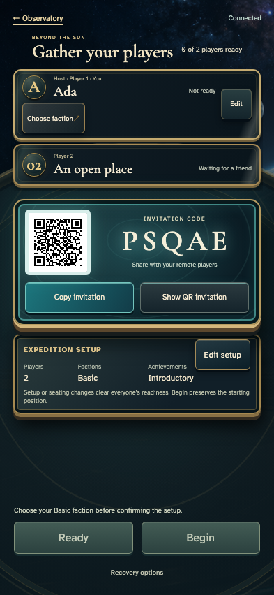](../../screenshots/build-upgrade-and-retain-a-real-fleet-with-separate-controllers/004-host-room-phone-darwin.png) | [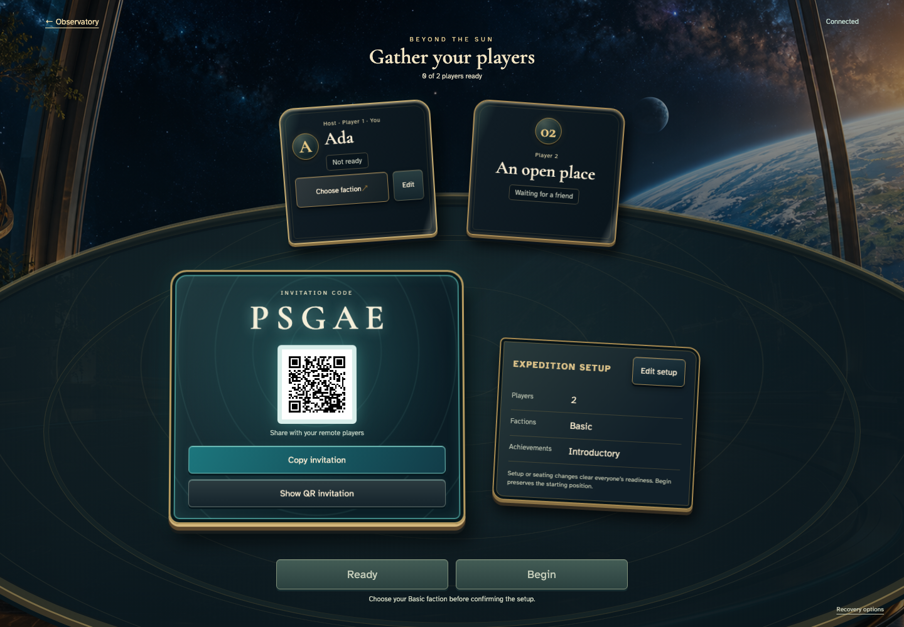](../../screenshots/build-upgrade-and-retain-a-real-fleet-with-separate-controllers/004-host-room-desktop-darwin.png) |

- [x] The canonical remote room exposes its actual invitation code
- [x] The actual canonical effect and backend acknowledgement settle.
- [x] Public technology topology retains physical separation.
- [x] The actual viewport fits without page scrolling.

## 6. A different identity previews the public invitation

Viewpoint: **Bora · separate guest controller**.

| phone · 1440 × 1000 | desktop · 393 × 852 |
| --- | --- |
| [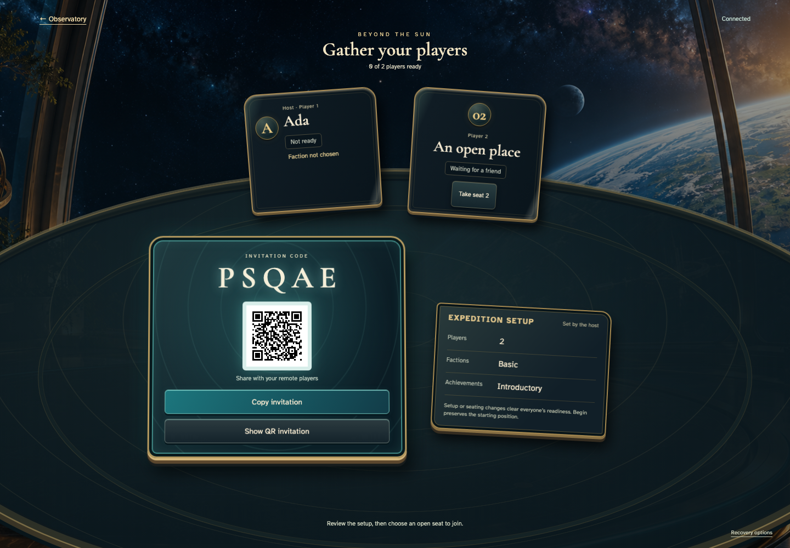](../../screenshots/build-upgrade-and-retain-a-real-fleet-with-separate-controllers/005-guest-preview-phone-darwin.png) | [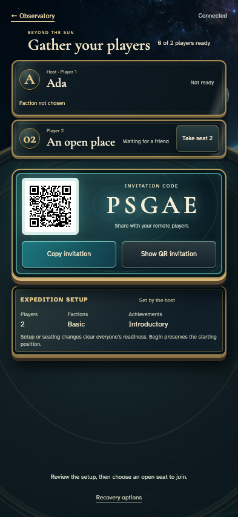](../../screenshots/build-upgrade-and-retain-a-real-fleet-with-separate-controllers/005-guest-preview-desktop-darwin.png) |

- [x] A different identity previews the public invitation
- [x] The actual canonical effect and backend acknowledgement settle.
- [x] Public technology topology retains physical separation.
- [x] The actual viewport fits without page scrolling.

## 7. The guest claims only the remote seat

Viewpoint: **Bora · separate guest controller**.

| phone · 1440 × 1000 | desktop · 393 × 852 |
| --- | --- |
| [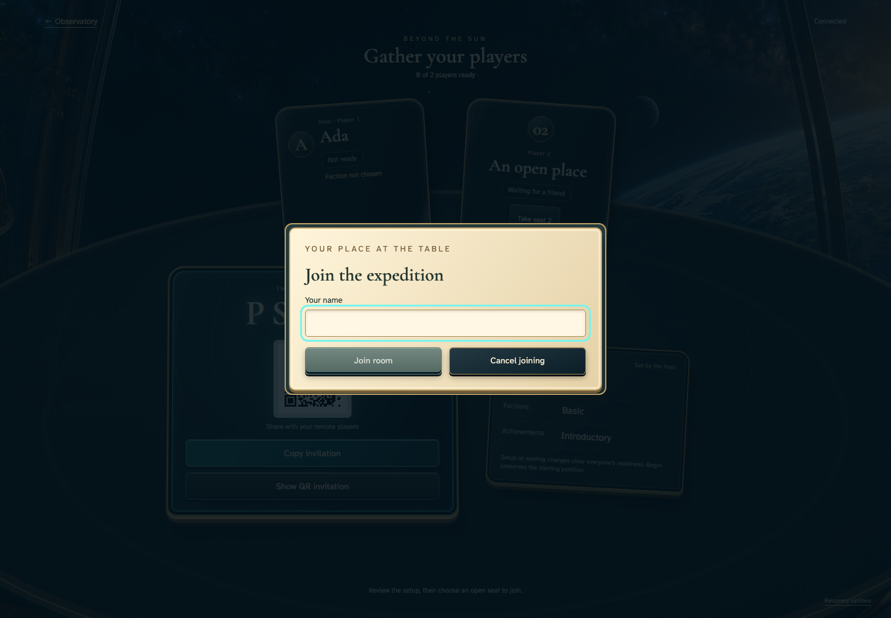](../../screenshots/build-upgrade-and-retain-a-real-fleet-with-separate-controllers/006-guest-editor-phone-darwin.png) |  |

- [x] The guest claims only the remote seat
- [x] The actual canonical effect and backend acknowledgement settle.
- [x] Public technology topology retains physical separation.
- [x] The actual viewport fits without page scrolling.

## 8. Name the independent guest Bora

Viewpoint: **Bora · separate guest controller**.

| phone · 1440 × 1000 | desktop · 393 × 852 |
| --- | --- |
| [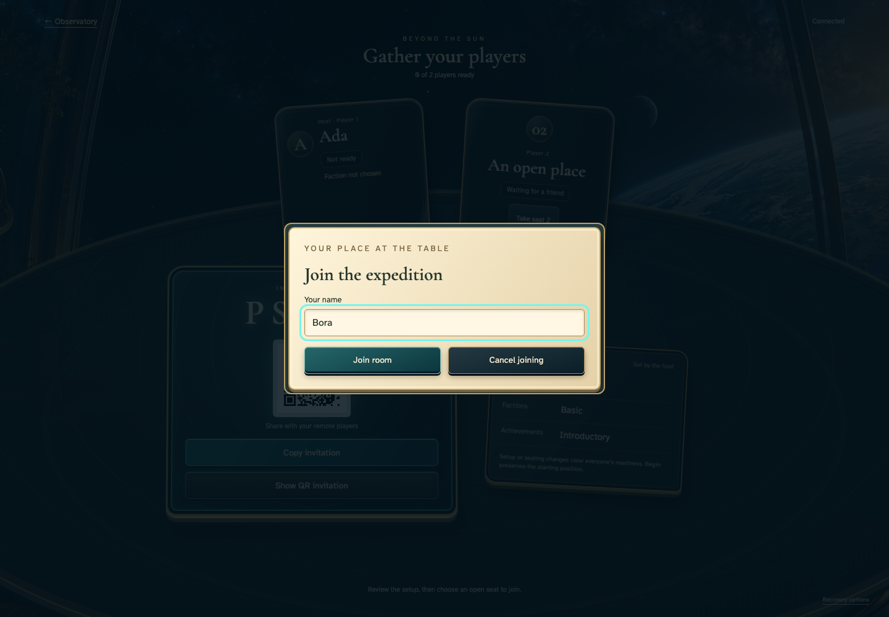](../../screenshots/build-upgrade-and-retain-a-real-fleet-with-separate-controllers/007-guest-name-phone-darwin.png) |  |

- [x] Name the independent guest Bora
- [x] The actual canonical effect and backend acknowledgement settle.
- [x] Public technology topology retains physical separation.
- [x] The actual viewport fits without page scrolling.

## 9. Both named remote identities share the same room

Viewpoint: **Bora · separate guest controller**.

| phone · 1440 × 1000 | desktop · 393 × 852 |
| --- | --- |
|  | [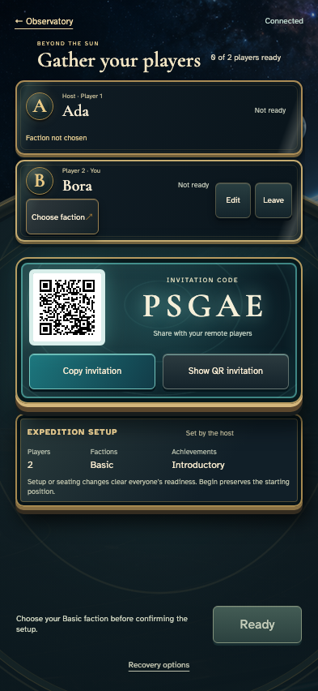](../../screenshots/build-upgrade-and-retain-a-real-fleet-with-separate-controllers/008-guest-joined-desktop-darwin.png) |

- [x] Both named remote identities share the same room
- [x] The actual canonical effect and backend acknowledgement settle.
- [x] Public technology topology retains physical separation.
- [x] The actual viewport fits without page scrolling.

## 10. Ada chooses a legal unique Basic faction

Viewpoint: **Ada · separate host controller**.

| phone · 393 × 852 | desktop · 1440 × 1000 |
| --- | --- |
|  |  |

- [x] Ada chooses a legal unique Basic faction
- [x] The actual canonical effect and backend acknowledgement settle.
- [x] Public technology topology retains physical separation.
- [x] The actual viewport fits without page scrolling.

## 11. Ada retains Nishida-Østergaard Corporation

Viewpoint: **Ada · separate host controller**.

| phone · 393 × 852 | desktop · 1440 × 1000 |
| --- | --- |
| [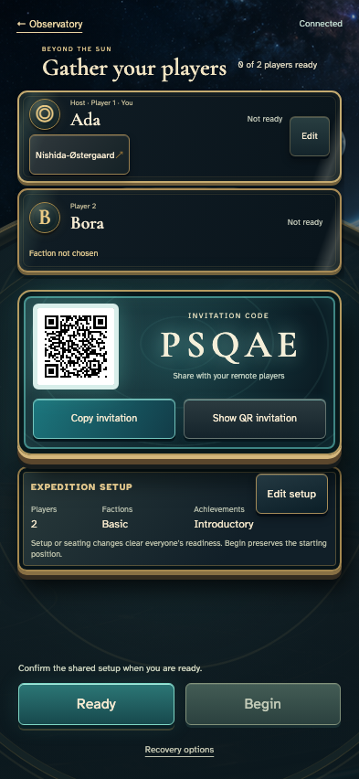](../../screenshots/build-upgrade-and-retain-a-real-fleet-with-separate-controllers/010-faction-0-chosen-phone-darwin.png) |  |

- [x] Ada retains Nishida-Østergaard Corporation
- [x] The actual canonical effect and backend acknowledgement settle.
- [x] Public technology topology retains physical separation.
- [x] The actual viewport fits without page scrolling.

## 12. Bora chooses a legal unique Basic faction

Viewpoint: **Bora · separate guest controller**.

| phone · 1440 × 1000 | desktop · 393 × 852 |
| --- | --- |
|  |  |

- [x] Bora chooses a legal unique Basic faction
- [x] The actual canonical effect and backend acknowledgement settle.
- [x] Public technology topology retains physical separation.
- [x] The actual viewport fits without page scrolling.

## 13. Bora retains United Nations of Sol

Viewpoint: **Bora · separate guest controller**.

| phone · 1440 × 1000 | desktop · 393 × 852 |
| --- | --- |
| [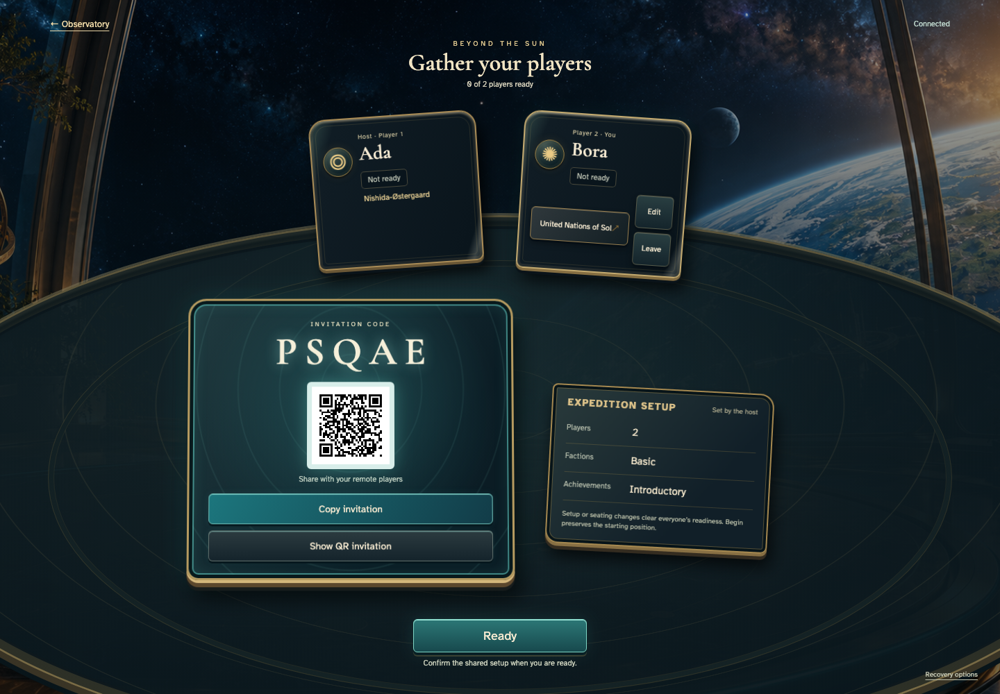](../../screenshots/build-upgrade-and-retain-a-real-fleet-with-separate-controllers/012-faction-1-chosen-phone-darwin.png) | [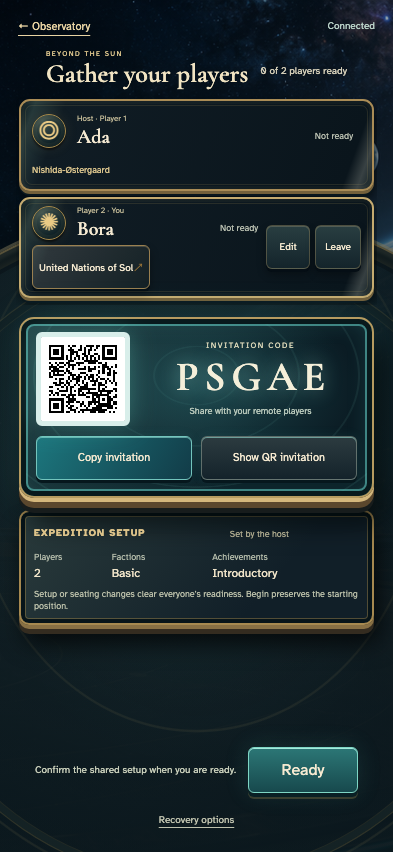](../../screenshots/build-upgrade-and-retain-a-real-fleet-with-separate-controllers/012-faction-1-chosen-desktop-darwin.png) |

- [x] Bora retains United Nations of Sol
- [x] The actual canonical effect and backend acknowledgement settle.
- [x] Public technology topology retains physical separation.
- [x] The actual viewport fits without page scrolling.

## 14. Confirm this identity is ready for the exact saved configuration

Viewpoint: **Bora · separate guest controller**.

| phone · 1440 × 1000 | desktop · 393 × 852 |
| --- | --- |
|  | [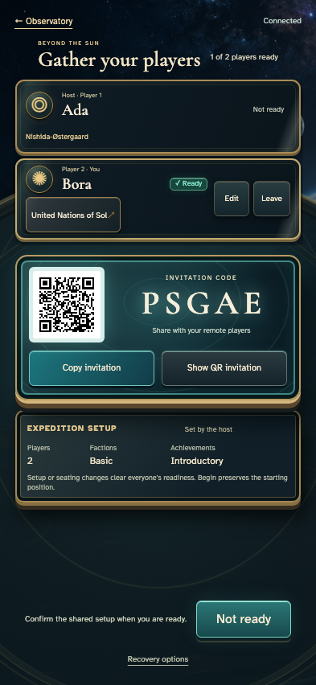](../../screenshots/build-upgrade-and-retain-a-real-fleet-with-separate-controllers/013-ready-1-desktop-darwin.png) |

- [x] Confirm this identity is ready for the exact saved configuration
- [x] The actual canonical effect and backend acknowledgement settle.
- [x] Public technology topology retains physical separation.
- [x] The actual viewport fits without page scrolling.

## 15. Confirm this identity is ready for the exact saved configuration

Viewpoint: **Ada · separate host controller**.

| phone · 393 × 852 | desktop · 1440 × 1000 |
| --- | --- |
| [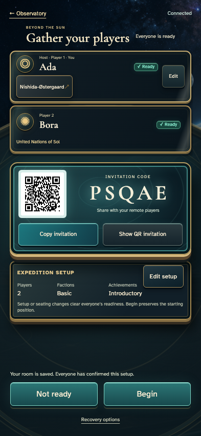](../../screenshots/build-upgrade-and-retain-a-real-fleet-with-separate-controllers/014-ready-0-phone-darwin.png) | [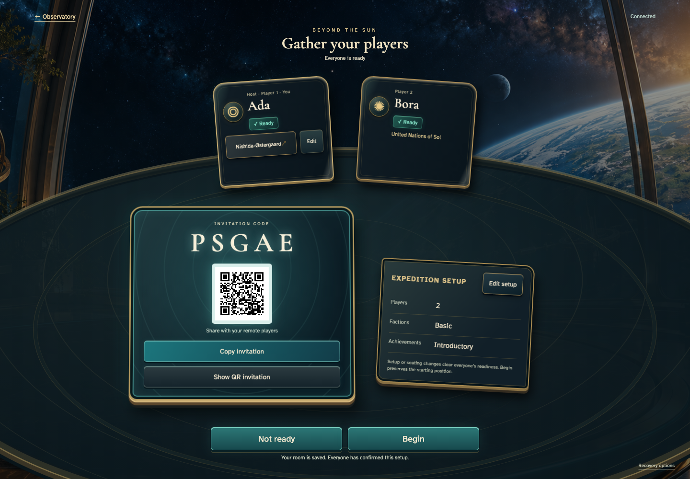](../../screenshots/build-upgrade-and-retain-a-real-fleet-with-separate-controllers/014-ready-0-desktop-darwin.png) |

- [x] Confirm this identity is ready for the exact saved configuration
- [x] The actual canonical effect and backend acknowledgement settle.
- [x] Public technology topology retains physical separation.
- [x] The actual viewport fits without page scrolling.

## 16. Begin the immutable source-reviewed Basic setup through the ordinary UI

Viewpoint: **Ada · separate host controller**.

| phone · 393 × 852 | desktop · 1440 × 1000 |
| --- | --- |
|  |  |

- [x] Begin the immutable source-reviewed Basic setup through the ordinary UI
- [x] The actual canonical effect and backend acknowledgement settle.
- [x] Public technology topology retains physical separation.
- [x] The actual viewport fits without page scrolling.

## 17. Ada opens the actual Action instrument

Viewpoint: **Ada · separate host controller**.

| phone · 393 × 852 | desktop · 1440 × 1000 |
| --- | --- |
|  | [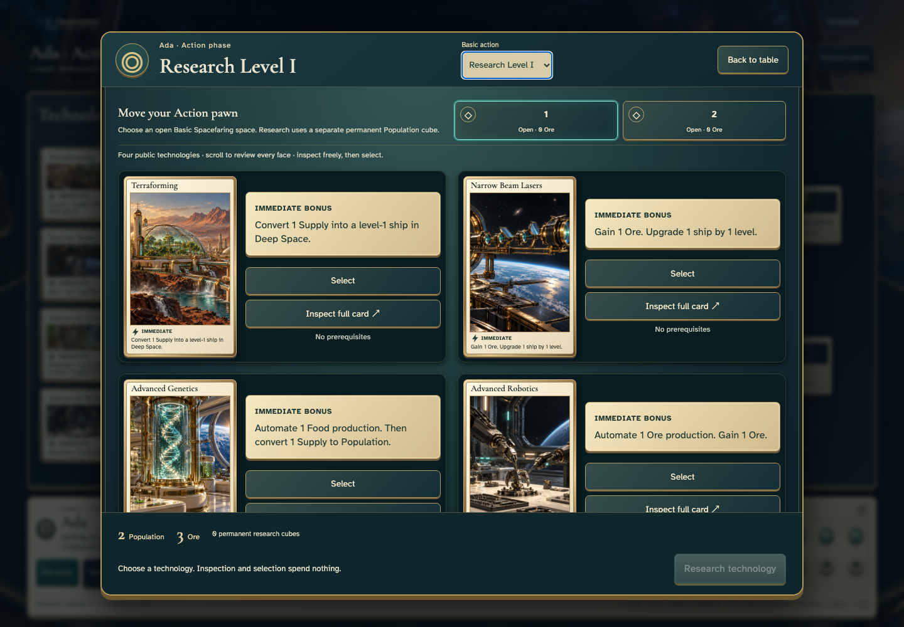](../../screenshots/build-upgrade-and-retain-a-real-fleet-with-separate-controllers/016-ada-build-plan-desktop-darwin.png) |

- [x] Ada opens the actual Action instrument
- [x] The actual canonical effect and backend acknowledgement settle.
- [x] Public technology topology retains physical separation.
- [x] The actual viewport fits without page scrolling.

## 18. Ada selects Basic construction

Viewpoint: **Ada · separate host controller**.

| phone · 393 × 852 | desktop · 1440 × 1000 |
| --- | --- |
| [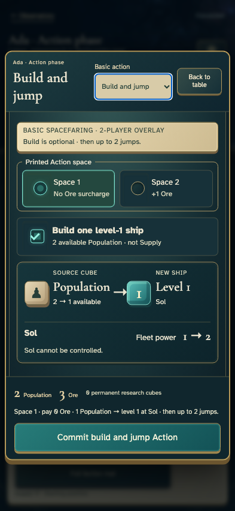](../../screenshots/build-upgrade-and-retain-a-real-fleet-with-separate-controllers/017-ada-build-kind-phone-darwin.png) | [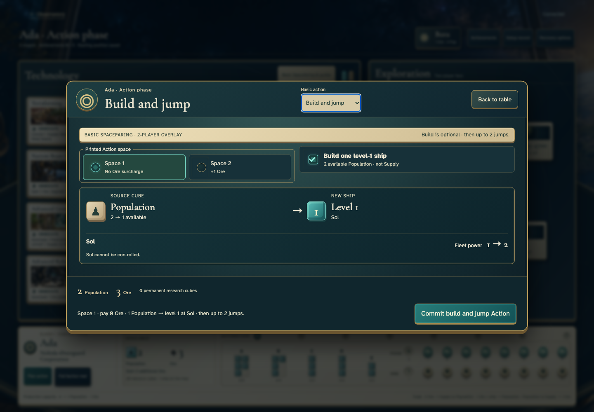](../../screenshots/build-upgrade-and-retain-a-real-fleet-with-separate-controllers/017-ada-build-kind-desktop-darwin.png) |

- [x] Ada selects Basic construction
- [x] The actual canonical effect and backend acknowledgement settle.
- [x] Public technology topology retains physical separation.
- [x] The actual viewport fits without page scrolling.

## 19. Keyboard may decline the optional build and retain Population

Viewpoint: **Ada · separate host controller**.

| phone · 393 × 852 | desktop · 1440 × 1000 |
| --- | --- |
| [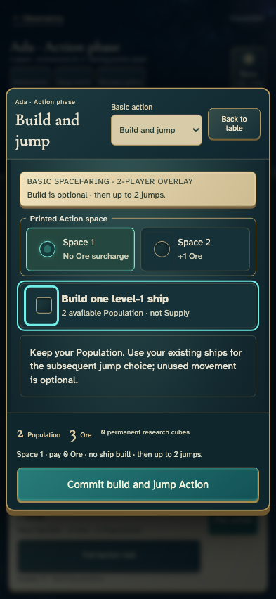](../../screenshots/build-upgrade-and-retain-a-real-fleet-with-separate-controllers/018-ada-no-build-phone-darwin.png) | [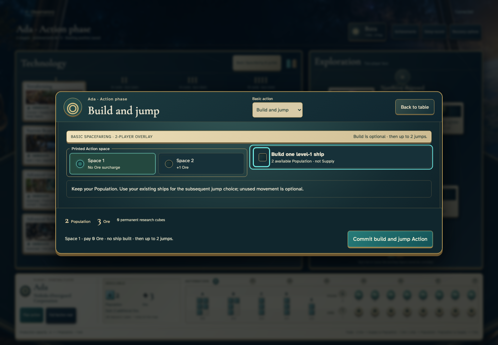](../../screenshots/build-upgrade-and-retain-a-real-fleet-with-separate-controllers/018-ada-no-build-desktop-darwin.png) |

- [x] Keyboard may decline the optional build and retain Population
- [x] The actual canonical effect and backend acknowledgement settle.
- [x] Public technology topology retains physical separation.
- [x] The actual viewport fits without page scrolling.

## 20. Keyboard restores the explicit Population-to-level-one build

Viewpoint: **Ada · separate host controller**.

| phone · 393 × 852 | desktop · 1440 × 1000 |
| --- | --- |
| [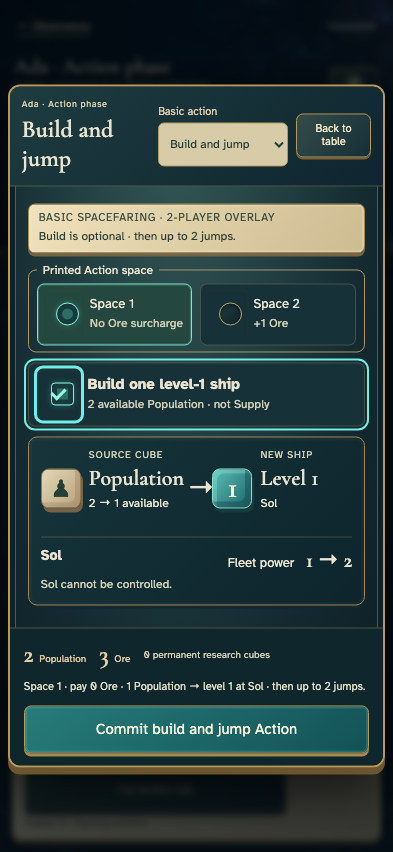](../../screenshots/build-upgrade-and-retain-a-real-fleet-with-separate-controllers/019-ada-build-selected-phone-darwin.png) | [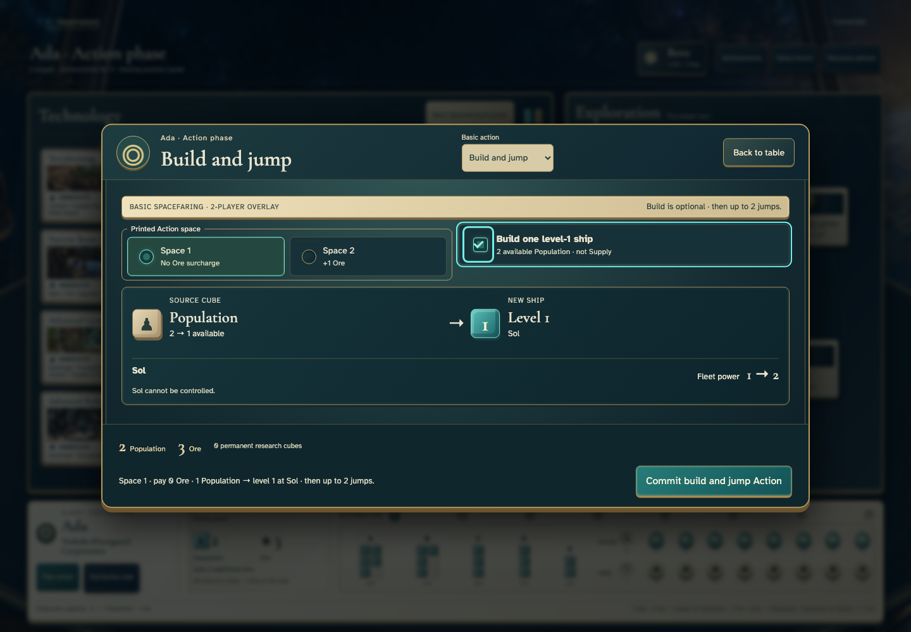](../../screenshots/build-upgrade-and-retain-a-real-fleet-with-separate-controllers/019-ada-build-selected-desktop-darwin.png) |

- [x] Keyboard restores the explicit Population-to-level-one build
- [x] The actual canonical effect and backend acknowledgement settle.
- [x] Public technology topology retains physical separation.
- [x] The actual viewport fits without page scrolling.

## 21. Cancel restores Plan action and spends no resources

Viewpoint: **Ada · separate host controller**.

| phone · 393 × 852 | desktop · 1440 × 1000 |
| --- | --- |
| [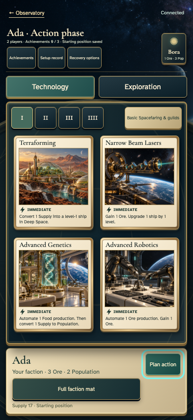](../../screenshots/build-upgrade-and-retain-a-real-fleet-with-separate-controllers/020-ada-cancel-phone-darwin.png) | [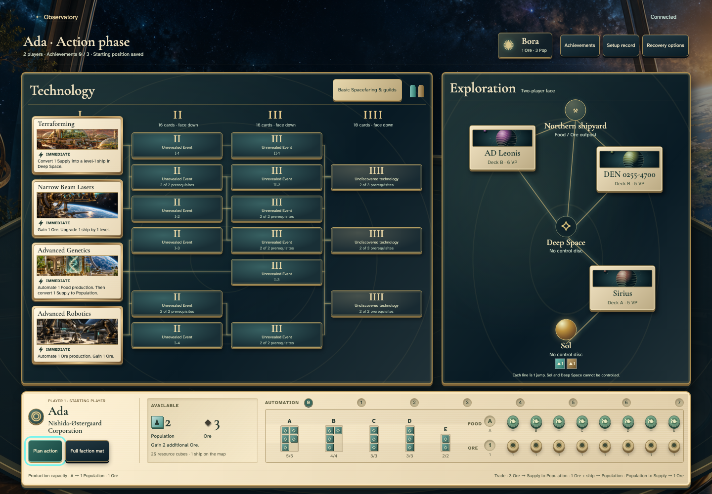](../../screenshots/build-upgrade-and-retain-a-real-fleet-with-separate-controllers/020-ada-cancel-desktop-darwin.png) |

- [x] Cancel restores Plan action and spends no resources
- [x] The actual canonical effect and backend acknowledgement settle.
- [x] Public technology topology retains physical separation.
- [x] The actual viewport fits without page scrolling.

## 22. Ada opens the actual Action instrument

Viewpoint: **Ada · separate host controller**.

| phone · 393 × 852 | desktop · 1440 × 1000 |
| --- | --- |
|  |  |

- [x] Ada opens the actual Action instrument
- [x] The actual canonical effect and backend acknowledgement settle.
- [x] Public technology topology retains physical separation.
- [x] The actual viewport fits without page scrolling.

## 23. Ada selects Basic construction

Viewpoint: **Ada · separate host controller**.

| phone · 393 × 852 | desktop · 1440 × 1000 |
| --- | --- |
|  |  |

- [x] Ada selects Basic construction
- [x] The actual canonical effect and backend acknowledgement settle.
- [x] Public technology topology retains physical separation.
- [x] The actual viewport fits without page scrolling.

## 24. Commit one Population cube into a level-one Sol ship; movement is still optional

Viewpoint: **Ada · separate host controller**.

| phone · 393 × 852 | desktop · 1440 × 1000 |
| --- | --- |
|  |  |

- [x] Commit one Population cube into a level-one Sol ship; movement is still optional
- [x] The actual canonical effect and backend acknowledgement settle.
- [x] Public technology topology retains physical separation.
- [x] The actual viewport fits without page scrolling.

## 25. The different controller observes the build and cannot submit Ada’s pending movement

Viewpoint: **Bora · separate guest controller**.

| phone · 1440 × 1000 | desktop · 393 × 852 |
| --- | --- |
|  | [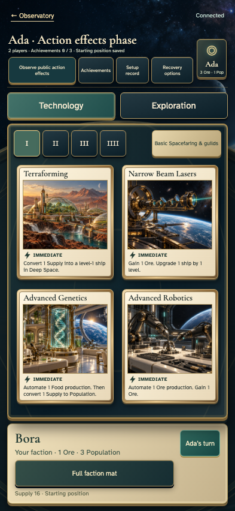](../../screenshots/build-upgrade-and-retain-a-real-fleet-with-separate-controllers/024-guest-observer-desktop-darwin.png) |

- [x] The different controller observes the build and cannot submit Ada’s pending movement
- [x] The actual canonical effect and backend acknowledgement settle.
- [x] Public technology topology retains physical separation.
- [x] The actual viewport fits without page scrolling.

## 26. Reload retains the saved ship and pending movement

Viewpoint: **Ada · separate host controller**.

| phone · 393 × 852 | desktop · 1440 × 1000 |
| --- | --- |
| [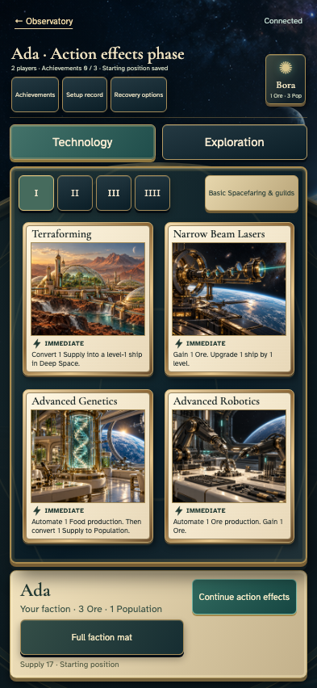](../../screenshots/build-upgrade-and-retain-a-real-fleet-with-separate-controllers/025-ada-build-retained-phone-darwin.png) | [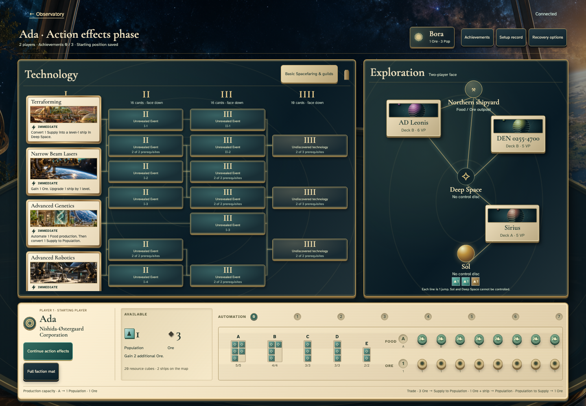](../../screenshots/build-upgrade-and-retain-a-real-fleet-with-separate-controllers/025-ada-build-retained-desktop-darwin.png) |

- [x] Reload retains the saved ship and pending movement
- [x] The actual canonical effect and backend acknowledgement settle.
- [x] Public technology topology retains physical separation.
- [x] The actual viewport fits without page scrolling.

## 27. Resume the same optional movement without rebuilding or charging again

Viewpoint: **Ada · separate host controller**.

| phone · 393 × 852 | desktop · 1440 × 1000 |
| --- | --- |
| [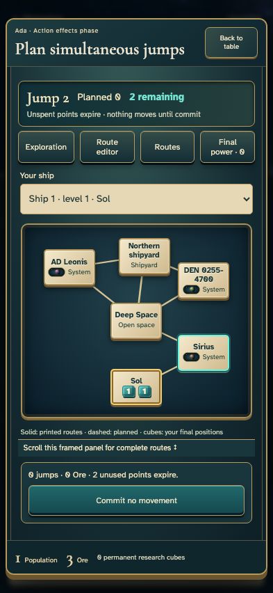](../../screenshots/build-upgrade-and-retain-a-real-fleet-with-separate-controllers/026-ada-movement-restored-phone-darwin.png) |  |

- [x] Resume the same optional movement without rebuilding or charging again
- [x] The actual canonical effect and backend acknowledgement settle.
- [x] Public technology topology retains physical separation.
- [x] The actual viewport fits without page scrolling.

## 28. Read the actual optional movement controls before declining every jump

Viewpoint: **Ada · separate host controller**.

| phone · 393 × 852 | desktop · 1440 × 1000 |
| --- | --- |
| [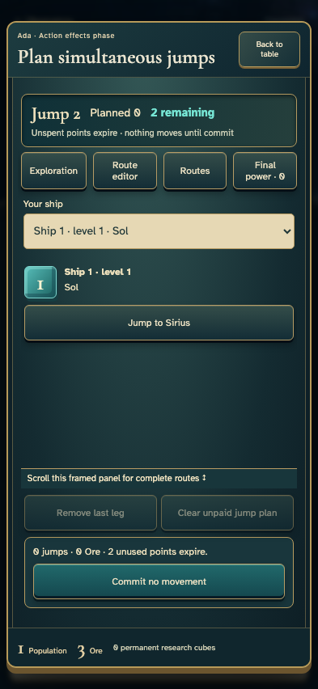](../../screenshots/build-upgrade-and-retain-a-real-fleet-with-separate-controllers/027-ada-optional-jump-phone-darwin.png) |  |

- [x] Read the actual optional movement controls before declining every jump
- [x] The actual canonical effect and backend acknowledgement settle.
- [x] Public technology topology retains physical separation.
- [x] The actual viewport fits without page scrolling.

## 29. Decline optional movement without undoing the ship or Action cost

Viewpoint: **Ada · separate host controller**.

| phone · 393 × 852 | desktop · 1440 × 1000 |
| --- | --- |
|  |  |

- [x] Decline optional movement without undoing the ship or Action cost
- [x] The actual canonical effect and backend acknowledgement settle.
- [x] Public technology topology retains physical separation.
- [x] The actual viewport fits without page scrolling.

## 30. Ada completes ordinary production and hands off

Viewpoint: **Ada · separate host controller**.

| phone · 393 × 852 | desktop · 1440 × 1000 |
| --- | --- |
|  |  |

- [x] Ada completes ordinary production and hands off
- [x] The actual canonical effect and backend acknowledgement settle.
- [x] Public technology topology retains physical separation.
- [x] The actual viewport fits without page scrolling.

## 31. The next independent controller sees the saved handoff

Viewpoint: **Bora · separate guest controller**.

| phone · 1440 × 1000 | desktop · 393 × 852 |
| --- | --- |
|  |  |

- [x] The next independent controller sees the saved handoff
- [x] The actual canonical effect and backend acknowledgement settle.
- [x] Public technology topology retains physical separation.
- [x] The actual viewport fits without page scrolling.

## 32. Bora opens the actual Action instrument

Viewpoint: **Bora · separate guest controller**.

| phone · 1440 × 1000 | desktop · 393 × 852 |
| --- | --- |
|  |  |

- [x] Bora opens the actual Action instrument
- [x] The actual canonical effect and backend acknowledgement settle.
- [x] Public technology topology retains physical separation.
- [x] The actual viewport fits without page scrolling.

## 33. Bora selects Basic construction

Viewpoint: **Bora · separate guest controller**.

| phone · 1440 × 1000 | desktop · 393 × 852 |
| --- | --- |
|  | [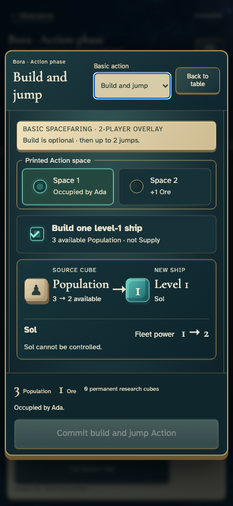](../../screenshots/build-upgrade-and-retain-a-real-fleet-with-separate-controllers/032-bora-build-kind-desktop-darwin.png) |

- [x] Bora selects Basic construction
- [x] The actual canonical effect and backend acknowledgement settle.
- [x] Public technology topology retains physical separation.
- [x] The actual viewport fits without page scrolling.

## 34. Ada’s occupied Basic space prevents a second pawn from using it

Viewpoint: **Bora · separate guest controller**.

| phone · 1440 × 1000 | desktop · 393 × 852 |
| --- | --- |
| [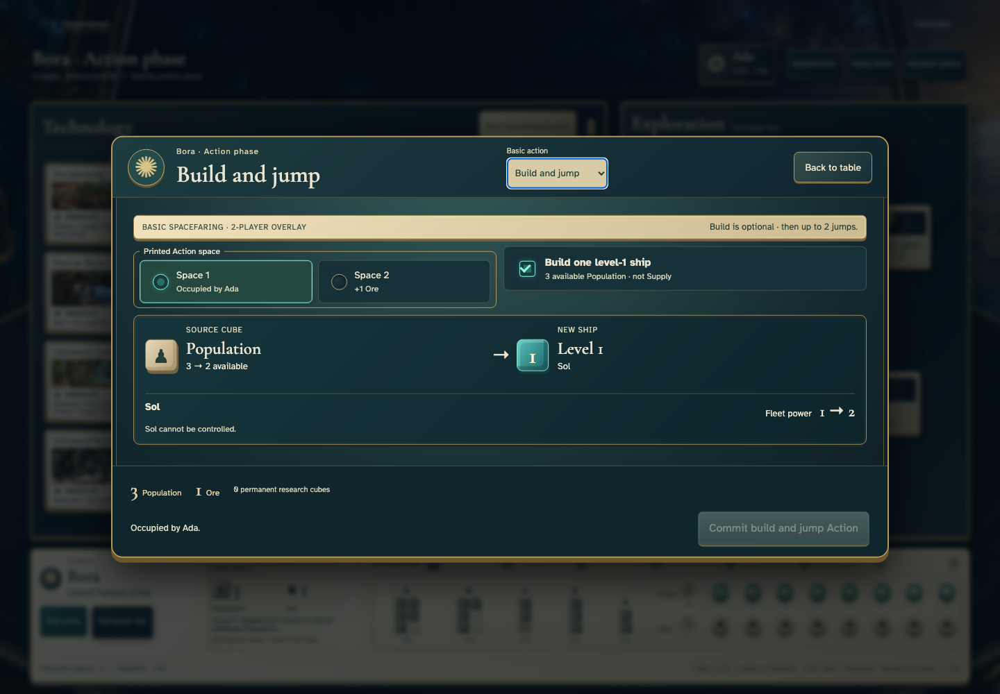](../../screenshots/build-upgrade-and-retain-a-real-fleet-with-separate-controllers/033-bora-occupied-phone-darwin.png) |  |

- [x] Ada’s occupied Basic space prevents a second pawn from using it
- [x] The actual canonical effect and backend acknowledgement settle.
- [x] Public technology topology retains physical separation.
- [x] The actual viewport fits without page scrolling.

## 35. Choose the second printed space with one Ore surcharge

Viewpoint: **Bora · separate guest controller**.

| phone · 1440 × 1000 | desktop · 393 × 852 |
| --- | --- |
| [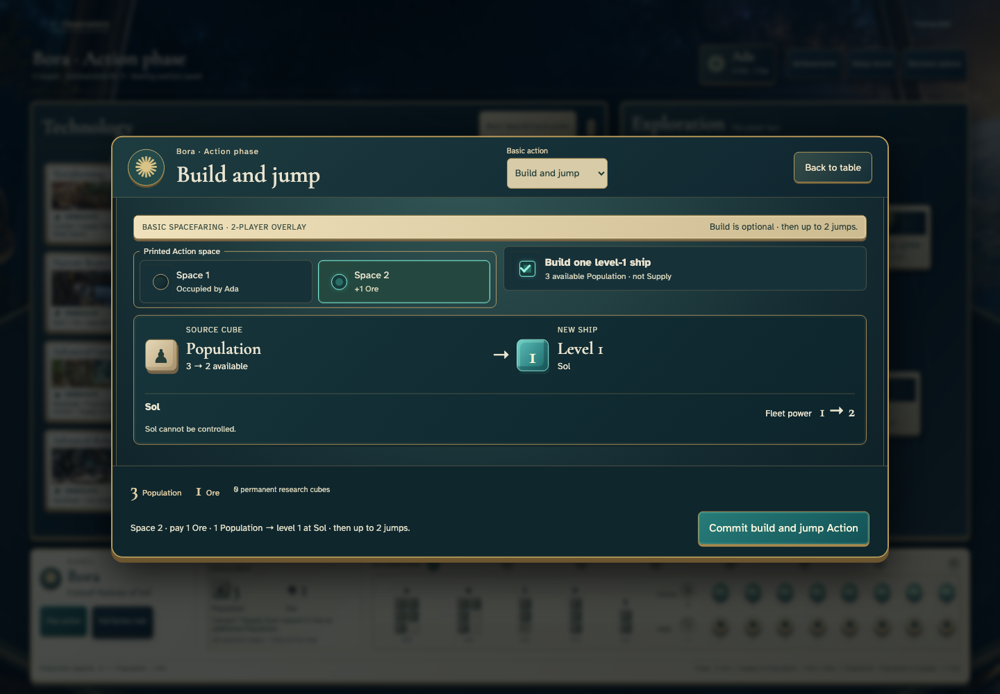](../../screenshots/build-upgrade-and-retain-a-real-fleet-with-separate-controllers/034-bora-second-space-phone-darwin.png) | [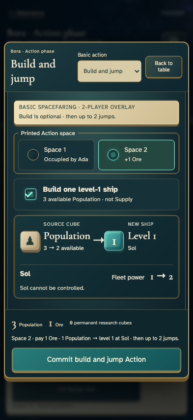](../../screenshots/build-upgrade-and-retain-a-real-fleet-with-separate-controllers/034-bora-second-space-desktop-darwin.png) |

- [x] Choose the second printed space with one Ore surcharge
- [x] The actual canonical effect and backend acknowledgement settle.
- [x] Public technology topology retains physical separation.
- [x] The actual viewport fits without page scrolling.

## 36. Build from Population at Sol and retain the exact second-space charge

Viewpoint: **Bora · separate guest controller**.

| phone · 1440 × 1000 | desktop · 393 × 852 |
| --- | --- |
| [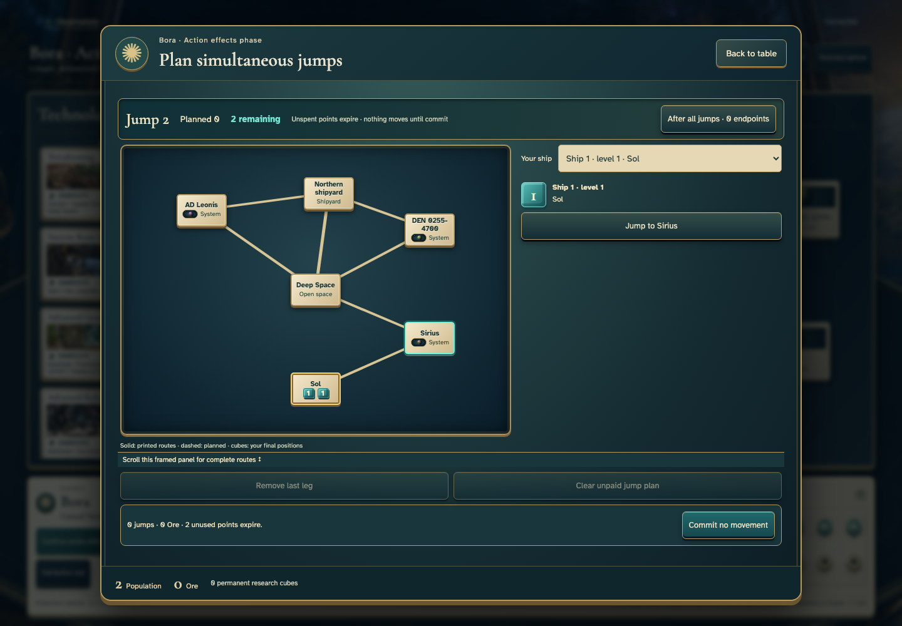](../../screenshots/build-upgrade-and-retain-a-real-fleet-with-separate-controllers/035-bora-built-phone-darwin.png) |  |

- [x] Build from Population at Sol and retain the exact second-space charge
- [x] The actual canonical effect and backend acknowledgement settle.
- [x] Public technology topology retains physical separation.
- [x] The actual viewport fits without page scrolling.

## 37. Read the actual optional movement controls before declining every jump

Viewpoint: **Bora · separate guest controller**.

| phone · 1440 × 1000 | desktop · 393 × 852 |
| --- | --- |
|  |  |

- [x] Read the actual optional movement controls before declining every jump
- [x] The actual canonical effect and backend acknowledgement settle.
- [x] Public technology topology retains physical separation.
- [x] The actual viewport fits without page scrolling.

## 38. Decline optional movement without undoing the ship or Action cost

Viewpoint: **Bora · separate guest controller**.

| phone · 1440 × 1000 | desktop · 393 × 852 |
| --- | --- |
| [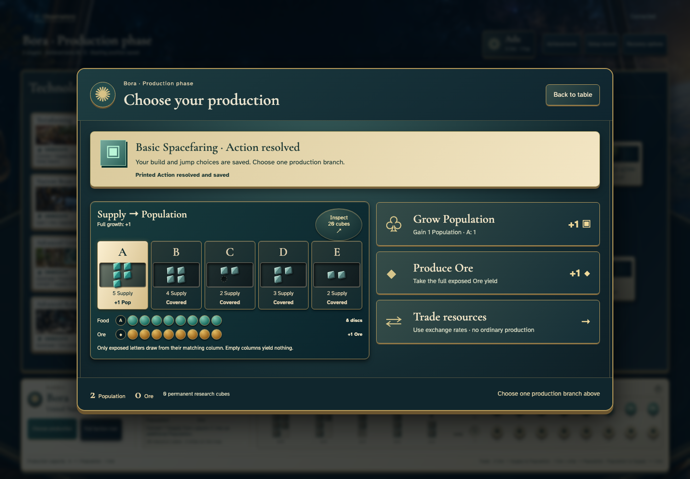](../../screenshots/build-upgrade-and-retain-a-real-fleet-with-separate-controllers/037-bora-no-move-phone-darwin.png) | [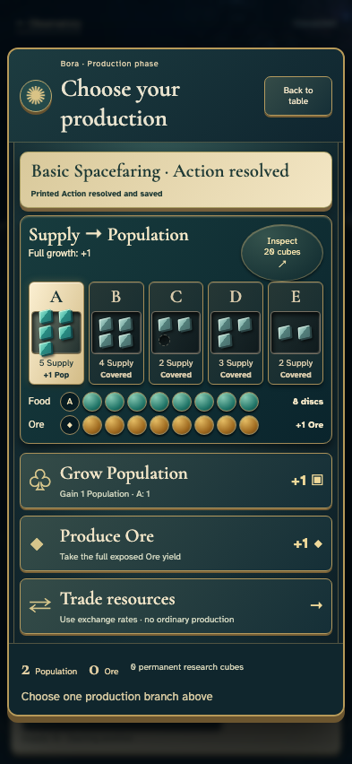](../../screenshots/build-upgrade-and-retain-a-real-fleet-with-separate-controllers/037-bora-no-move-desktop-darwin.png) |

- [x] Decline optional movement without undoing the ship or Action cost
- [x] The actual canonical effect and backend acknowledgement settle.
- [x] Public technology topology retains physical separation.
- [x] The actual viewport fits without page scrolling.

## 39. Bora completes ordinary production and hands off

Viewpoint: **Bora · separate guest controller**.

| phone · 1440 × 1000 | desktop · 393 × 852 |
| --- | --- |
| [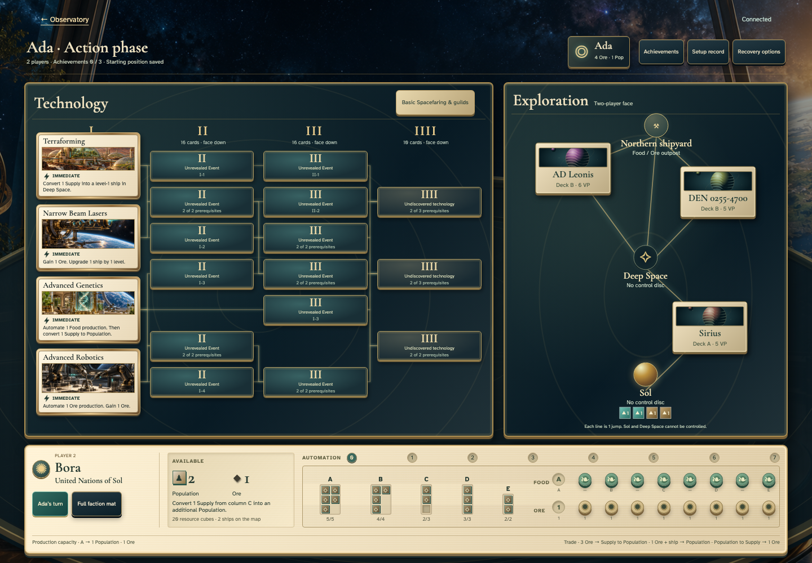](../../screenshots/build-upgrade-and-retain-a-real-fleet-with-separate-controllers/038-bora-handoff-phone-darwin.png) |  |

- [x] Bora completes ordinary production and hands off
- [x] The actual canonical effect and backend acknowledgement settle.
- [x] Public technology topology retains physical separation.
- [x] The actual viewport fits without page scrolling.

## 40. The next independent controller sees the saved handoff

Viewpoint: **Ada · separate host controller**.

| phone · 393 × 852 | desktop · 1440 × 1000 |
| --- | --- |
| [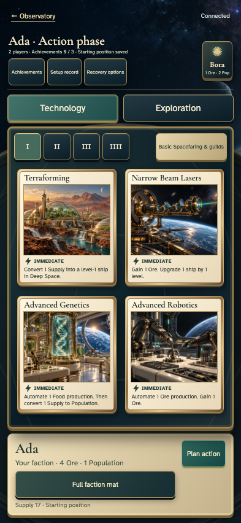](../../screenshots/build-upgrade-and-retain-a-real-fleet-with-separate-controllers/039-bora-next-phone-darwin.png) |  |

- [x] The next independent controller sees the saved handoff
- [x] The actual canonical effect and backend acknowledgement settle.
- [x] Public technology topology retains physical separation.
- [x] The actual viewport fits without page scrolling.

## 41. Open the retained faction economy and physical fleet register

Viewpoint: **Bora · separate guest controller**.

| phone · 1440 × 1000 | desktop · 393 × 852 |
| --- | --- |
|  |  |

- [x] Open the retained faction economy and physical fleet register
- [x] The actual canonical effect and backend acknowledgement settle.
- [x] Public technology topology retains physical separation.
- [x] The actual viewport fits without page scrolling.

## 42. Inspect 2 real ships with explicit levels and public summed power

Viewpoint: **Bora · separate guest controller**.

| phone · 1440 × 1000 | desktop · 393 × 852 |
| --- | --- |
|  |  |

- [x] Inspect 2 real ships with explicit levels and public summed power
- [x] The actual canonical effect and backend acknowledgement settle.
- [x] Public technology topology retains physical separation.
- [x] The actual viewport fits without page scrolling.

## 43. Inspect Bora's actual power at Sol

Viewpoint: **Bora · separate guest controller**.

| phone · 1440 × 1000 | desktop · 393 × 852 |
| --- | --- |
|  |  |

- [x] Inspect Bora's actual power at Sol
- [x] The actual canonical effect and backend acknowledgement settle.
- [x] Public technology topology retains physical separation.
- [x] The actual viewport fits without page scrolling.

## 44. The register explains levels, location-specific power and incumbent ties without taking a turn

Viewpoint: **Bora · separate guest controller**.

| phone · 1440 × 1000 | desktop · 393 × 852 |
| --- | --- |
|  |  |

- [x] The register explains levels, location-specific power and incumbent ties without taking a turn
- [x] The actual canonical effect and backend acknowledgement settle.
- [x] Public technology topology retains physical separation.
- [x] The actual viewport fits without page scrolling.

## 45. Keyboard reaches the bounded fleet details

Viewpoint: **Bora · separate guest controller**.

| phone · 1440 × 1000 | desktop · 393 × 852 |
| --- | --- |
|  | [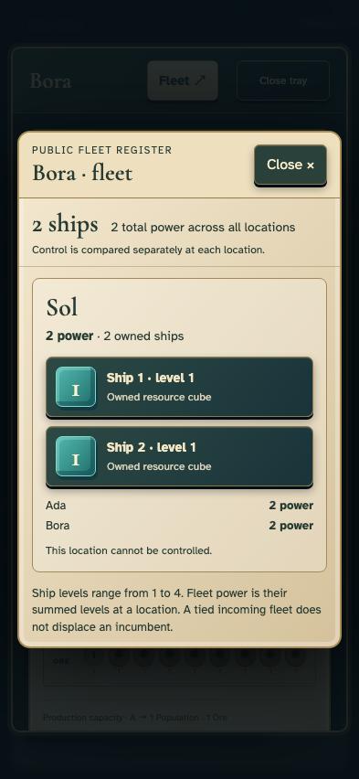](../../screenshots/build-upgrade-and-retain-a-real-fleet-with-separate-controllers/044-bora-register-keyboard-region-desktop-darwin.png) |

- [x] Keyboard reaches the bounded fleet details
- [x] The actual canonical effect and backend acknowledgement settle.
- [x] Public technology topology retains physical separation.
- [x] The actual viewport fits without page scrolling.

## 46. Reverse Tab stays within the fleet reader

Viewpoint: **Bora · separate guest controller**.

| phone · 1440 × 1000 | desktop · 393 × 852 |
| --- | --- |
| [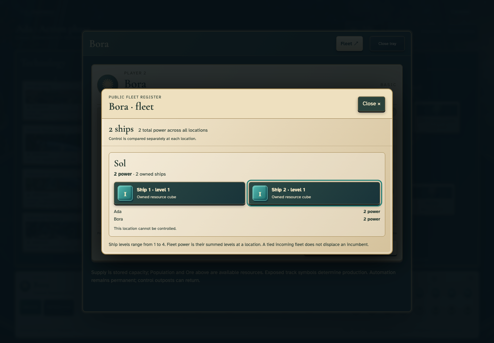](../../screenshots/build-upgrade-and-retain-a-real-fleet-with-separate-controllers/045-bora-register-reverse-tab-phone-darwin.png) | [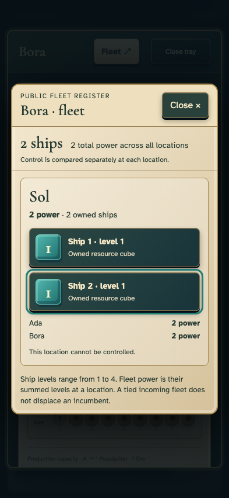](../../screenshots/build-upgrade-and-retain-a-real-fleet-with-separate-controllers/045-bora-register-reverse-tab-desktop-darwin.png) |

- [x] Reverse Tab stays within the fleet reader
- [x] The actual canonical effect and backend acknowledgement settle.
- [x] Public technology topology retains physical separation.
- [x] The actual viewport fits without page scrolling.

## 47. Forward Tab wraps back to persistent Close

Viewpoint: **Bora · separate guest controller**.

| phone · 1440 × 1000 | desktop · 393 × 852 |
| --- | --- |
| [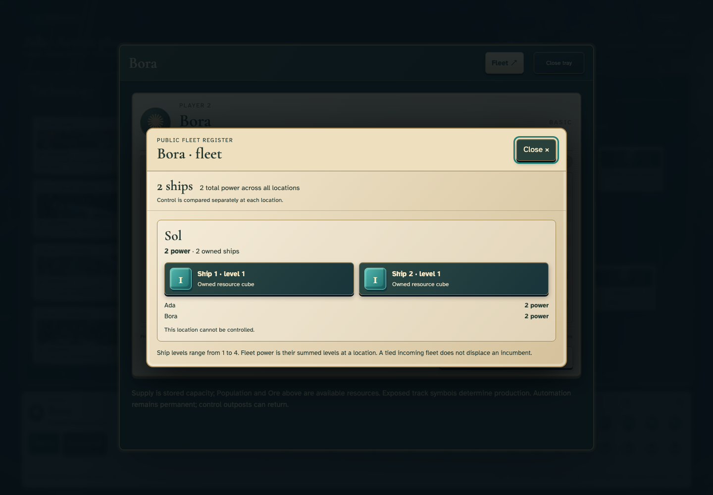](../../screenshots/build-upgrade-and-retain-a-real-fleet-with-separate-controllers/046-bora-register-tab-wrap-phone-darwin.png) | [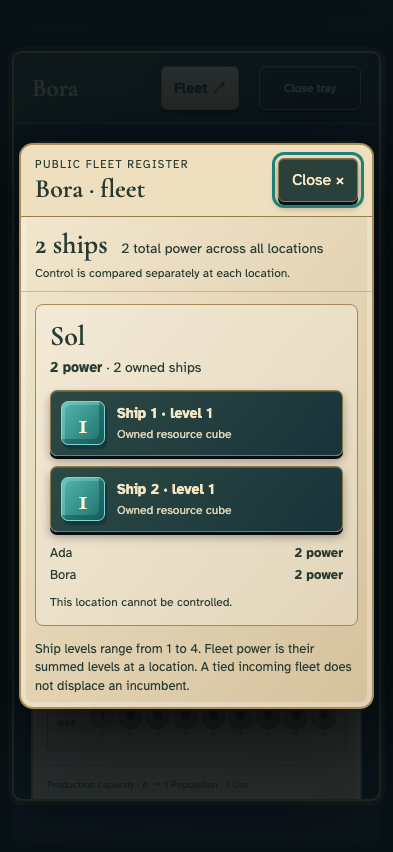](../../screenshots/build-upgrade-and-retain-a-real-fleet-with-separate-controllers/046-bora-register-tab-wrap-desktop-darwin.png) |

- [x] Forward Tab wraps back to persistent Close
- [x] The actual canonical effect and backend acknowledgement settle.
- [x] Public technology topology retains physical separation.
- [x] The actual viewport fits without page scrolling.

## 48. Escape restores the actual Fleet opener

Viewpoint: **Bora · separate guest controller**.

| phone · 1440 × 1000 | desktop · 393 × 852 |
| --- | --- |
| [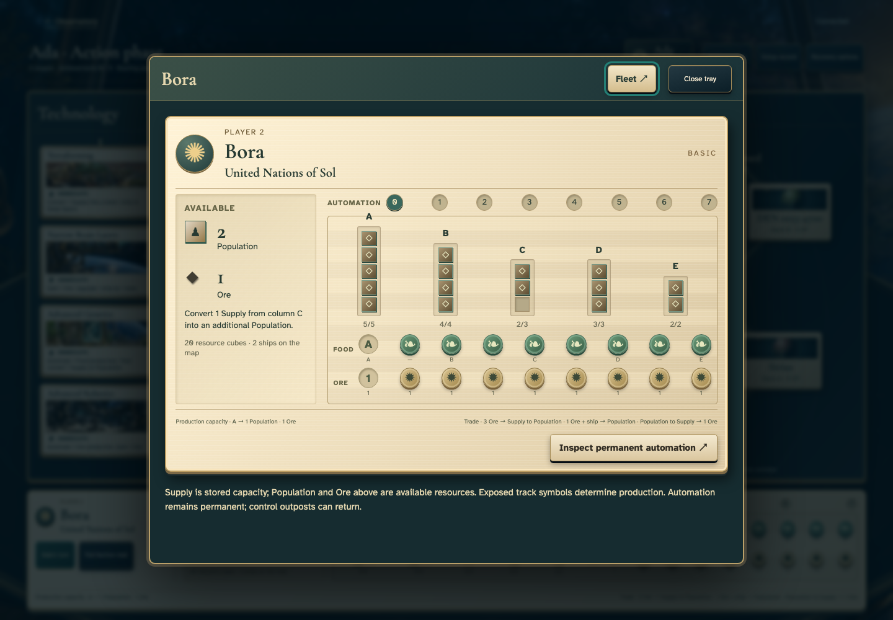](../../screenshots/build-upgrade-and-retain-a-real-fleet-with-separate-controllers/047-bora-register-return-phone-darwin.png) | [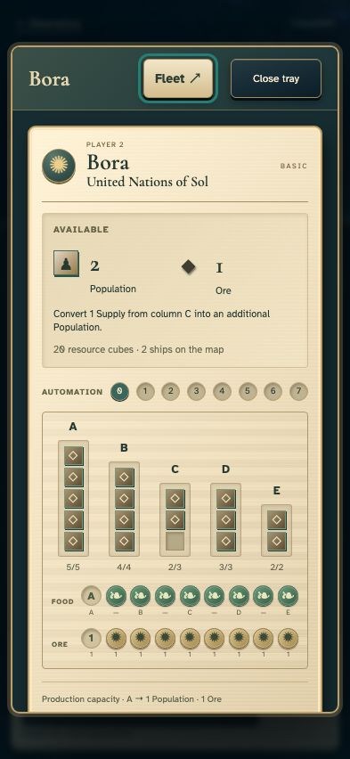](../../screenshots/build-upgrade-and-retain-a-real-fleet-with-separate-controllers/047-bora-register-return-desktop-darwin.png) |

- [x] Escape restores the actual Fleet opener
- [x] The actual canonical effect and backend acknowledgement settle.
- [x] Public technology topology retains physical separation.
- [x] The actual viewport fits without page scrolling.

## 49. Close the mat and restore its physical opener

Viewpoint: **Bora · separate guest controller**.

| phone · 1440 × 1000 | desktop · 393 × 852 |
| --- | --- |
|  | [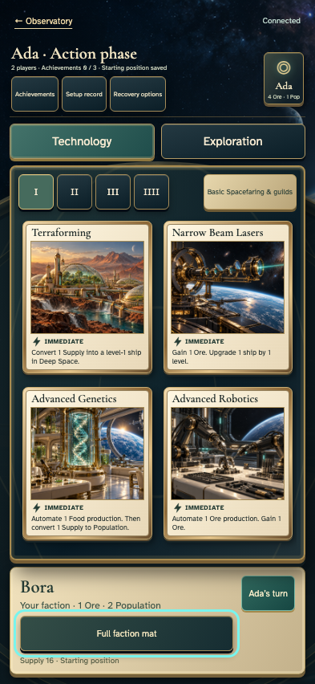](../../screenshots/build-upgrade-and-retain-a-real-fleet-with-separate-controllers/048-bora-register-mat-return-desktop-darwin.png) |

- [x] Close the mat and restore its physical opener
- [x] The actual canonical effect and backend acknowledgement settle.
- [x] Public technology topology retains physical separation.
- [x] The actual viewport fits without page scrolling.

## 50. Ada opens the actual Action instrument

Viewpoint: **Ada · separate host controller**.

| phone · 393 × 852 | desktop · 1440 × 1000 |
| --- | --- |
| [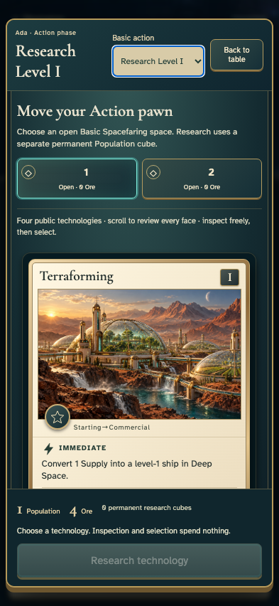](../../screenshots/build-upgrade-and-retain-a-real-fleet-with-separate-controllers/049-ada-lasers-plan-phone-darwin.png) |  |

- [x] Ada opens the actual Action instrument
- [x] The actual canonical effect and backend acknowledgement settle.
- [x] Public technology topology retains physical separation.
- [x] The actual viewport fits without page scrolling.

## 51. Ada chooses the unoccupied printed research space

Viewpoint: **Ada · separate host controller**.

| phone · 393 × 852 | desktop · 1440 × 1000 |
| --- | --- |
| [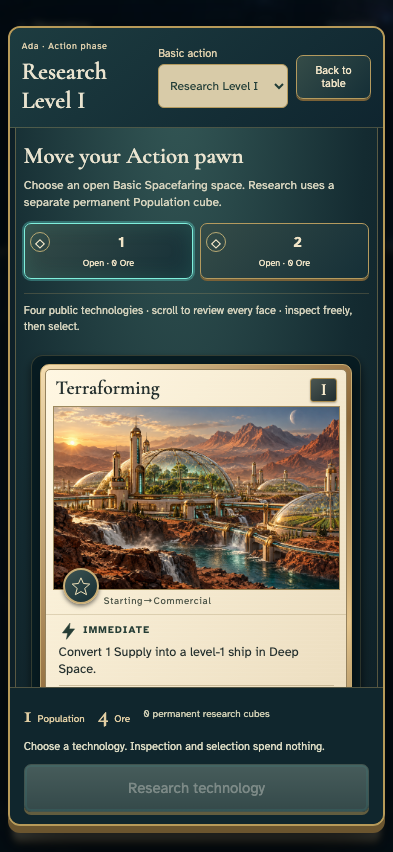](../../screenshots/build-upgrade-and-retain-a-real-fleet-with-separate-controllers/050-ada-lasers-space-phone-darwin.png) |  |

- [x] Ada chooses the unoccupied printed research space
- [x] The actual canonical effect and backend acknowledgement settle.
- [x] Public technology topology retains physical separation.
- [x] The actual viewport fits without page scrolling.

## 52. Choose the public Narrow Beam Lasers face and read its printed effect

Viewpoint: **Ada · separate host controller**.

| phone · 393 × 852 | desktop · 1440 × 1000 |
| --- | --- |
| [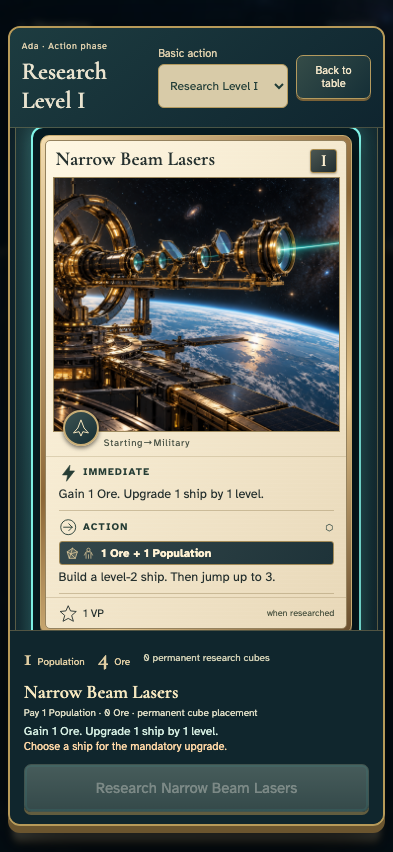](../../screenshots/build-upgrade-and-retain-a-real-fleet-with-separate-controllers/051-ada-lasers-card-phone-darwin.png) |  |

- [x] Choose the public Narrow Beam Lasers face and read its printed effect
- [x] The actual canonical effect and backend acknowledgement settle.
- [x] Public technology topology retains physical separation.
- [x] The actual viewport fits without page scrolling.

## 53. The mandatory one-level upgrade needs an explicit owned ship

Viewpoint: **Ada · separate host controller**.

| phone · 393 × 852 | desktop · 1440 × 1000 |
| --- | --- |
|  | [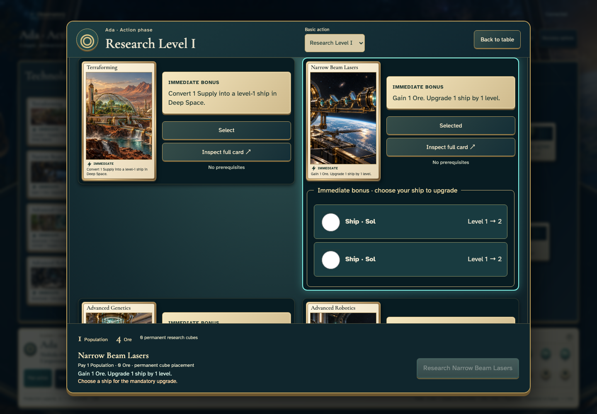](../../screenshots/build-upgrade-and-retain-a-real-fleet-with-separate-controllers/052-ada-lasers-target-required-desktop-darwin.png) |

- [x] The mandatory one-level upgrade needs an explicit owned ship
- [x] The actual canonical effect and backend acknowledgement settle.
- [x] Public technology topology retains physical separation.
- [x] The actual viewport fits without page scrolling.

## 54. Select the owned ship and inspect the exact level change

Viewpoint: **Ada · separate host controller**.

| phone · 393 × 852 | desktop · 1440 × 1000 |
| --- | --- |
| [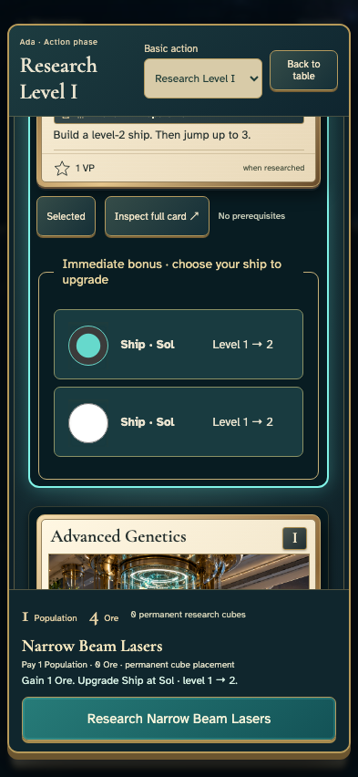](../../screenshots/build-upgrade-and-retain-a-real-fleet-with-separate-controllers/053-ada-lasers-target-phone-darwin.png) | [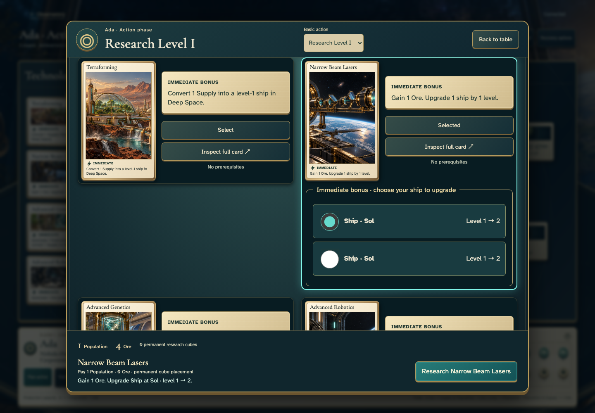](../../screenshots/build-upgrade-and-retain-a-real-fleet-with-separate-controllers/053-ada-lasers-target-desktop-darwin.png) |

- [x] Select the owned ship and inspect the exact level change
- [x] The actual canonical effect and backend acknowledgement settle.
- [x] Public technology topology retains physical separation.
- [x] The actual viewport fits without page scrolling.

## 55. Ada pays permanent research Population and resolves the printed bonus

Viewpoint: **Ada · separate host controller**.

| phone · 393 × 852 | desktop · 1440 × 1000 |
| --- | --- |
|  |  |

- [x] Ada pays permanent research Population and resolves the printed bonus
- [x] The actual canonical effect and backend acknowledgement settle.
- [x] Public technology topology retains physical separation.
- [x] The actual viewport fits without page scrolling.

## 56. Ada completes ordinary production and hands off

Viewpoint: **Ada · separate host controller**.

| phone · 393 × 852 | desktop · 1440 × 1000 |
| --- | --- |
|  |  |

- [x] Ada completes ordinary production and hands off
- [x] The actual canonical effect and backend acknowledgement settle.
- [x] Public technology topology retains physical separation.
- [x] The actual viewport fits without page scrolling.

## 57. The next independent controller sees the saved handoff

Viewpoint: **Bora · separate guest controller**.

| phone · 1440 × 1000 | desktop · 393 × 852 |
| --- | --- |
|  |  |

- [x] The next independent controller sees the saved handoff
- [x] The actual canonical effect and backend acknowledgement settle.
- [x] Public technology topology retains physical separation.
- [x] The actual viewport fits without page scrolling.

## 58. Bora opens the actual Action instrument

Viewpoint: **Bora · separate guest controller**.

| phone · 1440 × 1000 | desktop · 393 × 852 |
| --- | --- |
|  |  |

- [x] Bora opens the actual Action instrument
- [x] The actual canonical effect and backend acknowledgement settle.
- [x] Public technology topology retains physical separation.
- [x] The actual viewport fits without page scrolling.

## 59. Bora selects ordinary gathering

Viewpoint: **Bora · separate guest controller**.

| phone · 1440 × 1000 | desktop · 393 × 852 |
| --- | --- |
|  |  |

- [x] Bora selects ordinary gathering
- [x] The actual canonical effect and backend acknowledgement settle.
- [x] Public technology topology retains physical separation.
- [x] The actual viewport fits without page scrolling.

## 60. Receive actual Gather resources before production

Viewpoint: **Bora · separate guest controller**.

| phone · 1440 × 1000 | desktop · 393 × 852 |
| --- | --- |
|  |  |

- [x] Receive actual Gather resources before production
- [x] The actual canonical effect and backend acknowledgement settle.
- [x] Public technology topology retains physical separation.
- [x] The actual viewport fits without page scrolling.

## 61. Bora completes ordinary production and hands off

Viewpoint: **Bora · separate guest controller**.

| phone · 1440 × 1000 | desktop · 393 × 852 |
| --- | --- |
|  |  |

- [x] Bora completes ordinary production and hands off
- [x] The actual canonical effect and backend acknowledgement settle.
- [x] Public technology topology retains physical separation.
- [x] The actual viewport fits without page scrolling.

## 62. The next independent controller sees the saved handoff

Viewpoint: **Ada · separate host controller**.

| phone · 393 × 852 | desktop · 1440 × 1000 |
| --- | --- |
|  |  |

- [x] The next independent controller sees the saved handoff
- [x] The actual canonical effect and backend acknowledgement settle.
- [x] Public technology topology retains physical separation.
- [x] The actual viewport fits without page scrolling.

## 63. Ada opens the actual Action instrument

Viewpoint: **Ada · separate host controller**.

| phone · 393 × 852 | desktop · 1440 × 1000 |
| --- | --- |
|  |  |

- [x] Ada opens the actual Action instrument
- [x] The actual canonical effect and backend acknowledgement settle.
- [x] Public technology topology retains physical separation.
- [x] The actual viewport fits without page scrolling.

## 64. Ada selects a printed Technology Action

Viewpoint: **Ada · separate host controller**.

| phone · 393 × 852 | desktop · 1440 × 1000 |
| --- | --- |
|  |  |

- [x] Ada selects a printed Technology Action
- [x] The actual canonical effect and backend acknowledgement settle.
- [x] Public technology topology retains physical separation.
- [x] The actual viewport fits without page scrolling.

## 65. Read the personally available printed cost before committing

Viewpoint: **Ada · separate host controller**.

| phone · 393 × 852 | desktop · 1440 × 1000 |
| --- | --- |
|  |  |

- [x] Read the personally available printed cost before committing
- [x] The actual canonical effect and backend acknowledgement settle.
- [x] Public technology topology retains physical separation.
- [x] The actual viewport fits without page scrolling.

## 66. The paid Action automatically builds level two at its sole permitted yard before optional movement

Viewpoint: **Ada · separate host controller**.

| phone · 393 × 852 | desktop · 1440 × 1000 |
| --- | --- |
|  |  |

- [x] The paid Action automatically builds level two at its sole permitted yard before optional movement
- [x] The actual canonical effect and backend acknowledgement settle.
- [x] Public technology topology retains physical separation.
- [x] The actual viewport fits without page scrolling.

## 67. Read the actual optional movement controls before declining every jump

Viewpoint: **Ada · separate host controller**.

| phone · 393 × 852 | desktop · 1440 × 1000 |
| --- | --- |
|  |  |

- [x] Read the actual optional movement controls before declining every jump
- [x] The actual canonical effect and backend acknowledgement settle.
- [x] Public technology topology retains physical separation.
- [x] The actual viewport fits without page scrolling.

## 68. Decline optional movement without undoing the ship or Action cost

Viewpoint: **Ada · separate host controller**.

| phone · 393 × 852 | desktop · 1440 × 1000 |
| --- | --- |
|  |  |

- [x] Decline optional movement without undoing the ship or Action cost
- [x] The actual canonical effect and backend acknowledgement settle.
- [x] Public technology topology retains physical separation.
- [x] The actual viewport fits without page scrolling.

## 69. Ada completes ordinary production and hands off

Viewpoint: **Ada · separate host controller**.

| phone · 393 × 852 | desktop · 1440 × 1000 |
| --- | --- |
|  |  |

- [x] Ada completes ordinary production and hands off
- [x] The actual canonical effect and backend acknowledgement settle.
- [x] Public technology topology retains physical separation.
- [x] The actual viewport fits without page scrolling.

## 70. The next independent controller sees the saved handoff

Viewpoint: **Bora · separate guest controller**.

| phone · 1440 × 1000 | desktop · 393 × 852 |
| --- | --- |
|  |  |

- [x] The next independent controller sees the saved handoff
- [x] The actual canonical effect and backend acknowledgement settle.
- [x] Public technology topology retains physical separation.
- [x] The actual viewport fits without page scrolling.

## 71. Open the retained faction economy and physical fleet register

Viewpoint: **Ada · separate host controller**.

| phone · 393 × 852 | desktop · 1440 × 1000 |
| --- | --- |
|  |  |

- [x] Open the retained faction economy and physical fleet register
- [x] The actual canonical effect and backend acknowledgement settle.
- [x] Public technology topology retains physical separation.
- [x] The actual viewport fits without page scrolling.

## 72. Inspect 3 real ships with explicit levels and public summed power

Viewpoint: **Ada · separate host controller**.

| phone · 393 × 852 | desktop · 1440 × 1000 |
| --- | --- |
|  |  |

- [x] Inspect 3 real ships with explicit levels and public summed power
- [x] The actual canonical effect and backend acknowledgement settle.
- [x] Public technology topology retains physical separation.
- [x] The actual viewport fits without page scrolling.

## 73. Inspect Ada's actual power at Sol

Viewpoint: **Ada · separate host controller**.

| phone · 393 × 852 | desktop · 1440 × 1000 |
| --- | --- |
|  |  |

- [x] Inspect Ada's actual power at Sol
- [x] The actual canonical effect and backend acknowledgement settle.
- [x] Public technology topology retains physical separation.
- [x] The actual viewport fits without page scrolling.

## 74. The register explains levels, location-specific power and incumbent ties without taking a turn

Viewpoint: **Ada · separate host controller**.

| phone · 393 × 852 | desktop · 1440 × 1000 |
| --- | --- |
|  |  |

- [x] The register explains levels, location-specific power and incumbent ties without taking a turn
- [x] The actual canonical effect and backend acknowledgement settle.
- [x] Public technology topology retains physical separation.
- [x] The actual viewport fits without page scrolling.

## 75. Keyboard reaches the bounded fleet details

Viewpoint: **Ada · separate host controller**.

| phone · 393 × 852 | desktop · 1440 × 1000 |
| --- | --- |
|  |  |

- [x] Keyboard reaches the bounded fleet details
- [x] The actual canonical effect and backend acknowledgement settle.
- [x] Public technology topology retains physical separation.
- [x] The actual viewport fits without page scrolling.

## 76. Reverse Tab stays within the fleet reader

Viewpoint: **Ada · separate host controller**.

| phone · 393 × 852 | desktop · 1440 × 1000 |
| --- | --- |
|  |  |

- [x] Reverse Tab stays within the fleet reader
- [x] The actual canonical effect and backend acknowledgement settle.
- [x] Public technology topology retains physical separation.
- [x] The actual viewport fits without page scrolling.

## 77. Forward Tab wraps back to persistent Close

Viewpoint: **Ada · separate host controller**.

| phone · 393 × 852 | desktop · 1440 × 1000 |
| --- | --- |
|  |  |

- [x] Forward Tab wraps back to persistent Close
- [x] The actual canonical effect and backend acknowledgement settle.
- [x] Public technology topology retains physical separation.
- [x] The actual viewport fits without page scrolling.

## 78. Escape restores the actual Fleet opener

Viewpoint: **Ada · separate host controller**.

| phone · 393 × 852 | desktop · 1440 × 1000 |
| --- | --- |
|  |  |

- [x] Escape restores the actual Fleet opener
- [x] The actual canonical effect and backend acknowledgement settle.
- [x] Public technology topology retains physical separation.
- [x] The actual viewport fits without page scrolling.

## 79. Close the mat and restore its physical opener

Viewpoint: **Ada · separate host controller**.

| phone · 393 × 852 | desktop · 1440 × 1000 |
| --- | --- |
|  |  |

- [x] Close the mat and restore its physical opener
- [x] The actual canonical effect and backend acknowledgement settle.
- [x] Public technology topology retains physical separation.
- [x] The actual viewport fits without page scrolling.
