# Transfer control then build at an owned shipyard with 2 shared corner fleets

One shared controller with direct physical seating, no remote identities or companion devices. Ordinary production UI setup, named legal unique Basic factions and real preparatory turns. Fixed setup entropy55555555-5555-4555-8555-000000000002; deterministic command identities never inject game state or inspect concealed decks. Basic builds use Population, second-space costs follow the actual player overlay, printed Lasers builds/upgrades and Terraforming paths resolve canonically. Separate backend integration coverage verifies exhausted source, cap4, invalid targets and atomic split denials.

## 1. Arrive using the actual production client

Viewpoint: **Ada · South West · one shared controller**.

| desktop · 1440 × 1000 |
| --- |
|  |

tabletop-4k · 3840 × 2160

- [x] Arrive using the actual production client
- [x] The actual canonical effect and backend acknowledgement settle.
- [x] Public technology topology retains physical separation.
- [x] The actual viewport fits without page scrolling.

## 2. Choose a real production play mode

Viewpoint: **Ada · South West · one shared controller**.

| desktop · 1440 × 1000 |
| --- |
|  |

tabletop-4k · 3840 × 2160

- [x] Choose a real production play mode
- [x] The actual canonical effect and backend acknowledgement settle.
- [x] Public technology topology retains physical separation.
- [x] The actual viewport fits without page scrolling.

## 3. One controller configures physical seats directly on the table

Viewpoint: **Ada · South West · one shared controller**.

| desktop · 1440 × 1000 |
| --- |
|  |

tabletop-4k · 3840 × 2160

- [x] One controller configures physical seats directly on the table
- [x] The actual canonical effect and backend acknowledgement settle.
- [x] Public technology topology retains physical separation.
- [x] The actual viewport fits without page scrolling.

## 4. Open the South West seat on the shared surface

Viewpoint: **Ada · South West · one shared controller**.

| desktop · 1440 × 1000 |
| --- |
|  |

tabletop-4k · 3840 × 2160

- [x] Open the South West seat on the shared surface
- [x] The actual canonical effect and backend acknowledgement settle.
- [x] Public technology topology retains physical separation.
- [x] The actual viewport fits without page scrolling.

## 5. Name the physical player Ada

Viewpoint: **Ada · South West · one shared controller**.

| desktop · 1440 × 1000 |
| --- |
|  |

tabletop-4k · 3840 × 2160

- [x] Name the physical player Ada
- [x] The actual canonical effect and backend acknowledgement settle.
- [x] Public technology topology retains physical separation.
- [x] The actual viewport fits without page scrolling.

## 6. The local physical seat is retained on this controller

Viewpoint: **Ada · South West · one shared controller**.

| desktop · 1440 × 1000 |
| --- |
|  |

tabletop-4k · 3840 × 2160

- [x] The local physical seat is retained on this controller
- [x] The actual canonical effect and backend acknowledgement settle.
- [x] Public technology topology retains physical separation.
- [x] The actual viewport fits without page scrolling.

## 7. Open the North East seat on the shared surface

Viewpoint: **Bora · North East · one shared controller**.

| desktop · 1440 × 1000 |
| --- |
| [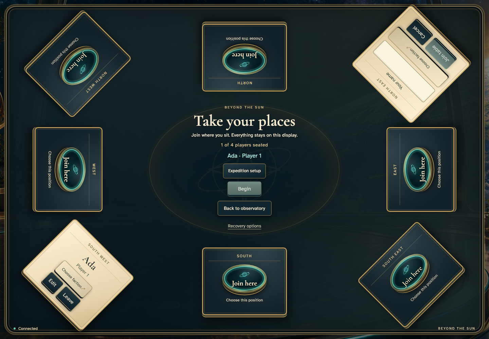](../../screenshots/transfer-control-then-build-at-an-owned-shipyard-with-2-shared-corner-fleets/006-seat-1-editor-desktop-darwin.png) |

tabletop-4k · 3840 × 2160

- [x] Open the North East seat on the shared surface
- [x] The actual canonical effect and backend acknowledgement settle.
- [x] Public technology topology retains physical separation.
- [x] The actual viewport fits without page scrolling.

## 8. Name the physical player Bora

Viewpoint: **Bora · North East · one shared controller**.

| desktop · 1440 × 1000 |
| --- |
|  |

tabletop-4k · 3840 × 2160

- [x] Name the physical player Bora
- [x] The actual canonical effect and backend acknowledgement settle.
- [x] Public technology topology retains physical separation.
- [x] The actual viewport fits without page scrolling.

## 9. The local physical seat is retained on this controller

Viewpoint: **Bora · North East · one shared controller**.

| desktop · 1440 × 1000 |
| --- |
|  |

tabletop-4k · 3840 × 2160

- [x] The local physical seat is retained on this controller
- [x] The actual canonical effect and backend acknowledgement settle.
- [x] Public technology topology retains physical separation.
- [x] The actual viewport fits without page scrolling.

## 10. Ada chooses a legal unique Basic faction

Viewpoint: **Ada · South West · one shared controller**.

| desktop · 1440 × 1000 |
| --- |
|  |

tabletop-4k · 3840 × 2160

- [x] Ada chooses a legal unique Basic faction
- [x] The actual canonical effect and backend acknowledgement settle.
- [x] Public technology topology retains physical separation.
- [x] The actual viewport fits without page scrolling.

## 11. Ada retains Nishida-Østergaard Corporation

Viewpoint: **Ada · South West · one shared controller**.

| desktop · 1440 × 1000 |
| --- |
|  |

tabletop-4k · 3840 × 2160

- [x] Ada retains Nishida-Østergaard Corporation
- [x] The actual canonical effect and backend acknowledgement settle.
- [x] Public technology topology retains physical separation.
- [x] The actual viewport fits without page scrolling.

## 12. Bora chooses a legal unique Basic faction

Viewpoint: **Bora · North East · one shared controller**.

| desktop · 1440 × 1000 |
| --- |
| [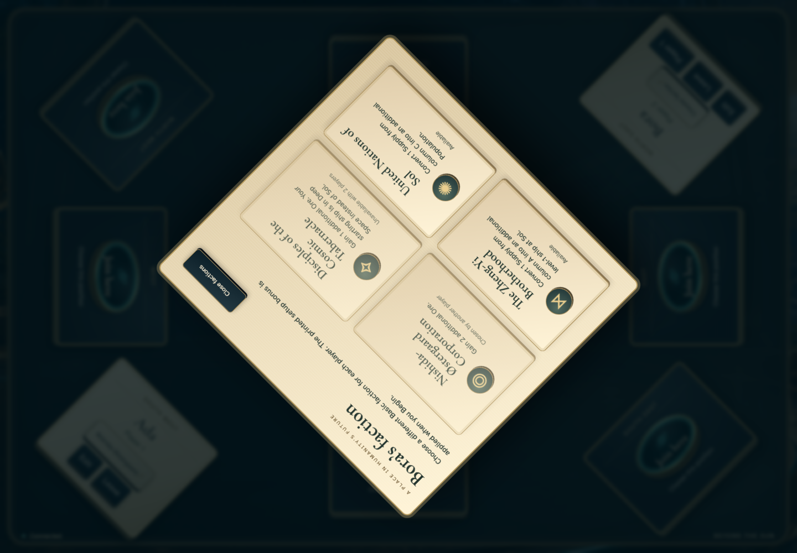](../../screenshots/transfer-control-then-build-at-an-owned-shipyard-with-2-shared-corner-fleets/011-faction-1-editor-desktop-darwin.png) |

tabletop-4k · 3840 × 2160

- [x] Bora chooses a legal unique Basic faction
- [x] The actual canonical effect and backend acknowledgement settle.
- [x] Public technology topology retains physical separation.
- [x] The actual viewport fits without page scrolling.

## 13. Bora retains United Nations of Sol

Viewpoint: **Bora · North East · one shared controller**.

| desktop · 1440 × 1000 |
| --- |
| [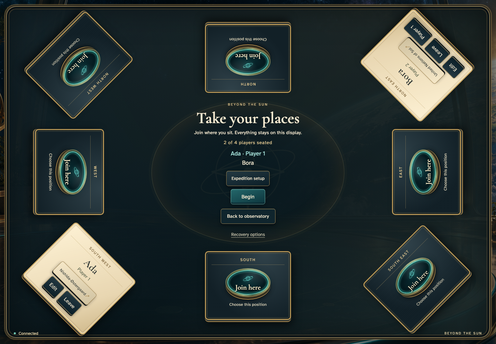](../../screenshots/transfer-control-then-build-at-an-owned-shipyard-with-2-shared-corner-fleets/012-faction-1-chosen-desktop-darwin.png) |

tabletop-4k · 3840 × 2160

[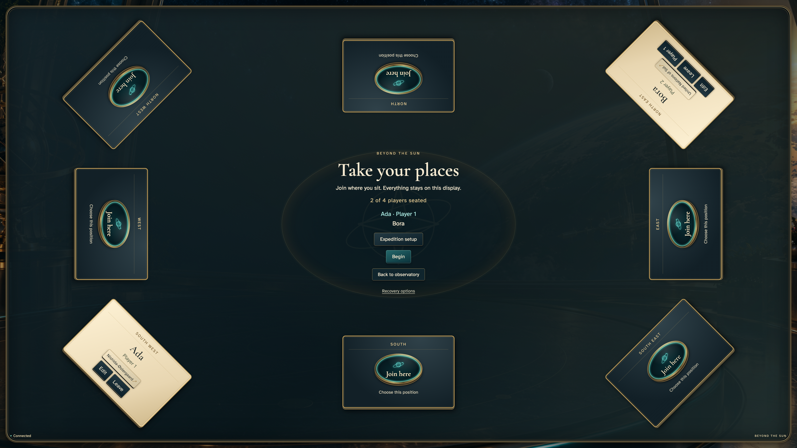](../../screenshots/transfer-control-then-build-at-an-owned-shipyard-with-2-shared-corner-fleets/012-faction-1-chosen-tabletop-4k-darwin.png)

- [x] Bora retains United Nations of Sol
- [x] The actual canonical effect and backend acknowledgement settle.
- [x] Public technology topology retains physical separation.
- [x] The actual viewport fits without page scrolling.

## 14. Begin the immutable source-reviewed Basic setup through the ordinary UI

Viewpoint: **Ada · South West · one shared controller**.

| desktop · 1440 × 1000 |
| --- |
|  |

tabletop-4k · 3840 × 2160

- [x] Begin the immutable source-reviewed Basic setup through the ordinary UI
- [x] The actual canonical effect and backend acknowledgement settle.
- [x] Public technology topology retains physical separation.
- [x] The actual viewport fits without page scrolling.

## 15. Ada opens the actual Action instrument

Viewpoint: **Ada · South West · one shared controller**.

| desktop · 1440 × 1000 |
| --- |
| [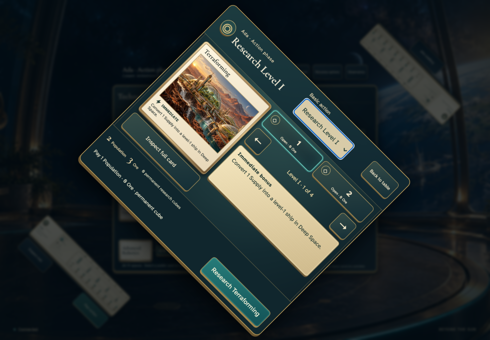](../../screenshots/transfer-control-then-build-at-an-owned-shipyard-with-2-shared-corner-fleets/014-ada-terraform-plan-desktop-darwin.png) |

tabletop-4k · 3840 × 2160

[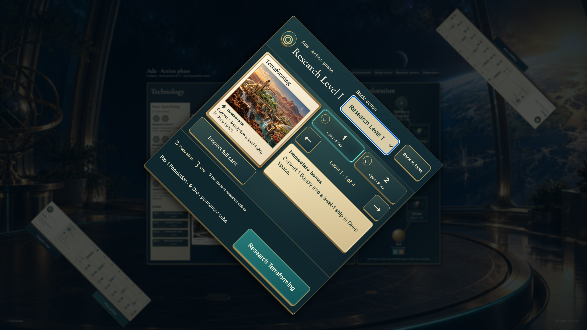](../../screenshots/transfer-control-then-build-at-an-owned-shipyard-with-2-shared-corner-fleets/014-ada-terraform-plan-tabletop-4k-darwin.png)

- [x] Ada opens the actual Action instrument
- [x] The actual canonical effect and backend acknowledgement settle.
- [x] Public technology topology retains physical separation.
- [x] The actual viewport fits without page scrolling.

## 16. Ada chooses the unoccupied printed research space

Viewpoint: **Ada · South West · one shared controller**.

| desktop · 1440 × 1000 |
| --- |
| [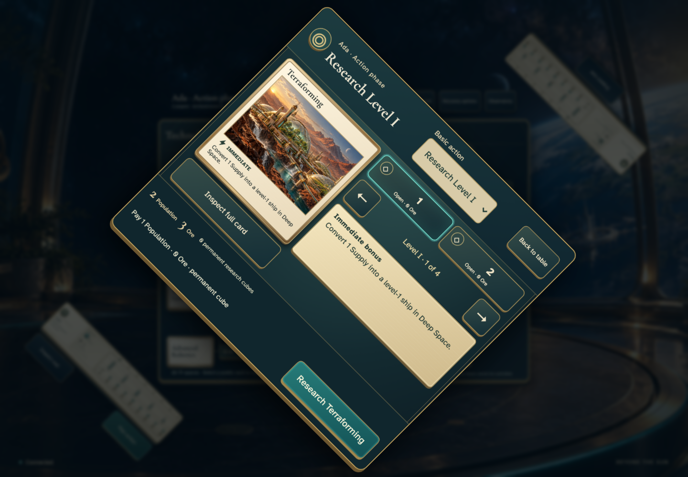](../../screenshots/transfer-control-then-build-at-an-owned-shipyard-with-2-shared-corner-fleets/015-ada-terraform-space-desktop-darwin.png) |

tabletop-4k · 3840 × 2160

[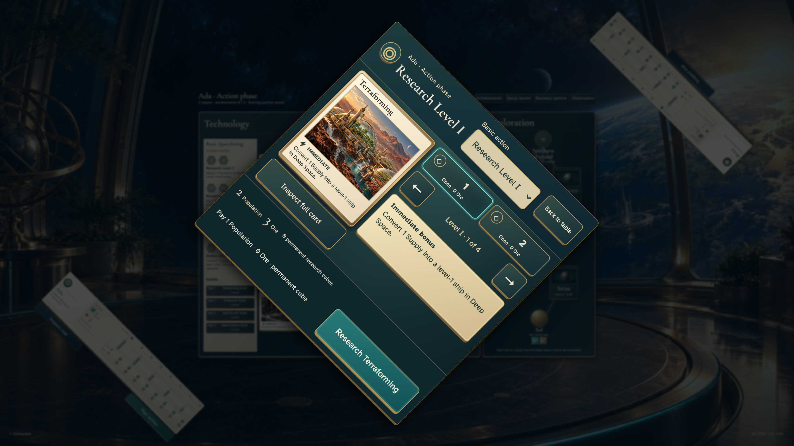](../../screenshots/transfer-control-then-build-at-an-owned-shipyard-with-2-shared-corner-fleets/015-ada-terraform-space-tabletop-4k-darwin.png)

- [x] Ada chooses the unoccupied printed research space
- [x] The actual canonical effect and backend acknowledgement settle.
- [x] Public technology topology retains physical separation.
- [x] The actual viewport fits without page scrolling.

## 17. Ada pays permanent research Population and resolves the printed bonus

Viewpoint: **Ada · South West · one shared controller**.

| desktop · 1440 × 1000 |
| --- |
| [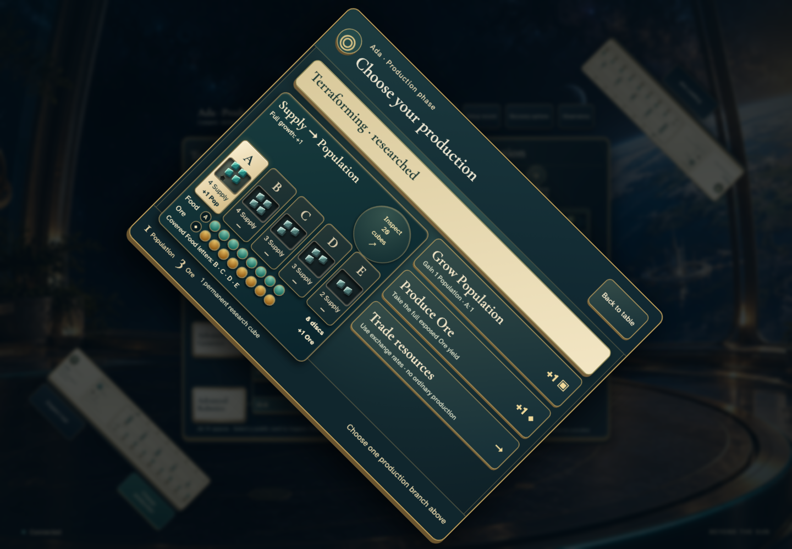](../../screenshots/transfer-control-then-build-at-an-owned-shipyard-with-2-shared-corner-fleets/016-ada-terraform-paid-desktop-darwin.png) |

tabletop-4k · 3840 × 2160

[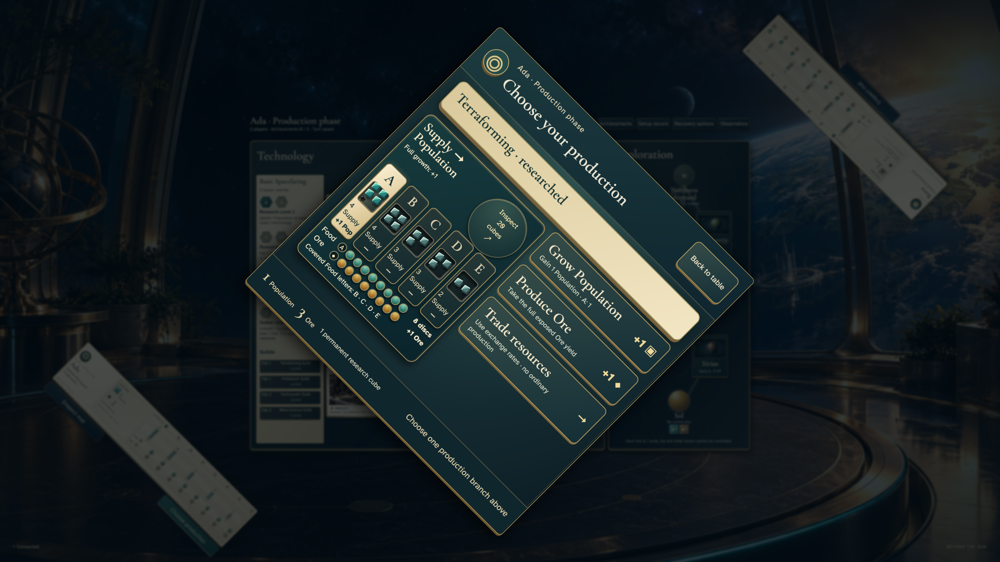](../../screenshots/transfer-control-then-build-at-an-owned-shipyard-with-2-shared-corner-fleets/016-ada-terraform-paid-tabletop-4k-darwin.png)

- [x] Ada pays permanent research Population and resolves the printed bonus
- [x] The actual canonical effect and backend acknowledgement settle.
- [x] Public technology topology retains physical separation.
- [x] The actual viewport fits without page scrolling.

## 18. Ada completes ordinary production and hands off

Viewpoint: **Ada · South West · one shared controller**.

| desktop · 1440 × 1000 |
| --- |
|  |

tabletop-4k · 3840 × 2160

[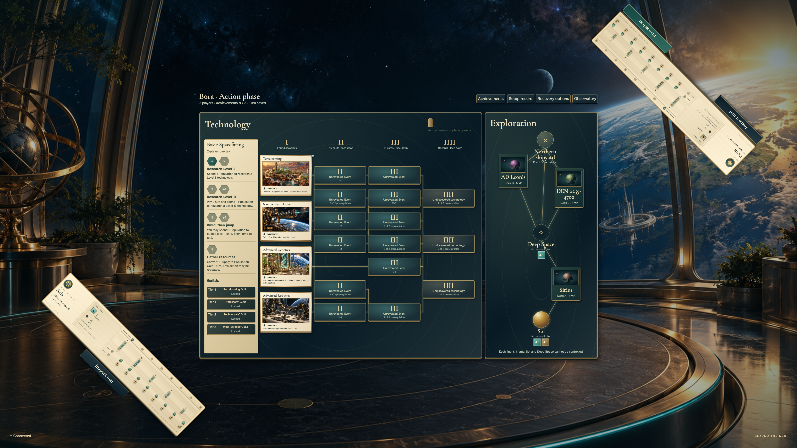](../../screenshots/transfer-control-then-build-at-an-owned-shipyard-with-2-shared-corner-fleets/017-ada-terraform-handoff-tabletop-4k-darwin.png)

- [x] Ada completes ordinary production and hands off
- [x] The actual canonical effect and backend acknowledgement settle.
- [x] Public technology topology retains physical separation.
- [x] The actual viewport fits without page scrolling.

## 19. Bora opens the actual Action instrument

Viewpoint: **Bora · North East · one shared controller**.

| desktop · 1440 × 1000 |
| --- |
| [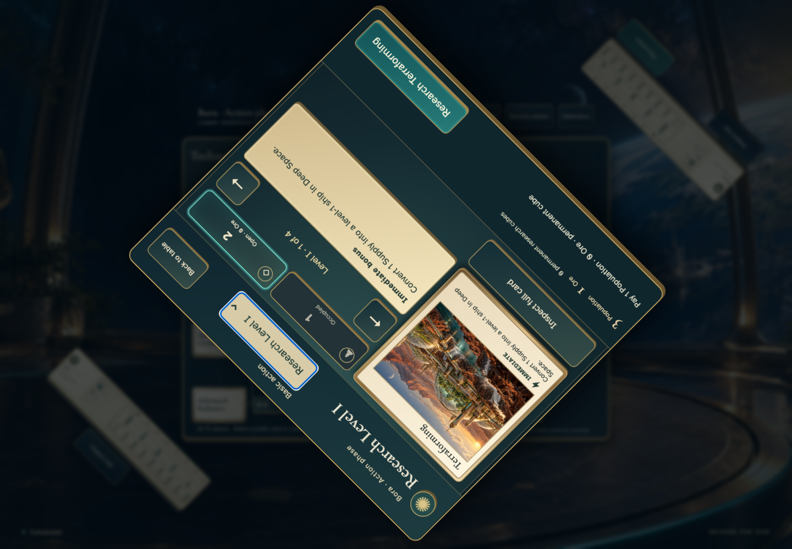](../../screenshots/transfer-control-then-build-at-an-owned-shipyard-with-2-shared-corner-fleets/018-bora-terraform-plan-desktop-darwin.png) |

tabletop-4k · 3840 × 2160

[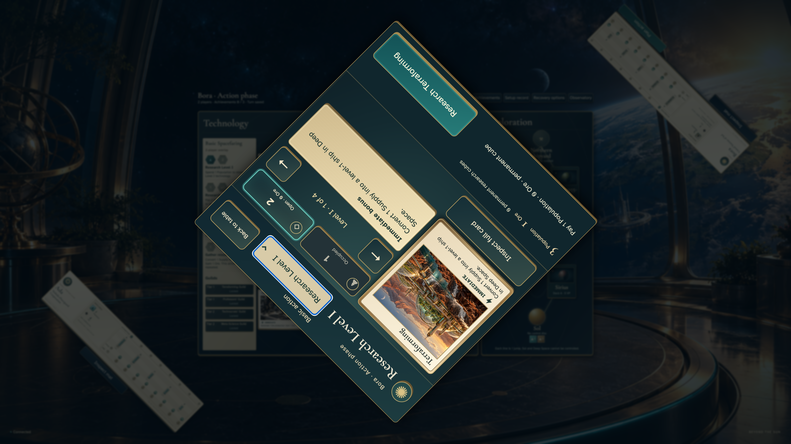](../../screenshots/transfer-control-then-build-at-an-owned-shipyard-with-2-shared-corner-fleets/018-bora-terraform-plan-tabletop-4k-darwin.png)

- [x] Bora opens the actual Action instrument
- [x] The actual canonical effect and backend acknowledgement settle.
- [x] Public technology topology retains physical separation.
- [x] The actual viewport fits without page scrolling.

## 20. Bora chooses the unoccupied printed research space

Viewpoint: **Bora · North East · one shared controller**.

| desktop · 1440 × 1000 |
| --- |
| [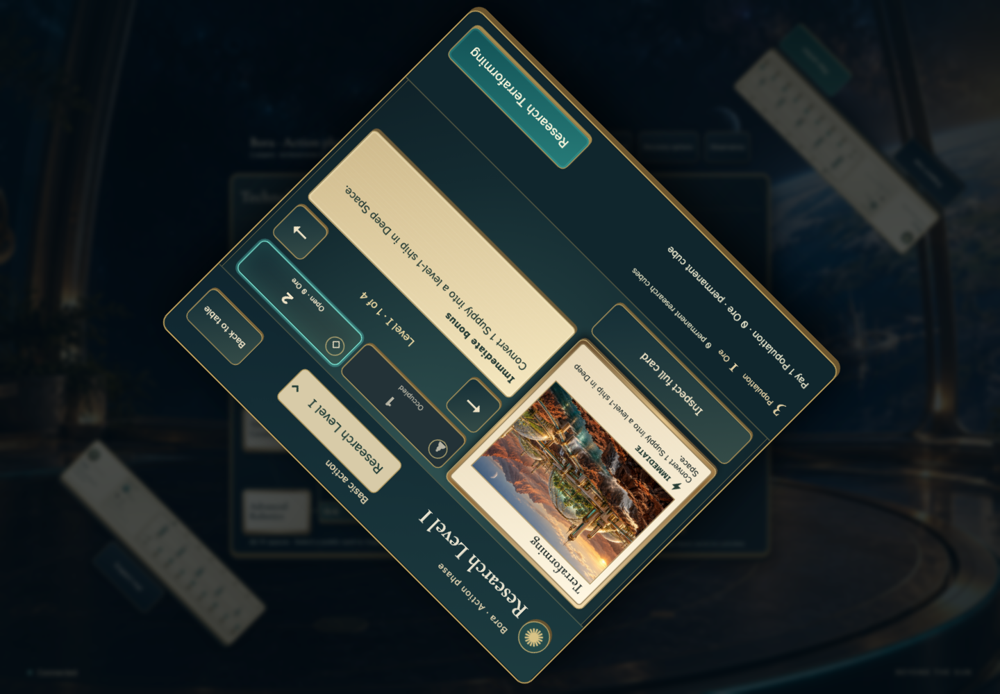](../../screenshots/transfer-control-then-build-at-an-owned-shipyard-with-2-shared-corner-fleets/019-bora-terraform-space-desktop-darwin.png) |

tabletop-4k · 3840 × 2160

[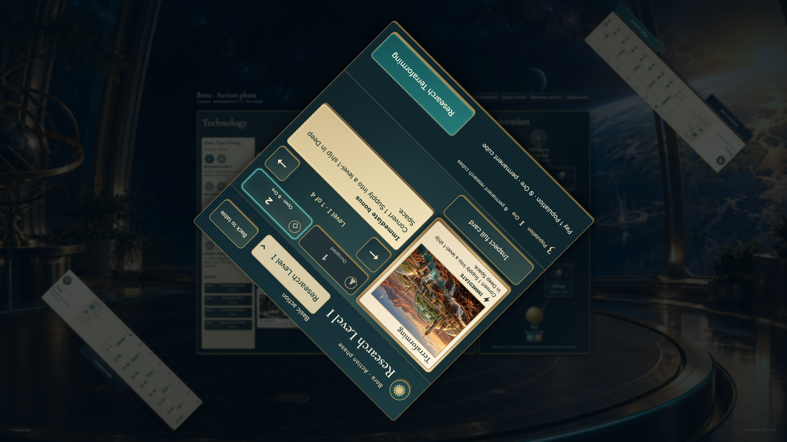](../../screenshots/transfer-control-then-build-at-an-owned-shipyard-with-2-shared-corner-fleets/019-bora-terraform-space-tabletop-4k-darwin.png)

- [x] Bora chooses the unoccupied printed research space
- [x] The actual canonical effect and backend acknowledgement settle.
- [x] Public technology topology retains physical separation.
- [x] The actual viewport fits without page scrolling.

## 21. Bora pays permanent research Population and resolves the printed bonus

Viewpoint: **Bora · North East · one shared controller**.

| desktop · 1440 × 1000 |
| --- |
|  |

tabletop-4k · 3840 × 2160

- [x] Bora pays permanent research Population and resolves the printed bonus
- [x] The actual canonical effect and backend acknowledgement settle.
- [x] Public technology topology retains physical separation.
- [x] The actual viewport fits without page scrolling.

## 22. Bora completes ordinary production and hands off

Viewpoint: **Bora · North East · one shared controller**.

| desktop · 1440 × 1000 |
| --- |
|  |

tabletop-4k · 3840 × 2160

- [x] Bora completes ordinary production and hands off
- [x] The actual canonical effect and backend acknowledgement settle.
- [x] Public technology topology retains physical separation.
- [x] The actual viewport fits without page scrolling.

## 23. Ada opens the actual Action instrument

Viewpoint: **Ada · South West · one shared controller**.

| desktop · 1440 × 1000 |
| --- |
|  |

tabletop-4k · 3840 × 2160

[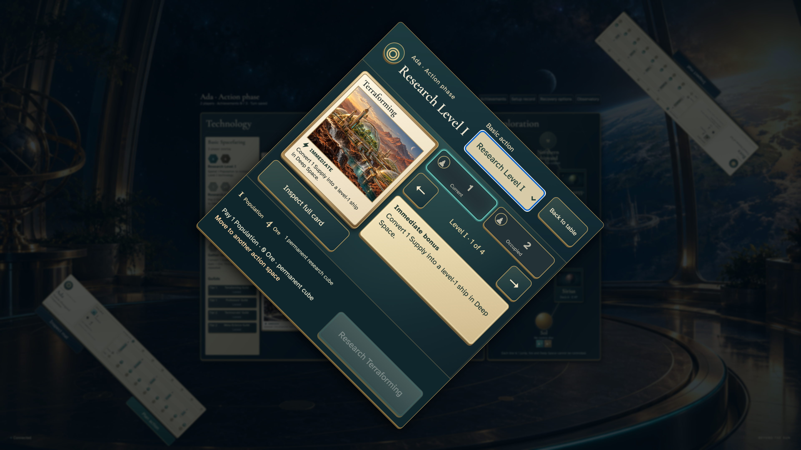](../../screenshots/transfer-control-then-build-at-an-owned-shipyard-with-2-shared-corner-fleets/022-ada-yard-plan-tabletop-4k-darwin.png)

- [x] Ada opens the actual Action instrument
- [x] The actual canonical effect and backend acknowledgement settle.
- [x] Public technology topology retains physical separation.
- [x] The actual viewport fits without page scrolling.

## 24. Ada selects a printed Technology Action

Viewpoint: **Ada · South West · one shared controller**.

| desktop · 1440 × 1000 |
| --- |
| [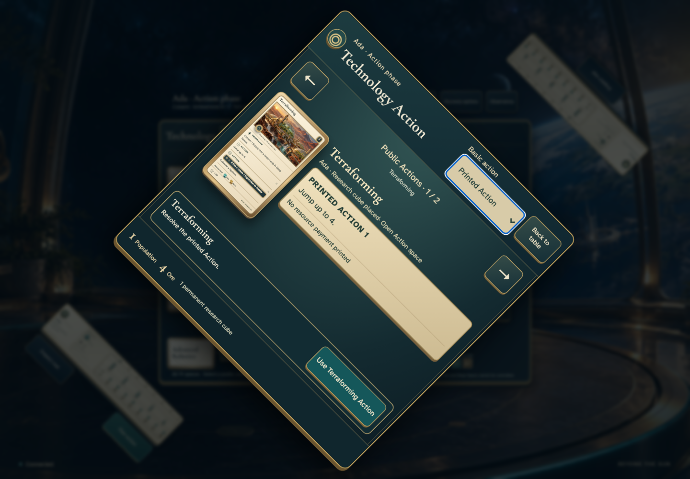](../../screenshots/transfer-control-then-build-at-an-owned-shipyard-with-2-shared-corner-fleets/023-ada-yard-kind-desktop-darwin.png) |

tabletop-4k · 3840 × 2160

[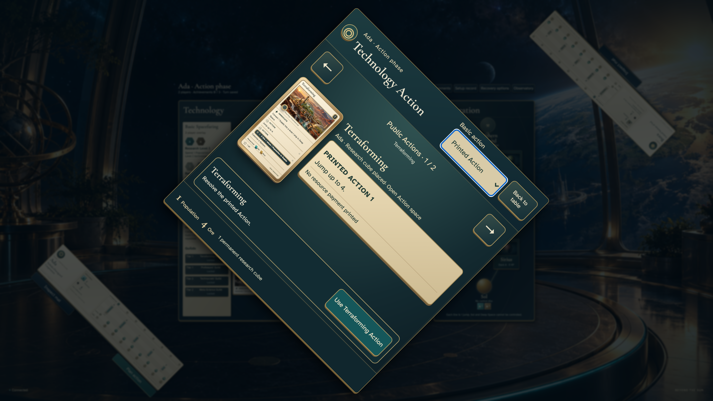](../../screenshots/transfer-control-then-build-at-an-owned-shipyard-with-2-shared-corner-fleets/023-ada-yard-kind-tabletop-4k-darwin.png)

- [x] Ada selects a printed Technology Action
- [x] The actual canonical effect and backend acknowledgement settle.
- [x] Public technology topology retains physical separation.
- [x] The actual viewport fits without page scrolling.

## 25. Pay the actual printed Action before selecting an owned ship

Viewpoint: **Ada · South West · one shared controller**.

| desktop · 1440 × 1000 |
| --- |
|  |

tabletop-4k · 3840 × 2160

[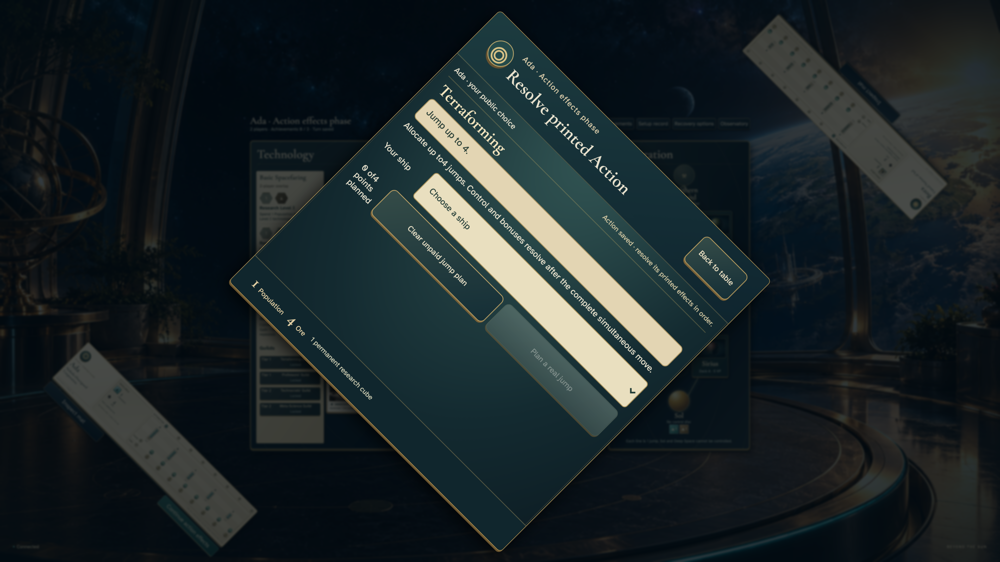](../../screenshots/transfer-control-then-build-at-an-owned-shipyard-with-2-shared-corner-fleets/024-ada-yard-paid-tabletop-4k-darwin.png)

- [x] Pay the actual printed Action before selecting an owned ship
- [x] The actual canonical effect and backend acknowledgement settle.
- [x] Public technology topology retains physical separation.
- [x] The actual viewport fits without page scrolling.

## 26. Select the existing level-one ship; construction is not part of this Action

Viewpoint: **Ada · South West · one shared controller**.

| desktop · 1440 × 1000 |
| --- |
| [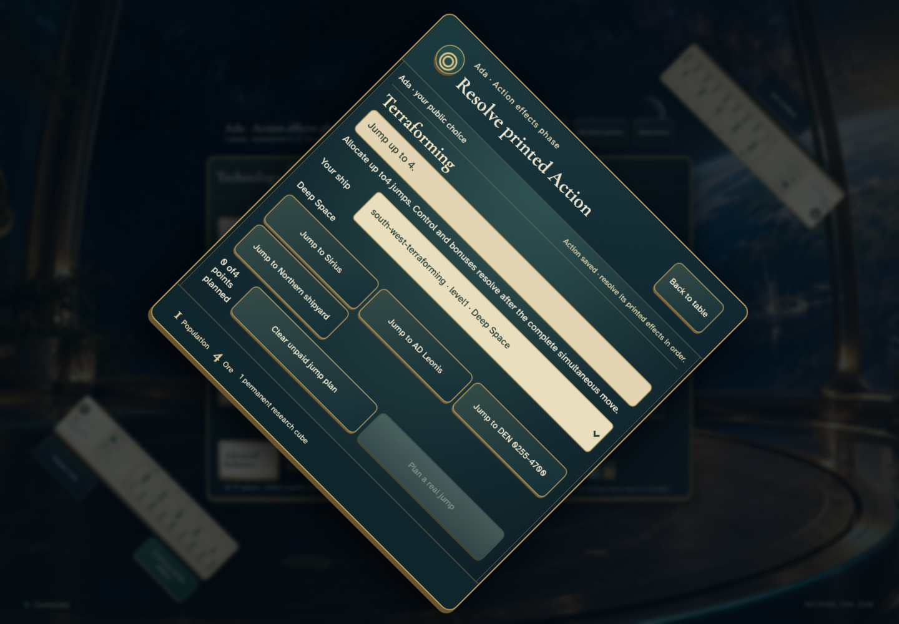](../../screenshots/transfer-control-then-build-at-an-owned-shipyard-with-2-shared-corner-fleets/025-ada-yard-ship-desktop-darwin.png) |

tabletop-4k · 3840 × 2160

[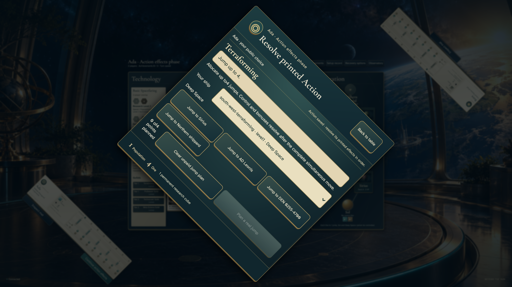](../../screenshots/transfer-control-then-build-at-an-owned-shipyard-with-2-shared-corner-fleets/025-ada-yard-ship-tabletop-4k-darwin.png)

- [x] Select the existing level-one ship; construction is not part of this Action
- [x] The actual canonical effect and backend acknowledgement settle.
- [x] Public technology topology retains physical separation.
- [x] The actual viewport fits without page scrolling.

## 27. Add the next adjacent system to the explicit path

Viewpoint: **Ada · South West · one shared controller**.

| desktop · 1440 × 1000 |
| --- |
| [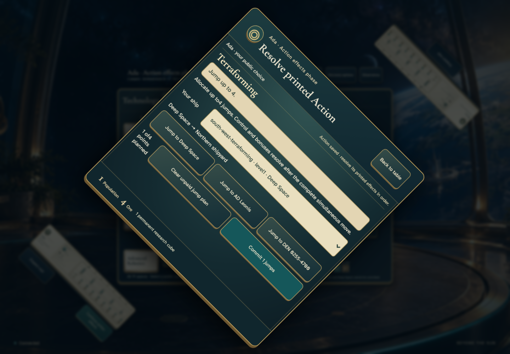](../../screenshots/transfer-control-then-build-at-an-owned-shipyard-with-2-shared-corner-fleets/026-ada-yard-leg-0-desktop-darwin.png) |

tabletop-4k · 3840 × 2160

[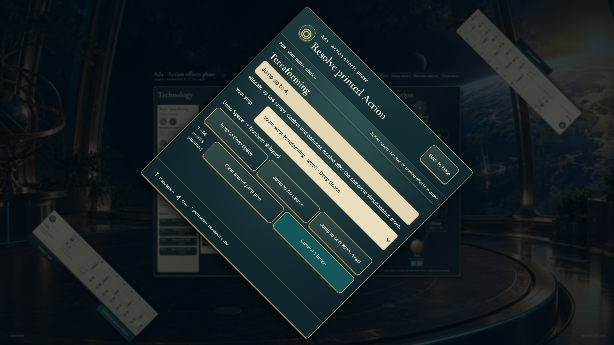](../../screenshots/transfer-control-then-build-at-an-owned-shipyard-with-2-shared-corner-fleets/026-ada-yard-leg-0-tabletop-4k-darwin.png)

- [x] Add the next adjacent system to the explicit path
- [x] The actual canonical effect and backend acknowledgement settle.
- [x] Public technology topology retains physical separation.
- [x] The actual viewport fits without page scrolling.

## 28. Arrive with uncontested power and resolve the actual outpost

Viewpoint: **Ada · South West · one shared controller**.

| desktop · 1440 × 1000 |
| --- |
| [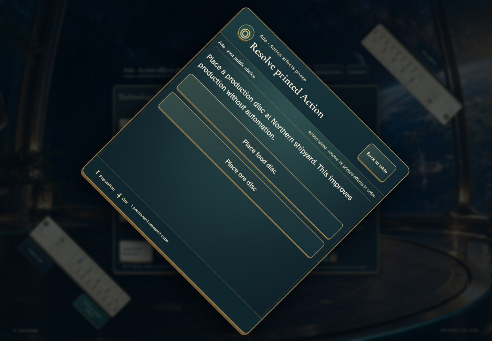](../../screenshots/transfer-control-then-build-at-an-owned-shipyard-with-2-shared-corner-fleets/027-ada-yard-arrival-desktop-darwin.png) |

tabletop-4k · 3840 × 2160

[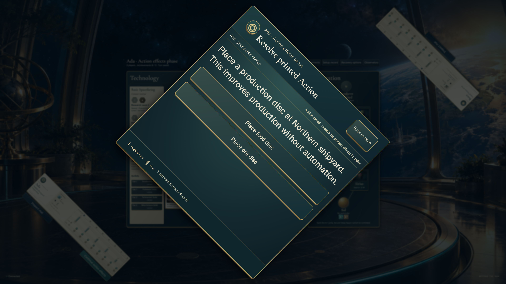](../../screenshots/transfer-control-then-build-at-an-owned-shipyard-with-2-shared-corner-fleets/027-ada-yard-arrival-tabletop-4k-darwin.png)

- [x] Arrive with uncontested power and resolve the actual outpost
- [x] The actual canonical effect and backend acknowledgement settle.
- [x] Public technology topology retains physical separation.
- [x] The actual viewport fits without page scrolling.

## 29. Place a real Food outpost before production

Viewpoint: **Ada · South West · one shared controller**.

| desktop · 1440 × 1000 |
| --- |
|  |

tabletop-4k · 3840 × 2160

[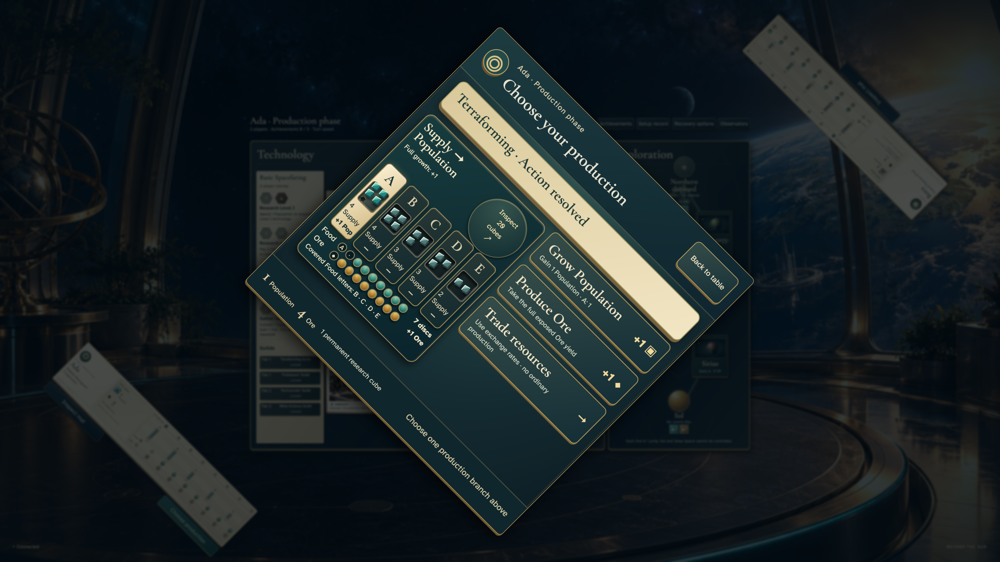](../../screenshots/transfer-control-then-build-at-an-owned-shipyard-with-2-shared-corner-fleets/028-ada-yard-food-tabletop-4k-darwin.png)

- [x] Place a real Food outpost before production
- [x] The actual canonical effect and backend acknowledgement settle.
- [x] Public technology topology retains physical separation.
- [x] The actual viewport fits without page scrolling.

## 30. Ada completes ordinary production and hands off

Viewpoint: **Ada · South West · one shared controller**.

| desktop · 1440 × 1000 |
| --- |
|  |

tabletop-4k · 3840 × 2160

- [x] Ada completes ordinary production and hands off
- [x] The actual canonical effect and backend acknowledgement settle.
- [x] Public technology topology retains physical separation.
- [x] The actual viewport fits without page scrolling.

## 31. Bora opens the actual Action instrument

Viewpoint: **Bora · North East · one shared controller**.

| desktop · 1440 × 1000 |
| --- |
|  |

tabletop-4k · 3840 × 2160

- [x] Bora opens the actual Action instrument
- [x] The actual canonical effect and backend acknowledgement settle.
- [x] Public technology topology retains physical separation.
- [x] The actual viewport fits without page scrolling.

## 32. Bora selects ordinary gathering

Viewpoint: **Bora · North East · one shared controller**.

| desktop · 1440 × 1000 |
| --- |
| [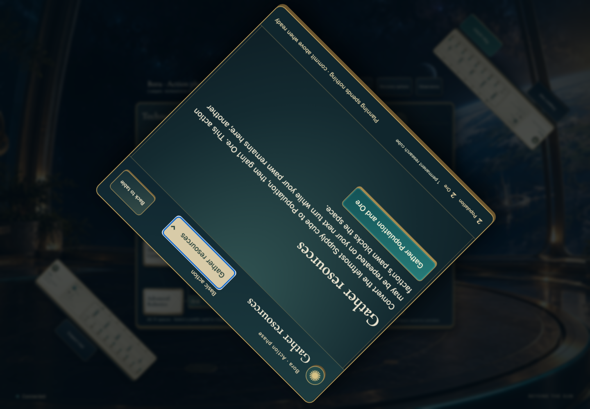](../../screenshots/transfer-control-then-build-at-an-owned-shipyard-with-2-shared-corner-fleets/031-bora-before-tie-kind-desktop-darwin.png) |

tabletop-4k · 3840 × 2160

[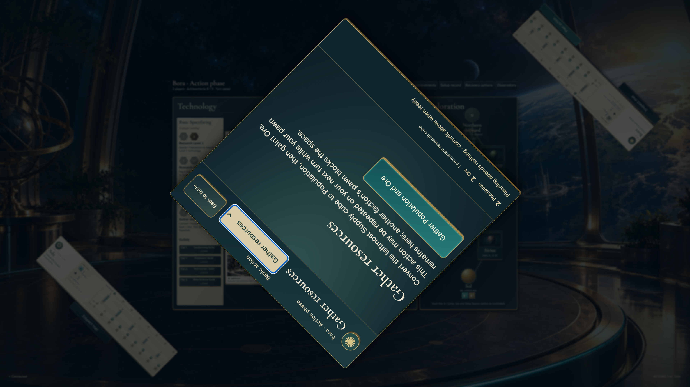](../../screenshots/transfer-control-then-build-at-an-owned-shipyard-with-2-shared-corner-fleets/031-bora-before-tie-kind-tabletop-4k-darwin.png)

- [x] Bora selects ordinary gathering
- [x] The actual canonical effect and backend acknowledgement settle.
- [x] Public technology topology retains physical separation.
- [x] The actual viewport fits without page scrolling.

## 33. Receive actual Gather resources before production

Viewpoint: **Bora · North East · one shared controller**.

| desktop · 1440 × 1000 |
| --- |
| [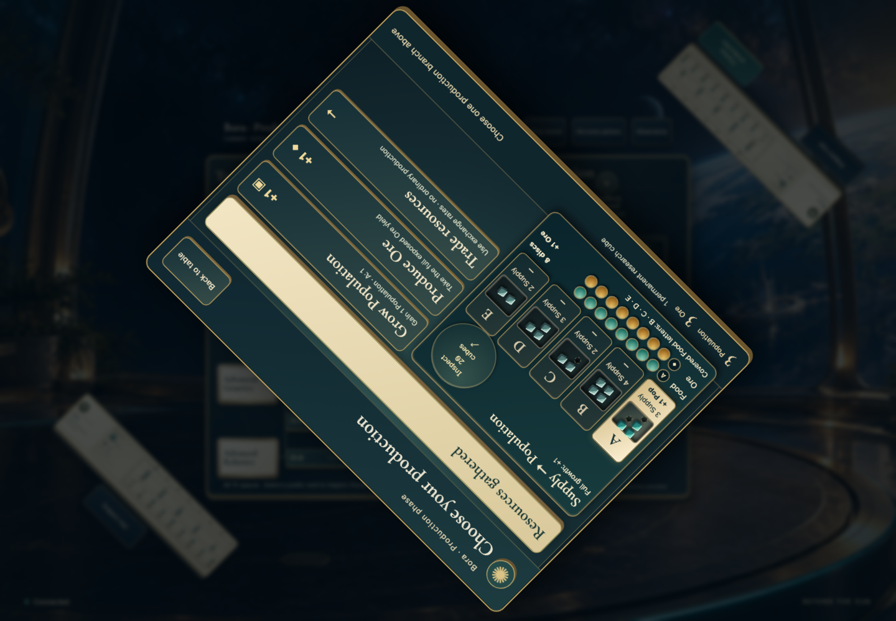](../../screenshots/transfer-control-then-build-at-an-owned-shipyard-with-2-shared-corner-fleets/032-bora-before-tie-gathered-desktop-darwin.png) |

tabletop-4k · 3840 × 2160

- [x] Receive actual Gather resources before production
- [x] The actual canonical effect and backend acknowledgement settle.
- [x] Public technology topology retains physical separation.
- [x] The actual viewport fits without page scrolling.

## 34. Bora completes ordinary production and hands off

Viewpoint: **Bora · North East · one shared controller**.

| desktop · 1440 × 1000 |
| --- |
| [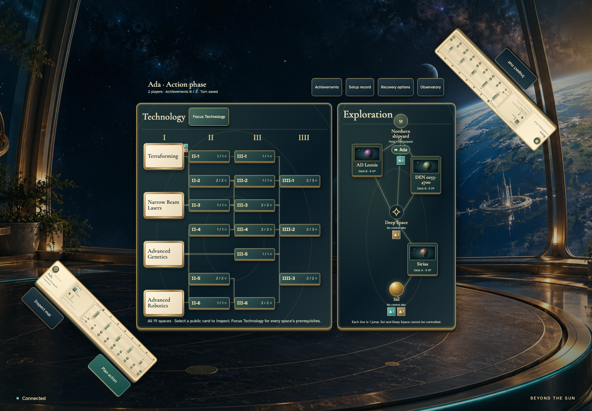](../../screenshots/transfer-control-then-build-at-an-owned-shipyard-with-2-shared-corner-fleets/033-bora-before-tie-handoff-desktop-darwin.png) |

tabletop-4k · 3840 × 2160

- [x] Bora completes ordinary production and hands off
- [x] The actual canonical effect and backend acknowledgement settle.
- [x] Public technology topology retains physical separation.
- [x] The actual viewport fits without page scrolling.

## 35. Ada opens the actual Action instrument

Viewpoint: **Ada · South West · one shared controller**.

| desktop · 1440 × 1000 |
| --- |
|  |

tabletop-4k · 3840 × 2160

- [x] Ada opens the actual Action instrument
- [x] The actual canonical effect and backend acknowledgement settle.
- [x] Public technology topology retains physical separation.
- [x] The actual viewport fits without page scrolling.

## 36. Ada chooses the unoccupied printed research space

Viewpoint: **Ada · South West · one shared controller**.

| desktop · 1440 × 1000 |
| --- |
| [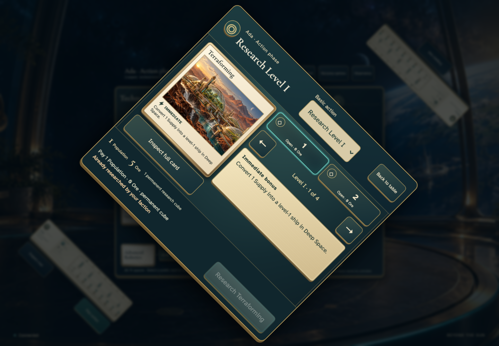](../../screenshots/transfer-control-then-build-at-an-owned-shipyard-with-2-shared-corner-fleets/035-ada-vacates-path-space-desktop-darwin.png) |

tabletop-4k · 3840 × 2160

[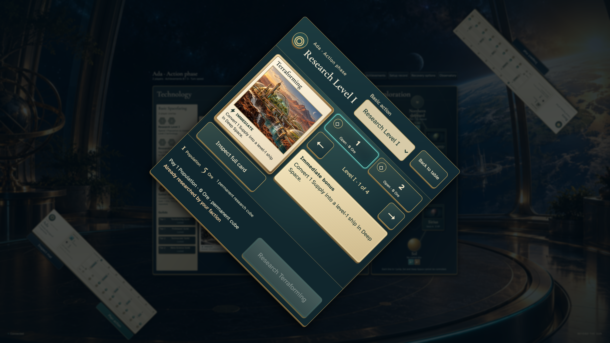](../../screenshots/transfer-control-then-build-at-an-owned-shipyard-with-2-shared-corner-fleets/035-ada-vacates-path-space-tabletop-4k-darwin.png)

- [x] Ada chooses the unoccupied printed research space
- [x] The actual canonical effect and backend acknowledgement settle.
- [x] Public technology topology retains physical separation.
- [x] The actual viewport fits without page scrolling.

## 37. Browse the next public Technology without paying

Viewpoint: **Ada · South West · one shared controller**.

| desktop · 1440 × 1000 |
| --- |
| [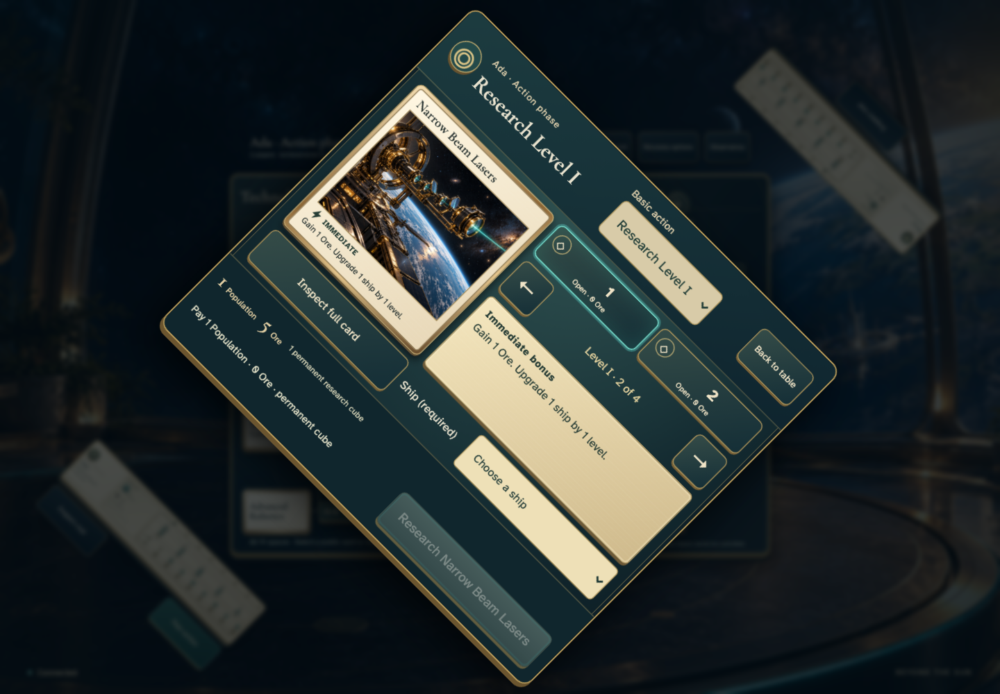](../../screenshots/transfer-control-then-build-at-an-owned-shipyard-with-2-shared-corner-fleets/036-ada-vacates-path-browse-0-desktop-darwin.png) |

tabletop-4k · 3840 × 2160

[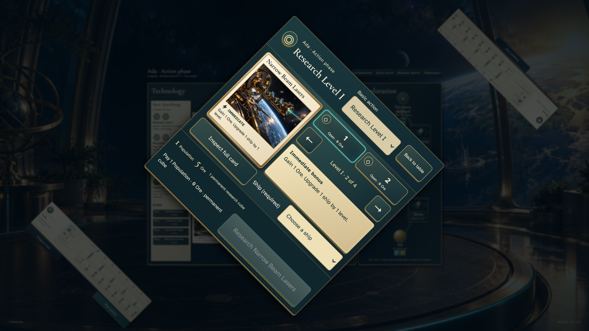](../../screenshots/transfer-control-then-build-at-an-owned-shipyard-with-2-shared-corner-fleets/036-ada-vacates-path-browse-0-tabletop-4k-darwin.png)

- [x] Browse the next public Technology without paying
- [x] The actual canonical effect and backend acknowledgement settle.
- [x] Public technology topology retains physical separation.
- [x] The actual viewport fits without page scrolling.

## 38. Browse the next public Technology without paying

Viewpoint: **Ada · South West · one shared controller**.

| desktop · 1440 × 1000 |
| --- |
| [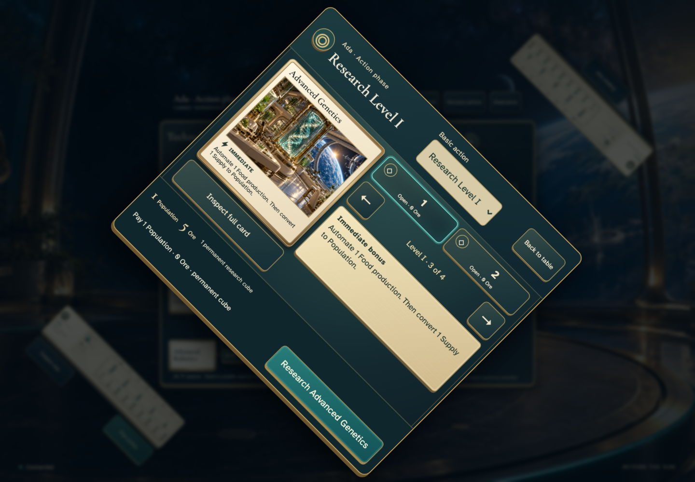](../../screenshots/transfer-control-then-build-at-an-owned-shipyard-with-2-shared-corner-fleets/037-ada-vacates-path-browse-1-desktop-darwin.png) |

tabletop-4k · 3840 × 2160

- [x] Browse the next public Technology without paying
- [x] The actual canonical effect and backend acknowledgement settle.
- [x] Public technology topology retains physical separation.
- [x] The actual viewport fits without page scrolling.

## 39. Browse the next public Technology without paying

Viewpoint: **Ada · South West · one shared controller**.

| desktop · 1440 × 1000 |
| --- |
| [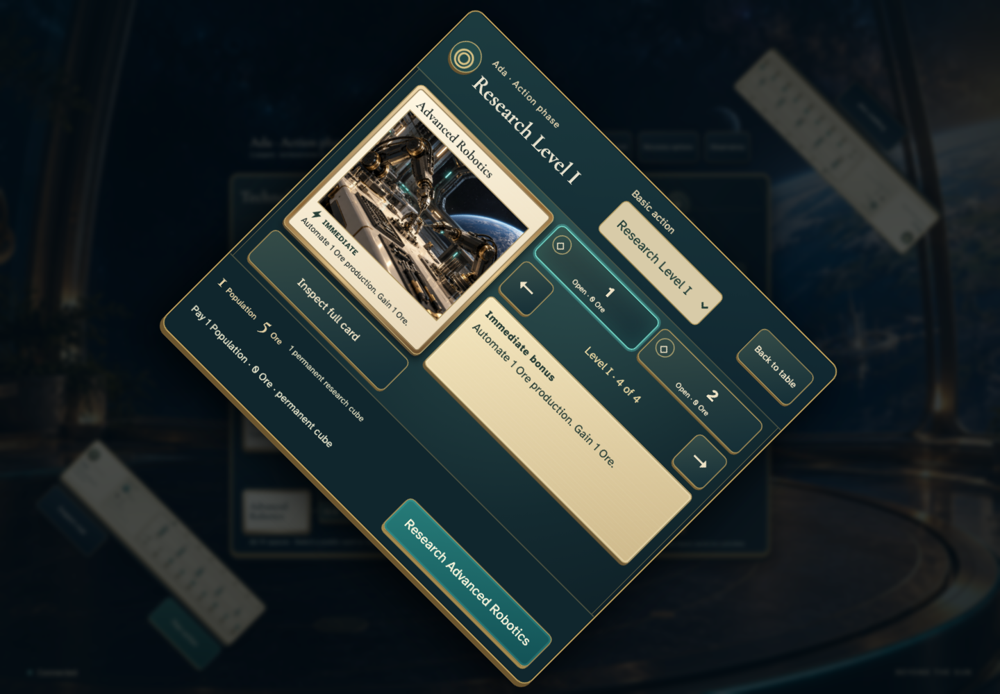](../../screenshots/transfer-control-then-build-at-an-owned-shipyard-with-2-shared-corner-fleets/038-ada-vacates-path-browse-2-desktop-darwin.png) |

tabletop-4k · 3840 × 2160

[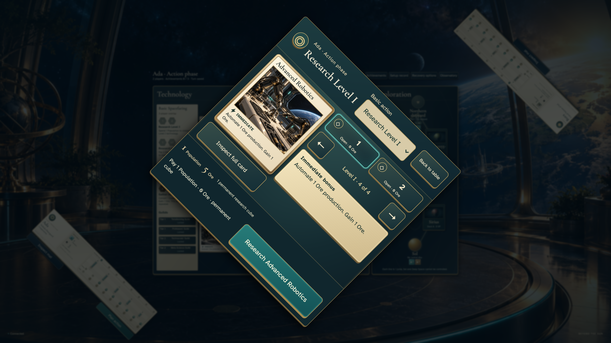](../../screenshots/transfer-control-then-build-at-an-owned-shipyard-with-2-shared-corner-fleets/038-ada-vacates-path-browse-2-tabletop-4k-darwin.png)

- [x] Browse the next public Technology without paying
- [x] The actual canonical effect and backend acknowledgement settle.
- [x] Public technology topology retains physical separation.
- [x] The actual viewport fits without page scrolling.

## 40. Ada pays permanent research Population and resolves the printed bonus

Viewpoint: **Ada · South West · one shared controller**.

| desktop · 1440 × 1000 |
| --- |
| [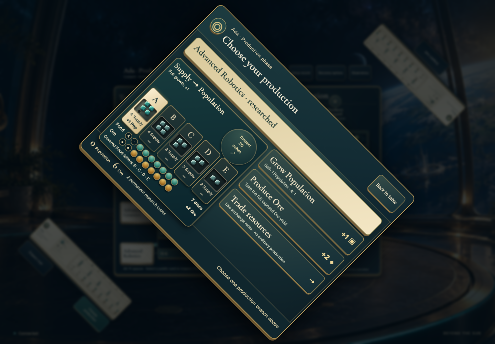](../../screenshots/transfer-control-then-build-at-an-owned-shipyard-with-2-shared-corner-fleets/039-ada-vacates-path-paid-desktop-darwin.png) |

tabletop-4k · 3840 × 2160

- [x] Ada pays permanent research Population and resolves the printed bonus
- [x] The actual canonical effect and backend acknowledgement settle.
- [x] Public technology topology retains physical separation.
- [x] The actual viewport fits without page scrolling.

## 41. Ada completes ordinary production and hands off

Viewpoint: **Ada · South West · one shared controller**.

| desktop · 1440 × 1000 |
| --- |
|  |

tabletop-4k · 3840 × 2160

- [x] Ada completes ordinary production and hands off
- [x] The actual canonical effect and backend acknowledgement settle.
- [x] Public technology topology retains physical separation.
- [x] The actual viewport fits without page scrolling.

## 42. Bora opens the actual Action instrument

Viewpoint: **Bora · North East · one shared controller**.

| desktop · 1440 × 1000 |
| --- |
|  |

tabletop-4k · 3840 × 2160

[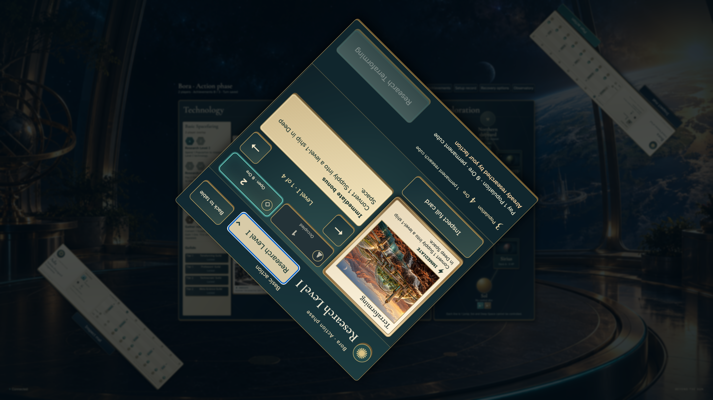](../../screenshots/transfer-control-then-build-at-an-owned-shipyard-with-2-shared-corner-fleets/041-bora-tie-plan-tabletop-4k-darwin.png)

- [x] Bora opens the actual Action instrument
- [x] The actual canonical effect and backend acknowledgement settle.
- [x] Public technology topology retains physical separation.
- [x] The actual viewport fits without page scrolling.

## 43. Bora selects a printed Technology Action

Viewpoint: **Bora · North East · one shared controller**.

| desktop · 1440 × 1000 |
| --- |
| [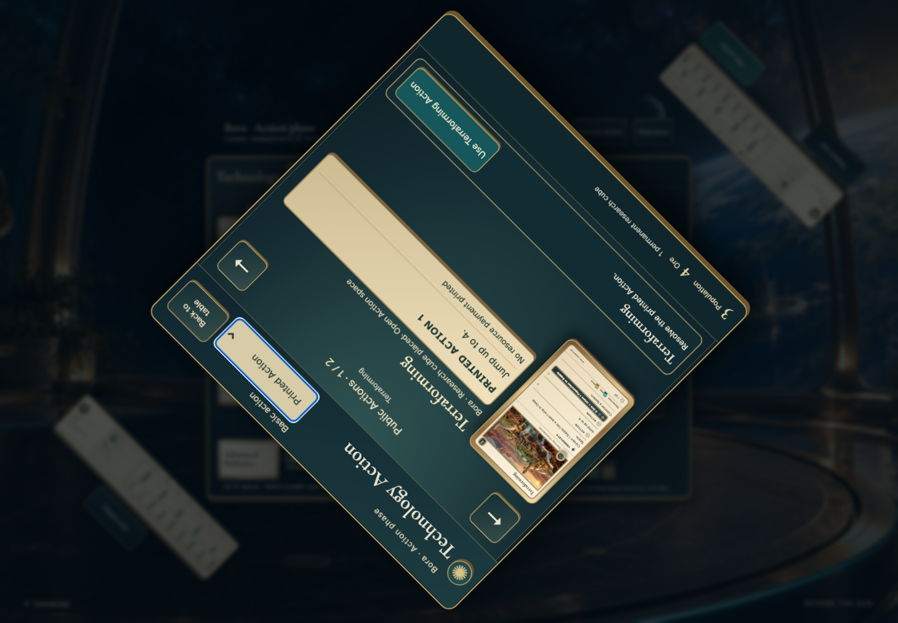](../../screenshots/transfer-control-then-build-at-an-owned-shipyard-with-2-shared-corner-fleets/042-bora-tie-kind-desktop-darwin.png) |

tabletop-4k · 3840 × 2160

[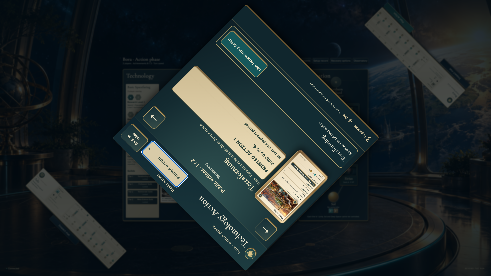](../../screenshots/transfer-control-then-build-at-an-owned-shipyard-with-2-shared-corner-fleets/042-bora-tie-kind-tabletop-4k-darwin.png)

- [x] Bora selects a printed Technology Action
- [x] The actual canonical effect and backend acknowledgement settle.
- [x] Public technology topology retains physical separation.
- [x] The actual viewport fits without page scrolling.

## 44. Pay the actual printed Action before selecting an owned ship

Viewpoint: **Bora · North East · one shared controller**.

| desktop · 1440 × 1000 |
| --- |
| [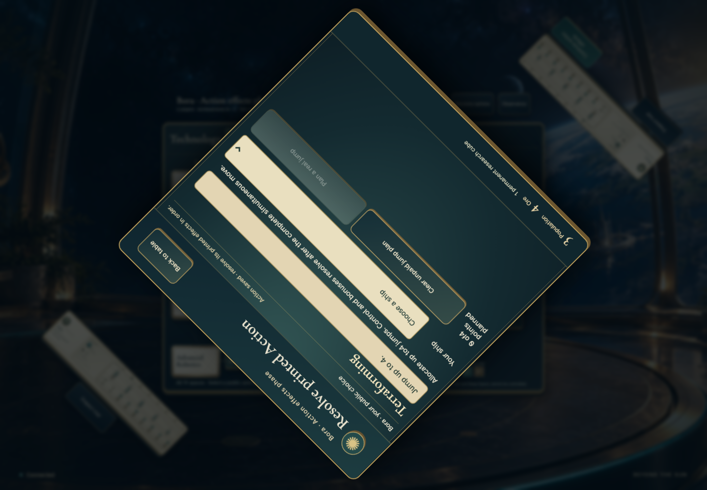](../../screenshots/transfer-control-then-build-at-an-owned-shipyard-with-2-shared-corner-fleets/043-bora-tie-paid-desktop-darwin.png) |

tabletop-4k · 3840 × 2160

[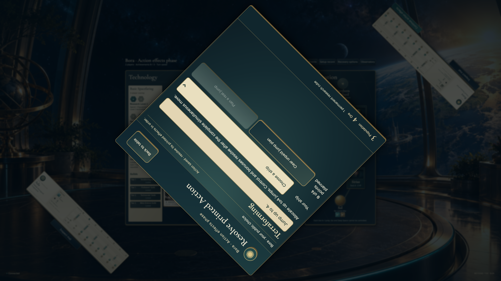](../../screenshots/transfer-control-then-build-at-an-owned-shipyard-with-2-shared-corner-fleets/043-bora-tie-paid-tabletop-4k-darwin.png)

- [x] Pay the actual printed Action before selecting an owned ship
- [x] The actual canonical effect and backend acknowledgement settle.
- [x] Public technology topology retains physical separation.
- [x] The actual viewport fits without page scrolling.

## 45. Select the existing level-one ship; construction is not part of this Action

Viewpoint: **Bora · North East · one shared controller**.

| desktop · 1440 × 1000 |
| --- |
| [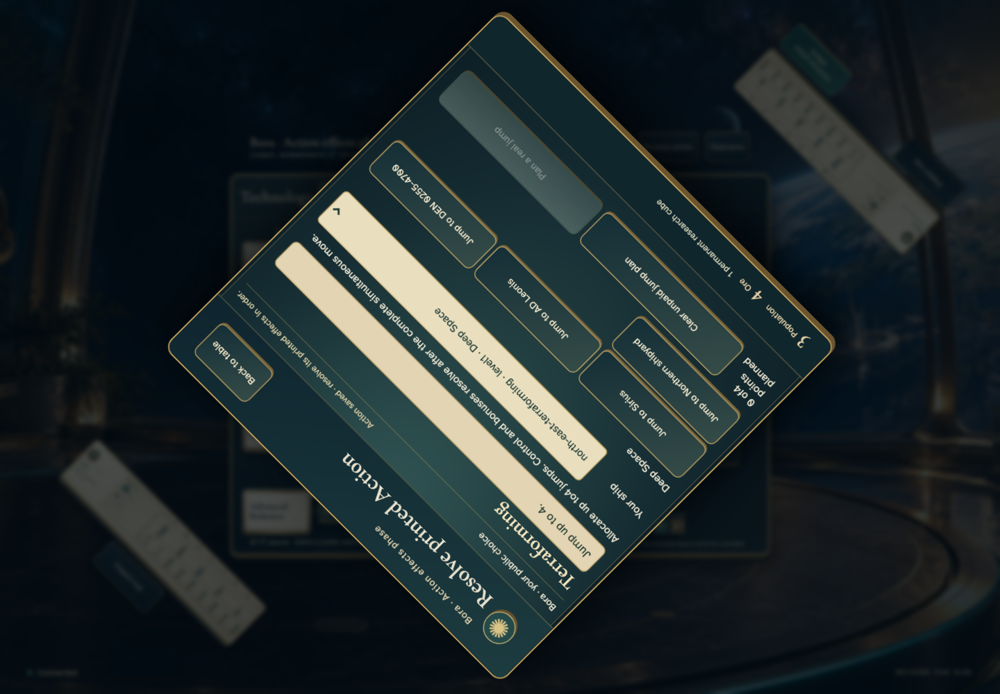](../../screenshots/transfer-control-then-build-at-an-owned-shipyard-with-2-shared-corner-fleets/044-bora-tie-ship-desktop-darwin.png) |

tabletop-4k · 3840 × 2160

[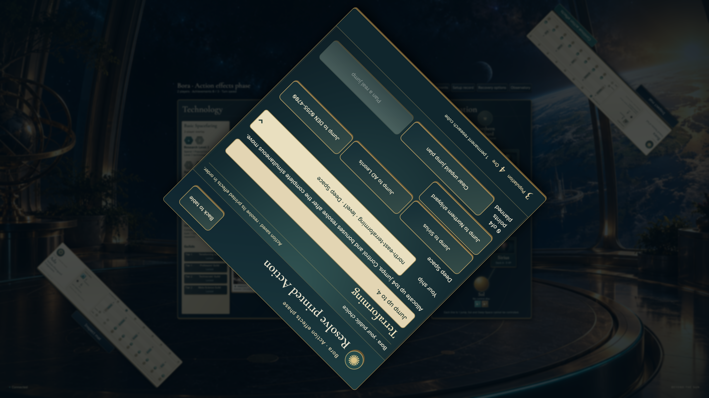](../../screenshots/transfer-control-then-build-at-an-owned-shipyard-with-2-shared-corner-fleets/044-bora-tie-ship-tabletop-4k-darwin.png)

- [x] Select the existing level-one ship; construction is not part of this Action
- [x] The actual canonical effect and backend acknowledgement settle.
- [x] Public technology topology retains physical separation.
- [x] The actual viewport fits without page scrolling.

## 46. Add the next adjacent system to the explicit path

Viewpoint: **Bora · North East · one shared controller**.

| desktop · 1440 × 1000 |
| --- |
| [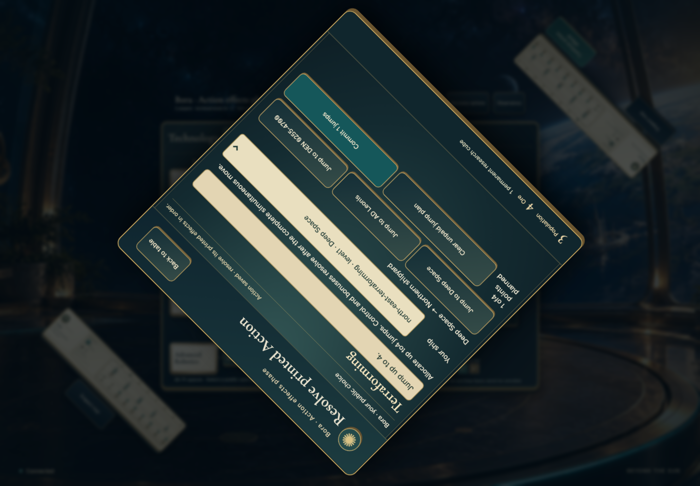](../../screenshots/transfer-control-then-build-at-an-owned-shipyard-with-2-shared-corner-fleets/045-bora-tie-leg-0-desktop-darwin.png) |

tabletop-4k · 3840 × 2160

[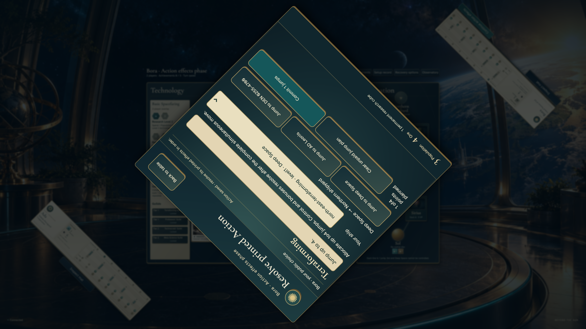](../../screenshots/transfer-control-then-build-at-an-owned-shipyard-with-2-shared-corner-fleets/045-bora-tie-leg-0-tabletop-4k-darwin.png)

- [x] Add the next adjacent system to the explicit path
- [x] The actual canonical effect and backend acknowledgement settle.
- [x] Public technology topology retains physical separation.
- [x] The actual viewport fits without page scrolling.

## 47. Equal incoming power preserves Ada’s incumbent outpost

Viewpoint: **Bora · North East · one shared controller**.

| desktop · 1440 × 1000 |
| --- |
| [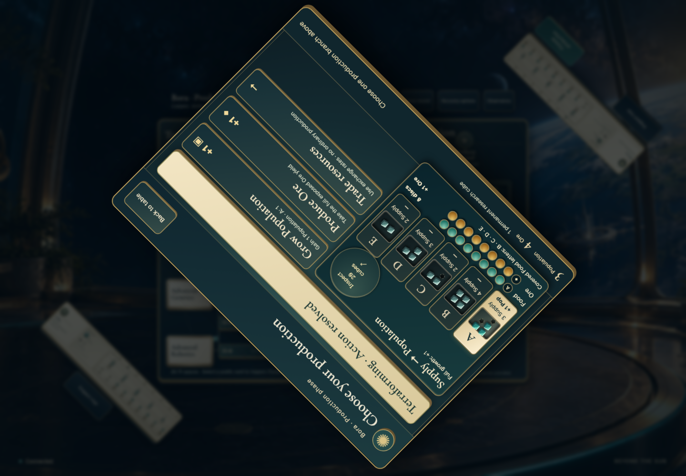](../../screenshots/transfer-control-then-build-at-an-owned-shipyard-with-2-shared-corner-fleets/046-bora-tie-arrival-desktop-darwin.png) |

tabletop-4k · 3840 × 2160

[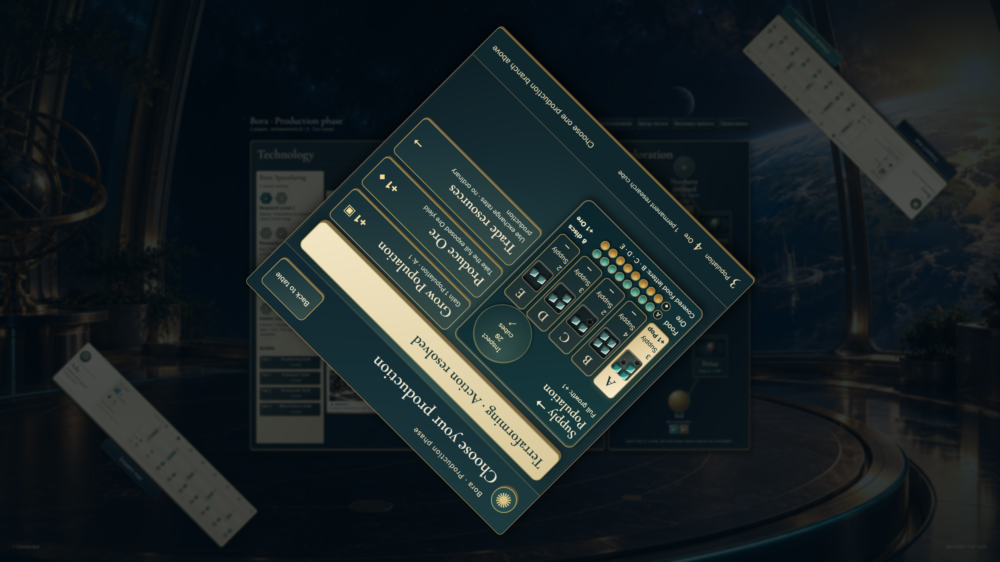](../../screenshots/transfer-control-then-build-at-an-owned-shipyard-with-2-shared-corner-fleets/046-bora-tie-arrival-tabletop-4k-darwin.png)

- [x] Equal incoming power preserves Ada’s incumbent outpost
- [x] The actual canonical effect and backend acknowledgement settle.
- [x] Public technology topology retains physical separation.
- [x] The actual viewport fits without page scrolling.

## 48. Bora completes ordinary production and hands off

Viewpoint: **Bora · North East · one shared controller**.

| desktop · 1440 × 1000 |
| --- |
|  |

tabletop-4k · 3840 × 2160

- [x] Bora completes ordinary production and hands off
- [x] The actual canonical effect and backend acknowledgement settle.
- [x] Public technology topology retains physical separation.
- [x] The actual viewport fits without page scrolling.

## 49. Ada opens the actual Action instrument

Viewpoint: **Ada · South West · one shared controller**.

| desktop · 1440 × 1000 |
| --- |
| [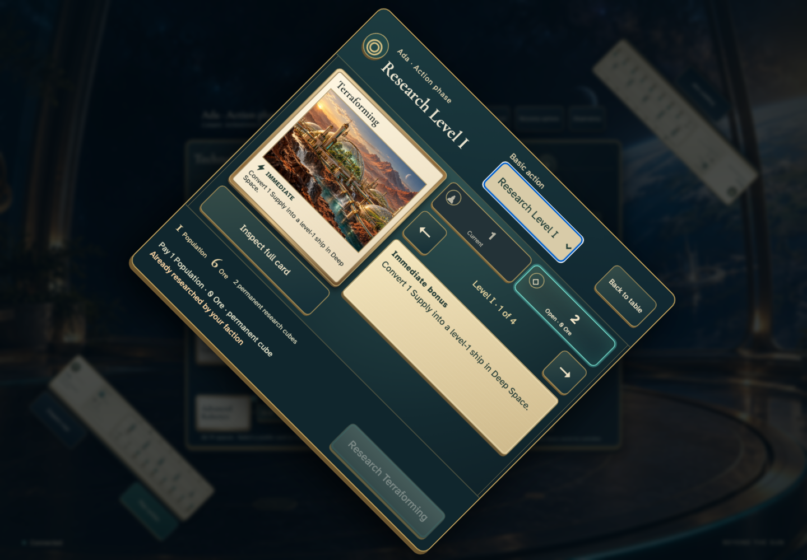](../../screenshots/transfer-control-then-build-at-an-owned-shipyard-with-2-shared-corner-fleets/048-ada-vacate-plan-desktop-darwin.png) |

tabletop-4k · 3840 × 2160

- [x] Ada opens the actual Action instrument
- [x] The actual canonical effect and backend acknowledgement settle.
- [x] Public technology topology retains physical separation.
- [x] The actual viewport fits without page scrolling.

## 50. Ada selects ordinary gathering

Viewpoint: **Ada · South West · one shared controller**.

| desktop · 1440 × 1000 |
| --- |
|  |

tabletop-4k · 3840 × 2160

- [x] Ada selects ordinary gathering
- [x] The actual canonical effect and backend acknowledgement settle.
- [x] Public technology topology retains physical separation.
- [x] The actual viewport fits without page scrolling.

## 51. Receive actual Gather resources before production

Viewpoint: **Ada · South West · one shared controller**.

| desktop · 1440 × 1000 |
| --- |
|  |

tabletop-4k · 3840 × 2160

- [x] Receive actual Gather resources before production
- [x] The actual canonical effect and backend acknowledgement settle.
- [x] Public technology topology retains physical separation.
- [x] The actual viewport fits without page scrolling.

## 52. Ada completes ordinary production and hands off

Viewpoint: **Ada · South West · one shared controller**.

| desktop · 1440 × 1000 |
| --- |
|  |

tabletop-4k · 3840 × 2160

- [x] Ada completes ordinary production and hands off
- [x] The actual canonical effect and backend acknowledgement settle.
- [x] Public technology topology retains physical separation.
- [x] The actual viewport fits without page scrolling.

## 53. Bora opens the actual Action instrument

Viewpoint: **Bora · North East · one shared controller**.

| desktop · 1440 × 1000 |
| --- |
|  |

tabletop-4k · 3840 × 2160

- [x] Bora opens the actual Action instrument
- [x] The actual canonical effect and backend acknowledgement settle.
- [x] Public technology topology retains physical separation.
- [x] The actual viewport fits without page scrolling.

## 54. Bora chooses the unoccupied printed research space

Viewpoint: **Bora · North East · one shared controller**.

| desktop · 1440 × 1000 |
| --- |
|  |

tabletop-4k · 3840 × 2160

- [x] Bora chooses the unoccupied printed research space
- [x] The actual canonical effect and backend acknowledgement settle.
- [x] Public technology topology retains physical separation.
- [x] The actual viewport fits without page scrolling.

## 55. Browse the next public Technology without paying

Viewpoint: **Bora · North East · one shared controller**.

| desktop · 1440 × 1000 |
| --- |
|  |

tabletop-4k · 3840 × 2160

- [x] Browse the next public Technology without paying
- [x] The actual canonical effect and backend acknowledgement settle.
- [x] Public technology topology retains physical separation.
- [x] The actual viewport fits without page scrolling.

## 56. The mandatory one-level upgrade needs an explicit owned ship

Viewpoint: **Bora · North East · one shared controller**.

| desktop · 1440 × 1000 |
| --- |
|  |

tabletop-4k · 3840 × 2160

- [x] The mandatory one-level upgrade needs an explicit owned ship
- [x] The actual canonical effect and backend acknowledgement settle.
- [x] Public technology topology retains physical separation.
- [x] The actual viewport fits without page scrolling.

## 57. Select the owned ship and inspect the exact level change

Viewpoint: **Bora · North East · one shared controller**.

| desktop · 1440 × 1000 |
| --- |
|  |

tabletop-4k · 3840 × 2160

- [x] Select the owned ship and inspect the exact level change
- [x] The actual canonical effect and backend acknowledgement settle.
- [x] Public technology topology retains physical separation.
- [x] The actual viewport fits without page scrolling.

## 58. Bora pays permanent research Population and resolves the printed bonus

Viewpoint: **Bora · North East · one shared controller**.

| desktop · 1440 × 1000 |
| --- |
|  |

tabletop-4k · 3840 × 2160

- [x] Bora pays permanent research Population and resolves the printed bonus
- [x] The actual canonical effect and backend acknowledgement settle.
- [x] Public technology topology retains physical separation.
- [x] The actual viewport fits without page scrolling.

## 59. Reload retains the upgraded ship and outstanding control-transfer choice

Viewpoint: **Bora · North East · one shared controller**.

| desktop · 1440 × 1000 |
| --- |
|  |

tabletop-4k · 3840 × 2160

- [x] Reload retains the upgraded ship and outstanding control-transfer choice
- [x] The actual canonical effect and backend acknowledgement settle.
- [x] Public technology topology retains physical separation.
- [x] The actual viewport fits without page scrolling.

## 60. Reopen the real control-transfer response after the upgrade

Viewpoint: **Bora · North East · one shared controller**.

| desktop · 1440 × 1000 |
| --- |
|  |

tabletop-4k · 3840 × 2160

- [x] Reopen the real control-transfer response after the upgrade
- [x] The actual canonical effect and backend acknowledgement settle.
- [x] Public technology topology retains physical separation.
- [x] The actual viewport fits without page scrolling.

## 61. Bora’s greater power replaces the incumbent before production

Viewpoint: **Bora · North East · one shared controller**.

| desktop · 1440 × 1000 |
| --- |
|  |

tabletop-4k · 3840 × 2160

- [x] Bora’s greater power replaces the incumbent before production
- [x] The actual canonical effect and backend acknowledgement settle.
- [x] Public technology topology retains physical separation.
- [x] The actual viewport fits without page scrolling.

## 62. Bora completes ordinary production and hands off

Viewpoint: **Bora · North East · one shared controller**.

| desktop · 1440 × 1000 |
| --- |
|  |

tabletop-4k · 3840 × 2160

- [x] Bora completes ordinary production and hands off
- [x] The actual canonical effect and backend acknowledgement settle.
- [x] Public technology topology retains physical separation.
- [x] The actual viewport fits without page scrolling.

## 63. Ada opens the actual Action instrument

Viewpoint: **Ada · South West · one shared controller**.

| desktop · 1440 × 1000 |
| --- |
|  |

tabletop-4k · 3840 × 2160

- [x] Ada opens the actual Action instrument
- [x] The actual canonical effect and backend acknowledgement settle.
- [x] Public technology topology retains physical separation.
- [x] The actual viewport fits without page scrolling.

## 64. Ada chooses the unoccupied printed research space

Viewpoint: **Ada · South West · one shared controller**.

| desktop · 1440 × 1000 |
| --- |
|  |

tabletop-4k · 3840 × 2160

- [x] Ada chooses the unoccupied printed research space
- [x] The actual canonical effect and backend acknowledgement settle.
- [x] Public technology topology retains physical separation.
- [x] The actual viewport fits without page scrolling.

## 65. Browse the next public Technology without paying

Viewpoint: **Ada · South West · one shared controller**.

| desktop · 1440 × 1000 |
| --- |
|  |

tabletop-4k · 3840 × 2160

- [x] Browse the next public Technology without paying
- [x] The actual canonical effect and backend acknowledgement settle.
- [x] Public technology topology retains physical separation.
- [x] The actual viewport fits without page scrolling.

## 66. Browse the next public Technology without paying

Viewpoint: **Ada · South West · one shared controller**.

| desktop · 1440 × 1000 |
| --- |
|  |

tabletop-4k · 3840 × 2160

- [x] Browse the next public Technology without paying
- [x] The actual canonical effect and backend acknowledgement settle.
- [x] Public technology topology retains physical separation.
- [x] The actual viewport fits without page scrolling.

## 67. Ada pays permanent research Population and resolves the printed bonus

Viewpoint: **Ada · South West · one shared controller**.

| desktop · 1440 × 1000 |
| --- |
|  |

tabletop-4k · 3840 × 2160

- [x] Ada pays permanent research Population and resolves the printed bonus
- [x] The actual canonical effect and backend acknowledgement settle.
- [x] Public technology topology retains physical separation.
- [x] The actual viewport fits without page scrolling.

## 68. Ada completes ordinary production and hands off

Viewpoint: **Ada · South West · one shared controller**.

| desktop · 1440 × 1000 |
| --- |
|  |

tabletop-4k · 3840 × 2160

- [x] Ada completes ordinary production and hands off
- [x] The actual canonical effect and backend acknowledgement settle.
- [x] Public technology topology retains physical separation.
- [x] The actual viewport fits without page scrolling.

## 69. Bora opens the actual Action instrument

Viewpoint: **Bora · North East · one shared controller**.

| desktop · 1440 × 1000 |
| --- |
|  |

tabletop-4k · 3840 × 2160

- [x] Bora opens the actual Action instrument
- [x] The actual canonical effect and backend acknowledgement settle.
- [x] Public technology topology retains physical separation.
- [x] The actual viewport fits without page scrolling.

## 70. Bora selects Basic construction

Viewpoint: **Bora · North East · one shared controller**.

| desktop · 1440 × 1000 |
| --- |
|  |

tabletop-4k · 3840 × 2160

- [x] Bora selects Basic construction
- [x] The actual canonical effect and backend acknowledgement settle.
- [x] Public technology topology retains physical separation.
- [x] The actual viewport fits without page scrolling.

## 71. Select the actually controlled Northern shipyard and review power two to three

Viewpoint: **Bora · North East · one shared controller**.

| desktop · 1440 × 1000 |
| --- |
|  |

tabletop-4k · 3840 × 2160

- [x] Select the actually controlled Northern shipyard and review power two to three
- [x] The actual canonical effect and backend acknowledgement settle.
- [x] Public technology topology retains physical separation.
- [x] The actual viewport fits without page scrolling.

## 72. Convert one Population cube into a level-one ship at the controlled yard

Viewpoint: **Bora · North East · one shared controller**.

| desktop · 1440 × 1000 |
| --- |
|  |

tabletop-4k · 3840 × 2160

- [x] Convert one Population cube into a level-one ship at the controlled yard
- [x] The actual canonical effect and backend acknowledgement settle.
- [x] Public technology topology retains physical separation.
- [x] The actual viewport fits without page scrolling.

## 73. Decline optional movement without undoing the ship or Action cost

Viewpoint: **Bora · North East · one shared controller**.

| desktop · 1440 × 1000 |
| --- |
|  |

tabletop-4k · 3840 × 2160

- [x] Decline optional movement without undoing the ship or Action cost
- [x] The actual canonical effect and backend acknowledgement settle.
- [x] Public technology topology retains physical separation.
- [x] The actual viewport fits without page scrolling.

## 74. Bora completes ordinary production and hands off

Viewpoint: **Bora · North East · one shared controller**.

| desktop · 1440 × 1000 |
| --- |
|  |

tabletop-4k · 3840 × 2160

- [x] Bora completes ordinary production and hands off
- [x] The actual canonical effect and backend acknowledgement settle.
- [x] Public technology topology retains physical separation.
- [x] The actual viewport fits without page scrolling.

## 75. Open the retained faction economy and physical fleet register

Viewpoint: **Bora · North East · one shared controller**.

| desktop · 1440 × 1000 |
| --- |
|  |

tabletop-4k · 3840 × 2160

- [x] Open the retained faction economy and physical fleet register
- [x] The actual canonical effect and backend acknowledgement settle.
- [x] Public technology topology retains physical separation.
- [x] The actual viewport fits without page scrolling.

## 76. Inspect 3 real ships with explicit levels and public summed power

Viewpoint: **Bora · North East · one shared controller**.

| desktop · 1440 × 1000 |
| --- |
|  |

tabletop-4k · 3840 × 2160

- [x] Inspect 3 real ships with explicit levels and public summed power
- [x] The actual canonical effect and backend acknowledgement settle.
- [x] Public technology topology retains physical separation.
- [x] The actual viewport fits without page scrolling.

## 77. Open the paged public location register

Viewpoint: **Bora · North East · one shared controller**.

| desktop · 1440 × 1000 |
| --- |
|  |

tabletop-4k · 3840 × 2160

- [x] Open the paged public location register
- [x] The actual canonical effect and backend acknowledgement settle.
- [x] Public technology topology retains physical separation.
- [x] The actual viewport fits without page scrolling.

## 78. Browse the next actual occupied location

Viewpoint: **Bora · North East · one shared controller**.

| desktop · 1440 × 1000 |
| --- |
|  |

tabletop-4k · 3840 × 2160

- [x] Browse the next actual occupied location
- [x] The actual canonical effect and backend acknowledgement settle.
- [x] Public technology topology retains physical separation.
- [x] The actual viewport fits without page scrolling.

## 79. Inspect Bora's actual power at Northern shipyard

Viewpoint: **Bora · North East · one shared controller**.

| desktop · 1440 × 1000 |
| --- |
|  |

tabletop-4k · 3840 × 2160

- [x] Inspect Bora's actual power at Northern shipyard
- [x] The actual canonical effect and backend acknowledgement settle.
- [x] Public technology topology retains physical separation.
- [x] The actual viewport fits without page scrolling.

## 80. The register explains levels, location-specific power and incumbent ties without taking a turn

Viewpoint: **Bora · North East · one shared controller**.

| desktop · 1440 × 1000 |
| --- |
|  |

tabletop-4k · 3840 × 2160

- [x] The register explains levels, location-specific power and incumbent ties without taking a turn
- [x] The actual canonical effect and backend acknowledgement settle.
- [x] Public technology topology retains physical separation.
- [x] The actual viewport fits without page scrolling.

## 81. Keyboard reaches the bounded fleet details

Viewpoint: **Bora · North East · one shared controller**.

| desktop · 1440 × 1000 |
| --- |
|  |

tabletop-4k · 3840 × 2160

- [x] Keyboard reaches the bounded fleet details
- [x] The actual canonical effect and backend acknowledgement settle.
- [x] Public technology topology retains physical separation.
- [x] The actual viewport fits without page scrolling.

## 82. Reverse Tab stays within the fleet reader

Viewpoint: **Bora · North East · one shared controller**.

| desktop · 1440 × 1000 |
| --- |
|  |

tabletop-4k · 3840 × 2160

- [x] Reverse Tab stays within the fleet reader
- [x] The actual canonical effect and backend acknowledgement settle.
- [x] Public technology topology retains physical separation.
- [x] The actual viewport fits without page scrolling.

## 83. Forward Tab wraps back to persistent Close

Viewpoint: **Bora · North East · one shared controller**.

| desktop · 1440 × 1000 |
| --- |
|  |

tabletop-4k · 3840 × 2160

- [x] Forward Tab wraps back to persistent Close
- [x] The actual canonical effect and backend acknowledgement settle.
- [x] Public technology topology retains physical separation.
- [x] The actual viewport fits without page scrolling.

## 84. Escape restores the actual Fleet opener

Viewpoint: **Bora · North East · one shared controller**.

| desktop · 1440 × 1000 |
| --- |
|  |

tabletop-4k · 3840 × 2160

- [x] Escape restores the actual Fleet opener
- [x] The actual canonical effect and backend acknowledgement settle.
- [x] Public technology topology retains physical separation.
- [x] The actual viewport fits without page scrolling.

## 85. Close the mat and restore its physical opener

Viewpoint: **Bora · North East · one shared controller**.

| desktop · 1440 × 1000 |
| --- |
|  |

tabletop-4k · 3840 × 2160

- [x] Close the mat and restore its physical opener
- [x] The actual canonical effect and backend acknowledgement settle.
- [x] Public technology topology retains physical separation.
- [x] The actual viewport fits without page scrolling.

## 86. Reload retains upgraded and new ships, control and automatic handoff

Viewpoint: **Bora · North East · one shared controller**.

| desktop · 1440 × 1000 |
| --- |
|  |

tabletop-4k · 3840 × 2160

- [x] Reload retains upgraded and new ships, control and automatic handoff
- [x] The actual canonical effect and backend acknowledgement settle.
- [x] Public technology topology retains physical separation.
- [x] The actual viewport fits without page scrolling.
