# Upgrade a rival-tied fleet and build at the newly controlled yard with separate controllers

Two actual separate authenticated controllers. Ordinary production UI setup, named legal unique Basic factions and real preparatory turns. Fixed setup entropy55555555-5555-4555-8555-000000000002; deterministic command identities never inject game state or inspect concealed decks. Basic builds use Population, second-space costs follow the actual player overlay, printed Lasers builds/upgrades and Terraforming paths resolve canonically. Separate backend integration coverage verifies exhausted source, cap4, invalid targets and atomic split denials.

## 1. Arrive using the actual production client

Viewpoint: **Ada · separate host controller**.

| phone · 393 × 852 | desktop · 1440 × 1000 |
| --- | --- |
|  |  |

- [x] Arrive using the actual production client
- [x] The actual canonical effect and backend acknowledgement settle.
- [x] Public technology topology retains physical separation.
- [x] The actual viewport fits without page scrolling.

## 2. Choose a real production play mode

Viewpoint: **Ada · separate host controller**.

| phone · 393 × 852 | desktop · 1440 × 1000 |
| --- | --- |
|  |  |

- [x] Choose a real production play mode
- [x] The actual canonical effect and backend acknowledgement settle.
- [x] Public technology topology retains physical separation.
- [x] The actual viewport fits without page scrolling.

## 3. Create an independent remote host controller

Viewpoint: **Ada · separate host controller**.

| phone · 393 × 852 | desktop · 1440 × 1000 |
| --- | --- |
|  |  |

- [x] Create an independent remote host controller
- [x] The actual canonical effect and backend acknowledgement settle.
- [x] Public technology topology retains physical separation.
- [x] The actual viewport fits without page scrolling.

## 4. Name the host Ada

Viewpoint: **Ada · separate host controller**.

| phone · 393 × 852 | desktop · 1440 × 1000 |
| --- | --- |
|  |  |

- [x] Name the host Ada
- [x] The actual canonical effect and backend acknowledgement settle.
- [x] Public technology topology retains physical separation.
- [x] The actual viewport fits without page scrolling.

## 5. The canonical remote room exposes its actual invitation code

Viewpoint: **Ada · separate host controller**.

| phone · 393 × 852 | desktop · 1440 × 1000 |
| --- | --- |
| [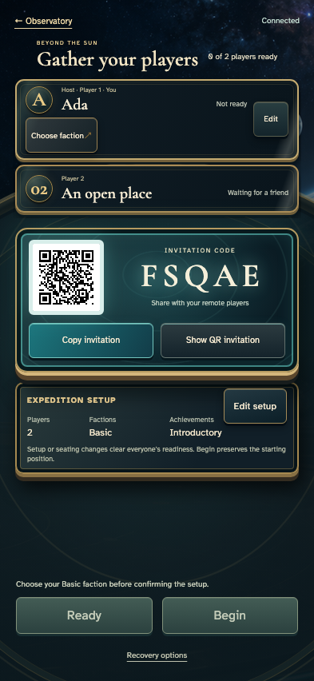](../../screenshots/upgrade-a-rival-tied-fleet-and-build-at-the-newly-controlled-yard-with-separate-controllers/004-host-room-phone-darwin.png) | [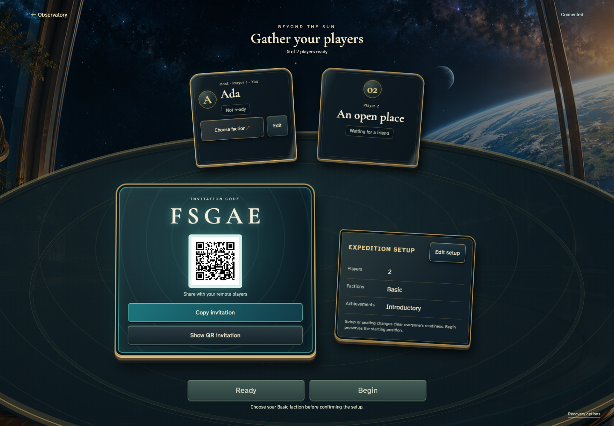](../../screenshots/upgrade-a-rival-tied-fleet-and-build-at-the-newly-controlled-yard-with-separate-controllers/004-host-room-desktop-darwin.png) |

- [x] The canonical remote room exposes its actual invitation code
- [x] The actual canonical effect and backend acknowledgement settle.
- [x] Public technology topology retains physical separation.
- [x] The actual viewport fits without page scrolling.

## 6. A different identity previews the public invitation

Viewpoint: **Bora · separate guest controller**.

| phone · 1440 × 1000 | desktop · 393 × 852 |
| --- | --- |
|  | [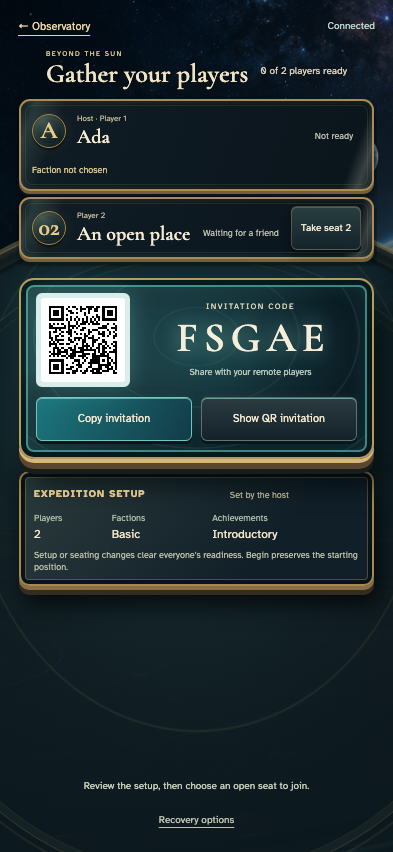](../../screenshots/upgrade-a-rival-tied-fleet-and-build-at-the-newly-controlled-yard-with-separate-controllers/005-guest-preview-desktop-darwin.png) |

- [x] A different identity previews the public invitation
- [x] The actual canonical effect and backend acknowledgement settle.
- [x] Public technology topology retains physical separation.
- [x] The actual viewport fits without page scrolling.

## 7. The guest claims only the remote seat

Viewpoint: **Bora · separate guest controller**.

| phone · 1440 × 1000 | desktop · 393 × 852 |
| --- | --- |
| [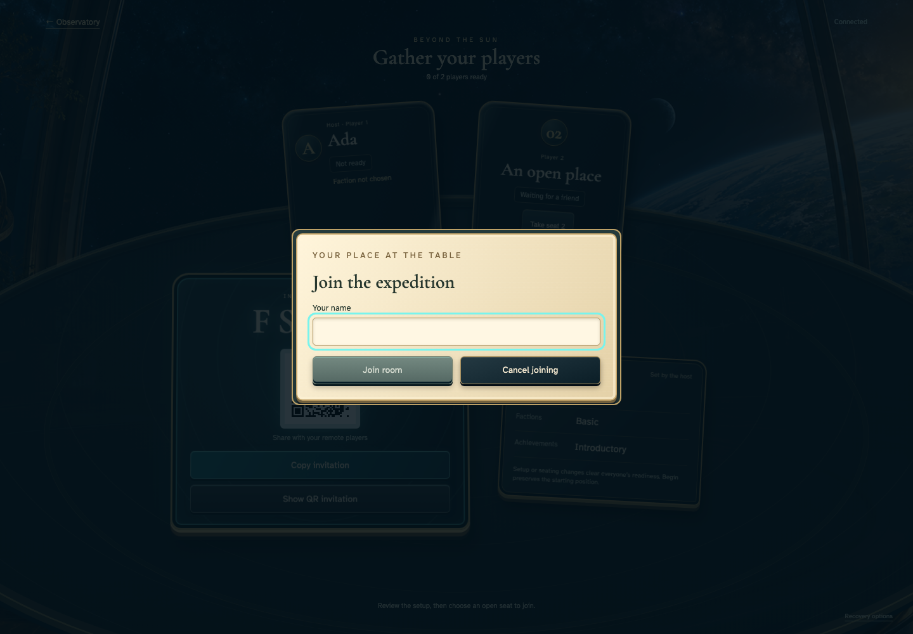](../../screenshots/upgrade-a-rival-tied-fleet-and-build-at-the-newly-controlled-yard-with-separate-controllers/006-guest-editor-phone-darwin.png) |  |

- [x] The guest claims only the remote seat
- [x] The actual canonical effect and backend acknowledgement settle.
- [x] Public technology topology retains physical separation.
- [x] The actual viewport fits without page scrolling.

## 8. Name the independent guest Bora

Viewpoint: **Bora · separate guest controller**.

| phone · 1440 × 1000 | desktop · 393 × 852 |
| --- | --- |
| [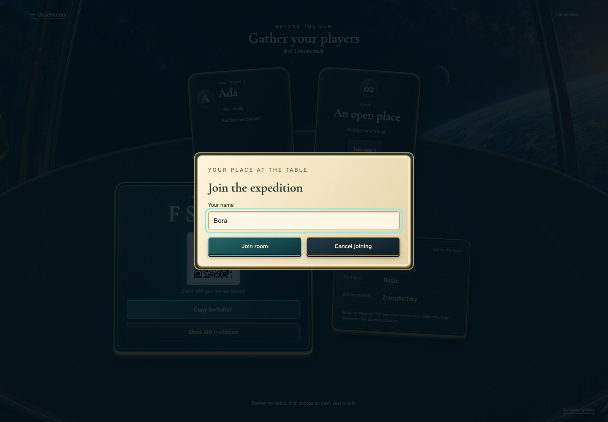](../../screenshots/upgrade-a-rival-tied-fleet-and-build-at-the-newly-controlled-yard-with-separate-controllers/007-guest-name-phone-darwin.png) |  |

- [x] Name the independent guest Bora
- [x] The actual canonical effect and backend acknowledgement settle.
- [x] Public technology topology retains physical separation.
- [x] The actual viewport fits without page scrolling.

## 9. Both named remote identities share the same room

Viewpoint: **Bora · separate guest controller**.

| phone · 1440 × 1000 | desktop · 393 × 852 |
| --- | --- |
| [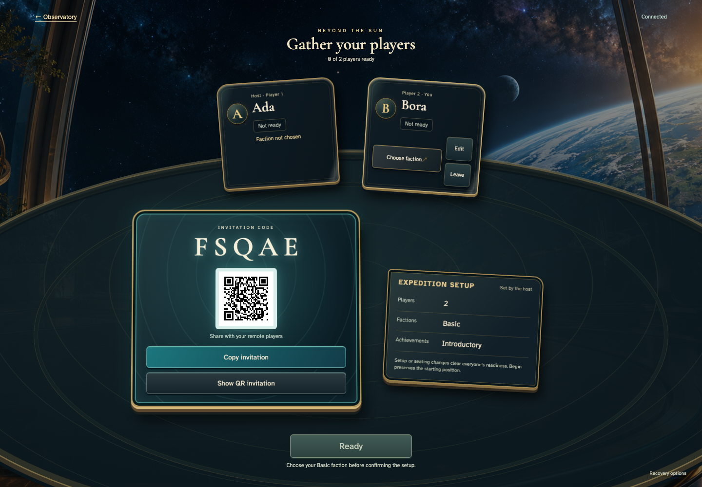](../../screenshots/upgrade-a-rival-tied-fleet-and-build-at-the-newly-controlled-yard-with-separate-controllers/008-guest-joined-phone-darwin.png) | [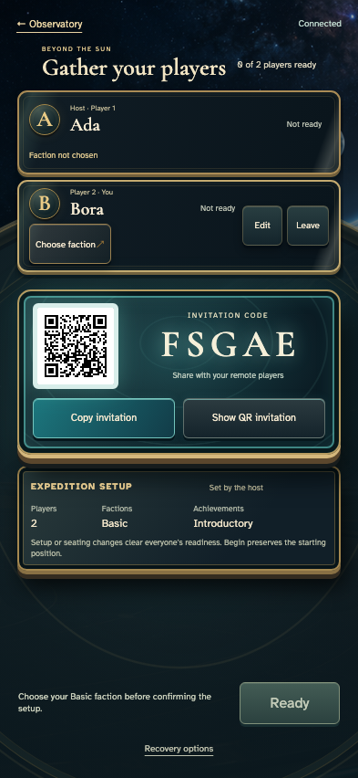](../../screenshots/upgrade-a-rival-tied-fleet-and-build-at-the-newly-controlled-yard-with-separate-controllers/008-guest-joined-desktop-darwin.png) |

- [x] Both named remote identities share the same room
- [x] The actual canonical effect and backend acknowledgement settle.
- [x] Public technology topology retains physical separation.
- [x] The actual viewport fits without page scrolling.

## 10. Ada chooses a legal unique Basic faction

Viewpoint: **Ada · separate host controller**.

| phone · 393 × 852 | desktop · 1440 × 1000 |
| --- | --- |
|  |  |

- [x] Ada chooses a legal unique Basic faction
- [x] The actual canonical effect and backend acknowledgement settle.
- [x] Public technology topology retains physical separation.
- [x] The actual viewport fits without page scrolling.

## 11. Ada retains Nishida-Østergaard Corporation

Viewpoint: **Ada · separate host controller**.

| phone · 393 × 852 | desktop · 1440 × 1000 |
| --- | --- |
| [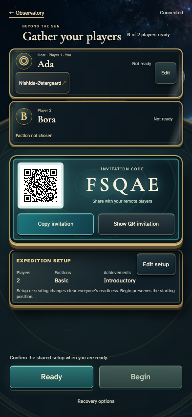](../../screenshots/upgrade-a-rival-tied-fleet-and-build-at-the-newly-controlled-yard-with-separate-controllers/010-faction-0-chosen-phone-darwin.png) | [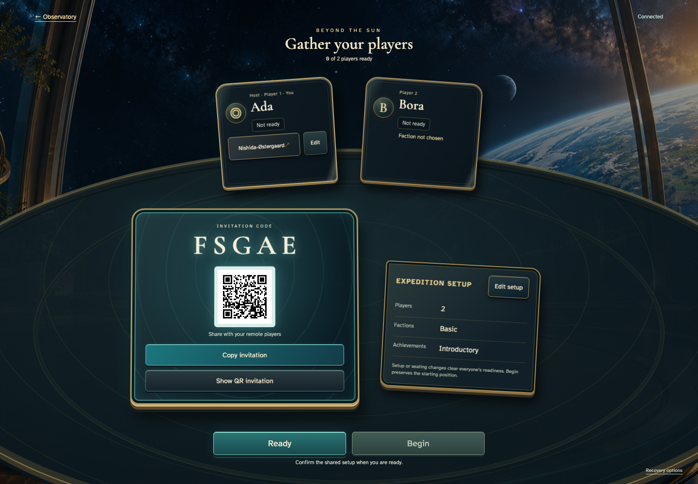](../../screenshots/upgrade-a-rival-tied-fleet-and-build-at-the-newly-controlled-yard-with-separate-controllers/010-faction-0-chosen-desktop-darwin.png) |

- [x] Ada retains Nishida-Østergaard Corporation
- [x] The actual canonical effect and backend acknowledgement settle.
- [x] Public technology topology retains physical separation.
- [x] The actual viewport fits without page scrolling.

## 12. Bora chooses a legal unique Basic faction

Viewpoint: **Bora · separate guest controller**.

| phone · 1440 × 1000 | desktop · 393 × 852 |
| --- | --- |
|  |  |

- [x] Bora chooses a legal unique Basic faction
- [x] The actual canonical effect and backend acknowledgement settle.
- [x] Public technology topology retains physical separation.
- [x] The actual viewport fits without page scrolling.

## 13. Bora retains United Nations of Sol

Viewpoint: **Bora · separate guest controller**.

| phone · 1440 × 1000 | desktop · 393 × 852 |
| --- | --- |
|  | [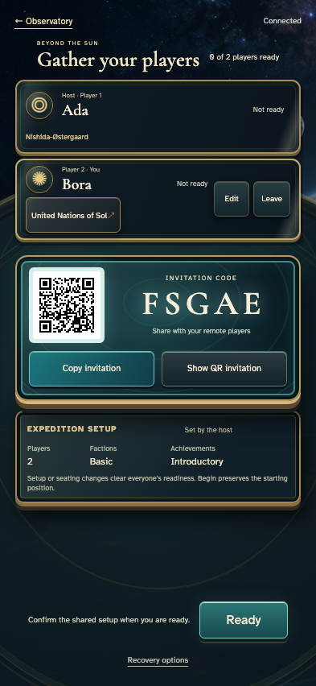](../../screenshots/upgrade-a-rival-tied-fleet-and-build-at-the-newly-controlled-yard-with-separate-controllers/012-faction-1-chosen-desktop-darwin.png) |

- [x] Bora retains United Nations of Sol
- [x] The actual canonical effect and backend acknowledgement settle.
- [x] Public technology topology retains physical separation.
- [x] The actual viewport fits without page scrolling.

## 14. Confirm this identity is ready for the exact saved configuration

Viewpoint: **Bora · separate guest controller**.

| phone · 1440 × 1000 | desktop · 393 × 852 |
| --- | --- |
| [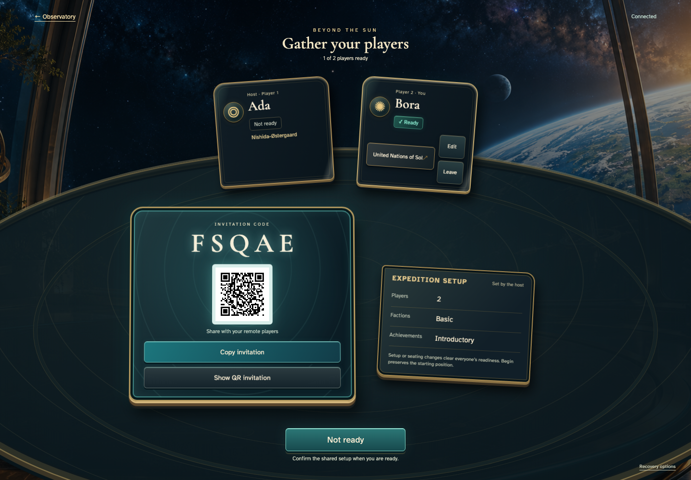](../../screenshots/upgrade-a-rival-tied-fleet-and-build-at-the-newly-controlled-yard-with-separate-controllers/013-ready-1-phone-darwin.png) | [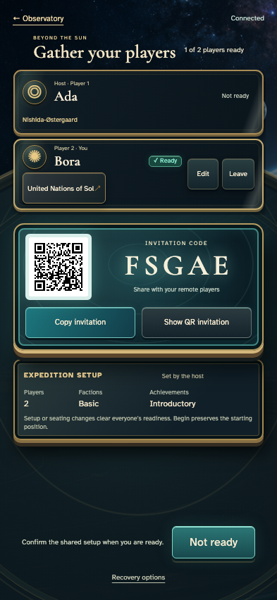](../../screenshots/upgrade-a-rival-tied-fleet-and-build-at-the-newly-controlled-yard-with-separate-controllers/013-ready-1-desktop-darwin.png) |

- [x] Confirm this identity is ready for the exact saved configuration
- [x] The actual canonical effect and backend acknowledgement settle.
- [x] Public technology topology retains physical separation.
- [x] The actual viewport fits without page scrolling.

## 15. Confirm this identity is ready for the exact saved configuration

Viewpoint: **Ada · separate host controller**.

| phone · 393 × 852 | desktop · 1440 × 1000 |
| --- | --- |
| [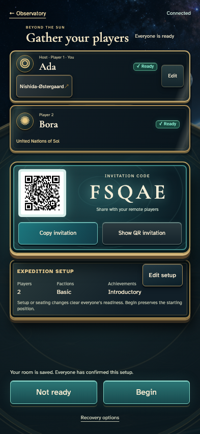](../../screenshots/upgrade-a-rival-tied-fleet-and-build-at-the-newly-controlled-yard-with-separate-controllers/014-ready-0-phone-darwin.png) |  |

- [x] Confirm this identity is ready for the exact saved configuration
- [x] The actual canonical effect and backend acknowledgement settle.
- [x] Public technology topology retains physical separation.
- [x] The actual viewport fits without page scrolling.

## 16. Begin the immutable source-reviewed Basic setup through the ordinary UI

Viewpoint: **Ada · separate host controller**.

| phone · 393 × 852 | desktop · 1440 × 1000 |
| --- | --- |
|  |  |

- [x] Begin the immutable source-reviewed Basic setup through the ordinary UI
- [x] The actual canonical effect and backend acknowledgement settle.
- [x] Public technology topology retains physical separation.
- [x] The actual viewport fits without page scrolling.

## 17. Ada opens the actual Action instrument

Viewpoint: **Ada · separate host controller**.

| phone · 393 × 852 | desktop · 1440 × 1000 |
| --- | --- |
|  |  |

- [x] Ada opens the actual Action instrument
- [x] The actual canonical effect and backend acknowledgement settle.
- [x] Public technology topology retains physical separation.
- [x] The actual viewport fits without page scrolling.

## 18. Ada chooses the unoccupied printed research space

Viewpoint: **Ada · separate host controller**.

| phone · 393 × 852 | desktop · 1440 × 1000 |
| --- | --- |
|  |  |

- [x] Ada chooses the unoccupied printed research space
- [x] The actual canonical effect and backend acknowledgement settle.
- [x] Public technology topology retains physical separation.
- [x] The actual viewport fits without page scrolling.

## 19. Choose the public Terraforming face and read its printed effect

Viewpoint: **Ada · separate host controller**.

| phone · 393 × 852 | desktop · 1440 × 1000 |
| --- | --- |
|  |  |

- [x] Choose the public Terraforming face and read its printed effect
- [x] The actual canonical effect and backend acknowledgement settle.
- [x] Public technology topology retains physical separation.
- [x] The actual viewport fits without page scrolling.

## 20. Ada pays permanent research Population and resolves the printed bonus

Viewpoint: **Ada · separate host controller**.

| phone · 393 × 852 | desktop · 1440 × 1000 |
| --- | --- |
|  |  |

- [x] Ada pays permanent research Population and resolves the printed bonus
- [x] The actual canonical effect and backend acknowledgement settle.
- [x] Public technology topology retains physical separation.
- [x] The actual viewport fits without page scrolling.

## 21. Ada completes ordinary production and hands off

Viewpoint: **Ada · separate host controller**.

| phone · 393 × 852 | desktop · 1440 × 1000 |
| --- | --- |
|  |  |

- [x] Ada completes ordinary production and hands off
- [x] The actual canonical effect and backend acknowledgement settle.
- [x] Public technology topology retains physical separation.
- [x] The actual viewport fits without page scrolling.

## 22. The next independent controller sees the saved handoff

Viewpoint: **Bora · separate guest controller**.

| phone · 1440 × 1000 | desktop · 393 × 852 |
| --- | --- |
| [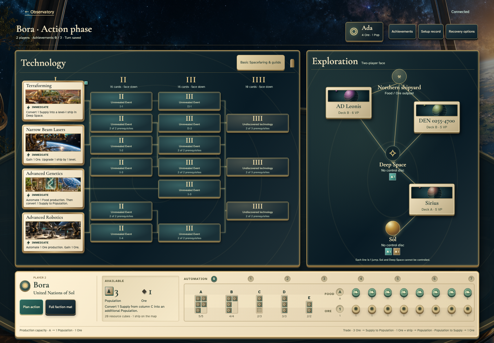](../../screenshots/upgrade-a-rival-tied-fleet-and-build-at-the-newly-controlled-yard-with-separate-controllers/021-ada-terraform-next-phone-darwin.png) | [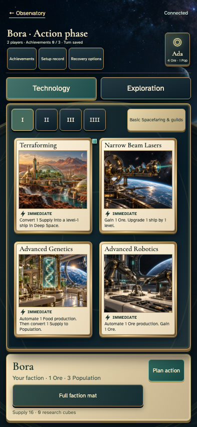](../../screenshots/upgrade-a-rival-tied-fleet-and-build-at-the-newly-controlled-yard-with-separate-controllers/021-ada-terraform-next-desktop-darwin.png) |

- [x] The next independent controller sees the saved handoff
- [x] The actual canonical effect and backend acknowledgement settle.
- [x] Public technology topology retains physical separation.
- [x] The actual viewport fits without page scrolling.

## 23. Bora opens the actual Action instrument

Viewpoint: **Bora · separate guest controller**.

| phone · 1440 × 1000 | desktop · 393 × 852 |
| --- | --- |
|  |  |

- [x] Bora opens the actual Action instrument
- [x] The actual canonical effect and backend acknowledgement settle.
- [x] Public technology topology retains physical separation.
- [x] The actual viewport fits without page scrolling.

## 24. Bora chooses the unoccupied printed research space

Viewpoint: **Bora · separate guest controller**.

| phone · 1440 × 1000 | desktop · 393 × 852 |
| --- | --- |
| [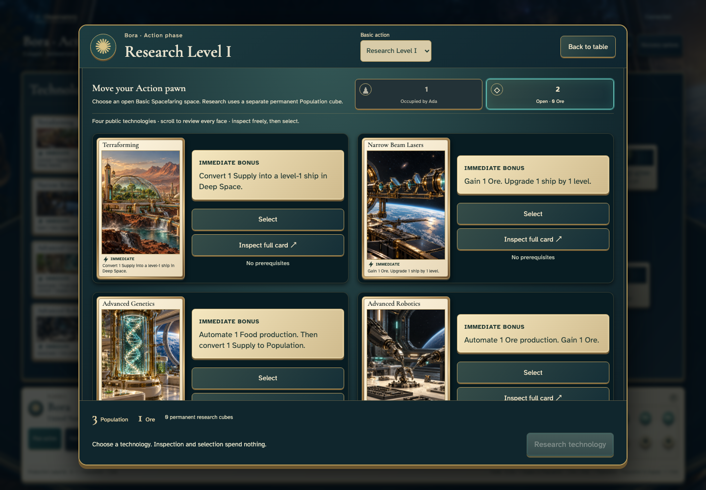](../../screenshots/upgrade-a-rival-tied-fleet-and-build-at-the-newly-controlled-yard-with-separate-controllers/023-bora-terraform-space-phone-darwin.png) |  |

- [x] Bora chooses the unoccupied printed research space
- [x] The actual canonical effect and backend acknowledgement settle.
- [x] Public technology topology retains physical separation.
- [x] The actual viewport fits without page scrolling.

## 25. Choose the public Terraforming face and read its printed effect

Viewpoint: **Bora · separate guest controller**.

| phone · 1440 × 1000 | desktop · 393 × 852 |
| --- | --- |
| [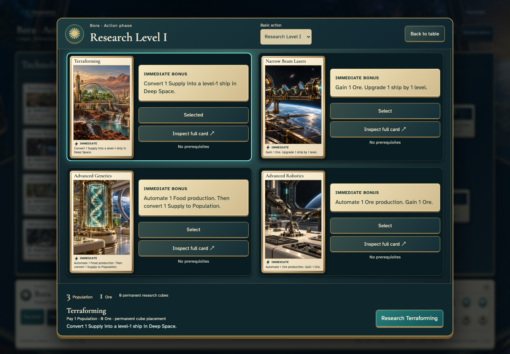](../../screenshots/upgrade-a-rival-tied-fleet-and-build-at-the-newly-controlled-yard-with-separate-controllers/024-bora-terraform-card-phone-darwin.png) | [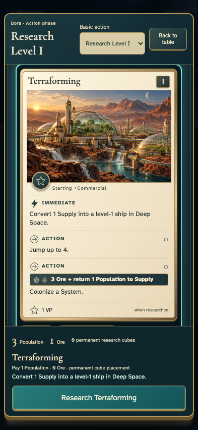](../../screenshots/upgrade-a-rival-tied-fleet-and-build-at-the-newly-controlled-yard-with-separate-controllers/024-bora-terraform-card-desktop-darwin.png) |

- [x] Choose the public Terraforming face and read its printed effect
- [x] The actual canonical effect and backend acknowledgement settle.
- [x] Public technology topology retains physical separation.
- [x] The actual viewport fits without page scrolling.

## 26. Bora pays permanent research Population and resolves the printed bonus

Viewpoint: **Bora · separate guest controller**.

| phone · 1440 × 1000 | desktop · 393 × 852 |
| --- | --- |
|  | [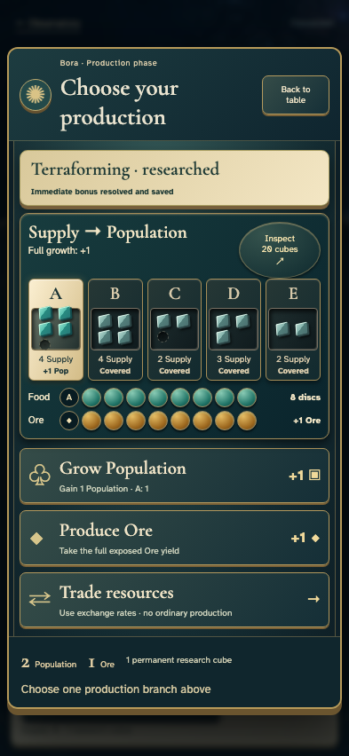](../../screenshots/upgrade-a-rival-tied-fleet-and-build-at-the-newly-controlled-yard-with-separate-controllers/025-bora-terraform-paid-desktop-darwin.png) |

- [x] Bora pays permanent research Population and resolves the printed bonus
- [x] The actual canonical effect and backend acknowledgement settle.
- [x] Public technology topology retains physical separation.
- [x] The actual viewport fits without page scrolling.

## 27. Bora completes ordinary production and hands off

Viewpoint: **Bora · separate guest controller**.

| phone · 1440 × 1000 | desktop · 393 × 852 |
| --- | --- |
| [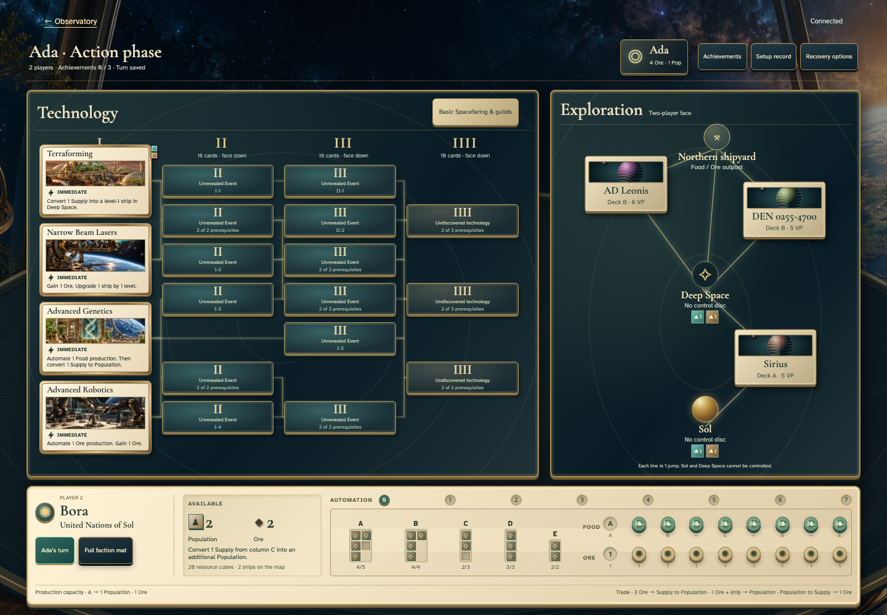](../../screenshots/upgrade-a-rival-tied-fleet-and-build-at-the-newly-controlled-yard-with-separate-controllers/026-bora-terraform-handoff-phone-darwin.png) |  |

- [x] Bora completes ordinary production and hands off
- [x] The actual canonical effect and backend acknowledgement settle.
- [x] Public technology topology retains physical separation.
- [x] The actual viewport fits without page scrolling.

## 28. The next independent controller sees the saved handoff

Viewpoint: **Ada · separate host controller**.

| phone · 393 × 852 | desktop · 1440 × 1000 |
| --- | --- |
|  | [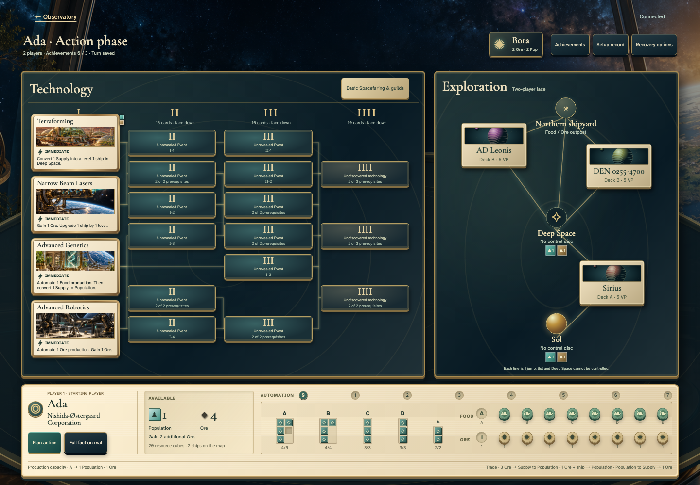](../../screenshots/upgrade-a-rival-tied-fleet-and-build-at-the-newly-controlled-yard-with-separate-controllers/027-bora-terraform-next-desktop-darwin.png) |

- [x] The next independent controller sees the saved handoff
- [x] The actual canonical effect and backend acknowledgement settle.
- [x] Public technology topology retains physical separation.
- [x] The actual viewport fits without page scrolling.

## 29. Ada opens the actual Action instrument

Viewpoint: **Ada · separate host controller**.

| phone · 393 × 852 | desktop · 1440 × 1000 |
| --- | --- |
| [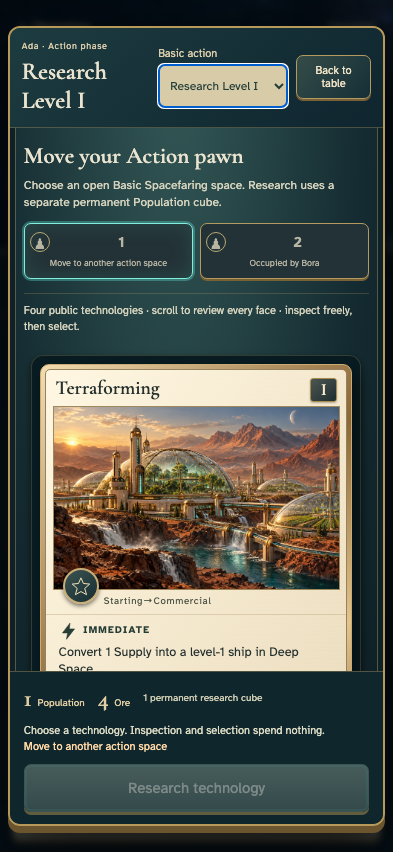](../../screenshots/upgrade-a-rival-tied-fleet-and-build-at-the-newly-controlled-yard-with-separate-controllers/028-ada-yard-plan-phone-darwin.png) | [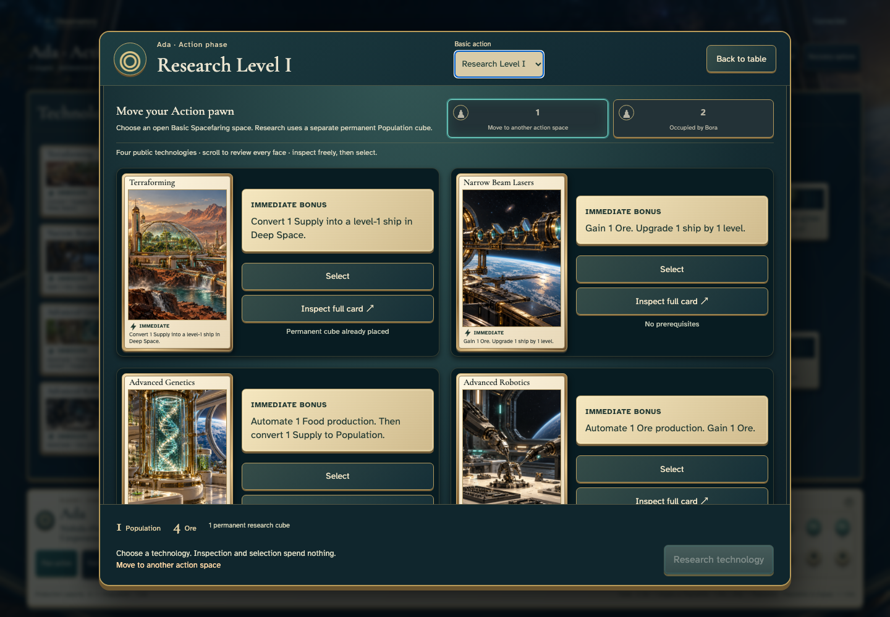](../../screenshots/upgrade-a-rival-tied-fleet-and-build-at-the-newly-controlled-yard-with-separate-controllers/028-ada-yard-plan-desktop-darwin.png) |

- [x] Ada opens the actual Action instrument
- [x] The actual canonical effect and backend acknowledgement settle.
- [x] Public technology topology retains physical separation.
- [x] The actual viewport fits without page scrolling.

## 30. Ada selects a printed Technology Action

Viewpoint: **Ada · separate host controller**.

| phone · 393 × 852 | desktop · 1440 × 1000 |
| --- | --- |
| [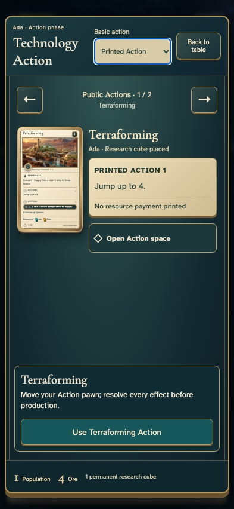](../../screenshots/upgrade-a-rival-tied-fleet-and-build-at-the-newly-controlled-yard-with-separate-controllers/029-ada-yard-kind-phone-darwin.png) | [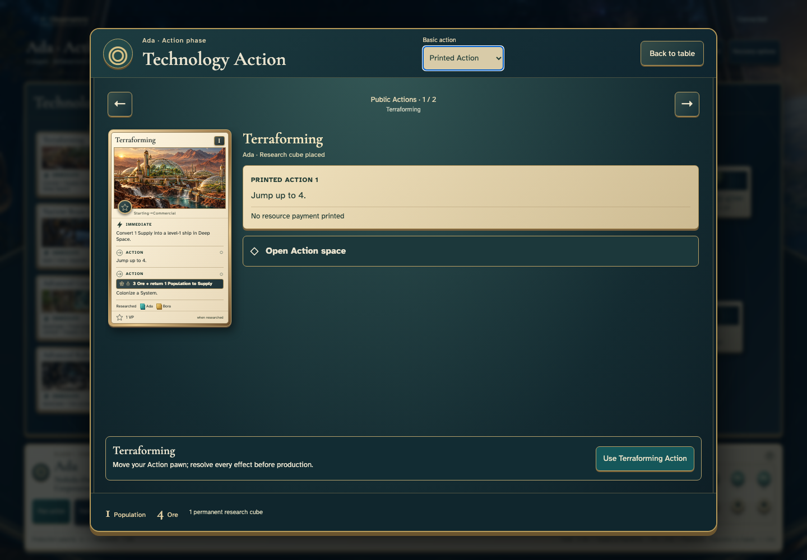](../../screenshots/upgrade-a-rival-tied-fleet-and-build-at-the-newly-controlled-yard-with-separate-controllers/029-ada-yard-kind-desktop-darwin.png) |

- [x] Ada selects a printed Technology Action
- [x] The actual canonical effect and backend acknowledgement settle.
- [x] Public technology topology retains physical separation.
- [x] The actual viewport fits without page scrolling.

## 31. Pay the actual printed Action before selecting an owned ship

Viewpoint: **Ada · separate host controller**.

| phone · 393 × 852 | desktop · 1440 × 1000 |
| --- | --- |
| [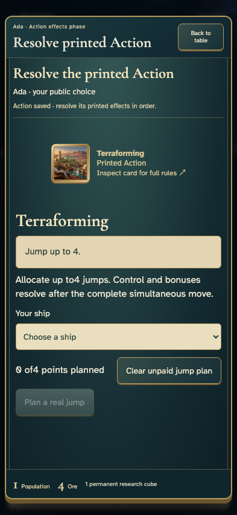](../../screenshots/upgrade-a-rival-tied-fleet-and-build-at-the-newly-controlled-yard-with-separate-controllers/030-ada-yard-paid-phone-darwin.png) | [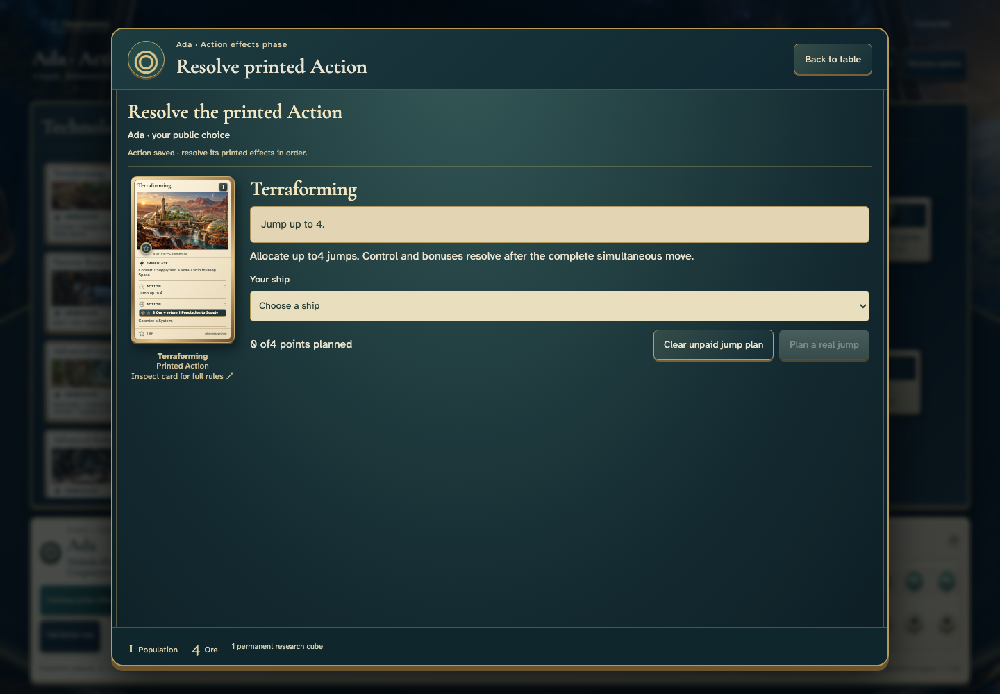](../../screenshots/upgrade-a-rival-tied-fleet-and-build-at-the-newly-controlled-yard-with-separate-controllers/030-ada-yard-paid-desktop-darwin.png) |

- [x] Pay the actual printed Action before selecting an owned ship
- [x] The actual canonical effect and backend acknowledgement settle.
- [x] Public technology topology retains physical separation.
- [x] The actual viewport fits without page scrolling.

## 32. Select the existing level-one ship; construction is not part of this Action

Viewpoint: **Ada · separate host controller**.

| phone · 393 × 852 | desktop · 1440 × 1000 |
| --- | --- |
| [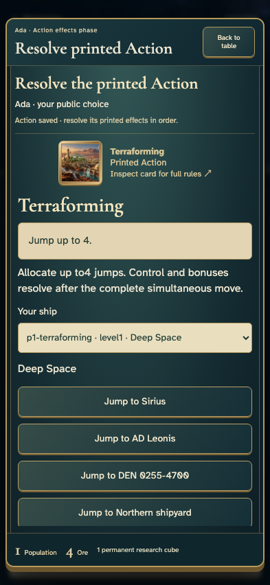](../../screenshots/upgrade-a-rival-tied-fleet-and-build-at-the-newly-controlled-yard-with-separate-controllers/031-ada-yard-ship-phone-darwin.png) | [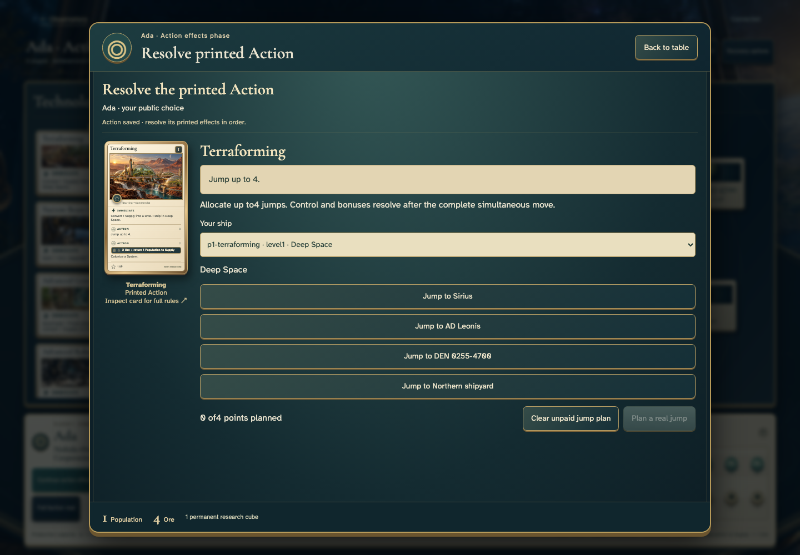](../../screenshots/upgrade-a-rival-tied-fleet-and-build-at-the-newly-controlled-yard-with-separate-controllers/031-ada-yard-ship-desktop-darwin.png) |

- [x] Select the existing level-one ship; construction is not part of this Action
- [x] The actual canonical effect and backend acknowledgement settle.
- [x] Public technology topology retains physical separation.
- [x] The actual viewport fits without page scrolling.

## 33. Add the next adjacent system to the explicit path

Viewpoint: **Ada · separate host controller**.

| phone · 393 × 852 | desktop · 1440 × 1000 |
| --- | --- |
|  | [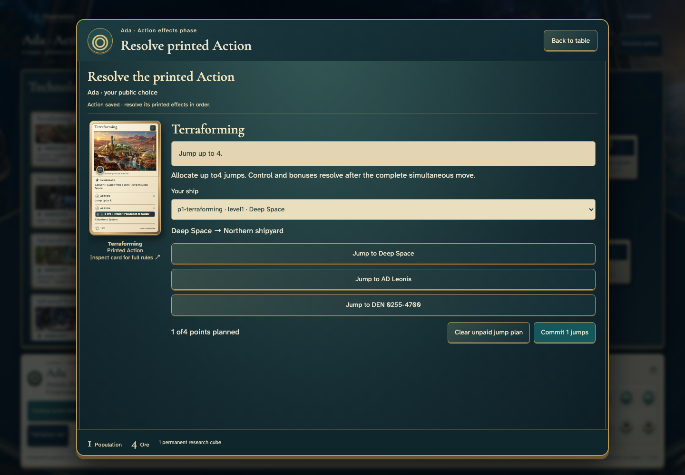](../../screenshots/upgrade-a-rival-tied-fleet-and-build-at-the-newly-controlled-yard-with-separate-controllers/032-ada-yard-leg-0-desktop-darwin.png) |

- [x] Add the next adjacent system to the explicit path
- [x] The actual canonical effect and backend acknowledgement settle.
- [x] Public technology topology retains physical separation.
- [x] The actual viewport fits without page scrolling.

## 34. Arrive with uncontested power and resolve the actual outpost

Viewpoint: **Ada · separate host controller**.

| phone · 393 × 852 | desktop · 1440 × 1000 |
| --- | --- |
| [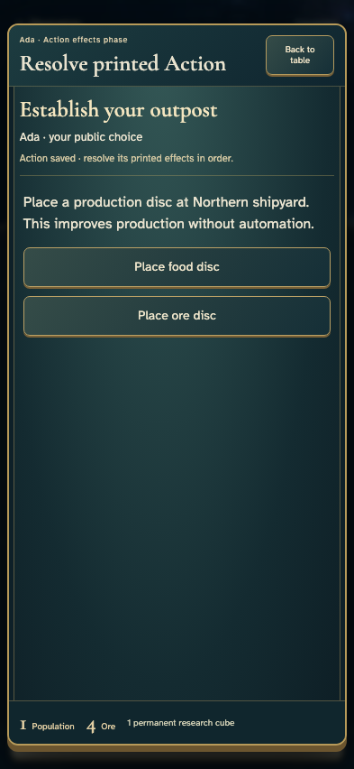](../../screenshots/upgrade-a-rival-tied-fleet-and-build-at-the-newly-controlled-yard-with-separate-controllers/033-ada-yard-arrival-phone-darwin.png) | [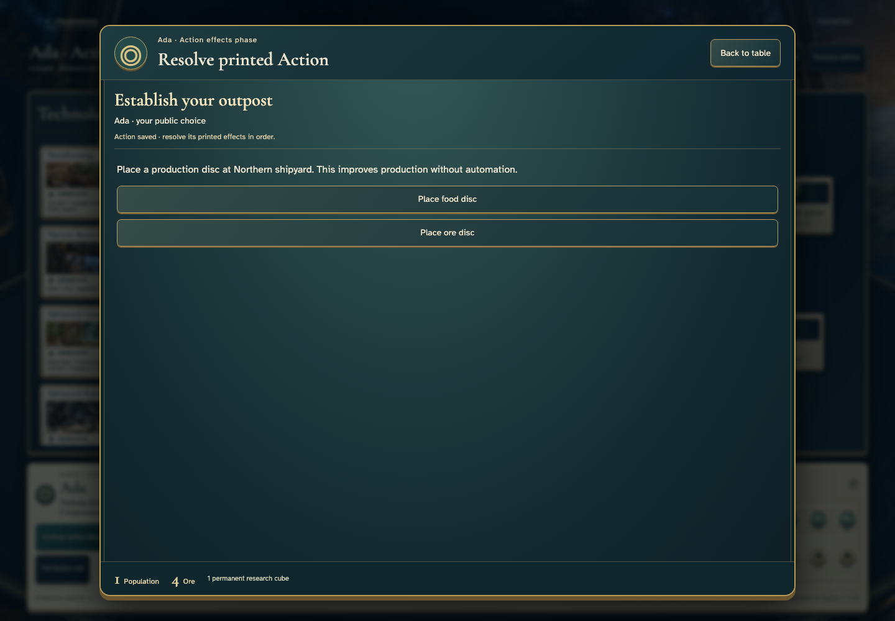](../../screenshots/upgrade-a-rival-tied-fleet-and-build-at-the-newly-controlled-yard-with-separate-controllers/033-ada-yard-arrival-desktop-darwin.png) |

- [x] Arrive with uncontested power and resolve the actual outpost
- [x] The actual canonical effect and backend acknowledgement settle.
- [x] Public technology topology retains physical separation.
- [x] The actual viewport fits without page scrolling.

## 35. Place a real Food outpost before production

Viewpoint: **Ada · separate host controller**.

| phone · 393 × 852 | desktop · 1440 × 1000 |
| --- | --- |
|  |  |

- [x] Place a real Food outpost before production
- [x] The actual canonical effect and backend acknowledgement settle.
- [x] Public technology topology retains physical separation.
- [x] The actual viewport fits without page scrolling.

## 36. Ada completes ordinary production and hands off

Viewpoint: **Ada · separate host controller**.

| phone · 393 × 852 | desktop · 1440 × 1000 |
| --- | --- |
|  |  |

- [x] Ada completes ordinary production and hands off
- [x] The actual canonical effect and backend acknowledgement settle.
- [x] Public technology topology retains physical separation.
- [x] The actual viewport fits without page scrolling.

## 37. The next independent controller sees the saved handoff

Viewpoint: **Bora · separate guest controller**.

| phone · 1440 × 1000 | desktop · 393 × 852 |
| --- | --- |
| [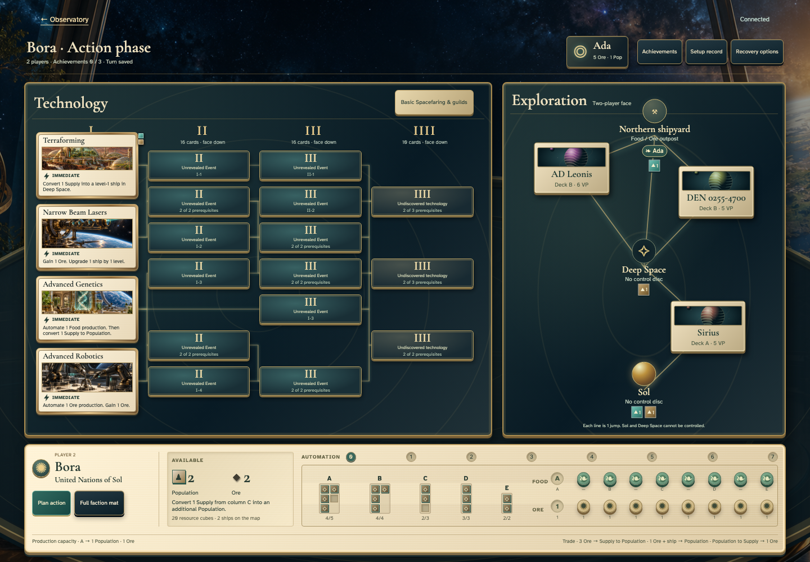](../../screenshots/upgrade-a-rival-tied-fleet-and-build-at-the-newly-controlled-yard-with-separate-controllers/036-ada-yard-next-phone-darwin.png) |  |

- [x] The next independent controller sees the saved handoff
- [x] The actual canonical effect and backend acknowledgement settle.
- [x] Public technology topology retains physical separation.
- [x] The actual viewport fits without page scrolling.

## 38. Bora opens the actual Action instrument

Viewpoint: **Bora · separate guest controller**.

| phone · 1440 × 1000 | desktop · 393 × 852 |
| --- | --- |
| [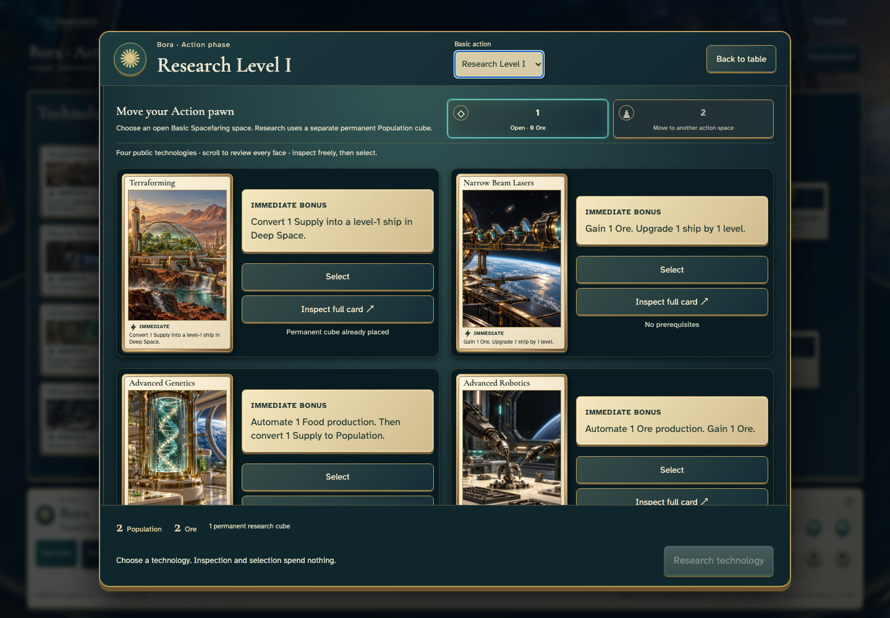](../../screenshots/upgrade-a-rival-tied-fleet-and-build-at-the-newly-controlled-yard-with-separate-controllers/037-bora-before-tie-plan-phone-darwin.png) |  |

- [x] Bora opens the actual Action instrument
- [x] The actual canonical effect and backend acknowledgement settle.
- [x] Public technology topology retains physical separation.
- [x] The actual viewport fits without page scrolling.

## 39. Bora selects ordinary gathering

Viewpoint: **Bora · separate guest controller**.

| phone · 1440 × 1000 | desktop · 393 × 852 |
| --- | --- |
| [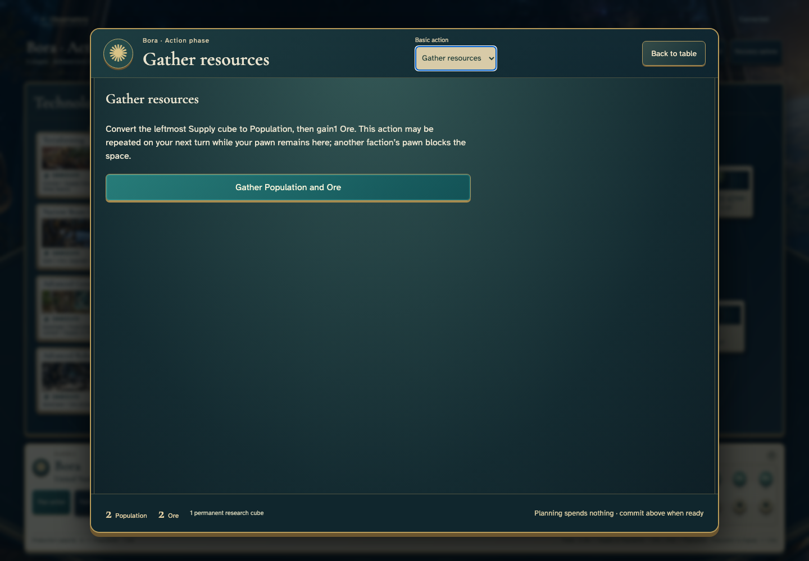](../../screenshots/upgrade-a-rival-tied-fleet-and-build-at-the-newly-controlled-yard-with-separate-controllers/038-bora-before-tie-kind-phone-darwin.png) | [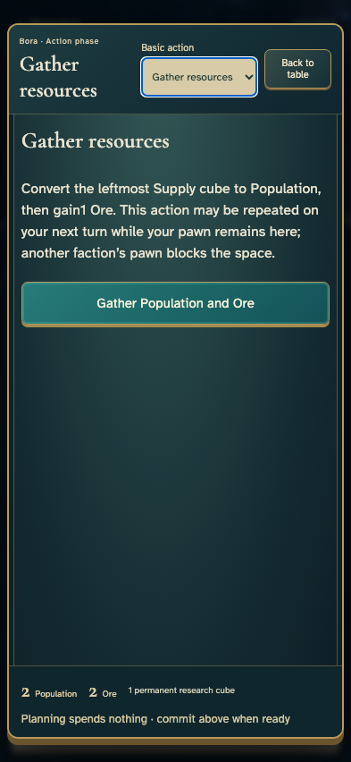](../../screenshots/upgrade-a-rival-tied-fleet-and-build-at-the-newly-controlled-yard-with-separate-controllers/038-bora-before-tie-kind-desktop-darwin.png) |

- [x] Bora selects ordinary gathering
- [x] The actual canonical effect and backend acknowledgement settle.
- [x] Public technology topology retains physical separation.
- [x] The actual viewport fits without page scrolling.

## 40. Receive actual Gather resources before production

Viewpoint: **Bora · separate guest controller**.

| phone · 1440 × 1000 | desktop · 393 × 852 |
| --- | --- |
| [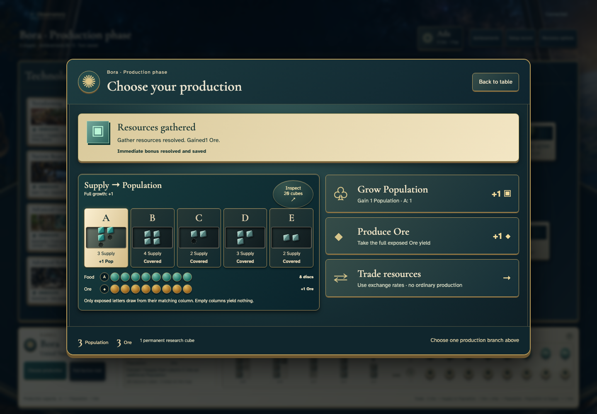](../../screenshots/upgrade-a-rival-tied-fleet-and-build-at-the-newly-controlled-yard-with-separate-controllers/039-bora-before-tie-gathered-phone-darwin.png) | [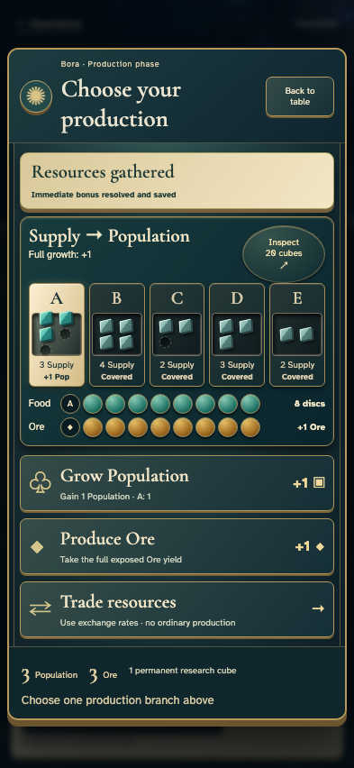](../../screenshots/upgrade-a-rival-tied-fleet-and-build-at-the-newly-controlled-yard-with-separate-controllers/039-bora-before-tie-gathered-desktop-darwin.png) |

- [x] Receive actual Gather resources before production
- [x] The actual canonical effect and backend acknowledgement settle.
- [x] Public technology topology retains physical separation.
- [x] The actual viewport fits without page scrolling.

## 41. Bora completes ordinary production and hands off

Viewpoint: **Bora · separate guest controller**.

| phone · 1440 × 1000 | desktop · 393 × 852 |
| --- | --- |
|  |  |

- [x] Bora completes ordinary production and hands off
- [x] The actual canonical effect and backend acknowledgement settle.
- [x] Public technology topology retains physical separation.
- [x] The actual viewport fits without page scrolling.

## 42. The next independent controller sees the saved handoff

Viewpoint: **Ada · separate host controller**.

| phone · 393 × 852 | desktop · 1440 × 1000 |
| --- | --- |
| [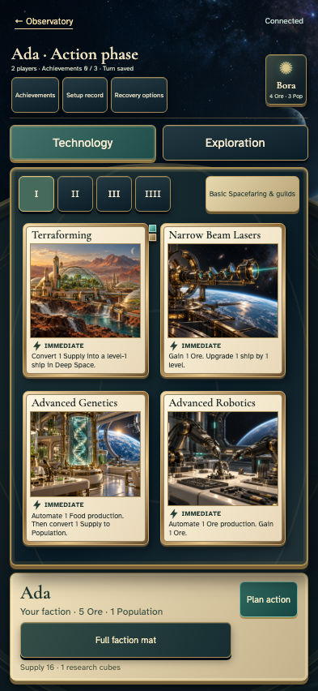](../../screenshots/upgrade-a-rival-tied-fleet-and-build-at-the-newly-controlled-yard-with-separate-controllers/041-bora-before-tie-next-phone-darwin.png) |  |

- [x] The next independent controller sees the saved handoff
- [x] The actual canonical effect and backend acknowledgement settle.
- [x] Public technology topology retains physical separation.
- [x] The actual viewport fits without page scrolling.

## 43. Ada opens the actual Action instrument

Viewpoint: **Ada · separate host controller**.

| phone · 393 × 852 | desktop · 1440 × 1000 |
| --- | --- |
| [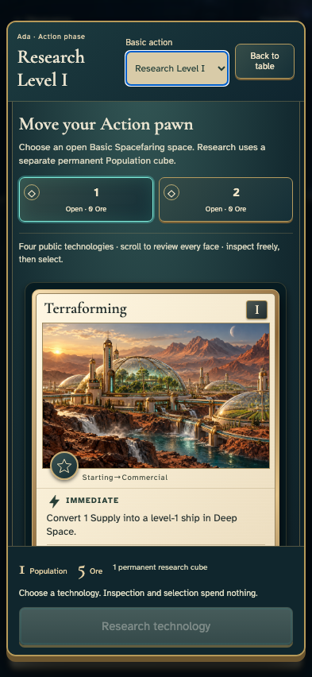](../../screenshots/upgrade-a-rival-tied-fleet-and-build-at-the-newly-controlled-yard-with-separate-controllers/042-ada-vacates-path-plan-phone-darwin.png) | [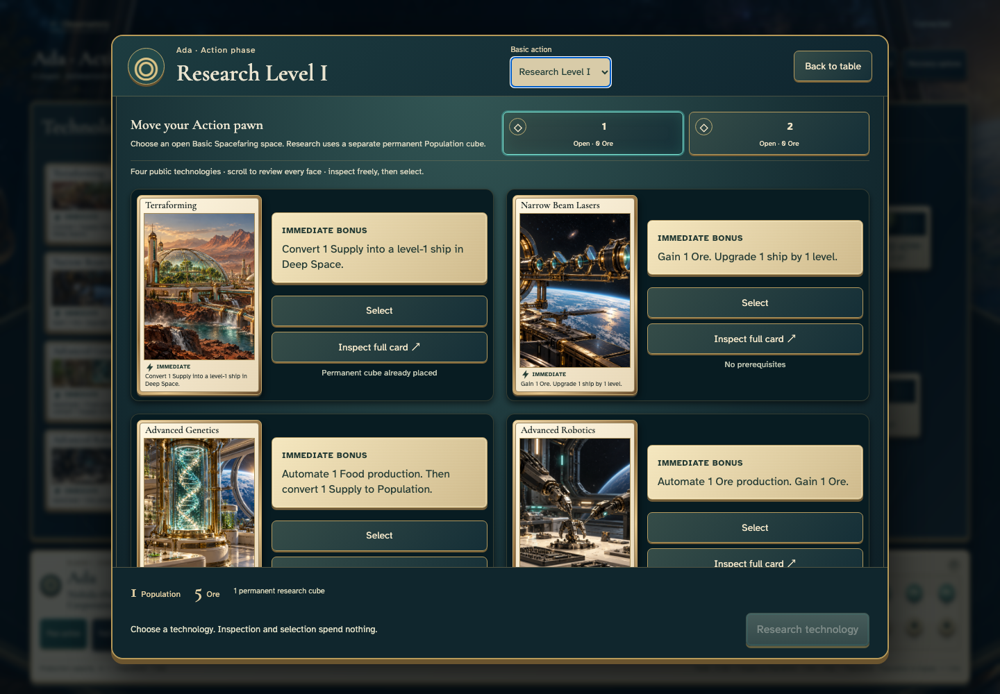](../../screenshots/upgrade-a-rival-tied-fleet-and-build-at-the-newly-controlled-yard-with-separate-controllers/042-ada-vacates-path-plan-desktop-darwin.png) |

- [x] Ada opens the actual Action instrument
- [x] The actual canonical effect and backend acknowledgement settle.
- [x] Public technology topology retains physical separation.
- [x] The actual viewport fits without page scrolling.

## 44. Ada chooses the unoccupied printed research space

Viewpoint: **Ada · separate host controller**.

| phone · 393 × 852 | desktop · 1440 × 1000 |
| --- | --- |
| [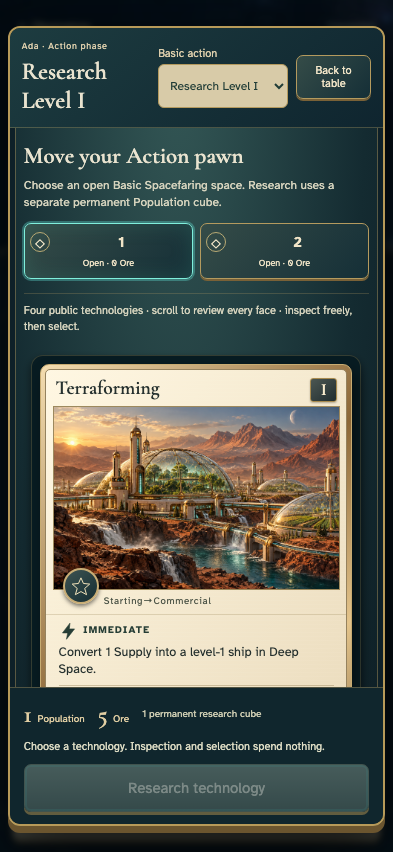](../../screenshots/upgrade-a-rival-tied-fleet-and-build-at-the-newly-controlled-yard-with-separate-controllers/043-ada-vacates-path-space-phone-darwin.png) |  |

- [x] Ada chooses the unoccupied printed research space
- [x] The actual canonical effect and backend acknowledgement settle.
- [x] Public technology topology retains physical separation.
- [x] The actual viewport fits without page scrolling.

## 45. Choose the public Advanced Robotics face and read its printed effect

Viewpoint: **Ada · separate host controller**.

| phone · 393 × 852 | desktop · 1440 × 1000 |
| --- | --- |
| [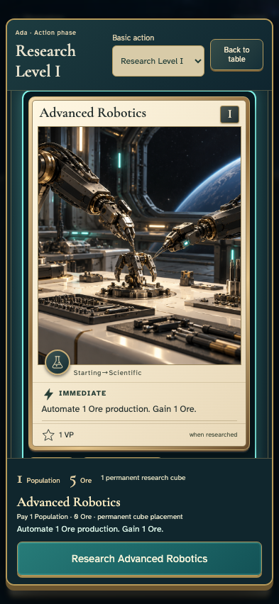](../../screenshots/upgrade-a-rival-tied-fleet-and-build-at-the-newly-controlled-yard-with-separate-controllers/044-ada-vacates-path-card-phone-darwin.png) | [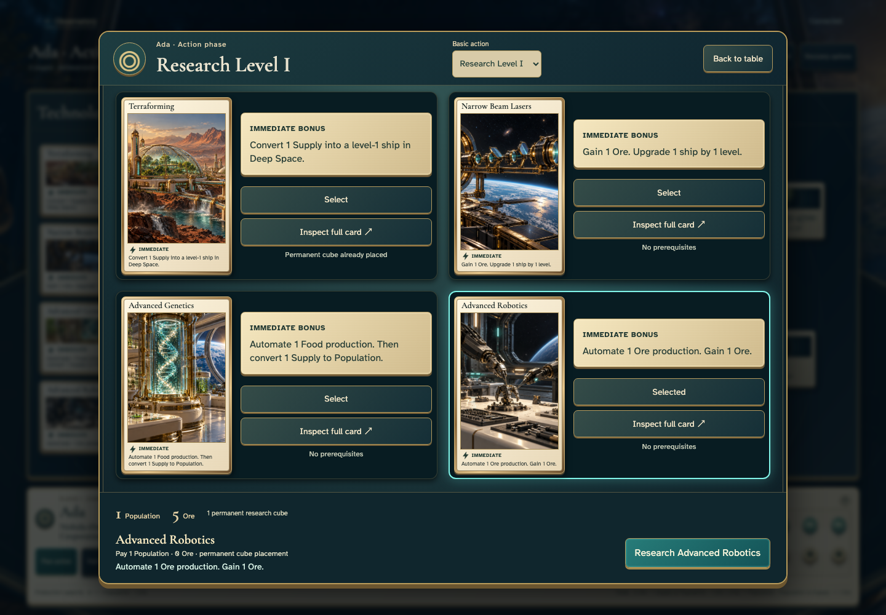](../../screenshots/upgrade-a-rival-tied-fleet-and-build-at-the-newly-controlled-yard-with-separate-controllers/044-ada-vacates-path-card-desktop-darwin.png) |

- [x] Choose the public Advanced Robotics face and read its printed effect
- [x] The actual canonical effect and backend acknowledgement settle.
- [x] Public technology topology retains physical separation.
- [x] The actual viewport fits without page scrolling.

## 46. Ada pays permanent research Population and resolves the printed bonus

Viewpoint: **Ada · separate host controller**.

| phone · 393 × 852 | desktop · 1440 × 1000 |
| --- | --- |
| [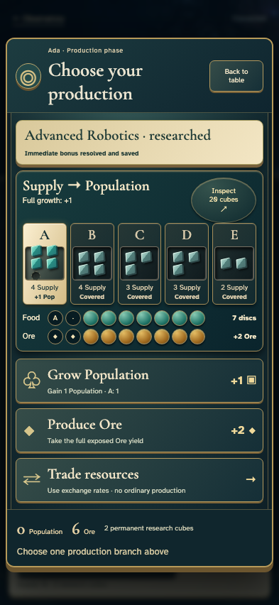](../../screenshots/upgrade-a-rival-tied-fleet-and-build-at-the-newly-controlled-yard-with-separate-controllers/045-ada-vacates-path-paid-phone-darwin.png) | [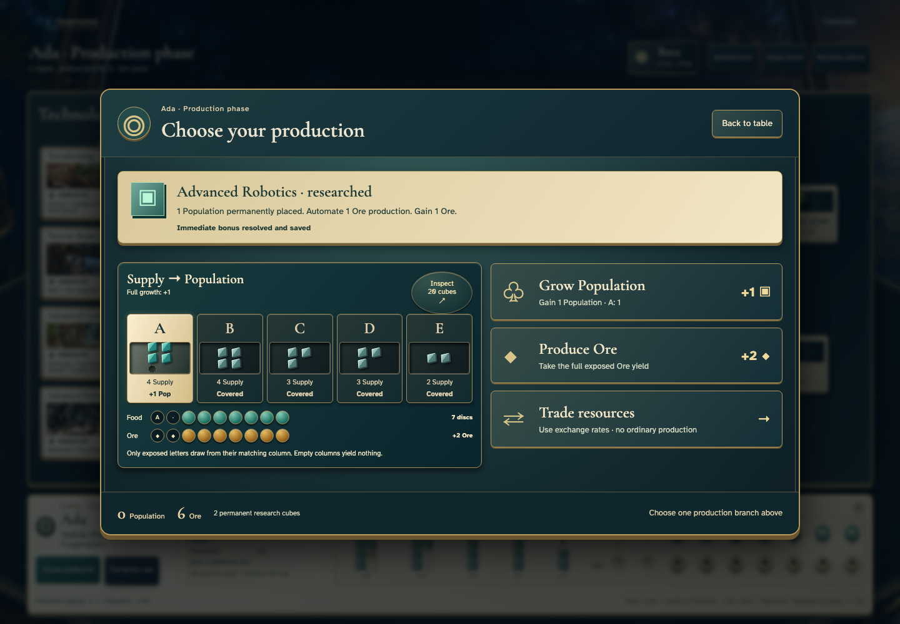](../../screenshots/upgrade-a-rival-tied-fleet-and-build-at-the-newly-controlled-yard-with-separate-controllers/045-ada-vacates-path-paid-desktop-darwin.png) |

- [x] Ada pays permanent research Population and resolves the printed bonus
- [x] The actual canonical effect and backend acknowledgement settle.
- [x] Public technology topology retains physical separation.
- [x] The actual viewport fits without page scrolling.

## 47. Ada completes ordinary production and hands off

Viewpoint: **Ada · separate host controller**.

| phone · 393 × 852 | desktop · 1440 × 1000 |
| --- | --- |
|  |  |

- [x] Ada completes ordinary production and hands off
- [x] The actual canonical effect and backend acknowledgement settle.
- [x] Public technology topology retains physical separation.
- [x] The actual viewport fits without page scrolling.

## 48. The next independent controller sees the saved handoff

Viewpoint: **Bora · separate guest controller**.

| phone · 1440 × 1000 | desktop · 393 × 852 |
| --- | --- |
|  |  |

- [x] The next independent controller sees the saved handoff
- [x] The actual canonical effect and backend acknowledgement settle.
- [x] Public technology topology retains physical separation.
- [x] The actual viewport fits without page scrolling.

## 49. Bora opens the actual Action instrument

Viewpoint: **Bora · separate guest controller**.

| phone · 1440 × 1000 | desktop · 393 × 852 |
| --- | --- |
|  |  |

- [x] Bora opens the actual Action instrument
- [x] The actual canonical effect and backend acknowledgement settle.
- [x] Public technology topology retains physical separation.
- [x] The actual viewport fits without page scrolling.

## 50. Bora selects a printed Technology Action

Viewpoint: **Bora · separate guest controller**.

| phone · 1440 × 1000 | desktop · 393 × 852 |
| --- | --- |
|  | [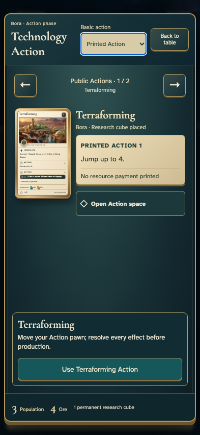](../../screenshots/upgrade-a-rival-tied-fleet-and-build-at-the-newly-controlled-yard-with-separate-controllers/049-bora-tie-kind-desktop-darwin.png) |

- [x] Bora selects a printed Technology Action
- [x] The actual canonical effect and backend acknowledgement settle.
- [x] Public technology topology retains physical separation.
- [x] The actual viewport fits without page scrolling.

## 51. Pay the actual printed Action before selecting an owned ship

Viewpoint: **Bora · separate guest controller**.

| phone · 1440 × 1000 | desktop · 393 × 852 |
| --- | --- |
| [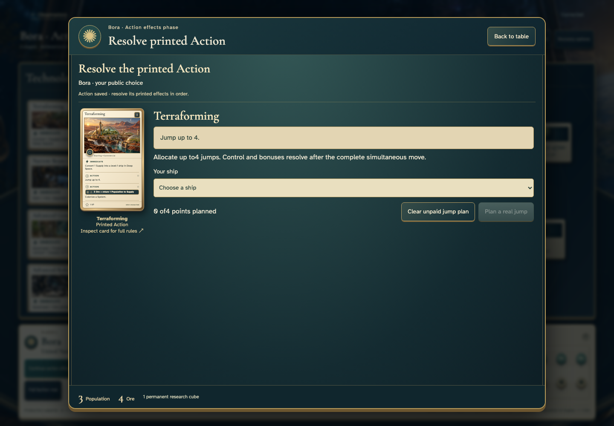](../../screenshots/upgrade-a-rival-tied-fleet-and-build-at-the-newly-controlled-yard-with-separate-controllers/050-bora-tie-paid-phone-darwin.png) | [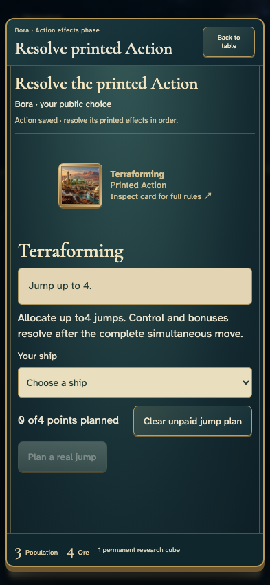](../../screenshots/upgrade-a-rival-tied-fleet-and-build-at-the-newly-controlled-yard-with-separate-controllers/050-bora-tie-paid-desktop-darwin.png) |

- [x] Pay the actual printed Action before selecting an owned ship
- [x] The actual canonical effect and backend acknowledgement settle.
- [x] Public technology topology retains physical separation.
- [x] The actual viewport fits without page scrolling.

## 52. Select the existing level-one ship; construction is not part of this Action

Viewpoint: **Bora · separate guest controller**.

| phone · 1440 × 1000 | desktop · 393 × 852 |
| --- | --- |
| [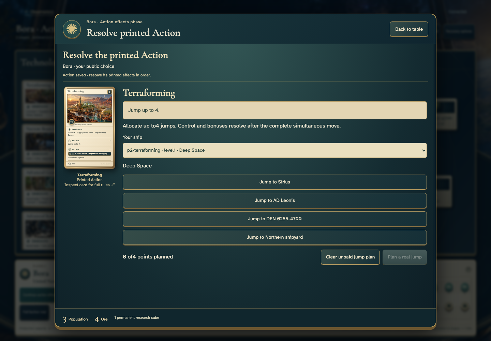](../../screenshots/upgrade-a-rival-tied-fleet-and-build-at-the-newly-controlled-yard-with-separate-controllers/051-bora-tie-ship-phone-darwin.png) |  |

- [x] Select the existing level-one ship; construction is not part of this Action
- [x] The actual canonical effect and backend acknowledgement settle.
- [x] Public technology topology retains physical separation.
- [x] The actual viewport fits without page scrolling.

## 53. Add the next adjacent system to the explicit path

Viewpoint: **Bora · separate guest controller**.

| phone · 1440 × 1000 | desktop · 393 × 852 |
| --- | --- |
|  |  |

- [x] Add the next adjacent system to the explicit path
- [x] The actual canonical effect and backend acknowledgement settle.
- [x] Public technology topology retains physical separation.
- [x] The actual viewport fits without page scrolling.

## 54. Equal incoming power preserves Ada’s incumbent outpost

Viewpoint: **Bora · separate guest controller**.

| phone · 1440 × 1000 | desktop · 393 × 852 |
| --- | --- |
|  |  |

- [x] Equal incoming power preserves Ada’s incumbent outpost
- [x] The actual canonical effect and backend acknowledgement settle.
- [x] Public technology topology retains physical separation.
- [x] The actual viewport fits without page scrolling.

## 55. Bora completes ordinary production and hands off

Viewpoint: **Bora · separate guest controller**.

| phone · 1440 × 1000 | desktop · 393 × 852 |
| --- | --- |
|  |  |

- [x] Bora completes ordinary production and hands off
- [x] The actual canonical effect and backend acknowledgement settle.
- [x] Public technology topology retains physical separation.
- [x] The actual viewport fits without page scrolling.

## 56. The next independent controller sees the saved handoff

Viewpoint: **Ada · separate host controller**.

| phone · 393 × 852 | desktop · 1440 × 1000 |
| --- | --- |
|  |  |

- [x] The next independent controller sees the saved handoff
- [x] The actual canonical effect and backend acknowledgement settle.
- [x] Public technology topology retains physical separation.
- [x] The actual viewport fits without page scrolling.

## 57. Ada opens the actual Action instrument

Viewpoint: **Ada · separate host controller**.

| phone · 393 × 852 | desktop · 1440 × 1000 |
| --- | --- |
|  |  |

- [x] Ada opens the actual Action instrument
- [x] The actual canonical effect and backend acknowledgement settle.
- [x] Public technology topology retains physical separation.
- [x] The actual viewport fits without page scrolling.

## 58. Ada selects ordinary gathering

Viewpoint: **Ada · separate host controller**.

| phone · 393 × 852 | desktop · 1440 × 1000 |
| --- | --- |
|  |  |

- [x] Ada selects ordinary gathering
- [x] The actual canonical effect and backend acknowledgement settle.
- [x] Public technology topology retains physical separation.
- [x] The actual viewport fits without page scrolling.

## 59. Receive actual Gather resources before production

Viewpoint: **Ada · separate host controller**.

| phone · 393 × 852 | desktop · 1440 × 1000 |
| --- | --- |
|  |  |

- [x] Receive actual Gather resources before production
- [x] The actual canonical effect and backend acknowledgement settle.
- [x] Public technology topology retains physical separation.
- [x] The actual viewport fits without page scrolling.

## 60. Ada completes ordinary production and hands off

Viewpoint: **Ada · separate host controller**.

| phone · 393 × 852 | desktop · 1440 × 1000 |
| --- | --- |
|  |  |

- [x] Ada completes ordinary production and hands off
- [x] The actual canonical effect and backend acknowledgement settle.
- [x] Public technology topology retains physical separation.
- [x] The actual viewport fits without page scrolling.

## 61. The next independent controller sees the saved handoff

Viewpoint: **Bora · separate guest controller**.

| phone · 1440 × 1000 | desktop · 393 × 852 |
| --- | --- |
|  |  |

- [x] The next independent controller sees the saved handoff
- [x] The actual canonical effect and backend acknowledgement settle.
- [x] Public technology topology retains physical separation.
- [x] The actual viewport fits without page scrolling.

## 62. Bora opens the actual Action instrument

Viewpoint: **Bora · separate guest controller**.

| phone · 1440 × 1000 | desktop · 393 × 852 |
| --- | --- |
|  |  |

- [x] Bora opens the actual Action instrument
- [x] The actual canonical effect and backend acknowledgement settle.
- [x] Public technology topology retains physical separation.
- [x] The actual viewport fits without page scrolling.

## 63. Bora chooses the unoccupied printed research space

Viewpoint: **Bora · separate guest controller**.

| phone · 1440 × 1000 | desktop · 393 × 852 |
| --- | --- |
|  |  |

- [x] Bora chooses the unoccupied printed research space
- [x] The actual canonical effect and backend acknowledgement settle.
- [x] Public technology topology retains physical separation.
- [x] The actual viewport fits without page scrolling.

## 64. Choose the public Narrow Beam Lasers face and read its printed effect

Viewpoint: **Bora · separate guest controller**.

| phone · 1440 × 1000 | desktop · 393 × 852 |
| --- | --- |
|  |  |

- [x] Choose the public Narrow Beam Lasers face and read its printed effect
- [x] The actual canonical effect and backend acknowledgement settle.
- [x] Public technology topology retains physical separation.
- [x] The actual viewport fits without page scrolling.

## 65. The mandatory one-level upgrade needs an explicit owned ship

Viewpoint: **Bora · separate guest controller**.

| phone · 1440 × 1000 | desktop · 393 × 852 |
| --- | --- |
|  |  |

- [x] The mandatory one-level upgrade needs an explicit owned ship
- [x] The actual canonical effect and backend acknowledgement settle.
- [x] Public technology topology retains physical separation.
- [x] The actual viewport fits without page scrolling.

## 66. Select the owned ship and inspect the exact level change

Viewpoint: **Bora · separate guest controller**.

| phone · 1440 × 1000 | desktop · 393 × 852 |
| --- | --- |
|  |  |

- [x] Select the owned ship and inspect the exact level change
- [x] The actual canonical effect and backend acknowledgement settle.
- [x] Public technology topology retains physical separation.
- [x] The actual viewport fits without page scrolling.

## 67. Bora pays permanent research Population and resolves the printed bonus

Viewpoint: **Bora · separate guest controller**.

| phone · 1440 × 1000 | desktop · 393 × 852 |
| --- | --- |
|  |  |

- [x] Bora pays permanent research Population and resolves the printed bonus
- [x] The actual canonical effect and backend acknowledgement settle.
- [x] Public technology topology retains physical separation.
- [x] The actual viewport fits without page scrolling.

## 68. Reload retains the upgraded ship and outstanding control-transfer choice

Viewpoint: **Bora · separate guest controller**.

| phone · 1440 × 1000 | desktop · 393 × 852 |
| --- | --- |
|  |  |

- [x] Reload retains the upgraded ship and outstanding control-transfer choice
- [x] The actual canonical effect and backend acknowledgement settle.
- [x] Public technology topology retains physical separation.
- [x] The actual viewport fits without page scrolling.

## 69. Reopen the real control-transfer response after the upgrade

Viewpoint: **Bora · separate guest controller**.

| phone · 1440 × 1000 | desktop · 393 × 852 |
| --- | --- |
|  |  |

- [x] Reopen the real control-transfer response after the upgrade
- [x] The actual canonical effect and backend acknowledgement settle.
- [x] Public technology topology retains physical separation.
- [x] The actual viewport fits without page scrolling.

## 70. Bora’s greater power replaces the incumbent before production

Viewpoint: **Bora · separate guest controller**.

| phone · 1440 × 1000 | desktop · 393 × 852 |
| --- | --- |
|  |  |

- [x] Bora’s greater power replaces the incumbent before production
- [x] The actual canonical effect and backend acknowledgement settle.
- [x] Public technology topology retains physical separation.
- [x] The actual viewport fits without page scrolling.

## 71. Bora completes ordinary production and hands off

Viewpoint: **Bora · separate guest controller**.

| phone · 1440 × 1000 | desktop · 393 × 852 |
| --- | --- |
|  |  |

- [x] Bora completes ordinary production and hands off
- [x] The actual canonical effect and backend acknowledgement settle.
- [x] Public technology topology retains physical separation.
- [x] The actual viewport fits without page scrolling.

## 72. The next independent controller sees the saved handoff

Viewpoint: **Ada · separate host controller**.

| phone · 393 × 852 | desktop · 1440 × 1000 |
| --- | --- |
|  |  |

- [x] The next independent controller sees the saved handoff
- [x] The actual canonical effect and backend acknowledgement settle.
- [x] Public technology topology retains physical separation.
- [x] The actual viewport fits without page scrolling.

## 73. Ada opens the actual Action instrument

Viewpoint: **Ada · separate host controller**.

| phone · 393 × 852 | desktop · 1440 × 1000 |
| --- | --- |
|  |  |

- [x] Ada opens the actual Action instrument
- [x] The actual canonical effect and backend acknowledgement settle.
- [x] Public technology topology retains physical separation.
- [x] The actual viewport fits without page scrolling.

## 74. Ada chooses the unoccupied printed research space

Viewpoint: **Ada · separate host controller**.

| phone · 393 × 852 | desktop · 1440 × 1000 |
| --- | --- |
|  |  |

- [x] Ada chooses the unoccupied printed research space
- [x] The actual canonical effect and backend acknowledgement settle.
- [x] Public technology topology retains physical separation.
- [x] The actual viewport fits without page scrolling.

## 75. Choose the public Advanced Genetics face and read its printed effect

Viewpoint: **Ada · separate host controller**.

| phone · 393 × 852 | desktop · 1440 × 1000 |
| --- | --- |
|  |  |

- [x] Choose the public Advanced Genetics face and read its printed effect
- [x] The actual canonical effect and backend acknowledgement settle.
- [x] Public technology topology retains physical separation.
- [x] The actual viewport fits without page scrolling.

## 76. Ada pays permanent research Population and resolves the printed bonus

Viewpoint: **Ada · separate host controller**.

| phone · 393 × 852 | desktop · 1440 × 1000 |
| --- | --- |
|  |  |

- [x] Ada pays permanent research Population and resolves the printed bonus
- [x] The actual canonical effect and backend acknowledgement settle.
- [x] Public technology topology retains physical separation.
- [x] The actual viewport fits without page scrolling.

## 77. Ada completes ordinary production and hands off

Viewpoint: **Ada · separate host controller**.

| phone · 393 × 852 | desktop · 1440 × 1000 |
| --- | --- |
|  |  |

- [x] Ada completes ordinary production and hands off
- [x] The actual canonical effect and backend acknowledgement settle.
- [x] Public technology topology retains physical separation.
- [x] The actual viewport fits without page scrolling.

## 78. The next independent controller sees the saved handoff

Viewpoint: **Bora · separate guest controller**.

| phone · 1440 × 1000 | desktop · 393 × 852 |
| --- | --- |
|  |  |

- [x] The next independent controller sees the saved handoff
- [x] The actual canonical effect and backend acknowledgement settle.
- [x] Public technology topology retains physical separation.
- [x] The actual viewport fits without page scrolling.

## 79. Bora opens the actual Action instrument

Viewpoint: **Bora · separate guest controller**.

| phone · 1440 × 1000 | desktop · 393 × 852 |
| --- | --- |
|  |  |

- [x] Bora opens the actual Action instrument
- [x] The actual canonical effect and backend acknowledgement settle.
- [x] Public technology topology retains physical separation.
- [x] The actual viewport fits without page scrolling.

## 80. Bora selects Basic construction

Viewpoint: **Bora · separate guest controller**.

| phone · 1440 × 1000 | desktop · 393 × 852 |
| --- | --- |
|  |  |

- [x] Bora selects Basic construction
- [x] The actual canonical effect and backend acknowledgement settle.
- [x] Public technology topology retains physical separation.
- [x] The actual viewport fits without page scrolling.

## 81. Select the actually controlled Northern shipyard and review power two to three

Viewpoint: **Bora · separate guest controller**.

| phone · 1440 × 1000 | desktop · 393 × 852 |
| --- | --- |
|  |  |

- [x] Select the actually controlled Northern shipyard and review power two to three
- [x] The actual canonical effect and backend acknowledgement settle.
- [x] Public technology topology retains physical separation.
- [x] The actual viewport fits without page scrolling.

## 82. Convert one Population cube into a level-one ship at the controlled yard

Viewpoint: **Bora · separate guest controller**.

| phone · 1440 × 1000 | desktop · 393 × 852 |
| --- | --- |
|  |  |

- [x] Convert one Population cube into a level-one ship at the controlled yard
- [x] The actual canonical effect and backend acknowledgement settle.
- [x] Public technology topology retains physical separation.
- [x] The actual viewport fits without page scrolling.

## 83. Decline optional movement without undoing the ship or Action cost

Viewpoint: **Bora · separate guest controller**.

| phone · 1440 × 1000 | desktop · 393 × 852 |
| --- | --- |
|  |  |

- [x] Decline optional movement without undoing the ship or Action cost
- [x] The actual canonical effect and backend acknowledgement settle.
- [x] Public technology topology retains physical separation.
- [x] The actual viewport fits without page scrolling.

## 84. Bora completes ordinary production and hands off

Viewpoint: **Bora · separate guest controller**.

| phone · 1440 × 1000 | desktop · 393 × 852 |
| --- | --- |
|  |  |

- [x] Bora completes ordinary production and hands off
- [x] The actual canonical effect and backend acknowledgement settle.
- [x] Public technology topology retains physical separation.
- [x] The actual viewport fits without page scrolling.

## 85. The next independent controller sees the saved handoff

Viewpoint: **Ada · separate host controller**.

| phone · 393 × 852 | desktop · 1440 × 1000 |
| --- | --- |
|  |  |

- [x] The next independent controller sees the saved handoff
- [x] The actual canonical effect and backend acknowledgement settle.
- [x] Public technology topology retains physical separation.
- [x] The actual viewport fits without page scrolling.

## 86. Open the retained faction economy and physical fleet register

Viewpoint: **Bora · separate guest controller**.

| phone · 1440 × 1000 | desktop · 393 × 852 |
| --- | --- |
|  |  |

- [x] Open the retained faction economy and physical fleet register
- [x] The actual canonical effect and backend acknowledgement settle.
- [x] Public technology topology retains physical separation.
- [x] The actual viewport fits without page scrolling.

## 87. Inspect 3 real ships with explicit levels and public summed power

Viewpoint: **Bora · separate guest controller**.

| phone · 1440 × 1000 | desktop · 393 × 852 |
| --- | --- |
|  |  |

- [x] Inspect 3 real ships with explicit levels and public summed power
- [x] The actual canonical effect and backend acknowledgement settle.
- [x] Public technology topology retains physical separation.
- [x] The actual viewport fits without page scrolling.

## 88. Inspect Bora's actual power at Northern shipyard

Viewpoint: **Bora · separate guest controller**.

| phone · 1440 × 1000 | desktop · 393 × 852 |
| --- | --- |
|  |  |

- [x] Inspect Bora's actual power at Northern shipyard
- [x] The actual canonical effect and backend acknowledgement settle.
- [x] Public technology topology retains physical separation.
- [x] The actual viewport fits without page scrolling.

## 89. The register explains levels, location-specific power and incumbent ties without taking a turn

Viewpoint: **Bora · separate guest controller**.

| phone · 1440 × 1000 | desktop · 393 × 852 |
| --- | --- |
|  |  |

- [x] The register explains levels, location-specific power and incumbent ties without taking a turn
- [x] The actual canonical effect and backend acknowledgement settle.
- [x] Public technology topology retains physical separation.
- [x] The actual viewport fits without page scrolling.

## 90. Keyboard reaches the bounded fleet details

Viewpoint: **Bora · separate guest controller**.

| phone · 1440 × 1000 | desktop · 393 × 852 |
| --- | --- |
|  |  |

- [x] Keyboard reaches the bounded fleet details
- [x] The actual canonical effect and backend acknowledgement settle.
- [x] Public technology topology retains physical separation.
- [x] The actual viewport fits without page scrolling.

## 91. Reverse Tab stays within the fleet reader

Viewpoint: **Bora · separate guest controller**.

| phone · 1440 × 1000 | desktop · 393 × 852 |
| --- | --- |
|  |  |

- [x] Reverse Tab stays within the fleet reader
- [x] The actual canonical effect and backend acknowledgement settle.
- [x] Public technology topology retains physical separation.
- [x] The actual viewport fits without page scrolling.

## 92. Forward Tab wraps back to persistent Close

Viewpoint: **Bora · separate guest controller**.

| phone · 1440 × 1000 | desktop · 393 × 852 |
| --- | --- |
|  |  |

- [x] Forward Tab wraps back to persistent Close
- [x] The actual canonical effect and backend acknowledgement settle.
- [x] Public technology topology retains physical separation.
- [x] The actual viewport fits without page scrolling.

## 93. Escape restores the actual Fleet opener

Viewpoint: **Bora · separate guest controller**.

| phone · 1440 × 1000 | desktop · 393 × 852 |
| --- | --- |
|  |  |

- [x] Escape restores the actual Fleet opener
- [x] The actual canonical effect and backend acknowledgement settle.
- [x] Public technology topology retains physical separation.
- [x] The actual viewport fits without page scrolling.

## 94. Close the mat and restore its physical opener

Viewpoint: **Bora · separate guest controller**.

| phone · 1440 × 1000 | desktop · 393 × 852 |
| --- | --- |
|  |  |

- [x] Close the mat and restore its physical opener
- [x] The actual canonical effect and backend acknowledgement settle.
- [x] Public technology topology retains physical separation.
- [x] The actual viewport fits without page scrolling.

## 95. Reload retains upgraded and new ships, control and automatic handoff

Viewpoint: **Bora · separate guest controller**.

| phone · 1440 × 1000 | desktop · 393 × 852 |
| --- | --- |
|  |  |

- [x] Reload retains upgraded and new ships, control and automatic handoff
- [x] The actual canonical effect and backend acknowledgement settle.
- [x] Public technology topology retains physical separation.
- [x] The actual viewport fits without page scrolling.
