# Auto-pass optional movement after decommissioning the last ship with separate controllers

Ordinary named legal Basic setup and real preparatory turns. Fixed initial setup entropy55555555-5555-4555-8555-000000000002; command identities separate stories, no state injection or future-deck reads. Remote players have separate identities; tabletop has one shared controller. Source inspection, unpaid recovery, simultaneous endpoints and handoff use production UI.

## 1. Arrive using the actual production client

Viewpoint: **Ada · separate host controller**.

| phone · 393 × 852 | desktop · 1440 × 1000 |
| --- | --- |
|  |  |

- [x] Arrive using the actual production client
- [x] Actual canonical effects and acknowledgement settle.
- [x] Public topology retains physical separation.
- [x] The viewport fits without page scrolling.

## 2. Choose a real production play mode

Viewpoint: **Ada · separate host controller**.

| phone · 393 × 852 | desktop · 1440 × 1000 |
| --- | --- |
|  |  |

- [x] Choose a real production play mode
- [x] Actual canonical effects and acknowledgement settle.
- [x] Public topology retains physical separation.
- [x] The viewport fits without page scrolling.

## 3. Create an independent remote host controller

Viewpoint: **Ada · separate host controller**.

| phone · 393 × 852 | desktop · 1440 × 1000 |
| --- | --- |
|  |  |

- [x] Create an independent remote host controller
- [x] Actual canonical effects and acknowledgement settle.
- [x] Public topology retains physical separation.
- [x] The viewport fits without page scrolling.

## 4. Name the host Ada

Viewpoint: **Ada · separate host controller**.

| phone · 393 × 852 | desktop · 1440 × 1000 |
| --- | --- |
|  |  |

- [x] Name the host Ada
- [x] Actual canonical effects and acknowledgement settle.
- [x] Public topology retains physical separation.
- [x] The viewport fits without page scrolling.

## 5. The canonical remote room exposes its actual invitation code

Viewpoint: **Ada · separate host controller**.

| phone · 393 × 852 | desktop · 1440 × 1000 |
| --- | --- |
| [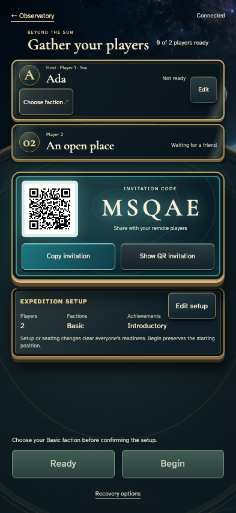](../../screenshots/auto-pass-optional-movement-after-decommissioning-the-last-ship-with-separate-controllers/004-host-room-phone-darwin.png) | [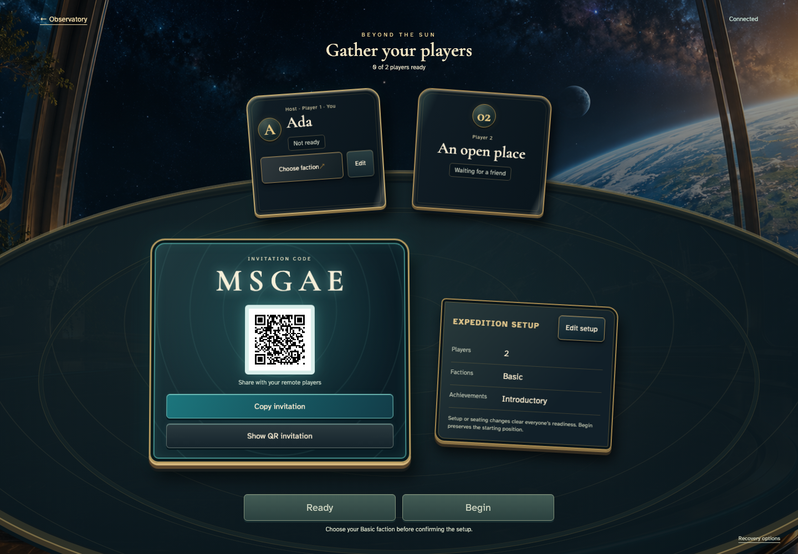](../../screenshots/auto-pass-optional-movement-after-decommissioning-the-last-ship-with-separate-controllers/004-host-room-desktop-darwin.png) |

- [x] The canonical remote room exposes its actual invitation code
- [x] Actual canonical effects and acknowledgement settle.
- [x] Public topology retains physical separation.
- [x] The viewport fits without page scrolling.

## 6. A different identity previews the public invitation

Viewpoint: **Bora · separate guest controller**.

| phone · 1440 × 1000 | desktop · 393 × 852 |
| --- | --- |
| [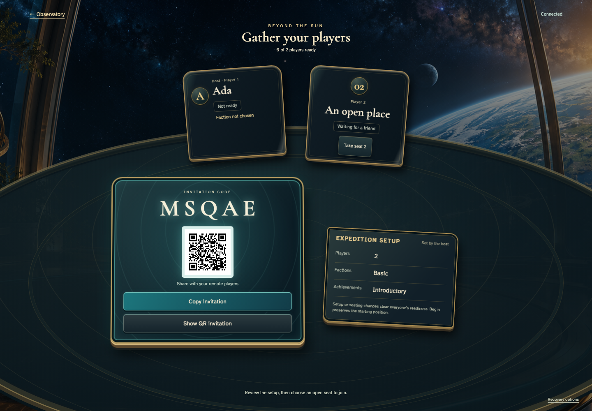](../../screenshots/auto-pass-optional-movement-after-decommissioning-the-last-ship-with-separate-controllers/005-guest-preview-phone-darwin.png) | [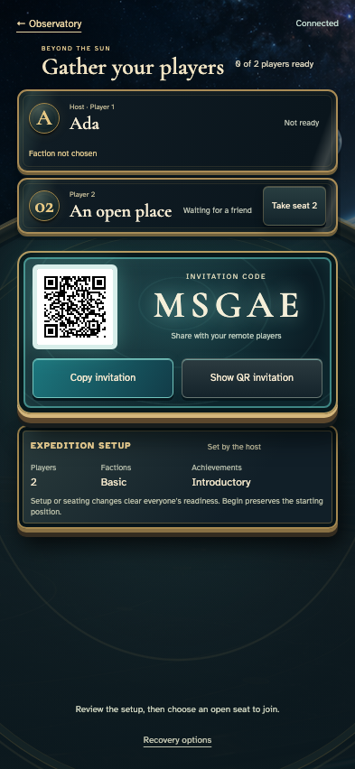](../../screenshots/auto-pass-optional-movement-after-decommissioning-the-last-ship-with-separate-controllers/005-guest-preview-desktop-darwin.png) |

- [x] A different identity previews the public invitation
- [x] Actual canonical effects and acknowledgement settle.
- [x] Public topology retains physical separation.
- [x] The viewport fits without page scrolling.

## 7. The guest claims only the remote seat

Viewpoint: **Bora · separate guest controller**.

| phone · 1440 × 1000 | desktop · 393 × 852 |
| --- | --- |
| [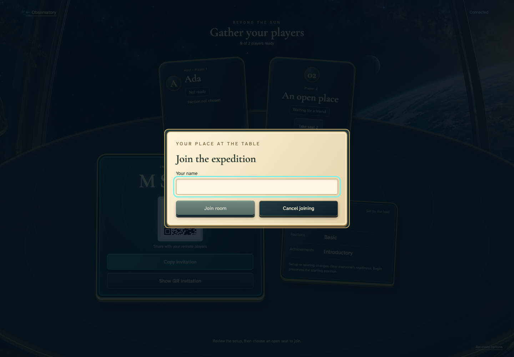](../../screenshots/auto-pass-optional-movement-after-decommissioning-the-last-ship-with-separate-controllers/006-guest-editor-phone-darwin.png) |  |

- [x] The guest claims only the remote seat
- [x] Actual canonical effects and acknowledgement settle.
- [x] Public topology retains physical separation.
- [x] The viewport fits without page scrolling.

## 8. Name the independent guest Bora

Viewpoint: **Bora · separate guest controller**.

| phone · 1440 × 1000 | desktop · 393 × 852 |
| --- | --- |
| [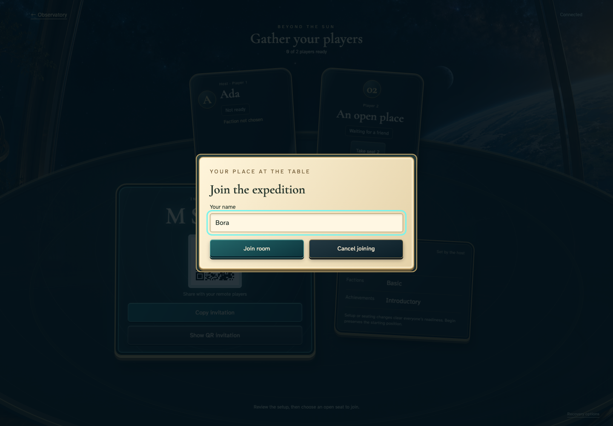](../../screenshots/auto-pass-optional-movement-after-decommissioning-the-last-ship-with-separate-controllers/007-guest-name-phone-darwin.png) |  |

- [x] Name the independent guest Bora
- [x] Actual canonical effects and acknowledgement settle.
- [x] Public topology retains physical separation.
- [x] The viewport fits without page scrolling.

## 9. Both named remote identities share the same room

Viewpoint: **Bora · separate guest controller**.

| phone · 1440 × 1000 | desktop · 393 × 852 |
| --- | --- |
| [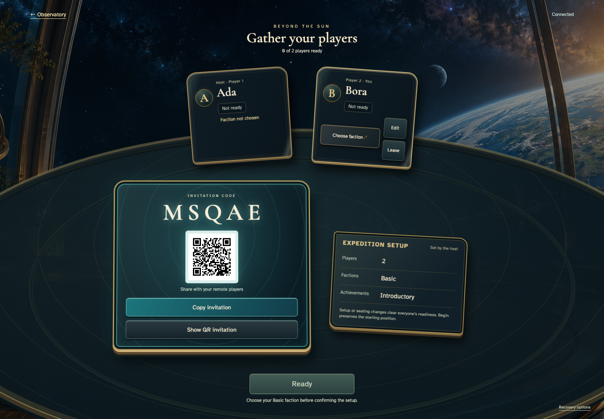](../../screenshots/auto-pass-optional-movement-after-decommissioning-the-last-ship-with-separate-controllers/008-guest-joined-phone-darwin.png) | [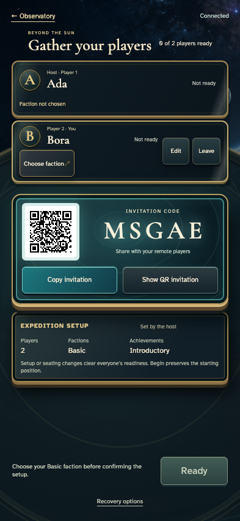](../../screenshots/auto-pass-optional-movement-after-decommissioning-the-last-ship-with-separate-controllers/008-guest-joined-desktop-darwin.png) |

- [x] Both named remote identities share the same room
- [x] Actual canonical effects and acknowledgement settle.
- [x] Public topology retains physical separation.
- [x] The viewport fits without page scrolling.

## 10. Ada chooses a legal unique Basic faction

Viewpoint: **Ada · separate host controller**.

| phone · 393 × 852 | desktop · 1440 × 1000 |
| --- | --- |
|  |  |

- [x] Ada chooses a legal unique Basic faction
- [x] Actual canonical effects and acknowledgement settle.
- [x] Public topology retains physical separation.
- [x] The viewport fits without page scrolling.

## 11. Ada retains Nishida-Østergaard Corporation

Viewpoint: **Ada · separate host controller**.

| phone · 393 × 852 | desktop · 1440 × 1000 |
| --- | --- |
| [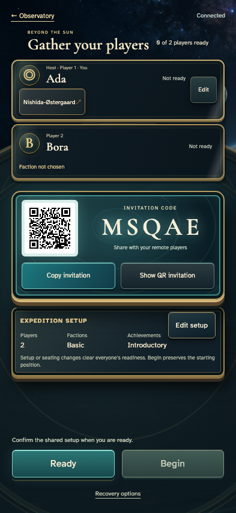](../../screenshots/auto-pass-optional-movement-after-decommissioning-the-last-ship-with-separate-controllers/010-faction-0-chosen-phone-darwin.png) |  |

- [x] Ada retains Nishida-Østergaard Corporation
- [x] Actual canonical effects and acknowledgement settle.
- [x] Public topology retains physical separation.
- [x] The viewport fits without page scrolling.

## 12. Bora chooses a legal unique Basic faction

Viewpoint: **Bora · separate guest controller**.

| phone · 1440 × 1000 | desktop · 393 × 852 |
| --- | --- |
|  |  |

- [x] Bora chooses a legal unique Basic faction
- [x] Actual canonical effects and acknowledgement settle.
- [x] Public topology retains physical separation.
- [x] The viewport fits without page scrolling.

## 13. Bora retains United Nations of Sol

Viewpoint: **Bora · separate guest controller**.

| phone · 1440 × 1000 | desktop · 393 × 852 |
| --- | --- |
| [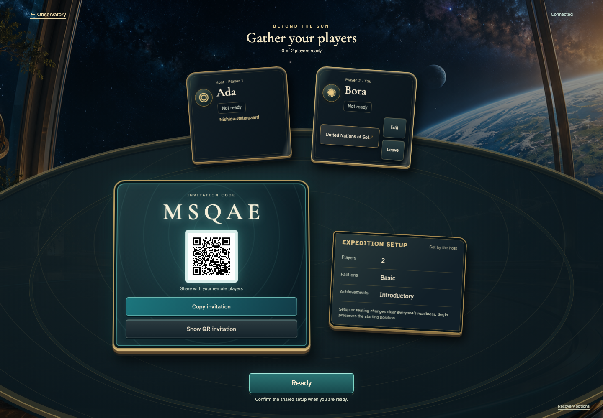](../../screenshots/auto-pass-optional-movement-after-decommissioning-the-last-ship-with-separate-controllers/012-faction-1-chosen-phone-darwin.png) | [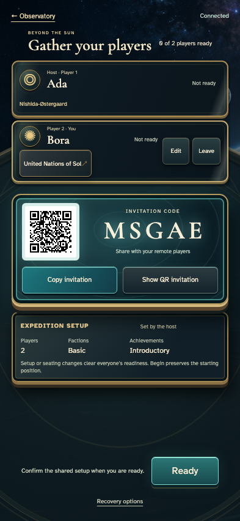](../../screenshots/auto-pass-optional-movement-after-decommissioning-the-last-ship-with-separate-controllers/012-faction-1-chosen-desktop-darwin.png) |

- [x] Bora retains United Nations of Sol
- [x] Actual canonical effects and acknowledgement settle.
- [x] Public topology retains physical separation.
- [x] The viewport fits without page scrolling.

## 14. Confirm this identity is ready for the exact saved configuration

Viewpoint: **Bora · separate guest controller**.

| phone · 1440 × 1000 | desktop · 393 × 852 |
| --- | --- |
|  | [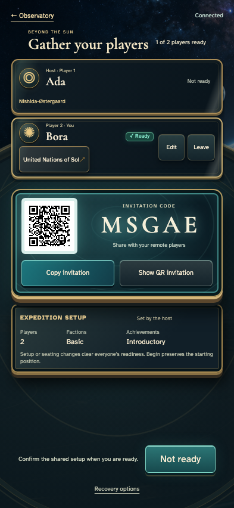](../../screenshots/auto-pass-optional-movement-after-decommissioning-the-last-ship-with-separate-controllers/013-ready-1-desktop-darwin.png) |

- [x] Confirm this identity is ready for the exact saved configuration
- [x] Actual canonical effects and acknowledgement settle.
- [x] Public topology retains physical separation.
- [x] The viewport fits without page scrolling.

## 15. Confirm this identity is ready for the exact saved configuration

Viewpoint: **Ada · separate host controller**.

| phone · 393 × 852 | desktop · 1440 × 1000 |
| --- | --- |
| [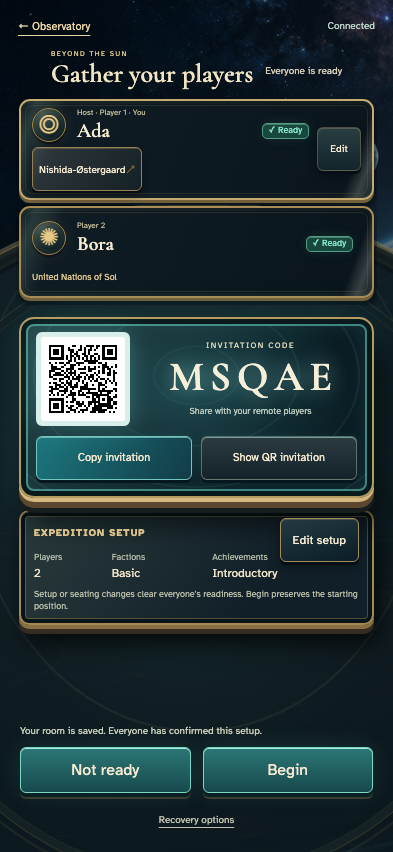](../../screenshots/auto-pass-optional-movement-after-decommissioning-the-last-ship-with-separate-controllers/014-ready-0-phone-darwin.png) | [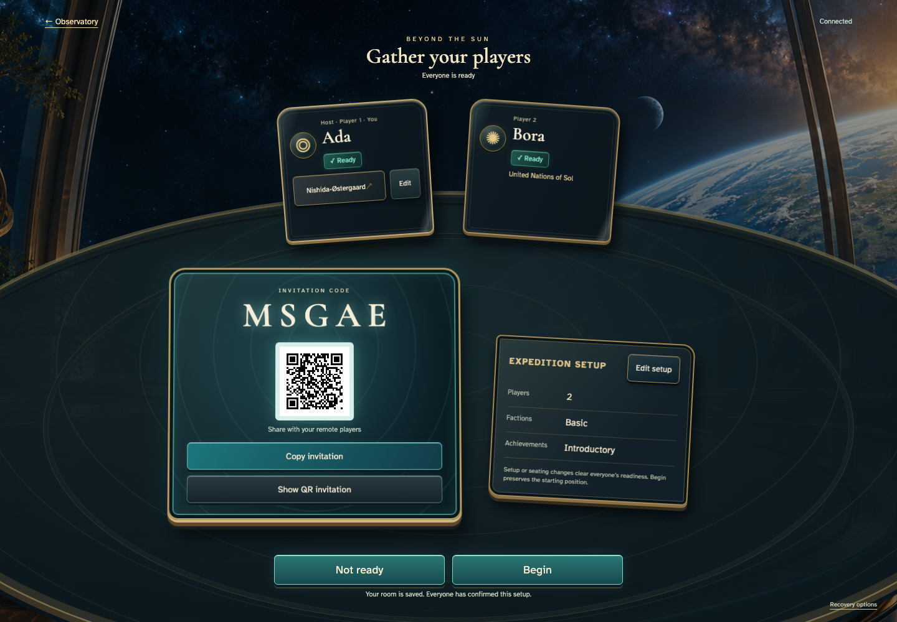](../../screenshots/auto-pass-optional-movement-after-decommissioning-the-last-ship-with-separate-controllers/014-ready-0-desktop-darwin.png) |

- [x] Confirm this identity is ready for the exact saved configuration
- [x] Actual canonical effects and acknowledgement settle.
- [x] Public topology retains physical separation.
- [x] The viewport fits without page scrolling.

## 16. Begin the immutable source-reviewed Basic setup through the ordinary UI

Viewpoint: **Ada · separate host controller**.

| phone · 393 × 852 | desktop · 1440 × 1000 |
| --- | --- |
|  |  |

- [x] Begin the immutable source-reviewed Basic setup through the ordinary UI
- [x] Actual canonical effects and acknowledgement settle.
- [x] Public topology retains physical separation.
- [x] The viewport fits without page scrolling.

## 17. Ada opens the actual Action instrument

Viewpoint: **Ada · separate host controller**.

| phone · 393 × 852 | desktop · 1440 × 1000 |
| --- | --- |
|  |  |

- [x] Ada opens the actual Action instrument
- [x] Actual canonical effects and acknowledgement settle.
- [x] Public topology retains physical separation.
- [x] The viewport fits without page scrolling.

## 18. Ada selects ordinary gathering

Viewpoint: **Ada · separate host controller**.

| phone · 393 × 852 | desktop · 1440 × 1000 |
| --- | --- |
| [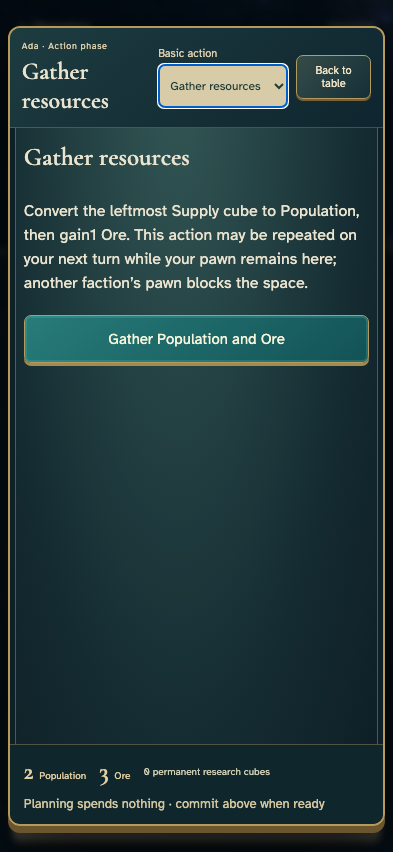](../../screenshots/auto-pass-optional-movement-after-decommissioning-the-last-ship-with-separate-controllers/017-empty-gather-kind-phone-darwin.png) | [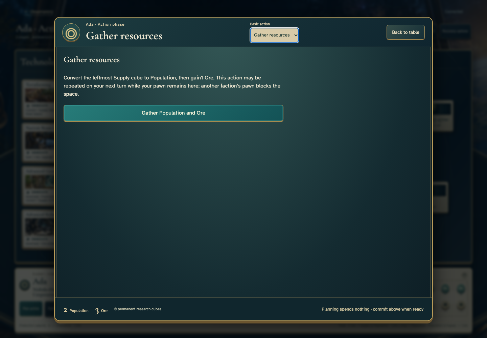](../../screenshots/auto-pass-optional-movement-after-decommissioning-the-last-ship-with-separate-controllers/017-empty-gather-kind-desktop-darwin.png) |

- [x] Ada selects ordinary gathering
- [x] Actual canonical effects and acknowledgement settle.
- [x] Public topology retains physical separation.
- [x] The viewport fits without page scrolling.

## 19. Gather through the real Action before choosing Trade

Viewpoint: **Ada · separate host controller**.

| phone · 393 × 852 | desktop · 1440 × 1000 |
| --- | --- |
|  | [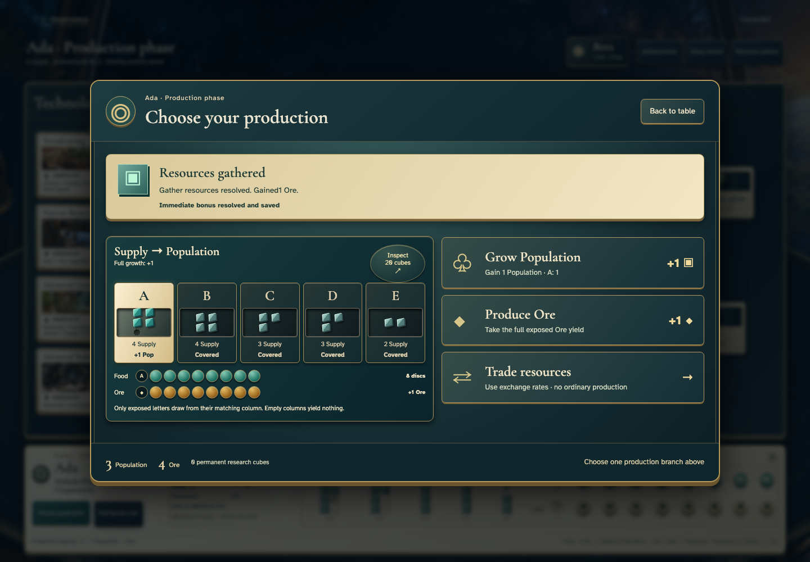](../../screenshots/auto-pass-optional-movement-after-decommissioning-the-last-ship-with-separate-controllers/018-empty-gathered-desktop-darwin.png) |

- [x] Gather through the real Action before choosing Trade
- [x] Actual canonical effects and acknowledgement settle.
- [x] Public topology retains physical separation.
- [x] The viewport fits without page scrolling.

## 20. Choose Trade instead of ordinary production

Viewpoint: **Ada · separate host controller**.

| phone · 393 × 852 | desktop · 1440 × 1000 |
| --- | --- |
| [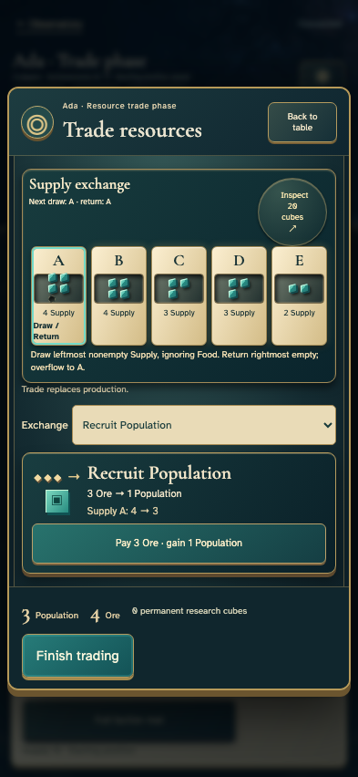](../../screenshots/auto-pass-optional-movement-after-decommissioning-the-last-ship-with-separate-controllers/019-empty-trade-phone-darwin.png) |  |

- [x] Choose Trade instead of ordinary production
- [x] Actual canonical effects and acknowledgement settle.
- [x] Public topology retains physical separation.
- [x] The viewport fits without page scrolling.

## 21. Select the actual ship-decommission exchange

Viewpoint: **Ada · separate host controller**.

| phone · 393 × 852 | desktop · 1440 × 1000 |
| --- | --- |
| [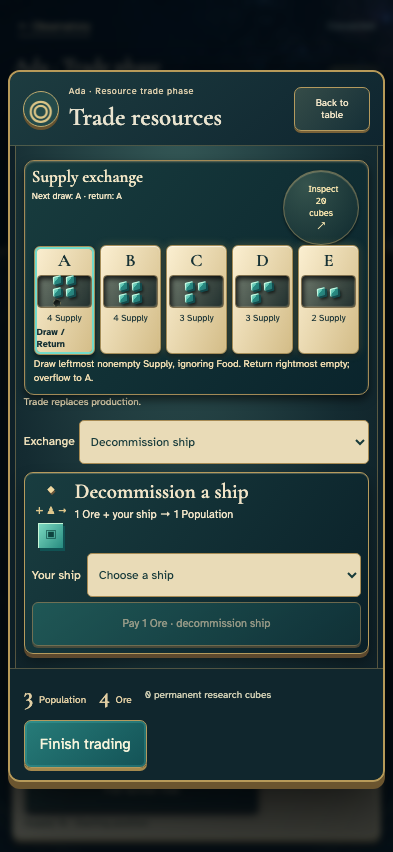](../../screenshots/auto-pass-optional-movement-after-decommissioning-the-last-ship-with-separate-controllers/020-empty-ship-exchange-phone-darwin.png) |  |

- [x] Select the actual ship-decommission exchange
- [x] Actual canonical effects and acknowledgement settle.
- [x] Public topology retains physical separation.
- [x] The viewport fits without page scrolling.

## 22. Choose the real last Sol ship before paying1Ore

Viewpoint: **Ada · separate host controller**.

| phone · 393 × 852 | desktop · 1440 × 1000 |
| --- | --- |
| [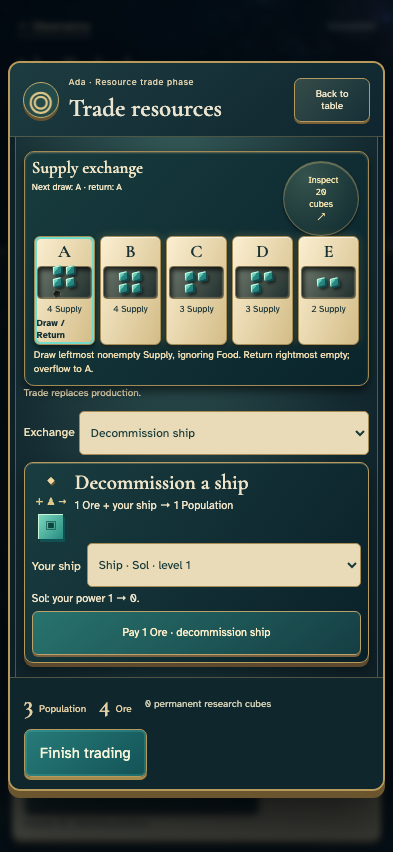](../../screenshots/auto-pass-optional-movement-after-decommissioning-the-last-ship-with-separate-controllers/021-empty-ship-selected-phone-darwin.png) | [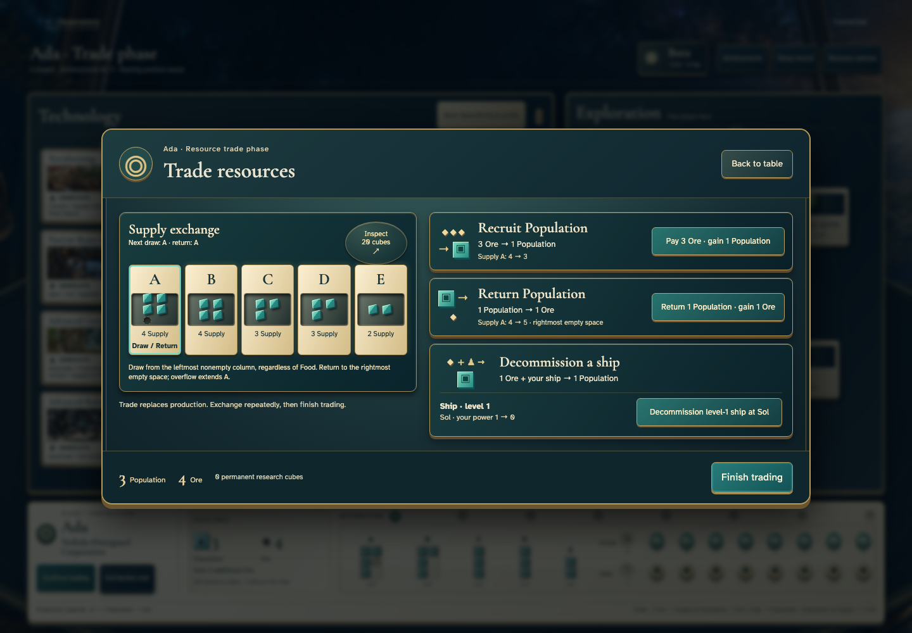](../../screenshots/auto-pass-optional-movement-after-decommissioning-the-last-ship-with-separate-controllers/021-empty-ship-selected-desktop-darwin.png) |

- [x] Choose the real last Sol ship before paying1Ore
- [x] Actual canonical effects and acknowledgement settle.
- [x] Public topology retains physical separation.
- [x] The viewport fits without page scrolling.

## 23. Return the last real ship through the printed one-Ore exchange

Viewpoint: **Ada · separate host controller**.

| phone · 393 × 852 | desktop · 1440 × 1000 |
| --- | --- |
| [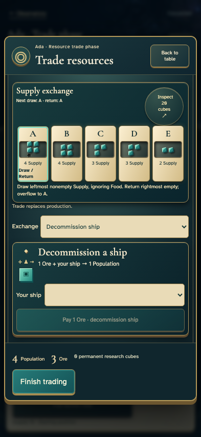](../../screenshots/auto-pass-optional-movement-after-decommissioning-the-last-ship-with-separate-controllers/022-empty-decommissioned-phone-darwin.png) | [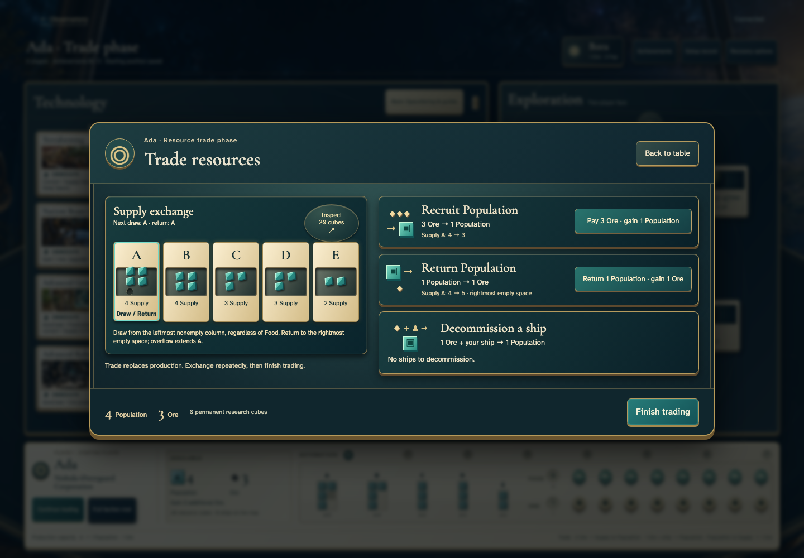](../../screenshots/auto-pass-optional-movement-after-decommissioning-the-last-ship-with-separate-controllers/022-empty-decommissioned-desktop-darwin.png) |

- [x] Return the last real ship through the printed one-Ore exchange
- [x] Actual canonical effects and acknowledgement settle.
- [x] Public topology retains physical separation.
- [x] The viewport fits without page scrolling.

## 24. Finish trading without adding ordinary production

Viewpoint: **Ada · separate host controller**.

| phone · 393 × 852 | desktop · 1440 × 1000 |
| --- | --- |
| [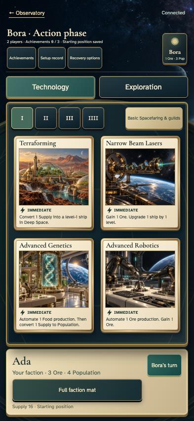](../../screenshots/auto-pass-optional-movement-after-decommissioning-the-last-ship-with-separate-controllers/023-empty-finished-phone-darwin.png) | [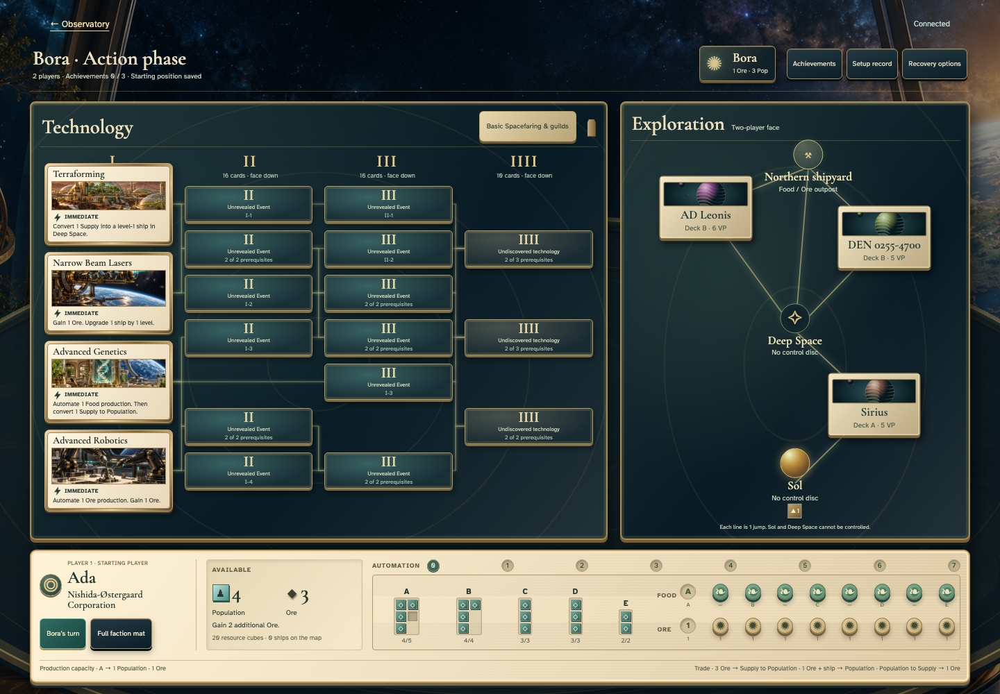](../../screenshots/auto-pass-optional-movement-after-decommissioning-the-last-ship-with-separate-controllers/023-empty-finished-desktop-darwin.png) |

- [x] Finish trading without adding ordinary production
- [x] Actual canonical effects and acknowledgement settle.
- [x] Public topology retains physical separation.
- [x] The viewport fits without page scrolling.

## 25. Bora opens the actual Action instrument

Viewpoint: **Bora · separate guest controller**.

| phone · 1440 × 1000 | desktop · 393 × 852 |
| --- | --- |
| [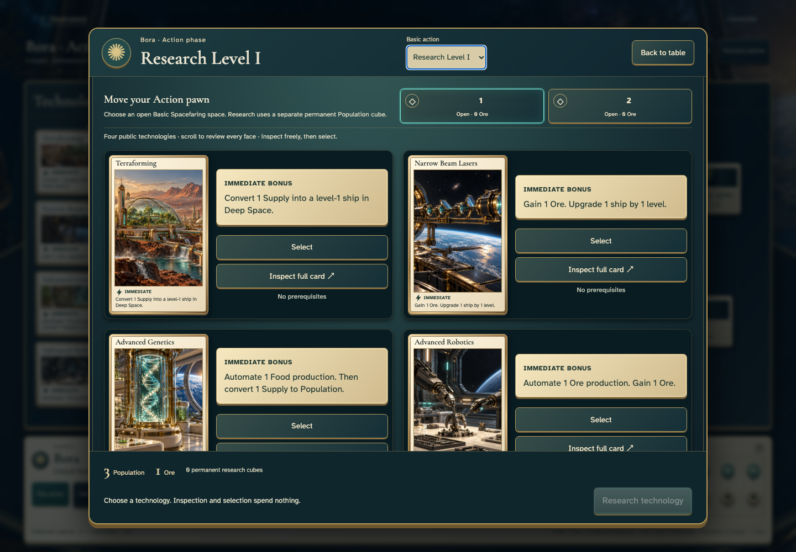](../../screenshots/auto-pass-optional-movement-after-decommissioning-the-last-ship-with-separate-controllers/024-prepare-1-plan-phone-darwin.png) | [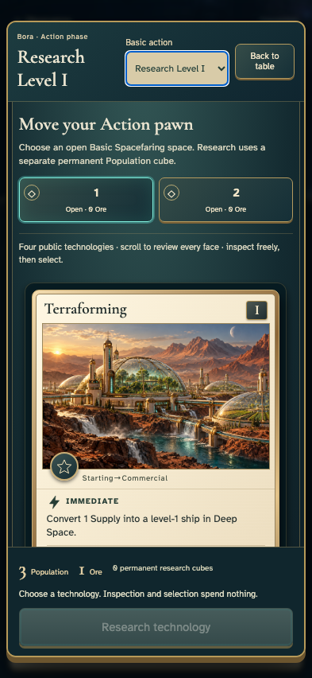](../../screenshots/auto-pass-optional-movement-after-decommissioning-the-last-ship-with-separate-controllers/024-prepare-1-plan-desktop-darwin.png) |

- [x] Bora opens the actual Action instrument
- [x] Actual canonical effects and acknowledgement settle.
- [x] Public topology retains physical separation.
- [x] The viewport fits without page scrolling.

## 26. Bora chooses the unoccupied printed research space

Viewpoint: **Bora · separate guest controller**.

| phone · 1440 × 1000 | desktop · 393 × 852 |
| --- | --- |
|  | [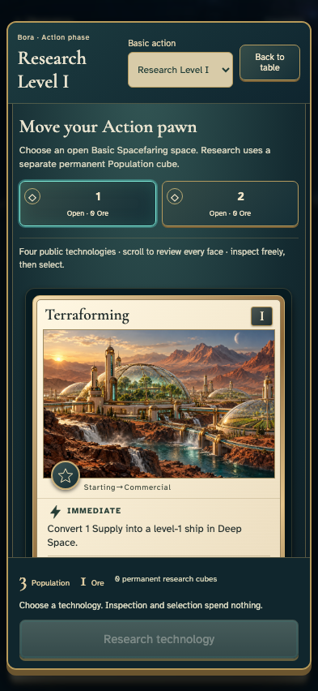](../../screenshots/auto-pass-optional-movement-after-decommissioning-the-last-ship-with-separate-controllers/025-prepare-1-space-desktop-darwin.png) |

- [x] Bora chooses the unoccupied printed research space
- [x] Actual canonical effects and acknowledgement settle.
- [x] Public topology retains physical separation.
- [x] The viewport fits without page scrolling.

## 27. Choose the public Advanced Robotics face and read its printed effect

Viewpoint: **Bora · separate guest controller**.

| phone · 1440 × 1000 | desktop · 393 × 852 |
| --- | --- |
| [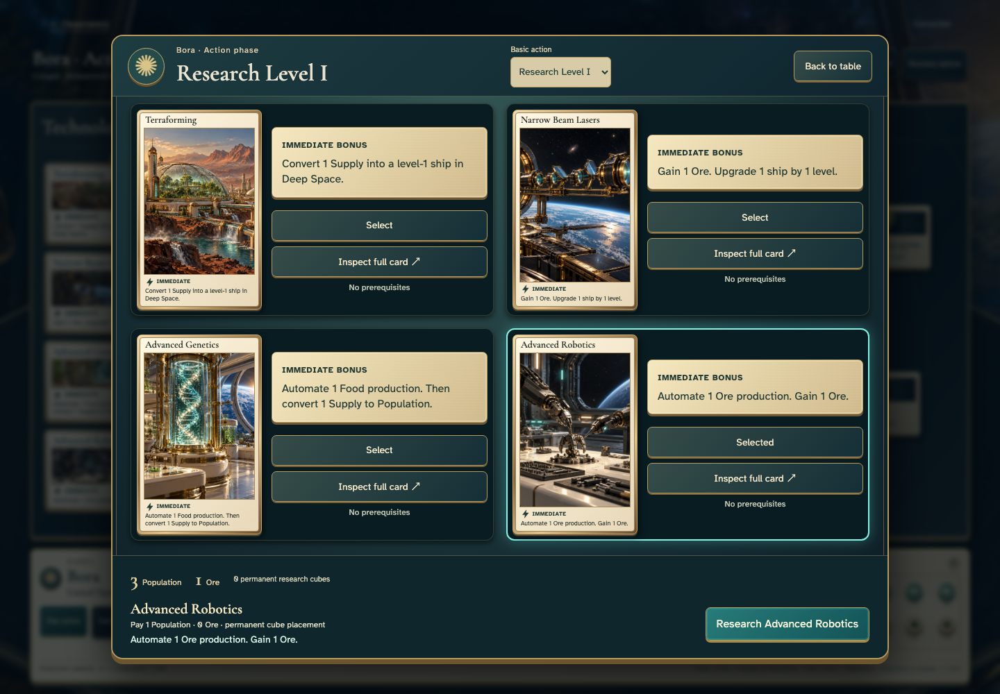](../../screenshots/auto-pass-optional-movement-after-decommissioning-the-last-ship-with-separate-controllers/026-prepare-1-card-phone-darwin.png) | [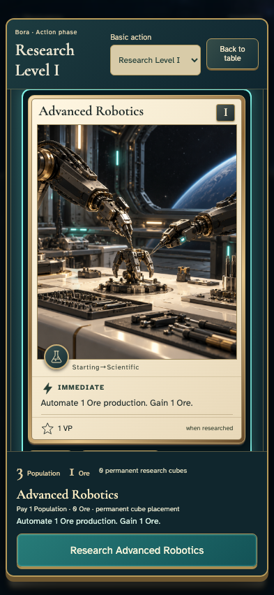](../../screenshots/auto-pass-optional-movement-after-decommissioning-the-last-ship-with-separate-controllers/026-prepare-1-card-desktop-darwin.png) |

- [x] Choose the public Advanced Robotics face and read its printed effect
- [x] Actual canonical effects and acknowledgement settle.
- [x] Public topology retains physical separation.
- [x] The viewport fits without page scrolling.

## 28. Bora pays permanent research Population and resolves the printed bonus

Viewpoint: **Bora · separate guest controller**.

| phone · 1440 × 1000 | desktop · 393 × 852 |
| --- | --- |
| [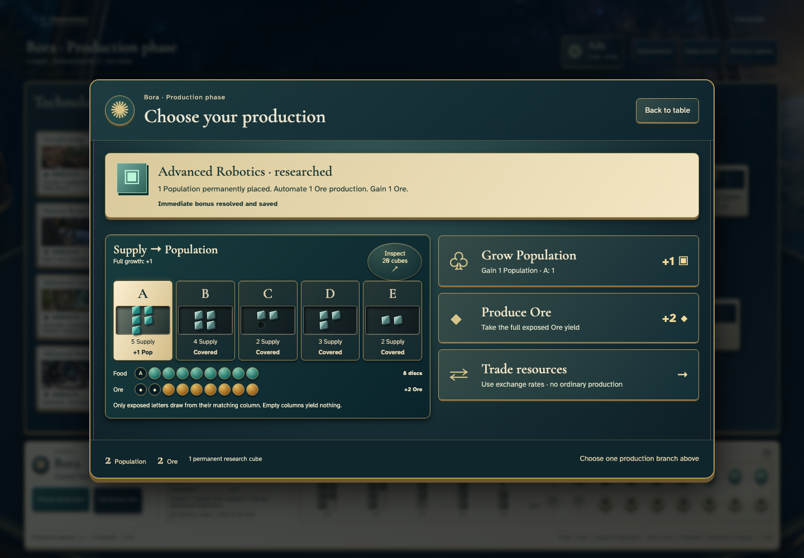](../../screenshots/auto-pass-optional-movement-after-decommissioning-the-last-ship-with-separate-controllers/027-prepare-1-paid-phone-darwin.png) |  |

- [x] Bora pays permanent research Population and resolves the printed bonus
- [x] Actual canonical effects and acknowledgement settle.
- [x] Public topology retains physical separation.
- [x] The viewport fits without page scrolling.

## 29. Bora completes ordinary production and hands off

Viewpoint: **Bora · separate guest controller**.

| phone · 1440 × 1000 | desktop · 393 × 852 |
| --- | --- |
| [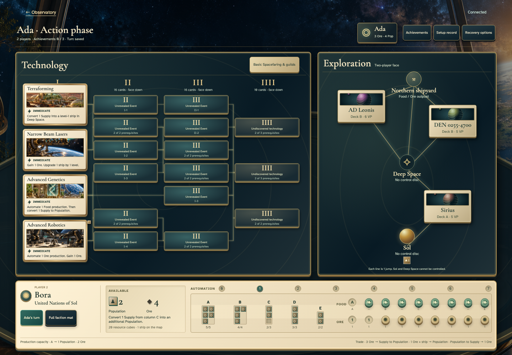](../../screenshots/auto-pass-optional-movement-after-decommissioning-the-last-ship-with-separate-controllers/028-prepare-1-handoff-phone-darwin.png) |  |

- [x] Bora completes ordinary production and hands off
- [x] Actual canonical effects and acknowledgement settle.
- [x] Public topology retains physical separation.
- [x] The viewport fits without page scrolling.

## 30. The next independent controller sees the saved handoff

Viewpoint: **Ada · separate host controller**.

| phone · 393 × 852 | desktop · 1440 × 1000 |
| --- | --- |
| [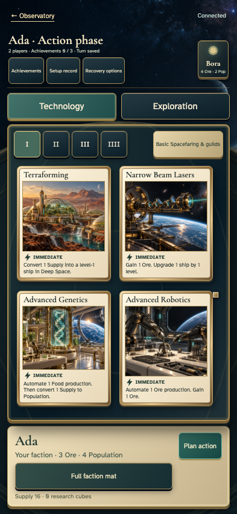](../../screenshots/auto-pass-optional-movement-after-decommissioning-the-last-ship-with-separate-controllers/029-prepare-1-next-phone-darwin.png) |  |

- [x] The next independent controller sees the saved handoff
- [x] Actual canonical effects and acknowledgement settle.
- [x] Public topology retains physical separation.
- [x] The viewport fits without page scrolling.

## 31. Ada opens the actual Action instrument

Viewpoint: **Ada · separate host controller**.

| phone · 393 × 852 | desktop · 1440 × 1000 |
| --- | --- |
| [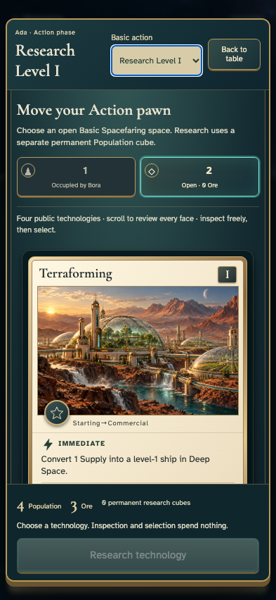](../../screenshots/auto-pass-optional-movement-after-decommissioning-the-last-ship-with-separate-controllers/030-empty-build-plan-phone-darwin.png) | [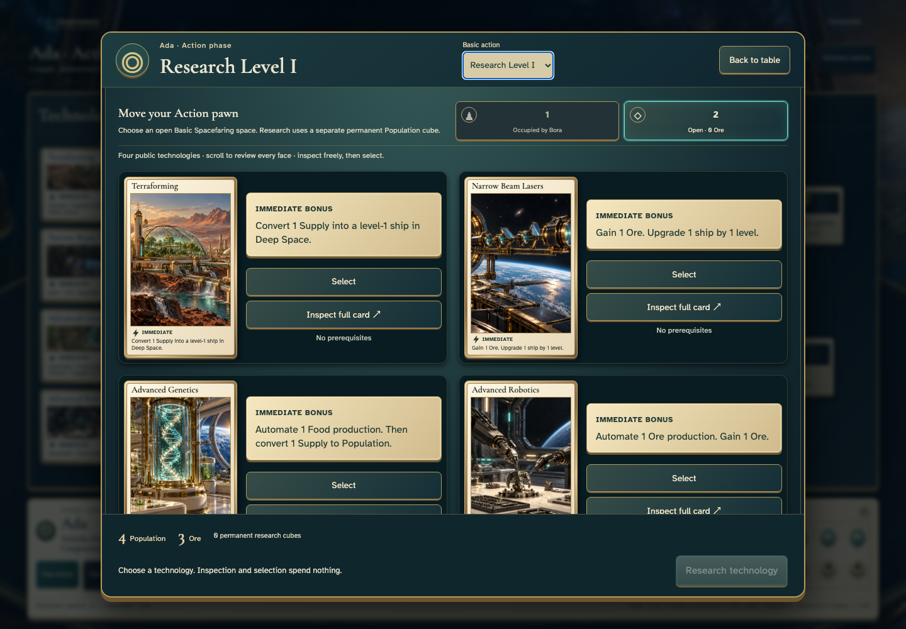](../../screenshots/auto-pass-optional-movement-after-decommissioning-the-last-ship-with-separate-controllers/030-empty-build-plan-desktop-darwin.png) |

- [x] Ada opens the actual Action instrument
- [x] Actual canonical effects and acknowledgement settle.
- [x] Public topology retains physical separation.
- [x] The viewport fits without page scrolling.

## 32. Ada selects Basic construction

Viewpoint: **Ada · separate host controller**.

| phone · 393 × 852 | desktop · 1440 × 1000 |
| --- | --- |
| [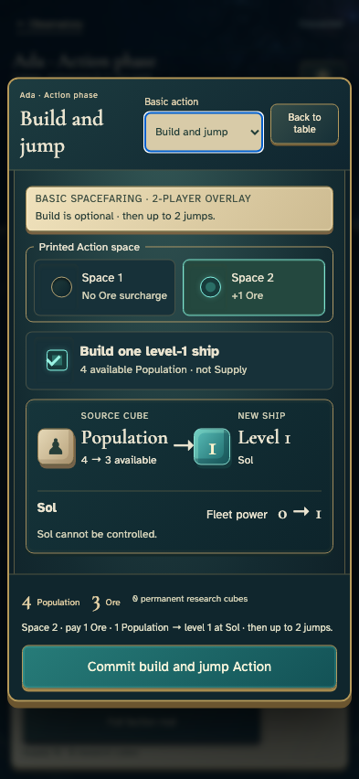](../../screenshots/auto-pass-optional-movement-after-decommissioning-the-last-ship-with-separate-controllers/031-empty-build-kind-phone-darwin.png) | [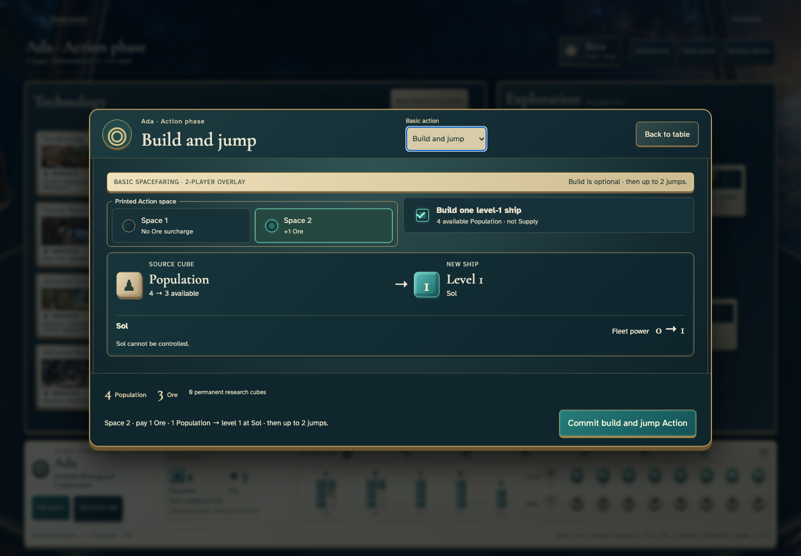](../../screenshots/auto-pass-optional-movement-after-decommissioning-the-last-ship-with-separate-controllers/031-empty-build-kind-desktop-darwin.png) |

- [x] Ada selects Basic construction
- [x] Actual canonical effects and acknowledgement settle.
- [x] Public topology retains physical separation.
- [x] The viewport fits without page scrolling.

## 33. Choose a valid printed construction space

Viewpoint: **Ada · separate host controller**.

| phone · 393 × 852 | desktop · 1440 × 1000 |
| --- | --- |
| [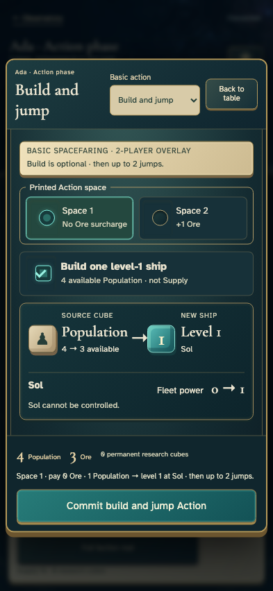](../../screenshots/auto-pass-optional-movement-after-decommissioning-the-last-ship-with-separate-controllers/032-empty-build-space-phone-darwin.png) | [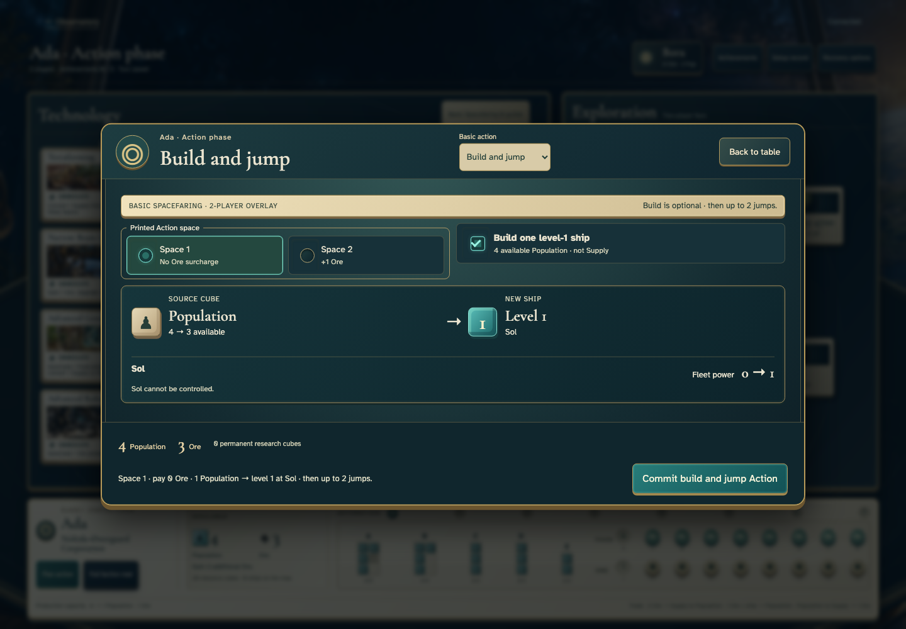](../../screenshots/auto-pass-optional-movement-after-decommissioning-the-last-ship-with-separate-controllers/032-empty-build-space-desktop-darwin.png) |

- [x] Choose a valid printed construction space
- [x] Actual canonical effects and acknowledgement settle.
- [x] Public topology retains physical separation.
- [x] The viewport fits without page scrolling.

## 34. Keep Population and build no replacement ship

Viewpoint: **Ada · separate host controller**.

| phone · 393 × 852 | desktop · 1440 × 1000 |
| --- | --- |
| [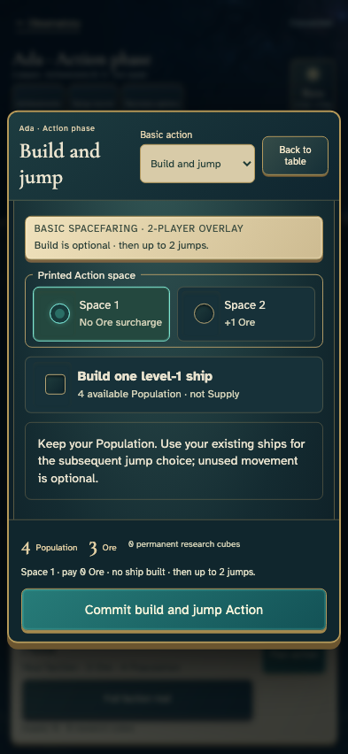](../../screenshots/auto-pass-optional-movement-after-decommissioning-the-last-ship-with-separate-controllers/033-empty-decline-build-phone-darwin.png) | [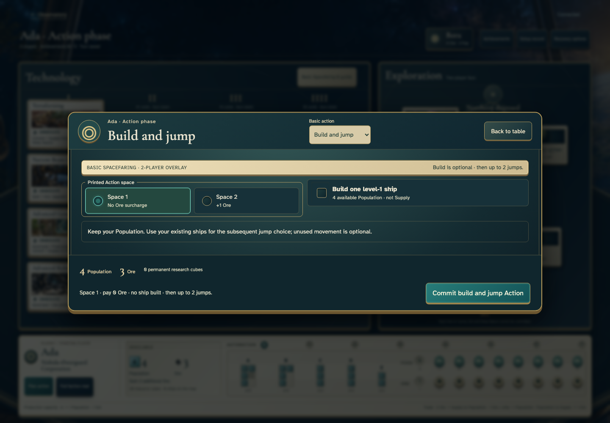](../../screenshots/auto-pass-optional-movement-after-decommissioning-the-last-ship-with-separate-controllers/033-empty-decline-build-desktop-darwin.png) |

- [x] Keep Population and build no replacement ship
- [x] Actual canonical effects and acknowledgement settle.
- [x] Public topology retains physical separation.
- [x] The viewport fits without page scrolling.

## 35. The original no-ship optional jump auto-passes to valid Production

Viewpoint: **Ada · separate host controller**.

| phone · 393 × 852 | desktop · 1440 × 1000 |
| --- | --- |
|  |  |

- [x] The original no-ship optional jump auto-passes to valid Production
- [x] Actual canonical effects and acknowledgement settle.
- [x] Public topology retains physical separation.
- [x] The viewport fits without page scrolling.

## 36. Reload retains saved Production

Viewpoint: **Ada · separate host controller**.

| phone · 393 × 852 | desktop · 1440 × 1000 |
| --- | --- |
|  |  |

- [x] Reload retains saved Production
- [x] Actual canonical effects and acknowledgement settle.
- [x] Public topology retains physical separation.
- [x] The viewport fits without page scrolling.

## 37. Resume without an artificial jump confirmation

Viewpoint: **Ada · separate host controller**.

| phone · 393 × 852 | desktop · 1440 × 1000 |
| --- | --- |
|  |  |

- [x] Resume without an artificial jump confirmation
- [x] Actual canonical effects and acknowledgement settle.
- [x] Public topology retains physical separation.
- [x] The viewport fits without page scrolling.

## 38. Close the decision to inspect the saved public fleet

Viewpoint: **Ada · separate host controller**.

| phone · 393 × 852 | desktop · 1440 × 1000 |
| --- | --- |
| [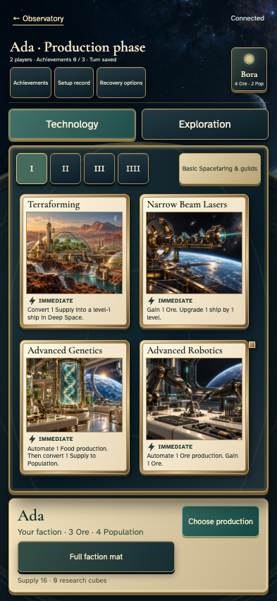](../../screenshots/auto-pass-optional-movement-after-decommissioning-the-last-ship-with-separate-controllers/037-fleet-board-phone-darwin.png) |  |

- [x] Close the decision to inspect the saved public fleet
- [x] Actual canonical effects and acknowledgement settle.
- [x] Public topology retains physical separation.
- [x] The viewport fits without page scrolling.

## 39. Open Ada’s real saved faction mat

Viewpoint: **Ada · separate host controller**.

| phone · 393 × 852 | desktop · 1440 × 1000 |
| --- | --- |
| [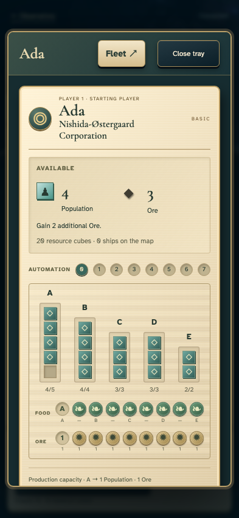](../../screenshots/auto-pass-optional-movement-after-decommissioning-the-last-ship-with-separate-controllers/038-fleet-mat-phone-darwin.png) | [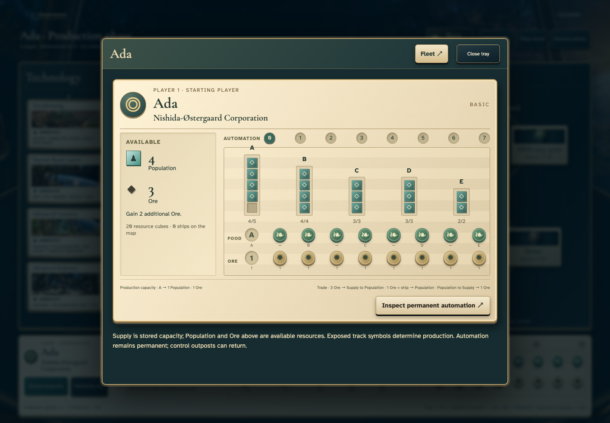](../../screenshots/auto-pass-optional-movement-after-decommissioning-the-last-ship-with-separate-controllers/038-fleet-mat-desktop-darwin.png) |

- [x] Open Ada’s real saved faction mat
- [x] Actual canonical effects and acknowledgement settle.
- [x] Public topology retains physical separation.
- [x] The viewport fits without page scrolling.

## 40. The actual retained fleet contains zero owned ships

Viewpoint: **Ada · separate host controller**.

| phone · 393 × 852 | desktop · 1440 × 1000 |
| --- | --- |
| [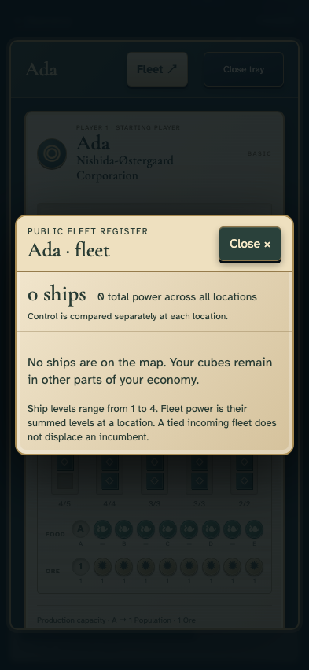](../../screenshots/auto-pass-optional-movement-after-decommissioning-the-last-ship-with-separate-controllers/039-fleet-count-phone-darwin.png) | [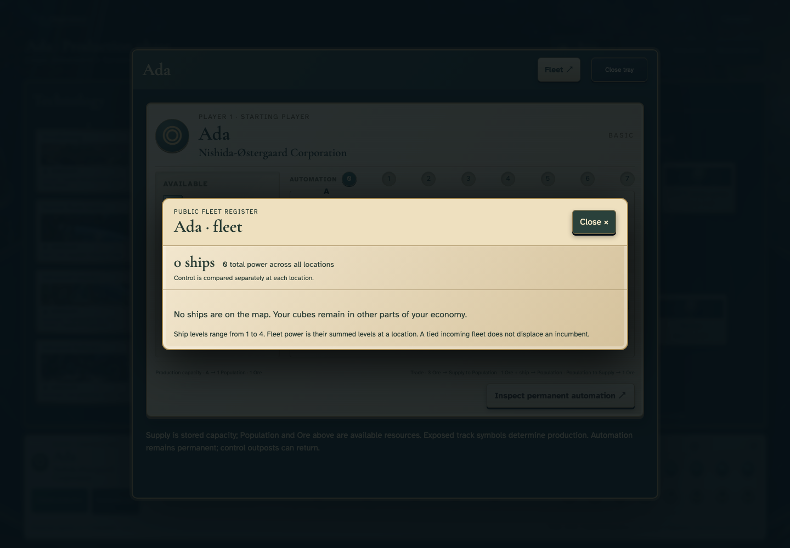](../../screenshots/auto-pass-optional-movement-after-decommissioning-the-last-ship-with-separate-controllers/039-fleet-count-desktop-darwin.png) |

- [x] The actual retained fleet contains zero owned ships
- [x] Actual canonical effects and acknowledgement settle.
- [x] Public topology retains physical separation.
- [x] The viewport fits without page scrolling.

## 41. Escape restores the actual Fleet opener

Viewpoint: **Ada · separate host controller**.

| phone · 393 × 852 | desktop · 1440 × 1000 |
| --- | --- |
| [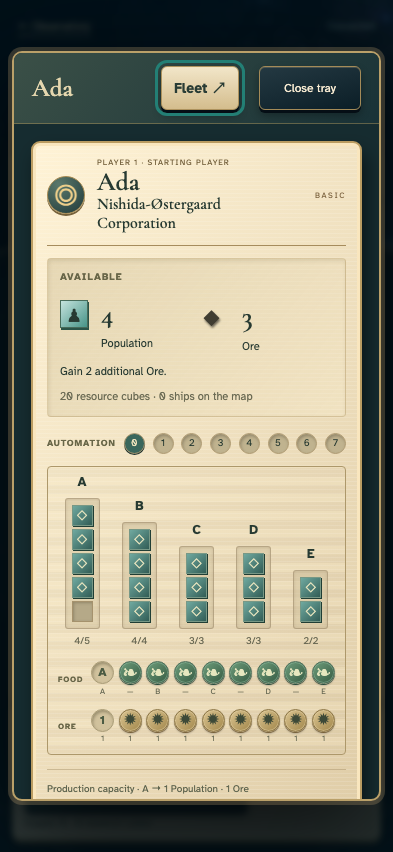](../../screenshots/auto-pass-optional-movement-after-decommissioning-the-last-ship-with-separate-controllers/040-fleet-focus-return-phone-darwin.png) | [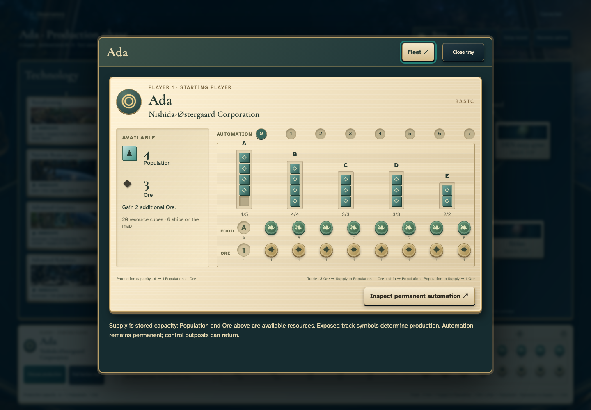](../../screenshots/auto-pass-optional-movement-after-decommissioning-the-last-ship-with-separate-controllers/040-fleet-focus-return-desktop-darwin.png) |

- [x] Escape restores the actual Fleet opener
- [x] Actual canonical effects and acknowledgement settle.
- [x] Public topology retains physical separation.
- [x] The viewport fits without page scrolling.

## 42. Close the mat without taking a turn

Viewpoint: **Ada · separate host controller**.

| phone · 393 × 852 | desktop · 1440 × 1000 |
| --- | --- |
| [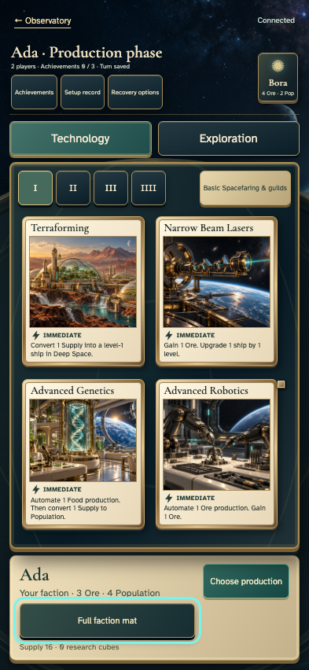](../../screenshots/auto-pass-optional-movement-after-decommissioning-the-last-ship-with-separate-controllers/041-fleet-mat-return-phone-darwin.png) | [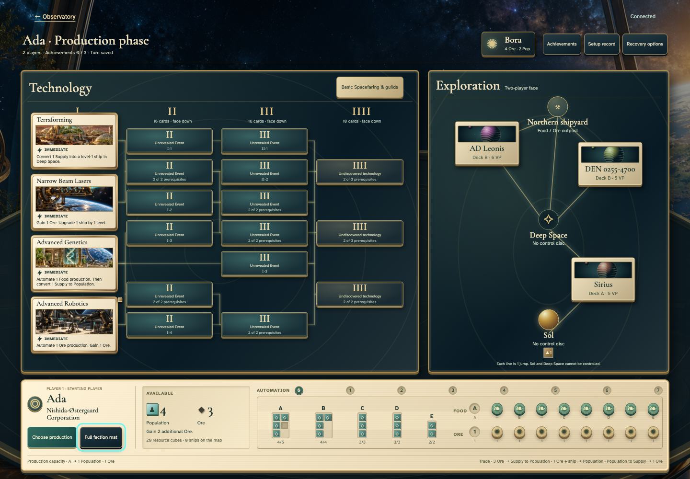](../../screenshots/auto-pass-optional-movement-after-decommissioning-the-last-ship-with-separate-controllers/041-fleet-mat-return-desktop-darwin.png) |

- [x] Close the mat without taking a turn
- [x] Actual canonical effects and acknowledgement settle.
- [x] Public topology retains physical separation.
- [x] The viewport fits without page scrolling.

## 43. Resume the same saved Production decision

Viewpoint: **Ada · separate host controller**.

| phone · 393 × 852 | desktop · 1440 × 1000 |
| --- | --- |
|  |  |

- [x] Resume the same saved Production decision
- [x] Actual canonical effects and acknowledgement settle.
- [x] Public topology retains physical separation.
- [x] The viewport fits without page scrolling.

## 44. Ada completes ordinary production and hands off

Viewpoint: **Ada · separate host controller**.

| phone · 393 × 852 | desktop · 1440 × 1000 |
| --- | --- |
|  |  |

- [x] Ada completes ordinary production and hands off
- [x] Actual canonical effects and acknowledgement settle.
- [x] Public topology retains physical separation.
- [x] The viewport fits without page scrolling.

## 45. The next independent controller sees the saved handoff

Viewpoint: **Bora · separate guest controller**.

| phone · 1440 × 1000 | desktop · 393 × 852 |
| --- | --- |
|  |  |

- [x] The next independent controller sees the saved handoff
- [x] Actual canonical effects and acknowledgement settle.
- [x] Public topology retains physical separation.
- [x] The viewport fits without page scrolling.
