# Plan a mandatory printed four-jump route with separate controllers

Ordinary named legal Basic setup and real preparatory turns. Fixed initial setup entropy55555555-5555-4555-8555-000000000002; command identities separate stories, no state injection or future-deck reads. Remote players have separate identities; tabletop has one shared controller. Source inspection, unpaid recovery, simultaneous endpoints and handoff use production UI.

## 1. Arrive using the actual production client

Viewpoint: **Ada · separate host controller**.

| phone · 393 × 852 | desktop · 1440 × 1000 |
| --- | --- |
|  |  |

- [x] Arrive using the actual production client
- [x] Actual canonical effects and acknowledgement settle.
- [x] Public topology retains physical separation.
- [x] The viewport fits without page scrolling.

## 2. Choose a real production play mode

Viewpoint: **Ada · separate host controller**.

| phone · 393 × 852 | desktop · 1440 × 1000 |
| --- | --- |
|  |  |

- [x] Choose a real production play mode
- [x] Actual canonical effects and acknowledgement settle.
- [x] Public topology retains physical separation.
- [x] The viewport fits without page scrolling.

## 3. Create an independent remote host controller

Viewpoint: **Ada · separate host controller**.

| phone · 393 × 852 | desktop · 1440 × 1000 |
| --- | --- |
|  | [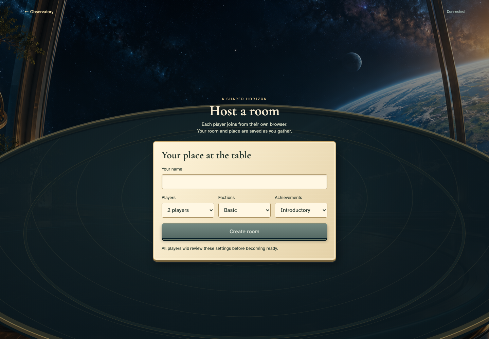](../../screenshots/plan-a-mandatory-printed-four-jump-route-with-separate-controllers/002-host-form-desktop-darwin.png) |

- [x] Create an independent remote host controller
- [x] Actual canonical effects and acknowledgement settle.
- [x] Public topology retains physical separation.
- [x] The viewport fits without page scrolling.

## 4. Name the host Ada

Viewpoint: **Ada · separate host controller**.

| phone · 393 × 852 | desktop · 1440 × 1000 |
| --- | --- |
|  |  |

- [x] Name the host Ada
- [x] Actual canonical effects and acknowledgement settle.
- [x] Public topology retains physical separation.
- [x] The viewport fits without page scrolling.

## 5. The canonical remote room exposes its actual invitation code

Viewpoint: **Ada · separate host controller**.

| phone · 393 × 852 | desktop · 1440 × 1000 |
| --- | --- |
| [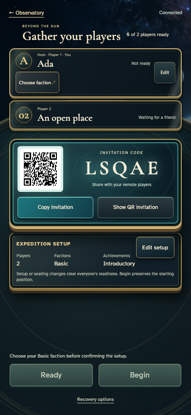](../../screenshots/plan-a-mandatory-printed-four-jump-route-with-separate-controllers/004-host-room-phone-darwin.png) | [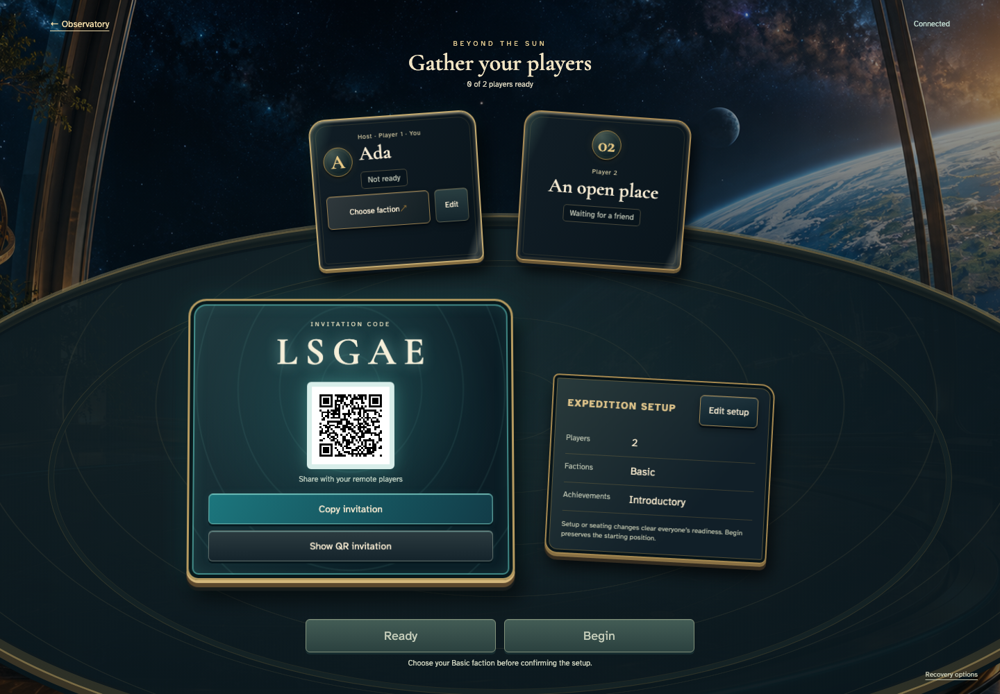](../../screenshots/plan-a-mandatory-printed-four-jump-route-with-separate-controllers/004-host-room-desktop-darwin.png) |

- [x] The canonical remote room exposes its actual invitation code
- [x] Actual canonical effects and acknowledgement settle.
- [x] Public topology retains physical separation.
- [x] The viewport fits without page scrolling.

## 6. A different identity previews the public invitation

Viewpoint: **Bora · separate guest controller**.

| phone · 1440 × 1000 | desktop · 393 × 852 |
| --- | --- |
| [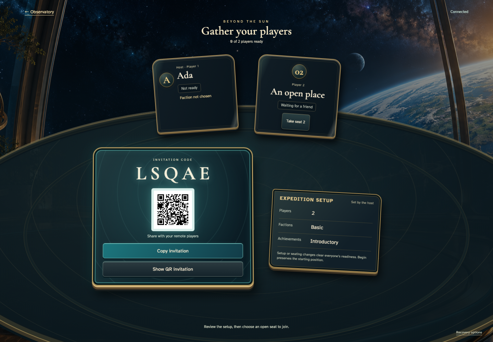](../../screenshots/plan-a-mandatory-printed-four-jump-route-with-separate-controllers/005-guest-preview-phone-darwin.png) | [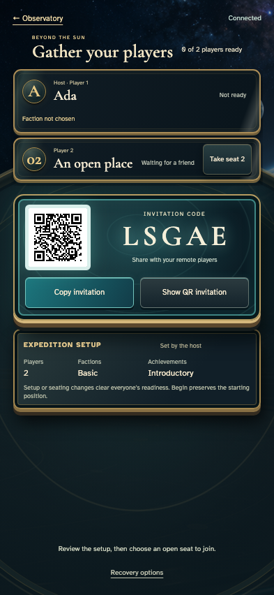](../../screenshots/plan-a-mandatory-printed-four-jump-route-with-separate-controllers/005-guest-preview-desktop-darwin.png) |

- [x] A different identity previews the public invitation
- [x] Actual canonical effects and acknowledgement settle.
- [x] Public topology retains physical separation.
- [x] The viewport fits without page scrolling.

## 7. The guest claims only the remote seat

Viewpoint: **Bora · separate guest controller**.

| phone · 1440 × 1000 | desktop · 393 × 852 |
| --- | --- |
| [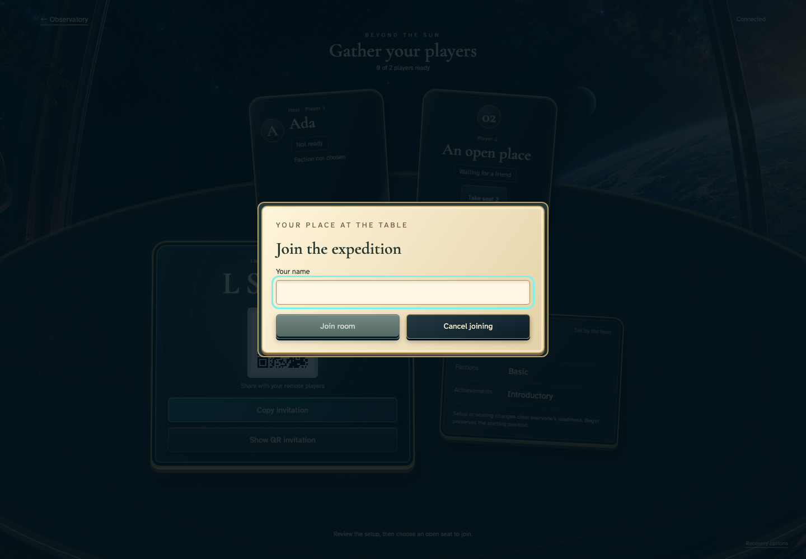](../../screenshots/plan-a-mandatory-printed-four-jump-route-with-separate-controllers/006-guest-editor-phone-darwin.png) |  |

- [x] The guest claims only the remote seat
- [x] Actual canonical effects and acknowledgement settle.
- [x] Public topology retains physical separation.
- [x] The viewport fits without page scrolling.

## 8. Name the independent guest Bora

Viewpoint: **Bora · separate guest controller**.

| phone · 1440 × 1000 | desktop · 393 × 852 |
| --- | --- |
| [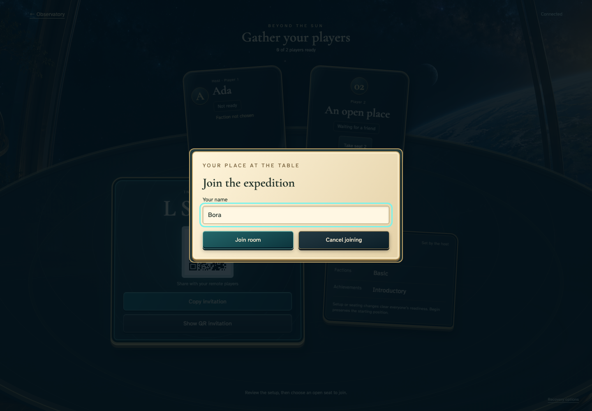](../../screenshots/plan-a-mandatory-printed-four-jump-route-with-separate-controllers/007-guest-name-phone-darwin.png) | [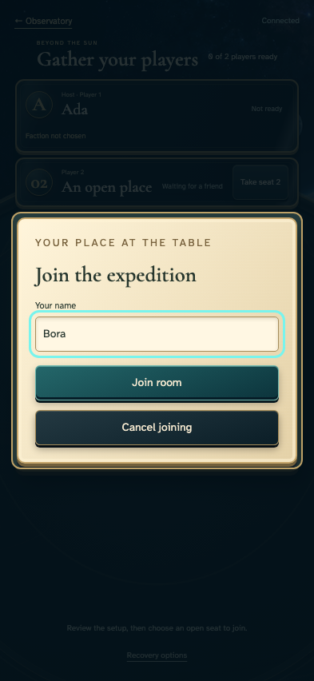](../../screenshots/plan-a-mandatory-printed-four-jump-route-with-separate-controllers/007-guest-name-desktop-darwin.png) |

- [x] Name the independent guest Bora
- [x] Actual canonical effects and acknowledgement settle.
- [x] Public topology retains physical separation.
- [x] The viewport fits without page scrolling.

## 9. Both named remote identities share the same room

Viewpoint: **Bora · separate guest controller**.

| phone · 1440 × 1000 | desktop · 393 × 852 |
| --- | --- |
| [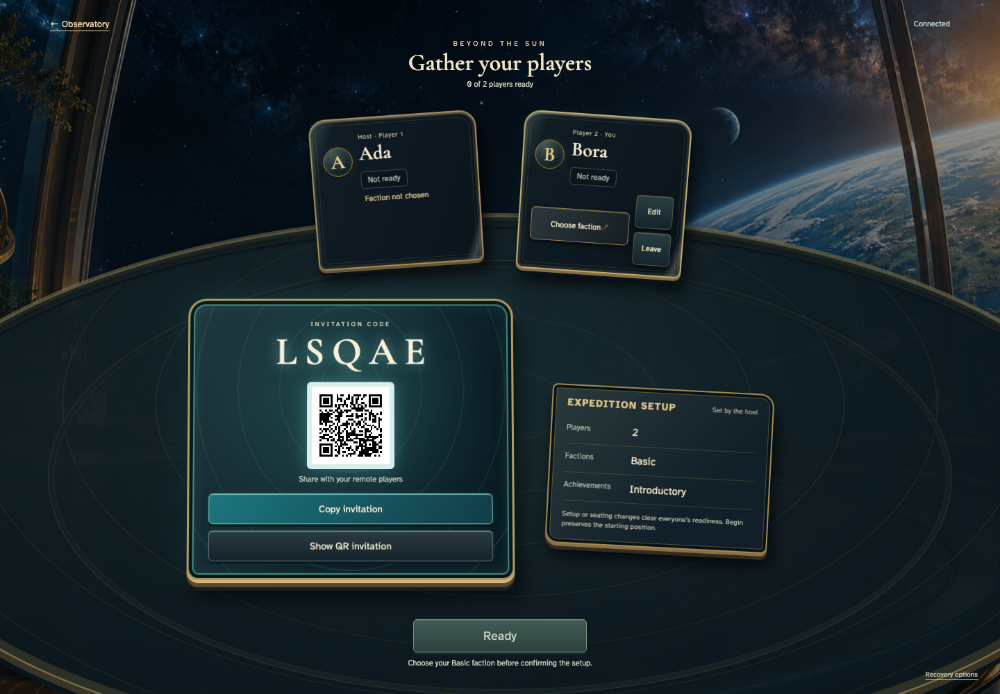](../../screenshots/plan-a-mandatory-printed-four-jump-route-with-separate-controllers/008-guest-joined-phone-darwin.png) | [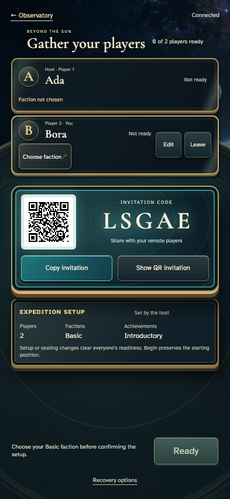](../../screenshots/plan-a-mandatory-printed-four-jump-route-with-separate-controllers/008-guest-joined-desktop-darwin.png) |

- [x] Both named remote identities share the same room
- [x] Actual canonical effects and acknowledgement settle.
- [x] Public topology retains physical separation.
- [x] The viewport fits without page scrolling.

## 10. Ada chooses a legal unique Basic faction

Viewpoint: **Ada · separate host controller**.

| phone · 393 × 852 | desktop · 1440 × 1000 |
| --- | --- |
|  |  |

- [x] Ada chooses a legal unique Basic faction
- [x] Actual canonical effects and acknowledgement settle.
- [x] Public topology retains physical separation.
- [x] The viewport fits without page scrolling.

## 11. Ada retains Nishida-Østergaard Corporation

Viewpoint: **Ada · separate host controller**.

| phone · 393 × 852 | desktop · 1440 × 1000 |
| --- | --- |
| [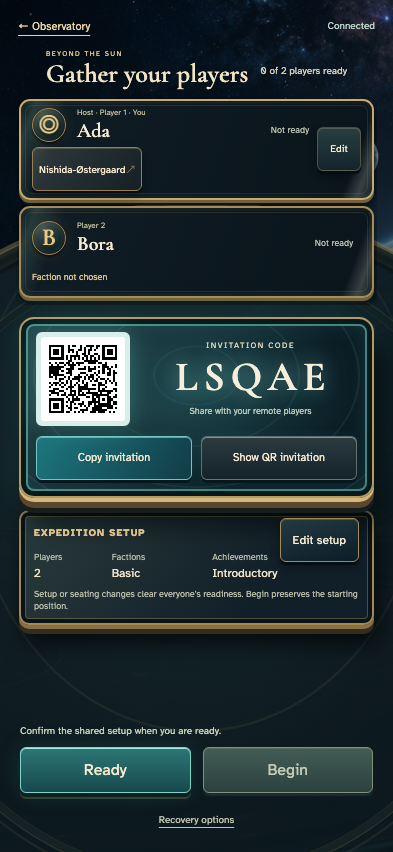](../../screenshots/plan-a-mandatory-printed-four-jump-route-with-separate-controllers/010-faction-0-chosen-phone-darwin.png) | [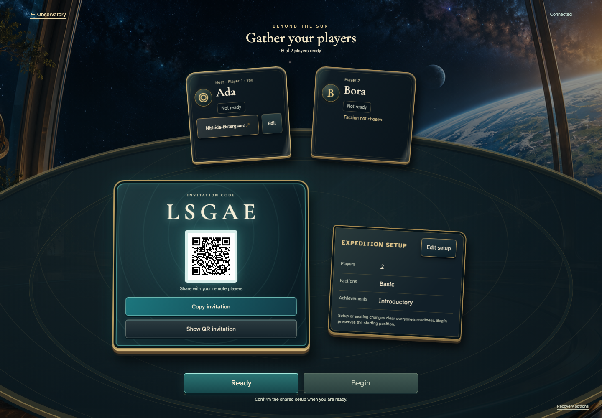](../../screenshots/plan-a-mandatory-printed-four-jump-route-with-separate-controllers/010-faction-0-chosen-desktop-darwin.png) |

- [x] Ada retains Nishida-Østergaard Corporation
- [x] Actual canonical effects and acknowledgement settle.
- [x] Public topology retains physical separation.
- [x] The viewport fits without page scrolling.

## 12. Bora chooses a legal unique Basic faction

Viewpoint: **Bora · separate guest controller**.

| phone · 1440 × 1000 | desktop · 393 × 852 |
| --- | --- |
|  |  |

- [x] Bora chooses a legal unique Basic faction
- [x] Actual canonical effects and acknowledgement settle.
- [x] Public topology retains physical separation.
- [x] The viewport fits without page scrolling.

## 13. Bora retains United Nations of Sol

Viewpoint: **Bora · separate guest controller**.

| phone · 1440 × 1000 | desktop · 393 × 852 |
| --- | --- |
|  | [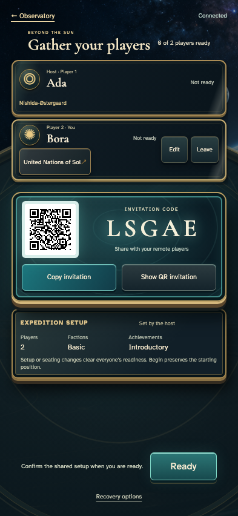](../../screenshots/plan-a-mandatory-printed-four-jump-route-with-separate-controllers/012-faction-1-chosen-desktop-darwin.png) |

- [x] Bora retains United Nations of Sol
- [x] Actual canonical effects and acknowledgement settle.
- [x] Public topology retains physical separation.
- [x] The viewport fits without page scrolling.

## 14. Confirm this identity is ready for the exact saved configuration

Viewpoint: **Bora · separate guest controller**.

| phone · 1440 × 1000 | desktop · 393 × 852 |
| --- | --- |
| [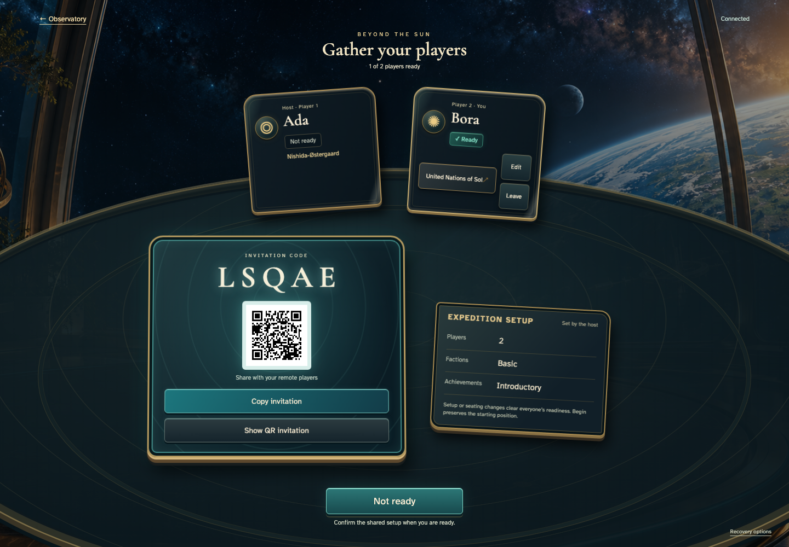](../../screenshots/plan-a-mandatory-printed-four-jump-route-with-separate-controllers/013-ready-1-phone-darwin.png) | [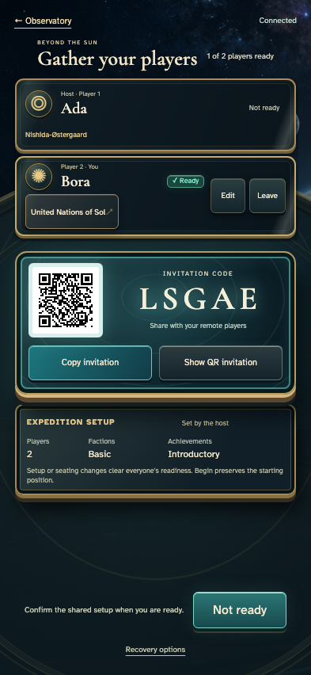](../../screenshots/plan-a-mandatory-printed-four-jump-route-with-separate-controllers/013-ready-1-desktop-darwin.png) |

- [x] Confirm this identity is ready for the exact saved configuration
- [x] Actual canonical effects and acknowledgement settle.
- [x] Public topology retains physical separation.
- [x] The viewport fits without page scrolling.

## 15. Confirm this identity is ready for the exact saved configuration

Viewpoint: **Ada · separate host controller**.

| phone · 393 × 852 | desktop · 1440 × 1000 |
| --- | --- |
| [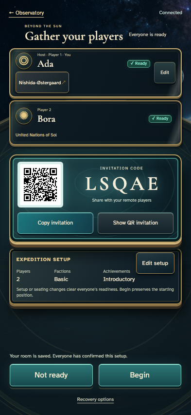](../../screenshots/plan-a-mandatory-printed-four-jump-route-with-separate-controllers/014-ready-0-phone-darwin.png) |  |

- [x] Confirm this identity is ready for the exact saved configuration
- [x] Actual canonical effects and acknowledgement settle.
- [x] Public topology retains physical separation.
- [x] The viewport fits without page scrolling.

## 16. Begin the immutable source-reviewed Basic setup through the ordinary UI

Viewpoint: **Ada · separate host controller**.

| phone · 393 × 852 | desktop · 1440 × 1000 |
| --- | --- |
|  |  |

- [x] Begin the immutable source-reviewed Basic setup through the ordinary UI
- [x] Actual canonical effects and acknowledgement settle.
- [x] Public topology retains physical separation.
- [x] The viewport fits without page scrolling.

## 17. Ada opens the actual Action instrument

Viewpoint: **Ada · separate host controller**.

| phone · 393 × 852 | desktop · 1440 × 1000 |
| --- | --- |
|  |  |

- [x] Ada opens the actual Action instrument
- [x] Actual canonical effects and acknowledgement settle.
- [x] Public topology retains physical separation.
- [x] The viewport fits without page scrolling.

## 18. Ada chooses the unoccupied printed research space

Viewpoint: **Ada · separate host controller**.

| phone · 393 × 852 | desktop · 1440 × 1000 |
| --- | --- |
|  |  |

- [x] Ada chooses the unoccupied printed research space
- [x] Actual canonical effects and acknowledgement settle.
- [x] Public topology retains physical separation.
- [x] The viewport fits without page scrolling.

## 19. Choose the public Terraforming face and read its printed effect

Viewpoint: **Ada · separate host controller**.

| phone · 393 × 852 | desktop · 1440 × 1000 |
| --- | --- |
| [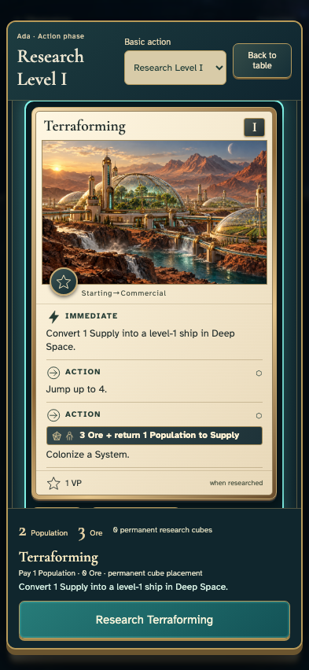](../../screenshots/plan-a-mandatory-printed-four-jump-route-with-separate-controllers/018-ada-prepare-card-phone-darwin.png) | [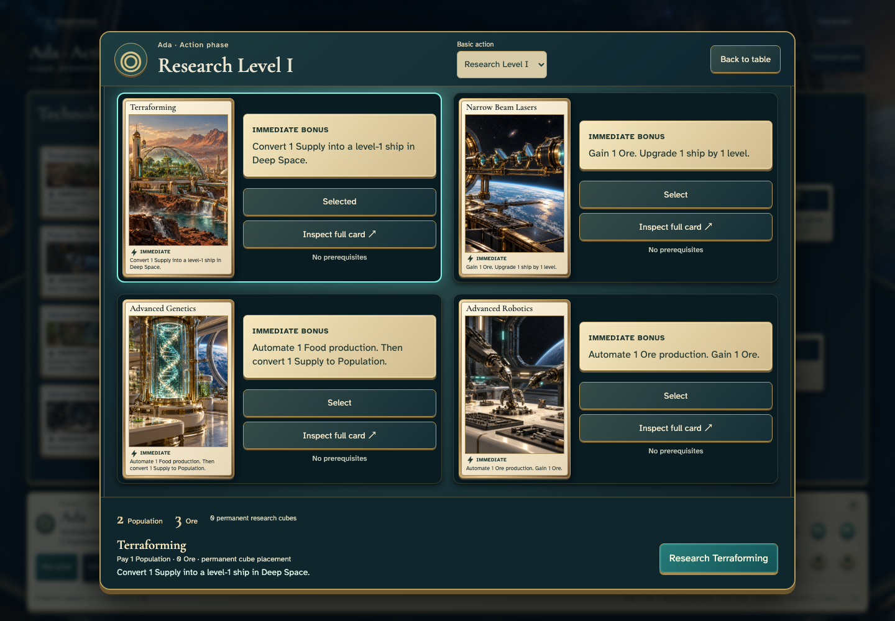](../../screenshots/plan-a-mandatory-printed-four-jump-route-with-separate-controllers/018-ada-prepare-card-desktop-darwin.png) |

- [x] Choose the public Terraforming face and read its printed effect
- [x] Actual canonical effects and acknowledgement settle.
- [x] Public topology retains physical separation.
- [x] The viewport fits without page scrolling.

## 20. Ada pays permanent research Population and resolves the printed bonus

Viewpoint: **Ada · separate host controller**.

| phone · 393 × 852 | desktop · 1440 × 1000 |
| --- | --- |
| [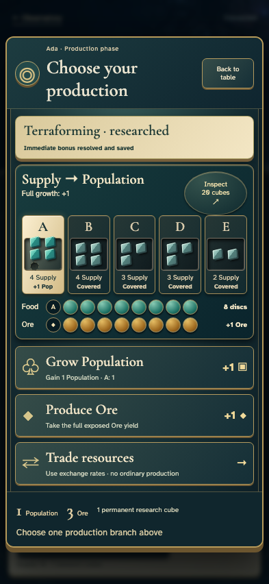](../../screenshots/plan-a-mandatory-printed-four-jump-route-with-separate-controllers/019-ada-prepare-paid-phone-darwin.png) |  |

- [x] Ada pays permanent research Population and resolves the printed bonus
- [x] Actual canonical effects and acknowledgement settle.
- [x] Public topology retains physical separation.
- [x] The viewport fits without page scrolling.

## 21. Ada completes ordinary production and hands off

Viewpoint: **Ada · separate host controller**.

| phone · 393 × 852 | desktop · 1440 × 1000 |
| --- | --- |
|  |  |

- [x] Ada completes ordinary production and hands off
- [x] Actual canonical effects and acknowledgement settle.
- [x] Public topology retains physical separation.
- [x] The viewport fits without page scrolling.

## 22. The next independent controller sees the saved handoff

Viewpoint: **Bora · separate guest controller**.

| phone · 1440 × 1000 | desktop · 393 × 852 |
| --- | --- |
| [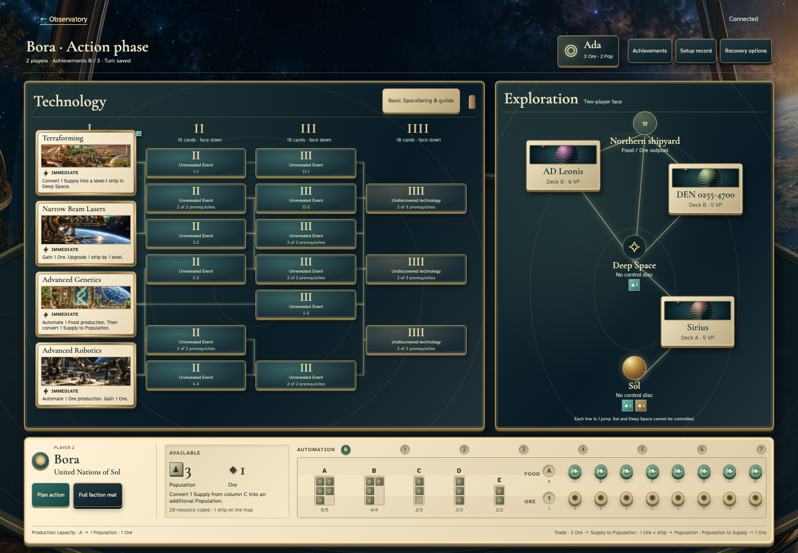](../../screenshots/plan-a-mandatory-printed-four-jump-route-with-separate-controllers/021-ada-prepare-next-phone-darwin.png) | [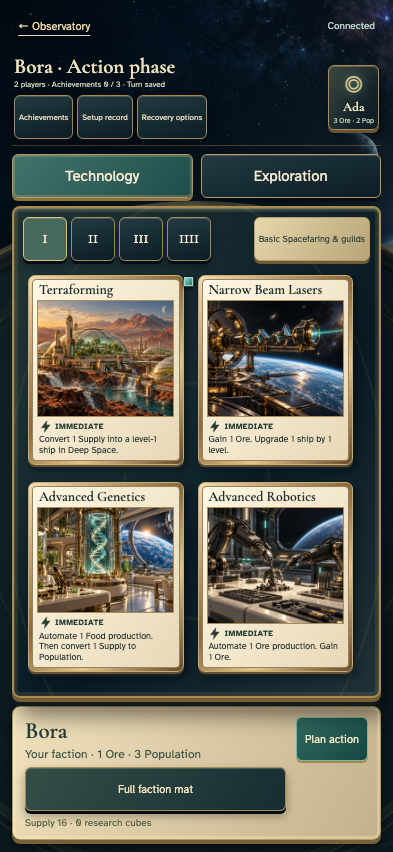](../../screenshots/plan-a-mandatory-printed-four-jump-route-with-separate-controllers/021-ada-prepare-next-desktop-darwin.png) |

- [x] The next independent controller sees the saved handoff
- [x] Actual canonical effects and acknowledgement settle.
- [x] Public topology retains physical separation.
- [x] The viewport fits without page scrolling.

## 23. Bora opens the actual Action instrument

Viewpoint: **Bora · separate guest controller**.

| phone · 1440 × 1000 | desktop · 393 × 852 |
| --- | --- |
|  | [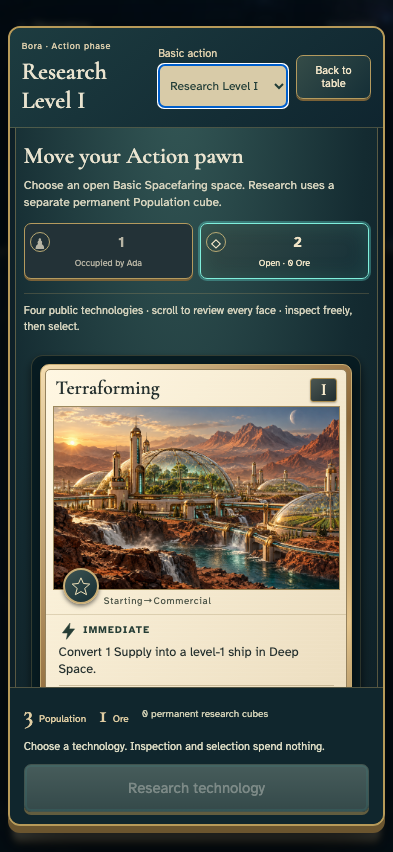](../../screenshots/plan-a-mandatory-printed-four-jump-route-with-separate-controllers/022-prepare-1-plan-desktop-darwin.png) |

- [x] Bora opens the actual Action instrument
- [x] Actual canonical effects and acknowledgement settle.
- [x] Public topology retains physical separation.
- [x] The viewport fits without page scrolling.

## 24. Bora chooses the unoccupied printed research space

Viewpoint: **Bora · separate guest controller**.

| phone · 1440 × 1000 | desktop · 393 × 852 |
| --- | --- |
|  | [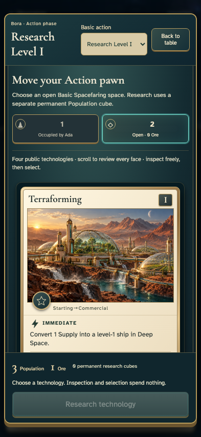](../../screenshots/plan-a-mandatory-printed-four-jump-route-with-separate-controllers/023-prepare-1-space-desktop-darwin.png) |

- [x] Bora chooses the unoccupied printed research space
- [x] Actual canonical effects and acknowledgement settle.
- [x] Public topology retains physical separation.
- [x] The viewport fits without page scrolling.

## 25. Choose the public Advanced Robotics face and read its printed effect

Viewpoint: **Bora · separate guest controller**.

| phone · 1440 × 1000 | desktop · 393 × 852 |
| --- | --- |
| [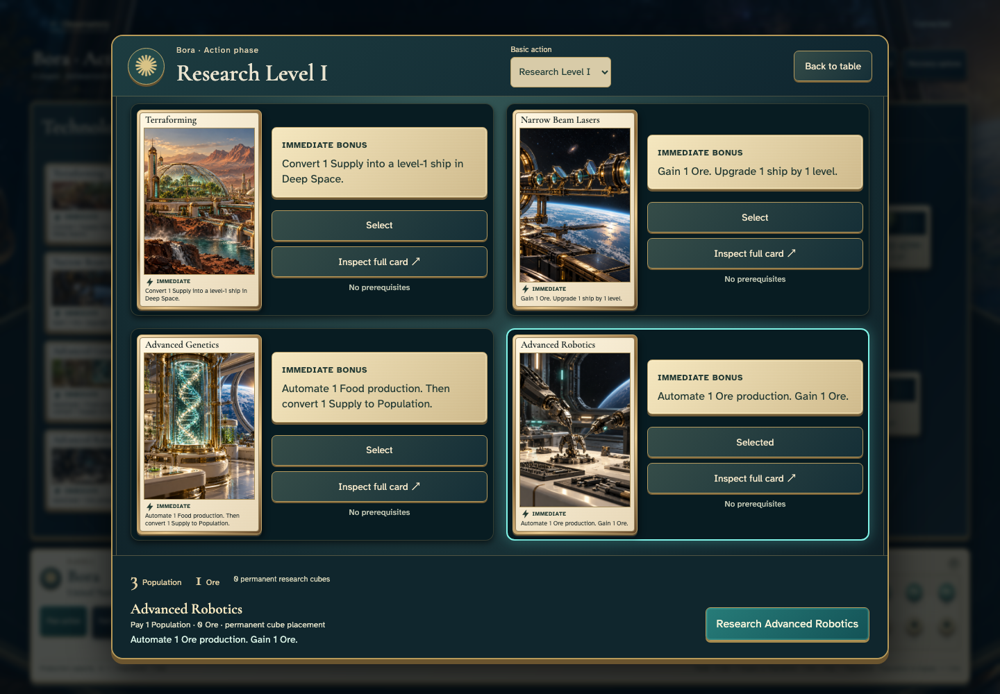](../../screenshots/plan-a-mandatory-printed-four-jump-route-with-separate-controllers/024-prepare-1-card-phone-darwin.png) | [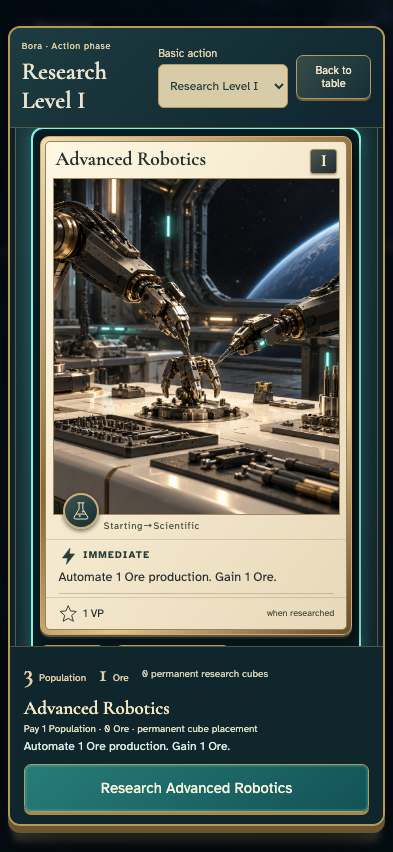](../../screenshots/plan-a-mandatory-printed-four-jump-route-with-separate-controllers/024-prepare-1-card-desktop-darwin.png) |

- [x] Choose the public Advanced Robotics face and read its printed effect
- [x] Actual canonical effects and acknowledgement settle.
- [x] Public topology retains physical separation.
- [x] The viewport fits without page scrolling.

## 26. Bora pays permanent research Population and resolves the printed bonus

Viewpoint: **Bora · separate guest controller**.

| phone · 1440 × 1000 | desktop · 393 × 852 |
| --- | --- |
| [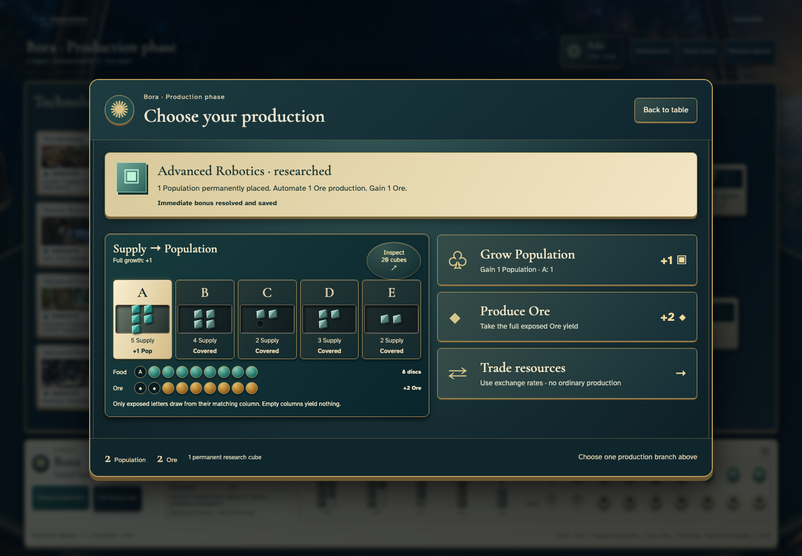](../../screenshots/plan-a-mandatory-printed-four-jump-route-with-separate-controllers/025-prepare-1-paid-phone-darwin.png) | [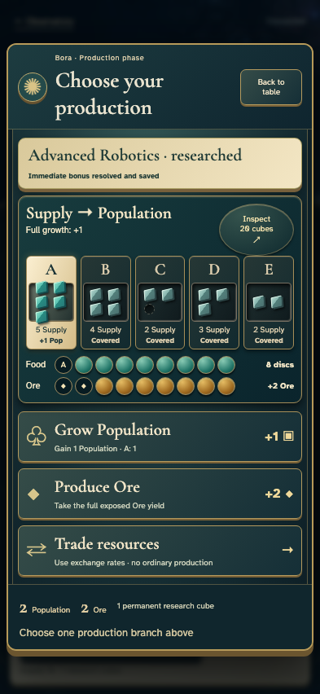](../../screenshots/plan-a-mandatory-printed-four-jump-route-with-separate-controllers/025-prepare-1-paid-desktop-darwin.png) |

- [x] Bora pays permanent research Population and resolves the printed bonus
- [x] Actual canonical effects and acknowledgement settle.
- [x] Public topology retains physical separation.
- [x] The viewport fits without page scrolling.

## 27. Bora completes ordinary production and hands off

Viewpoint: **Bora · separate guest controller**.

| phone · 1440 × 1000 | desktop · 393 × 852 |
| --- | --- |
| [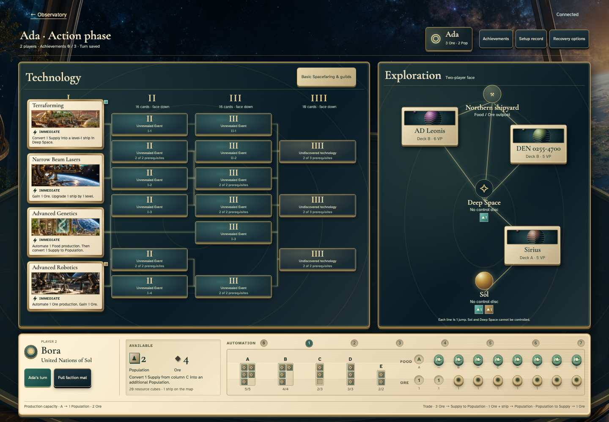](../../screenshots/plan-a-mandatory-printed-four-jump-route-with-separate-controllers/026-prepare-1-handoff-phone-darwin.png) | [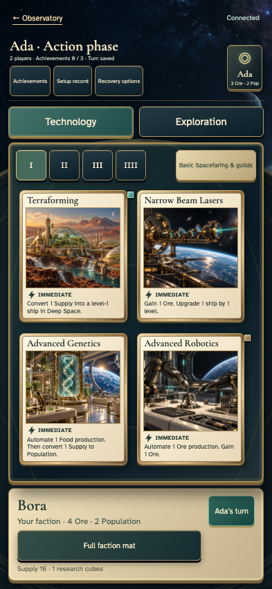](../../screenshots/plan-a-mandatory-printed-four-jump-route-with-separate-controllers/026-prepare-1-handoff-desktop-darwin.png) |

- [x] Bora completes ordinary production and hands off
- [x] Actual canonical effects and acknowledgement settle.
- [x] Public topology retains physical separation.
- [x] The viewport fits without page scrolling.

## 28. The next independent controller sees the saved handoff

Viewpoint: **Ada · separate host controller**.

| phone · 393 × 852 | desktop · 1440 × 1000 |
| --- | --- |
|  |  |

- [x] The next independent controller sees the saved handoff
- [x] Actual canonical effects and acknowledgement settle.
- [x] Public topology retains physical separation.
- [x] The viewport fits without page scrolling.

## 29. Ada opens the actual Action instrument

Viewpoint: **Ada · separate host controller**.

| phone · 393 × 852 | desktop · 1440 × 1000 |
| --- | --- |
| [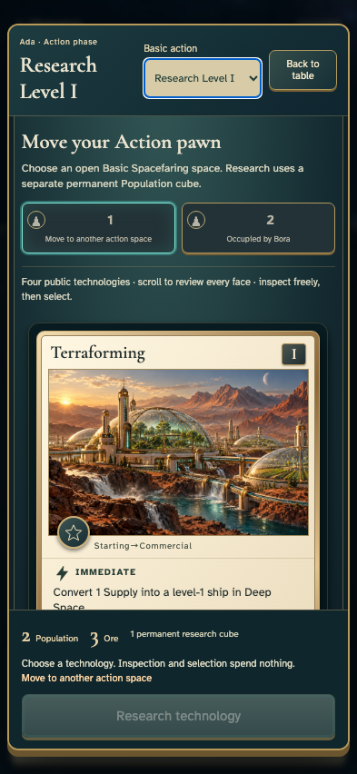](../../screenshots/plan-a-mandatory-printed-four-jump-route-with-separate-controllers/028-jump-action-plan-phone-darwin.png) | [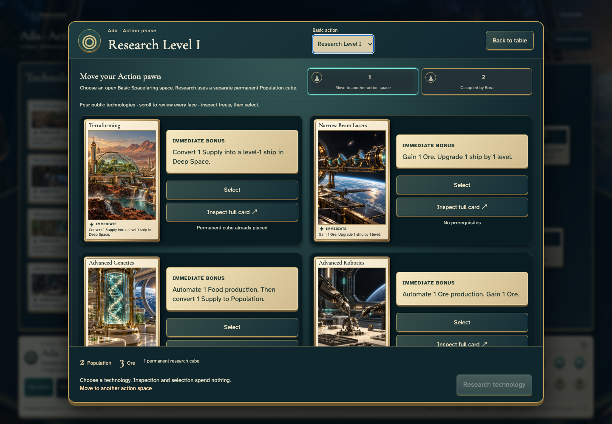](../../screenshots/plan-a-mandatory-printed-four-jump-route-with-separate-controllers/028-jump-action-plan-desktop-darwin.png) |

- [x] Ada opens the actual Action instrument
- [x] Actual canonical effects and acknowledgement settle.
- [x] Public topology retains physical separation.
- [x] The viewport fits without page scrolling.

## 30. Ada selects a printed Technology Action

Viewpoint: **Ada · separate host controller**.

| phone · 393 × 852 | desktop · 1440 × 1000 |
| --- | --- |
| [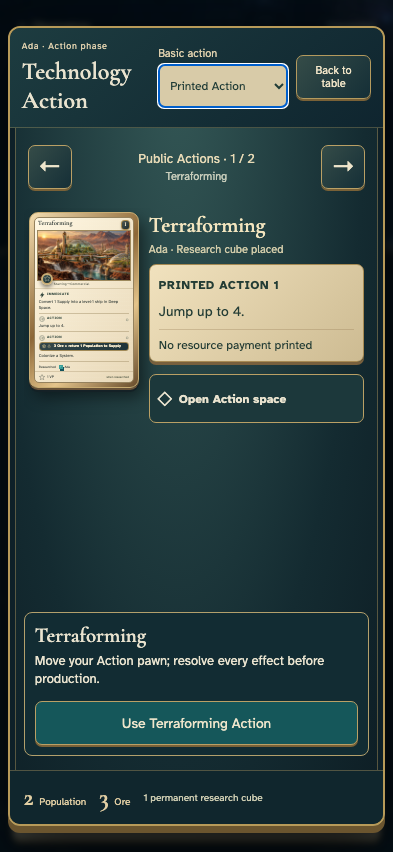](../../screenshots/plan-a-mandatory-printed-four-jump-route-with-separate-controllers/029-jump-action-kind-phone-darwin.png) | [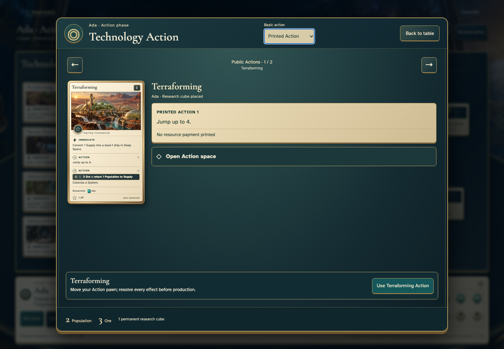](../../screenshots/plan-a-mandatory-printed-four-jump-route-with-separate-controllers/029-jump-action-kind-desktop-darwin.png) |

- [x] Ada selects a printed Technology Action
- [x] Actual canonical effects and acknowledgement settle.
- [x] Public topology retains physical separation.
- [x] The viewport fits without page scrolling.

## 31. Read the actual printed movement allowance and payment

Viewpoint: **Ada · separate host controller**.

| phone · 393 × 852 | desktop · 1440 × 1000 |
| --- | --- |
|  |  |

- [x] Read the actual printed movement allowance and payment
- [x] Actual canonical effects and acknowledgement settle.
- [x] Public topology retains physical separation.
- [x] The viewport fits without page scrolling.

## 32. Open simultaneous movement after canonical payment

Viewpoint: **Ada · separate host controller**.

| phone · 393 × 852 | desktop · 1440 × 1000 |
| --- | --- |
|  |  |

- [x] Open simultaneous movement after canonical payment
- [x] Actual canonical effects and acknowledgement settle.
- [x] Public topology retains physical separation.
- [x] The viewport fits without page scrolling.

## 33. The independent observer reads the decision without actor authority

Viewpoint: **Bora · separate guest controller**.

| phone · 1440 × 1000 | desktop · 393 × 852 |
| --- | --- |
| [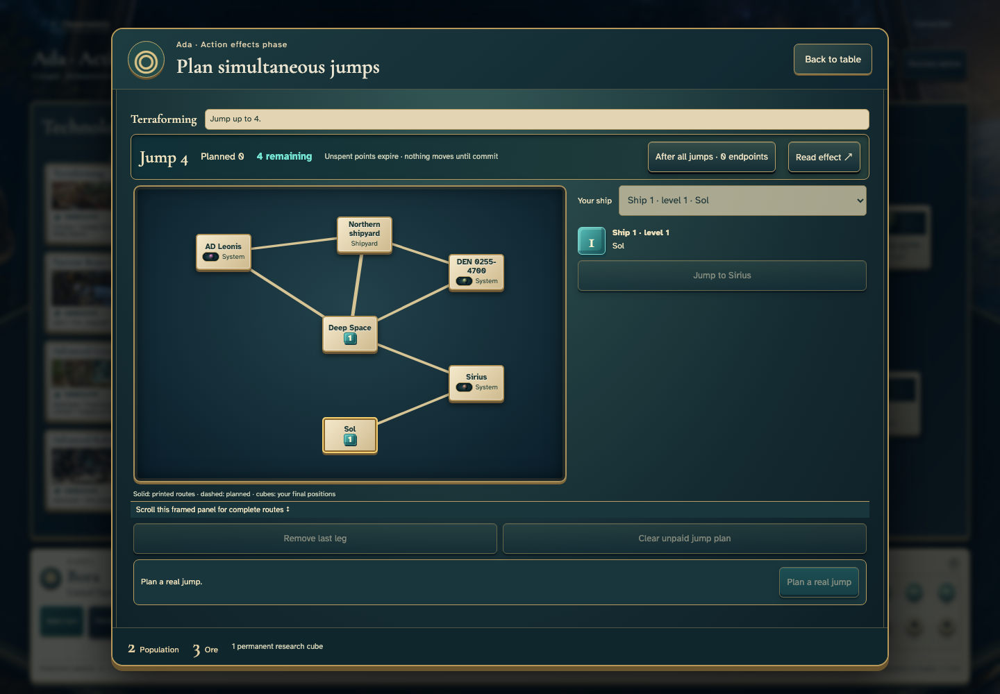](../../screenshots/plan-a-mandatory-printed-four-jump-route-with-separate-controllers/032-jump-observer-phone-darwin.png) | [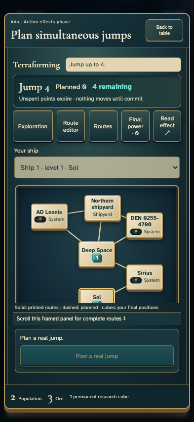](../../screenshots/plan-a-mandatory-printed-four-jump-route-with-separate-controllers/032-jump-observer-desktop-darwin.png) |

- [x] The independent observer reads the decision without actor authority
- [x] Actual canonical effects and acknowledgement settle.
- [x] Public topology retains physical separation.
- [x] The viewport fits without page scrolling.

## 34. Observer returns to their public board

Viewpoint: **Bora · separate guest controller**.

| phone · 1440 × 1000 | desktop · 393 × 852 |
| --- | --- |
| [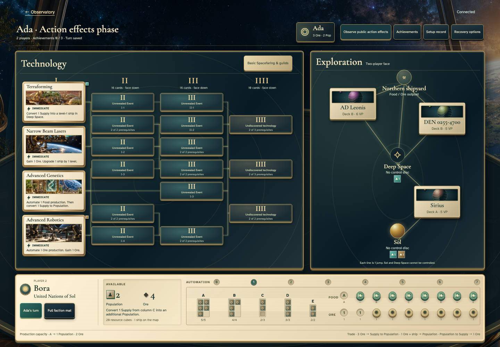](../../screenshots/plan-a-mandatory-printed-four-jump-route-with-separate-controllers/033-jump-observer-return-phone-darwin.png) |  |

- [x] Observer returns to their public board
- [x] Actual canonical effects and acknowledgement settle.
- [x] Public topology retains physical separation.
- [x] The viewport fits without page scrolling.

## 35. Inspect actual public connections with the complete visible jump allowance

Viewpoint: **Ada · separate host controller**.

| phone · 393 × 852 | desktop · 1440 × 1000 |
| --- | --- |
| [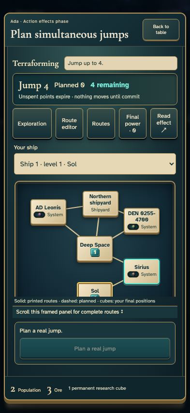](../../screenshots/plan-a-mandatory-printed-four-jump-route-with-separate-controllers/034-jump-map-overview-phone-darwin.png) |  |

- [x] Inspect actual public connections with the complete visible jump allowance
- [x] Actual canonical effects and acknowledgement settle.
- [x] Public topology retains physical separation.
- [x] The viewport fits without page scrolling.

## 36. Inspect the actual source face without taking movement

Viewpoint: **Ada · separate host controller**.

| phone · 393 × 852 | desktop · 1440 × 1000 |
| --- | --- |
| [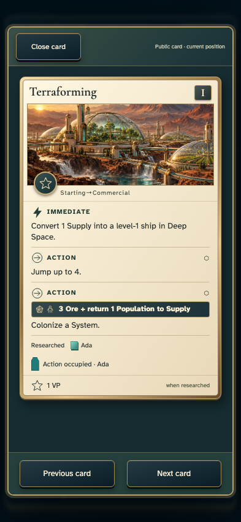](../../screenshots/plan-a-mandatory-printed-four-jump-route-with-separate-controllers/035-jump-source-phone-darwin.png) | [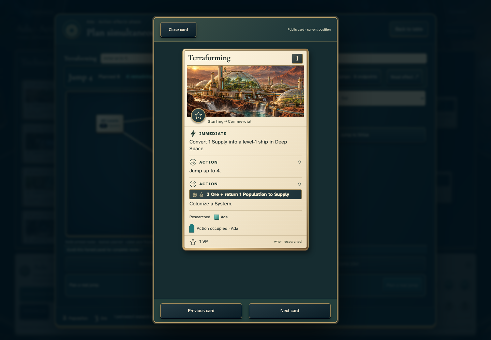](../../screenshots/plan-a-mandatory-printed-four-jump-route-with-separate-controllers/035-jump-source-desktop-darwin.png) |

- [x] Inspect the actual source face without taking movement
- [x] Actual canonical effects and acknowledgement settle.
- [x] Public topology retains physical separation.
- [x] The viewport fits without page scrolling.

## 37. Keyboard reaches the complete printed rules

Viewpoint: **Ada · separate host controller**.

| phone · 393 × 852 | desktop · 1440 × 1000 |
| --- | --- |
| [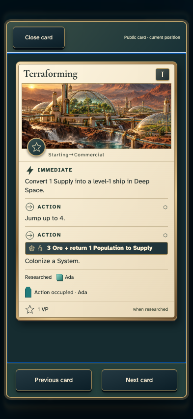](../../screenshots/plan-a-mandatory-printed-four-jump-route-with-separate-controllers/036-jump-source-rules-phone-darwin.png) | [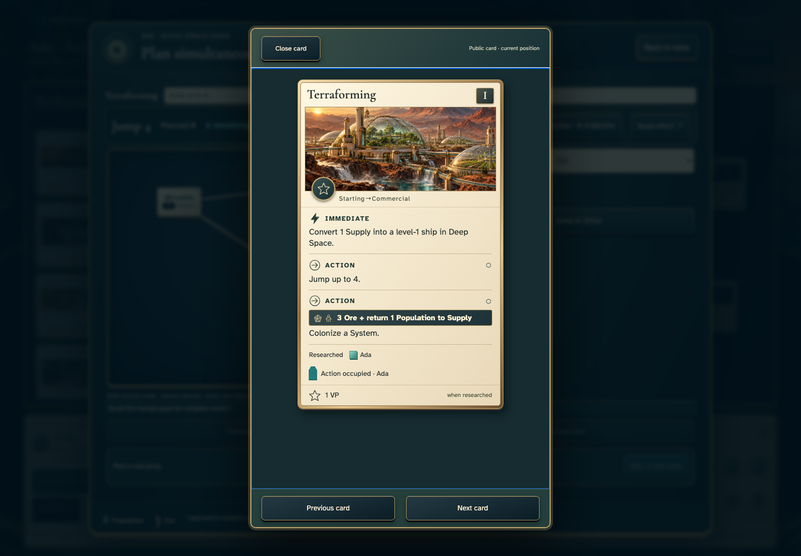](../../screenshots/plan-a-mandatory-printed-four-jump-route-with-separate-controllers/036-jump-source-rules-desktop-darwin.png) |

- [x] Keyboard reaches the complete printed rules
- [x] Actual canonical effects and acknowledgement settle.
- [x] Public topology retains physical separation.
- [x] The viewport fits without page scrolling.

## 38. Escape restores the exact source opener

Viewpoint: **Ada · separate host controller**.

| phone · 393 × 852 | desktop · 1440 × 1000 |
| --- | --- |
| [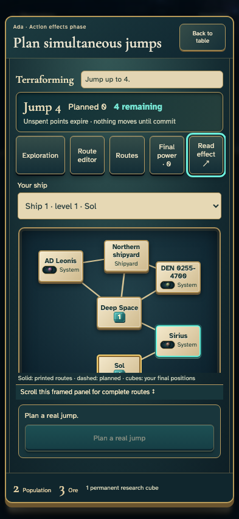](../../screenshots/plan-a-mandatory-printed-four-jump-route-with-separate-controllers/037-jump-source-return-phone-darwin.png) | [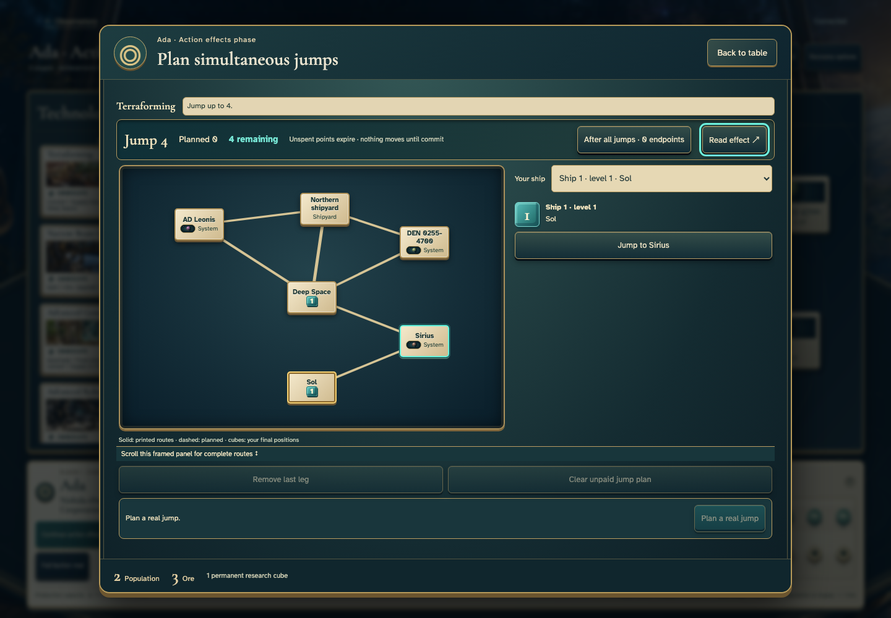](../../screenshots/plan-a-mandatory-printed-four-jump-route-with-separate-controllers/037-jump-source-return-desktop-darwin.png) |

- [x] Escape restores the exact source opener
- [x] Actual canonical effects and acknowledgement settle.
- [x] Public topology retains physical separation.
- [x] The viewport fits without page scrolling.

## 39. Read the ship and connected-destination view

Viewpoint: **Ada · separate host controller**.

| phone · 393 × 852 | desktop · 1440 × 1000 |
| --- | --- |
|  |  |

- [x] Read the ship and connected-destination view
- [x] Actual canonical effects and acknowledgement settle.
- [x] Public topology retains physical separation.
- [x] The viewport fits without page scrolling.

## 40. Plan one connected leg without moving a cube

Viewpoint: **Ada · separate host controller**.

| phone · 393 × 852 | desktop · 1440 × 1000 |
| --- | --- |
|  | [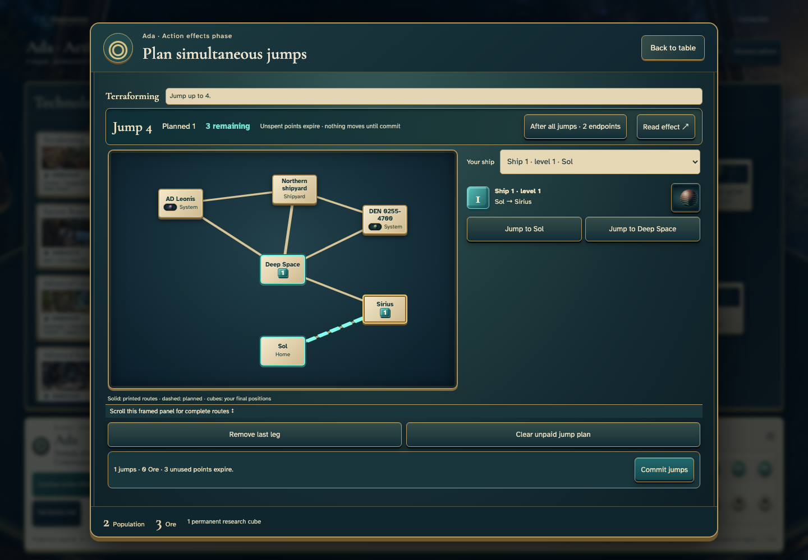](../../screenshots/plan-a-mandatory-printed-four-jump-route-with-separate-controllers/039-jump-first-leg-desktop-darwin.png) |

- [x] Plan one connected leg without moving a cube
- [x] Actual canonical effects and acknowledgement settle.
- [x] Public topology retains physical separation.
- [x] The viewport fits without page scrolling.

## 41. Remove the selected ship’s last leg without refunding Action payment

Viewpoint: **Ada · separate host controller**.

| phone · 393 × 852 | desktop · 1440 × 1000 |
| --- | --- |
|  |  |

- [x] Remove the selected ship’s last leg without refunding Action payment
- [x] Actual canonical effects and acknowledgement settle.
- [x] Public topology retains physical separation.
- [x] The viewport fits without page scrolling.

## 42. Plan another unpaid leg

Viewpoint: **Ada · separate host controller**.

| phone · 393 × 852 | desktop · 1440 × 1000 |
| --- | --- |
| [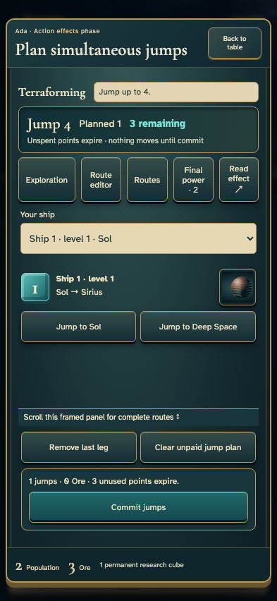](../../screenshots/plan-a-mandatory-printed-four-jump-route-with-separate-controllers/041-jump-edit-again-phone-darwin.png) |  |

- [x] Plan another unpaid leg
- [x] Actual canonical effects and acknowledgement settle.
- [x] Public topology retains physical separation.
- [x] The viewport fits without page scrolling.

## 43. Clear the unpaid plan while retaining the paid Action

Viewpoint: **Ada · separate host controller**.

| phone · 393 × 852 | desktop · 1440 × 1000 |
| --- | --- |
|  | [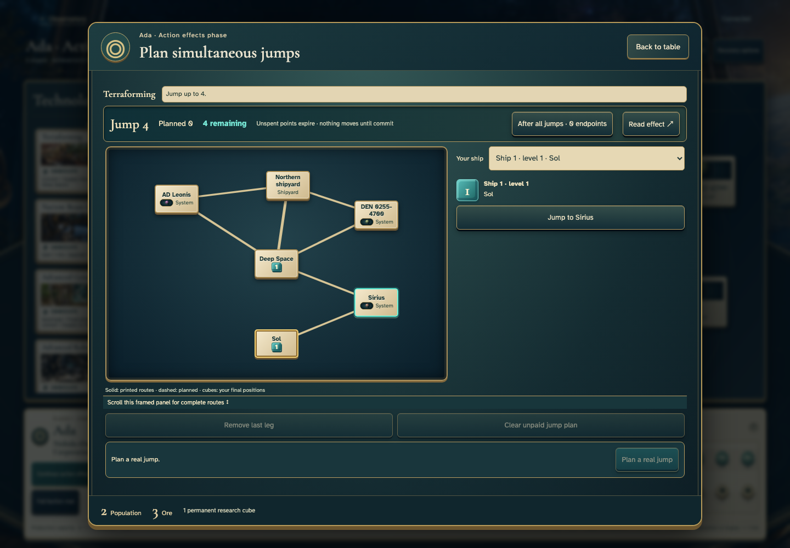](../../screenshots/plan-a-mandatory-printed-four-jump-route-with-separate-controllers/042-jump-clear-desktop-darwin.png) |

- [x] Clear the unpaid plan while retaining the paid Action
- [x] Actual canonical effects and acknowledgement settle.
- [x] Public topology retains physical separation.
- [x] The viewport fits without page scrolling.

## 44. Reload preserves the paid Action and pending movement

Viewpoint: **Ada · separate host controller**.

| phone · 393 × 852 | desktop · 1440 × 1000 |
| --- | --- |
| [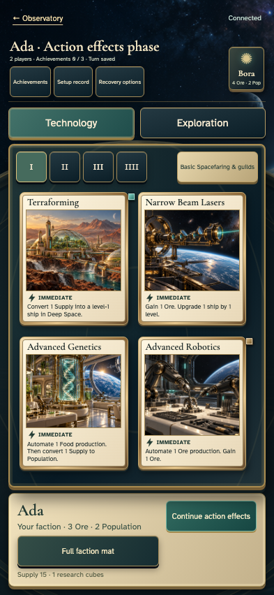](../../screenshots/plan-a-mandatory-printed-four-jump-route-with-separate-controllers/043-jump-reload-board-phone-darwin.png) | [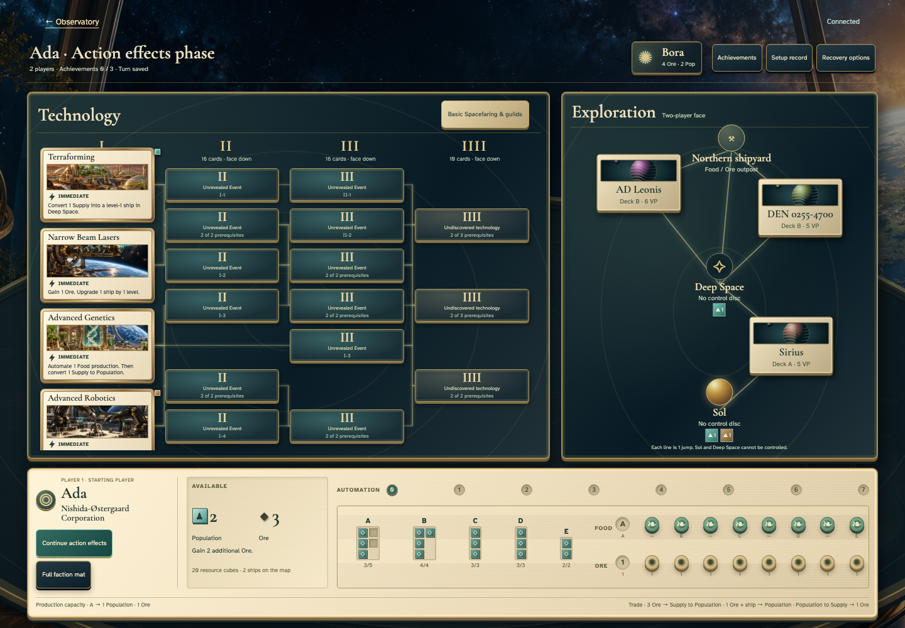](../../screenshots/plan-a-mandatory-printed-four-jump-route-with-separate-controllers/043-jump-reload-board-desktop-darwin.png) |

- [x] Reload preserves the paid Action and pending movement
- [x] Actual canonical effects and acknowledgement settle.
- [x] Public topology retains physical separation.
- [x] The viewport fits without page scrolling.

## 45. Resume the saved allowance without duplicate payment or construction

Viewpoint: **Ada · separate host controller**.

| phone · 393 × 852 | desktop · 1440 × 1000 |
| --- | --- |
|  |  |

- [x] Resume the saved allowance without duplicate payment or construction
- [x] Actual canonical effects and acknowledgement settle.
- [x] Public topology retains physical separation.
- [x] The viewport fits without page scrolling.

## 46. Read the recovered connected-destination view

Viewpoint: **Ada · separate host controller**.

| phone · 393 × 852 | desktop · 1440 × 1000 |
| --- | --- |
| [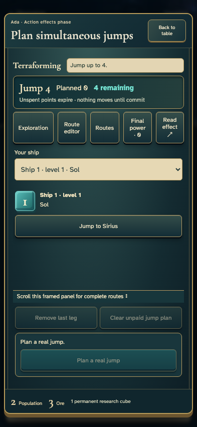](../../screenshots/plan-a-mandatory-printed-four-jump-route-with-separate-controllers/045-jump-recovered-editor-phone-darwin.png) |  |

- [x] Read the recovered connected-destination view
- [x] Actual canonical effects and acknowledgement settle.
- [x] Public topology retains physical separation.
- [x] The viewport fits without page scrolling.

## 47. Choose the first actual adjacent System

Viewpoint: **Ada · separate host controller**.

| phone · 393 × 852 | desktop · 1440 × 1000 |
| --- | --- |
|  |  |

- [x] Choose the first actual adjacent System
- [x] Actual canonical effects and acknowledgement settle.
- [x] Public topology retains physical separation.
- [x] The viewport fits without page scrolling.

## 48. Continue the same ship through the System to Deep Space

Viewpoint: **Ada · separate host controller**.

| phone · 393 × 852 | desktop · 1440 × 1000 |
| --- | --- |
| [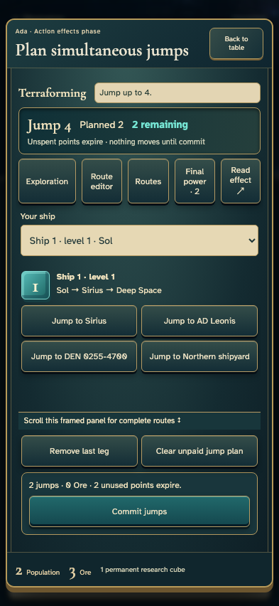](../../screenshots/plan-a-mandatory-printed-four-jump-route-with-separate-controllers/047-jump-leg-two-phone-darwin.png) |  |

- [x] Continue the same ship through the System to Deep Space
- [x] Actual canonical effects and acknowledgement settle.
- [x] Public topology retains physical separation.
- [x] The viewport fits without page scrolling.

## 49. Use the real Northern shipyard connection

Viewpoint: **Ada · separate host controller**.

| phone · 393 × 852 | desktop · 1440 × 1000 |
| --- | --- |
|  |  |

- [x] Use the real Northern shipyard connection
- [x] Actual canonical effects and acknowledgement settle.
- [x] Public topology retains physical separation.
- [x] The viewport fits without page scrolling.

## 50. End at Deep Space without collecting pass-through bonuses

Viewpoint: **Ada · separate host controller**.

| phone · 393 × 852 | desktop · 1440 × 1000 |
| --- | --- |
|  |  |

- [x] End at Deep Space without collecting pass-through bonuses
- [x] Actual canonical effects and acknowledgement settle.
- [x] Public topology retains physical separation.
- [x] The viewport fits without page scrolling.

## 51. Read the selected ship’s complete route and level

Viewpoint: **Ada · separate host controller**.

| phone · 393 × 852 | desktop · 1440 × 1000 |
| --- | --- |
|  |  |

- [x] Read the selected ship’s complete route and level
- [x] Actual canonical effects and acknowledgement settle.
- [x] Public topology retains physical separation.
- [x] The viewport fits without page scrolling.

## 52. Read another real owned ship’s complete path

Viewpoint: **Ada · separate host controller**.

| phone · 393 × 852 | desktop · 1440 × 1000 |
| --- | --- |
|  |  |

- [x] Read another real owned ship’s complete path
- [x] Actual canonical effects and acknowledgement settle.
- [x] Public topology retains physical separation.
- [x] The viewport fits without page scrolling.

## 53. Review final departure and arrival power together before commit

Viewpoint: **Ada · separate host controller**.

| phone · 393 × 852 | desktop · 1440 × 1000 |
| --- | --- |
|  |  |

- [x] Review final departure and arrival power together before commit
- [x] Actual canonical effects and acknowledgement settle.
- [x] Public topology retains physical separation.
- [x] The viewport fits without page scrolling.

## 54. Read the next actual endpoint and control consequence

Viewpoint: **Ada · separate host controller**.

| phone · 393 × 852 | desktop · 1440 × 1000 |
| --- | --- |
|  |  |

- [x] Read the next actual endpoint and control consequence
- [x] Actual canonical effects and acknowledgement settle.
- [x] Public topology retains physical separation.
- [x] The viewport fits without page scrolling.

## 55. Keyboard reaches the atomic Commit outside the reader

Viewpoint: **Ada · separate host controller**.

| phone · 393 × 852 | desktop · 1440 × 1000 |
| --- | --- |
|  |  |

- [x] Keyboard reaches the atomic Commit outside the reader
- [x] Actual canonical effects and acknowledgement settle.
- [x] Public topology retains physical separation.
- [x] The viewport fits without page scrolling.

## 56. Commit all ships together and resume actual saved consequences

Viewpoint: **Ada · separate host controller**.

| phone · 393 × 852 | desktop · 1440 × 1000 |
| --- | --- |
|  |  |

- [x] Commit all ships together and resume actual saved consequences
- [x] Actual canonical effects and acknowledgement settle.
- [x] Public topology retains physical separation.
- [x] The viewport fits without page scrolling.

## 57. All endpoint changes and printed bonuses are saved before production

Viewpoint: **Ada · separate host controller**.

| phone · 393 × 852 | desktop · 1440 × 1000 |
| --- | --- |
|  |  |

- [x] All endpoint changes and printed bonuses are saved before production
- [x] Actual canonical effects and acknowledgement settle.
- [x] Public topology retains physical separation.
- [x] The viewport fits without page scrolling.

## 58. Reload retains committed ships and saved Production

Viewpoint: **Ada · separate host controller**.

| phone · 393 × 852 | desktop · 1440 × 1000 |
| --- | --- |
|  |  |

- [x] Reload retains committed ships and saved Production
- [x] Actual canonical effects and acknowledgement settle.
- [x] Public topology retains physical separation.
- [x] The viewport fits without page scrolling.

## 59. Resume Production without replaying movement or bonuses

Viewpoint: **Ada · separate host controller**.

| phone · 393 × 852 | desktop · 1440 × 1000 |
| --- | --- |
|  |  |

- [x] Resume Production without replaying movement or bonuses
- [x] Actual canonical effects and acknowledgement settle.
- [x] Public topology retains physical separation.
- [x] The viewport fits without page scrolling.

## 60. Close the decision to inspect the saved public fleet

Viewpoint: **Ada · separate host controller**.

| phone · 393 × 852 | desktop · 1440 × 1000 |
| --- | --- |
|  |  |

- [x] Close the decision to inspect the saved public fleet
- [x] Actual canonical effects and acknowledgement settle.
- [x] Public topology retains physical separation.
- [x] The viewport fits without page scrolling.

## 61. Open Ada’s real saved faction mat

Viewpoint: **Ada · separate host controller**.

| phone · 393 × 852 | desktop · 1440 × 1000 |
| --- | --- |
|  |  |

- [x] Open Ada’s real saved faction mat
- [x] Actual canonical effects and acknowledgement settle.
- [x] Public topology retains physical separation.
- [x] The viewport fits without page scrolling.

## 62. The actual retained fleet contains two owned ships

Viewpoint: **Ada · separate host controller**.

| phone · 393 × 852 | desktop · 1440 × 1000 |
| --- | --- |
|  |  |

- [x] The actual retained fleet contains two owned ships
- [x] Actual canonical effects and acknowledgement settle.
- [x] Public topology retains physical separation.
- [x] The viewport fits without page scrolling.

## 63. The saved Deep Space fleet has exact power2

Viewpoint: **Ada · separate host controller**.

| phone · 393 × 852 | desktop · 1440 × 1000 |
| --- | --- |
|  |  |

- [x] The saved Deep Space fleet has exact power2
- [x] Actual canonical effects and acknowledgement settle.
- [x] Public topology retains physical separation.
- [x] The viewport fits without page scrolling.

## 64. Escape restores the actual Fleet opener

Viewpoint: **Ada · separate host controller**.

| phone · 393 × 852 | desktop · 1440 × 1000 |
| --- | --- |
|  |  |

- [x] Escape restores the actual Fleet opener
- [x] Actual canonical effects and acknowledgement settle.
- [x] Public topology retains physical separation.
- [x] The viewport fits without page scrolling.

## 65. Close the mat without taking a turn

Viewpoint: **Ada · separate host controller**.

| phone · 393 × 852 | desktop · 1440 × 1000 |
| --- | --- |
|  |  |

- [x] Close the mat without taking a turn
- [x] Actual canonical effects and acknowledgement settle.
- [x] Public topology retains physical separation.
- [x] The viewport fits without page scrolling.

## 66. Resume the same saved Production decision

Viewpoint: **Ada · separate host controller**.

| phone · 393 × 852 | desktop · 1440 × 1000 |
| --- | --- |
|  |  |

- [x] Resume the same saved Production decision
- [x] Actual canonical effects and acknowledgement settle.
- [x] Public topology retains physical separation.
- [x] The viewport fits without page scrolling.

## 67. Ada completes ordinary production and hands off

Viewpoint: **Ada · separate host controller**.

| phone · 393 × 852 | desktop · 1440 × 1000 |
| --- | --- |
|  |  |

- [x] Ada completes ordinary production and hands off
- [x] Actual canonical effects and acknowledgement settle.
- [x] Public topology retains physical separation.
- [x] The viewport fits without page scrolling.

## 68. The next independent controller sees the saved handoff

Viewpoint: **Bora · separate guest controller**.

| phone · 1440 × 1000 | desktop · 393 × 852 |
| --- | --- |
|  |  |

- [x] The next independent controller sees the saved handoff
- [x] Actual canonical effects and acknowledgement settle.
- [x] Public topology retains physical separation.
- [x] The viewport fits without page scrolling.
