# Plan split simultaneous jumps at 4 shared corner seats

Ordinary named legal Basic setup and real preparatory turns. Fixed initial setup entropy55555555-5555-4555-8555-000000000002; command identities separate stories, no state injection or future-deck reads. Remote players have separate identities; tabletop has one shared controller. Source inspection, unpaid recovery, simultaneous endpoints and handoff use production UI.

## 1. Arrive using the actual production client

Viewpoint: **Ada · South West · one shared controller**.

| desktop · 1440 × 1000 |
| --- |
|  |

tabletop-4k · 3840 × 2160

- [x] Arrive using the actual production client
- [x] Actual canonical effects and acknowledgement settle.
- [x] Public topology retains physical separation.
- [x] The viewport fits without page scrolling.

## 2. Choose a real production play mode

Viewpoint: **Ada · South West · one shared controller**.

| desktop · 1440 × 1000 |
| --- |
|  |

tabletop-4k · 3840 × 2160

- [x] Choose a real production play mode
- [x] Actual canonical effects and acknowledgement settle.
- [x] Public topology retains physical separation.
- [x] The viewport fits without page scrolling.

## 3. One controller configures physical seats directly on the table

Viewpoint: **Ada · South West · one shared controller**.

| desktop · 1440 × 1000 |
| --- |
|  |

tabletop-4k · 3840 × 2160

- [x] One controller configures physical seats directly on the table
- [x] Actual canonical effects and acknowledgement settle.
- [x] Public topology retains physical separation.
- [x] The viewport fits without page scrolling.

## 4. Open the South West seat on the shared surface

Viewpoint: **Ada · South West · one shared controller**.

| desktop · 1440 × 1000 |
| --- |
|  |

tabletop-4k · 3840 × 2160

- [x] Open the South West seat on the shared surface
- [x] Actual canonical effects and acknowledgement settle.
- [x] Public topology retains physical separation.
- [x] The viewport fits without page scrolling.

## 5. Name the physical player Ada

Viewpoint: **Ada · South West · one shared controller**.

| desktop · 1440 × 1000 |
| --- |
|  |

tabletop-4k · 3840 × 2160

- [x] Name the physical player Ada
- [x] Actual canonical effects and acknowledgement settle.
- [x] Public topology retains physical separation.
- [x] The viewport fits without page scrolling.

## 6. The local physical seat is retained on this controller

Viewpoint: **Ada · South West · one shared controller**.

| desktop · 1440 × 1000 |
| --- |
|  |

tabletop-4k · 3840 × 2160

- [x] The local physical seat is retained on this controller
- [x] Actual canonical effects and acknowledgement settle.
- [x] Public topology retains physical separation.
- [x] The viewport fits without page scrolling.

## 7. Open the North West seat on the shared surface

Viewpoint: **Bora · North West · one shared controller**.

| desktop · 1440 × 1000 |
| --- |
|  |

tabletop-4k · 3840 × 2160

- [x] Open the North West seat on the shared surface
- [x] Actual canonical effects and acknowledgement settle.
- [x] Public topology retains physical separation.
- [x] The viewport fits without page scrolling.

## 8. Name the physical player Bora

Viewpoint: **Bora · North West · one shared controller**.

| desktop · 1440 × 1000 |
| --- |
| [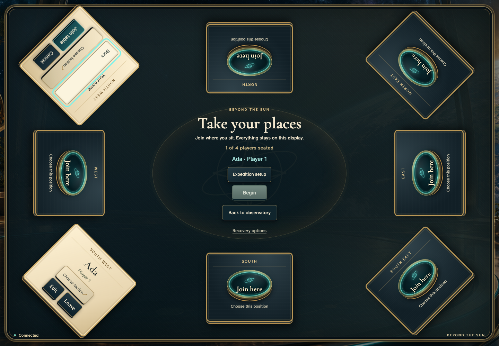](../../screenshots/plan-split-simultaneous-jumps-at-4-shared-corner-seats/007-seat-1-name-desktop-darwin.png) |

tabletop-4k · 3840 × 2160

- [x] Name the physical player Bora
- [x] Actual canonical effects and acknowledgement settle.
- [x] Public topology retains physical separation.
- [x] The viewport fits without page scrolling.

## 9. The local physical seat is retained on this controller

Viewpoint: **Bora · North West · one shared controller**.

| desktop · 1440 × 1000 |
| --- |
|  |

tabletop-4k · 3840 × 2160

- [x] The local physical seat is retained on this controller
- [x] Actual canonical effects and acknowledgement settle.
- [x] Public topology retains physical separation.
- [x] The viewport fits without page scrolling.

## 10. Open the North East seat on the shared surface

Viewpoint: **Cleo · North East · one shared controller**.

| desktop · 1440 × 1000 |
| --- |
|  |

tabletop-4k · 3840 × 2160

- [x] Open the North East seat on the shared surface
- [x] Actual canonical effects and acknowledgement settle.
- [x] Public topology retains physical separation.
- [x] The viewport fits without page scrolling.

## 11. Name the physical player Cleo

Viewpoint: **Cleo · North East · one shared controller**.

| desktop · 1440 × 1000 |
| --- |
|  |

tabletop-4k · 3840 × 2160

- [x] Name the physical player Cleo
- [x] Actual canonical effects and acknowledgement settle.
- [x] Public topology retains physical separation.
- [x] The viewport fits without page scrolling.

## 12. The local physical seat is retained on this controller

Viewpoint: **Cleo · North East · one shared controller**.

| desktop · 1440 × 1000 |
| --- |
|  |

tabletop-4k · 3840 × 2160

- [x] The local physical seat is retained on this controller
- [x] Actual canonical effects and acknowledgement settle.
- [x] Public topology retains physical separation.
- [x] The viewport fits without page scrolling.

## 13. Open the South East seat on the shared surface

Viewpoint: **Dara · South East · one shared controller**.

| desktop · 1440 × 1000 |
| --- |
|  |

tabletop-4k · 3840 × 2160

- [x] Open the South East seat on the shared surface
- [x] Actual canonical effects and acknowledgement settle.
- [x] Public topology retains physical separation.
- [x] The viewport fits without page scrolling.

## 14. Name the physical player Dara

Viewpoint: **Dara · South East · one shared controller**.

| desktop · 1440 × 1000 |
| --- |
| [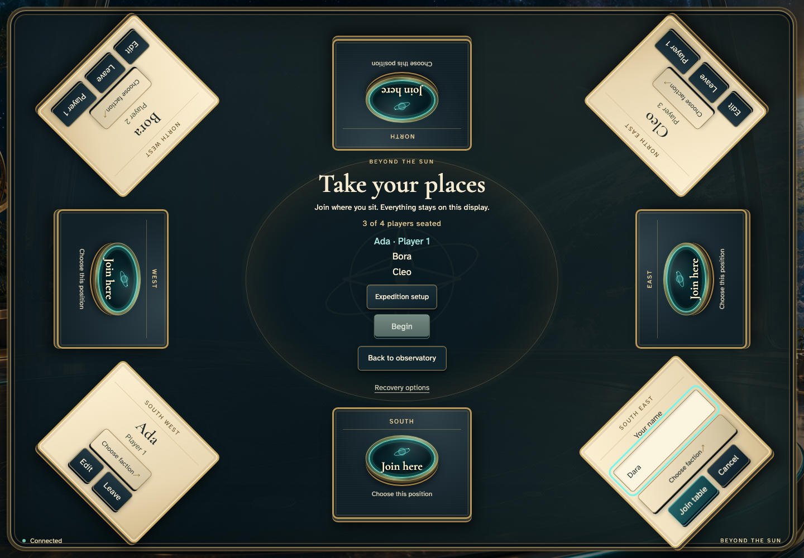](../../screenshots/plan-split-simultaneous-jumps-at-4-shared-corner-seats/013-seat-3-name-desktop-darwin.png) |

tabletop-4k · 3840 × 2160

- [x] Name the physical player Dara
- [x] Actual canonical effects and acknowledgement settle.
- [x] Public topology retains physical separation.
- [x] The viewport fits without page scrolling.

## 15. The local physical seat is retained on this controller

Viewpoint: **Dara · South East · one shared controller**.

| desktop · 1440 × 1000 |
| --- |
|  |

tabletop-4k · 3840 × 2160

- [x] The local physical seat is retained on this controller
- [x] Actual canonical effects and acknowledgement settle.
- [x] Public topology retains physical separation.
- [x] The viewport fits without page scrolling.

## 16. Ada chooses a legal unique Basic faction

Viewpoint: **Ada · South West · one shared controller**.

| desktop · 1440 × 1000 |
| --- |
|  |

tabletop-4k · 3840 × 2160

- [x] Ada chooses a legal unique Basic faction
- [x] Actual canonical effects and acknowledgement settle.
- [x] Public topology retains physical separation.
- [x] The viewport fits without page scrolling.

## 17. Ada retains Nishida-Østergaard Corporation

Viewpoint: **Ada · South West · one shared controller**.

| desktop · 1440 × 1000 |
| --- |
|  |

tabletop-4k · 3840 × 2160

- [x] Ada retains Nishida-Østergaard Corporation
- [x] Actual canonical effects and acknowledgement settle.
- [x] Public topology retains physical separation.
- [x] The viewport fits without page scrolling.

## 18. Bora chooses a legal unique Basic faction

Viewpoint: **Bora · North West · one shared controller**.

| desktop · 1440 × 1000 |
| --- |
|  |

tabletop-4k · 3840 × 2160

[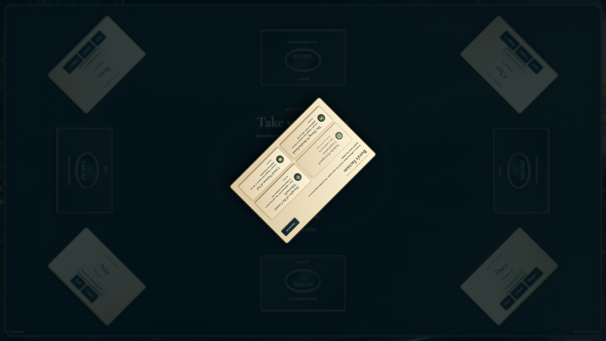](../../screenshots/plan-split-simultaneous-jumps-at-4-shared-corner-seats/017-faction-1-editor-tabletop-4k-darwin.png)

- [x] Bora chooses a legal unique Basic faction
- [x] Actual canonical effects and acknowledgement settle.
- [x] Public topology retains physical separation.
- [x] The viewport fits without page scrolling.

## 19. Bora retains The Zheng-Yi Brotherhood

Viewpoint: **Bora · North West · one shared controller**.

| desktop · 1440 × 1000 |
| --- |
|  |

tabletop-4k · 3840 × 2160

- [x] Bora retains The Zheng-Yi Brotherhood
- [x] Actual canonical effects and acknowledgement settle.
- [x] Public topology retains physical separation.
- [x] The viewport fits without page scrolling.

## 20. Cleo chooses a legal unique Basic faction

Viewpoint: **Cleo · North East · one shared controller**.

| desktop · 1440 × 1000 |
| --- |
|  |

tabletop-4k · 3840 × 2160

[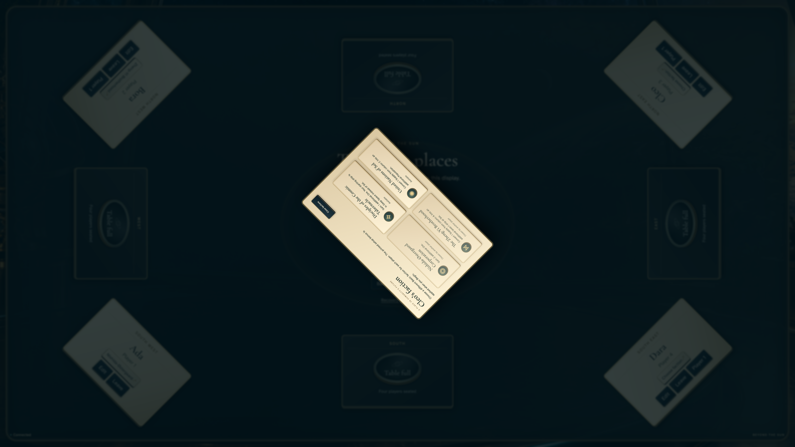](../../screenshots/plan-split-simultaneous-jumps-at-4-shared-corner-seats/019-faction-2-editor-tabletop-4k-darwin.png)

- [x] Cleo chooses a legal unique Basic faction
- [x] Actual canonical effects and acknowledgement settle.
- [x] Public topology retains physical separation.
- [x] The viewport fits without page scrolling.

## 21. Cleo retains Disciples of the Cosmic Tabernacle

Viewpoint: **Cleo · North East · one shared controller**.

| desktop · 1440 × 1000 |
| --- |
|  |

tabletop-4k · 3840 × 2160

[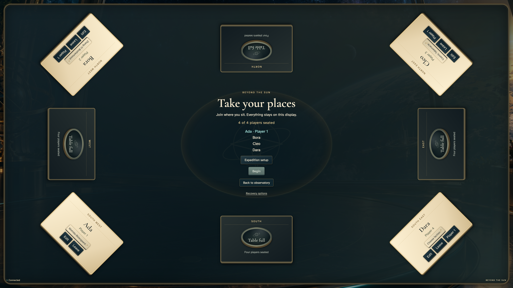](../../screenshots/plan-split-simultaneous-jumps-at-4-shared-corner-seats/020-faction-2-chosen-tabletop-4k-darwin.png)

- [x] Cleo retains Disciples of the Cosmic Tabernacle
- [x] Actual canonical effects and acknowledgement settle.
- [x] Public topology retains physical separation.
- [x] The viewport fits without page scrolling.

## 22. Dara chooses a legal unique Basic faction

Viewpoint: **Dara · South East · one shared controller**.

| desktop · 1440 × 1000 |
| --- |
| [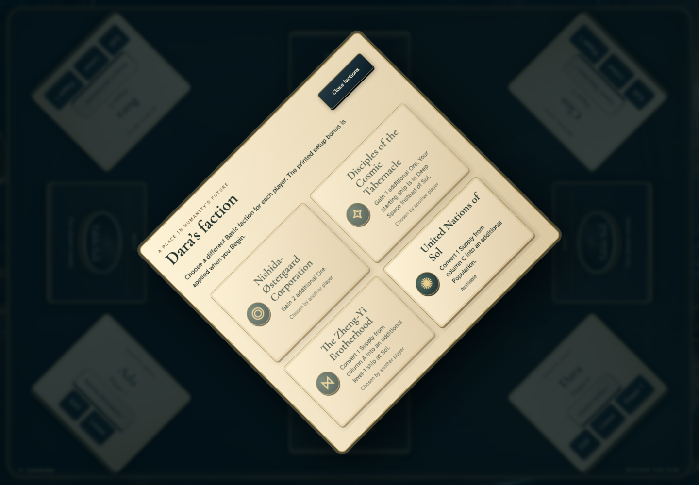](../../screenshots/plan-split-simultaneous-jumps-at-4-shared-corner-seats/021-faction-3-editor-desktop-darwin.png) |

tabletop-4k · 3840 × 2160

- [x] Dara chooses a legal unique Basic faction
- [x] Actual canonical effects and acknowledgement settle.
- [x] Public topology retains physical separation.
- [x] The viewport fits without page scrolling.

## 23. Dara retains United Nations of Sol

Viewpoint: **Dara · South East · one shared controller**.

| desktop · 1440 × 1000 |
| --- |
|  |

tabletop-4k · 3840 × 2160

- [x] Dara retains United Nations of Sol
- [x] Actual canonical effects and acknowledgement settle.
- [x] Public topology retains physical separation.
- [x] The viewport fits without page scrolling.

## 24. Begin the immutable source-reviewed Basic setup through the ordinary UI

Viewpoint: **Ada · South West · one shared controller**.

| desktop · 1440 × 1000 |
| --- |
| [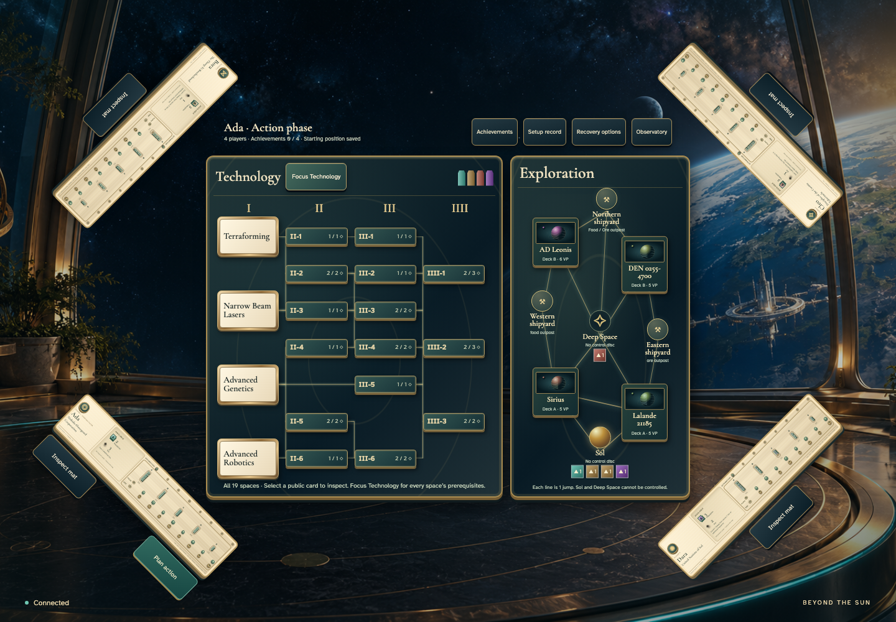](../../screenshots/plan-split-simultaneous-jumps-at-4-shared-corner-seats/023-begun-desktop-darwin.png) |

tabletop-4k · 3840 × 2160

- [x] Begin the immutable source-reviewed Basic setup through the ordinary UI
- [x] Actual canonical effects and acknowledgement settle.
- [x] Public topology retains physical separation.
- [x] The viewport fits without page scrolling.

## 25. Ada opens the actual Action instrument

Viewpoint: **Ada · South West · one shared controller**.

| desktop · 1440 × 1000 |
| --- |
| [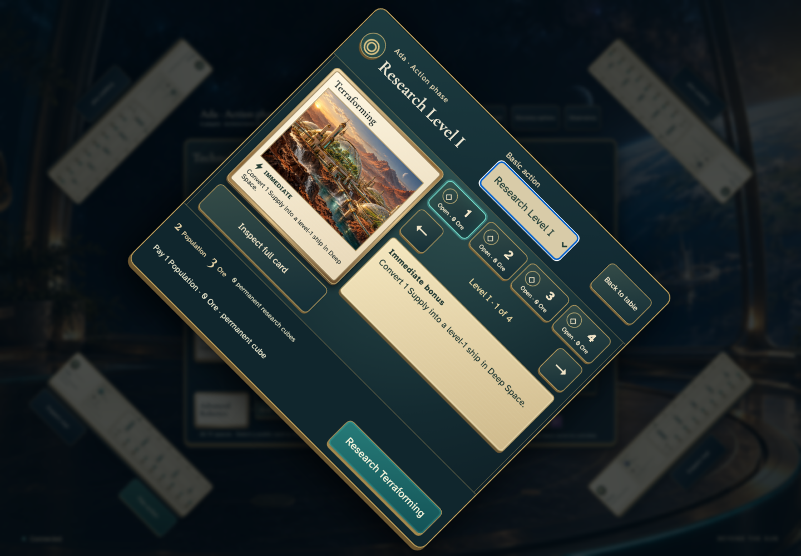](../../screenshots/plan-split-simultaneous-jumps-at-4-shared-corner-seats/024-ada-prepare-plan-desktop-darwin.png) |

tabletop-4k · 3840 × 2160

[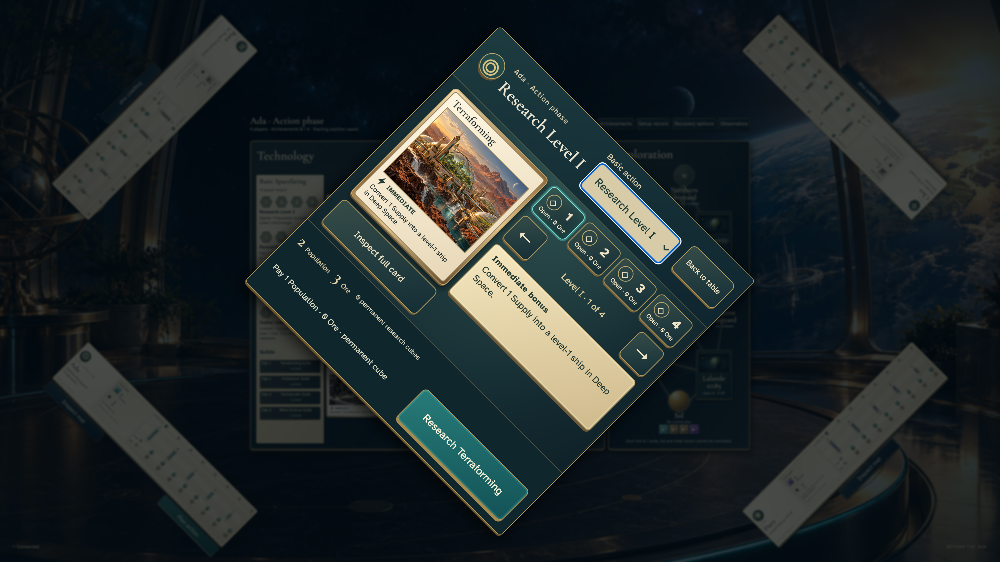](../../screenshots/plan-split-simultaneous-jumps-at-4-shared-corner-seats/024-ada-prepare-plan-tabletop-4k-darwin.png)

- [x] Ada opens the actual Action instrument
- [x] Actual canonical effects and acknowledgement settle.
- [x] Public topology retains physical separation.
- [x] The viewport fits without page scrolling.

## 26. Ada chooses the unoccupied printed research space

Viewpoint: **Ada · South West · one shared controller**.

| desktop · 1440 × 1000 |
| --- |
| [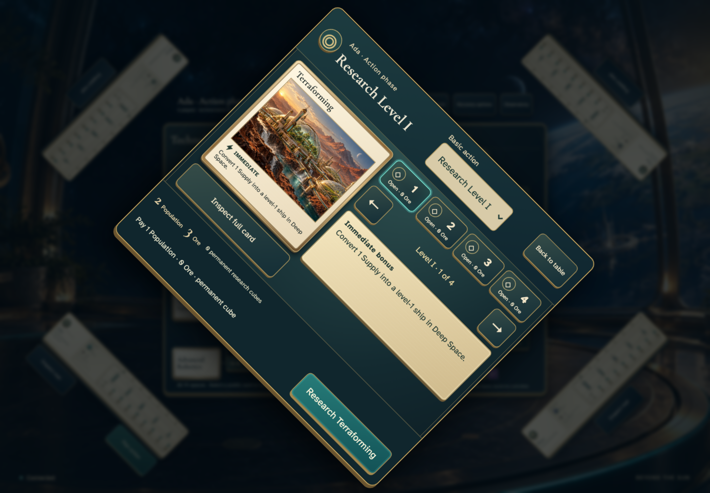](../../screenshots/plan-split-simultaneous-jumps-at-4-shared-corner-seats/025-ada-prepare-space-desktop-darwin.png) |

tabletop-4k · 3840 × 2160

[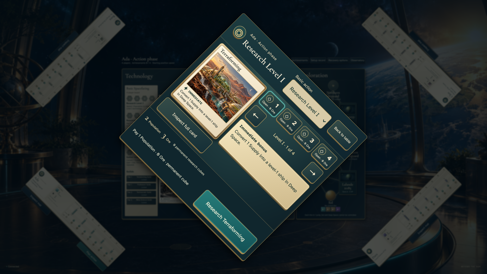](../../screenshots/plan-split-simultaneous-jumps-at-4-shared-corner-seats/025-ada-prepare-space-tabletop-4k-darwin.png)

- [x] Ada chooses the unoccupied printed research space
- [x] Actual canonical effects and acknowledgement settle.
- [x] Public topology retains physical separation.
- [x] The viewport fits without page scrolling.

## 27. Browse the next public Technology without paying

Viewpoint: **Ada · South West · one shared controller**.

| desktop · 1440 × 1000 |
| --- |
|  |

tabletop-4k · 3840 × 2160

[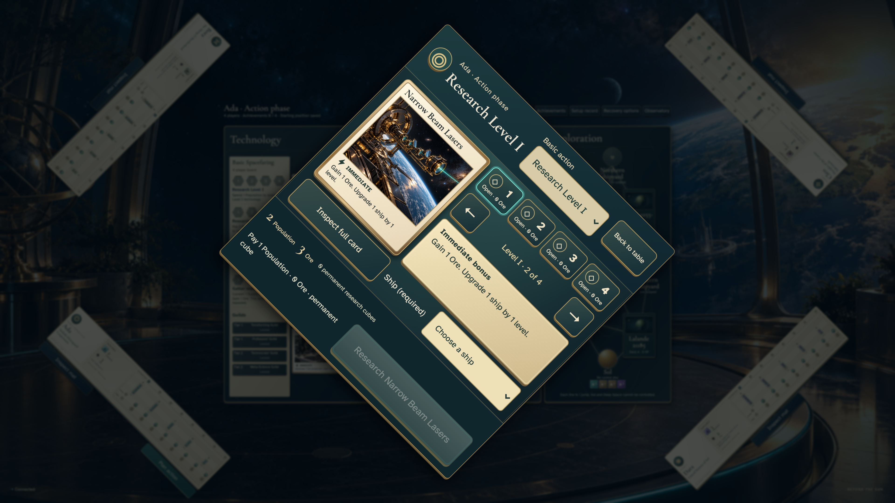](../../screenshots/plan-split-simultaneous-jumps-at-4-shared-corner-seats/026-ada-prepare-browse-0-tabletop-4k-darwin.png)

- [x] Browse the next public Technology without paying
- [x] Actual canonical effects and acknowledgement settle.
- [x] Public topology retains physical separation.
- [x] The viewport fits without page scrolling.

## 28. The mandatory one-level upgrade needs an explicit owned ship

Viewpoint: **Ada · South West · one shared controller**.

| desktop · 1440 × 1000 |
| --- |
|  |

tabletop-4k · 3840 × 2160

- [x] The mandatory one-level upgrade needs an explicit owned ship
- [x] Actual canonical effects and acknowledgement settle.
- [x] Public topology retains physical separation.
- [x] The viewport fits without page scrolling.

## 29. Select the owned ship and inspect the exact level change

Viewpoint: **Ada · South West · one shared controller**.

| desktop · 1440 × 1000 |
| --- |
| [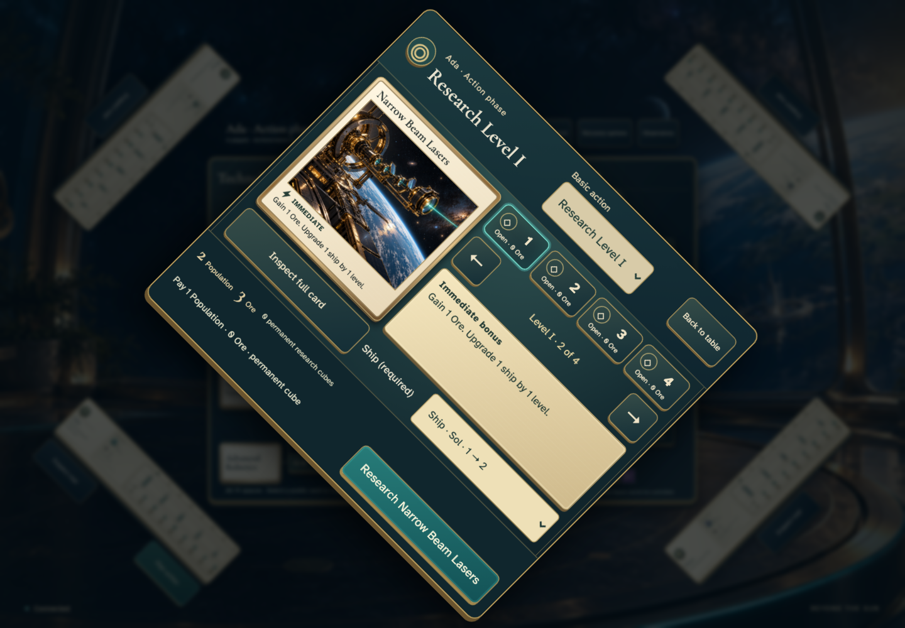](../../screenshots/plan-split-simultaneous-jumps-at-4-shared-corner-seats/028-ada-prepare-target-desktop-darwin.png) |

tabletop-4k · 3840 × 2160

[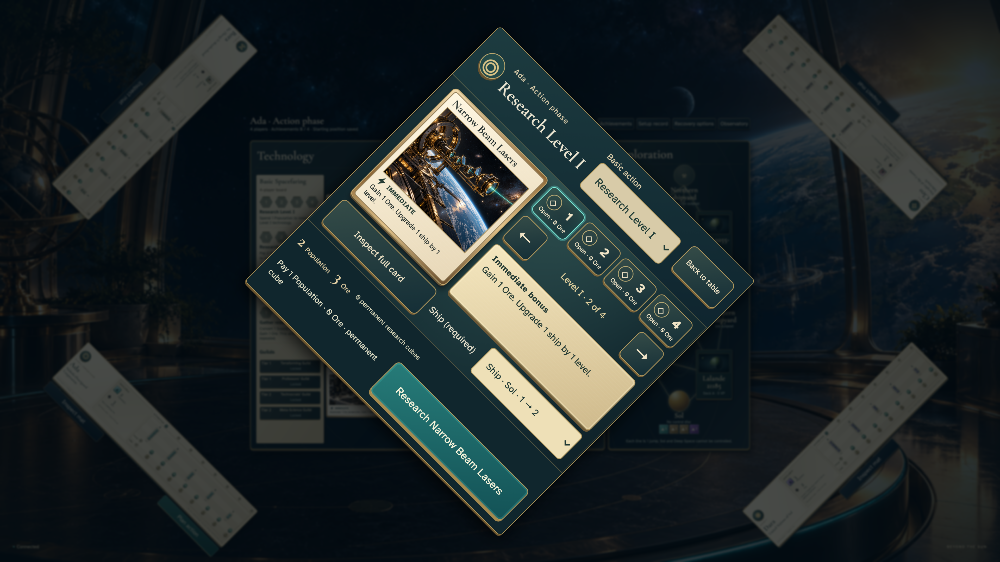](../../screenshots/plan-split-simultaneous-jumps-at-4-shared-corner-seats/028-ada-prepare-target-tabletop-4k-darwin.png)

- [x] Select the owned ship and inspect the exact level change
- [x] Actual canonical effects and acknowledgement settle.
- [x] Public topology retains physical separation.
- [x] The viewport fits without page scrolling.

## 30. Ada pays permanent research Population and resolves the printed bonus

Viewpoint: **Ada · South West · one shared controller**.

| desktop · 1440 × 1000 |
| --- |
| [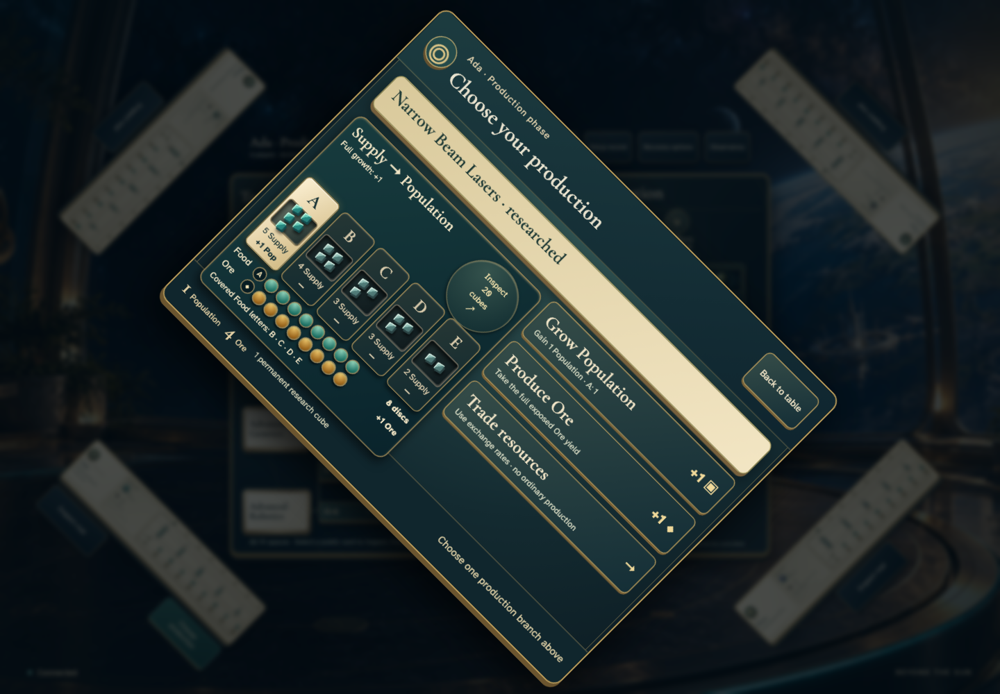](../../screenshots/plan-split-simultaneous-jumps-at-4-shared-corner-seats/029-ada-prepare-paid-desktop-darwin.png) |

tabletop-4k · 3840 × 2160

- [x] Ada pays permanent research Population and resolves the printed bonus
- [x] Actual canonical effects and acknowledgement settle.
- [x] Public topology retains physical separation.
- [x] The viewport fits without page scrolling.

## 31. Ada completes ordinary production and hands off

Viewpoint: **Ada · South West · one shared controller**.

| desktop · 1440 × 1000 |
| --- |
| [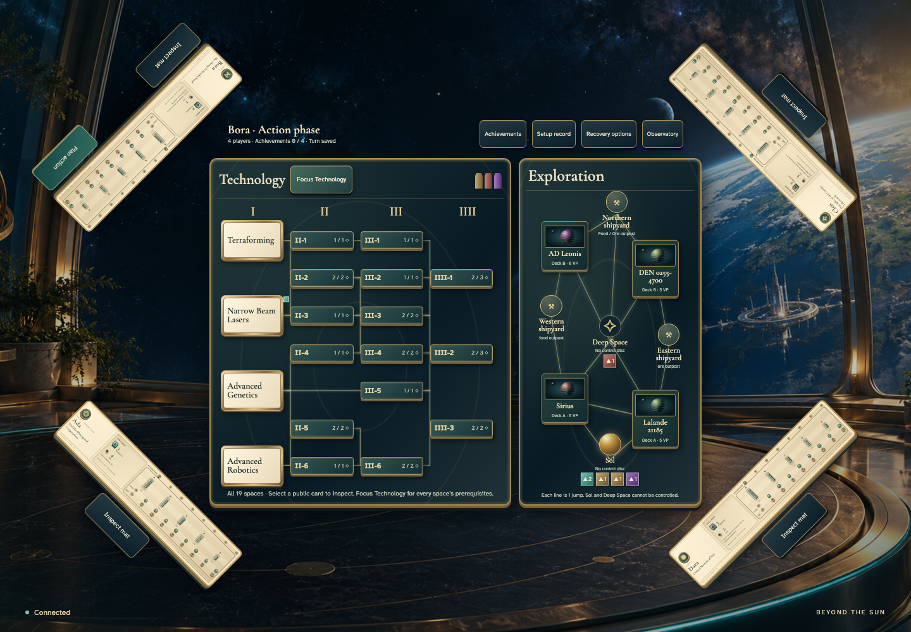](../../screenshots/plan-split-simultaneous-jumps-at-4-shared-corner-seats/030-ada-prepare-handoff-desktop-darwin.png) |

tabletop-4k · 3840 × 2160

- [x] Ada completes ordinary production and hands off
- [x] Actual canonical effects and acknowledgement settle.
- [x] Public topology retains physical separation.
- [x] The viewport fits without page scrolling.

## 32. Bora opens the actual Action instrument

Viewpoint: **Bora · North West · one shared controller**.

| desktop · 1440 × 1000 |
| --- |
| [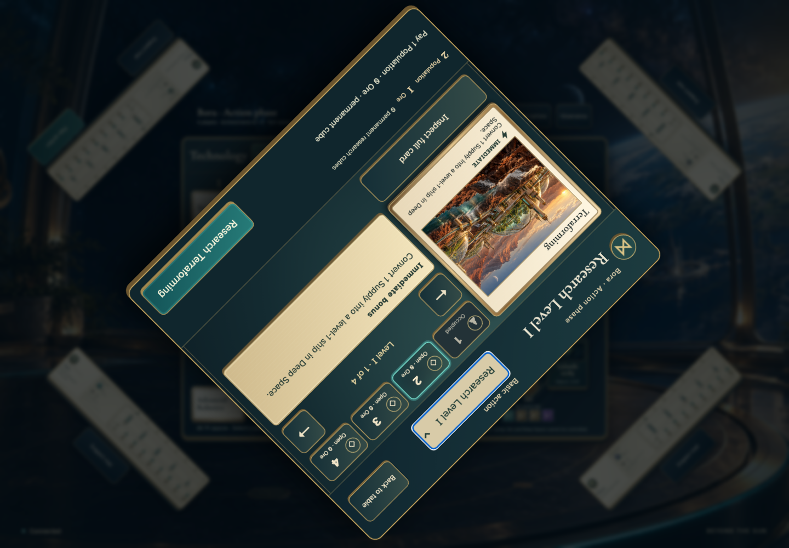](../../screenshots/plan-split-simultaneous-jumps-at-4-shared-corner-seats/031-prepare-1-plan-desktop-darwin.png) |

tabletop-4k · 3840 × 2160

[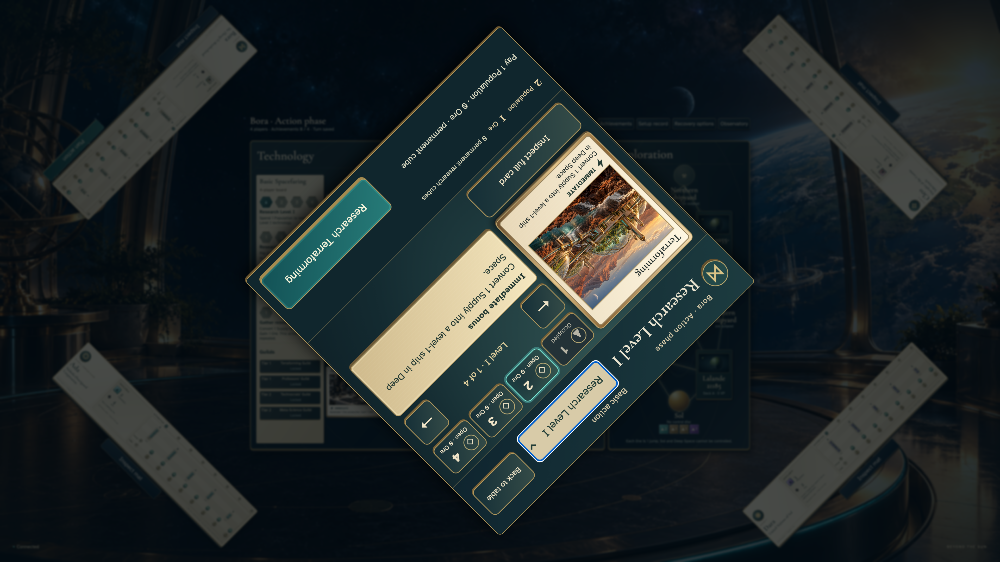](../../screenshots/plan-split-simultaneous-jumps-at-4-shared-corner-seats/031-prepare-1-plan-tabletop-4k-darwin.png)

- [x] Bora opens the actual Action instrument
- [x] Actual canonical effects and acknowledgement settle.
- [x] Public topology retains physical separation.
- [x] The viewport fits without page scrolling.

## 33. Bora chooses the unoccupied printed research space

Viewpoint: **Bora · North West · one shared controller**.

| desktop · 1440 × 1000 |
| --- |
|  |

tabletop-4k · 3840 × 2160

[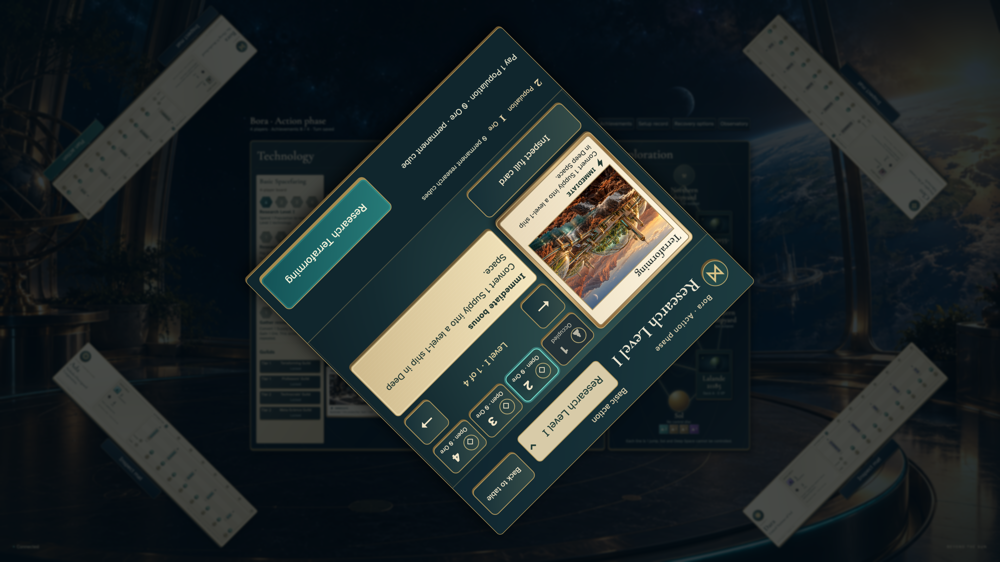](../../screenshots/plan-split-simultaneous-jumps-at-4-shared-corner-seats/032-prepare-1-space-tabletop-4k-darwin.png)

- [x] Bora chooses the unoccupied printed research space
- [x] Actual canonical effects and acknowledgement settle.
- [x] Public topology retains physical separation.
- [x] The viewport fits without page scrolling.

## 34. Browse the next public Technology without paying

Viewpoint: **Bora · North West · one shared controller**.

| desktop · 1440 × 1000 |
| --- |
| [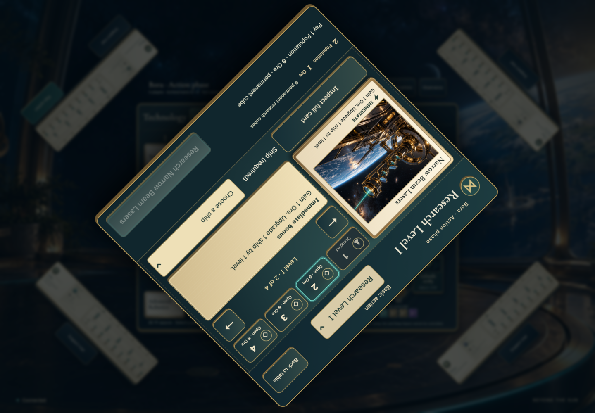](../../screenshots/plan-split-simultaneous-jumps-at-4-shared-corner-seats/033-prepare-1-browse-0-desktop-darwin.png) |

tabletop-4k · 3840 × 2160

[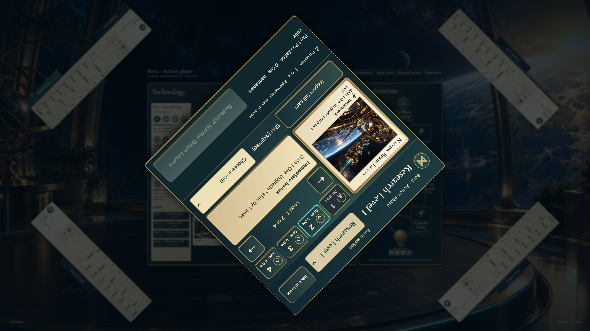](../../screenshots/plan-split-simultaneous-jumps-at-4-shared-corner-seats/033-prepare-1-browse-0-tabletop-4k-darwin.png)

- [x] Browse the next public Technology without paying
- [x] Actual canonical effects and acknowledgement settle.
- [x] Public topology retains physical separation.
- [x] The viewport fits without page scrolling.

## 35. Browse the next public Technology without paying

Viewpoint: **Bora · North West · one shared controller**.

| desktop · 1440 × 1000 |
| --- |
| [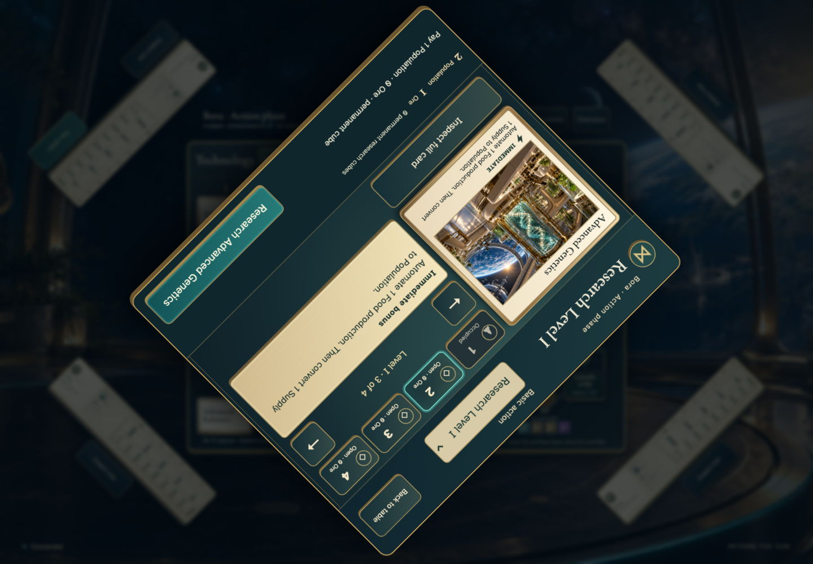](../../screenshots/plan-split-simultaneous-jumps-at-4-shared-corner-seats/034-prepare-1-browse-1-desktop-darwin.png) |

tabletop-4k · 3840 × 2160

[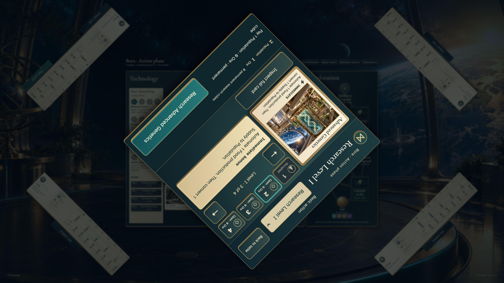](../../screenshots/plan-split-simultaneous-jumps-at-4-shared-corner-seats/034-prepare-1-browse-1-tabletop-4k-darwin.png)

- [x] Browse the next public Technology without paying
- [x] Actual canonical effects and acknowledgement settle.
- [x] Public topology retains physical separation.
- [x] The viewport fits without page scrolling.

## 36. Browse the next public Technology without paying

Viewpoint: **Bora · North West · one shared controller**.

| desktop · 1440 × 1000 |
| --- |
| [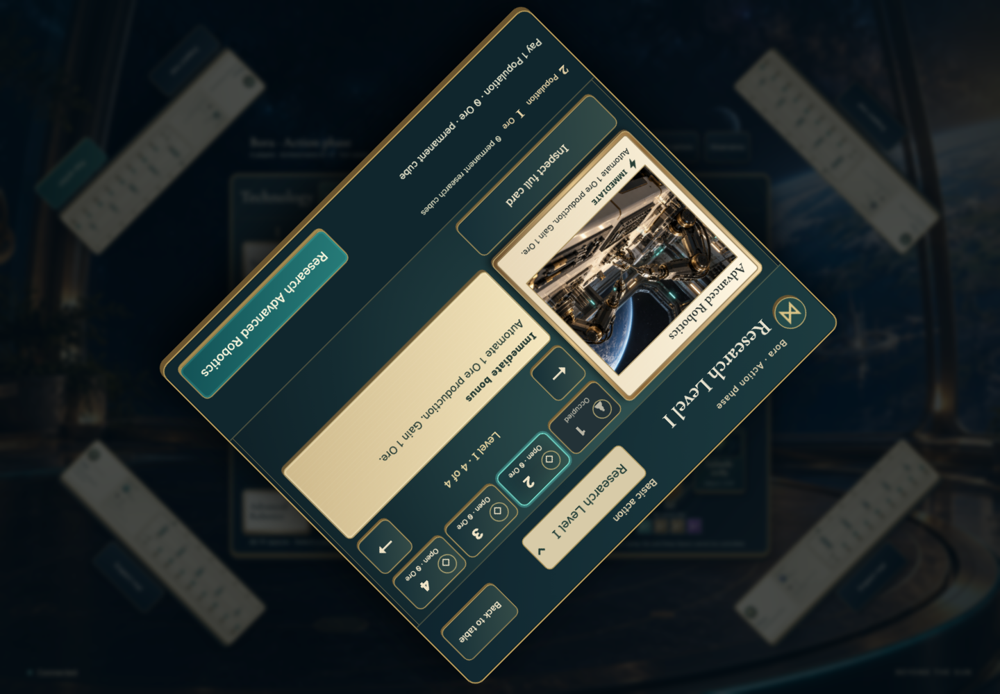](../../screenshots/plan-split-simultaneous-jumps-at-4-shared-corner-seats/035-prepare-1-browse-2-desktop-darwin.png) |

tabletop-4k · 3840 × 2160

[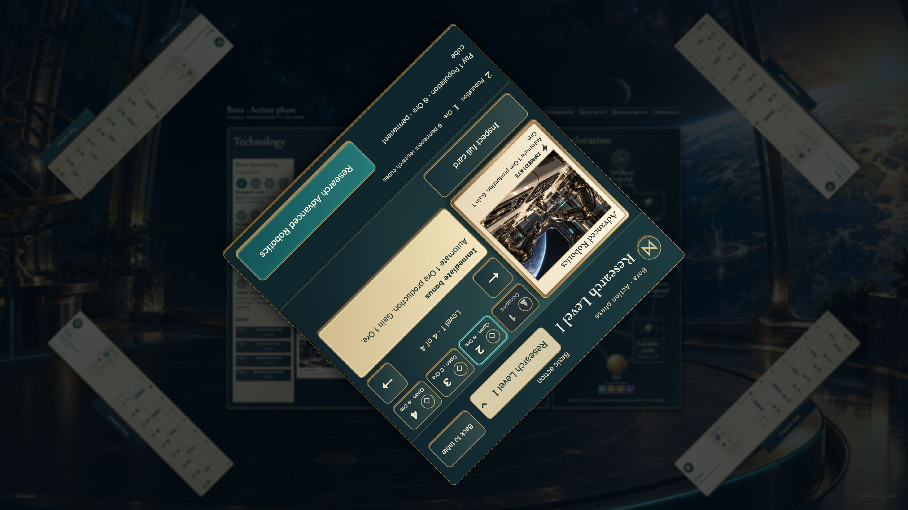](../../screenshots/plan-split-simultaneous-jumps-at-4-shared-corner-seats/035-prepare-1-browse-2-tabletop-4k-darwin.png)

- [x] Browse the next public Technology without paying
- [x] Actual canonical effects and acknowledgement settle.
- [x] Public topology retains physical separation.
- [x] The viewport fits without page scrolling.

## 37. Bora pays permanent research Population and resolves the printed bonus

Viewpoint: **Bora · North West · one shared controller**.

| desktop · 1440 × 1000 |
| --- |
| [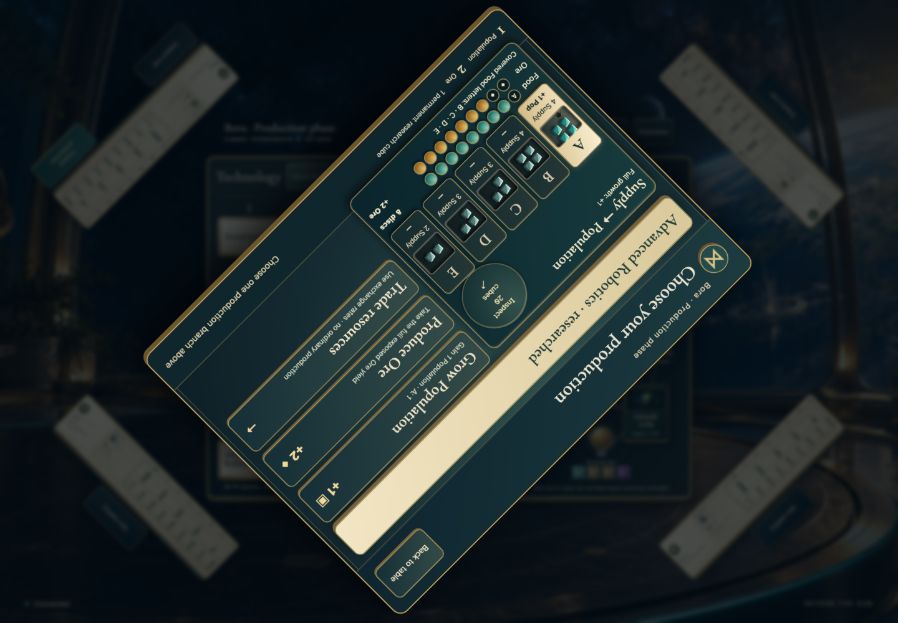](../../screenshots/plan-split-simultaneous-jumps-at-4-shared-corner-seats/036-prepare-1-paid-desktop-darwin.png) |

tabletop-4k · 3840 × 2160

[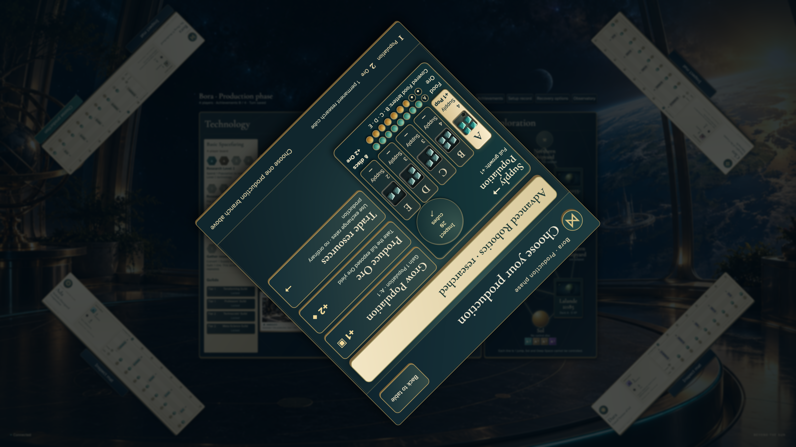](../../screenshots/plan-split-simultaneous-jumps-at-4-shared-corner-seats/036-prepare-1-paid-tabletop-4k-darwin.png)

- [x] Bora pays permanent research Population and resolves the printed bonus
- [x] Actual canonical effects and acknowledgement settle.
- [x] Public topology retains physical separation.
- [x] The viewport fits without page scrolling.

## 38. Bora completes ordinary production and hands off

Viewpoint: **Bora · North West · one shared controller**.

| desktop · 1440 × 1000 |
| --- |
| [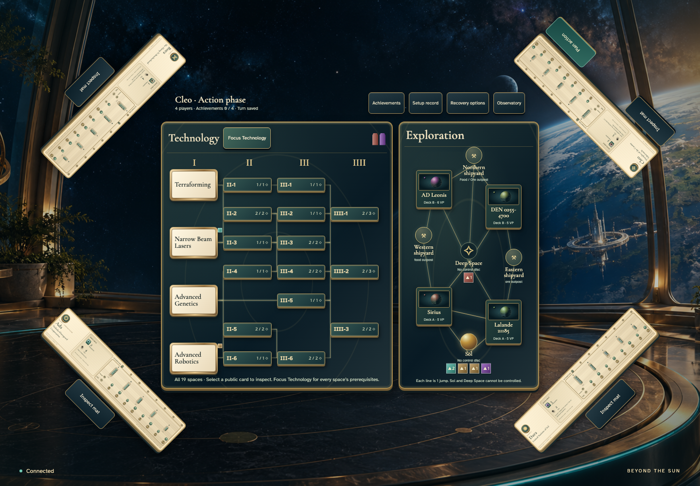](../../screenshots/plan-split-simultaneous-jumps-at-4-shared-corner-seats/037-prepare-1-handoff-desktop-darwin.png) |

tabletop-4k · 3840 × 2160

[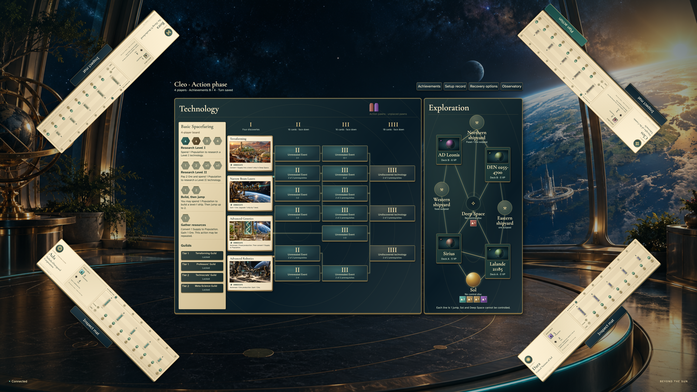](../../screenshots/plan-split-simultaneous-jumps-at-4-shared-corner-seats/037-prepare-1-handoff-tabletop-4k-darwin.png)

- [x] Bora completes ordinary production and hands off
- [x] Actual canonical effects and acknowledgement settle.
- [x] Public topology retains physical separation.
- [x] The viewport fits without page scrolling.

## 39. Cleo opens the actual Action instrument

Viewpoint: **Cleo · North East · one shared controller**.

| desktop · 1440 × 1000 |
| --- |
| [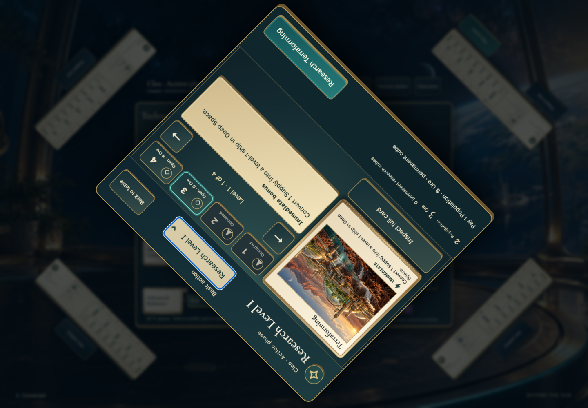](../../screenshots/plan-split-simultaneous-jumps-at-4-shared-corner-seats/038-prepare-2-plan-desktop-darwin.png) |

tabletop-4k · 3840 × 2160

- [x] Cleo opens the actual Action instrument
- [x] Actual canonical effects and acknowledgement settle.
- [x] Public topology retains physical separation.
- [x] The viewport fits without page scrolling.

## 40. Cleo chooses the unoccupied printed research space

Viewpoint: **Cleo · North East · one shared controller**.

| desktop · 1440 × 1000 |
| --- |
| [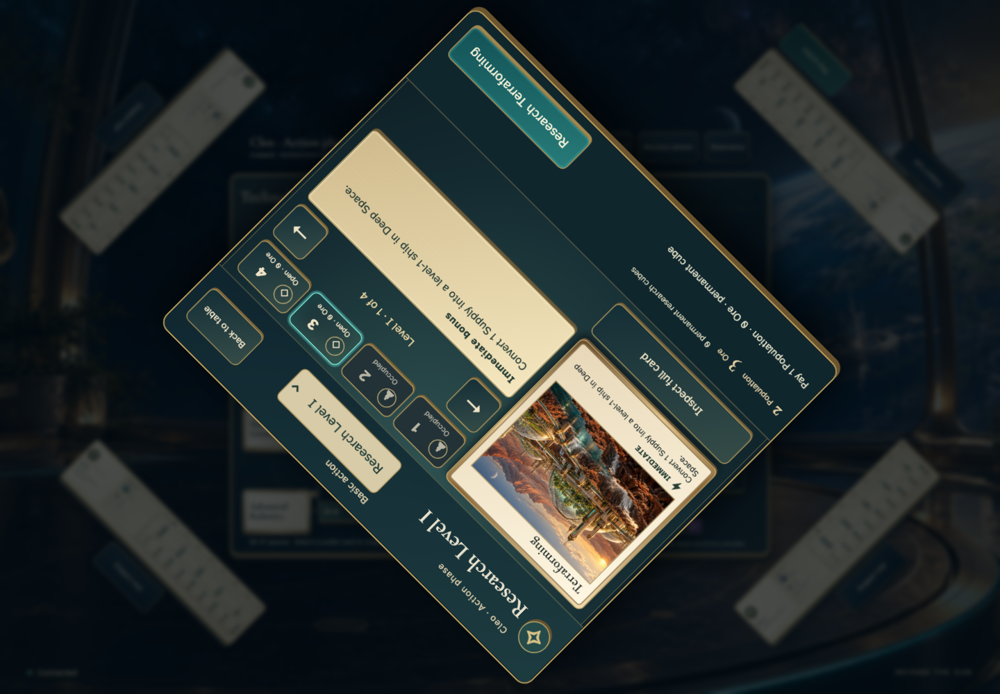](../../screenshots/plan-split-simultaneous-jumps-at-4-shared-corner-seats/039-prepare-2-space-desktop-darwin.png) |

tabletop-4k · 3840 × 2160

[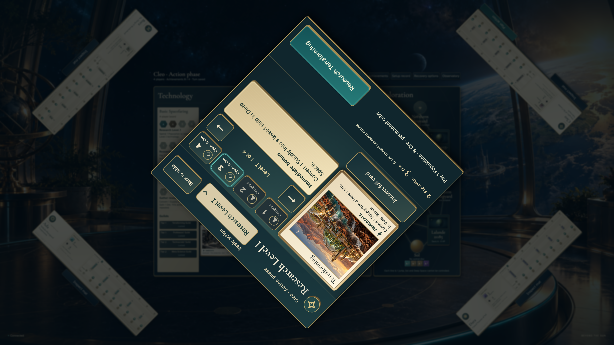](../../screenshots/plan-split-simultaneous-jumps-at-4-shared-corner-seats/039-prepare-2-space-tabletop-4k-darwin.png)

- [x] Cleo chooses the unoccupied printed research space
- [x] Actual canonical effects and acknowledgement settle.
- [x] Public topology retains physical separation.
- [x] The viewport fits without page scrolling.

## 41. Browse the next public Technology without paying

Viewpoint: **Cleo · North East · one shared controller**.

| desktop · 1440 × 1000 |
| --- |
| [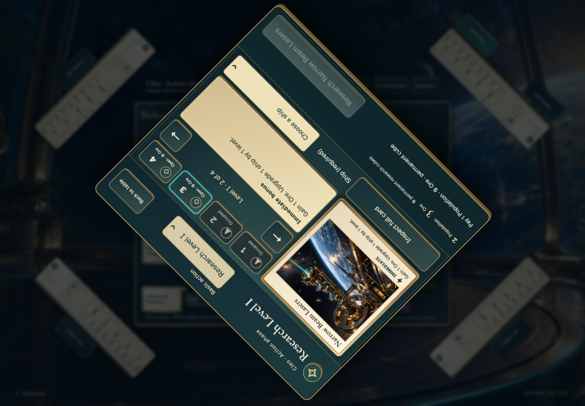](../../screenshots/plan-split-simultaneous-jumps-at-4-shared-corner-seats/040-prepare-2-browse-0-desktop-darwin.png) |

tabletop-4k · 3840 × 2160

[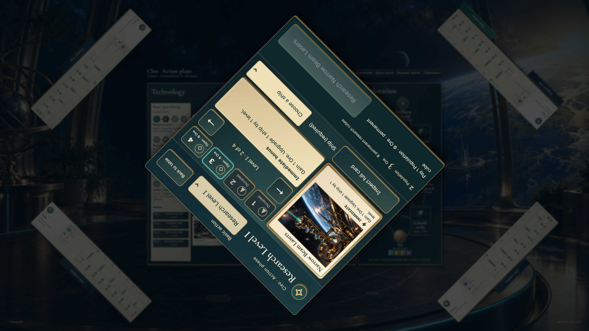](../../screenshots/plan-split-simultaneous-jumps-at-4-shared-corner-seats/040-prepare-2-browse-0-tabletop-4k-darwin.png)

- [x] Browse the next public Technology without paying
- [x] Actual canonical effects and acknowledgement settle.
- [x] Public topology retains physical separation.
- [x] The viewport fits without page scrolling.

## 42. Browse the next public Technology without paying

Viewpoint: **Cleo · North East · one shared controller**.

| desktop · 1440 × 1000 |
| --- |
| [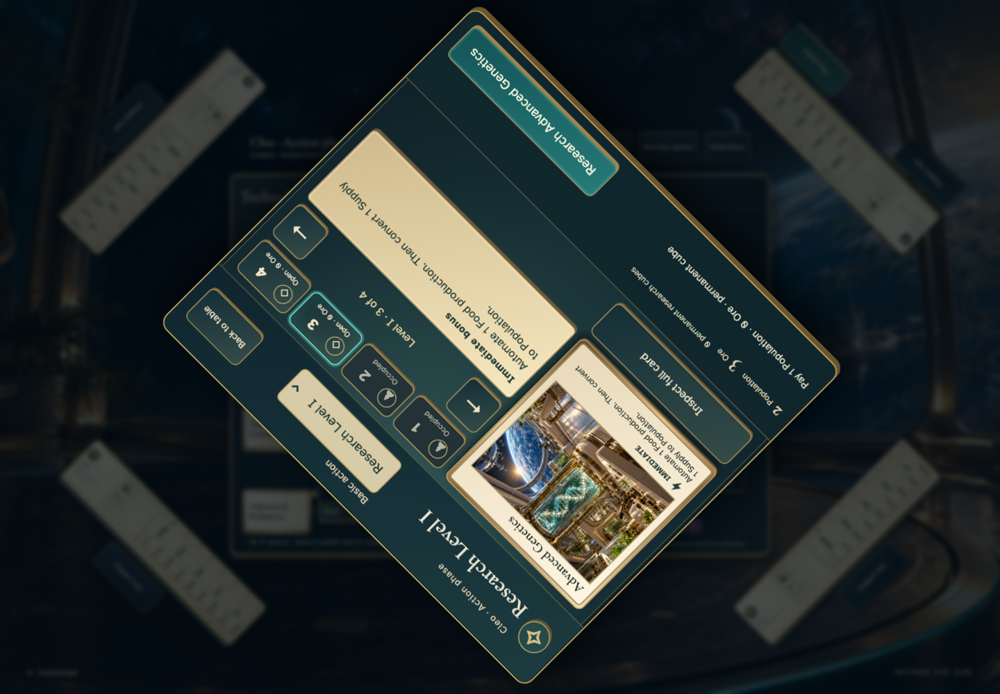](../../screenshots/plan-split-simultaneous-jumps-at-4-shared-corner-seats/041-prepare-2-browse-1-desktop-darwin.png) |

tabletop-4k · 3840 × 2160

[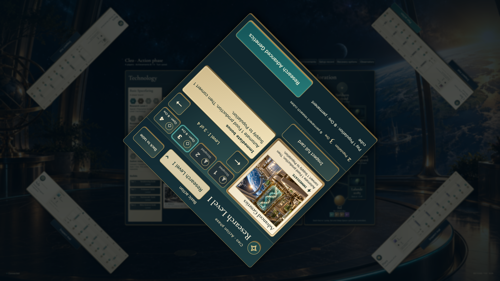](../../screenshots/plan-split-simultaneous-jumps-at-4-shared-corner-seats/041-prepare-2-browse-1-tabletop-4k-darwin.png)

- [x] Browse the next public Technology without paying
- [x] Actual canonical effects and acknowledgement settle.
- [x] Public topology retains physical separation.
- [x] The viewport fits without page scrolling.

## 43. Browse the next public Technology without paying

Viewpoint: **Cleo · North East · one shared controller**.

| desktop · 1440 × 1000 |
| --- |
| [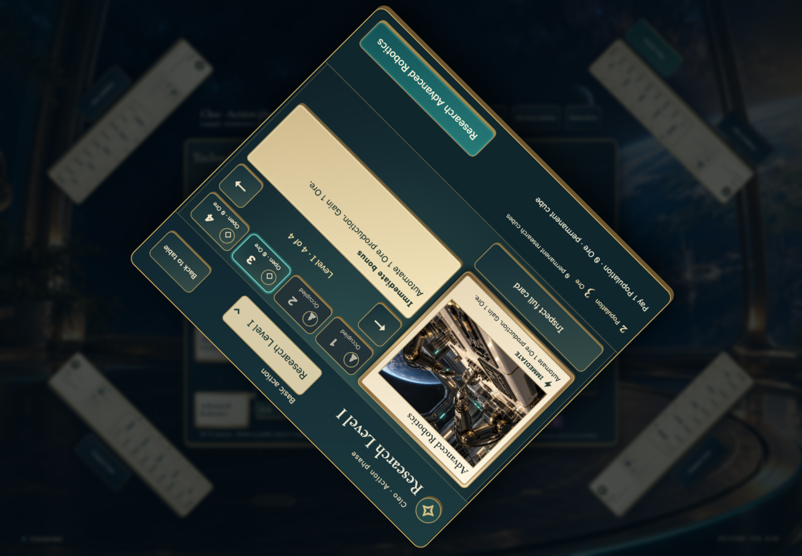](../../screenshots/plan-split-simultaneous-jumps-at-4-shared-corner-seats/042-prepare-2-browse-2-desktop-darwin.png) |

tabletop-4k · 3840 × 2160

[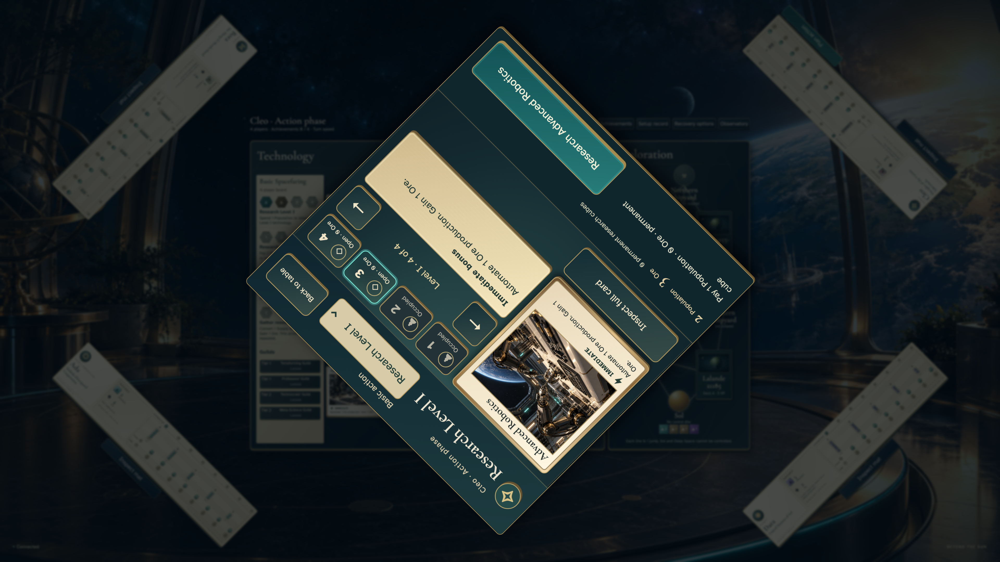](../../screenshots/plan-split-simultaneous-jumps-at-4-shared-corner-seats/042-prepare-2-browse-2-tabletop-4k-darwin.png)

- [x] Browse the next public Technology without paying
- [x] Actual canonical effects and acknowledgement settle.
- [x] Public topology retains physical separation.
- [x] The viewport fits without page scrolling.

## 44. Cleo pays permanent research Population and resolves the printed bonus

Viewpoint: **Cleo · North East · one shared controller**.

| desktop · 1440 × 1000 |
| --- |
| [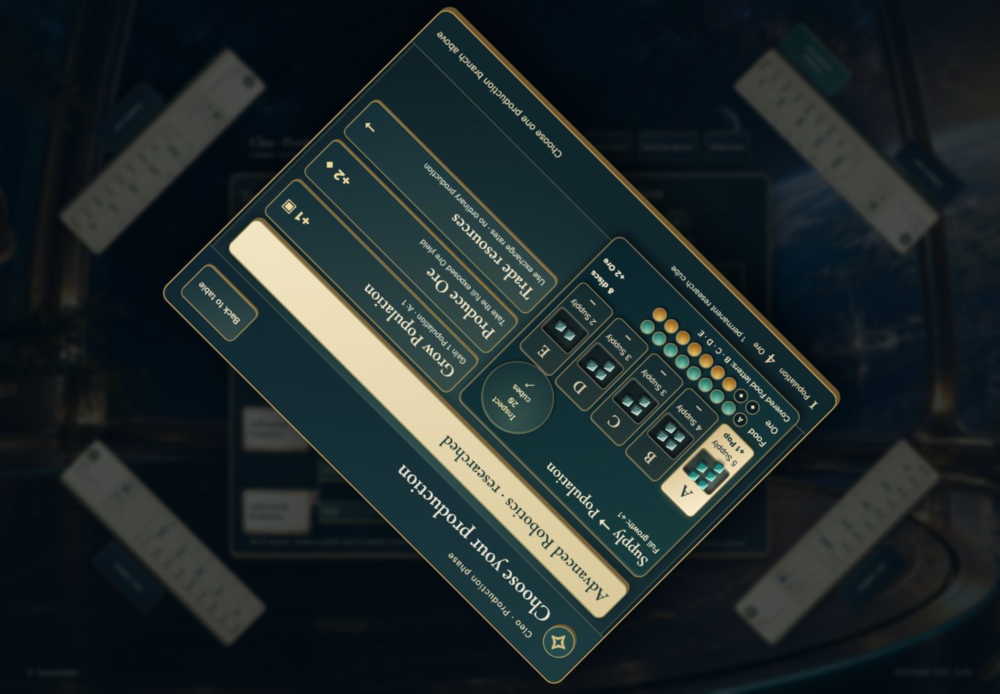](../../screenshots/plan-split-simultaneous-jumps-at-4-shared-corner-seats/043-prepare-2-paid-desktop-darwin.png) |

tabletop-4k · 3840 × 2160

[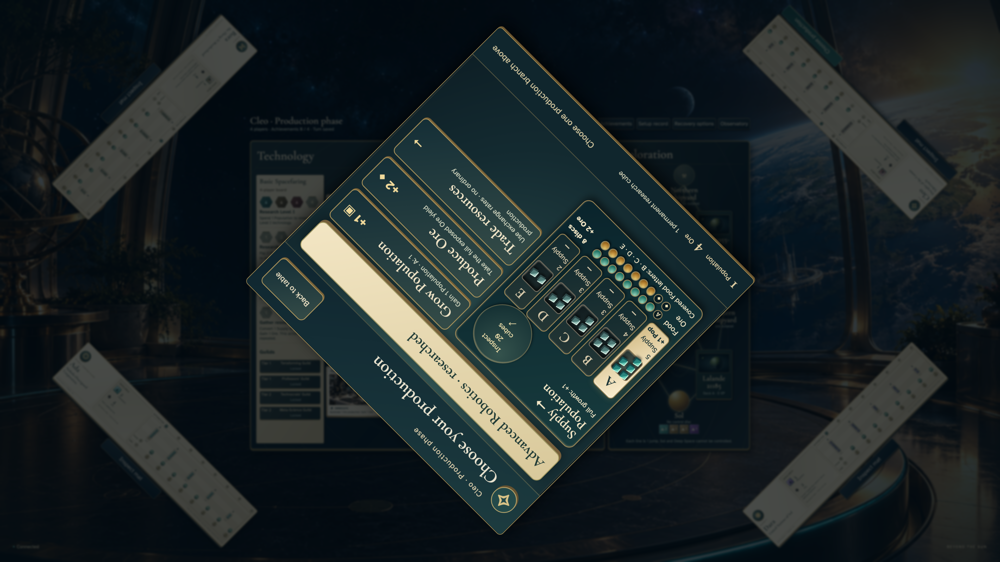](../../screenshots/plan-split-simultaneous-jumps-at-4-shared-corner-seats/043-prepare-2-paid-tabletop-4k-darwin.png)

- [x] Cleo pays permanent research Population and resolves the printed bonus
- [x] Actual canonical effects and acknowledgement settle.
- [x] Public topology retains physical separation.
- [x] The viewport fits without page scrolling.

## 45. Cleo completes ordinary production and hands off

Viewpoint: **Cleo · North East · one shared controller**.

| desktop · 1440 × 1000 |
| --- |
|  |

tabletop-4k · 3840 × 2160

- [x] Cleo completes ordinary production and hands off
- [x] Actual canonical effects and acknowledgement settle.
- [x] Public topology retains physical separation.
- [x] The viewport fits without page scrolling.

## 46. Dara opens the actual Action instrument

Viewpoint: **Dara · South East · one shared controller**.

| desktop · 1440 × 1000 |
| --- |
| [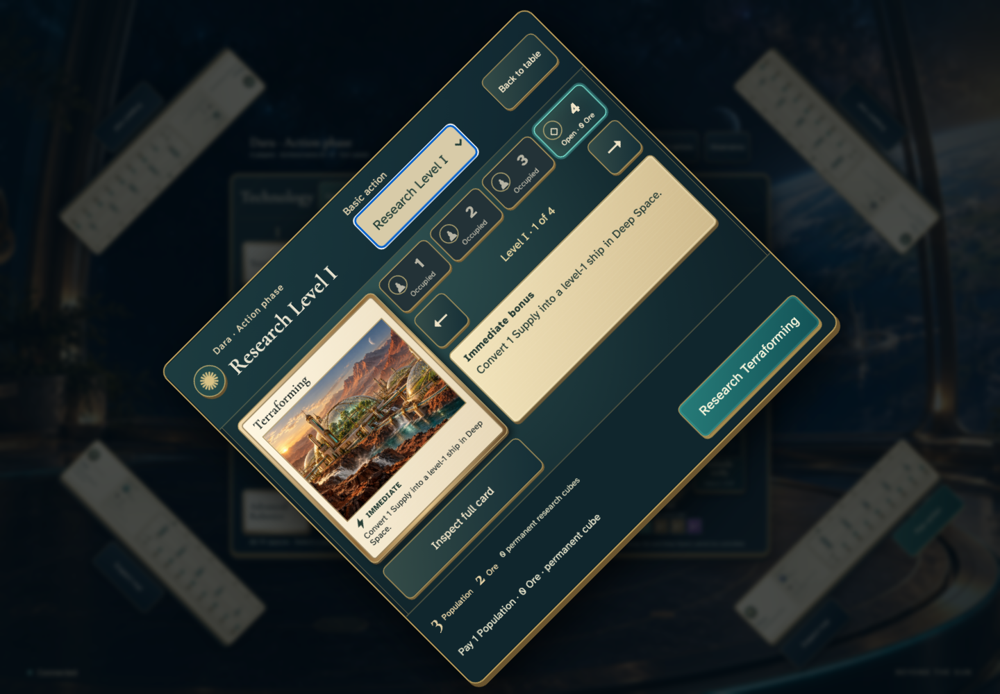](../../screenshots/plan-split-simultaneous-jumps-at-4-shared-corner-seats/045-prepare-3-plan-desktop-darwin.png) |

tabletop-4k · 3840 × 2160

- [x] Dara opens the actual Action instrument
- [x] Actual canonical effects and acknowledgement settle.
- [x] Public topology retains physical separation.
- [x] The viewport fits without page scrolling.

## 47. Dara chooses the unoccupied printed research space

Viewpoint: **Dara · South East · one shared controller**.

| desktop · 1440 × 1000 |
| --- |
|  |

tabletop-4k · 3840 × 2160

[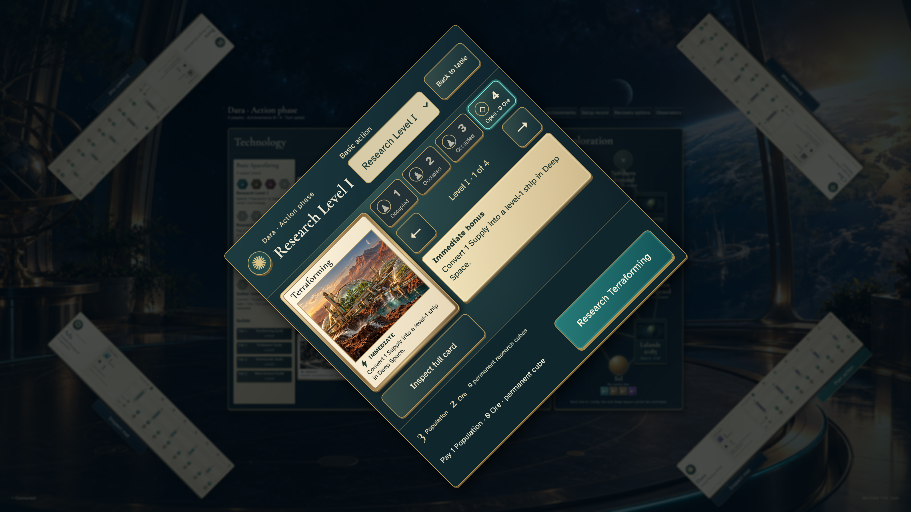](../../screenshots/plan-split-simultaneous-jumps-at-4-shared-corner-seats/046-prepare-3-space-tabletop-4k-darwin.png)

- [x] Dara chooses the unoccupied printed research space
- [x] Actual canonical effects and acknowledgement settle.
- [x] Public topology retains physical separation.
- [x] The viewport fits without page scrolling.

## 48. Browse the next public Technology without paying

Viewpoint: **Dara · South East · one shared controller**.

| desktop · 1440 × 1000 |
| --- |
| [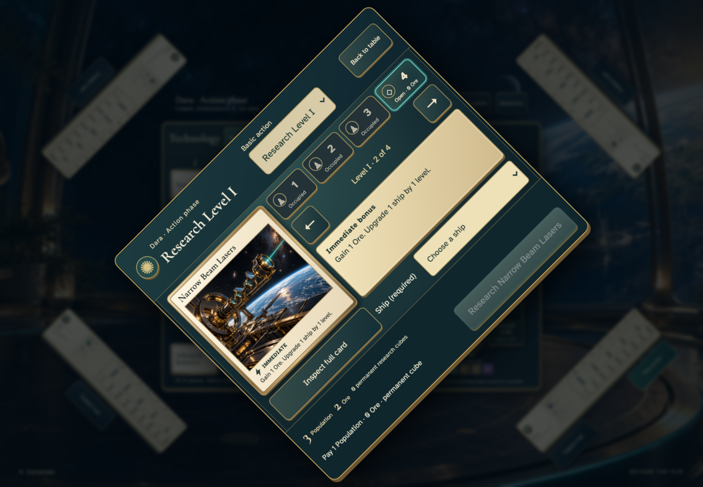](../../screenshots/plan-split-simultaneous-jumps-at-4-shared-corner-seats/047-prepare-3-browse-0-desktop-darwin.png) |

tabletop-4k · 3840 × 2160

[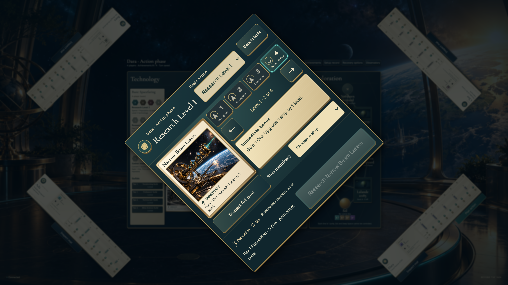](../../screenshots/plan-split-simultaneous-jumps-at-4-shared-corner-seats/047-prepare-3-browse-0-tabletop-4k-darwin.png)

- [x] Browse the next public Technology without paying
- [x] Actual canonical effects and acknowledgement settle.
- [x] Public topology retains physical separation.
- [x] The viewport fits without page scrolling.

## 49. Browse the next public Technology without paying

Viewpoint: **Dara · South East · one shared controller**.

| desktop · 1440 × 1000 |
| --- |
| [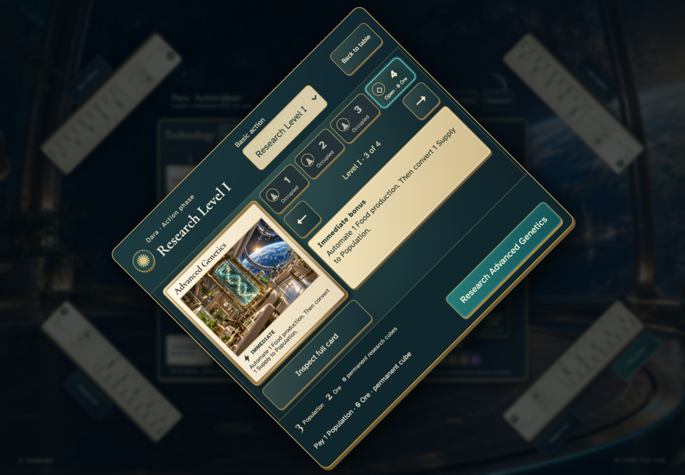](../../screenshots/plan-split-simultaneous-jumps-at-4-shared-corner-seats/048-prepare-3-browse-1-desktop-darwin.png) |

tabletop-4k · 3840 × 2160

[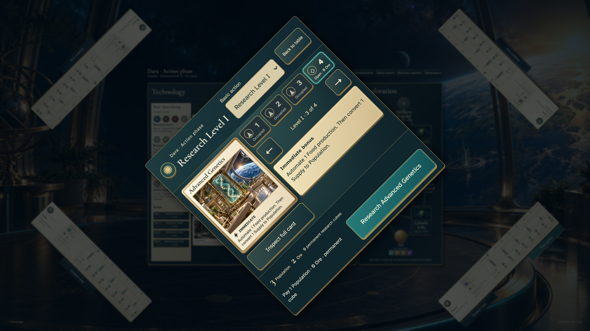](../../screenshots/plan-split-simultaneous-jumps-at-4-shared-corner-seats/048-prepare-3-browse-1-tabletop-4k-darwin.png)

- [x] Browse the next public Technology without paying
- [x] Actual canonical effects and acknowledgement settle.
- [x] Public topology retains physical separation.
- [x] The viewport fits without page scrolling.

## 50. Browse the next public Technology without paying

Viewpoint: **Dara · South East · one shared controller**.

| desktop · 1440 × 1000 |
| --- |
| [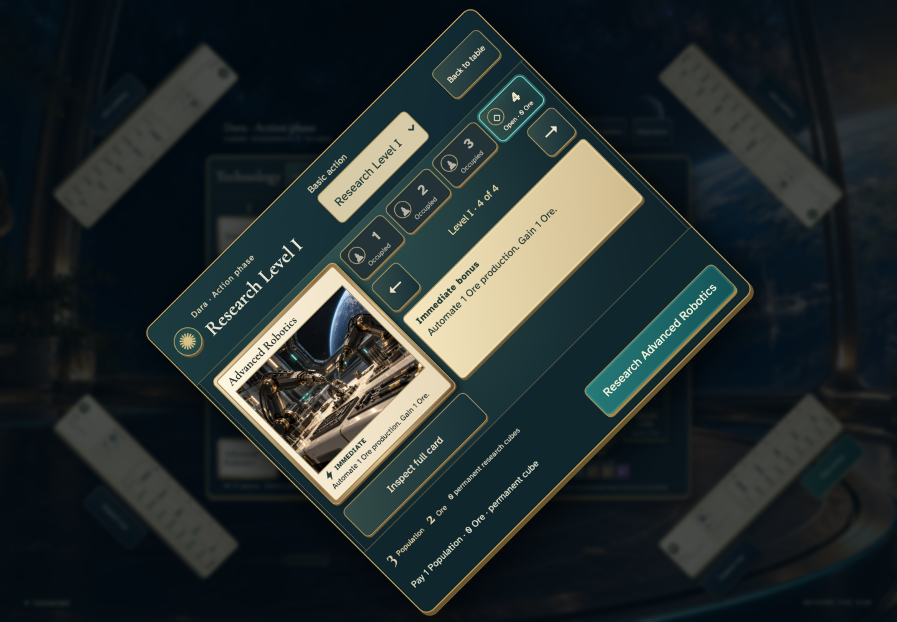](../../screenshots/plan-split-simultaneous-jumps-at-4-shared-corner-seats/049-prepare-3-browse-2-desktop-darwin.png) |

tabletop-4k · 3840 × 2160

[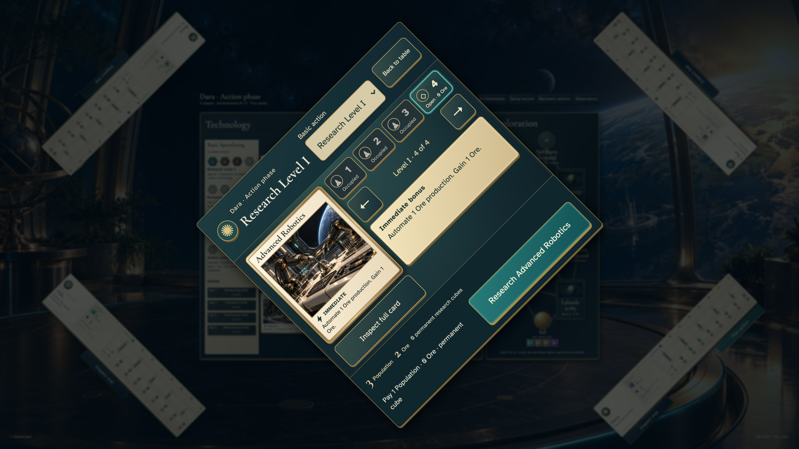](../../screenshots/plan-split-simultaneous-jumps-at-4-shared-corner-seats/049-prepare-3-browse-2-tabletop-4k-darwin.png)

- [x] Browse the next public Technology without paying
- [x] Actual canonical effects and acknowledgement settle.
- [x] Public topology retains physical separation.
- [x] The viewport fits without page scrolling.

## 51. Dara pays permanent research Population and resolves the printed bonus

Viewpoint: **Dara · South East · one shared controller**.

| desktop · 1440 × 1000 |
| --- |
| [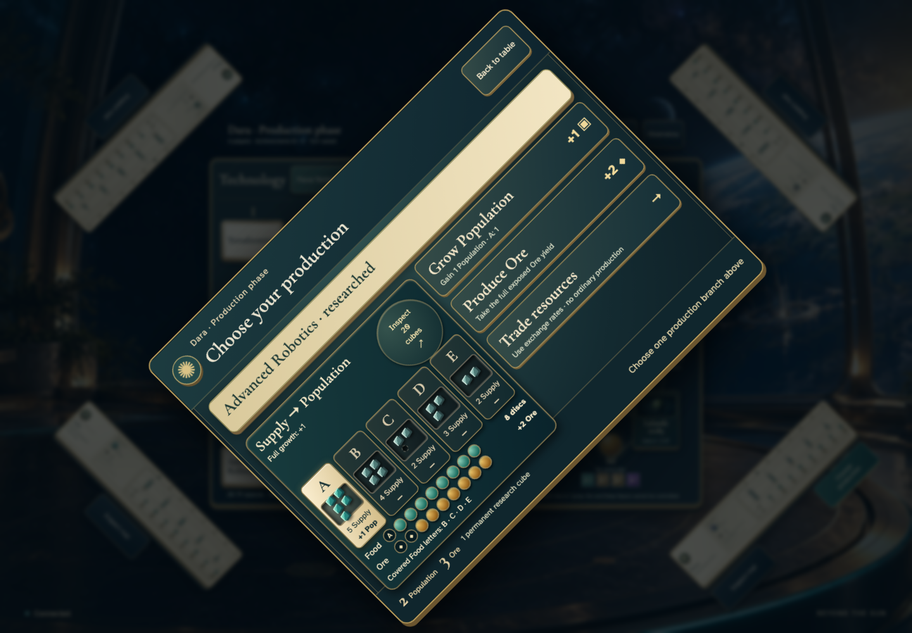](../../screenshots/plan-split-simultaneous-jumps-at-4-shared-corner-seats/050-prepare-3-paid-desktop-darwin.png) |

tabletop-4k · 3840 × 2160

[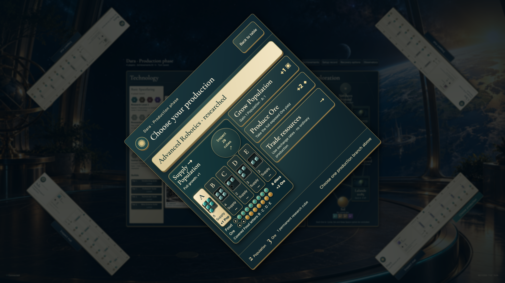](../../screenshots/plan-split-simultaneous-jumps-at-4-shared-corner-seats/050-prepare-3-paid-tabletop-4k-darwin.png)

- [x] Dara pays permanent research Population and resolves the printed bonus
- [x] Actual canonical effects and acknowledgement settle.
- [x] Public topology retains physical separation.
- [x] The viewport fits without page scrolling.

## 52. Dara completes ordinary production and hands off

Viewpoint: **Dara · South East · one shared controller**.

| desktop · 1440 × 1000 |
| --- |
|  |

tabletop-4k · 3840 × 2160

- [x] Dara completes ordinary production and hands off
- [x] Actual canonical effects and acknowledgement settle.
- [x] Public topology retains physical separation.
- [x] The viewport fits without page scrolling.

## 53. Ada opens the actual Action instrument

Viewpoint: **Ada · South West · one shared controller**.

| desktop · 1440 × 1000 |
| --- |
|  |

tabletop-4k · 3840 × 2160

- [x] Ada opens the actual Action instrument
- [x] Actual canonical effects and acknowledgement settle.
- [x] Public topology retains physical separation.
- [x] The viewport fits without page scrolling.

## 54. Ada selects a printed Technology Action

Viewpoint: **Ada · South West · one shared controller**.

| desktop · 1440 × 1000 |
| --- |
|  |

tabletop-4k · 3840 × 2160

- [x] Ada selects a printed Technology Action
- [x] Actual canonical effects and acknowledgement settle.
- [x] Public topology retains physical separation.
- [x] The viewport fits without page scrolling.

## 55. Read the actual printed movement allowance and payment

Viewpoint: **Ada · South West · one shared controller**.

| desktop · 1440 × 1000 |
| --- |
|  |

tabletop-4k · 3840 × 2160

- [x] Read the actual printed movement allowance and payment
- [x] Actual canonical effects and acknowledgement settle.
- [x] Public topology retains physical separation.
- [x] The viewport fits without page scrolling.

## 56. Open simultaneous movement after canonical payment

Viewpoint: **Ada · South West · one shared controller**.

| desktop · 1440 × 1000 |
| --- |
|  |

tabletop-4k · 3840 × 2160

- [x] Open simultaneous movement after canonical payment
- [x] Actual canonical effects and acknowledgement settle.
- [x] Public topology retains physical separation.
- [x] The viewport fits without page scrolling.

## 57. Inspect actual public connections with the complete visible jump allowance

Viewpoint: **Ada · South West · one shared controller**.

| desktop · 1440 × 1000 |
| --- |
|  |

tabletop-4k · 3840 × 2160

- [x] Inspect actual public connections with the complete visible jump allowance
- [x] Actual canonical effects and acknowledgement settle.
- [x] Public topology retains physical separation.
- [x] The viewport fits without page scrolling.

## 58. Inspect the actual source face without taking movement

Viewpoint: **Ada · South West · one shared controller**.

| desktop · 1440 × 1000 |
| --- |
|  |

tabletop-4k · 3840 × 2160

- [x] Inspect the actual source face without taking movement
- [x] Actual canonical effects and acknowledgement settle.
- [x] Public topology retains physical separation.
- [x] The viewport fits without page scrolling.

## 59. Keyboard reaches the complete printed rules

Viewpoint: **Ada · South West · one shared controller**.

| desktop · 1440 × 1000 |
| --- |
|  |

tabletop-4k · 3840 × 2160

- [x] Keyboard reaches the complete printed rules
- [x] Actual canonical effects and acknowledgement settle.
- [x] Public topology retains physical separation.
- [x] The viewport fits without page scrolling.

## 60. Escape restores the exact source opener

Viewpoint: **Ada · South West · one shared controller**.

| desktop · 1440 × 1000 |
| --- |
|  |

tabletop-4k · 3840 × 2160

- [x] Escape restores the exact source opener
- [x] Actual canonical effects and acknowledgement settle.
- [x] Public topology retains physical separation.
- [x] The viewport fits without page scrolling.

## 61. Read the ship and connected-destination view

Viewpoint: **Ada · South West · one shared controller**.

| desktop · 1440 × 1000 |
| --- |
|  |

tabletop-4k · 3840 × 2160

- [x] Read the ship and connected-destination view
- [x] Actual canonical effects and acknowledgement settle.
- [x] Public topology retains physical separation.
- [x] The viewport fits without page scrolling.

## 62. Plan one connected leg without moving a cube

Viewpoint: **Ada · South West · one shared controller**.

| desktop · 1440 × 1000 |
| --- |
|  |

tabletop-4k · 3840 × 2160

- [x] Plan one connected leg without moving a cube
- [x] Actual canonical effects and acknowledgement settle.
- [x] Public topology retains physical separation.
- [x] The viewport fits without page scrolling.

## 63. Remove the selected ship’s last leg without refunding Action payment

Viewpoint: **Ada · South West · one shared controller**.

| desktop · 1440 × 1000 |
| --- |
|  |

tabletop-4k · 3840 × 2160

- [x] Remove the selected ship’s last leg without refunding Action payment
- [x] Actual canonical effects and acknowledgement settle.
- [x] Public topology retains physical separation.
- [x] The viewport fits without page scrolling.

## 64. Plan another unpaid leg

Viewpoint: **Ada · South West · one shared controller**.

| desktop · 1440 × 1000 |
| --- |
|  |

tabletop-4k · 3840 × 2160

- [x] Plan another unpaid leg
- [x] Actual canonical effects and acknowledgement settle.
- [x] Public topology retains physical separation.
- [x] The viewport fits without page scrolling.

## 65. Clear the unpaid plan while retaining the paid Action

Viewpoint: **Ada · South West · one shared controller**.

| desktop · 1440 × 1000 |
| --- |
|  |

tabletop-4k · 3840 × 2160

- [x] Clear the unpaid plan while retaining the paid Action
- [x] Actual canonical effects and acknowledgement settle.
- [x] Public topology retains physical separation.
- [x] The viewport fits without page scrolling.

## 66. Reload preserves the paid Action and pending movement

Viewpoint: **Ada · South West · one shared controller**.

| desktop · 1440 × 1000 |
| --- |
|  |

tabletop-4k · 3840 × 2160

- [x] Reload preserves the paid Action and pending movement
- [x] Actual canonical effects and acknowledgement settle.
- [x] Public topology retains physical separation.
- [x] The viewport fits without page scrolling.

## 67. Resume the saved allowance without duplicate payment or construction

Viewpoint: **Ada · South West · one shared controller**.

| desktop · 1440 × 1000 |
| --- |
|  |

tabletop-4k · 3840 × 2160

- [x] Resume the saved allowance without duplicate payment or construction
- [x] Actual canonical effects and acknowledgement settle.
- [x] Public topology retains physical separation.
- [x] The viewport fits without page scrolling.

## 68. Read the recovered connected-destination view

Viewpoint: **Ada · South West · one shared controller**.

| desktop · 1440 × 1000 |
| --- |
|  |

tabletop-4k · 3840 × 2160

- [x] Read the recovered connected-destination view
- [x] Actual canonical effects and acknowledgement settle.
- [x] Public topology retains physical separation.
- [x] The viewport fits without page scrolling.

## 69. Choose the first actual adjacent System

Viewpoint: **Ada · South West · one shared controller**.

| desktop · 1440 × 1000 |
| --- |
|  |

tabletop-4k · 3840 × 2160

- [x] Choose the first actual adjacent System
- [x] Actual canonical effects and acknowledgement settle.
- [x] Public topology retains physical separation.
- [x] The viewport fits without page scrolling.

## 70. Continue the same ship through the System to Deep Space

Viewpoint: **Ada · South West · one shared controller**.

| desktop · 1440 × 1000 |
| --- |
|  |

tabletop-4k · 3840 × 2160

- [x] Continue the same ship through the System to Deep Space
- [x] Actual canonical effects and acknowledgement settle.
- [x] Public topology retains physical separation.
- [x] The viewport fits without page scrolling.

## 71. Split the allowance onto the second real owned ship

Viewpoint: **Ada · South West · one shared controller**.

| desktop · 1440 × 1000 |
| --- |
|  |

tabletop-4k · 3840 × 2160

- [x] Split the allowance onto the second real owned ship
- [x] Actual canonical effects and acknowledgement settle.
- [x] Public topology retains physical separation.
- [x] The viewport fits without page scrolling.

## 72. Use the third point for the second ship’s System endpoint

Viewpoint: **Ada · South West · one shared controller**.

| desktop · 1440 × 1000 |
| --- |
|  |

tabletop-4k · 3840 × 2160

- [x] Use the third point for the second ship’s System endpoint
- [x] Actual canonical effects and acknowledgement settle.
- [x] Public topology retains physical separation.
- [x] The viewport fits without page scrolling.

## 73. Read the selected ship’s complete route and level

Viewpoint: **Ada · South West · one shared controller**.

| desktop · 1440 × 1000 |
| --- |
|  |

tabletop-4k · 3840 × 2160

- [x] Read the selected ship’s complete route and level
- [x] Actual canonical effects and acknowledgement settle.
- [x] Public topology retains physical separation.
- [x] The viewport fits without page scrolling.

## 74. Read another real owned ship’s complete path

Viewpoint: **Ada · South West · one shared controller**.

| desktop · 1440 × 1000 |
| --- |
|  |

tabletop-4k · 3840 × 2160

- [x] Read another real owned ship’s complete path
- [x] Actual canonical effects and acknowledgement settle.
- [x] Public topology retains physical separation.
- [x] The viewport fits without page scrolling.

## 75. The short shared reader retains complete route context and Commit

Viewpoint: **Ada · South West · one shared controller**.

| desktop · 1280 × 640 |
| --- |
|  |

tabletop-4k · 1280 × 640

- [x] The short shared reader retains complete route context and Commit
- [x] Actual canonical effects and acknowledgement settle.
- [x] Public topology retains physical separation.
- [x] The viewport fits without page scrolling.

## 76. Restore the declared shared viewport before commit

Viewpoint: **Ada · South West · one shared controller**.

| desktop · 1440 × 1000 |
| --- |
|  |

tabletop-4k · 3840 × 2160

- [x] Restore the declared shared viewport before commit
- [x] Actual canonical effects and acknowledgement settle.
- [x] Public topology retains physical separation.
- [x] The viewport fits without page scrolling.

## 77. Review final departure and arrival power together before commit

Viewpoint: **Ada · South West · one shared controller**.

| desktop · 1440 × 1000 |
| --- |
|  |

tabletop-4k · 3840 × 2160

- [x] Review final departure and arrival power together before commit
- [x] Actual canonical effects and acknowledgement settle.
- [x] Public topology retains physical separation.
- [x] The viewport fits without page scrolling.

## 78. The short shared endpoint view initially exposes its identity and every final-power row

Viewpoint: **Ada · South West · one shared controller**.

| desktop · 1280 × 640 |
| --- |
|  |

tabletop-4k · 1280 × 640

- [x] The short shared endpoint view initially exposes its identity and every final-power row
- [x] Actual canonical effects and acknowledgement settle.
- [x] Public topology retains physical separation.
- [x] The viewport fits without page scrolling.

## 79. Restore the actual shared viewport with the same endpoint plan

Viewpoint: **Ada · South West · one shared controller**.

| desktop · 1440 × 1000 |
| --- |
|  |

tabletop-4k · 3840 × 2160

- [x] Restore the actual shared viewport with the same endpoint plan
- [x] Actual canonical effects and acknowledgement settle.
- [x] Public topology retains physical separation.
- [x] The viewport fits without page scrolling.

## 80. Read the next actual endpoint and control consequence

Viewpoint: **Ada · South West · one shared controller**.

| desktop · 1440 × 1000 |
| --- |
|  |

tabletop-4k · 3840 × 2160

- [x] Read the next actual endpoint and control consequence
- [x] Actual canonical effects and acknowledgement settle.
- [x] Public topology retains physical separation.
- [x] The viewport fits without page scrolling.

## 81. Read the next actual endpoint and control consequence

Viewpoint: **Ada · South West · one shared controller**.

| desktop · 1440 × 1000 |
| --- |
|  |

tabletop-4k · 3840 × 2160

- [x] Read the next actual endpoint and control consequence
- [x] Actual canonical effects and acknowledgement settle.
- [x] Public topology retains physical separation.
- [x] The viewport fits without page scrolling.

## 82. Return to the intact allocated routes before inspecting a real endpoint

Viewpoint: **Ada · South West · one shared controller**.

| desktop · 1440 × 1000 |
| --- |
|  |

tabletop-4k · 3840 × 2160

- [x] Return to the intact allocated routes before inspecting a real endpoint
- [x] Actual canonical effects and acknowledgement settle.
- [x] Public topology retains physical separation.
- [x] The viewport fits without page scrolling.

## 83. Select the real System-ending ship without changing any leg

Viewpoint: **Ada · South West · one shared controller**.

| desktop · 1440 × 1000 |
| --- |
|  |

tabletop-4k · 3840 × 2160

- [x] Select the real System-ending ship without changing any leg
- [x] Actual canonical effects and acknowledgement settle.
- [x] Public topology retains physical separation.
- [x] The viewport fits without page scrolling.

## 84. Open the full reusable System face from its actual pending route

Viewpoint: **Ada · South West · one shared controller**.

| desktop · 1440 × 1000 |
| --- |
|  |

tabletop-4k · 3840 × 2160

- [x] Open the full reusable System face from its actual pending route
- [x] Actual canonical effects and acknowledgement settle.
- [x] Public topology retains physical separation.
- [x] The viewport fits without page scrolling.

## 85. Read the complete printed System rules without moving a cube

Viewpoint: **Ada · South West · one shared controller**.

| desktop · 1440 × 1000 |
| --- |
|  |

tabletop-4k · 3840 × 2160

- [x] Read the complete printed System rules without moving a cube
- [x] Actual canonical effects and acknowledgement settle.
- [x] Public topology retains physical separation.
- [x] The viewport fits without page scrolling.

## 86. Escape restores the exact endpoint opener and the same fully allocated plan

Viewpoint: **Ada · South West · one shared controller**.

| desktop · 1440 × 1000 |
| --- |
|  |

tabletop-4k · 3840 × 2160

- [x] Escape restores the exact endpoint opener and the same fully allocated plan
- [x] Actual canonical effects and acknowledgement settle.
- [x] Public topology retains physical separation.
- [x] The viewport fits without page scrolling.

## 87. Keyboard reaches the atomic Commit outside the reader

Viewpoint: **Ada · South West · one shared controller**.

| desktop · 1440 × 1000 |
| --- |
|  |

tabletop-4k · 3840 × 2160

- [x] Keyboard reaches the atomic Commit outside the reader
- [x] Actual canonical effects and acknowledgement settle.
- [x] Public topology retains physical separation.
- [x] The viewport fits without page scrolling.

## 88. Commit all ships together and resume actual saved consequences

Viewpoint: **Ada · South West · one shared controller**.

| desktop · 1440 × 1000 |
| --- |
|  |

tabletop-4k · 3840 × 2160

- [x] Commit all ships together and resume actual saved consequences
- [x] Actual canonical effects and acknowledgement settle.
- [x] Public topology retains physical separation.
- [x] The viewport fits without page scrolling.

## 89. All endpoint changes and printed bonuses are saved before production

Viewpoint: **Ada · South West · one shared controller**.

| desktop · 1440 × 1000 |
| --- |
|  |

tabletop-4k · 3840 × 2160

- [x] All endpoint changes and printed bonuses are saved before production
- [x] Actual canonical effects and acknowledgement settle.
- [x] Public topology retains physical separation.
- [x] The viewport fits without page scrolling.

## 90. Reload retains committed ships and saved Production

Viewpoint: **Ada · South West · one shared controller**.

| desktop · 1440 × 1000 |
| --- |
|  |

tabletop-4k · 3840 × 2160

- [x] Reload retains committed ships and saved Production
- [x] Actual canonical effects and acknowledgement settle.
- [x] Public topology retains physical separation.
- [x] The viewport fits without page scrolling.

## 91. Resume Production without replaying movement or bonuses

Viewpoint: **Ada · South West · one shared controller**.

| desktop · 1440 × 1000 |
| --- |
|  |

tabletop-4k · 3840 × 2160

- [x] Resume Production without replaying movement or bonuses
- [x] Actual canonical effects and acknowledgement settle.
- [x] Public topology retains physical separation.
- [x] The viewport fits without page scrolling.

## 92. Close the decision to inspect the saved public fleet

Viewpoint: **Ada · South West · one shared controller**.

| desktop · 1440 × 1000 |
| --- |
|  |

tabletop-4k · 3840 × 2160

- [x] Close the decision to inspect the saved public fleet
- [x] Actual canonical effects and acknowledgement settle.
- [x] Public topology retains physical separation.
- [x] The viewport fits without page scrolling.

## 93. Open Ada’s real saved faction mat

Viewpoint: **Ada · South West · one shared controller**.

| desktop · 1440 × 1000 |
| --- |
|  |

tabletop-4k · 3840 × 2160

- [x] Open Ada’s real saved faction mat
- [x] Actual canonical effects and acknowledgement settle.
- [x] Public topology retains physical separation.
- [x] The viewport fits without page scrolling.

## 94. The actual retained fleet contains two owned ships

Viewpoint: **Ada · South West · one shared controller**.

| desktop · 1440 × 1000 |
| --- |
|  |

tabletop-4k · 3840 × 2160

- [x] The actual retained fleet contains two owned ships
- [x] Actual canonical effects and acknowledgement settle.
- [x] Public topology retains physical separation.
- [x] The viewport fits without page scrolling.

## 95. Open actual occupied-location power

Viewpoint: **Ada · South West · one shared controller**.

| desktop · 1440 × 1000 |
| --- |
|  |

tabletop-4k · 3840 × 2160

- [x] Open actual occupied-location power
- [x] Actual canonical effects and acknowledgement settle.
- [x] Public topology retains physical separation.
- [x] The viewport fits without page scrolling.

## 96. Deep Space retains the exact simultaneous final power2

Viewpoint: **Ada · South West · one shared controller**.

| desktop · 1440 × 1000 |
| --- |
|  |

tabletop-4k · 3840 × 2160

- [x] Deep Space retains the exact simultaneous final power2
- [x] Actual canonical effects and acknowledgement settle.
- [x] Public topology retains physical separation.
- [x] The viewport fits without page scrolling.

## 97. Escape restores the actual Fleet opener

Viewpoint: **Ada · South West · one shared controller**.

| desktop · 1440 × 1000 |
| --- |
|  |

tabletop-4k · 3840 × 2160

- [x] Escape restores the actual Fleet opener
- [x] Actual canonical effects and acknowledgement settle.
- [x] Public topology retains physical separation.
- [x] The viewport fits without page scrolling.

## 98. Close the mat without taking a turn

Viewpoint: **Ada · South West · one shared controller**.

| desktop · 1440 × 1000 |
| --- |
|  |

tabletop-4k · 3840 × 2160

- [x] Close the mat without taking a turn
- [x] Actual canonical effects and acknowledgement settle.
- [x] Public topology retains physical separation.
- [x] The viewport fits without page scrolling.

## 99. Resume the same saved Production decision

Viewpoint: **Ada · South West · one shared controller**.

| desktop · 1440 × 1000 |
| --- |
|  |

tabletop-4k · 3840 × 2160

- [x] Resume the same saved Production decision
- [x] Actual canonical effects and acknowledgement settle.
- [x] Public topology retains physical separation.
- [x] The viewport fits without page scrolling.

## 100. Ada completes ordinary production and hands off

Viewpoint: **Ada · South West · one shared controller**.

| desktop · 1440 × 1000 |
| --- |
|  |

tabletop-4k · 3840 × 2160

- [x] Ada completes ordinary production and hands off
- [x] Actual canonical effects and acknowledgement settle.
- [x] Public topology retains physical separation.
- [x] The viewport fits without page scrolling.
