# Choose the order of two gained System bonuses with separate remote controllers

Ordinary remote invite/claim/unique Basic factions/Ready/Begin; two real identities for contest or four for first-turn bonus/specialty choices. Seed fixed only at Begin (002 contest/specialty;004 bonuses); command identities disjoint. No injected game state or future deck read.

## 1. Arrive through the actual production interface

Viewpoint: **Ada · separate host controller**.

| phone · 393 × 852 | desktop · 1440 × 1000 |
| --- | --- |
|  |  |

- [x] Arrive through the actual production interface
- [x] Actual canonical effects and acknowledgement settle.
- [x] Public topology retains physical separation.
- [x] The viewport fits without page scrolling.

## 2. Choose physical tabletop or separate-controller remote play

Viewpoint: **Ada · separate host controller**.

| phone · 393 × 852 | desktop · 1440 × 1000 |
| --- | --- |
|  |  |

- [x] Choose physical tabletop or separate-controller remote play
- [x] Actual canonical effects and acknowledgement settle.
- [x] Public topology retains physical separation.
- [x] The viewport fits without page scrolling.

## 3. Open the ordinary remote host form

Viewpoint: **Ada · separate host controller**.

| phone · 393 × 852 | desktop · 1440 × 1000 |
| --- | --- |
|  |  |

- [x] Open the ordinary remote host form
- [x] Actual canonical effects and acknowledgement settle.
- [x] Public topology retains physical separation.
- [x] The viewport fits without page scrolling.

## 4. Enter Ada’s host name

Viewpoint: **Ada · separate host controller**.

| phone · 393 × 852 | desktop · 1440 × 1000 |
| --- | --- |
|  |  |

- [x] Enter Ada’s host name
- [x] Actual canonical effects and acknowledgement settle.
- [x] Public topology retains physical separation.
- [x] The viewport fits without page scrolling.

## 5. Configure the real four-player Basic setup

Viewpoint: **Ada · separate host controller**.

| phone · 393 × 852 | desktop · 1440 × 1000 |
| --- | --- |
| [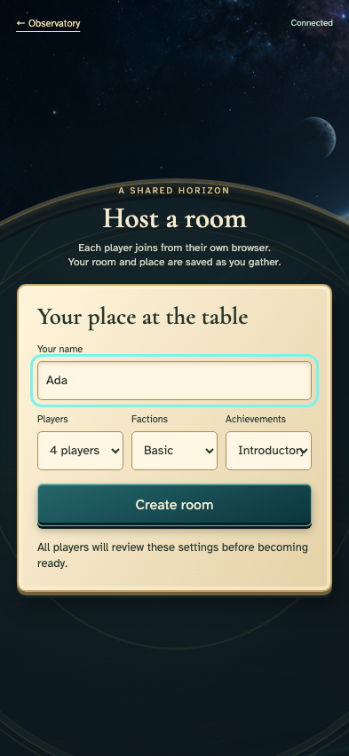](../../screenshots/choose-the-order-of-two-gained-system-bonuses-with-separate-remote-controllers/004-four-players-phone-darwin.png) |  |

- [x] Configure the real four-player Basic setup
- [x] Actual canonical effects and acknowledgement settle.
- [x] Public topology retains physical separation.
- [x] The viewport fits without page scrolling.

## 6. The host receives the real public invitation

Viewpoint: **Ada · separate host controller**.

| phone · 393 × 852 | desktop · 1440 × 1000 |
| --- | --- |
| [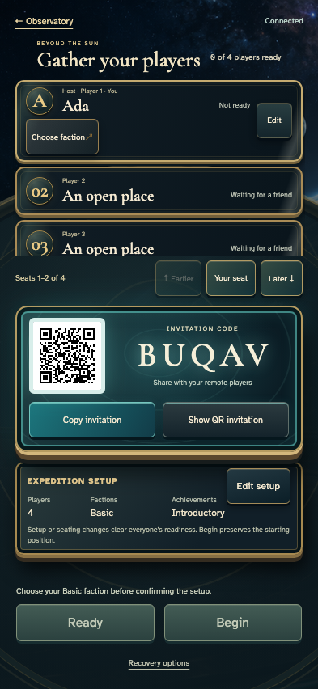](../../screenshots/choose-the-order-of-two-gained-system-bonuses-with-separate-remote-controllers/005-host-room-phone-darwin.png) | [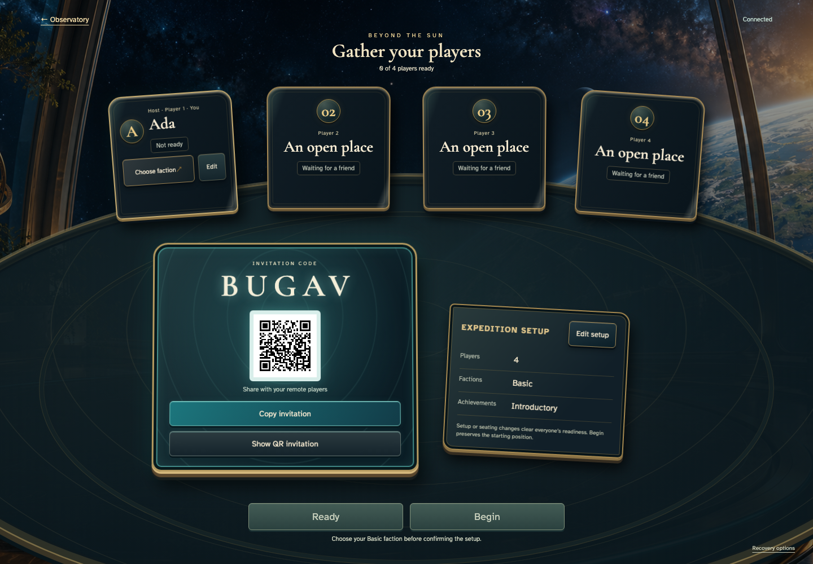](../../screenshots/choose-the-order-of-two-gained-system-bonuses-with-separate-remote-controllers/005-host-room-desktop-darwin.png) |

- [x] The host receives the real public invitation
- [x] Actual canonical effects and acknowledgement settle.
- [x] Public topology retains physical separation.
- [x] The viewport fits without page scrolling.

## 7. An independent controller previews the invitation

Viewpoint: **Bora · separate guest controller**.

| phone · 1440 × 1000 | desktop · 393 × 852 |
| --- | --- |
| [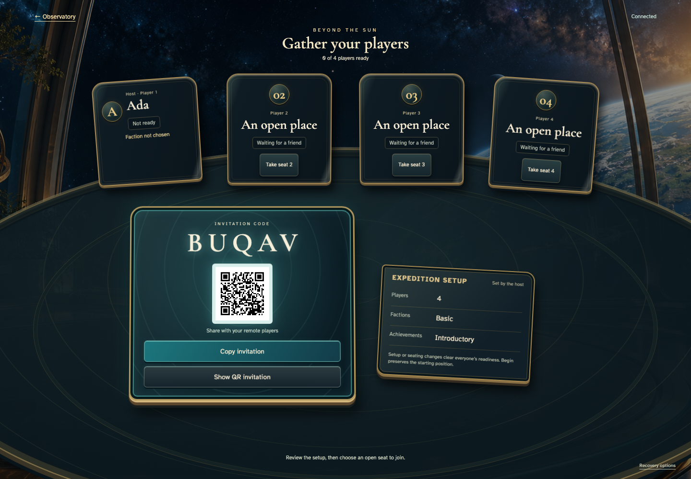](../../screenshots/choose-the-order-of-two-gained-system-bonuses-with-separate-remote-controllers/006-guest-1-preview-phone-darwin.png) | [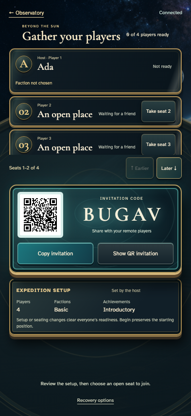](../../screenshots/choose-the-order-of-two-gained-system-bonuses-with-separate-remote-controllers/006-guest-1-preview-desktop-darwin.png) |

- [x] An independent controller previews the invitation
- [x] Actual canonical effects and acknowledgement settle.
- [x] Public topology retains physical separation.
- [x] The viewport fits without page scrolling.

## 8. Claim an open remote seat through its own dialog

Viewpoint: **Bora · separate guest controller**.

| phone · 1440 × 1000 | desktop · 393 × 852 |
| --- | --- |
| [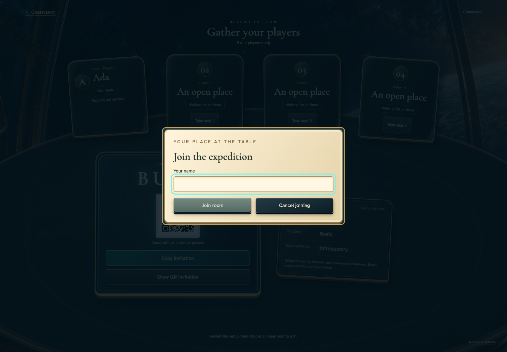](../../screenshots/choose-the-order-of-two-gained-system-bonuses-with-separate-remote-controllers/007-guest-1-name-form-phone-darwin.png) |  |

- [x] Claim an open remote seat through its own dialog
- [x] Actual canonical effects and acknowledgement settle.
- [x] Public topology retains physical separation.
- [x] The viewport fits without page scrolling.

## 9. Enter the guest name

Viewpoint: **Bora · separate guest controller**.

| phone · 1440 × 1000 | desktop · 393 × 852 |
| --- | --- |
| [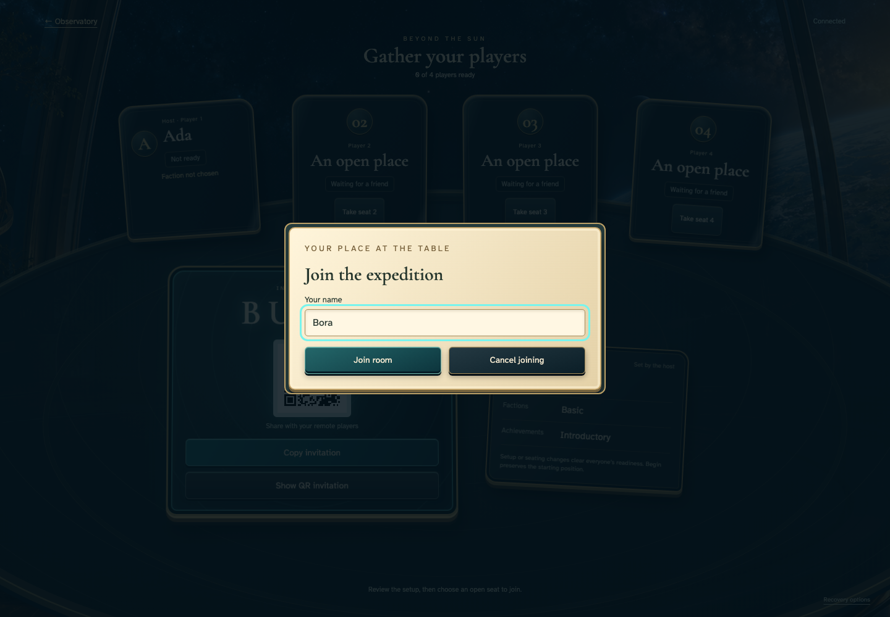](../../screenshots/choose-the-order-of-two-gained-system-bonuses-with-separate-remote-controllers/008-guest-1-name-phone-darwin.png) | [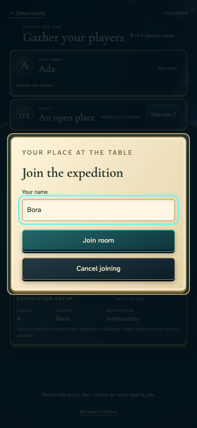](../../screenshots/choose-the-order-of-two-gained-system-bonuses-with-separate-remote-controllers/008-guest-1-name-desktop-darwin.png) |

- [x] Enter the guest name
- [x] Actual canonical effects and acknowledgement settle.
- [x] Public topology retains physical separation.
- [x] The viewport fits without page scrolling.

## 10. Persist this controller’s own seat

Viewpoint: **Bora · separate guest controller**.

| phone · 1440 × 1000 | desktop · 393 × 852 |
| --- | --- |
| [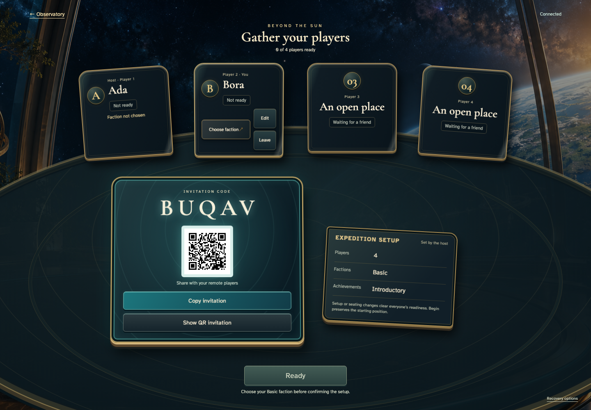](../../screenshots/choose-the-order-of-two-gained-system-bonuses-with-separate-remote-controllers/009-guest-1-joined-phone-darwin.png) | [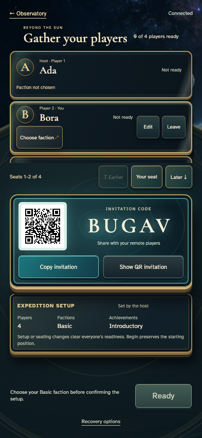](../../screenshots/choose-the-order-of-two-gained-system-bonuses-with-separate-remote-controllers/009-guest-1-joined-desktop-darwin.png) |

- [x] Persist this controller’s own seat
- [x] Actual canonical effects and acknowledgement settle.
- [x] Public topology retains physical separation.
- [x] The viewport fits without page scrolling.

## 11. An independent controller previews the invitation

Viewpoint: **Cleo · separate guest controller**.

| phone · 1440 × 1000 | desktop · 393 × 852 |
| --- | --- |
| [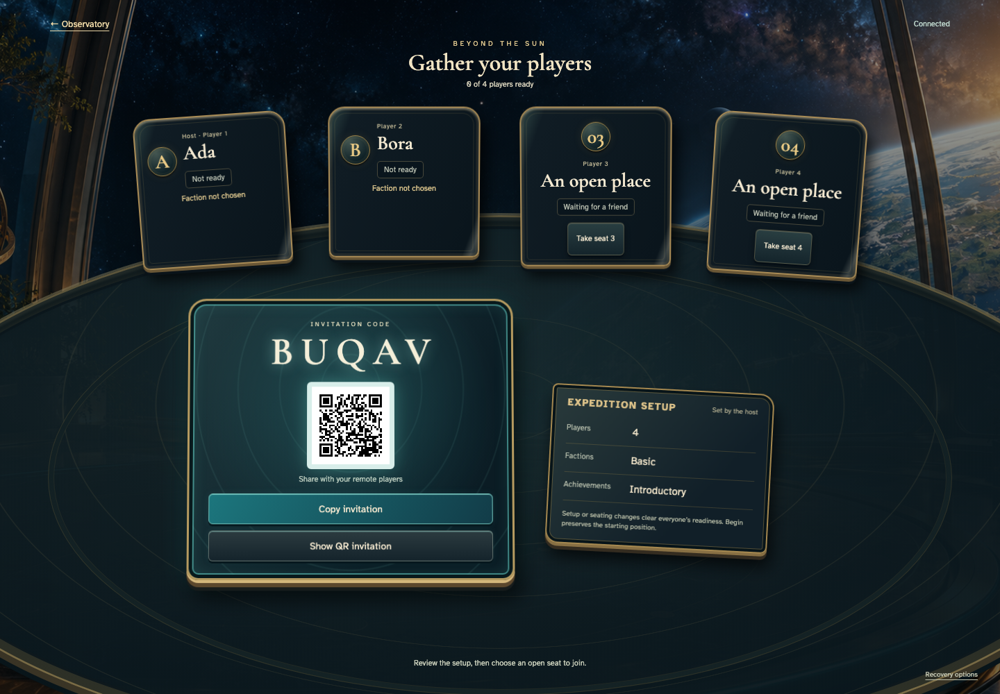](../../screenshots/choose-the-order-of-two-gained-system-bonuses-with-separate-remote-controllers/010-guest-2-preview-phone-darwin.png) | [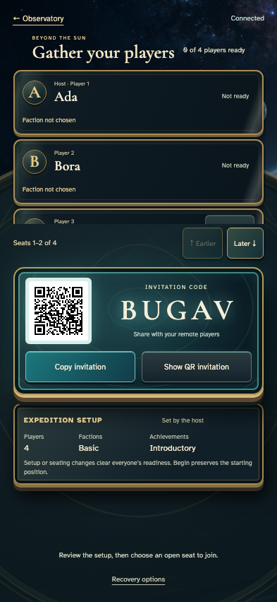](../../screenshots/choose-the-order-of-two-gained-system-bonuses-with-separate-remote-controllers/010-guest-2-preview-desktop-darwin.png) |

- [x] An independent controller previews the invitation
- [x] Actual canonical effects and acknowledgement settle.
- [x] Public topology retains physical separation.
- [x] The viewport fits without page scrolling.

## 12. Claim an open remote seat through its own dialog

Viewpoint: **Cleo · separate guest controller**.

| phone · 1440 × 1000 | desktop · 393 × 852 |
| --- | --- |
| [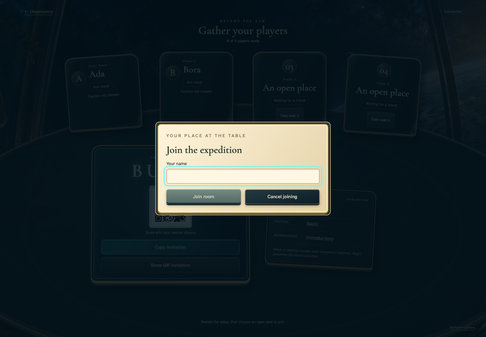](../../screenshots/choose-the-order-of-two-gained-system-bonuses-with-separate-remote-controllers/011-guest-2-name-form-phone-darwin.png) |  |

- [x] Claim an open remote seat through its own dialog
- [x] Actual canonical effects and acknowledgement settle.
- [x] Public topology retains physical separation.
- [x] The viewport fits without page scrolling.

## 13. Enter the guest name

Viewpoint: **Cleo · separate guest controller**.

| phone · 1440 × 1000 | desktop · 393 × 852 |
| --- | --- |
|  | [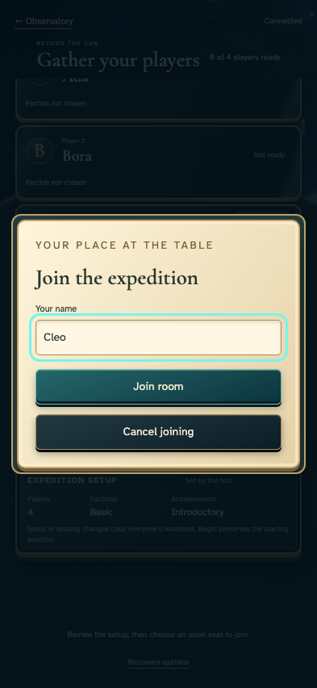](../../screenshots/choose-the-order-of-two-gained-system-bonuses-with-separate-remote-controllers/012-guest-2-name-desktop-darwin.png) |

- [x] Enter the guest name
- [x] Actual canonical effects and acknowledgement settle.
- [x] Public topology retains physical separation.
- [x] The viewport fits without page scrolling.

## 14. Persist this controller’s own seat

Viewpoint: **Cleo · separate guest controller**.

| phone · 1440 × 1000 | desktop · 393 × 852 |
| --- | --- |
| [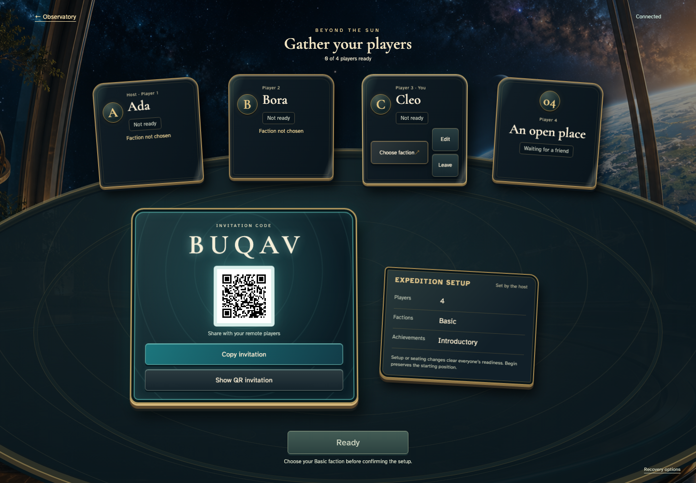](../../screenshots/choose-the-order-of-two-gained-system-bonuses-with-separate-remote-controllers/013-guest-2-joined-phone-darwin.png) | [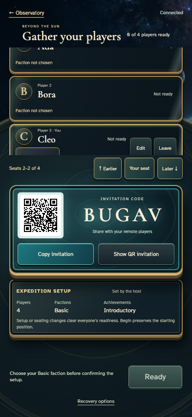](../../screenshots/choose-the-order-of-two-gained-system-bonuses-with-separate-remote-controllers/013-guest-2-joined-desktop-darwin.png) |

- [x] Persist this controller’s own seat
- [x] Actual canonical effects and acknowledgement settle.
- [x] Public topology retains physical separation.
- [x] The viewport fits without page scrolling.

## 15. An independent controller previews the invitation

Viewpoint: **Dara · separate guest controller**.

| phone · 1440 × 1000 | desktop · 393 × 852 |
| --- | --- |
| [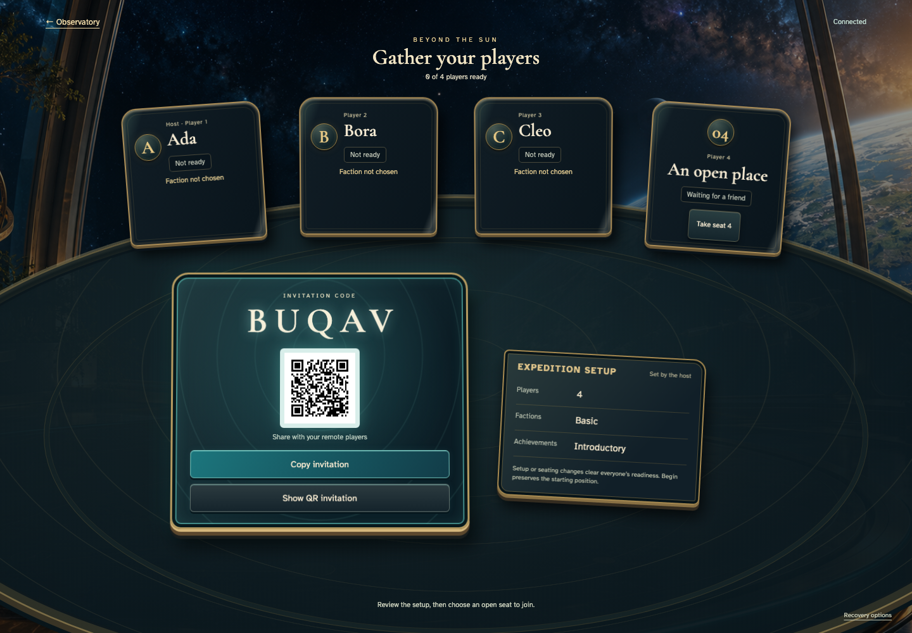](../../screenshots/choose-the-order-of-two-gained-system-bonuses-with-separate-remote-controllers/014-guest-3-preview-phone-darwin.png) |  |

- [x] An independent controller previews the invitation
- [x] Actual canonical effects and acknowledgement settle.
- [x] Public topology retains physical separation.
- [x] The viewport fits without page scrolling.

## 16. Claim an open remote seat through its own dialog

Viewpoint: **Dara · separate guest controller**.

| phone · 1440 × 1000 | desktop · 393 × 852 |
| --- | --- |
|  |  |

- [x] Claim an open remote seat through its own dialog
- [x] Actual canonical effects and acknowledgement settle.
- [x] Public topology retains physical separation.
- [x] The viewport fits without page scrolling.

## 17. Enter the guest name

Viewpoint: **Dara · separate guest controller**.

| phone · 1440 × 1000 | desktop · 393 × 852 |
| --- | --- |
| [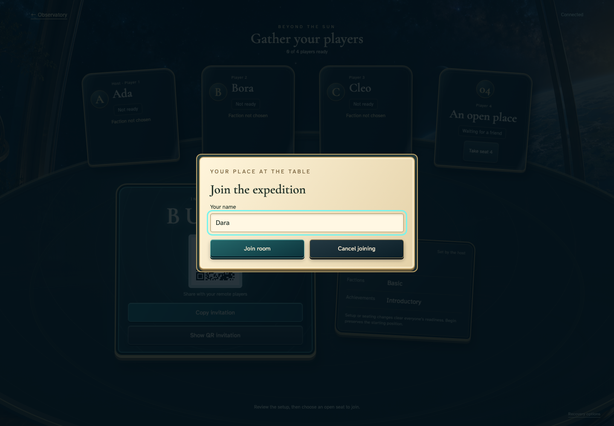](../../screenshots/choose-the-order-of-two-gained-system-bonuses-with-separate-remote-controllers/016-guest-3-name-phone-darwin.png) | [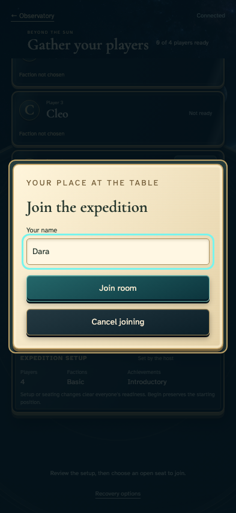](../../screenshots/choose-the-order-of-two-gained-system-bonuses-with-separate-remote-controllers/016-guest-3-name-desktop-darwin.png) |

- [x] Enter the guest name
- [x] Actual canonical effects and acknowledgement settle.
- [x] Public topology retains physical separation.
- [x] The viewport fits without page scrolling.

## 18. Persist this controller’s own seat

Viewpoint: **Dara · separate guest controller**.

| phone · 1440 × 1000 | desktop · 393 × 852 |
| --- | --- |
| [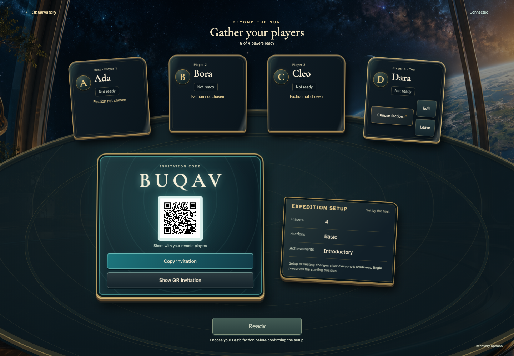](../../screenshots/choose-the-order-of-two-gained-system-bonuses-with-separate-remote-controllers/017-guest-3-joined-phone-darwin.png) | [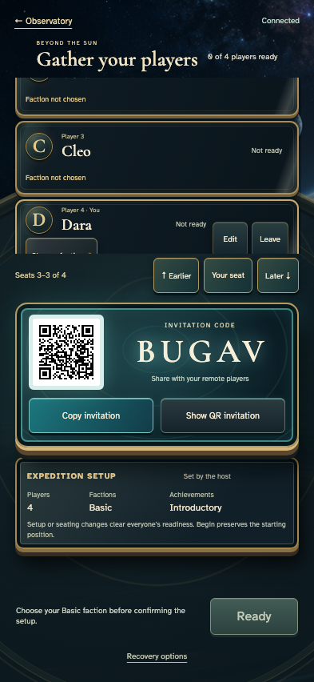](../../screenshots/choose-the-order-of-two-gained-system-bonuses-with-separate-remote-controllers/017-guest-3-joined-desktop-darwin.png) |

- [x] Persist this controller’s own seat
- [x] Actual canonical effects and acknowledgement settle.
- [x] Public topology retains physical separation.
- [x] The viewport fits without page scrolling.

## 19. Choose a legal unique Basic faction

Viewpoint: **Ada · separate host controller**.

| phone · 393 × 852 | desktop · 1440 × 1000 |
| --- | --- |
| [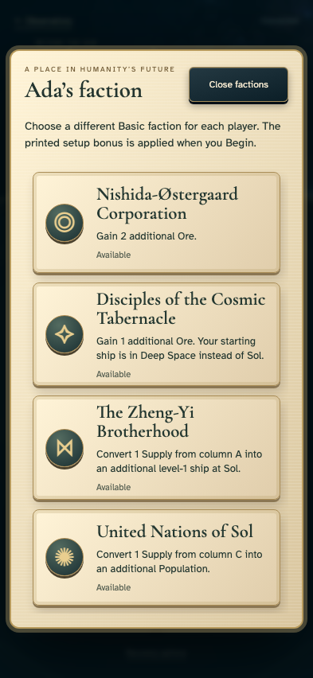](../../screenshots/choose-the-order-of-two-gained-system-bonuses-with-separate-remote-controllers/018-faction-0-open-phone-darwin.png) |  |

- [x] Choose a legal unique Basic faction
- [x] Actual canonical effects and acknowledgement settle.
- [x] Public topology retains physical separation.
- [x] The viewport fits without page scrolling.

## 20. Ada chooses Nishida-Østergaard Corporation

Viewpoint: **Ada · separate host controller**.

| phone · 393 × 852 | desktop · 1440 × 1000 |
| --- | --- |
| [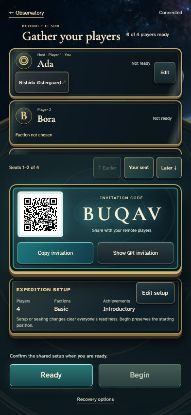](../../screenshots/choose-the-order-of-two-gained-system-bonuses-with-separate-remote-controllers/019-faction-0-selected-phone-darwin.png) | [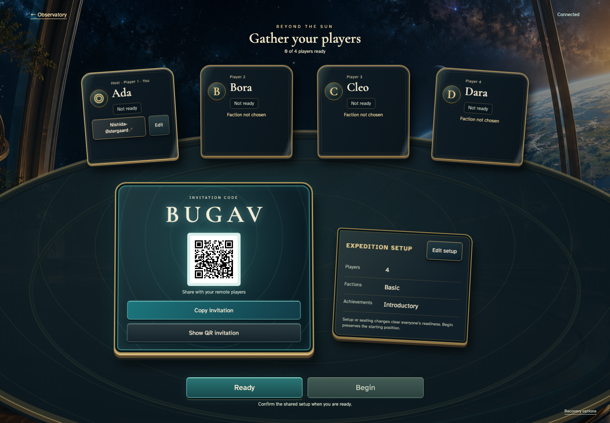](../../screenshots/choose-the-order-of-two-gained-system-bonuses-with-separate-remote-controllers/019-faction-0-selected-desktop-darwin.png) |

- [x] Ada chooses Nishida-Østergaard Corporation
- [x] Actual canonical effects and acknowledgement settle.
- [x] Public topology retains physical separation.
- [x] The viewport fits without page scrolling.

## 21. Choose a legal unique Basic faction

Viewpoint: **Bora · separate guest controller**.

| phone · 1440 × 1000 | desktop · 393 × 852 |
| --- | --- |
| [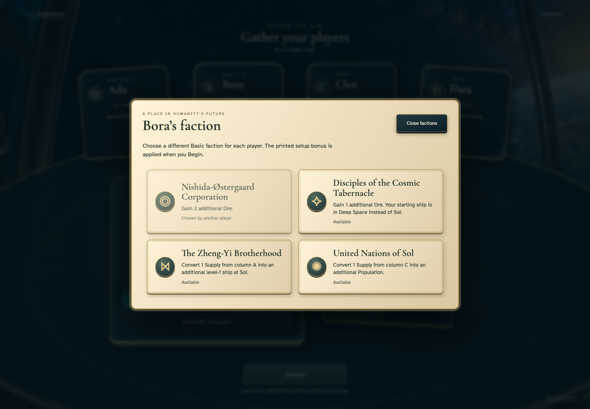](../../screenshots/choose-the-order-of-two-gained-system-bonuses-with-separate-remote-controllers/020-faction-1-open-phone-darwin.png) |  |

- [x] Choose a legal unique Basic faction
- [x] Actual canonical effects and acknowledgement settle.
- [x] Public topology retains physical separation.
- [x] The viewport fits without page scrolling.

## 22. Bora chooses The Zheng-Yi Brotherhood

Viewpoint: **Bora · separate guest controller**.

| phone · 1440 × 1000 | desktop · 393 × 852 |
| --- | --- |
| [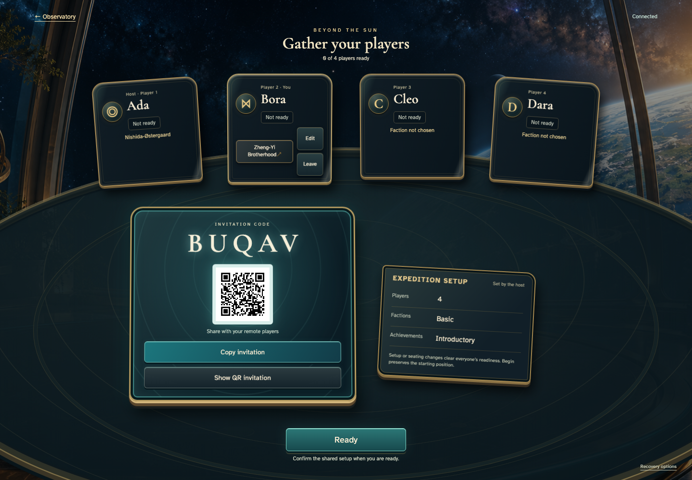](../../screenshots/choose-the-order-of-two-gained-system-bonuses-with-separate-remote-controllers/021-faction-1-selected-phone-darwin.png) | [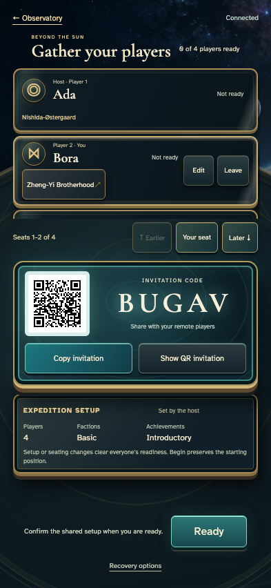](../../screenshots/choose-the-order-of-two-gained-system-bonuses-with-separate-remote-controllers/021-faction-1-selected-desktop-darwin.png) |

- [x] Bora chooses The Zheng-Yi Brotherhood
- [x] Actual canonical effects and acknowledgement settle.
- [x] Public topology retains physical separation.
- [x] The viewport fits without page scrolling.

## 23. Choose a legal unique Basic faction

Viewpoint: **Cleo · separate guest controller**.

| phone · 1440 × 1000 | desktop · 393 × 852 |
| --- | --- |
| [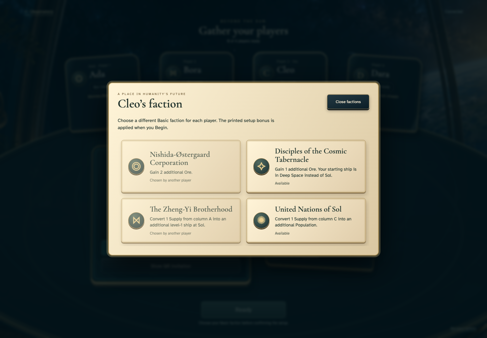](../../screenshots/choose-the-order-of-two-gained-system-bonuses-with-separate-remote-controllers/022-faction-2-open-phone-darwin.png) |  |

- [x] Choose a legal unique Basic faction
- [x] Actual canonical effects and acknowledgement settle.
- [x] Public topology retains physical separation.
- [x] The viewport fits without page scrolling.

## 24. Cleo chooses United Nations of Sol

Viewpoint: **Cleo · separate guest controller**.

| phone · 1440 × 1000 | desktop · 393 × 852 |
| --- | --- |
| [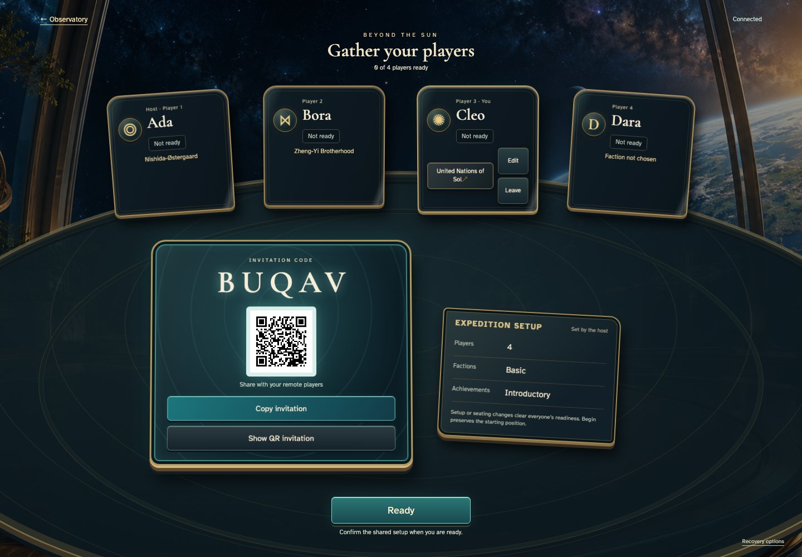](../../screenshots/choose-the-order-of-two-gained-system-bonuses-with-separate-remote-controllers/023-faction-2-selected-phone-darwin.png) | [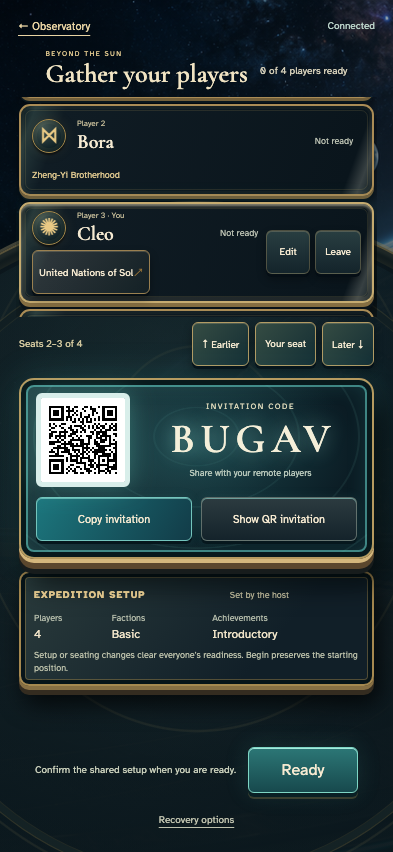](../../screenshots/choose-the-order-of-two-gained-system-bonuses-with-separate-remote-controllers/023-faction-2-selected-desktop-darwin.png) |

- [x] Cleo chooses United Nations of Sol
- [x] Actual canonical effects and acknowledgement settle.
- [x] Public topology retains physical separation.
- [x] The viewport fits without page scrolling.

## 25. Choose a legal unique Basic faction

Viewpoint: **Dara · separate guest controller**.

| phone · 1440 × 1000 | desktop · 393 × 852 |
| --- | --- |
| [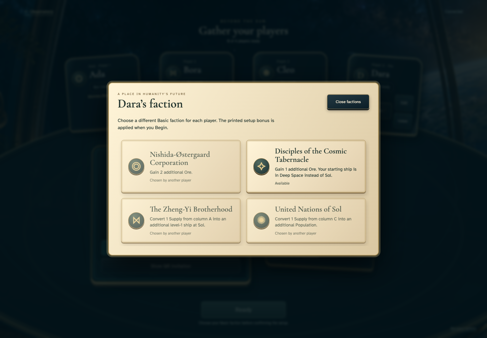](../../screenshots/choose-the-order-of-two-gained-system-bonuses-with-separate-remote-controllers/024-faction-3-open-phone-darwin.png) | [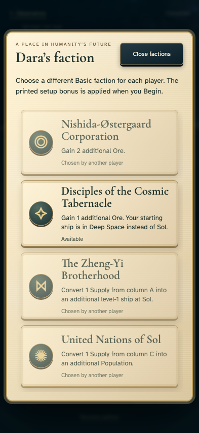](../../screenshots/choose-the-order-of-two-gained-system-bonuses-with-separate-remote-controllers/024-faction-3-open-desktop-darwin.png) |

- [x] Choose a legal unique Basic faction
- [x] Actual canonical effects and acknowledgement settle.
- [x] Public topology retains physical separation.
- [x] The viewport fits without page scrolling.

## 26. Dara chooses Disciples of the Cosmic Tabernacle

Viewpoint: **Dara · separate guest controller**.

| phone · 1440 × 1000 | desktop · 393 × 852 |
| --- | --- |
| [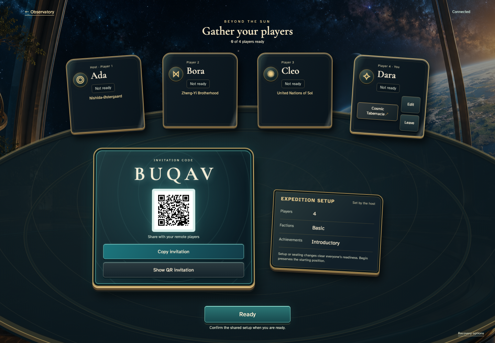](../../screenshots/choose-the-order-of-two-gained-system-bonuses-with-separate-remote-controllers/025-faction-3-selected-phone-darwin.png) | [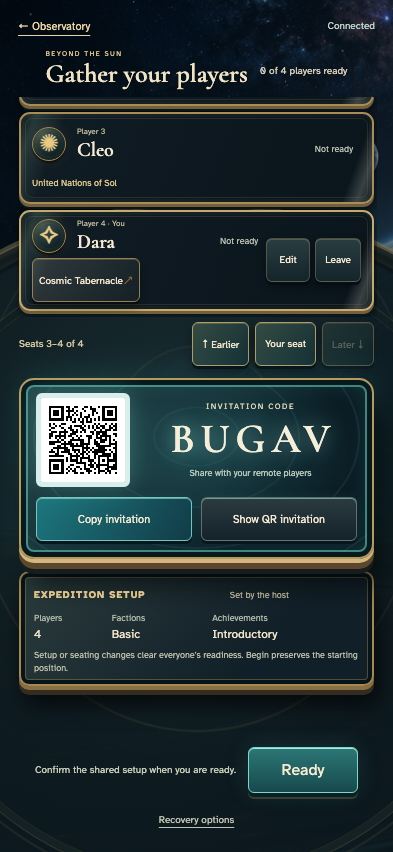](../../screenshots/choose-the-order-of-two-gained-system-bonuses-with-separate-remote-controllers/025-faction-3-selected-desktop-darwin.png) |

- [x] Dara chooses Disciples of the Cosmic Tabernacle
- [x] Actual canonical effects and acknowledgement settle.
- [x] Public topology retains physical separation.
- [x] The viewport fits without page scrolling.

## 27. Ada acknowledges the current shared configuration

Viewpoint: **Ada · separate host controller**.

| phone · 393 × 852 | desktop · 1440 × 1000 |
| --- | --- |
|  | [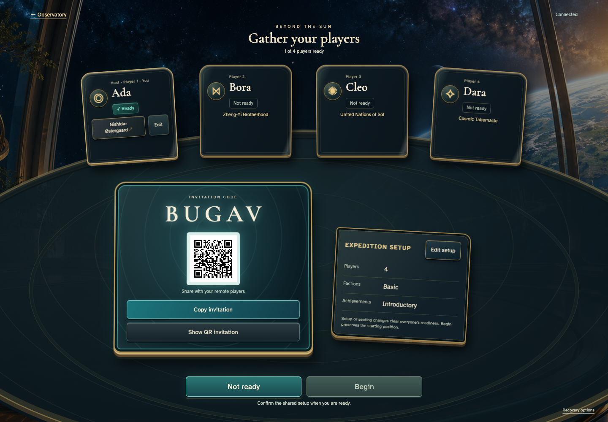](../../screenshots/choose-the-order-of-two-gained-system-bonuses-with-separate-remote-controllers/026-ready-0-desktop-darwin.png) |

- [x] Ada acknowledges the current shared configuration
- [x] Actual canonical effects and acknowledgement settle.
- [x] Public topology retains physical separation.
- [x] The viewport fits without page scrolling.

## 28. Bora acknowledges the current shared configuration

Viewpoint: **Bora · separate guest controller**.

| phone · 1440 × 1000 | desktop · 393 × 852 |
| --- | --- |
| [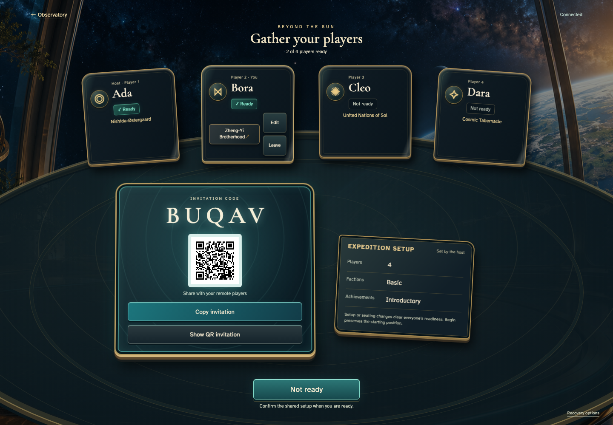](../../screenshots/choose-the-order-of-two-gained-system-bonuses-with-separate-remote-controllers/027-ready-1-phone-darwin.png) | [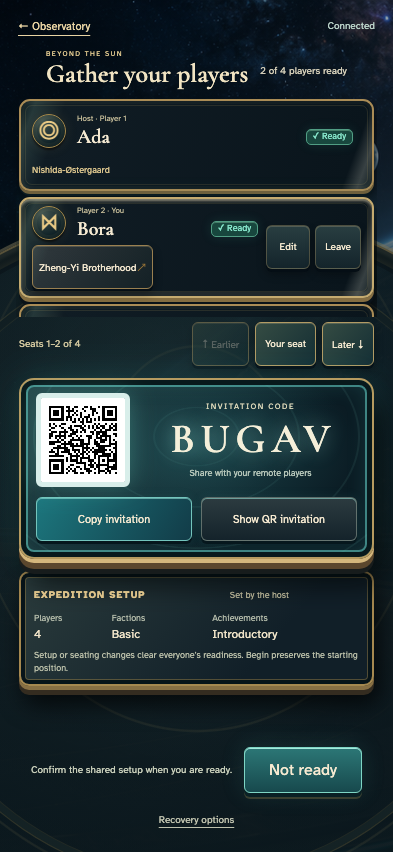](../../screenshots/choose-the-order-of-two-gained-system-bonuses-with-separate-remote-controllers/027-ready-1-desktop-darwin.png) |

- [x] Bora acknowledges the current shared configuration
- [x] Actual canonical effects and acknowledgement settle.
- [x] Public topology retains physical separation.
- [x] The viewport fits without page scrolling.

## 29. Cleo acknowledges the current shared configuration

Viewpoint: **Cleo · separate guest controller**.

| phone · 1440 × 1000 | desktop · 393 × 852 |
| --- | --- |
| [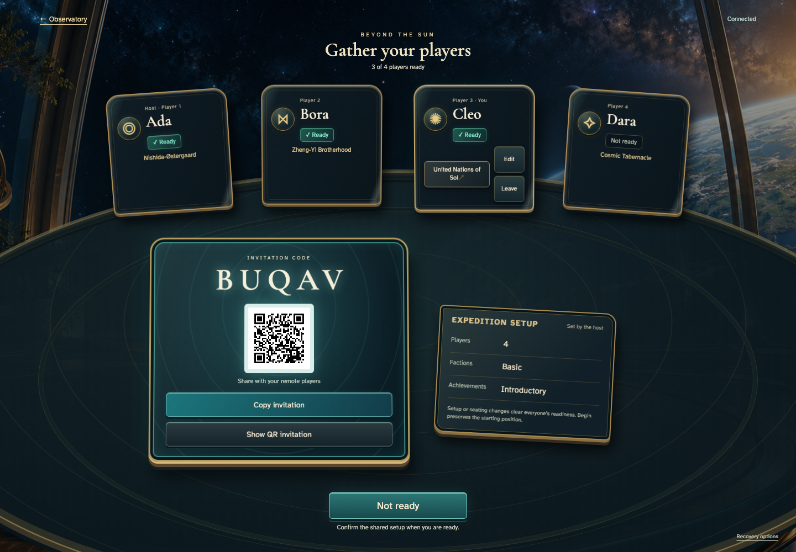](../../screenshots/choose-the-order-of-two-gained-system-bonuses-with-separate-remote-controllers/028-ready-2-phone-darwin.png) | [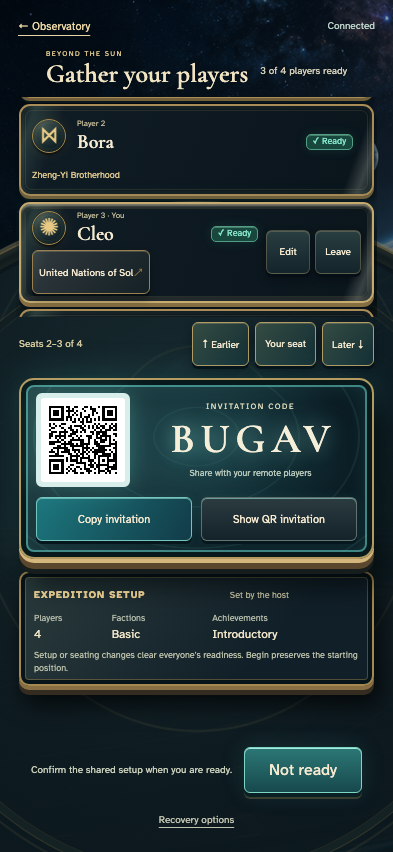](../../screenshots/choose-the-order-of-two-gained-system-bonuses-with-separate-remote-controllers/028-ready-2-desktop-darwin.png) |

- [x] Cleo acknowledges the current shared configuration
- [x] Actual canonical effects and acknowledgement settle.
- [x] Public topology retains physical separation.
- [x] The viewport fits without page scrolling.

## 30. Dara acknowledges the current shared configuration

Viewpoint: **Dara · separate guest controller**.

| phone · 1440 × 1000 | desktop · 393 × 852 |
| --- | --- |
| [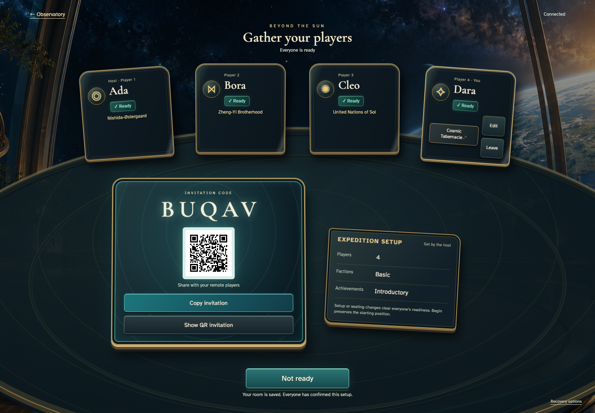](../../screenshots/choose-the-order-of-two-gained-system-bonuses-with-separate-remote-controllers/029-ready-3-phone-darwin.png) | [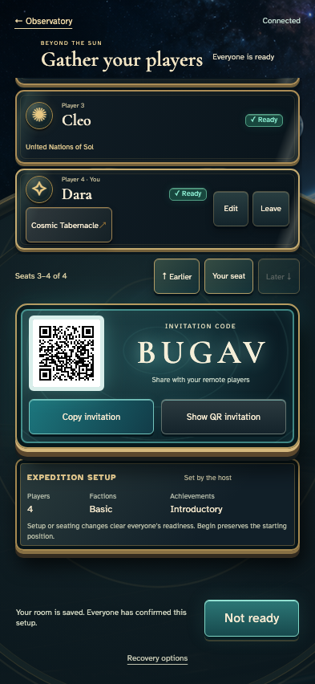](../../screenshots/choose-the-order-of-two-gained-system-bonuses-with-separate-remote-controllers/029-ready-3-desktop-darwin.png) |

- [x] Dara acknowledges the current shared configuration
- [x] Actual canonical effects and acknowledgement settle.
- [x] Public topology retains physical separation.
- [x] The viewport fits without page scrolling.

## 31. Begin the immutable Basic game through normal UI

Viewpoint: **Ada · separate host controller**.

| phone · 393 × 852 | desktop · 1440 × 1000 |
| --- | --- |
| [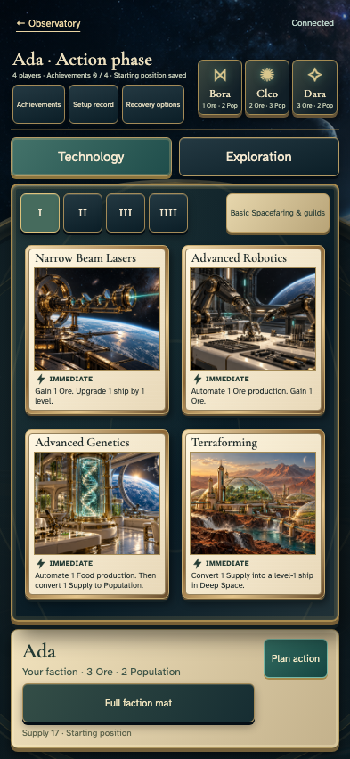](../../screenshots/choose-the-order-of-two-gained-system-bonuses-with-separate-remote-controllers/030-begun-phone-darwin.png) | [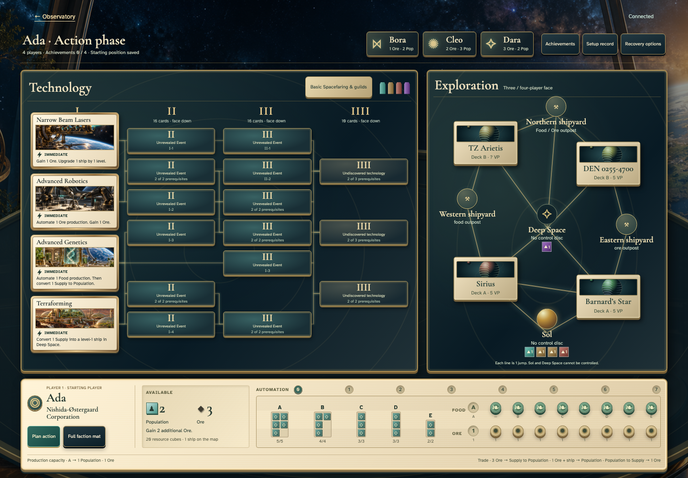](../../screenshots/choose-the-order-of-two-gained-system-bonuses-with-separate-remote-controllers/030-begun-desktop-darwin.png) |

- [x] Begin the immutable Basic game through normal UI
- [x] Actual canonical effects and acknowledgement settle.
- [x] Public topology retains physical separation.
- [x] The viewport fits without page scrolling.

## 32. Ada opens the real Action instrument

Viewpoint: **Ada · separate host controller**.

| phone · 393 × 852 | desktop · 1440 × 1000 |
| --- | --- |
| [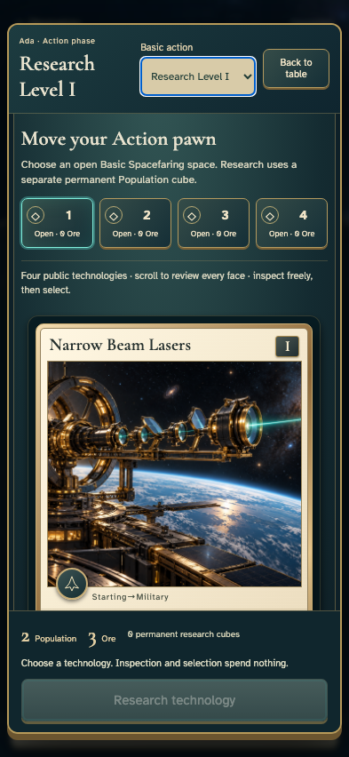](../../screenshots/choose-the-order-of-two-gained-system-bonuses-with-separate-remote-controllers/031-split-build-open-phone-darwin.png) | [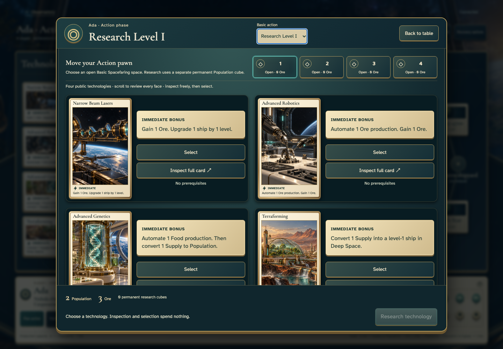](../../screenshots/choose-the-order-of-two-gained-system-bonuses-with-separate-remote-controllers/031-split-build-open-desktop-darwin.png) |

- [x] Ada opens the real Action instrument
- [x] Actual canonical effects and acknowledgement settle.
- [x] Public topology retains physical separation.
- [x] The viewport fits without page scrolling.

## 33. Ada chooses Basic build and jump

Viewpoint: **Ada · separate host controller**.

| phone · 393 × 852 | desktop · 1440 × 1000 |
| --- | --- |
| [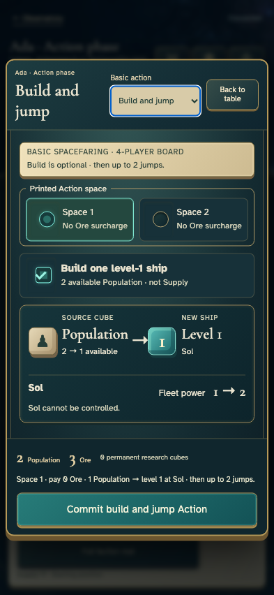](../../screenshots/choose-the-order-of-two-gained-system-bonuses-with-separate-remote-controllers/032-split-build-kind-phone-darwin.png) | [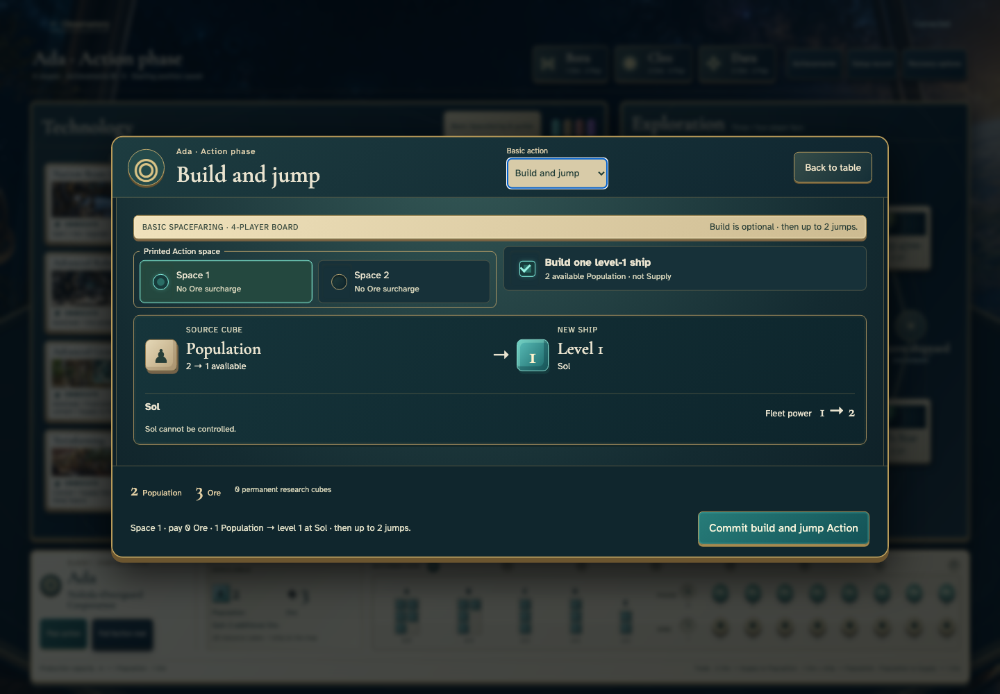](../../screenshots/choose-the-order-of-two-gained-system-bonuses-with-separate-remote-controllers/032-split-build-kind-desktop-darwin.png) |

- [x] Ada chooses Basic build and jump
- [x] Actual canonical effects and acknowledgement settle.
- [x] Public topology retains physical separation.
- [x] The viewport fits without page scrolling.

## 34. Commit the actual Population conversion and printed space cost before optional movement

Viewpoint: **Ada · separate host controller**.

| phone · 393 × 852 | desktop · 1440 × 1000 |
| --- | --- |
| [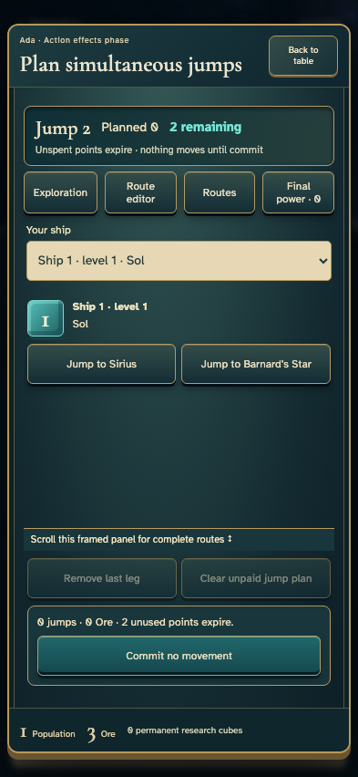](../../screenshots/choose-the-order-of-two-gained-system-bonuses-with-separate-remote-controllers/033-split-build-built-phone-darwin.png) | [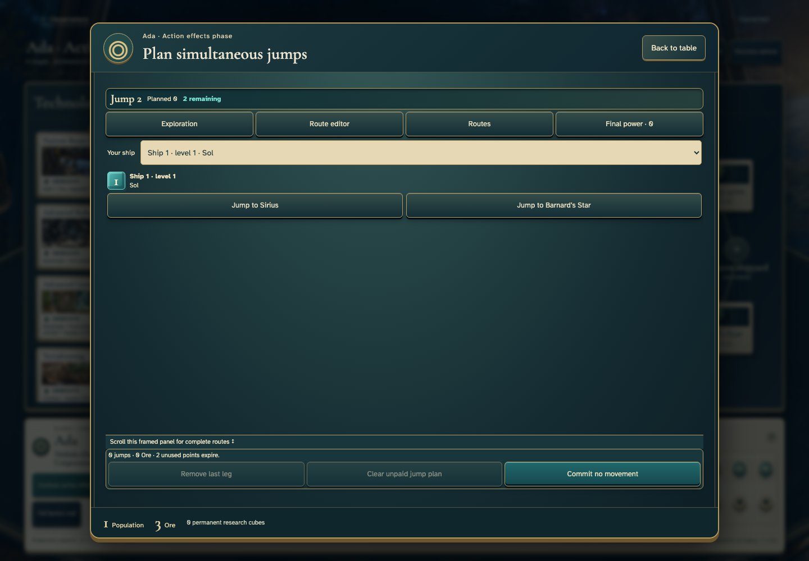](../../screenshots/choose-the-order-of-two-gained-system-bonuses-with-separate-remote-controllers/033-split-build-built-desktop-darwin.png) |

- [x] Commit the actual Population conversion and printed space cost before optional movement
- [x] Actual canonical effects and acknowledgement settle.
- [x] Public topology retains physical separation.
- [x] The viewport fits without page scrolling.

## 35. Read the complete public map before choosing a connected route

Viewpoint: **Ada · separate host controller**.

| phone · 393 × 852 | desktop · 1440 × 1000 |
| --- | --- |
| [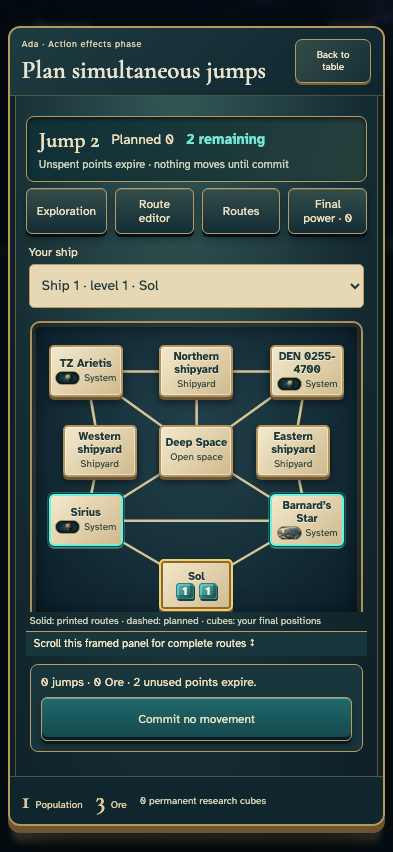](../../screenshots/choose-the-order-of-two-gained-system-bonuses-with-separate-remote-controllers/034-split-build-map-phone-darwin.png) |  |

- [x] Read the complete public map before choosing a connected route
- [x] Actual canonical effects and acknowledgement settle.
- [x] Public topology retains physical separation.
- [x] The viewport fits without page scrolling.

## 36. Read the actual connected destinations in this interface

Viewpoint: **Ada · separate host controller**.

| phone · 393 × 852 | desktop · 1440 × 1000 |
| --- | --- |
|  |  |

- [x] Read the actual connected destinations in this interface
- [x] Actual canonical effects and acknowledgement settle.
- [x] Public topology retains physical separation.
- [x] The viewport fits without page scrolling.

## 37. Choose a real owned ship for this unpaid route

Viewpoint: **Ada · separate host controller**.

| phone · 393 × 852 | desktop · 1440 × 1000 |
| --- | --- |
|  |  |

- [x] Choose a real owned ship for this unpaid route
- [x] Actual canonical effects and acknowledgement settle.
- [x] Public topology retains physical separation.
- [x] The viewport fits without page scrolling.

## 38. Plan Sirius as an endpoint; nothing moves yet

Viewpoint: **Ada · separate host controller**.

| phone · 393 × 852 | desktop · 1440 × 1000 |
| --- | --- |
|  |  |

- [x] Plan Sirius as an endpoint; nothing moves yet
- [x] Actual canonical effects and acknowledgement settle.
- [x] Public topology retains physical separation.
- [x] The viewport fits without page scrolling.

## 39. Choose a real owned ship for this unpaid route

Viewpoint: **Ada · separate host controller**.

| phone · 393 × 852 | desktop · 1440 × 1000 |
| --- | --- |
|  |  |

- [x] Choose a real owned ship for this unpaid route
- [x] Actual canonical effects and acknowledgement settle.
- [x] Public topology retains physical separation.
- [x] The viewport fits without page scrolling.

## 40. Plan Barnard’s Star as an endpoint; nothing moves yet

Viewpoint: **Ada · separate host controller**.

| phone · 393 × 852 | desktop · 1440 × 1000 |
| --- | --- |
|  |  |

- [x] Plan Barnard’s Star as an endpoint; nothing moves yet
- [x] Actual canonical effects and acknowledgement settle.
- [x] Public topology retains physical separation.
- [x] The viewport fits without page scrolling.

## 41. All outposts are placed; the owner chooses System bonus order

Viewpoint: **Ada · separate host controller**.

| phone · 393 × 852 | desktop · 1440 × 1000 |
| --- | --- |
|  |  |

- [x] All outposts are placed; the owner chooses System bonus order
- [x] Actual canonical effects and acknowledgement settle.
- [x] Public topology retains physical separation.
- [x] The viewport fits without page scrolling.

## 42. The separate guest observes and cannot answer the owner’s pending choice

Viewpoint: **Bora · separate guest controller**.

| phone · 1440 × 1000 | desktop · 393 × 852 |
| --- | --- |
|  |  |

- [x] The separate guest observes and cannot answer the owner’s pending choice
- [x] Actual canonical effects and acknowledgement settle.
- [x] Public topology retains physical separation.
- [x] The viewport fits without page scrolling.

## 43. Reload keeps the paid movement and pending responder-owned choice

Viewpoint: **Ada · separate host controller**.

| phone · 393 × 852 | desktop · 1440 × 1000 |
| --- | --- |
|  |  |

- [x] Reload keeps the paid movement and pending responder-owned choice
- [x] Actual canonical effects and acknowledgement settle.
- [x] Public topology retains physical separation.
- [x] The viewport fits without page scrolling.

## 44. The same owner resumes the same choices and unpaid rewards

Viewpoint: **Ada · separate host controller**.

| phone · 393 × 852 | desktop · 1440 × 1000 |
| --- | --- |
|  |  |

- [x] The same owner resumes the same choices and unpaid rewards
- [x] Actual canonical effects and acknowledgement settle.
- [x] Public topology retains physical separation.
- [x] The viewport fits without page scrolling.

## 45. Keyboard focus reaches the intended owner response

Viewpoint: **Ada · separate host controller**.

| phone · 393 × 852 | desktop · 1440 × 1000 |
| --- | --- |
|  |  |

- [x] Keyboard focus reaches the intended owner response
- [x] Actual canonical effects and acknowledgement settle.
- [x] Public topology retains physical separation.
- [x] The viewport fits without page scrolling.

## 46. Resolve Barnard’s Star first then the remaining Sirius reward exactly once

Viewpoint: **Ada · separate host controller**.

| phone · 393 × 852 | desktop · 1440 × 1000 |
| --- | --- |
|  |  |

- [x] Resolve Barnard’s Star first then the remaining Sirius reward exactly once
- [x] Actual canonical effects and acknowledgement settle.
- [x] Public topology retains physical separation.
- [x] The viewport fits without page scrolling.

## 47. Reload retains Production after the resolved choice

Viewpoint: **Ada · separate host controller**.

| phone · 393 × 852 | desktop · 1440 × 1000 |
| --- | --- |
|  |  |

- [x] Reload retains Production after the resolved choice
- [x] Actual canonical effects and acknowledgement settle.
- [x] Public topology retains physical separation.
- [x] The viewport fits without page scrolling.

## 48. Reopen the saved Production without replaying either reward

Viewpoint: **Ada · separate host controller**.

| phone · 393 × 852 | desktop · 1440 × 1000 |
| --- | --- |
|  |  |

- [x] Reopen the saved Production without replaying either reward
- [x] Actual canonical effects and acknowledgement settle.
- [x] Public topology retains physical separation.
- [x] The viewport fits without page scrolling.

## 49. Close the pending Production to inspect the real disc

Viewpoint: **Ada · separate host controller**.

| phone · 393 × 852 | desktop · 1440 × 1000 |
| --- | --- |
|  |  |

- [x] Close the pending Production to inspect the real disc
- [x] Actual canonical effects and acknowledgement settle.
- [x] Public topology retains physical separation.
- [x] The viewport fits without page scrolling.

## 50. Ada inspects the actual production discs

Viewpoint: **Ada · separate host controller**.

| phone · 393 × 852 | desktop · 1440 × 1000 |
| --- | --- |
|  |  |

- [x] Ada inspects the actual production discs
- [x] Actual canonical effects and acknowledgement settle.
- [x] Public topology retains physical separation.
- [x] The viewport fits without page scrolling.

## 51. Open the reusable public fleet inspection

Viewpoint: **Ada · separate host controller**.

| phone · 393 × 852 | desktop · 1440 × 1000 |
| --- | --- |
|  |  |

- [x] Open the reusable public fleet inspection
- [x] Actual canonical effects and acknowledgement settle.
- [x] Public topology retains physical separation.
- [x] The viewport fits without page scrolling.

## 52. Read saved disc ownership separately from current summed fleet power

Viewpoint: **Ada · separate host controller**.

| phone · 393 × 852 | desktop · 1440 × 1000 |
| --- | --- |
|  |  |

- [x] Read saved disc ownership separately from current summed fleet power
- [x] Actual canonical effects and acknowledgement settle.
- [x] Public topology retains physical separation.
- [x] The viewport fits without page scrolling.

## 53. Inspect every faction’s actual level sum and the incumbent’s disc

Viewpoint: **Ada · separate host controller**.

| phone · 393 × 852 | desktop · 1440 × 1000 |
| --- | --- |
|  |  |

- [x] Inspect every faction’s actual level sum and the incumbent’s disc
- [x] Actual canonical effects and acknowledgement settle.
- [x] Public topology retains physical separation.
- [x] The viewport fits without page scrolling.

## 54. Keyboard scroll reaches production, printed bonus and the inspection boundary

Viewpoint: **Ada · separate host controller**.

| phone · 393 × 852 | desktop · 1440 × 1000 |
| --- | --- |
|  |  |

- [x] Keyboard scroll reaches production, printed bonus and the inspection boundary
- [x] Actual canonical effects and acknowledgement settle.
- [x] Public topology retains physical separation.
- [x] The viewport fits without page scrolling.

## 55. Open the complete reusable fleet rules through semantic navigation

Viewpoint: **Ada · separate host controller**.

| phone · 393 × 852 | desktop · 1440 × 1000 |
| --- | --- |
|  |  |

- [x] Open the complete reusable fleet rules through semantic navigation
- [x] Actual canonical effects and acknowledgement settle.
- [x] Public topology retains physical separation.
- [x] The viewport fits without page scrolling.

## 56. Return to the real ship register without taking a turn

Viewpoint: **Ada · separate host controller**.

| phone · 393 × 852 | desktop · 1440 × 1000 |
| --- | --- |
|  |  |

- [x] Return to the real ship register without taking a turn
- [x] Actual canonical effects and acknowledgement settle.
- [x] Public topology retains physical separation.
- [x] The viewport fits without page scrolling.

## 57. Escape restores the exact fleet opener without taking a turn

Viewpoint: **Ada · separate host controller**.

| phone · 393 × 852 | desktop · 1440 × 1000 |
| --- | --- |
|  |  |

- [x] Escape restores the exact fleet opener without taking a turn
- [x] Actual canonical effects and acknowledgement settle.
- [x] Public topology retains physical separation.
- [x] The viewport fits without page scrolling.

## 58. Close the mat and restore its own opener

Viewpoint: **Ada · separate host controller**.

| phone · 393 × 852 | desktop · 1440 × 1000 |
| --- | --- |
|  |  |

- [x] Close the mat and restore its own opener
- [x] Actual canonical effects and acknowledgement settle.
- [x] Public topology retains physical separation.
- [x] The viewport fits without page scrolling.

## 59. Inspection returns to the same saved Production

Viewpoint: **Ada · separate host controller**.

| phone · 393 × 852 | desktop · 1440 × 1000 |
| --- | --- |
|  |  |

- [x] Inspection returns to the same saved Production
- [x] Actual canonical effects and acknowledgement settle.
- [x] Public topology retains physical separation.
- [x] The viewport fits without page scrolling.

## 60. Ada chooses ordinary Ore production and hands off

Viewpoint: **Ada · separate host controller**.

| phone · 393 × 852 | desktop · 1440 × 1000 |
| --- | --- |
|  |  |

- [x] Ada chooses ordinary Ore production and hands off
- [x] Actual canonical effects and acknowledgement settle.
- [x] Public topology retains physical separation.
- [x] The viewport fits without page scrolling.

## 61. The next distinct controller receives the saved Action phase

Viewpoint: **Bora · separate guest controller**.

| phone · 1440 × 1000 | desktop · 393 × 852 |
| --- | --- |
|  |  |

- [x] The next distinct controller receives the saved Action phase
- [x] Actual canonical effects and acknowledgement settle.
- [x] Public topology retains physical separation.
- [x] The viewport fits without page scrolling.
