# Choose two System bonus rewards at four shared cardinal seats

Exactly one shared controller; all local seats/factions/Begin through the actual table. Two players for incoming tie/later exceed, four for simultaneous two-System bonuses or Food/Ore specialty. Setup seed002 or004; command identities disjoint. No companion devices, state injection or future deck read.

## 1. Arrive through the actual production interface

Viewpoint: **Ada · South · one shared controller**.

| desktop · 1440 × 1000 |
| --- |
|  |

tabletop-4k · 3840 × 2160

- [x] Arrive through the actual production interface
- [x] Actual canonical effects and acknowledgement settle.
- [x] Public topology retains physical separation.
- [x] The viewport fits without page scrolling.

## 2. Choose physical tabletop or separate-controller remote play

Viewpoint: **Ada · South · one shared controller**.

| desktop · 1440 × 1000 |
| --- |
|  |

tabletop-4k · 3840 × 2160

- [x] Choose physical tabletop or separate-controller remote play
- [x] Actual canonical effects and acknowledgement settle.
- [x] Public topology retains physical separation.
- [x] The viewport fits without page scrolling.

## 3. One shared controller opens the physical seats

Viewpoint: **Ada · South · one shared controller**.

| desktop · 1440 × 1000 |
| --- |
|  |

tabletop-4k · 3840 × 2160

- [x] One shared controller opens the physical seats
- [x] Actual canonical effects and acknowledgement settle.
- [x] Public topology retains physical separation.
- [x] The viewport fits without page scrolling.

## 4. Join directly at South

Viewpoint: **Ada · South · one shared controller**.

| desktop · 1440 × 1000 |
| --- |
|  |

tabletop-4k · 3840 × 2160

- [x] Join directly at South
- [x] Actual canonical effects and acknowledgement settle.
- [x] Public topology retains physical separation.
- [x] The viewport fits without page scrolling.

## 5. Name this physical seat Ada

Viewpoint: **Ada · South · one shared controller**.

| desktop · 1440 × 1000 |
| --- |
|  |

tabletop-4k · 3840 × 2160

- [x] Name this physical seat Ada
- [x] Actual canonical effects and acknowledgement settle.
- [x] Public topology retains physical separation.
- [x] The viewport fits without page scrolling.

## 6. Persist the named seat on the same display

Viewpoint: **Ada · South · one shared controller**.

| desktop · 1440 × 1000 |
| --- |
|  |

tabletop-4k · 3840 × 2160

- [x] Persist the named seat on the same display
- [x] Actual canonical effects and acknowledgement settle.
- [x] Public topology retains physical separation.
- [x] The viewport fits without page scrolling.

## 7. Join directly at West

Viewpoint: **Bora · West · one shared controller**.

| desktop · 1440 × 1000 |
| --- |
|  |

tabletop-4k · 3840 × 2160

- [x] Join directly at West
- [x] Actual canonical effects and acknowledgement settle.
- [x] Public topology retains physical separation.
- [x] The viewport fits without page scrolling.

## 8. Name this physical seat Bora

Viewpoint: **Bora · West · one shared controller**.

| desktop · 1440 × 1000 |
| --- |
|  |

tabletop-4k · 3840 × 2160

[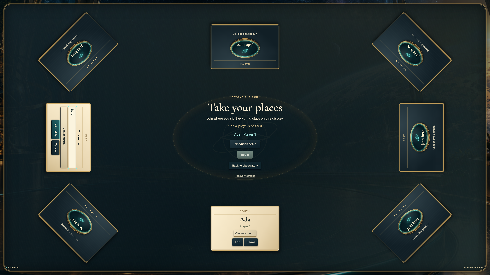](../../screenshots/choose-two-system-bonus-rewards-at-four-shared-cardinal-seats/007-seat-1-name-tabletop-4k-darwin.png)

- [x] Name this physical seat Bora
- [x] Actual canonical effects and acknowledgement settle.
- [x] Public topology retains physical separation.
- [x] The viewport fits without page scrolling.

## 9. Persist the named seat on the same display

Viewpoint: **Bora · West · one shared controller**.

| desktop · 1440 × 1000 |
| --- |
|  |

tabletop-4k · 3840 × 2160

- [x] Persist the named seat on the same display
- [x] Actual canonical effects and acknowledgement settle.
- [x] Public topology retains physical separation.
- [x] The viewport fits without page scrolling.

## 10. Join directly at North

Viewpoint: **Cleo · North · one shared controller**.

| desktop · 1440 × 1000 |
| --- |
| [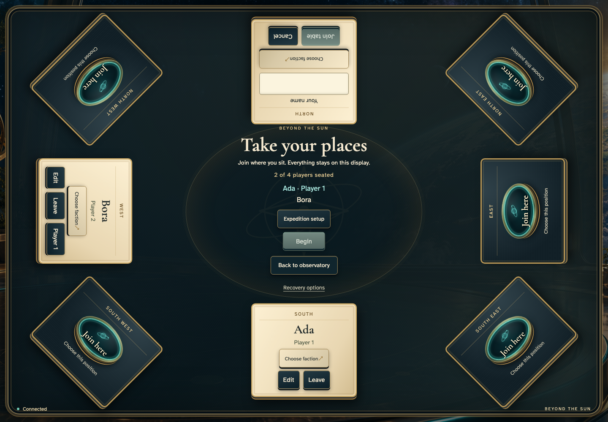](../../screenshots/choose-two-system-bonus-rewards-at-four-shared-cardinal-seats/009-seat-2-editor-desktop-darwin.png) |

tabletop-4k · 3840 × 2160

[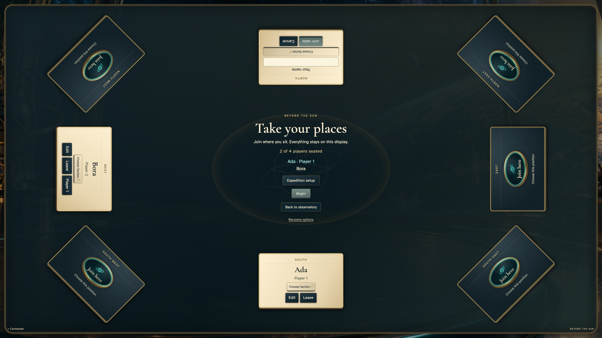](../../screenshots/choose-two-system-bonus-rewards-at-four-shared-cardinal-seats/009-seat-2-editor-tabletop-4k-darwin.png)

- [x] Join directly at North
- [x] Actual canonical effects and acknowledgement settle.
- [x] Public topology retains physical separation.
- [x] The viewport fits without page scrolling.

## 11. Name this physical seat Cleo

Viewpoint: **Cleo · North · one shared controller**.

| desktop · 1440 × 1000 |
| --- |
|  |

tabletop-4k · 3840 × 2160

- [x] Name this physical seat Cleo
- [x] Actual canonical effects and acknowledgement settle.
- [x] Public topology retains physical separation.
- [x] The viewport fits without page scrolling.

## 12. Persist the named seat on the same display

Viewpoint: **Cleo · North · one shared controller**.

| desktop · 1440 × 1000 |
| --- |
|  |

tabletop-4k · 3840 × 2160

- [x] Persist the named seat on the same display
- [x] Actual canonical effects and acknowledgement settle.
- [x] Public topology retains physical separation.
- [x] The viewport fits without page scrolling.

## 13. Join directly at East

Viewpoint: **Dara · East · one shared controller**.

| desktop · 1440 × 1000 |
| --- |
| [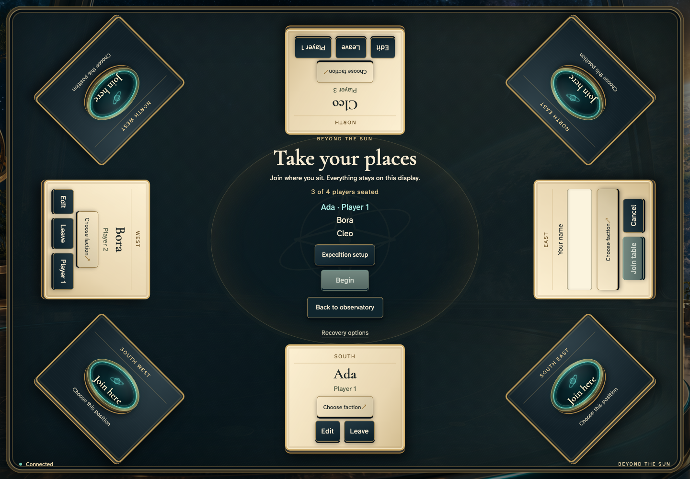](../../screenshots/choose-two-system-bonus-rewards-at-four-shared-cardinal-seats/012-seat-3-editor-desktop-darwin.png) |

tabletop-4k · 3840 × 2160

[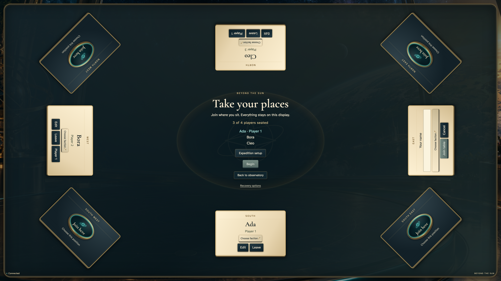](../../screenshots/choose-two-system-bonus-rewards-at-four-shared-cardinal-seats/012-seat-3-editor-tabletop-4k-darwin.png)

- [x] Join directly at East
- [x] Actual canonical effects and acknowledgement settle.
- [x] Public topology retains physical separation.
- [x] The viewport fits without page scrolling.

## 14. Name this physical seat Dara

Viewpoint: **Dara · East · one shared controller**.

| desktop · 1440 × 1000 |
| --- |
|  |

tabletop-4k · 3840 × 2160

- [x] Name this physical seat Dara
- [x] Actual canonical effects and acknowledgement settle.
- [x] Public topology retains physical separation.
- [x] The viewport fits without page scrolling.

## 15. Persist the named seat on the same display

Viewpoint: **Dara · East · one shared controller**.

| desktop · 1440 × 1000 |
| --- |
|  |

tabletop-4k · 3840 × 2160

- [x] Persist the named seat on the same display
- [x] Actual canonical effects and acknowledgement settle.
- [x] Public topology retains physical separation.
- [x] The viewport fits without page scrolling.

## 16. Choose a legal unique Basic faction

Viewpoint: **Ada · South · one shared controller**.

| desktop · 1440 × 1000 |
| --- |
|  |

tabletop-4k · 3840 × 2160

- [x] Choose a legal unique Basic faction
- [x] Actual canonical effects and acknowledgement settle.
- [x] Public topology retains physical separation.
- [x] The viewport fits without page scrolling.

## 17. Ada chooses Nishida-Østergaard Corporation

Viewpoint: **Ada · South · one shared controller**.

| desktop · 1440 × 1000 |
| --- |
|  |

tabletop-4k · 3840 × 2160

- [x] Ada chooses Nishida-Østergaard Corporation
- [x] Actual canonical effects and acknowledgement settle.
- [x] Public topology retains physical separation.
- [x] The viewport fits without page scrolling.

## 18. Choose a legal unique Basic faction

Viewpoint: **Bora · West · one shared controller**.

| desktop · 1440 × 1000 |
| --- |
|  |

tabletop-4k · 3840 × 2160

[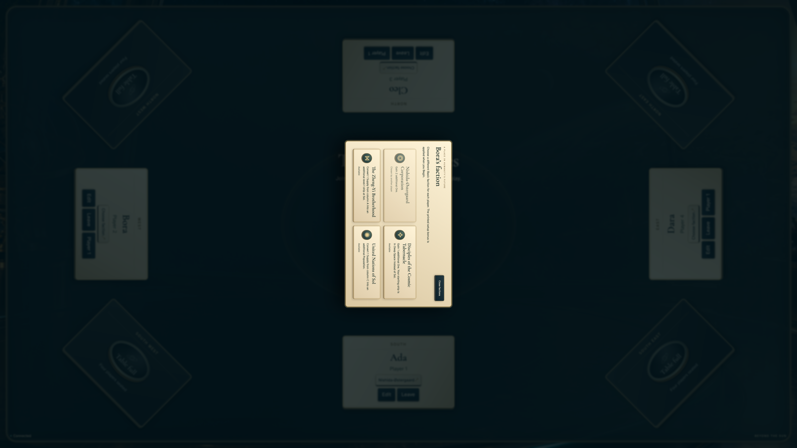](../../screenshots/choose-two-system-bonus-rewards-at-four-shared-cardinal-seats/017-faction-1-open-tabletop-4k-darwin.png)

- [x] Choose a legal unique Basic faction
- [x] Actual canonical effects and acknowledgement settle.
- [x] Public topology retains physical separation.
- [x] The viewport fits without page scrolling.

## 19. Bora chooses The Zheng-Yi Brotherhood

Viewpoint: **Bora · West · one shared controller**.

| desktop · 1440 × 1000 |
| --- |
|  |

tabletop-4k · 3840 × 2160

- [x] Bora chooses The Zheng-Yi Brotherhood
- [x] Actual canonical effects and acknowledgement settle.
- [x] Public topology retains physical separation.
- [x] The viewport fits without page scrolling.

## 20. Choose a legal unique Basic faction

Viewpoint: **Cleo · North · one shared controller**.

| desktop · 1440 × 1000 |
| --- |
|  |

tabletop-4k · 3840 × 2160

- [x] Choose a legal unique Basic faction
- [x] Actual canonical effects and acknowledgement settle.
- [x] Public topology retains physical separation.
- [x] The viewport fits without page scrolling.

## 21. Cleo chooses United Nations of Sol

Viewpoint: **Cleo · North · one shared controller**.

| desktop · 1440 × 1000 |
| --- |
| [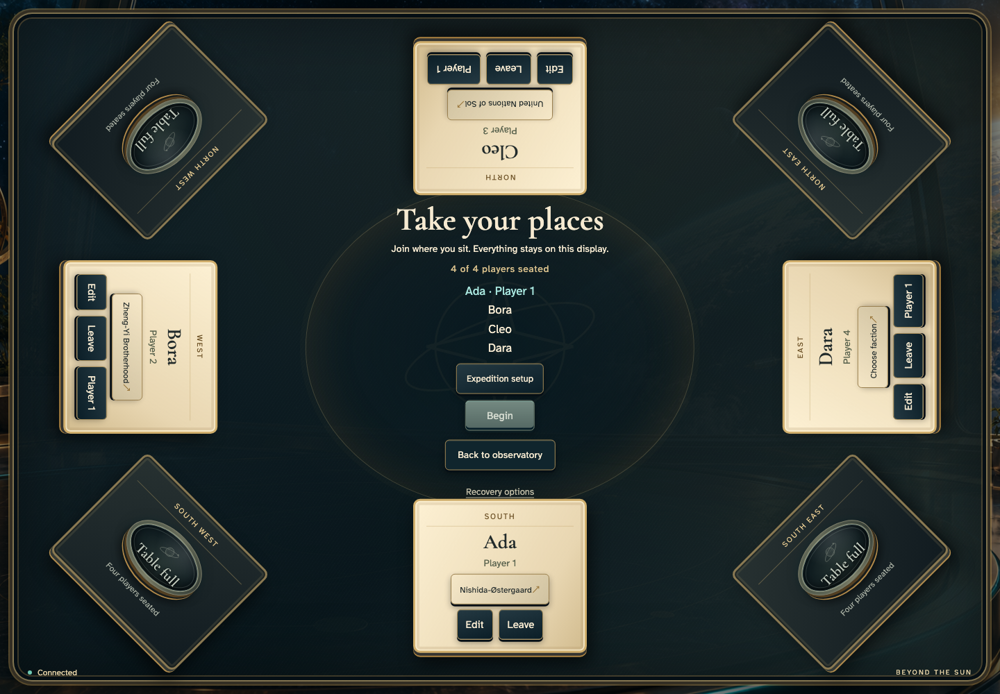](../../screenshots/choose-two-system-bonus-rewards-at-four-shared-cardinal-seats/020-faction-2-selected-desktop-darwin.png) |

tabletop-4k · 3840 × 2160

- [x] Cleo chooses United Nations of Sol
- [x] Actual canonical effects and acknowledgement settle.
- [x] Public topology retains physical separation.
- [x] The viewport fits without page scrolling.

## 22. Choose a legal unique Basic faction

Viewpoint: **Dara · East · one shared controller**.

| desktop · 1440 × 1000 |
| --- |
| [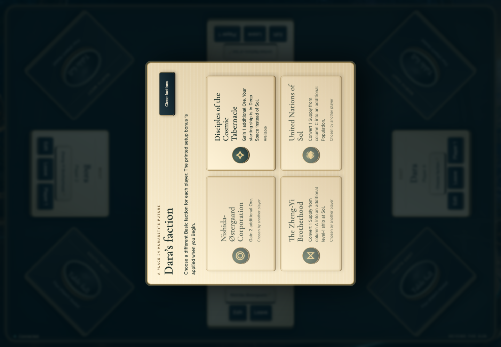](../../screenshots/choose-two-system-bonus-rewards-at-four-shared-cardinal-seats/021-faction-3-open-desktop-darwin.png) |

tabletop-4k · 3840 × 2160

[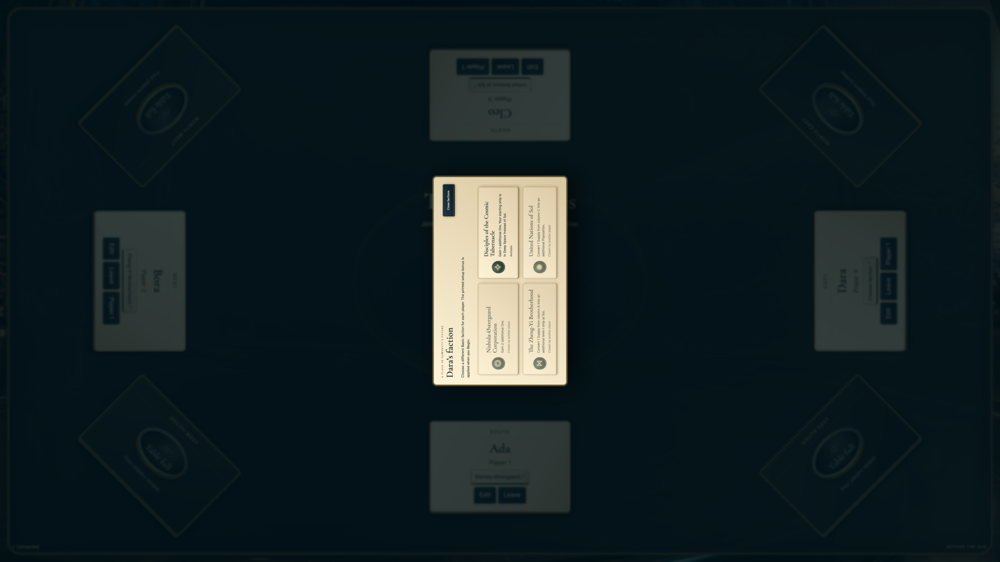](../../screenshots/choose-two-system-bonus-rewards-at-four-shared-cardinal-seats/021-faction-3-open-tabletop-4k-darwin.png)

- [x] Choose a legal unique Basic faction
- [x] Actual canonical effects and acknowledgement settle.
- [x] Public topology retains physical separation.
- [x] The viewport fits without page scrolling.

## 23. Dara chooses Disciples of the Cosmic Tabernacle

Viewpoint: **Dara · East · one shared controller**.

| desktop · 1440 × 1000 |
| --- |
| [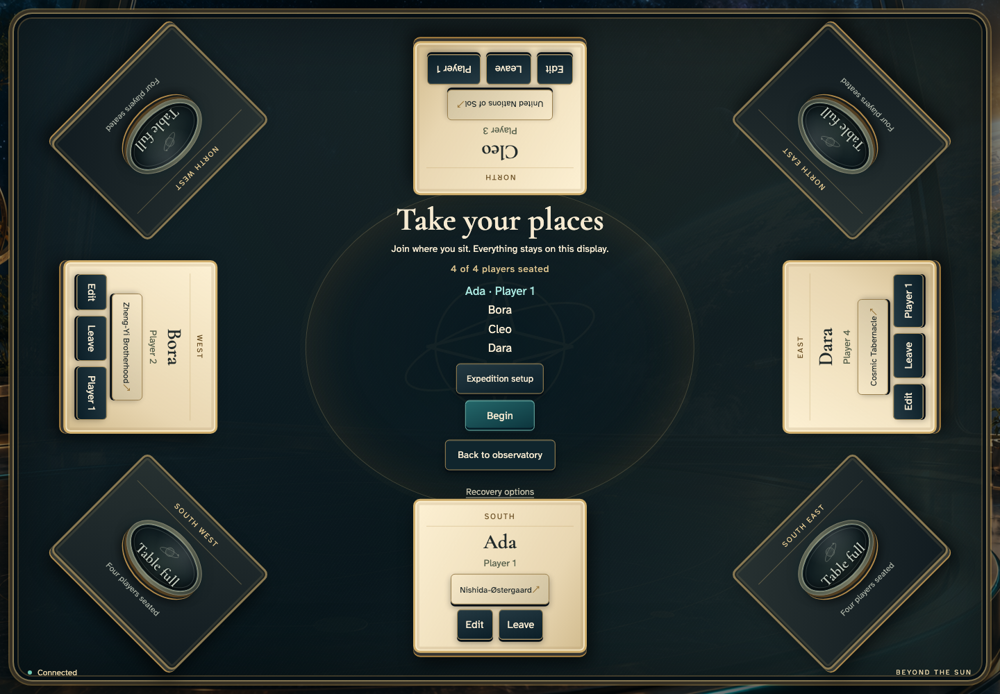](../../screenshots/choose-two-system-bonus-rewards-at-four-shared-cardinal-seats/022-faction-3-selected-desktop-darwin.png) |

tabletop-4k · 3840 × 2160

[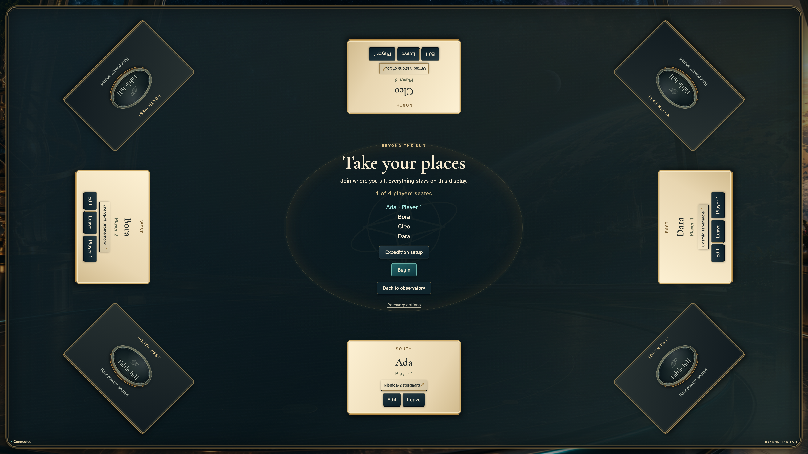](../../screenshots/choose-two-system-bonus-rewards-at-four-shared-cardinal-seats/022-faction-3-selected-tabletop-4k-darwin.png)

- [x] Dara chooses Disciples of the Cosmic Tabernacle
- [x] Actual canonical effects and acknowledgement settle.
- [x] Public topology retains physical separation.
- [x] The viewport fits without page scrolling.

## 24. Begin the immutable Basic game through normal UI

Viewpoint: **Ada · South · one shared controller**.

| desktop · 1440 × 1000 |
| --- |
| [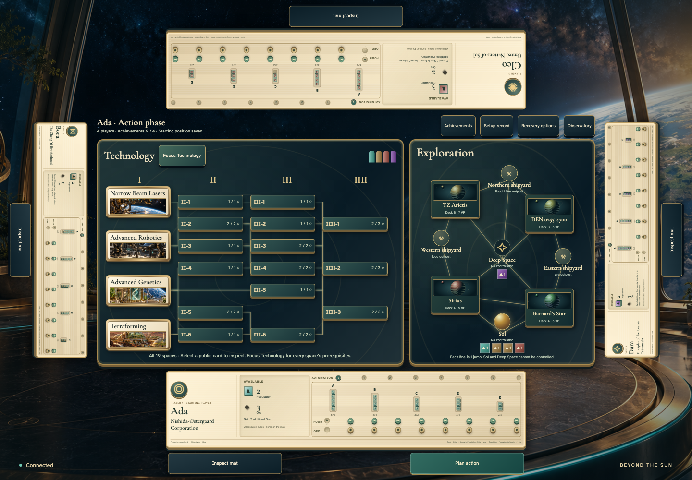](../../screenshots/choose-two-system-bonus-rewards-at-four-shared-cardinal-seats/023-begun-desktop-darwin.png) |

tabletop-4k · 3840 × 2160

[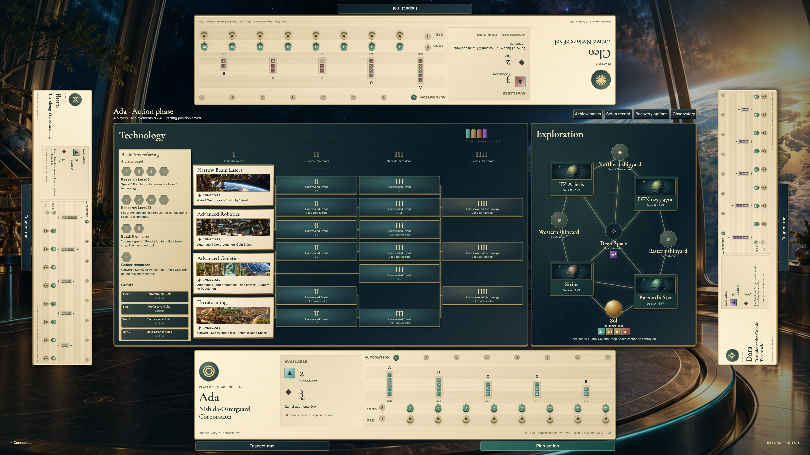](../../screenshots/choose-two-system-bonus-rewards-at-four-shared-cardinal-seats/023-begun-tabletop-4k-darwin.png)

- [x] Begin the immutable Basic game through normal UI
- [x] Actual canonical effects and acknowledgement settle.
- [x] Public topology retains physical separation.
- [x] The viewport fits without page scrolling.

## 25. Ada opens the real Action instrument

Viewpoint: **Ada · South · one shared controller**.

| desktop · 1440 × 1000 |
| --- |
| [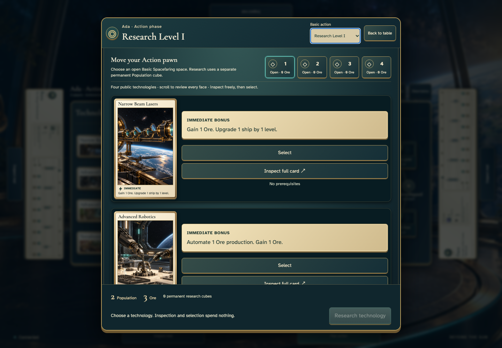](../../screenshots/choose-two-system-bonus-rewards-at-four-shared-cardinal-seats/024-split-build-open-desktop-darwin.png) |

tabletop-4k · 3840 × 2160

[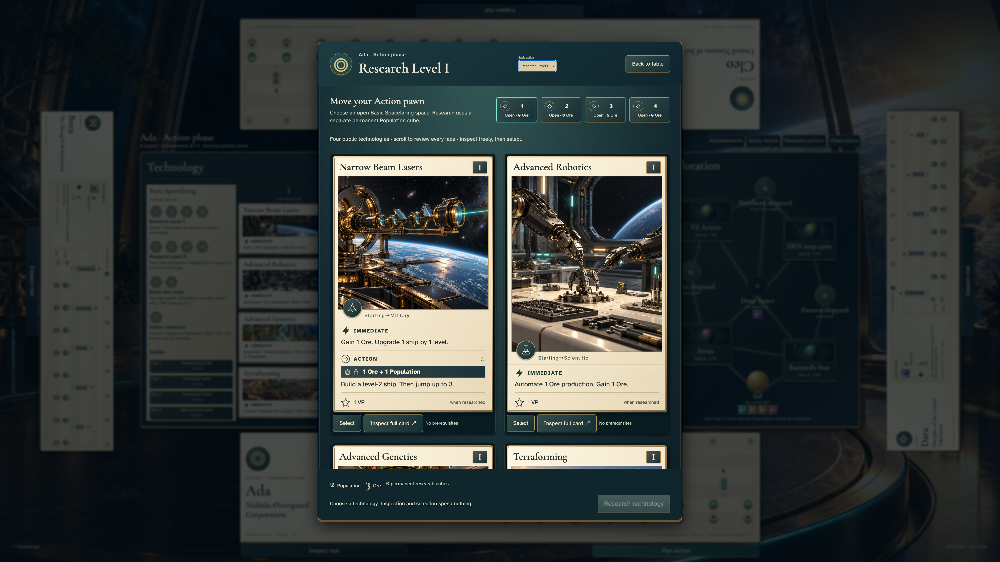](../../screenshots/choose-two-system-bonus-rewards-at-four-shared-cardinal-seats/024-split-build-open-tabletop-4k-darwin.png)

- [x] Ada opens the real Action instrument
- [x] Actual canonical effects and acknowledgement settle.
- [x] Public topology retains physical separation.
- [x] The viewport fits without page scrolling.

## 26. Ada chooses Basic build and jump

Viewpoint: **Ada · South · one shared controller**.

| desktop · 1440 × 1000 |
| --- |
| [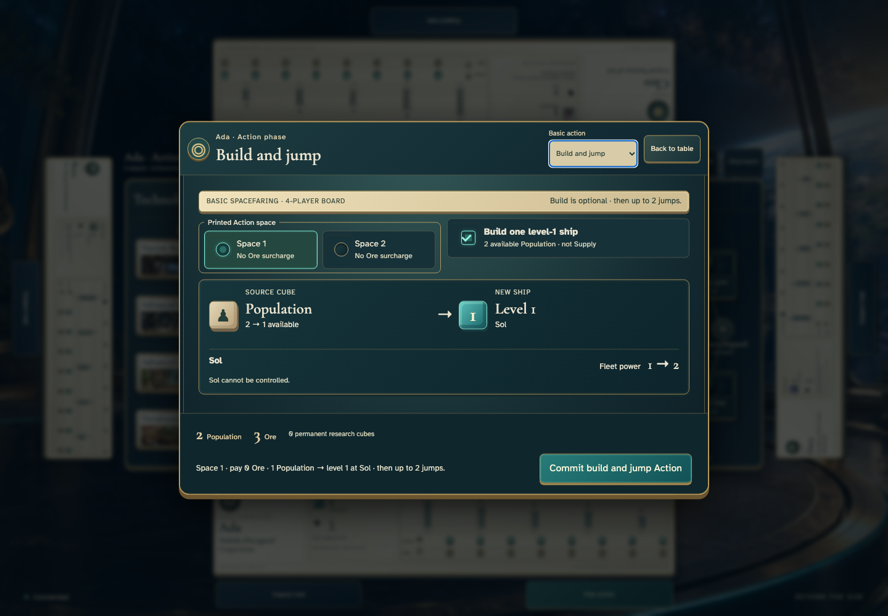](../../screenshots/choose-two-system-bonus-rewards-at-four-shared-cardinal-seats/025-split-build-kind-desktop-darwin.png) |

tabletop-4k · 3840 × 2160

[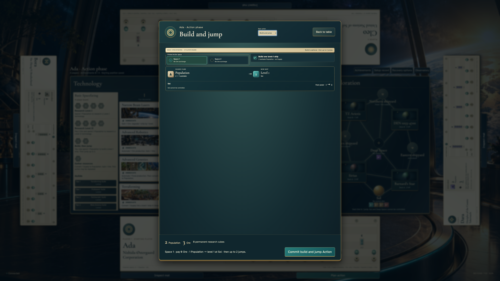](../../screenshots/choose-two-system-bonus-rewards-at-four-shared-cardinal-seats/025-split-build-kind-tabletop-4k-darwin.png)

- [x] Ada chooses Basic build and jump
- [x] Actual canonical effects and acknowledgement settle.
- [x] Public topology retains physical separation.
- [x] The viewport fits without page scrolling.

## 27. Commit the actual Population conversion and printed space cost before optional movement

Viewpoint: **Ada · South · one shared controller**.

| desktop · 1440 × 1000 |
| --- |
|  |

tabletop-4k · 3840 × 2160

[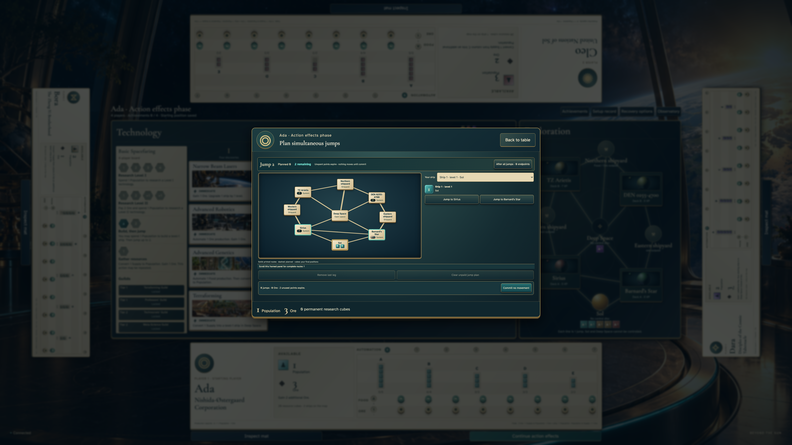](../../screenshots/choose-two-system-bonus-rewards-at-four-shared-cardinal-seats/026-split-build-built-tabletop-4k-darwin.png)

- [x] Commit the actual Population conversion and printed space cost before optional movement
- [x] Actual canonical effects and acknowledgement settle.
- [x] Public topology retains physical separation.
- [x] The viewport fits without page scrolling.

## 28. Read the complete public map before choosing a connected route

Viewpoint: **Ada · South · one shared controller**.

| desktop · 1440 × 1000 |
| --- |
| [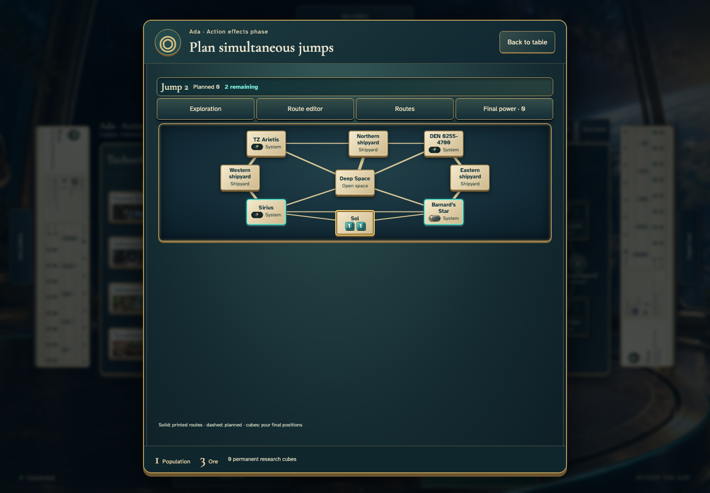](../../screenshots/choose-two-system-bonus-rewards-at-four-shared-cardinal-seats/027-split-build-map-desktop-darwin.png) |

tabletop-4k · 3840 × 2160

- [x] Read the complete public map before choosing a connected route
- [x] Actual canonical effects and acknowledgement settle.
- [x] Public topology retains physical separation.
- [x] The viewport fits without page scrolling.

## 29. Read the actual connected destinations in this interface

Viewpoint: **Ada · South · one shared controller**.

| desktop · 1440 × 1000 |
| --- |
|  |

tabletop-4k · 3840 × 2160

- [x] Read the actual connected destinations in this interface
- [x] Actual canonical effects and acknowledgement settle.
- [x] Public topology retains physical separation.
- [x] The viewport fits without page scrolling.

## 30. Choose a real owned ship for this unpaid route

Viewpoint: **Ada · South · one shared controller**.

| desktop · 1440 × 1000 |
| --- |
|  |

tabletop-4k · 3840 × 2160

- [x] Choose a real owned ship for this unpaid route
- [x] Actual canonical effects and acknowledgement settle.
- [x] Public topology retains physical separation.
- [x] The viewport fits without page scrolling.

## 31. Plan Sirius as an endpoint; nothing moves yet

Viewpoint: **Ada · South · one shared controller**.

| desktop · 1440 × 1000 |
| --- |
| [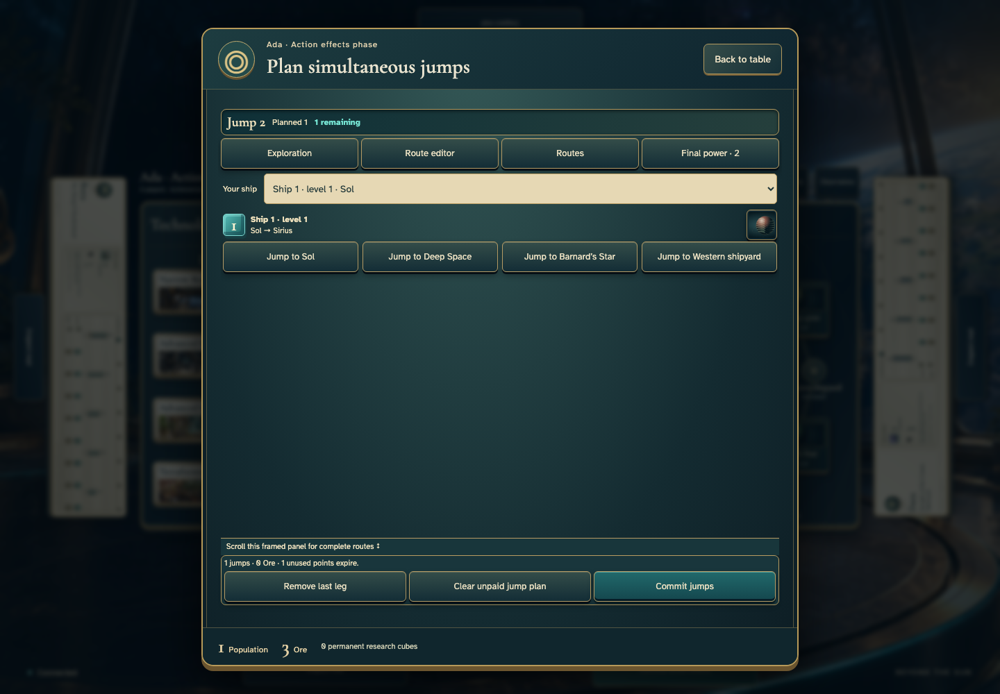](../../screenshots/choose-two-system-bonus-rewards-at-four-shared-cardinal-seats/030-split-first-endpoint-desktop-darwin.png) |

tabletop-4k · 3840 × 2160

[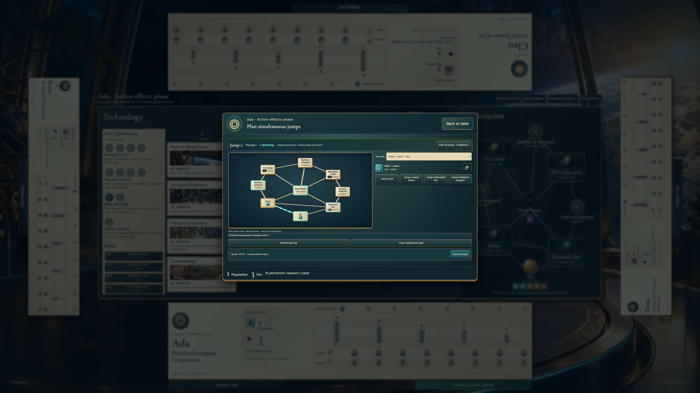](../../screenshots/choose-two-system-bonus-rewards-at-four-shared-cardinal-seats/030-split-first-endpoint-tabletop-4k-darwin.png)

- [x] Plan Sirius as an endpoint; nothing moves yet
- [x] Actual canonical effects and acknowledgement settle.
- [x] Public topology retains physical separation.
- [x] The viewport fits without page scrolling.

## 32. Choose a real owned ship for this unpaid route

Viewpoint: **Ada · South · one shared controller**.

| desktop · 1440 × 1000 |
| --- |
| [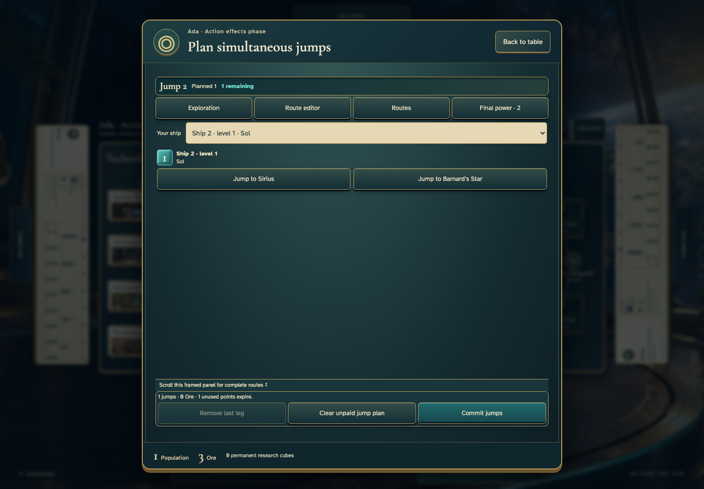](../../screenshots/choose-two-system-bonus-rewards-at-four-shared-cardinal-seats/031-split-second-ship-desktop-darwin.png) |

tabletop-4k · 3840 × 2160

- [x] Choose a real owned ship for this unpaid route
- [x] Actual canonical effects and acknowledgement settle.
- [x] Public topology retains physical separation.
- [x] The viewport fits without page scrolling.

## 33. Plan Barnard’s Star as an endpoint; nothing moves yet

Viewpoint: **Ada · South · one shared controller**.

| desktop · 1440 × 1000 |
| --- |
| [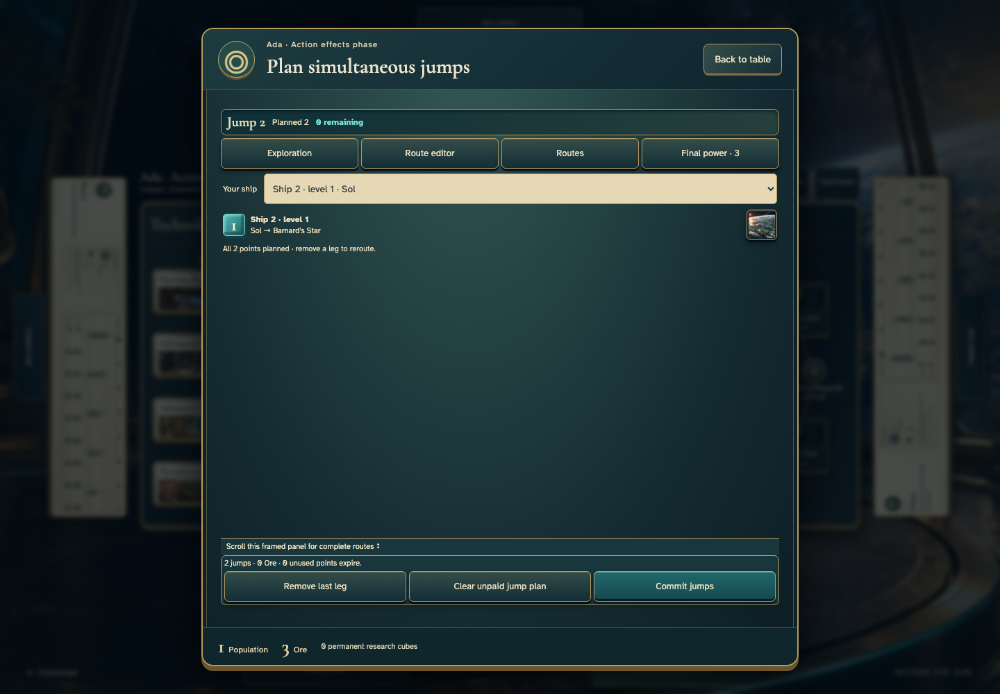](../../screenshots/choose-two-system-bonus-rewards-at-four-shared-cardinal-seats/032-split-second-endpoint-desktop-darwin.png) |

tabletop-4k · 3840 × 2160

- [x] Plan Barnard’s Star as an endpoint; nothing moves yet
- [x] Actual canonical effects and acknowledgement settle.
- [x] Public topology retains physical separation.
- [x] The viewport fits without page scrolling.

## 34. All outposts are placed; the owner chooses System bonus order

Viewpoint: **Ada · South · one shared controller**.

| desktop · 1440 × 1000 |
| --- |
| [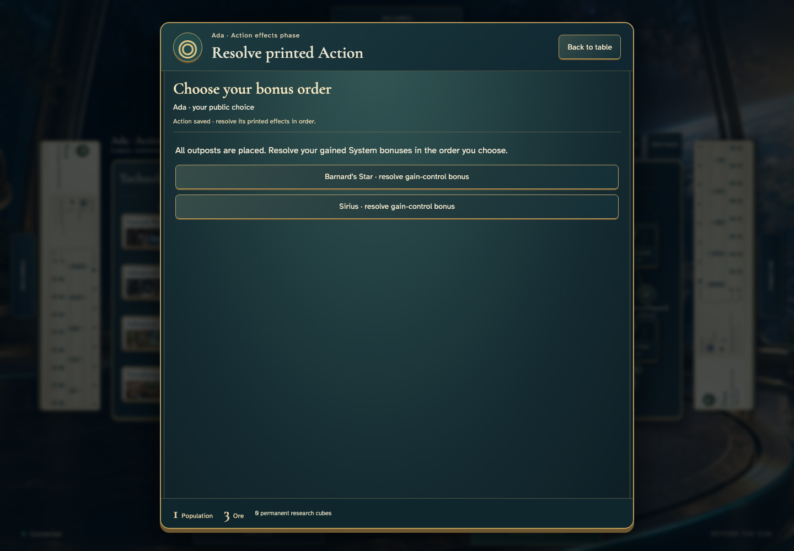](../../screenshots/choose-two-system-bonus-rewards-at-four-shared-cardinal-seats/033-owner-choice-desktop-darwin.png) |

tabletop-4k · 3840 × 2160

- [x] All outposts are placed; the owner chooses System bonus order
- [x] Actual canonical effects and acknowledgement settle.
- [x] Public topology retains physical separation.
- [x] The viewport fits without page scrolling.

## 35. Reload keeps the paid movement and pending responder-owned choice

Viewpoint: **Ada · South · one shared controller**.

| desktop · 1440 × 1000 |
| --- |
| [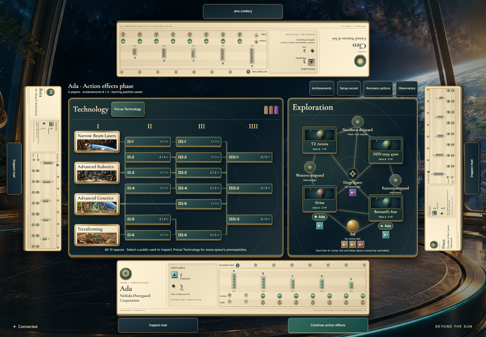](../../screenshots/choose-two-system-bonus-rewards-at-four-shared-cardinal-seats/034-choice-retained-board-desktop-darwin.png) |

tabletop-4k · 3840 × 2160

- [x] Reload keeps the paid movement and pending responder-owned choice
- [x] Actual canonical effects and acknowledgement settle.
- [x] Public topology retains physical separation.
- [x] The viewport fits without page scrolling.

## 36. The same owner resumes the same choices and unpaid rewards

Viewpoint: **Ada · South · one shared controller**.

| desktop · 1440 × 1000 |
| --- |
|  |

tabletop-4k · 3840 × 2160

- [x] The same owner resumes the same choices and unpaid rewards
- [x] Actual canonical effects and acknowledgement settle.
- [x] Public topology retains physical separation.
- [x] The viewport fits without page scrolling.

## 37. Keyboard focus reaches the intended owner response

Viewpoint: **Ada · South · one shared controller**.

| desktop · 1440 × 1000 |
| --- |
|  |

tabletop-4k · 3840 × 2160

[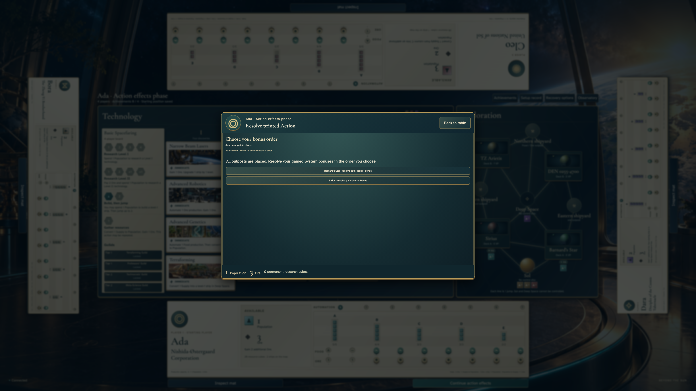](../../screenshots/choose-two-system-bonus-rewards-at-four-shared-cardinal-seats/036-choice-keyboard-tabletop-4k-darwin.png)

- [x] Keyboard focus reaches the intended owner response
- [x] Actual canonical effects and acknowledgement settle.
- [x] Public topology retains physical separation.
- [x] The viewport fits without page scrolling.

## 38. Resolve Barnard’s Star first then the remaining Sirius reward exactly once

Viewpoint: **Ada · South · one shared controller**.

| desktop · 1440 × 1000 |
| --- |
|  |

tabletop-4k · 3840 × 2160

[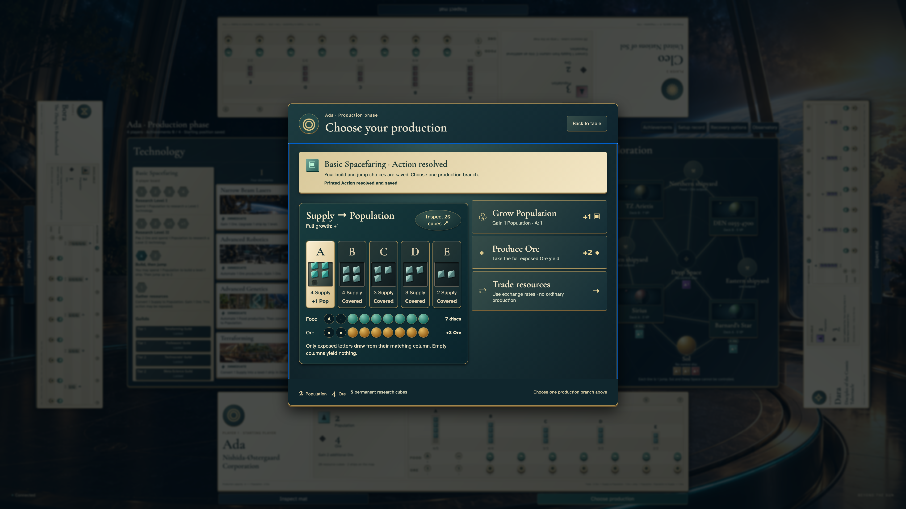](../../screenshots/choose-two-system-bonus-rewards-at-four-shared-cardinal-seats/037-choice-paid-tabletop-4k-darwin.png)

- [x] Resolve Barnard’s Star first then the remaining Sirius reward exactly once
- [x] Actual canonical effects and acknowledgement settle.
- [x] Public topology retains physical separation.
- [x] The viewport fits without page scrolling.

## 39. Reload retains Production after the resolved choice

Viewpoint: **Ada · South · one shared controller**.

| desktop · 1440 × 1000 |
| --- |
|  |

tabletop-4k · 3840 × 2160

- [x] Reload retains Production after the resolved choice
- [x] Actual canonical effects and acknowledgement settle.
- [x] Public topology retains physical separation.
- [x] The viewport fits without page scrolling.

## 40. Reopen the saved Production without replaying either reward

Viewpoint: **Ada · South · one shared controller**.

| desktop · 1440 × 1000 |
| --- |
| [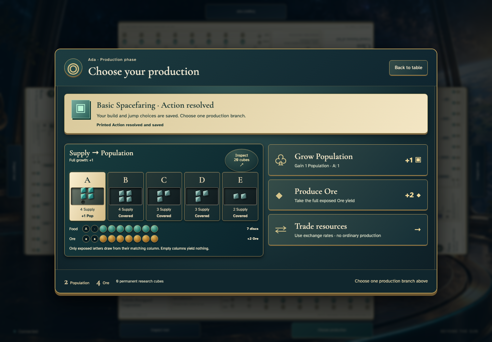](../../screenshots/choose-two-system-bonus-rewards-at-four-shared-cardinal-seats/039-paid-retained-desktop-darwin.png) |

tabletop-4k · 3840 × 2160

- [x] Reopen the saved Production without replaying either reward
- [x] Actual canonical effects and acknowledgement settle.
- [x] Public topology retains physical separation.
- [x] The viewport fits without page scrolling.

## 41. Close the pending Production to inspect the real disc

Viewpoint: **Ada · South · one shared controller**.

| desktop · 1440 × 1000 |
| --- |
|  |

tabletop-4k · 3840 × 2160

- [x] Close the pending Production to inspect the real disc
- [x] Actual canonical effects and acknowledgement settle.
- [x] Public topology retains physical separation.
- [x] The viewport fits without page scrolling.

## 42. Ada inspects the actual production discs

Viewpoint: **Ada · South · one shared controller**.

| desktop · 1440 × 1000 |
| --- |
| [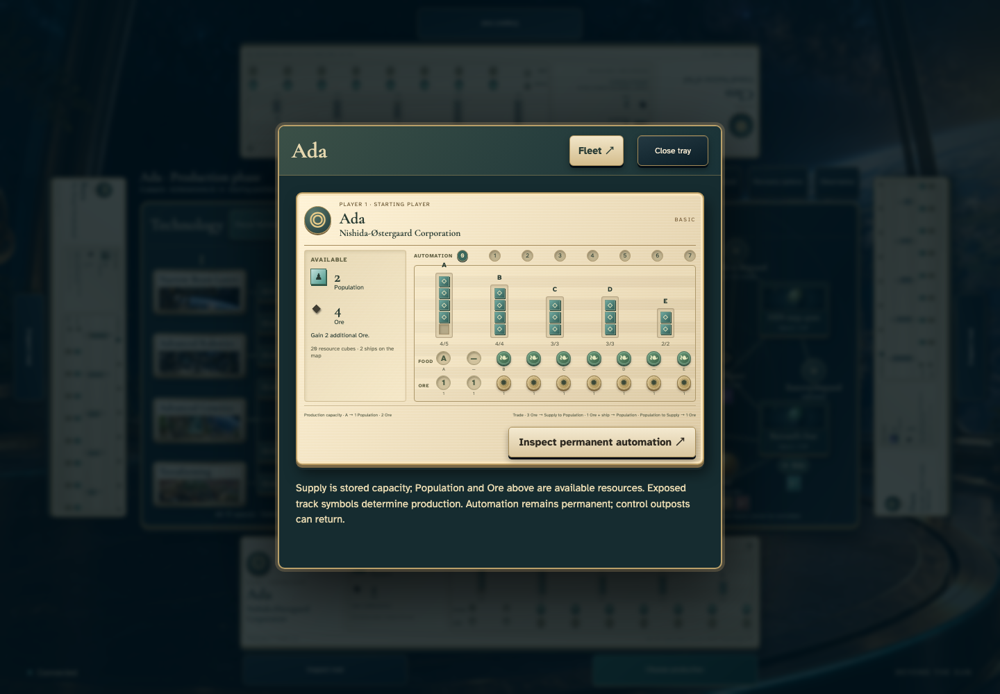](../../screenshots/choose-two-system-bonus-rewards-at-four-shared-cardinal-seats/041-selected-disc-mat-desktop-darwin.png) |

tabletop-4k · 3840 × 2160

[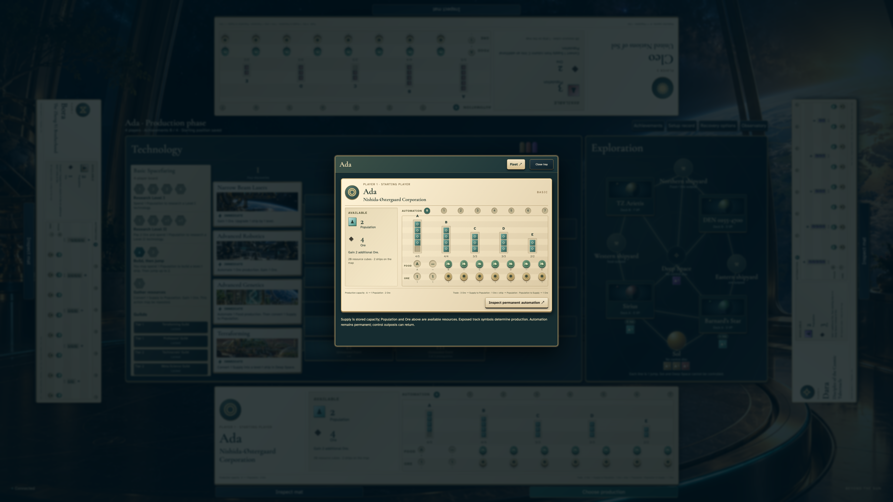](../../screenshots/choose-two-system-bonus-rewards-at-four-shared-cardinal-seats/041-selected-disc-mat-tabletop-4k-darwin.png)

- [x] Ada inspects the actual production discs
- [x] Actual canonical effects and acknowledgement settle.
- [x] Public topology retains physical separation.
- [x] The viewport fits without page scrolling.

## 43. Open the reusable public fleet inspection

Viewpoint: **Ada · South · one shared controller**.

| desktop · 1440 × 1000 |
| --- |
|  |

tabletop-4k · 3840 × 2160

- [x] Open the reusable public fleet inspection
- [x] Actual canonical effects and acknowledgement settle.
- [x] Public topology retains physical separation.
- [x] The viewport fits without page scrolling.

## 44. Read saved disc ownership separately from current summed fleet power

Viewpoint: **Ada · South · one shared controller**.

| desktop · 1440 × 1000 |
| --- |
| [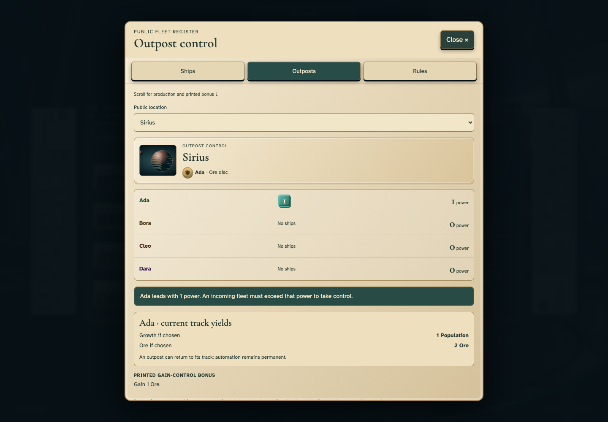](../../screenshots/choose-two-system-bonus-rewards-at-four-shared-cardinal-seats/043-selected-disc-outposts-desktop-darwin.png) |

tabletop-4k · 3840 × 2160

- [x] Read saved disc ownership separately from current summed fleet power
- [x] Actual canonical effects and acknowledgement settle.
- [x] Public topology retains physical separation.
- [x] The viewport fits without page scrolling.

## 45. Inspect every faction’s actual level sum and the incumbent’s disc

Viewpoint: **Ada · South · one shared controller**.

| desktop · 1440 × 1000 |
| --- |
| [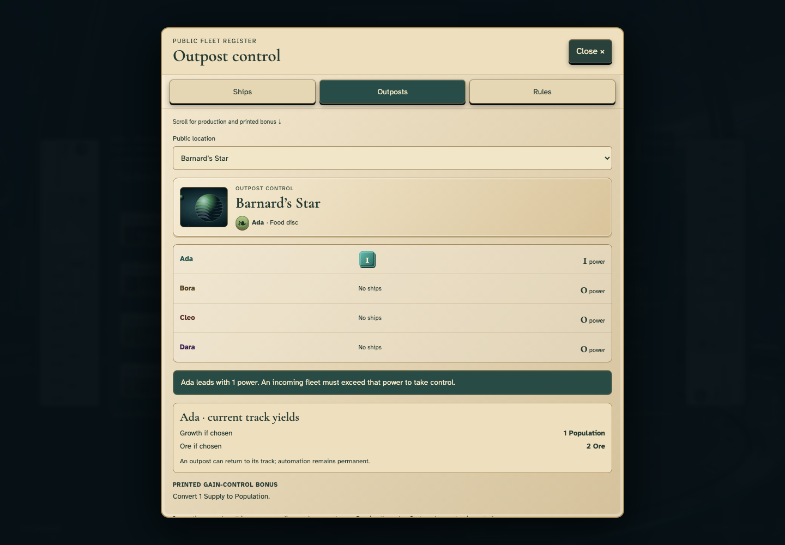](../../screenshots/choose-two-system-bonus-rewards-at-four-shared-cardinal-seats/044-selected-disc-power-desktop-darwin.png) |

tabletop-4k · 3840 × 2160

[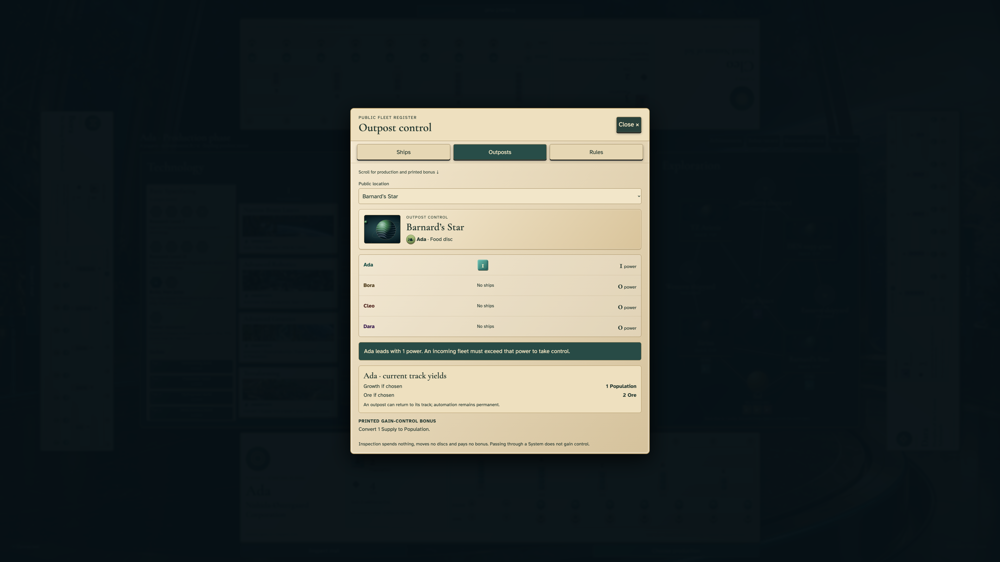](../../screenshots/choose-two-system-bonus-rewards-at-four-shared-cardinal-seats/044-selected-disc-power-tabletop-4k-darwin.png)

- [x] Inspect every faction’s actual level sum and the incumbent’s disc
- [x] Actual canonical effects and acknowledgement settle.
- [x] Public topology retains physical separation.
- [x] The viewport fits without page scrolling.

## 46. Keyboard scroll reaches production, printed bonus and the inspection boundary

Viewpoint: **Ada · South · one shared controller**.

| desktop · 1440 × 1000 |
| --- |
| [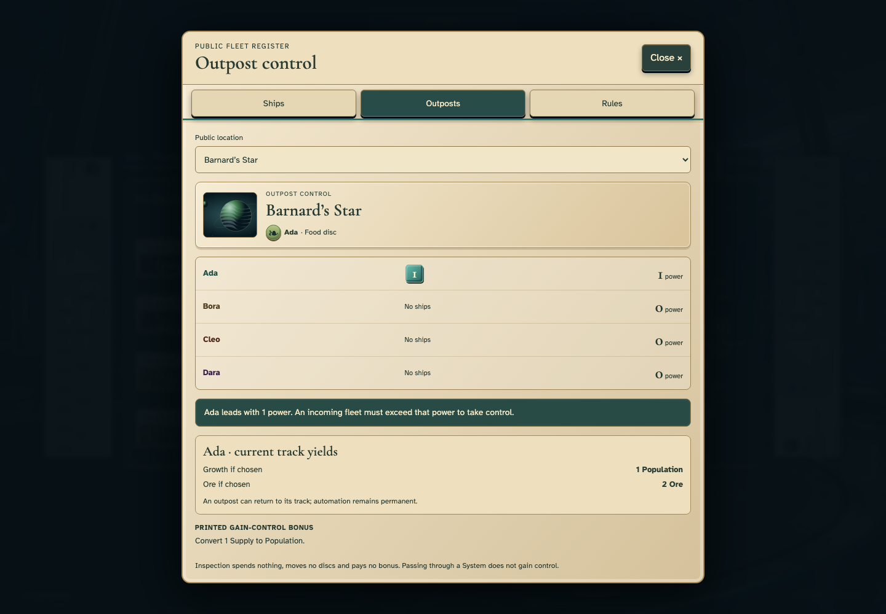](../../screenshots/choose-two-system-bonus-rewards-at-four-shared-cardinal-seats/045-selected-disc-scroll-desktop-darwin.png) |

tabletop-4k · 3840 × 2160

- [x] Keyboard scroll reaches production, printed bonus and the inspection boundary
- [x] Actual canonical effects and acknowledgement settle.
- [x] Public topology retains physical separation.
- [x] The viewport fits without page scrolling.

## 47. Open the complete reusable fleet rules through semantic navigation

Viewpoint: **Ada · South · one shared controller**.

| desktop · 1440 × 1000 |
| --- |
| [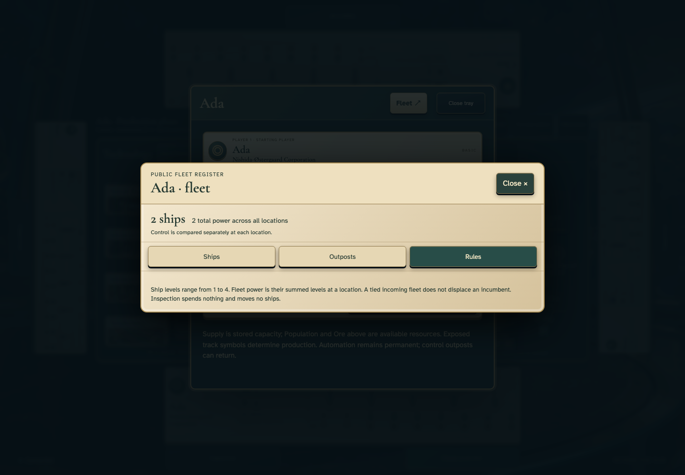](../../screenshots/choose-two-system-bonus-rewards-at-four-shared-cardinal-seats/046-selected-disc-fleet-rules-desktop-darwin.png) |

tabletop-4k · 3840 × 2160

[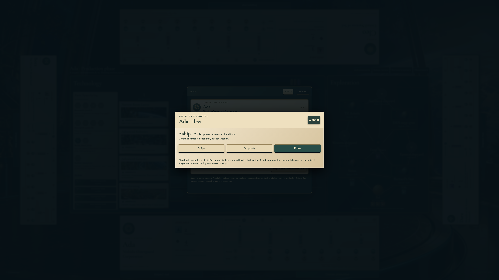](../../screenshots/choose-two-system-bonus-rewards-at-four-shared-cardinal-seats/046-selected-disc-fleet-rules-tabletop-4k-darwin.png)

- [x] Open the complete reusable fleet rules through semantic navigation
- [x] Actual canonical effects and acknowledgement settle.
- [x] Public topology retains physical separation.
- [x] The viewport fits without page scrolling.

## 48. Return to the real ship register without taking a turn

Viewpoint: **Ada · South · one shared controller**.

| desktop · 1440 × 1000 |
| --- |
| [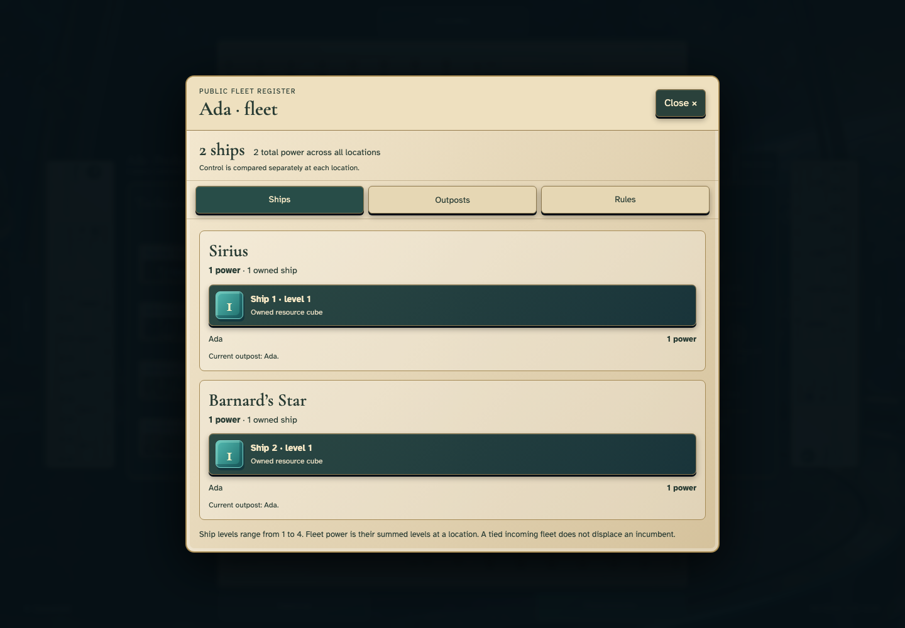](../../screenshots/choose-two-system-bonus-rewards-at-four-shared-cardinal-seats/047-selected-disc-fleet-ships-desktop-darwin.png) |

tabletop-4k · 3840 × 2160

[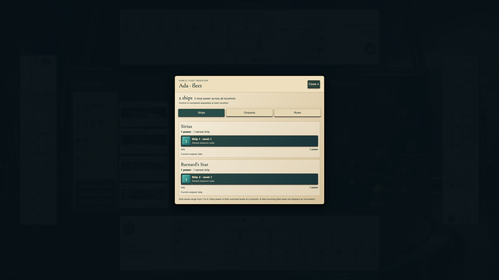](../../screenshots/choose-two-system-bonus-rewards-at-four-shared-cardinal-seats/047-selected-disc-fleet-ships-tabletop-4k-darwin.png)

- [x] Return to the real ship register without taking a turn
- [x] Actual canonical effects and acknowledgement settle.
- [x] Public topology retains physical separation.
- [x] The viewport fits without page scrolling.

## 49. Escape restores the exact fleet opener without taking a turn

Viewpoint: **Ada · South · one shared controller**.

| desktop · 1440 × 1000 |
| --- |
| [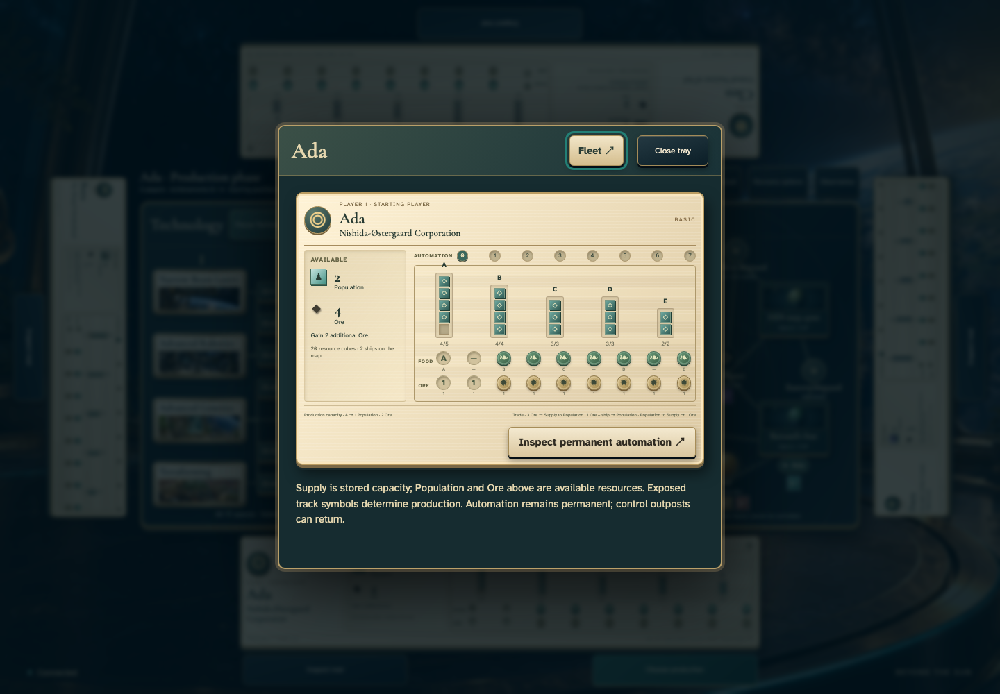](../../screenshots/choose-two-system-bonus-rewards-at-four-shared-cardinal-seats/048-selected-disc-focus-return-desktop-darwin.png) |

tabletop-4k · 3840 × 2160

- [x] Escape restores the exact fleet opener without taking a turn
- [x] Actual canonical effects and acknowledgement settle.
- [x] Public topology retains physical separation.
- [x] The viewport fits without page scrolling.

## 50. Close the mat and restore its own opener

Viewpoint: **Ada · South · one shared controller**.

| desktop · 1440 × 1000 |
| --- |
| [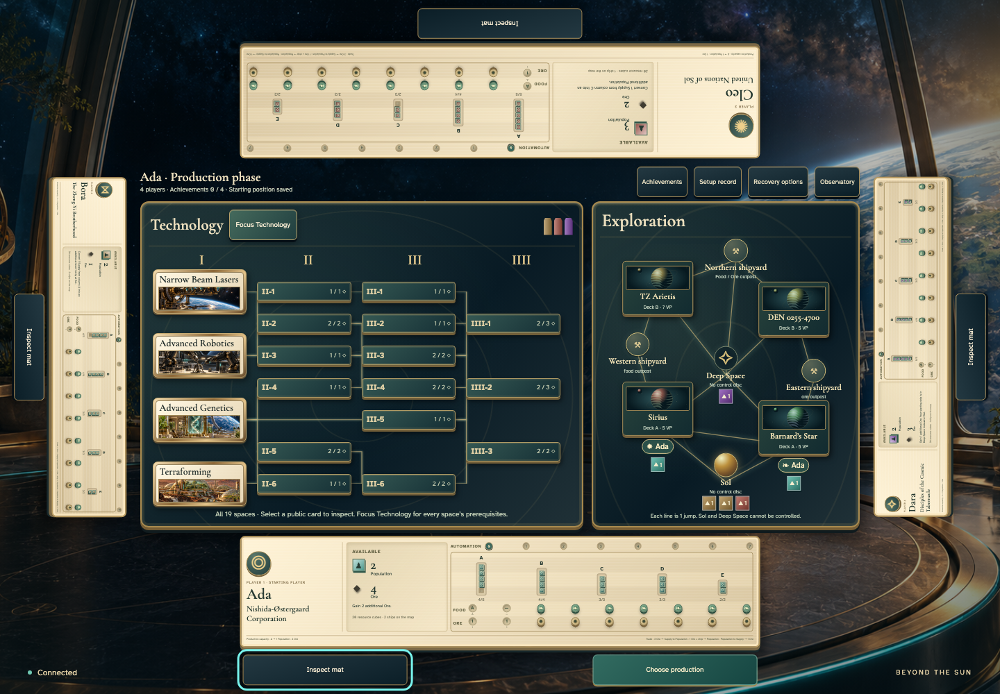](../../screenshots/choose-two-system-bonus-rewards-at-four-shared-cardinal-seats/049-selected-disc-mat-return-desktop-darwin.png) |

tabletop-4k · 3840 × 2160

- [x] Close the mat and restore its own opener
- [x] Actual canonical effects and acknowledgement settle.
- [x] Public topology retains physical separation.
- [x] The viewport fits without page scrolling.

## 51. Inspection returns to the same saved Production

Viewpoint: **Ada · South · one shared controller**.

| desktop · 1440 × 1000 |
| --- |
|  |

tabletop-4k · 3840 × 2160

- [x] Inspection returns to the same saved Production
- [x] Actual canonical effects and acknowledgement settle.
- [x] Public topology retains physical separation.
- [x] The viewport fits without page scrolling.

## 52. Ada chooses ordinary Ore production and hands off

Viewpoint: **Ada · South · one shared controller**.

| desktop · 1440 × 1000 |
| --- |
| [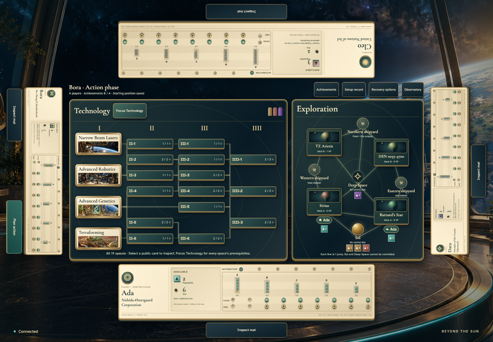](../../screenshots/choose-two-system-bonus-rewards-at-four-shared-cardinal-seats/051-choice-final-handoff-desktop-darwin.png) |

tabletop-4k · 3840 × 2160

[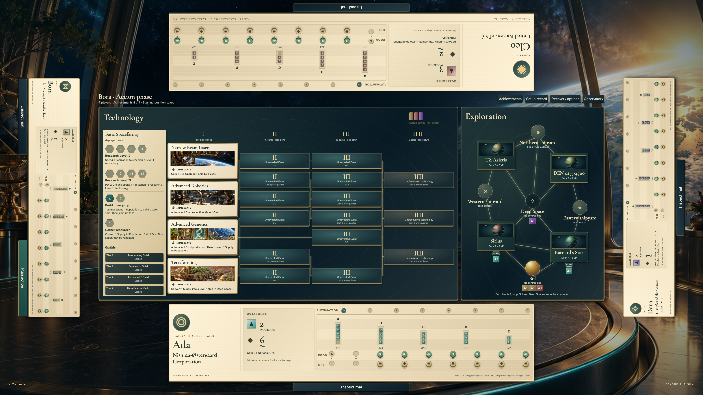](../../screenshots/choose-two-system-bonus-rewards-at-four-shared-cardinal-seats/051-choice-final-handoff-tabletop-4k-darwin.png)

- [x] Ada chooses ordinary Ore production and hands off
- [x] Actual canonical effects and acknowledgement settle.
- [x] Public topology retains physical separation.
- [x] The viewport fits without page scrolling.
